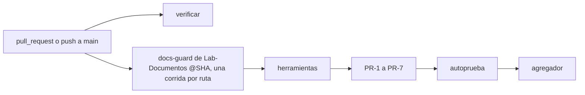

# Integración continua de Lab-Documentos.Documentacion

## Índice

1. [Definiciones](#definiciones)
2. [Qué corre en cada PR](#qué-corre-en-cada-pr)
3. [Seguridad](#seguridad)
4. [Cómo reproducirlo en local](#cómo-reproducirlo-en-local)
5. [Cambiar la versión de docs-guard](#cambiar-la-versión-de-docs-guard)

## Definiciones

- **Verificar**: el workflow [`workflows/verificar.yml`](workflows/verificar.yml) de este repositorio.
- **docs-guard**: workflow reutilizable (`workflow_call`) de `hdcm-dev/Lab-Documentos`; corre los grupos PR-1 a PR-7
  (enlaces, esquema, anti-inyección, estructura y mermaid, trazas, contrato, fijadas) y su autoprueba sobre una
  carpeta de Markdown.
- **Runner propio**: la máquina autohospedada con las etiquetas `self-hosted` e `i7infra-dev`.
- **Fijado por SHA**: la referencia a otro workflow o action se hace por commit completo, no por rama ni etiqueta.

## Qué corre en cada PR

Disparadores: `pull_request`, `push` a `main` (la corrida sobre el commit de merge queda en `main`) y
`workflow_dispatch`.

| Job | Qué verifica | Dónde corre |
| --- | --- | --- |
| `verificar` | Lo que el PR (o el merge, en `push`) agrega: sin claves privadas ni binarios pesados | Runner propio |
| `docs-guard (.github)` | PR-1 a PR-7 y autoprueba sobre esta carpeta | Runner propio (lo declara el workflow llamado) |
| `docs-guard (expediente)` | PR-1 a PR-7 y autoprueba sobre `PROMPTs/DEVs/Enchacement/01-Replanteo-Y-Analisis/OUTPUTs/Expedientes/0002-Replanteo-Metodologia-DocAsCode` | Runner propio (lo declara el workflow llamado) |



El workflow llamado declara su propio `runs-on`; el registro del job muestra el nombre del runner que lo tomó.

## Seguridad

- `permissions: contents: read` en todo el workflow; ningún secreto.
- Sin `pull_request_target`.
- Un PR desde un fork no corre en el runner propio: guarda
  `if: github.event.pull_request.head.repo.full_name == github.repository`.
- El workflow llamado y las actions se fijan por SHA.

## Cómo reproducirlo en local

Ejemplo, con un clon de Lab-Documentos en el commit fijado:

```bash
git -C ../Lab-Documentos checkout d65d52be2e236af4e858e2492c796845c21831d3
bash ../Lab-Documentos/scripts/ci-local.sh todo .github
bash ../Lab-Documentos/scripts/ci-local.sh todo PROMPTs/DEVs/Enchacement/01-Replanteo-Y-Analisis/OUTPUTs/Expedientes/0002-Replanteo-Metodologia-DocAsCode
```

## Cambiar la versión de docs-guard

El SHA aparece dos veces en `verificar.yml` (en `uses:` y en `herramientas-ref`) y deben coincidir: así el workflow
y sus scripts son del mismo commit.
