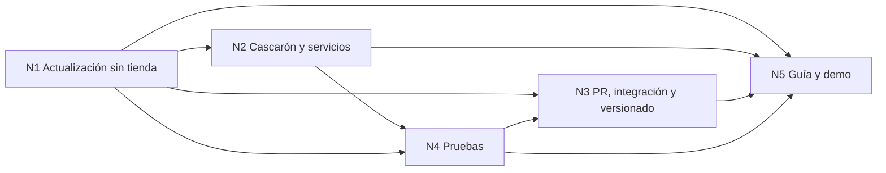

# Bitácora 02 — Cohesión global entre núcleos

> Relaciones, dependencias y vínculos entre los núcleos de `01-Descomposicion-En-Nucleos.md`. Se actualiza en la
> fase de integración con las decisiones de la mesa.

## Índice

1. [Grafo de dependencias](#1-grafo-de-dependencias)
2. [Contratos entre núcleos](#2-contratos-entre-núcleos)
3. [Contradicciones abiertas](#3-contradicciones-abiertas)

## 1. Grafo de dependencias

## 2. Contratos entre núcleos

| De → a | Qué pasa por el borde |
| --- | --- |
| N1 → N2 | La opción de contenido (D-01) define cómo llama una página al cascarón: puente JS↔C# versionado (`bridgeVersion`) |
| N1 → N3 | Las líneas de versión: cascarón (tienda), contenido (servidor), puente (contrato); `minShellVersion` las ata |
| N2 → N4 | El contrato del puente es lo que una prueba de contrato fija |
| N4 → N3 | Las suites que la compuerta del PR exige en verde |
| N1–N4 → N5 | La guía enseña lo decidido; la demo lo ejecuta |

## 3. Contradicciones abiertas

Ninguna registrada todavía.
