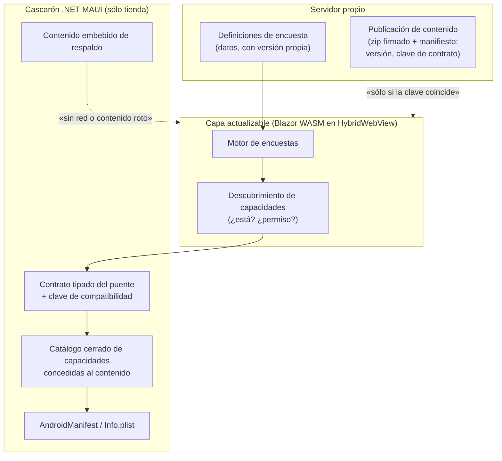
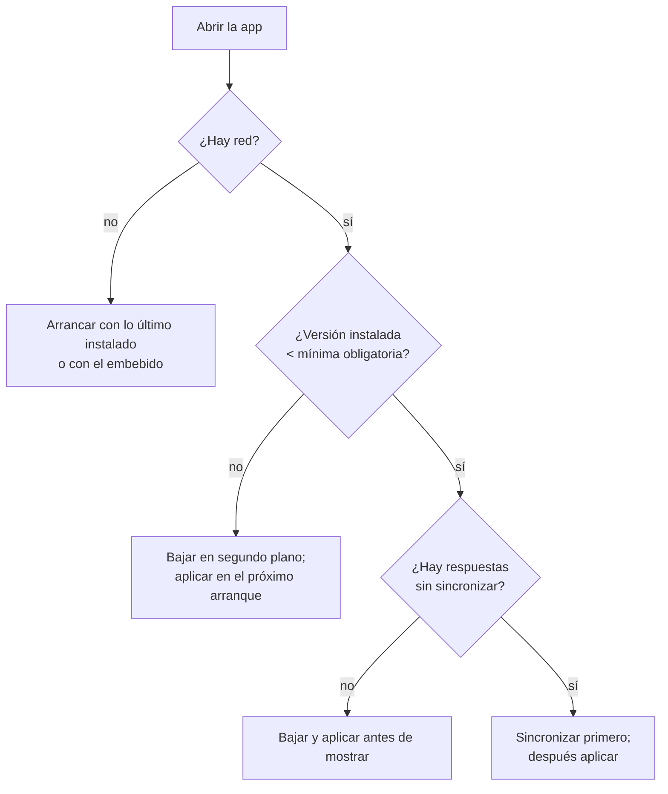

| Campo | Valor |
| --- | --- |
| Tipo | síntesis de investigación (I0) |
| Fecha | 2026-10-25 |
| Autor | Sintetizador de la investigación (expediente 0001) |
| Expediente | 0001-Framework-Concept-Maui-Autoactualizable (preguntas P1–P13, folios 003 a 006) |
| Pedido | PO, 2026-10-25: «podes investigar que se esta usando en la industria en este sentido, ver que opiniones hay de desarrolladores para este tipo de aplicaciones»; y «por ahi como marco de trabajo podes sacar opiniones en otros frameworks para ver sus arquitecturas» |
| Insumos | Los siete dossiers verificados de esta carpeta: I1 (relevamiento en campo), I2 (plataformas OTA), I3 (interfaz definida desde el servidor), I4 (ecosistema .NET), I5 (opiniones), I6 (empresariales y al iniciar sesión), I7 (arquitecturas de otros frameworks) |

# I0 — Síntesis: qué usa la industria y qué opinan los desarrolladores

## Índice

- [Resumen ejecutivo para el PO](#resumen-ejecutivo-para-el-po)
- [0. Cómo leer esta síntesis](#0-cómo-leer-esta-síntesis)
- [1. Mapa de lo que se usa](#1-mapa-de-lo-que-se-usa)
  - [1.1 Tabla consolidada por patrón](#11-tabla-consolidada-por-patrón)
  - [1.2 Arquitecturas de referencia de otros frameworks](#12-arquitecturas-de-referencia-de-otros-frameworks)
  - [1.3 El ecosistema .NET: piezas, no producto](#13-el-ecosistema-net-piezas-no-producto)
- [2. Momento de actualización](#2-momento-de-actualización)
- [3. Datos tomados con una versión vieja (P13)](#3-datos-tomados-con-una-versión-vieja-p13)
- [4. Frontera del manifiesto y capacidades (P12)](#4-frontera-del-manifiesto-y-capacidades-p12)
- [5. Tiendas: evidencia y opinión](#5-tiendas-evidencia-y-opinión)
- [6. Opiniones de desarrolladores](#6-opiniones-de-desarrolladores)
- [7. Implicancias para P1–P13](#7-implicancias-para-p1p13)
- [8. Fuentes consolidadas](#8-fuentes-consolidadas)

---

## Resumen ejecutivo para el PO

**Lo que pediste existe en la industria y tiene nombre propio en dos familias distintas.** Conviene no mezclarlas:

1. **Apps de encuestas en campo y apps empresariales de campo** (ODK, KoboToolbox, SurveyCTO, CommCare, Survey123;
   Power Apps, SAP MDK, ServiceNow, ServiceMax, Salesforce Field Service). Instalan desde la tienda un **motor
   genérico** y bajan del servidor **definiciones como datos** (formularios, metadatos, pantallas declaradas). Trabajan
   completas sin red y sincronizan después. Es exactamente tu escenario de la encuesta [5][6][20][21][122][129]. **No
   descargan código de pantallas**; SAP MDK es la excepción parcial: baja reglas JS dentro del *bundle* [129].
2. **Plataformas de actualización «por aire» (OTA) de código interpretado** (Expo, Capgo, Capawesome, Shorebird; antes
   CodePush). Actualizan la capa JS/HTML/Dart; lo nativo y los permisos sólo cambian por la tienda [33][47][48][50].
   Tu demo del g42 (Blazor WASM dentro de HybridWebView) pertenece técnicamente a esta familia.

**Siete conclusiones que la evidencia sostiene:**

- **«Actualizarse al iniciar sesión» es práctica documentada**, no sólo intuición: CommCare chequea tras el login y
  **aplica en el login siguiente** [21]; D365 Field Service arranca la primera sincronización al loguear [128];
  Salesforce baja la agenda «at login» [134]; Oracle y ServiceMax chequean la versión mínima del cascarón al ingresar
  [140][142]; Shorebird sugiere la pantalla de login como «launch gate» para forzar [51].
- **«Forzar» sólo funciona con red.** CommCare, la única plataforma de encuestas revisada que bloquea, lo hace al
  reloguear y con conectividad [20]. ServiceMax bloquea el **ingreso nuevo** pero deja seguir la sesión en curso [140].
  El cascarón sólo se fuerza en Android (In-App Updates inmediato) [4]; en iOS, sólo bloquear y mandar a la tienda [108].
- **Las encuestas tomadas con una versión vieja (P13) tienen solución probada sólo en la familia de encuestas**: cada
  respuesta lleva la versión de la definición [7]; el servidor acepta las versiones publicadas y no borradas [10]; los
  borradores siguen con su versión (ODK, Kobo) o se migran a pedido (SurveyCTO, Enketo) [11][16][17]. **Las
  plataformas OTA y los frameworks no lo resuelven** [37]: es responsabilidad de la app.
- **El manifiesto es frontera dura en todas las fuentes leídas**: el permiso del sistema sólo cambia por binario
  [39][67][80][81]. Lo que varía es cómo el contenido **descubre** lo que hay (`isPluginAvailable`, `get` → null,
  Shiny `501`, Adaptive Cards `requires`/`fallback`) [66][69][90][106].
- **En .NET no hay mecanismo oficial**; hay piezas (HybridWebView + `WebResourceRequested` en .NET 10) [98] y **un único
  producto de tercero**, Shiny.AppDeviceBridge, en beta desde septiembre de 2026, que implementa justo el patrón del
  borrador (zip base, releases firmados, versión mínima, versión mínima de cascarón) [105][106][107].
- **Depender de un servicio OTA ajeno es un riesgo real**: CodePush se retiró el 2025-03-31 [42]; Ionic dejó de vender
  Appflow y Portals el 2025-02-11 [44]. Varios desarrolladores reaccionaron armando su propio servidor [59].
- **Riesgo de tienda propio de nuestro stack: NO VERIFICADO.** Ninguna política de Apple ni de Google nombra
  WebAssembly [1][2][3]; no se encontró caso documentado de rechazo ni de aprobación de Blazor WASM descargado [64][98].

**Lo que la síntesis propone (criterio del sintetizador, a decidir en la mesa):** la opción **C** de P1 —el motor de
encuestas en el contenido Blazor actualizable y **las encuestas como datos versionados**—, con un contrato de puente
versionado por una clave exacta, un catálogo cerrado de capacidades en el cascarón y la regla «no forzar mientras haya
respuestas sin sincronizar». Detalle por pregunta en §7.

---

## 0. Cómo leer esta síntesis

- **No agrega fuentes nuevas.** Todo sale de los siete dossiers, que pasaron cada uno por un verificador adversarial el
  2026-10-25. Los números `[n]` remiten a §8, donde cada fuente dice de qué dossier viene (p. ej. «I1[29]»), su autor u
  organización, su fecha y su clase.
- **HECHO** = documentación oficial, anuncio del proveedor, código o registro. **OPINIÓN** = foro, Hacker News (HN),
  issue, blog, charla: con autor, fecha y cita breve; señal cualitativa, **no estadística**. **NO VERIFICADO** = el
  dossier no pudo leer la fuente primaria. **[criterio del sintetizador]** = inferencia de esta síntesis.
- Lo que un proveedor dice de sí mismo (Capgo, Capawesome, Shorebird, Shiny, Patch, Nativeblocks) es HECHO en cuanto a
  lo que declara hacer y **material interesado** en lo demás (cumplimiento de tiendas, comparaciones).
- **Límites heredados.** Reddit no se pudo leer en ningún dossier (I3, I4, I5, I6 lo declaran; I1 y I2 no obtuvieron
  hilos). Stack Overflow se leyó en I4 por API, pero no en I5. Varias páginas dieron 403: Airbnb, Lyft y DoorDash (I3);
  `developer.salesforce.com` y `community.sap.com` (I6).

**Discrepancias entre dossiers, resueltas aquí:**

| Tema | Qué dice cada uno | Cómo se lee |
| --- | --- | --- |
| «Actualizar al iniciar sesión» | I5: «No apareció ningún producto con "actualizar al iniciar sesión" como modo». I1 e I6: CommCare, Survey123, D365 FS, Salesforce, Oracle, ServiceMax lo documentan [21][25][128][134][140][142] | I5 relevó productos OTA y opiniones; I1 e I6, plataformas de campo y empresariales. **Como práctica de plataformas de campo y empresariales está documentada (HECHO)**; como modo de primera clase de las plataformas OTA, no (Shorebird sólo lo sugiere [51]) |
| MAUI y live updates | Un proveedor interesado (Capgo) clasifica «.NET MAUI / Xamarin» como «No» / «Remote config only» [79] | I7 lo marca: esa tabla no considera contenido web descargado dentro de un WebView del cascarón MAUI, que la misma fuente admite para otros stacks. Lectura del investigador I7, no de la fuente |
| Opiniones repetidas | eseidel, pritambarhate, lxgr, dr_kiszonka, LoganDark, pjmlp, Mason Roy y LN aparecen en dos o tres dossiers | Las filas de opinión no se suman entre dossiers como si fueran opiniones distintas (§6) |

---

## 1. Mapa de lo que se usa

### 1.1 Tabla consolidada por patrón

| Patrón | Qué se actualiza sin tienda | Cómo trabaja sin red | Momento y forzado | Ejemplos (estado al 2026-10-25) | Fuentes |
| --- | --- | --- | --- | --- | --- |
| **Contenido web / código interpretado OTA** | Bundle JS/HTML/CSS y assets (Expo, Capacitor) o código Dart (Shorebird). Nunca código nativo ni manifiesto | Arranca con lo último descargado o con el bundle embebido en el binario; Expo espera como mucho `fallbackToCacheTimeout` (0 por defecto) | Por defecto revisa al abrir sin bloquear y aplica en el **próximo arranque** (Expo, Shorebird, Capawesome); Capgo aplica al pasar a segundo plano; forzado: CodePush `mandatory`+`IMMEDIATE`, Capgo `always`/`onLaunch`; Expo «no first-class support» | Expo EAS Update (activo, protocolo abierto para servidor propio); Capgo (MPL-2.0, autoalojable); Capawesome; Shorebird (activo); **CodePush retirado 2025-03-31**; **Appflow sin ventas nuevas, acceso hasta 2027-12-31** | [33][34][35][36][42][43][44][45][47][48][50][51] |
| **Definición como datos / SDUI** | Composición de pantallas (qué componentes, en qué orden, con qué datos) sobre un catálogo fijo de componentes del cliente; un componente nuevo exige versión nueva del cliente | En las publicaciones de las grandes (Airbnb, Lyft, DoorDash, Shopify, Reddit, Duolingo, Careem), casi ninguna documenta uso sin red; Netflix: «harder to support offline apps»; Duolingo cachea la UI | No hay «momento»: cada respuesta trae la UI; clientes viejos: *layout* por defecto (Shopify), respuesta parcial (Duolingo), `requires`+`fallback` (Adaptive Cards) | Airbnb Ghost Platform, Shopify Shop App, Duolingo, Netflix; Spotify HubFramework **deprecado**; Thoughtworks Radar: Trial (abr-2026) para «highly dynamic areas» | [83][84][86][87][88][89][90] |
| **Formulario versionado tipo ODK** | Definición del formulario (XLSForm → XForm, o «aplicación» CommCare) y sus adjuntos; cada publicación cambia `version` | Completo: formulario y respuestas en el teléfono; cola de salida que envía al volver la red | Manual, periódico, «Exactly match server» (ODK); **tras el login, aplicado en el login siguiente** (CommCare); al reabrir o reloguear (Survey123); forzado sólo CommCare *Forced* | ODK Collect v2026.3.5 y Central v2026.3.1; KoboCollect; SurveyCTO; CommCare 2.65.0; Survey123 | [5][6][16][17][20][21][25] |
| **Metadatos empresariales al iniciar sesión** | Definición de la app y perfil de datos (Power Apps, D365), *bundle* de metadatos con reglas JS (SAP MDK), metadatos y propiedades (ServiceNow), configuración (ServiceMax) | Base local transaccional, sincronización delta periódica, cola de errores; riesgo de perder pendientes al vencer la caché (ServiceNow) | Primera sincronización **al loguear** (D365 FS); MDK chequea al lanzar tras el código de acceso, al reanudar y cada 20–25 min, con `OnWillUpdate` para postergar; Power Apps sólo avisa; cascarón: versión mínima **al iniciar sesión** (Oracle, ServiceMax) | Power Apps canvas y *wrap*; D365 Field Service; SAP MDK; Salesforce FS; ServiceNow; ServiceMax Go; Oracle FS | [122][124][127][128][129][138][140][141][142] |
| **PWA / service worker** | Todo el contenido web cacheado (HTML, JS, WASM) | Precaché y estrategias de caché | El SW nuevo queda en `waiting` hasta cerrar todas las pestañas; `skipWaiting()` lo activa ya, con riesgos documentados; pauta: avisar y recargar con consentimiento | Workbox, Angular SW; Enketo (web forms de Kobo) | [143][144][145][146] |

**Lectura [criterio del sintetizador].** Entre las fuentes reunidas, **el único patrón documentado que junta
«definición por datos + sin red + sincronización + versión vieja» es el del formulario versionado** (I3 llega a la misma
conclusión para SDUI). El patrón OTA resuelve el canal del código, no los datos; el SDUI de las grandes resuelve la
composición en línea, no el trabajo sin red.

### 1.2 Arquitecturas de referencia de otros frameworks

Fuente: I7. Ocho frameworks separan, en distinto grado, una **capa nativa** (sólo tienda) de una **capa actualizable**.

| Framework | Cómo separa las capas | Cómo versiona el contrato | Qué pasa si falta un módulo | Cómo declara capacidades | Fuentes |
| --- | --- | --- | --- | --- | --- |
| React Native + Expo | JS ↔ módulos nativos por JSI; cada módulo con especificación tipada y Codegen | `runtimeVersion` exacta; política `fingerprint` = hash de dependencias, código nativo y configuración | `get` devuelve `null`; `getEnforcing` lanza excepción; rollback si falla temprano | App config y config plugins generan el manifiesto; «Changes to the Info.plist cannot be updated over-the-air» | [33][37][38][39][65][66] |
| Capacitor | SPA ↔ plugins Kotlin/Swift por interfaz TypeScript | Sin clave en runtime; Capgo compara paquetes nativos al publicar y falla el CI con `--fail-on-incompatible` | `isPluginAvailable`; errores `unimplemented` / `unavailable` | `@CapacitorPlugin(permissions=…)` + manifiesto; `checkPermissions`/`requestPermissions` desde JS | [46][67][68][69][71] |
| Ionic Portals | Micro-frontends web dentro de una app nativa, sobre Capacitor | Igual que Capacitor; Live Updates **por portal** | Igual | Lista de lo que cada equipo web puede tocar | [72][73] |
| Cordova | `cordova.exec(servicio, acción)` por cadenas, sin tipos | `engines` sólo en build | Sin mecanismo oficial (NO VERIFICADO) | `plugin.xml` + lista de dominios permitidos | [74][75] |
| Flutter + Shorebird | No hay contrato de módulos: **la release es el contrato** | Release + número de patch | Una patch con paquete nativo nuevo hace que la app «will crash or fail» | Manifiesto; sólo tienda | [50][53] |
| NativeScript | Toda la API de la plataforma expuesta al JS | Ninguna oficial | NO VERIFICADO | Manifiesto (NO VERIFICADO en lo leído) | [76][77] |
| KMP / Compose MP | Todo nativo | — | — | Manifiesto | [78] |
| Tauri v2 móvil | Frontend web → comandos Rust → plugins Kotlin/Swift | NO VERIFICADO | Comando no concedido → denegado | **Capabilities** declarativas por ventana, plataforma y URL remota; por defecto la API sólo es accesible al código empaquetado | [80][81][82] |

Lo que dejan, en tres líneas (HECHO de cada fuente; la agrupación es de I7):

- **Separación.** En los cuatro frameworks con documentación de permisos leída (Expo, Capacitor, Cordova, Tauri), el
  permiso del sistema vive en el manifiesto del binario y el contenido sólo consulta y pide en ejecución lo ya declarado
  [39][67][74][81].
- **Versionado del contrato.** Tres familias: clave explícita y exacta calculable por hash (Expo) [33][38]; atadura a
  la release (Shorebird) [50]; comparación de dependencias nativas al publicar (Capgo) [46]. Cordova y NativeScript no
  tienen mecanismo de runtime oficial [74][77].
- **Capacidades.** Dos frameworks suman una capa de autorización propia por encima del manifiesto: Tauri
  (capabilities) [80] e Ionic Portals (qué puede tocar cada web) [72].

**Patrón que conviene copiar** (propuesta de I7, [criterio propio de I7], que esta síntesis suscribe con un agregado):

1. **Contrato tipado del puente**, como TurboModules o la interfaz TS de Capacitor [66][68].
2. **Clave de compatibilidad exacta derivada del código**, como `runtimeVersion`/`fingerprint`, con compuerta de CI que
   falla si cambió el contrato sin subir la clave, como `--fail-on-incompatible` [33][38][46]. I7 señala que la
   evidencia de Expo y Capgo favorece la coincidencia exacta o un piso calculado, no un rango escrito a mano.
3. **Descubrimiento y degradación**: preguntar qué hay y con qué estado de permiso antes de usarlo [66][67][69].
4. **Lista de capacidades concedidas al contenido**, como Tauri o Portals [72][80].
5. **Respaldo embebido y rollback temprano**, como Expo [34][37].
6. **Agregado de la síntesis [criterio del sintetizador]:** **definiciones como datos con su propia línea de versión**,
   como ODK (§3). Ningún framework de I7 lo trae; es lo que resuelve el escenario de la encuesta sin tocar el canal de
   código.

Lo que **no** conviene copiar (I7, criterio propio): exponer toda la API como NativeScript [76]; `server.url` de
Capacitor en producción, que su documentación desaconseja («This is not intended for use in production») [70]; y code
push de código compilado tipo Shorebird, que no aplica a WASM [53].

### 1.3 El ecosistema .NET: piezas, no producto

| Pieza | Qué hace | Estado | Fuentes |
| --- | --- | --- | --- |
| BlazorWebView (Blazor Hybrid) | Componentes compilados en el binario; «After the app is built, the .NET code Web View content sources can't change»; **no** usa WebAssembly | Oficial; MAUI 10.0.120 | [100][101] |
| HybridWebView | Aloja HTML/JS desde `Resources/Raw/wwwroot`; desde .NET 10, `WebResourceRequested` permite responder con un stream propio (manejador que «MUST be synchronous»); en Android no hay esquemas propios, en iOS no se interceptan `http`/`https` | Oficial desde .NET 9 | [98][99] |
| Shiny.AppDeviceBridge (Allan Ritchie, MIT) | Zip de web estática servido por *loopback*; firma ECDSA P-256 con clave en el binario; `minimumVersion` (obligatoria antes de mostrar); `minimumHostVersion`; segundo plano y aplicación en el próximo arranque; sin red arranca con lo más nuevo entre embebido e instalado; **sin rollback** («Old releases are never reinstalled»); capacidades nativas como *bridges* con `501` si no existen | Beta anunciada 2026-09-18; NuGet 1.0.0 (2026-09-30) → 2.1.0 (2026-10-15); 1 581 descargas | [105][106][107] |
| Plugin.Maui.AppUpdate / Oscore InAppUpdates | Sólo el **cascarón**: Play In-App inmediato o flexible; en iOS, abrir la ficha | Terceros, 2025–2026 | [108][109] |
| CommunityToolkit.Datasync | Datos: almacenamiento local + sincronización con ASP.NET Core | Client 10.1.2 | [110] |
| PR `dotnet/maui#39289` | Propuesta «web-first» para .NET 11; **no es OTA**; certificación de actualización pendiente | Borrador | [115] |

Contexto de plataforma (HECHO): MAUI 10 termina soporte el **2027-05-11** aunque .NET 10 sea LTS [104]; .NET 11 GA
«expected in November 2026» [121]. La documentación de seguridad de Blazor Hybrid trata el contenido del WebView como
no confiable y recomienda TLS, CSP, SRI y validar el puente; incluso sugiere bajar contenido externo y empaquetarlo
[101]. **[criterio del sintetizador]** La postura oficial es lo opuesto a la actualización dinámica: el framework debe
justificar en la guía por qué se aparta y con qué controles (firma, puente validado).

---

## 2. Momento de actualización

| Familia | Al abrir | Al iniciar sesión | Segundo plano / periódico | Forzado | Fuentes |
| --- | --- | --- | --- | --- | --- |
| **OTA de código** | Por defecto: chequea al abrir **sin bloquear** y aplica en el próximo arranque (Expo, Shorebird, Capawesome); Capgo `onLaunch` aplica en frío | No como modo; Shorebird lo sugiere para forzar («as part of a login screen, or other launch gate») | Expo con `expo-background-task` (recargar en segundo plano: «experimental»); Capgo `atBackground` por defecto | CodePush `mandatory`+`IMMEDIATE`; Capgo `always`; Expo sin soporte de primera clase | [35][43][45][48][51] |
| **.NET (Shiny)** | Al abrir: obligatoria antes de mostrar si la instalada < `minimumVersion`; si no, segundo plano y próximo arranque | NO VERIFICADO (no lo mencionan) | `background.js` cuando el SO decide («at best every 15 minutes on Android») | `minimumVersion`; por defecto una descarga obligatoria fallida «is treated as offline» | [105][106] |
| **Encuestas en campo** | Survey123 al reabrir la app; Kobo web forms con banner al cargar | **CommCare: chequea tras el login y aplica en el siguiente**; Survey123 al cerrar y volver a iniciar sesión | ODK y KoboCollect con frecuencia configurable; CommCare diaria/semanal | Sólo CommCare *Forced*, «Under ideal conditions (proper internet connectivity…)» y al reloguear | [17][20][21][25] |
| **Empresariales** | Power Apps: sincronización inicial de datos al abrir; app nueva sólo al refrescar; SAP MDK al lanzar tras el código de acceso | D365 FS: primera sincronización al loguear; Salesforce: agenda «at login»; ServiceNow: propiedades «after authentication»; **cascarón: Oracle y ServiceMax al ingresar** | 7 de 8 productos de la tabla de I6 tienen ciclo periódico (conteo del verificador de I6) | SAP sin `OnWillUpdate` aplica sin preguntar; con él, el usuario posterga; ServiceMax bloquea el ingreso nuevo y deja la sesión en curso | [122][126][127][128][129][134][140][142] |
| **PWA** | El chequeo lo dispara la navegación; se activa en la próxima carga sin pestañas abiertas | — | Eventos funcionales chequean si pasaron 24 h | `skipWaiting()` + recarga, con riesgos documentados | [143][144][146] |

**Lecciones con respaldo:**

- **Bajar no es aplicar.** CommCare baja tras el login y aplica en el próximo [21]; Expo, Shorebird y Capawesome
  aplican en el próximo arranque [35][50][48]; la PWA espera que no haya pestañas abiertas [144]. La razón explícita
  en Shorebird: «the patch cannot be hot-swapped into memory dynamically on that launch» [50]. En CommCare el efecto es
  que la sesión en curso no cambia de definición a mitad del trabajo [21].
- **El login es el momento de lo pesado y del cascarón; el abrir/reanudar, el del contenido.** Es la lectura de I6
  sobre su tabla: primera sincronización y versión mínima del cascarón al loguear; contenido al abrir o reanudar
  [128][129][140][142].
- **La adopción la limita la frecuencia de arranques en frío.** OPINIÓN de un equipo en producción (Kikoff, 2026-05-07):
  «Code push adoption ≈ user cold-start frequency. That's the floor.» [56].
- **Un contenido que rompe el arranque no puede recibir su propio arreglo**: «the app never runs long enough to fetch
  it» (Mason Roy, 2026-09-30, OPINIÓN) [57]. Respuesta documentada: señal de «arrancó bien» (`notifyAppReady`) y
  vuelta al anterior [43][47]; Expo recupera sólo errores tempranos [37].
- **Forzar al abrir choca con iOS según un proveedor.** El README de Capgo recomienda no activar el «Force update» y
  «Do not tell the user the app is updating» [47]; I5 verificó que la pauta que cita es hoy 3.2.2 (x) («other
  store-related actions») [1]: aplicarla a una actualización de contenido es **lectura del proveedor**, no texto de
  Apple.

El diagrama combina lo documentado por Shiny (obligatoria antes de mostrar, segundo plano, sin red) [106] con la regla
«primero sincronizar» que I5 deriva como criterio propio de las experiencias de ODK y Kobo [12][18]. **La rama F–H es
[criterio del sintetizador]**: ninguna plataforma leída la documenta con ese nombre; la más cercana es SAP MDK, cuyo
`OnWillUpdate` sirve para cerrar almacenes o guardar datos antes de aplicar y permite postergar [129][130].

---

## 3. Datos tomados con una versión vieja (P13)

| Familia | Qué hace con lo tomado con la versión vieja | Fuentes |
| --- | --- | --- |
| **Encuestas en campo** | **Envío finalizado:** ODK Central acepta envíos de toda versión publicada mientras el formulario no se borre (OPINIÓN autorizada de LN, 2021-04-20; NO VERIFICADO en la doc oficial); los envíos previos «remain unchanged» y la exportación usa la definición actual por defecto (HECHO). Survey123: entra si el esquema de la capa no perdió campos; si los perdió, «manual extraction of the data» (ZacharySutherby, OPINIÓN). **Borrador en curso:** ODK y Kobo lo dejan **atado a su versión**; migrarlo «it's not functionality that's currently available» (LN, 2025-03-24). SurveyCTO conserva las versiones viejas y ofrece «Reload with updated form»; Enketo deja elegir entre descartar o cargar en la versión nueva (HECHO). **Regla de versión:** `orx:version` en la instancia; Central exige cambiarla en cada publicación; tipo de campo publicado no cambia (salvo a texto) | [6][7][10][11][16][17][19][28] |
| **Problemas reportados en campo** | Respuestas viejas que «still save but leave the new questions blank» (Marco, 2020-05-18); sin red Kobo «cannot distinguish a form whether it's using the old version or the updated version» y el servidor «does not restrict this» (Kal_Lam, 2024-08-17); usuarios que piden migrar borradores sin solución (deen 2024; thadeouspascal 2025) | [12][18][19] |
| **Empresariales** | Ninguna documenta migración de capturas pendientes. Power Apps: el offline integrado «Automatically handles schema changes — Yes» (sin explicar el mecanismo). ServiceMax: la *Config Sync* «preserves the synchronized and yet-to-be synchronized data». SAP MDK: `OnWillUpdate` para guardar o cerrar almacenes, y posponer. **Riesgos:** ServiceNow Zurich pierde lo guardado en caché si vence sin sincronizar; SAP borraría almacenes al cerrar sesión (NO VERIFICADO, 403) | [123][129][130][133][138][141] |
| **OTA de código** | **Hueco.** Ninguna plataforma leída lo trata; sólo Expo advierte que revertir «can be dangerous if your new update has modified persistent state in a non-backwards compatible way» | [37] |
| **Frameworks (I7)** | Ningún framework relevado lo trata: es responsabilidad de la app; no se encontró guía oficial de migración de datos locales entre bundles (NO VERIFICADO) | [37] |
| **.NET** | Sin fuente que lo trate (NO VERIFICADO por ausencia); `maui.dataforms` (formularios JSON) es prueba de concepto sin NuGet, inactiva desde 2023 | [106][116] |
| **SDUI** | Las publicaciones de las grandes no lo tratan (apps en línea); SurveyJS guarda local y sincroniza al evento `online`, sin versionar definiciones | [93] |

**Regla que repiten las plataformas de encuestas** (criterio de I1 a partir de [6][16][28], que esta síntesis
comparte): los cambios **aditivos** (agregar preguntas, aflojar restricciones, corregir textos) conviven; los
**destructivos** (borrar o renombrar campos, cambiar tipos) rompen la unión de datos o el envío. Kobo: cambiar nombres
de opciones puede «make data inconsistent across form versions» [17].

**Implicancia [criterio del sintetizador].** P13 no se resuelve en el canal de actualización sino en el modelo de
datos: cada respuesta guarda `id` y `versión` de la definición; el servidor no retira una versión mientras haya
respuestas pendientes; los borradores se terminan con su versión, salvo migración explícita para cambios aditivos; y
la actualización forzada nunca descarta respuestas sin sincronizar.

---

## 4. Frontera del manifiesto y capacidades (P12)

**Lo que todas las fuentes leídas sobre el tema dicen igual (HECHO):** lo nativo, y por extensión los permisos, sólo
cambia con un binario por la tienda. Lo declaran Expo («Changes to the Info.plist cannot be updated over-the-air»)
[39], Appflow, Capgo, Capawesome y Shorebird (las cinco OTA leídas en I2) [47][48][50], Capacitor y Tauri [67][81],
Shiny («Keep native capabilities in the binary (bridges ship with the app), ship a complete baseline, and use
`minimumHostVersion`») [106], SAP MDK («Custom extension controls cannot be added to a nonbranded client») [132]. Kikoff
lo resume: «if your change is in `lib/`, it's patchable. If it's in `ios/` or `android/`, it isn't.» (OPINIÓN) [56].

**Cuatro mecanismos para que el contenido viva con esa frontera:**

| Mecanismo | Quién | Cómo | Fuentes |
| --- | --- | --- | --- |
| Versión mínima del motor/cascarón | CommCare, ODK, Survey123, Shiny, Expo, Capgo | La definición o el contenido declara qué motor necesita; ODK Central 2024.3 exige Collect 2024.3 para *Entities*; Survey123 lee `pulldata('@property','appversion')` en un `constraint`; Shiny `minimumHostVersion`; Expo `runtimeVersion`; Capgo `nativeVersion` | [9][23][26][33][45][106] |
| Descubrimiento en ejecución | Capacitor, React Native, Shiny, Salesforce | `isPluginAvailable`; `TurboModuleRegistry.get` → `null`; Shiny `501` si no existe, `403 access_denied` hasta conceder; Salesforce `isAvailable()` (NO VERIFICADO, 403) | [66][69][106][135] |
| Negociación declarativa | Adaptive Cards | La tarjeta declara `requires` (capacidad + versión mínima) y `fallback` (otro elemento o `drop`); el *host* configura el renderizador con HostConfig. Cómo publica el *host* la lista de *features* queda NO VERIFICADO | [90][91] |
| Lista de capacidades por contenido | Tauri, Ionic Portals | Capabilities por ventana, plataforma y URL remota; por defecto la API sólo para código empaquetado. Portals: «Set granular permissions that designate which parts of the native app your web teams can touch» | [72][80] |

**Lo específico de nuestro stack (HECHO):**

- En HybridWebView Android, interceptar los pedidos de permiso del WebView sigue abierto (`dotnet/maui#25784`, Backlog;
  `#30847`, `p/0`, hito .NET 10 SR13) [111][112]. I4 propone, como criterio propio, que el contenido pida foto o GPS
  **por el puente C#** y el cascarón use `Permissions`/`MediaPicker`/`Geolocation` de MAUI.
- En Apple, una descripción de uso faltante hace caer la app cuando la página pide la capacidad (Shiny, HECHO del
  proveedor) [106]: el catálogo del cascarón debe traer todas las descripciones de antemano.
- **Apple 4.7.2:** «Your app may not extend or expose native platform APIs or technologies to the software without
  prior permission from Apple» [1]. La 4.7 habla de «HTML5 and JavaScript mini apps and mini games»; **si alcanza al
  contenido propio de la app es NO VERIFICADO** (I2, I4): ninguna fuente lo aplica a ese caso.
- **Riesgo ante la revisión (criterio de I5):** una capacidad que el contenido «enciende» y la revisión no vio puede
  leerse como «hidden features», el motivo del rechazo de Expo #1865 [55]. Un chequeo de versión con el servidor es
  también la técnica que se describe para esconder funciones a la revisión (layer8, HN 2024-08-04) [154]; la decisión
  por versión debe limitarse a forzar o avisar, no a encender capacidades.

**Implicancia [criterio del sintetizador].** El cascarón trae un **catálogo cerrado y completo** de capacidades con sus
permisos y descripciones; el contenido las **descubre** (está / estado de permiso) y degrada si faltan; el manifiesto
del contenido declara la **clave de contrato** y, si necesita una capacidad nueva, la publicación exige cascarón nuevo
por tienda; nada se «enciende» desde el servidor si la revisión no lo vio en el binario.

---

## 5. Tiendas: evidencia y opinión

**Reglas (HECHO, texto literal verificado en varios dossiers):**

- Apple 2.5.2: las apps no pueden «download, install, or execute code which introduces or changes features or
  functionality of the app» [1].
- Apple DPLA 3.3.1(B): «Interpreted code may be downloaded to an Application but only so long as such code: (a) does
  not change the primary purpose … (b) does not bypass signing, sandbox, or other security features of the OS» [2].
- Apple 4.7: software no embebido, «specifically HTML5 and JavaScript mini apps and mini games»; 4.7.2 (ver §4) [1].
- Google Play: la app no puede actualizarse «using any method other than Google Play's update mechanism»; «This
  restriction does not apply to code that runs in a virtual machine or an interpreter where either provides indirect
  access to Android APIs (such as JavaScript in a webview or browser)»; y el código interpretado cargado en ejecución
  «must not allow potential violations of Google Play policies» [3].
- Blazor WebAssembly sin AOT corre sobre «a .NET Intermediate Language (IL) interpreter implemented in WebAssembly»,
  con JIT parcial («Jiterpreter») [102].

**Casos documentados:**

| Caso | Qué muestra | Clase | Fuentes |
| --- | --- | --- | --- |
| Marzo de 2017: Apple avisa a apps con «hot code push» (JSPatch, Rollout.io) | Apuntaba a acceso a APIs nativas privadas, según la prensa; en Meteor se lee que no alcanza a JS/HTML en Cordova | HECHO del evento; lectura OPINIÓN | [60][61][62] |
| Expo #1865 (2018): rechazo 2.5.2, aprobado al desactivar OTA | La app estaba «designed to compile and execute code remotely» (mantenedor de Expo): no es una app de formularios típica; en 2019 otro equipo pasó apelando | HECHO del issue | [55] |
| Capgo: versiones viejas del plugin rechazadas por 2.5.2 por un selector de `autoSplashscreen` | Rechazo por la interfaz, no por actualizar; el README admite que un revisor «can still misread the binary or the launch UI», «It is rare» | HECHO del proveedor | [47] |
| Pauta 4.2: app web en WebView rechazada «for the 10th time» (foro de Apple, 2025-11) | Envolver un sitio se rechaza; un cascarón con contenido local que trabaja sin red está en mejor posición (lectura de I5) | OPINIÓN | [160] |
| Plataformas de encuestas y empresariales | **No se encontró ningún rechazo** por bajar formularios o metadatos (I1, I6); ausencia de evidencia, no evidencia de ausencia | — | — |
| 2024–2026: EAS Update, Capgo, Capawesome, Shorebird | **No se encontraron casos documentados recientes** de rechazo (I2); Reddit inaccesible | NO VERIFICADO | — |
| WebAssembly descargado | Ninguna resolución de Apple nombra WebAssembly; el proveedor Patch admite que «Apple, not any vendor, gets the final word on that reading»; Shiny funda su lectura en que «The downloaded content is HTML and JavaScript», no en WASM | NO VERIFICADO | [64][105][106] |

**Lo que es sólo opinión (y se contradice):** el fundador de Shorebird (interesado): «We've seen 1000s of releases in
the last year, and not had a single complaint about rejections» [150]; pritambarhate: «This service is straight up
lying when it says that Remote Code Push is implemented as per Apple's guidelines» [150]; 00deadbeef, **de oídas**:
«I've heard of people having apps rejected for including Expo's OTA update feature» [150]; hirbod (mantenedor de Expo,
2022): «There have been cases where Apple rejected apps with activated expo-updates, but these are rare…» [63];
LoganDark (2025-12-05): «If Apple finds out for instance, your app will still be taken down» [155].

**Implicancia [criterio del sintetizador].** Para la encuesta, la definición como **datos** queda fuera de la
discusión de código (es lo que hacen plataformas que no registran rechazos). El **código** Blazor WASM descargado queda
en zona gris en iOS; I4 sugiere tratar el WASM compilado AOT con más cautela que el IL interpretado. Android tiene la
excepción expresa para código en máquina virtual o intérprete, aunque su ejemplo es JavaScript [3].

---

## 6. Opiniones de desarrolladores

**Qué se contó y dónde.** Las tablas de opinión de los siete dossiers suman **185 filas** (I1 24, I2 26, I3 33, I4 25,
I5 43, I6 16, I7 18), cada una con autor, fecha, enlace y cita cotejados por el verificador de su dossier. **No es una
muestra**: cada investigador eligió por pertinencia. **No se deduplicó**: hay autores y citas repetidos entre dossiers
(§0). Por eso esta sección **no dice qué opina «la mayoría»**; dice qué aparece sin contradicción en lo citado, qué
aparece en ambos sentidos y qué matices se repiten.

### 6.1 Consenso visible (sin contradicción en lo citado)

| Tema | Lo que se repite | Ejemplos (autor, fecha) | Fuentes |
| --- | --- | --- | --- |
| La OTA sirve para arreglos urgentes | Varios, desde equipos en producción | tcoff91 (2026-09-10): «Being able to ship hotfixes instantly to our users has saved our asses multiple times.»; sebmellen (2026-09-11): cambios rápidos «for compliance reasons... That's not easy without OTA.» | [153] |
| Sólo lo nativo debe pasar por la tienda | Lo dicen incluso quienes critican el WebView | Bret Cameron (2026-06-05): «only genuinely native changes (a new plugin, a permission, an SDK bump) need to go through the app stores.» | [165] |
| El motor de encuestas de tienda + formularios del servidor funciona sin red | En campo | yanokwa (se presenta como CEO de ODK, interesado, 2022-05-26): «the Land Cruiser of mobile data collection apps»; not_the_nsa (2018-05-27): «ODK works really well for us» | [30][31] |
| La versión explícita de la definición es la disciplina que hace todo fluido | Foro de ODK | LN (2019-12-02): «as long as the new form version has a different `version`»; mathieubossaert (2026-03-02): «you can update the form version without any fear» | [14][15] |
| Depender de un servicio OTA ajeno es frágil | Tras el retiro de CodePush | highRPM (2024-08-02): «When are you going to provide an independent code push?»; glncy (2024-04-03) armó su propio servidor | [59] |
| El rollback no salva a los ya afectados | Producción | Mason Roy (2026-09-30): «Rollback isn't a button.»; «`runtimeVersion` is the only thing standing between an OTA update and a crash loop.» | [57] |

### 6.2 Controversias (aparecen en ambos sentidos)

| Tema | A favor | En contra | Fuentes |
| --- | --- | --- | --- |
| Cumplimiento de Apple | sportanova (2015): «there's an explicit exception for downloading code and executing it via WebKit»; eseidel (interesado) | pritambarhate; myko (2026-09-11): «pretty clear it is against the policy»; apitman (2026-09-11) | [150][153] |
| Seguridad de la OTA | Las plataformas responden con firma (Expo, Shorebird, Capawesome) [40][48][52] | dr_kiszonka (2024-04-08): «Wouldn't this allow you to remotely inject malware into an app?»; lloeki (2017): «As a security-conscious user, live patching is awful.» | [150][151] |
| Experiencia en WebView | DecoPerson (2025-11-08): «I did this and never looked back.»; samwillis (2022): Capacitor «probably a better option» que Flutter o RN para muchas apps | adastra22 y hn8726 (2025-11-08): «On mobile the webview app experience is crap»; mamcx (2021): «WebView in android is SLOOOOOOOOOWWWWWW» | [95][163][164] |
| SDUI | whoevercares (2021): velocidad con equipos chicos; ahartwell (coautor del post de Lyft): «a huge boon to our productivity» | bosswipe: «tight coupling between all the clients and the backend»; Thoughtworks (oct-2022): «horrendous, overly configurable messes»; syysilma: malo «for people on slow / no connection» | [88][95][96][97] |
| MAUI Blazor Hybrid en producción | randyburden (2026-02-25): «I'd still make the same call today»; jabart; pragmar (2024): «Faster app startups» | holbrad (2025-10-05): «Certainly wouldn't recommend MAUI»; debugnik (2025-08-12): espera «a silent maintenance mode»; Xynratron (2026): «not a solution for an Enterprise»; holecekp (2026-04-11): «caution when upgrading MAUI to .NET 10» | [114][120][168] |
| Bloquear la app hasta actualizar | iway (2023-10): OTA para «force upgrade application code»; ewerspej (2025-04-25): «quite a good UX actually if the app notifies you» | jarlem (2024-08-13): «Not the greatest user experience»; QuinceyMorris (2018-08): «you can't force users to update … blocked if there's no network connectivity»; Rob Walker (Lendable, 2026-05-14): la versión mínima es «a blunt instrument» | [113][159][161] |
| Conflictos sin red | kobieps (2025-09-23): «last-write-wins is sufficient for 95% of use cases» (percepción, no medición); cyberax: «impossible conflicts … require business processes around them» | LAC-Tech (2021-10): «Last write wins is not handling data sync, it's washing your hands of it.» | [157][158] |

### 6.3 Matices que conviene llevar a la mesa

- **Forzar con criterio, no a todos.** Rob Walker: «Only app versions requiring a critical fix are subjected to a
  forced server update.» [161]. seadowg (ODK, 2020-05-05): «Our plan is for this to be opt in so we don't mess with any
  existing workflows.» [13].
- **Los clientes que no se pueden actualizar son una deuda.** thamer (HN 2021): «you have bugs in this code running on
  devices you can never update, this can be a huge mess» [158]; Netflix (Luu): las versiones viejas siguen siendo
  problema «until we can somehow completely deprecate those old versions» [87].
- **Lo local es caché.** aboodman (HN 2021): «it can be deleted at anytime (by browser, or even by user!)» [158].
  JessicaCelis (Esri, 2017): tras actualizar la app «all of my drafts were missing … You can imagine my horror» [29].
- **El offline es simple en teoría.** Timo Pertilä (2025-07-07): «In practice, it's not always so simple.» y «The most
  annoying aspect of offline support is the nonsensical error messages.» [148].
- **Los metadatos a veces exigen reingresar.** Heiko Lindner (Trailblazer): «sometimes you have to logout and re-login
  again to see page layout changes» [149] — señal de que «al iniciar sesión» también aparece como síntoma, no sólo como
  diseño.
- **El atajo de activar ya la versión nueva engaña.** Cita de Redfin Engineering que reproduce Jan Tošovský (2019): «The
  worst thing about blindly calling skipWaiting() is that it appears to work perfectly at first» [147].

**Lectura cualitativa [criterio del sintetizador].** Las objeciones no apuntan a separar cascarón y contenido sino a
tres cosas: el cumplimiento de Apple para **código** descargado (con afirmaciones de oídas y sin casos recientes
verificables), la **seguridad** del canal (contestada con firma) y la **experiencia** del WebView. Ninguna de las tres
alcanza a la definición de encuesta como datos.

---

## 7. Implicancias para P1–P13

Columna «Evidencia»: lo que sostienen las fuentes (HECHO salvo marca). Columna «Criterio del sintetizador»: propuesta
para la mesa, no respaldada como práctica medida.

| Pregunta | Evidencia | Criterio del sintetizador |
| --- | --- | --- |
| **P1** modelo (A WASM / B datos / C híbrido) | Encuestas en campo: B sobre motor de tienda [5][20][22]; empresariales: metadatos, SAP MDK híbrido con reglas JS [129]; OTA: sólo código interpretado [33][50]; SDUI recomendado para «highly dynamic areas», no para toda la UI (OPINIÓN, Thoughtworks) [88]; cada capacidad nueva del lenguaje de definición exige motor nuevo por tienda [9][22] | **C**: el motor de encuestas en el contenido Blazor (A, actualizable sin tienda) y las encuestas como datos versionados (B). Arreglar una pregunta = dato; tipo de pregunta nuevo = contenido; capacidad nativa nueva = cascarón. Coincide con lo que proponen I1, I3 e I7 |
| **P2** canal | Manifiesto con id, `runtimeVersion` y hash por asset (protocolo Expo Updates v1) [36]; firma verificada en el cliente con clave en el binario (Expo RSA, Shorebird RSA, Shiny ECDSA P-256) [40][52][106]; canales y rollout gradual [33][48]; rollback: al embebido (Expo), al último sano (Capawesome), sin rollback (Shiny) [34][48][106]; borrador → publicar en Central; *build* «released» en CommCare [6][24]; retiro de CodePush [42] | Servidor propio y autoalojable; contenido firmado; directiva de vuelta al embebido; «arrancó bien» con plazo; staging de definiciones como el borrador de Central. Retención: no retirar una versión de definición con respuestas pendientes |
| **P3** cascarón, puente, contrato | Contrato tipado (TurboModules, Capacitor) [66][68]; clave exacta derivada por hash (`fingerprint`) [38]; CI que falla ante incompatibilidad [46]; incompatibilidad metadatos ↔ cliente documentada por SAP, mitigada controlando el cliente [131]; falla real por publicar desde el árbol local (OPINIÓN, issue 2026-08-06) [58]; HybridWebView: `InvokeDotNet`/`InvokeJavaScriptAsync`, `WebResourceRequested` síncrono [98] | Interfaces C# únicas del puente + `bridgeVersion` calculada del contrato (no a mano); el manifiesto del contenido declara la clave; el servidor entrega sólo si coincide. El `minShellVersion` del borrador queda como piso, no como sustituto |
| **P4** entrada (cuenta, seguridad del teléfono) | Login como momento de chequeo y primera sincronización [21][128][134]; versión mínima del cascarón al ingresar, con la sesión en curso tolerada (ServiceMax) [140]; QR de App User de ODK como autenticación y configuración a la vez [5] | Chequear al login; aplicar contenido en el login siguiente o en el próximo arranque; bloquear sólo el ingreso nuevo por cascarón viejo |
| **P5** sin red, outbox, conflictos | Arrancar siempre con lo local (Expo, Shiny con tope de 5 s) [34][106]; cola de salida sin vencimiento (Survey123) [28]; estado visible de pendientes, cola de errores (Power Apps, SAP `ErrorArchive`) [122][130]; conflictos por registro con política configurable (D365) [127]; riesgos: perder pendientes al vencer caché (ServiceNow) [138] o al borrar la app (Survey123) [28]; idempotencia de la cola: NO VERIFICADO (I5) | No borrar la base local al cerrar sesión con pendientes; respuestas de encuesta = sólo agregar (casi sin conflictos, criterio de I5); la complejidad está en P13, no en la fusión |
| **P6** PR e integración | Compuerta que falla si el contrato nativo cambió sin cambiar la clave [38][46]; regresiones entre service releases de MAUI 10 reportadas por la comunidad (OPINIÓN) [114] | En el PR: prueba «contenido N sobre el cascarón mínimo declarado» (propuesta de I6) y validación de definiciones contra esquema (propuesta de I3); fijar versión de MAUI |
| **P7** líneas de versión | Al menos tres en encuestas: definición, motor, servidor [7][22]; Expo y Shorebird: binario, clave de compatibilidad, id del update [33][54]; además fuera de nuestro control: WebView del sistema [101] y soporte de MAUI hasta 2027-05-11 [104]; Power Apps *wrap* exige re-envolver «at least monthly» [124] | Cuatro líneas: **cascarón** (tienda), **clave de contrato**, **contenido** (canal propio), **definición de encuesta** (datos, `yyyymmddrr` como XLSForm [8]); cada publicación cambia su versión |
| **P8** pruebas | Probar el contenido nuevo contra el cascarón viejo publicado y en staging que replique el estado del dispositivo (Expo) [37]; cargas de ejemplo del servidor para pruebas de captura (Netflix) [87] | Compuerta: definición válida contra esquema + renderizada por el motor mínimo soportado + contenido sobre el cascarón mínimo |
| **P9** iOS | Apple 2.5.2, DPLA 3.3.1(B), 4.7.2 [1][2]; WASM: NO VERIFICADO [64]; WKWebView puede requerir bajar `EmccMaximumHeapSize` [103]; en iOS no hay actualización in-app del cascarón, sólo abrir la ficha [108] | Declarar iOS como riesgo abierto: datos sí, código WASM descargado en zona gris; sin observación propia (no hay Mac) |
| **P10** guía | Casos reales de falla con fuente: bucle de cierre al arrancar [57], rechazo 2.5.2 [55], respuestas con preguntas en blanco [12], borrador atado a versión [11]; diagramas de capas de I7 como marco comparativo | Escenario guía: encuestador, coordinador que publica, servidor; cada regla de la guía con su historia de falla |
| **P11** demo | Camino oficial más corto en .NET 10: `WebResourceRequested` sirviendo desde `AppDataDirectory` [98]; Shiny como tabla diferencial [106]; en .NET no hay biblioteca madura de formularios por datos (criterio de I3 sobre tres paquetes) [92][116] | Demo mínima: embebido + descarga firmada + aplicar en el próximo arranque + vuelta al embebido; encuesta sin red con pendientes; publicar versión nueva; reabrir con red; ver «sincronizar primero» y pendientes etiquetados con la versión vieja; caso «capacidad ausente». Renderizador propio mínimo en Blazor |
| **P12** capacidades del manifiesto | Nativo y permisos sólo por binario (todas las fuentes leídas) [39][47][106]; descubrimiento (`isPluginAvailable`, `get`→null, `501`) [66][69][106]; negociación `requires`/`fallback` [90]; lista por contenido (Tauri, Portals) [72][80]; versión mínima del motor [9][26]; HybridWebView Android: permisos del WebView abiertos [111][112]; alcance de Apple 4.7.2: NO VERIFICADO [1] | Catálogo cerrado y completo en el cascarón (permisos + descripciones de uso); capacidades por el puente C#, no por el WebView; el contenido descubre y degrada; nada se enciende desde el servidor |
| **P13** encuestas con versión vieja | Versión en la instancia [7]; servidor acepta versiones publicadas no borradas (OPINIÓN autorizada) [10]; envíos previos intactos, exportación con la actual [6]; borradores atados a su versión (ODK, Kobo) o migración a pedido (SurveyCTO, Enketo) [11][16][17]; aditivo sí, destructivo no; OTA y frameworks: hueco [37] | Cada respuesta con `id`+`versión`; servidor nunca retira una versión con pendientes; borrador termina con su versión salvo migración aditiva explícita; actualizar nunca descarta lo no sincronizado |
| **Forzado** (folio 006) | Contenido: forzable sólo con red (CommCare al reloguear [20]; Shiny `minimumVersion`, que por defecto trata la falla como sin red [106]; SAP aplica sin preguntar si no hay `OnWillUpdate` [129]); cascarón: Android In-App inmediato [4], iOS sólo bloquear y mandar a la ficha [108]; ServiceMax tolera la sesión en curso [140]; Capgo desaconseja forzar en iOS (lectura del proveedor) [47] | Forzar contenido al iniciar **con red y sin pendientes**; con pendientes, sincronizar primero; sin red, trabajar con lo instalado y marcar versión; forzar por versión y condición, no a todos; cascarón por versión mínima al ingreso nuevo |

---

## 8. Fuentes consolidadas

Todas fueron consultadas el 2026-10-25 por el dossier de origen y pasaron por su verificador. «Origen» indica el dossier
y su número de fuente. Clase: H = HECHO, O = OPINIÓN, NV = NO VERIFICADO (contenido sólo por extracto del buscador o
página inaccesible).

### Políticas de tiendas

1. Apple — «App Review Guidelines» (2.5.2, 3.2.2, 4.2, 4.7, 4.7.2, 4.7.3), «Last Updated: October 16, 2026». https://developer.apple.com/app-store/review/guidelines/ — H — I1[43] I2[34] I3[26] I4[26] I5[15] I7[35]
2. Apple — «Apple Developer Program License Agreement», §3.3.1(B). https://developer.apple.com/support/terms/apple-developer-program-license-agreement/ — H — I2[37] I4[27]
3. Google — Play Console Help, «Device and Network Abuse». https://support.google.com/googleplay/android-developer/answer/9888379 (I1 cita también https://support.google.com/googleplay/android-developer/answer/16273414) — H — I1[42] I2[38] I3[27] I4[28] I5[22] I7[34]
4. Android Developers — «In-app updates». https://developer.android.com/guide/playcore/in-app-updates — H — I5[7]

### Encuestas y relevamiento en campo

5. ODK Docs — «Collect settings». https://docs.getodk.org/collect-settings/ — H — I1[1] I3[22] I5[8] I6[42]
6. ODK Docs — «Managing Forms in Central». https://docs.getodk.org/central-forms/ — H — I1[2] I3[21] I5[9] I6[41]
7. ODK — XForms Specification (`orx:version`). https://getodk.github.io/xforms-spec/ — H — I1[5]
8. XLSForm — hoja `settings`, columna `version`. https://xlsform.org/en/ — H — I1[6] I3[25]
9. Foro ODK — anuncio «ODK Central v2024.3», Sadiq_Khoja, 2024-12-17. https://forum.getodk.org/t/odk-central-v2024-3-offline-entities-submission-deletes-and-faster-form-uploads/51515 — H — I1[14]
10. Foro ODK — «Can you still send data from old versions of forms to ODK Central?», LN y otros, 2021-04-20/29. https://forum.getodk.org/t/can-you-still-send-data-from-old-versions-of-forms-to-odk-central/33257 — O — I1[7] I3[23] I6[43]
11. Foro ODK — «Open a draft with an updated version of the form», Cheikh_ibrahima_Fall y LN, 2025-03-24. https://forum.getodk.org/t/open-a-draft-with-an-updated-version-of-the-form/54287 — O — I1[8] I3[24]
12. Foro ODK — «How to force form update», Marco y seadowg, 2020-05-18. https://forum.getodk.org/t/how-to-force-form-update/26553 — O — I1[11] I5[14]
13. Foro ODK — «Have Collect exactly match the forms on Central», 2019-11-04 a 2020-09-24. https://forum.getodk.org/t/have-collect-exactly-match-the-forms-on-central/23101 — O — I1[12]
14. Foro ODK — «Updating an existing form in Collect is not seamless», Saad y LN, 2019-11-27 a 2019-12-02. https://forum.getodk.org/t/updating-an-existing-form-in-collect-is-not-seamless/23552 — O — I1[9] I6[44]
15. Foro ODK — «How do I update forms in ODK Central?», mathieubossaert, 2026-03-02. https://forum.getodk.org/t/how-do-i-update-forms-in-odk-central/16026 — O — I1[15]
16. SurveyCTO Docs — «Updating forms». https://docs.surveycto.com/02-designing-forms/01-core-concepts/10.updating.html — H — I1[26]
17. KoboToolbox Support — «Deploying forms for data collection», act. 2026-09-08. https://support.kobotoolbox.org/deploy_form_new_project.html — H — I1[18]
18. KoboToolbox Community — «Restricting user to sumbit data when they are not on the live version in Kobocollect App», Kal_Lam, 2024-08-17. https://community.kobotoolbox.org/t/restricting-user-to-sumbit-data-when-they-are-not-on-the-live-version-in-kobocollect-app/57150 — O — I5[10]
19. KoboToolbox Community — «How to update a partially saved form in the Draft…», deen (2024-05-07), thadeouspascal (2025-08-20). https://community.kobotoolbox.org/t/how-to-update-a-partially-saved-form-in-the-draft-to-incorporate-the-new-changes-in-the-new-version-deployed/53198 — O — I1[20]
20. Dimagi — «Manage Application Versions», act. 2024-09-13. https://dimagi.atlassian.net/wiki/spaces/commcarepublic/pages/2143957917/Manage+Application+Versions — H — I1[28]
21. Dimagi — «Ways to Update an Application», act. 2025-06-04. https://dimagi.atlassian.net/wiki/spaces/commcarepublic/pages/2411495485/Ways+to+Update+an+Application — H — I1[29]
22. Dimagi — «Update Your Application», act. 2024-06-20. https://dimagi.atlassian.net/wiki/spaces/commcarepublic/pages/2143957871 — H — I1[30]
23. Dimagi — «CommCare Mobile Support Compatibility Map», act. 2025-12-05. https://dimagi.atlassian.net/wiki/spaces/commcarepublic/pages/2143955661/CommCare+Mobile+Support+Compatibility+Map — H — I1[31]
24. Dimagi — «Control Application Version During Updates», act. 2024-04-27 (archivada). https://dimagi.atlassian.net/wiki/spaces/commcarepublic/pages/2143954269 — H — I1[32]
25. Esri Support — BUG-000144445 (Survey123, estado *Duplicate*). https://support.esri.com/en-us/bug/after-updating-a-survey-the-arcgis-survey123-field-app-bug-000144445 — H — I1[34]
26. Esri Community — idea «Minimum field app version requirement», BradenBurkholder, 2017-07-25, *Implemented*. https://community.esri.com/t5/arcgis-survey123-ideas/minimum-field-app-version-requirement/idi-p/922208 — O (estado: H) — I1[36]
27. Esri Community — «Survey123 Form Change With Items in your Survey123 Outbox», Shwu-jingJeng (2020-07-29), PaulG (2021-05-18). https://community.esri.com/en/discussion/739280/survey123-form-change-with-items-in-your-survey123-outbox — O — I1[37]
28. Esri Community — «Offline Inbox/Send Folder Storage Time», ZacharySutherby, 2022-05-17. https://community.esri.com/t5/arcgis-survey123-questions/offline-inbox-send-folder-storage-time/td-p/1174865 — O — I1[38]
29. Esri Community — «Recovering Data after Survey123 Update», JessicaCelis, 2017-05-17. https://community.esri.com/t5/arcgis-survey123-questions/recovering-data-after-survey123-update/td-p/833084 — O — I1[39]
30. Hacker News — comentario de yanokwa, 2022-05-26. https://news.ycombinator.com/item?id=31520984 — O — I1[44]
31. Hacker News — not_the_nsa (https://news.ycombinator.com/item?id=17165822) y jasonkostempski (https://news.ycombinator.com/item?id=17165399), 2018-05-27 — O — I1[45][46]
32. Hacker News — nrjames, 2015-12-04. https://news.ycombinator.com/item?id=10675574 — O — I1[48]

### Plataformas OTA

33. Expo — «Runtime versions and updates». https://docs.expo.dev/eas-update/runtime-versions/ — H — I2[1] I5[1] I7[1]
34. Expo — «app.json / app.config.js», sección `updates`. https://docs.expo.dev/versions/latest/config/app/ — H — I2[2]
35. Expo — «Download updates». https://docs.expo.dev/eas-update/download-updates/ — H — I2[3]
36. Expo — «Expo Updates v1» (especificación). https://docs.expo.dev/technical-specs/expo-updates-1/ — H — I2[5]
37. Expo — «Error recovery». https://docs.expo.dev/eas-update/error-recovery/ — H — I2[6] I7[4]
38. Expo — «Fingerprint». https://docs.expo.dev/versions/latest/sdk/fingerprint/ — H — I7[3]
39. Expo — «Permissions». https://docs.expo.dev/guides/permissions/ — H — I7[5]
40. Expo — «Code signing». https://docs.expo.dev/eas-update/code-signing/ — H — I2[35]
41. Expo, Ishika Chakraborty — «5 OTA Update best practices every mobile team should know», 2026-02-24. https://expo.dev/blog/5-ota-update-best-practices-every-mobile-team-should-know — H (proveedor) — I5[2]
42. Microsoft — «Visual Studio App Center Retirement», act. 2026-04-15. https://learn.microsoft.com/en-us/appcenter/retirement — H — I2[7] I4[17]
43. Microsoft — «API Reference for the React Native plugin» (CodePush). https://github.com/microsoft/react-native-code-push/blob/master/docs/api-js.md — H — I2[11]
44. The Ionic Team — «Important announcement: the future of Ionic's commercial products», 2025-02-11. https://ionic.io/blog/important-announcement-the-future-of-ionics-commercial-products — H — I2[15] I5[4] I7[19]
45. Capgo — «Update Behavior». https://capgo.app/docs/live-updates/update-behavior/ — H (proveedor) — I2[20]
46. Capgo — «Compatibility». https://capgo.app/docs/live-updates/compatibility/ — H (proveedor) — I7[15]
47. Cap-go — README de `capacitor-updater` (MPL-2.0). https://github.com/Cap-go/capacitor-updater — H (proveedor) — I2[21] I5[5]
48. Capawesome — «Cloud Live Updates». https://capawesome.io/cloud/live-updates/ — H (proveedor) — I2[22] I7[16]
49. Capawesome — «2025 October update» y best practices. https://capawesome.io/blog/2025-october-update · https://capawesome.io/docs/cloud/live-updates/guides/best-practices/ — H (proveedor) — I2[24]
50. Shorebird — «Code Push». https://docs.shorebird.dev/code-push/ — H (proveedor) — I2[25] I7[22]
51. Shorebird — «Update strategies». https://docs.shorebird.dev/code-push/update-strategies/ — H (proveedor) — I2[27] I7[45]
52. Shorebird — «Patch signing». https://docs.shorebird.dev/code-push/guides/patch-signing/ — H (proveedor) — I2[28]
53. Shorebird — «FAQ». https://docs.shorebird.dev/code-push/faq/ — H (proveedor) — I7[23]
54. Shorebird — «Rollback». https://docs.shorebird.dev/code-push/rollback/ — H (proveedor) — I2[29]
55. expo/expo — issue #1865 «AppStore: Binary Rejected», 2018-06-13 a 2019. https://github.com/expo/expo/issues/1865 — H (del issue) — I2[41] I5[16]
56. Kikoff, Karthic Thangarasu — «Shorebird in Anger: A Production Flutter Code Push Integration», 2026-05-07. https://about.kikoff.com/build/shorebird-in-anger-a-production-flutter-code-push-integration — O — I2[32]
57. Mason Roy — «Expo OTA Updates Are a Loaded Gun. Here's the Safety.», dev.to, 2026-09-30. https://dev.to/mason_roy/expo-ota-updates-are-a-loaded-gun-heres-the-safety-1c1k — O — I5[13] I7[41]
58. tommyshellberg/emberglow — issue #399 «OTA safety: runtimeVersion is a hand-maintained string», 2026-08-06. https://github.com/tommyshellberg/emberglow/issues/399 — O — I2[33]
59. microsoft/react-native-code-push — issue #2675 «[Discussion] Visual Studio App Center Retirement». https://github.com/microsoft/react-native-code-push/issues/2675 — O — I2[49]
60. Silicon UK, Roland Moore-Colyer — «Apple Clamps Down On iOS Apps Using Hot Code Push SDKs», 2017-03-09. https://www.silicon.co.uk/mobility/apple-hot-code-push-206922 — H (evento, prensa) — I2[39]
61. 9to5Mac, Chance Miller — «Rollout hot code push policy shift», 2017-03-08. https://9to5mac.com/2017/03/08/rollout-hot-code-push-policy-shift/ — H (evento); cita O — I5[33]
62. Meteor Forums — «Apple starts rejecting apps with "hot code push" features», 2017-03-08. https://forums.meteor.com/t/apple-starts-rejecting-apps-with-hot-code-push-features/34597 — O — I2[40]
63. expo/expo — discusión #16286 «[expo-updates] Concerns about bypassing Google/Apple app review», 2022-02-13 (jeffcad 2022-03-27, hirbod 2022-03-28). https://github.com/expo/expo/discussions/16286 — O — I5[25]
64. Patch (proveedor) — «Does Apple Allow OTA Updates on iOS? Guideline 2.5.2». https://patchrelease.com/blog/what-apple-allows-ota-updates — O (interesado) — I5[21]

### Arquitecturas de otros frameworks

65. React Native — «About the New Architecture», act. 2026-10-14. https://reactnative.dev/architecture/landing-page — H — I7[7]
66. React Native — «Turbo Native Modules: Introduction». https://reactnative.dev/docs/turbo-native-modules-introduction — H — I7[8]
67. Capacitor — «Capacitor Android Plugin Guide». https://capacitorjs.com/docs/plugins/android — H — I7[9]
68. Capacitor — «Capacitor Web/PWA Plugin Guide». https://capacitorjs.com/docs/plugins/web — H — I7[10]
69. Capacitor — «Utilities» (`isPluginAvailable`). https://capacitorjs.com/docs/basics/utilities — H — I7[11]
70. Capacitor — «Configuration» (`server.url`). https://capacitorjs.com/docs/config — H — I7[12]
71. Capacitor — «Camera Capacitor Plugin API» (v8). https://capacitorjs.com/docs/apis/camera — H — I7[13]
72. Matt Netkow (Ionic) — «Micro Frontends for Mobile with Ionic Portals» (sin fecha). https://ionic.io/resources/articles/micro-frontends-for-mobile-with-ionic-portals — H (proveedor) — I7[18]
73. Ionic — «What are Live Updates?» (Portals). https://ionic.io/docs/portals/live-updates — H (proveedor) — I7[46]
74. Apache Cordova — «Plugin Development Guide». https://cordova.apache.org/docs/en/latest/guide/hybrid/plugins/index.html — H — I7[20]
75. Apache Cordova — «Allow List Guide». https://cordova.apache.org/docs/en/latest/guide/appdev/allowlist/index.html — H — I7[21]
76. NativeScript — documentación y «Marshalling». https://docs.nativescript.org/ · https://docs.nativescript.org/guide/marshalling — H — I7[25][26]
77. `nativescript-app-sync` 2.0.0, README. https://unpkg.com/nativescript-app-sync@2.0.0/README.md — H — I7[27]
78. JetBrains — «Supported platforms» (Kotlin Multiplatform). https://kotlinlang.org/docs/multiplatform/supported-platforms.html — H — I7[28]
79. Capgo (interesado) — «Which Stacks Can Use Live Updates on Android?». https://capgo.app/blog/android-live-updates-allowed-stacks/ — O (interesado) — I7[29]
80. Tauri — «Capabilities». https://v2.tauri.app/security/capabilities/ — H — I7[30]
81. Tauri — «Mobile Plugin Development». https://v2.tauri.app/develop/plugins/develop-mobile/ — H — I7[31]
82. Tauri — «Updater» y README del plugin (2.14.0, sin Android/iOS). https://v2.tauri.app/plugin/updater/ · https://github.com/tauri-apps/plugins-workspace/blob/v2/plugins/updater/README.md — H — I7[32]

### Interfaz definida desde el servidor

83. InfoQ, Sergio De Simone — «Airbnb's Server-Driven UI Platform», 2021-07-15. https://www.infoq.com/news/2021/07/airbnb-server-driven-ui/ — H (vía prensa; el post primario dio 403) — I3[2]
84. Shopify Engineering, Ashwin Narayanan — «Implementing Server-Driven UI Architecture on the Shop App», 2022-11-22. https://shopify.engineering/server-driven-ui-in-shop-app — H — I3[5]
85. Shopify Engineering, David Muzi — «Building Shopify Mobile with Native and Web Technology», 2017-09-29. https://shopify.engineering/building-shopify-mobile-with-native-and-web-technology — H — I3[6]
86. Duolingo, Michelle Zhu — «How server-driven UI keeps our shop fresh», 2024-11-08. https://blog.duolingo.com/server-driven-ui/ — H — I3[8]
87. Christopher Luu (Netflix) — «Server-Driven UI for Mobile and beyond», QCon London 2024; InfoQ 2024-12-26. https://www.infoq.com/presentations/server-ui-mobile/ — O (charla) — I3[11]
88. Thoughtworks Technology Radar — «Server-driven UI» (mar-2022 Trial, oct-2022 Assess, abr-2026 Trial). https://www.thoughtworks.com/radar/techniques/server-driven-ui — O (consultora) — I3[12]
89. Spotify — HubFramework (archivado, «DEPRECATED»). https://github.com/spotify/HubFramework — H — I3[13]
90. Microsoft Learn — «FactSet Element — Adaptive Cards» (`requires`, `fallback`), ms.date 2025-12-11. https://learn.microsoft.com/en-us/adaptive-cards/schema-explorer/fact-set — H — I3[14]
91. Microsoft Learn — «HostConfig for Adaptive Cards», ms.date 2020-08-05. https://learn.microsoft.com/en-us/adaptive-cards/rendering-cards/host-config — H — I3[33]
92. NuGet — AdaptiveCardsBlazor 2.0.0 (2019-12-15) y Orbyss.Blazor.JsonForms 1.1.5 (2026-06-05). https://www.nuget.org/packages/AdaptiveCardsBlazor · https://www.nuget.org/packages/Orbyss.Blazor.JsonForms — H — I3[16][17]
93. SurveyJS — «Capture Data Anytime, Anywhere: Leveraging SurveyJS Functionality Offline». https://surveyjs.io/stay-updated/blog/offline-form-builder — H — I3[19]
94. Nativeblocks (proveedor) — «Server-driven UI pros and cons», 2024-09-21. https://nativeblocks.io/blog/server-driven-ui-pros-cons/ — O (interesado) — I3[31]
95. Hacker News — «Airbnb's Server-Driven UI System», 2021-07-02. https://news.ycombinator.com/item?id=27707423 — O — I3[28]
96. Hacker News — «What Is Server-Driven UI?» (judo.app), 2021-09-01. https://news.ycombinator.com/item?id=28381168 — O (posible afiliación de dos comentaristas con Judo: NV) — I3[29]
97. Hacker News — hilo del post de Lyft, 2023-03-10. https://news.ycombinator.com/item?id=35095149 — O — I3[4]

### Ecosistema .NET

98. Microsoft Learn — «HybridWebView — .NET MAUI», ms.date 2026-07-08. https://learn.microsoft.com/en-us/dotnet/maui/user-interface/controls/hybridwebview?view=net-maui-10.0 — H — I2[42] I4[1] I7[36]
99. Microsoft Learn — «What's new in .NET MAUI for .NET 10», ms.date 2026-08-14. https://learn.microsoft.com/en-us/dotnet/maui/whats-new/dotnet-10?view=net-maui-10.0 — H — I4[2]
100. Microsoft Learn — «ASP.NET Core Blazor Hybrid», ms.date 2025-11-11. https://learn.microsoft.com/en-us/aspnet/core/blazor/hybrid/?view=aspnetcore-10.0 — H — I4[3]
101. Microsoft Learn — «ASP.NET Core Blazor Hybrid security considerations», ms.date 2025-11-11. https://learn.microsoft.com/en-us/aspnet/core/blazor/hybrid/security/security-considerations?view=aspnetcore-10.0 — H — I4[22]
102. Microsoft Learn — «ASP.NET Core Blazor WebAssembly build tools and AOT compilation», ms.date 2025-11-11. https://learn.microsoft.com/en-us/aspnet/core/blazor/webassembly-build-tools-and-aot?view=aspnetcore-10.0 — H — I4[29]
103. Microsoft Learn — «Blazor WebAssembly runtime performance» (heap en navegadores móviles). https://learn.microsoft.com/en-us/aspnet/core/blazor/performance/webassembly-runtime-performance?view=aspnetcore-10.0 — H — I4[33]
104. Microsoft — «.NET MAUI Support Policy». https://dotnet.microsoft.com/en-us/platform/support/policy/maui — H — I4[20]
105. Allan Ritchie — «Introducing Shiny.AppDeviceBridge — Ship Your App on Your Schedule…», 2026-09-18. https://shinylib.net/blog/2026/09/appdevicebridge/ — H (proveedor) — I4[5]
106. shinyorg/appdevicebridge — README (MIT). https://github.com/shinyorg/appdevicebridge — H (proveedor) — I4[6]
107. NuGet — Shiny.AppDeviceBridge.WebView (2.1.0, 2026-10-15). https://api.nuget.org/v3-flatcontainer/shiny.appdevicebridge.webview/index.json — H — I4[7]
108. NuGet — Plugin.Maui.AppUpdate 1.0.7 (2026-09-11). https://www.nuget.org/packages/Plugin.Maui.AppUpdate/ — H — I4[8]
109. NuGet — Oscore.Maui.Android.InAppUpdates 1.5.1 (2025-11-21). https://www-1.nuget.org/packages/Oscore.Maui.Android.InAppUpdates — H — I4[9]
110. CommunityToolkit.Datasync — documentación y NuGet Client 10.1.2 (2026-07-06). https://communitytoolkit.github.io/Datasync/ — H — I4[10]
111. dotnet/maui — issue #25784, jonmdev, 2024-11-12, abierto. https://github.com/dotnet/maui/issues/25784 — H — I4[24a]
112. dotnet/maui — issue #30847, mattleibow, 2025-07-25, abierto, p/0. https://github.com/dotnet/maui/issues/30847 — H — I4[24b]
113. dotnet/maui — discusión #24201, 2024-08-12 (jarlem 2024-08-13; ewerspej 2025-04-25). https://github.com/dotnet/maui/discussions/24201 — O — I4[19]
114. dotnet/maui — discusión #34171 «How are things in 2026?», 2026-02-21 a 2026-10-19. https://github.com/dotnet/maui/discussions/34171 — O — I4[31]
115. dotnet/maui — PR #39289, Matt Leibow, 2026-10-09 (borrador). https://github.com/dotnet/maui/pull/39289 — H — I4[16]
116. rjygraham/maui.dataforms («proof of concept library», último push 2023-10-22). https://github.com/rjygraham/maui.dataforms — H — I4[23]
117. Stack Overflow 76408615 — respuesta aceptada de ToolmakerSteve, 2023-06-05. https://stackoverflow.com/questions/76408615 — O — I4[32]
118. Stack Overflow 40516982 — «Xamarin - Updating The App Without App Store», 2016-11-09. https://stackoverflow.com/questions/40516982 — O — I4[18]
119. The Register, Tim Anderson — «Avalonia bolts Linux and WebAssembly onto .NET MAUI», 2026-03-23. https://www.theregister.com/2026/03/23/maui_linux_avalonia — O (prensa) — I4[35]
120. Hacker News — comentarios sobre MAUI Blazor Hybrid: randyburden 2026-02-25 (https://news.ycombinator.com/item?id=47146669), jabart 2025-10-05 (https://news.ycombinator.com/item?id=45481734), holbrad 2025-10-05 (https://news.ycombinator.com/item?id=45484892), debugnik 2025-08-12 (https://news.ycombinator.com/item?id=44875029), pjmlp 2025-10-28 (https://news.ycombinator.com/item?id=45730678; I5 enlaza la misma cita en https://news.ycombinator.com/item?id=45730421) — O — I4[36a,b,f,g,h] I5[29]
121. Microsoft Learn — «What's new in .NET 11», ms.date 2026-10-13. https://learn.microsoft.com/en-us/dotnet/core/whats-new/dotnet-11/overview — H — I4[21]

### Plataformas empresariales y PWA

122. Microsoft Learn — «Work with canvas apps offline», ms.date 2024-05-31. https://learn.microsoft.com/en-us/power-apps/mobile/canvas-mobile-offline-working — H — I6[1]
123. Microsoft Learn — «Mobile offline for canvas apps overview», ms.date 2024-06-05. https://learn.microsoft.com/en-us/power-apps/mobile/canvas-mobile-offline-overview — H — I6[2]
124. Microsoft Learn — «Frequently asked questions for wrap», ms.date 2026-06-12. https://learn.microsoft.com/en-us/power-apps/maker/common/wrap/faq — H — I6[6]
125. Microsoft Learn — «Power Apps version 24073 - Release Notes», 2024-07-12. https://learn.microsoft.com/en-us/power-platform/released-versions/powerapps-studio-players/3.24073 — H — I6[7]
126. Power Platform Community — KA-24799 (refresco manual tras publicar; sin fecha). https://community.powerplatform.com/article/KA-24799 — H (soporte del proveedor) — I6[8]
127. Microsoft Learn — «Configure offline data synchronization» (D365 Field Service), ms.date 2026-10-19. https://learn.microsoft.com/en-us/dynamics365/field-service/mobile/offline-data-sync — H — I6[9]
128. Microsoft Dynamics 365 Blog, Jonathan Baker — «Best Practices for Offline Mode in the Field Service mobile app – Part 1», 2023-11-06. https://www.microsoft.com/en-us/dynamics-365/blog/?p=187773 — H (proveedor) — I6[10]
129. SAP Help — «App Update» (MDK), «Last update: July 20, 2026». https://help.sap.com/doc/f53c64b93e5140918d676b927a3cd65b/Cloud/en-US/docs-en/guides/features/app-update/mdk/app-update.html — H — I6[13]
130. SAP Developers — tutorial «cp-mobile-dev-kit-offline-app». https://developers.sap.com/tutorials/cp-mobile-dev-kit-offline-app — H — I6[14]
131. SAP Learning — «Upgrading SAP Service and Asset Manager». https://learning.sap.com/courses/implementing-sap-service-and-asset-manager/upgrading-sap-service-and-asset-manager — H — I6[15]
132. SAP Learning — «Client Branding» (SSAM) y tutoriales de extensiones MDK. https://learning.sap.com/courses/implementing-sap-service-and-asset-manager/client-branding · https://developers.sap.com/tutorials/cp-mobile-dev-kit-nativescript-geolocation.html — H — I6[16]
133. SAP Community — hilo «SAP MDK App update failed with MDK version 23.4» y blog «What's new in Mobile development kit client 3.0 SP01» (2019-06-06). https://community.sap.com/t5/technology-q-a/sap-mdk-app-update-failed-with-mdk-version-23-4/qaq-p/12669454 — NV (403) — I6[17]
134. Salesforce Help — 000353214 «Salesforce Field Service app for iOS and Android performance considerations», 2026-07-14. https://help.salesforce.com/s/articleView?id=000353214&language=en_US&type=1 — H — I6[18]
135. Salesforce Developers — «Scan Barcodes on a Mobile Device» (`lightning/mobileCapabilities`). https://developer.salesforce.com/docs/atlas.en-us.field_service_dev.meta/field_service_dev/fsl_dev_mobile_lwc_barcode_scanner.htm — NV (403) — I6[20]
136. Salesforce Developers — objeto `MobileSecurityPolicy` (`MinimumAppVersion`). https://developer.salesforce.com/docs/atlas.en-us.object_reference.meta/api/sforce_api_objects_mobilesecuritypolicy.htm — NV (403) — I6[21]
137. ServiceNow Docs — «Offline mode» (Brazil). https://www.servicenow.com/docs/r/mobile/mobile-offline-mode.html — H — I6[23]
138. ServiceNow Docs — «Offline mode for mobile» (Zurich). https://www.servicenow.com/docs/r/zurich/mobile/offline-end-user.html — H — I6[24]
139. ServiceNow Docs — «Refresh mobile app meta-data» (Brazil). https://www.servicenow.com/docs/r/mobile/metadata-refresh.html — H — I6[25]
140. PTC ServiceMax — «Global Settings Manager» / «Managing Login Settings» (r25.2 y r24.2, espejo). https://supporttest.ptc.com/help/servicemaxcore/r25.2/en/articles/go/go-global-settings-manag.html · https://supporttest.ptc.com/help/servicemaxcore/r24.2/en/articles/go/go-console-login-settings.html — H — I6[27]
141. PTC ServiceMax — «Sync Operations», FAQ e «Important Considerations» (r25.2, espejo). https://supporttest.ptc.com/help/servicemaxcore/r25.2/en/articles/go/go-tech-sync-operations.html — H — I6[28]
142. Oracle — «Prompt Mobile Application Users to Upgrade Mobile Application from Previous Versions» (Oracle Field Service). https://docs.oracle.com/en/cloud/saas/field-service/famai/c-prompt-to-upgrade-from-a-previous-version.html — H — I6[29]
143. Chrome for Developers — «Handling service worker updates with immediacy» (Workbox), act. 2021-12-07. https://developer.chrome.com/docs/workbox/handling-service-worker-updates — H — I6[30]
144. web.dev, Jake Archibald — «The service worker lifecycle», act. 2016-09-29. https://web.dev/articles/service-worker-lifecycle — H — I6[32]
145. Angular — «Communicating with the Service Worker». https://angular.dev/ecosystem/service-workers/communications — H — I6[34]
146. w3c/ServiceWorker — issue #1238, dfabulich (2017-11-30), garygreen (2019-08-06), signorpipo (2024-02-28). https://github.com/w3c/ServiceWorker/issues/1238 — O — I6[35]
147. Lista public-webapps-github (w3.org), Jan Tošovský, 2019-02-19, citando a Redfin Engineering. https://lists.w3.org/Archives/Public/public-webapps-github/2019Feb/0799.html — O — I6[36]
148. Forward Forever, Timo Pertilä — «Canvas Power Apps and offline use – building in practice», 2025-07-07. https://forwardforever.com/canvas-power-apps-and-offline-use-building-in-practice/ — O — I6[39]
149. Trailblazer Community — respuesta de Heiko Lindner (17-ago, año no visible). https://trailhead.salesforce.com/trailblazer-community/feed/0D5KX00000pOwMt0AK — O — I6[22]

### Opiniones generales

150. Hacker News — «Show HN: Shorebird 1.0, Flutter Code Push», 2024-04-08 (eseidel, pritambarhate, 00deadbeef, dr_kiszonka, lxgr, abarth). https://news.ycombinator.com/item?id=39973150 — O — I2[43] I5[19] I7[39]
151. Hacker News — «Apple starts rejecting apps with "hot code push" features», 2017-03-08. https://news.ycombinator.com/item?id=13817557 — O — I5[17]
152. Hacker News — «Apple allows hot code push for JS downloaded and run by WebKit», 2014-10-02. https://news.ycombinator.com/item?id=8402184 — O — I2[44]
153. Hacker News — hilo «Shopify is moving from React Native back to Swift and Kotlin» (spiderice, tcoff91, sebmellen, apitman, myko, whstl), 2026-09-10/11. https://news.ycombinator.com/item?id=49647401 — O — I5[23]
154. Hacker News — «Techniques used by developers to bypass App Store review», 2024-08-03/04 (layer8, kevingadd, nox101, j45). https://news.ycombinator.com/item?id=41146779 — O — I5[24]
155. Hacker News — LoganDark, 2025-12-05. https://news.ycombinator.com/item?id=46167140 — O — I2[50] I5[27]
156. Hacker News — «Publish your PWA to the iOS App Store», 2021-10-29 (dfabulich). https://news.ycombinator.com/item?id=29043216 — O — I5[28]
157. Hacker News — «Why haven't local-first apps become popular?», 2025-09-22 (cyberax, kobieps). https://news.ycombinator.com/item?id=45333021 — O — I5[31]
158. Hacker News — «Downsides of Offline First», 2021-10-01 (aboodman, thamer, JamesSwift, josephg, LAC-Tech, lazide). https://news.ycombinator.com/item?id=28717848 — O — I5[32] I6[38]
159. Apple Developer Forums — «Best practice to force upgrade app», 2018-08 a 2023-10 (QuinceyMorris, iway). https://developer.apple.com/forums/thread/107576 — O — I5[11]
160. Apple Developer Forums — «Guideline 4.2 - Design - Minimum Functionality», ahomag y darkpaw, 2025-11. https://developer.apple.com/forums/thread/806726 — O — I5[20]
161. Rob Walker (Lendable) — «A Better Forced Update Approach», 2026-05-14. https://careers.lendable.com/blog/articles/a-better-forced-update-approach — O — I5[12]
162. Saagar Jha — «Fixing Section 2.5.2», 2020-11-08. https://saagarjha.com/blog/2020/11/08/fixing-section-2-5-2/ — O — I5[30]
163. Hacker News — samwillis y respuestas (yesimahuman, xtracto, angst_ridden), 2022-03-16. https://news.ycombinator.com/item?id=30700880 — O — I7[37]
164. Hacker News — bearjaws y respuestas (DecoPerson, adastra22, hn8726, sebmellen, serial_dev), 2025-11-08. https://news.ycombinator.com/item?id=45853740 — O — I7[38]
165. Bret Cameron — «React Native vs Capacitor: why I use both», 2026-06-05. https://www.bretcameron.com/blog/react-native-vs-capacitor-why-i-use-both — O — I7[42]
166. Hacker News — «Expo – Open-source platform for making universal apps…», 2023-07-26 (jameside, frankcalise). https://news.ycombinator.com/item?id=36871651 — O — I2[46]
167. Hacker News — quikoa, 2026-10-24. https://news.ycombinator.com/item?id=50219082 — O — I2[48]
168. Hacker News — pathartl y pragmar en «Xamarin has reached End of Support», 2024-05-01. https://news.ycombinator.com/item?id=40228866 — O — I5[26]

**Lo que sigue NO VERIFICADO en el conjunto (heredado de los dossiers):** aceptación de WebAssembly descargado por
Apple y Google; alcance de Apple 4.7.2 sobre contenido propio; casos de rechazo 2024–2026 de EAS Update, Capgo,
Capawesome y Shorebird; regla de aceptación de envíos por versión en la documentación oficial de ODK (sólo foro);
borrado de almacenes al cerrar sesión en SAP MDK; `isAvailable()` y `MinimumAppVersion` de Salesforce; idempotencia de
la cola de salida como práctica; OTA en Uno, Avalonia, Cordova y NativeScript oficiales; tamaño y arranque de Blazor
WASM en WebView móvil (sólo el g42, fuera de esta investigación); Reddit en todos los ángulos.
