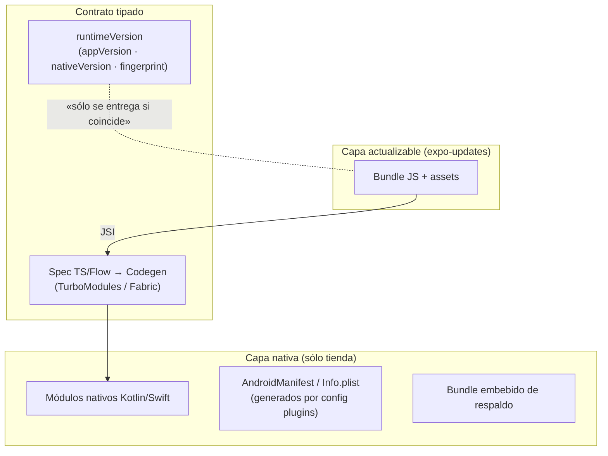
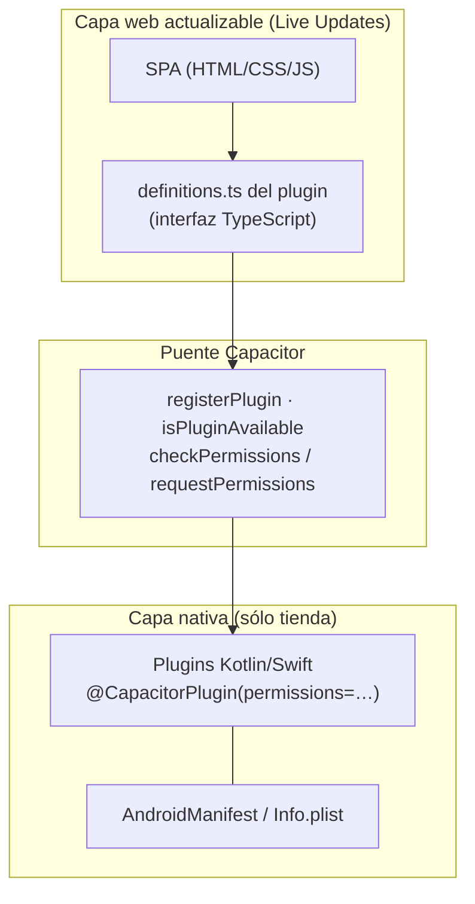
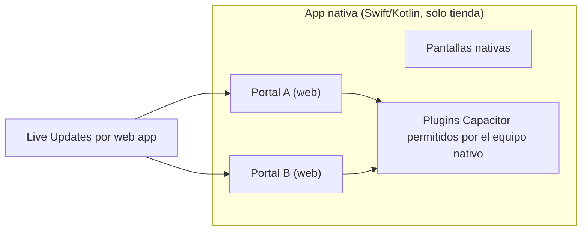
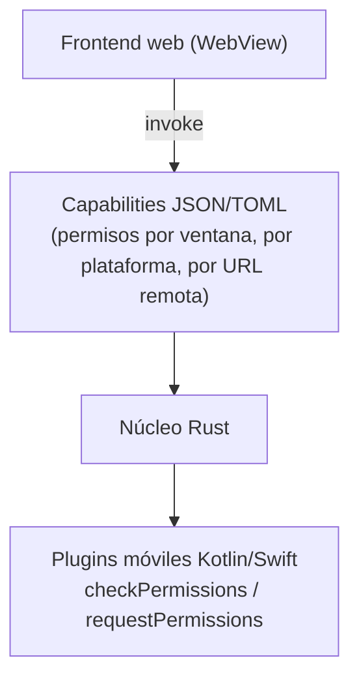

| Campo | Valor |
| --- | --- |
| Tipo | dossier de investigación (ángulo I7) |
| Fecha | 2026-10-25 (fecha de consulta de todas las fuentes) |
| Autor | Investigador I7 |
| Expediente | 0001-Framework-Concept-Maui-Autoactualizable |
| Pedido | PO, 2026-10-25: «como marco de trabajo podes sacar opiniones en otros frameworks para ver sus arquitecturas» |

# I7: arquitecturas de referencia de otros frameworks (capa nativa por tienda y capa actualizable)

## Índice

1. Alcance del ángulo
2. Qué se usa (tabla de productos y patrones)
3. Arquitectura de cada framework
   - 3.1 React Native + Expo
   - 3.2 Capacitor / Ionic
   - 3.3 Ionic Portals
   - 3.4 Apache Cordova
   - 3.5 Flutter + Shorebird
   - 3.6 NativeScript
   - 3.7 Kotlin Multiplatform / Compose Multiplatform
   - 3.8 Tauri v2 móvil
   - 3.9 Lo transversal: momento de actualización, versionado, datos con versión vieja, permisos y tiendas
4. Opiniones de desarrolladores
5. Tabla comparativa y patrón a copiar para MAUI + Blazor WASM
6. Lecciones aplicables a P1–P13
7. Fuentes numeradas
8. Verificación de fuentes

Convenciones: **HECHO** = documentación oficial, anuncio del proveedor o código. **OPINIÓN** = foros, Hacker News
(HN), blogs; señal cualitativa, no estadística. **NO VERIFICADO** = no se pudo confirmar, con el motivo.
**[criterio propio]** = inferencia del investigador, no de la fuente. `[n]` remite a §7. Las fuentes marcadas
«(vía buscador)» se leyeron sólo como resumen del buscador, no la página entera. Lo que un proveedor dice de sí mismo
(Capgo, Capawesome, Shorebird, Ionic) es HECHO en cuanto a lo que declara hacer y material interesado en lo demás.

---

## 1. Alcance del ángulo

Se estudia la **arquitectura** de ocho frameworks que separan, en mayor o menor medida, una **capa nativa** (sólo
cambia por la tienda: binario, manifiesto de permisos, módulos nativos) de una **capa actualizable** (JS/HTML/CSS o
Dart). Para cada uno: diagrama de capas, cómo se define y **versiona el contrato** entre ambas capas, qué pasa si el
contenido pide un módulo nativo que el binario instalado no trae, cómo se declaran permisos y capacidades (P12),
cómo se actualiza y se revierte, y qué opinan desarrolladores. Cierra con una comparación y con el patrón que
conviene copiar para el cascarón .NET MAUI + contenido Blazor WASM (criterio propio).

Queda fuera, porque lo cubren otros ángulos: el detalle comercial de las plataformas OTA (I2), la UI definida desde el
servidor (I3) y el relevamiento amplio de opiniones (I5). Aquí sólo se toman cuando hacen a la arquitectura.

## 2. Qué se usa

| Nombre | Qué actualiza sin tienda | Cómo trabaja sin red | Cómo fuerza o programa la actualización | Versión / estado vigente | Fuente |
| --- | --- | --- | --- | --- | --- |
| **React Native + Expo (`expo-updates`)** | Bundle JS y assets; nunca código nativo ni Info.plist | Arranca con la última actualización descargada o con la embebida en el binario (`isEmbeddedLaunch`) | Chequeo al cargar, tras recuperación de error, sólo wifi o nunca; API para buscar, bajar y recargar; directiva de rollback al bundle embebido | Expo SDK 58; Nueva Arquitectura por defecto desde RN 0.76 | [1][2][4][5][7] |
| **Capacitor + Live Updates (Capgo, Capawesome; Appflow en retiro)** | Capa web (HTML, CSS, JS, assets) | Bundle web local dentro del binario o el último bajado | Según proveedor: en segundo plano y aplicar al próximo inicio, al iniciar, siempre; piso mínimo de versión nativa | Capacitor 8 (npm `@capacitor/core` 8.5.3; 9.0 en alpha); Appflow sin ventas nuevas desde 2025-02-11 y con acceso hasta el 2027-12-31 | [12][13][15][16][19] |
| **Ionic Portals** | Cada «portal» (micro-frontend web) dentro de una app nativa, con Live Updates por portal [46] | NO VERIFICADO (la documentación leída no lo trata) | NO VERIFICADO | Producto comercial sin ventas nuevas desde 2025-02-11 | [17][18][19] |
| **Apache Cordova** | La carpeta `www` sólo con plugin de terceros (CodePush de Cordova está archivado, ver I2) | Contenido local en el binario | NO VERIFICADO (no hay mecanismo oficial) | Vigente como proyecto Apache; sin OTA oficial | [20][21] |
| **Flutter + Shorebird** | Código Dart; no assets, no nativo, no cambio de motor | Corre la última patch válida o la release base; sin red reintenta en el próximo inicio | Por defecto revisa al iniciar en segundo plano y aplica en el siguiente inicio; se puede controlar desde una «launch gate» | Activo; 1.0 con iOS estable el 2024-04-08 | [22][23][24][45] |
| **NativeScript** | JS/TS y assets sólo con plugin comunitario (`nativescript-app-sync`, beta, basado en CodePush) | Contenido local | NO VERIFICADO | NativeScript 9.1; sin OTA oficial | [25][26][27] |
| **Kotlin / Compose Multiplatform** | Nada de código: compila a nativo; las alternativas son configuración remota o Play Feature Delivery | La app es nativa completa | Sólo por tienda | Compose MP estable en Android, iOS y escritorio; web (Kotlin/Wasm) Beta | [28][29][34] |
| **Tauri v2 móvil** | El plugin de actualización oficial es **sólo escritorio** | Contenido local empaquetado | En móvil, sólo por tienda (oficial) | Tauri 2; `tauri-plugin-updater` 2.14.0 (2026-10-14) sin Android/iOS | [30][31][32][33] |

## 3. Arquitectura de cada framework

### 3.1 React Native + Expo

- **Contrato entre capas (HECHO).** Con la Nueva Arquitectura, JSI reemplaza el puente asíncrono: «JSI is an
  interface that allows JavaScript to hold a reference to a C++ object and vice-versa» [7]; habilitada por defecto
  desde 0.76 [7]. Cada módulo nativo se declara con una **especificación tipada**: «The specification declares the
  methods and data types that will pass back and forth between your native code and the React Native JavaScript
  runtime», y Codegen genera las interfaces nativas en el build [8].
- **Módulo ausente (HECHO).** `TurboModuleRegistry.get` «will return `null` if the Turbo Native Module is
  unavailable»; `getEnforcing` «will throw an exception» [8]. El contenido elige si tolera la ausencia.
- **Versión del contrato (HECHO).** `runtimeVersion` «guarantees compatibility between a build's native code and an
  update» [1]. Políticas: `appVersion`, `nativeVersion` y `fingerprint` [2]. `fingerprint` es un hash «derived from
  hashing app dependencies, custom native code, native project files, and configuration», usado para «determining
  compatibility between the native layer and JavaScript layer» [3]. Regla: «any time native code is updated, we're
  required to make a new build before publishing an update» [1].
- **Si igual llega JS incompatible (HECHO).** «Since the update would make calls to code that does not exist inside the
  build, `expo-updates` may detect an error and attempt to roll back to the previously working update» [1]. La
  recuperación sólo cubre errores tempranos: si el error ocurre tras mostrar contenido no hay rollback, y lo que pase
  más de 10 s después del primer render no se captura [4].
- **Permisos (HECHO).** Se declaran en el app config (`android.permissions`, `ios.infoPlist`) o por opciones de config
  plugins; «Changes to the Info.plist cannot be updated over-the-air, they will only be deployed when you submit a new
  native binary» [5]. Los config plugins corren en *prebuild* y pueden «configure AndroidManifest.xml and
  Info.plist» [6].
- **Revertir (HECHO).** Directiva de rollback del servidor al bundle embebido [2]; Expo advierte que republicar una
  actualización vieja es riesgoso si la rota cambió estado persistente de forma incompatible [4].

### 3.2 Capacitor / Ionic

- **Contrato (HECHO).** «Plugins in Capacitor enable JavaScript to interface directly with Native APIs» [14]; la
  interfaz TypeScript del plugin «defines the method signatures of your plugin» y la implementación web la cumple
  [10]. No hay un número de versión del contrato en el runtime: la compatibilidad la resuelven los proveedores de Live
  Updates comparando paquetes nativos (abajo).
- **Módulo ausente (HECHO).** `Capacitor.isPluginAvailable`: «Check if a plugin is available on the currently running
  platform» [11]. Los plugins distinguen `unimplemented` («the functionality is not implemented») de `unavailable`
  («the functionality can't be used right now») [10]. En la práctica, el error «"X" plugin is not implemented on
  android» aparece en el foro de Ionic con plugins oficiales que no quedaron operativos en el binario; en ese hilo
  (LorenzG, 2025-03-04/05) la causa fue el entorno de build (Node 20.0 en vez de ≥ 20.5), no el contenido web [44].
  Que el error indique en general «plugin no registrado en el binario» es [criterio propio].
- **Versionado del bundle contra el binario (HECHO del proveedor).** Capgo «compares the native packages in your local
  project» contra los del bundle vigente en el canal; si difieren, el bundle es *native-incompatible*; con
  `--fail-on-incompatible` «the upload fails with a non-zero exit and nothing is shipped», y con
  `--auto-min-update-version` sube el piso para que «devices that haven't installed the matching native build don't
  receive it» [15]. Capawesome: «you must be careful to restrict Live Updates to compatible native versions of your
  app» [16].
- **Permisos (HECHO).** Los de instalación van en el `AndroidManifest.xml` del plugin; los de tiempo de ejecución se
  agrupan por funcionalidad con alias en `@CapacitorPlugin(permissions=…)`, y con eso «the `checkPermissions()` and
  `requestPermissions()` methods should be fully functional» [9]. Del lado web, el estado es
  `'prompt' | 'prompt-with-rationale' | 'granted' | 'denied'` [13]. El plugin Cámara pide claves de Info.plist
  (`NSCameraUsageDescription`, etc.) que sólo cambian por tienda [13].
- **Cargar el contenido desde un servidor (HECHO).** `server.url` existe, pero «This is intended for use with
  live-reload servers. This is not intended for use in production» [12]. El modelo de producción es bundle local más
  Live Updates.
- **Revertir (HECHO del proveedor).** Capawesome: «If the app crashes after an update, automatically roll back to the
  last healthy bundle» [16].

### 3.3 Ionic Portals

- **HECHO.** «a supercharged native WebView component for iOS and Android», construido sobre Capacitor; se abre un
  Portal «to embed/expose web app» y se acceden funciones nativas «via the Capacitor bridge» [17].
- **Gobierno de capacidades (HECHO).** «Set granular permissions that designate which parts of the native app your web
  teams can touch» [18]; los equipos nativos quieren que los web trabajen «in a sandboxed environment» [18]. Es el
  ejemplo más claro de **lista de capacidades concedidas por el cascarón a cada contenido**.
- **Actualización (HECHO).** «Portals comes with a Live Updates feature that will allow you to update your web based
  content» [18]. Es por portal: «you are able to use Appflow Live Update for each of your Portals» y «each Portal can
  be updated independent of the rest of the code in the application» [46]. (Corregido en la verificación: antes
  figuraba NO VERIFICADO.)
- **Estado (HECHO).** «we have discontinued new customer sales for all Ionic commercial products and services—including
  Ionic Appflow, Identity Vault, Portals» (Ionic, 2025-02-11); los usuarios de Appflow tienen acceso «through December
  31, 2027» y a los clientes Enterprise se les ofrece uso continuado con mantenimiento propio [19].

### 3.4 Apache Cordova

- **Contrato (HECHO).** «Plugins usually consist of a JavaScript interface paired with corresponding platform-native
  code»; `cordova.exec` invoca «an action method on the specified service class with the provided arguments» [20].
  Es un puente por **nombre de servicio y acción** (cadenas), sin tipado.
- **Versionado (HECHO).** La compatibilidad del plugin se declara en `engines.cordovaDependencies` del `package.json`,
  que mapea versiones del plugin a versiones requeridas de CLI, plataforma u otros plugins [20]. Es versionado **de
  build**, no de runtime: nada impide que un `www` nuevo llame a un servicio que el binario no trae
  [criterio propio, por ausencia en la doc].
- **Capacidades de red (HECHO).** Lista de dominios permitidos: `<access>` (peticiones), `<allow-navigation>`
  (navegación del WebView) y `<allow-intent>` (lo que se pide abrir al sistema); se recomienda CSP porque «is more
  secure» [21]. Los permisos de dispositivo los agrega el `plugin.xml` de cada plugin al manifiesto (la página leída
  remite a la especificación; detalle NO VERIFICADO) [20].

### 3.5 Flutter + Shorebird

- **Qué parche es posible (HECHO).** «Patches can change any Dart code in your application» [22]; no assets (por
  ahora), no Java/Kotlin/Swift/Objective-C, y «you cannot change the Flutter version of your app using Code Push» [22].
- **Atadura a la release (HECHO).** «Patches are identified by their associated release version and a patch number»;
  una sola patch activa por release [22]. No hay contrato de módulos: la release **es** el contrato.
- **Módulo ausente (HECHO).** Sumar un paquete con código nativo en una patch hace que «the app will crash or fail on
  user devices because the native components» faltan; «If you need to add a new package with native code, you must
  push a new store release» [23].
- **iOS (HECHO).** «uses a custom interpreter designed specifically for physical arm64 iOS devices» para cumplir la
  restricción de código interpretado [23]; del código no cambiado «runs the existing fully optimized AOT code»
  (abarth, HN 2024-04-09 UTC; que sea cofundador de Shorebird: NO VERIFICADO, ni el hilo ni su perfil de HN lo dicen)
  [39].
- **Sin red (HECHO).** «Some form of network connectivity is required»; si falla el chequeo, «the updater will simply
  try to check again next time the application launches» [23].

### 3.6 NativeScript

- **HECHO.** «NativeScript provides platform APIs directly to the JavaScript runtime» [25]; la conversión de tipos «is
  handled implicitly by the NativeScript iOS and Android runtimes» [26].
- **Consecuencia [criterio propio].** No hay una lista cerrada de módulos: el JS puede llamar cualquier API de la
  plataforma presente en el binario. El contrato es **toda la superficie del SDK compilado**, más amplio y menos
  gobernable que una lista de plugins. Los permisos siguen en el manifiesto de `App_Resources` (NO VERIFICADO en la
  página leída).
- **OTA (HECHO, README leído en la verificación).** `nativescript-app-sync`: «currently in beta and is *not supported* by
  the core NativeScript team»; basado en
  CodePush; guarda la versión anterior para revertir [27]. No se halló OTA oficial.

### 3.7 Kotlin Multiplatform / Compose Multiplatform

- **HECHO.** Compose Multiplatform: Android, iOS y escritorio «Stable»; web sobre Kotlin/Wasm «Beta» [28]. La doc leída
  no menciona actualizaciones OTA [28].
- **Política (HECHO).** Google Play: «an app may not download executable code (such as dex, JAR, .so files) from a
  source other than Google Play», salvo «code that runs in a virtual machine or an interpreter» con acceso indirecto
  a las API de Android, p. ej. JavaScript en un webview [34]. La misma política agrega que el código interpretado cargado en
  ejecución «must not allow potential violations of Google Play policies» [34]. Un proveedor (Capgo, interesado)
  clasifica KMP/Compose en Android como «No» para live updates, con configuración remota o Play Feature Delivery como
  alternativa [29]; en la misma tabla clasifica «.NET MAUI / Xamarin» como «No» y «Remote config only» [29], sin
  considerar contenido web descargado dentro de un WebView del cascarón MAUI (nuestro caso), que esa misma fuente
  admite para otros stacks como «yes for JavaScript in a WebView» [criterio propio sobre la lectura de [29]].
- **Consecuencia [criterio propio].** KMP es el **contraejemplo**: todo es capa nativa; lo único actualizable sin
  tienda son datos (configuración, definiciones). Es la opción B pura del P1.

### 3.8 Tauri v2 móvil

- **Capacidades declaradas (HECHO).** «Capabilities define which permissions are granted or denied for which windows or
  webviews»; pueden ser por plataforma (`platforms`: `iOS`, `android`…) y, por defecto, «the API is only accessible
  to bundled code shipped with the Tauri App»; un campo `remote.urls` concede comandos a orígenes remotos [30].
  Advertencia oficial: en Linux y Android Tauri «is unable to distinguish between requests from an embedded `<iframe>`
  and the window itself» [30].
- **Plugins móviles (HECHO).** Kotlin o Swift; «Tauri automatically implements two commands for the plugin:
  `checkPermissions` and `requestPermissions`» con permisos agrupados por alias [31].
- **Actualización (HECHO).** El updater oficial exige firma («needs a signature to verify that the update is from a
  trusted source») y se registra sólo para escritorio (`#[cfg(desktop)]`) [32]; el README del plugin marca Android e iOS como no
  soportados [32]. El equipo dijo en la RC que no quería «raise expectations that Tauri 2.0 will be the "mobile as a
  first class citizen" release» [33].
- **Lección [criterio propio].** Tauri no resuelve OTA móvil, pero su **modelo de capabilities** (lista declarativa,
  por plataforma, separando contenido empaquetado de remoto) es el mejor modelo de P12 de los relevados.

### 3.9 Lo transversal

**Momento de actualización.** Expo: al cargar por defecto, con variantes tras error, sólo wifi o nunca [2]. Shorebird:
al iniciar en segundo plano, aplica al próximo inicio; para forzar, chequear «as part of a login screen, or other
launch gate» [22][23][45]. Capawesome:
descarga en segundo plano y aplica al próximo inicio [16]. Ninguna fuente oficial relevada describe «al iniciar
sesión» como modo de primera clase; Shorebird lo menciona sólo como sugerencia (pantalla de login como «launch gate»)
[45].

**Versionado de lo descargado y compatibilidad.** Tres familias (HECHO de cada fuente):
1. **Clave de compatibilidad explícita y exacta**: `runtimeVersion` de Expo, calculable por hash (`fingerprint`) [1][3].
2. **Atadura a la release**: Shorebird (release + número de patch) [22].
3. **Comparación de dependencias nativas al publicar**: Capgo (falla el CI o sube el piso mínimo) [15].
Cordova y NativeScript no tienen un mecanismo de runtime oficial [20][27].

**Datos tomados con versión vieja.** Ningún framework relevado lo trata: es responsabilidad de la app. Lo más cercano
es la advertencia de Expo sobre revertir cuando la actualización rota ya cambió estado persistente [4]. NO VERIFICADO
que exista guía oficial de ninguno sobre migrar datos locales entre versiones del bundle.

**Permisos y capacidades.** En los cuatro frameworks con fuente leída sobre el tema, el permiso del sistema vive en el
manifiesto del binario (Expo [5], Capacitor [9][13], Cordova [20], Tauri [31]); NativeScript y KMP no se verificaron
(NO VERIFICADO: no se leyó su documentación de permisos). El contenido sólo puede **consultar y pedir en tiempo de ejecución** lo ya
declarado (`checkPermissions`/`requestPermissions` en Capacitor [9] y Tauri [31]). Dos frameworks suman una capa
propia de autorización por encima del manifiesto: Tauri (capabilities) [30] e Ionic Portals (qué puede tocar cada
equipo web) [18].

**Tiendas.** Apple 2.5.2: las apps no pueden «download, install, or execute code which introduces or changes features
or functionality of the app» [35]; Shorebird cita la cláusula 3.3.1(b) del acuerdo de desarrollador para el código
interpretado [23]. Google Play exime el código interpretado en webview, con la condición de que no permita violar sus políticas [34]. Un comentarista de HN sostiene que
Shorebird «is straight up lying» sobre el cumplimiento con Apple; el fundador responde que no vieron rechazos en
«1000s of releases» [39] (OPINIÓN de ambos lados).

## 4. Opiniones de desarrolladores

Conteo (recontado en la verificación): 18 filas con autor y cita (6 a favor, 6 en contra, 6 matices; dos autores
aparecen dos veces), de 6 páginas (3 hilos de HN, 1 comentario suelto de HN, 1 dev.to, 1 blog personal). No es muestra
representativa; se eligieron por tocar la arquitectura de capas.

### 4.1 A favor

| Fuente | Autor | Fecha | Postura | Cita | Tema |
| --- | --- | --- | --- | --- | --- |
| HN [37] | samwillis | 2022-03-16 | A favor de Capacitor | «I believe for a lot of apps its probably a better option than either Flutter or React Native.» | WebView vs. nativo |
| HN [37] | yesimahuman (cofundador de Ionic y creador de Capacitor según su perfil de HN; interesado) | 2022-03-16 | A favor | «In Capacitor/Ionic yuou have full native access» | Puente de plugins |
| Blog [42] | Bret Cameron | 2026-06-05 | A favor, usa ambos | «only genuinely native changes (a new plugin, a permission, an SDK bump) need to go through the app stores.» | Frontera nativo/actualizable |
| HN [38] | DecoPerson | 2025-11-08 | A favor de WebView | «I did this and never looked back.» | App WebView con nativo para lo específico |
| HN [39] | eseidel (fundador de Shorebird, interesado) | 2024-04-09 (UTC) | A favor | «We've seen 1000s of releases in the last year, and not had a single complaint about rejections.» | Tiendas |
| HN [39] | abarth | 2024-04-09 (UTC) | A favor (técnico) | «code you haven't changed runs the existing fully optimized AOT code that's already in your app.» | Rendimiento del parche |

### 4.2 En contra

| Fuente | Autor | Fecha | Postura | Cita | Tema |
| --- | --- | --- | --- | --- | --- |
| HN [37] | xtracto | 2022-03-16 | En contra | «Want to use the camera? you are limited to whatever "plugin" is available.» | Capacidades atadas a plugins |
| HN [37] | angst_ridden | 2022-03-16 | En contra | «supporting an end-of-lifed Cordova plugin for necessary functionality» | Mantenimiento de plugins |
| HN [38] | adastra22 | 2025-11-08 | En contra | «I have never once experienced a WebView app that I would say had "a really good experience."» | Experiencia WebView |
| HN [38] | hn8726 | 2025-11-08 | En contra | «On mobile the webview app experience is crap» | Experiencia WebView |
| HN [39] | pritambarhate | 2024-04-09 (UTC) | En contra | «This service is straight up lying when it says that Remote Code Push is implemented as per Apple's guidelines.» | Tiendas |
| HN [39] | lxgr | 2024-04-08 | En contra | «just doesn't sound like a great idea, even if it might technically pass the various app stores' review guidelines.» | Riesgo del code push |

### 4.3 Matices

| Fuente | Autor | Fecha | Postura | Cita | Tema |
| --- | --- | --- | --- | --- | --- |
| dev.to [41] | Mason Roy | 2026-09-30 | Matiz | «`runtimeVersion` is the only thing standing between an OTA update and a crash loop.» | Contrato de versión |
| dev.to [41] | Mason Roy | ídem | Matiz | «the app never runs long enough to fetch it.» | Por qué un bucle de fallos no se arregla por OTA |
| HN [38] | sebmellen | 2025-11-08 | Matiz | «Works until you need complex native code» | Límite del WebView |
| HN [38] | serial_dev | 2025-11-08 | Matiz | «if a webview app experience is good, you don't notice it, you only notice if it's bad.» | Experiencia |
| HN [40] | mmcnl | 2024-02-17 | Matiz | «Tauri is still in beta for mobile, Capacitor is the incumbent.» | Madurez Tauri móvil |
| Blog [42] | Bret Cameron | 2026-06-05 | Matiz | La UI WebView está cerca de nativa pero «rarely all the way there»; tuvo que escribir un plugin nativo para CoreMIDI | Capacidades que el WebView no trae |

Sin cita textual (resumen del buscador de HN, se mencionan sólo como señal): imadj (HN 41214883, 2024-08-11) ubica a
Flutter como líder en pulido móvil frente a Tauri en beta; marcus_cemes (HN 34985406, 2023-03-01) duda de la tracción de
Tauri móvil frente a Flutter [43]. No se encontraron opiniones de desarrolladores sobre ausencia de OTA en KMP en Reddit
ni HN (búsqueda del 2026-10-25 sin resultados): NO VERIFICADO.

**Lectura [criterio propio].** Las críticas no apuntan a la separación de capas en sí sino a (a) la experiencia de
UI en WebView, (b) depender de plugins para cada capacidad y (c) la confianza/cumplimiento del code push de código.
La separación «sólo lo nativo pasa por tienda» aparece como ventaja aun en los que critican (Bret Cameron [42]).

## 5. Tabla comparativa y patrón a copiar

| Framework | Contrato nativo ↔ actualizable | Versión del contrato | Módulo ausente | Permisos / capacidades | Actualizar / revertir |
| --- | --- | --- | --- | --- | --- |
| RN + Expo | Spec TS/Flow + Codegen (tipado) | `runtimeVersion` exacta; `fingerprint` por hash | `get` → null; `getEnforcing` → excepción; rollback si falla temprano | App config + config plugins → manifiesto; sólo por binario | `expo-updates`; rollback a anterior o embebido |
| Capacitor | Interfaz TS del plugin + puente | Sin clave en runtime; Capgo compara paquetes nativos al publicar | `isPluginAvailable`; `UNIMPLEMENTED` | `@CapacitorPlugin(permissions)` + manifiesto; check/request en JS | Proveedor; rollback automático (Capawesome) |
| Ionic Portals | Igual que Capacitor, por portal | Igual | Igual | Más una lista de lo que cada web puede tocar | Live Updates; NO VERIFICADO por portal |
| Cordova | `cordova.exec(servicio, acción)` sin tipos | `engines` sólo en build | NO VERIFICADO (sin mecanismo oficial) | `plugin.xml` + allow list de dominios | Sin OTA oficial |
| Flutter + Shorebird | No hay: la release es el contrato | Release + número de patch | Crash si la patch trae paquete nativo nuevo | Manifiesto; sólo tienda | Patch; rollback del servidor |
| NativeScript | Toda la API de la plataforma | Ninguna oficial | NO VERIFICADO | Manifiesto | Plugin comunitario beta |
| KMP / Compose MP | Todo nativo | — | — | Manifiesto | Sólo tienda (y datos remotos) |
| Tauri v2 móvil | Comandos + plugins; capabilities JSON | NO VERIFICADO | Comando no concedido → denegado | Capabilities por ventana/plataforma/URL + check/request | Updater sólo escritorio |
| **MAUI + HybridWebView (nuestro caso)** | `InvokeDotNet` / `InvokeJavaScriptAsync`; JSON [36] | A definir (P3) | A definir (P12) | Manifiesto del cascarón | A definir (P2) |

**Patrón a copiar [criterio propio].** Combinar cuatro piezas que aparecen probadas por separado:

1. **Contrato tipado del puente, como Capacitor/TurboModules.** Un único conjunto de interfaces C# del cascarón
   (p. ej. `IUbicacion`, `ICamara`, `IAlmacen`) expuestas al contenido por HybridWebView [36]; el contenido Blazor no
   llama nada fuera de ese contrato [8][10].
2. **Clave de compatibilidad exacta, como `runtimeVersion` de Expo.** El cascarón publica una `bridgeVersion` (o un
   hash del contrato, como `fingerprint`) y el manifiesto del contenido declara la que necesita; el servidor sólo
   entrega contenido cuya clave coincida, y el CI falla si cambió el contrato sin subir la clave, como
   `--fail-on-incompatible` de Capgo [1][3][15]. El `minShellVersion` del borrador es la misma idea en forma de
   rango; la evidencia de Expo y Capgo favorece la coincidencia exacta o el piso calculado, no un rango a mano.
3. **Descubrimiento y degradación, como `isPluginAvailable` + `get` que devuelve null.** El contenido pregunta qué
   capacidades hay y qué estado de permiso tienen (`granted/denied/prompt`) antes de usar algo, y tiene una ruta
   alternativa si falta [9][11][13].
4. **Lista de capacidades concedidas al contenido, como Tauri capabilities / Ionic Portals.** Además del manifiesto
   (lo que el sistema permite), el cascarón declara qué capacidades expone al contenido descargado y para qué origen
   [18][30].
5. **Respaldo embebido y rollback temprano, como Expo.** El cascarón trae un contenido embebido que arranca sin red, y
   marca como fallido un contenido que no llega a renderizar [2][4].

Lo que **no** conviene copiar [criterio propio]: el modelo NativeScript (todo el SDK expuesto, contrato ingobernable)
[25]; `server.url` de Capacitor para producción, que la propia doc desaconseja [12]; y el code push de código
compilado tipo Shorebird, que no aplica a WASM y trae el debate de tiendas [23][39].

## 6. Lecciones aplicables a P1–P13

| Pregunta | Lección | Fuente |
| --- | --- | --- |
| P1 (modelo A/B/C) | Todos los frameworks con OTA actualizan **código interpretado en la capa web/JS**; KMP muestra el polo B (sólo datos remotos). Ninguno trae solución oficial para datos de dominio versionados: la definición de la encuesta como dato (B) puede convivir con el bundle (A) [criterio propio; no se midió cuántas apps reales lo hacen] | [1][22][29] |
| P2 (canal, rollback) | Rollback automático sólo para fallos tempranos (Expo, 10 s); rollback al embebido como directiva del servidor; Capawesome revierte al último sano. Revertir es riesgoso si el estado persistente cambió | [2][4][16] |
| P3 (cascarón, puente, contrato) | Contrato tipado (spec) + clave exacta (`runtimeVersion`/`fingerprint`) + verificación en CI; la clave se deriva del código, no se escribe a mano | [1][3][8][15] |
| P4 (entrada del usuario) | Sin hallazgos en este ángulo | — |
| P5 (sin red) | Patrón común: arrancar del último contenido bajado o del embebido; nunca esperar a la red para abrir (Expo `fallbackToCacheTimeout` 0 por defecto, ver I2) | [2][23] |
| P6 (PR e integración) | Compuerta de CI que falla si el contrato nativo cambió sin cambiar la clave (`--fail-on-incompatible`, fingerprint) | [3][15][41] |
| P7 (líneas de versión) | Al menos dos líneas: versión del cascarón (tienda) y clave de compatibilidad del contrato, separada de la versión del contenido. En Expo, `appVersion` vs. `fingerprint` muestra el riesgo de atarlas a mano | [1][2][41] |
| P8 (pruebas) | Probar el contenido nuevo contra el cascarón **viejo** publicado (Expo pide un staging que replique el estado del dispositivo para probar rollbacks) | [4] |
| P9 (iOS) | Apple 2.5.2 prohíbe código descargado que cambie funcionalidad; la defensa de los proveedores es «interpretado» y sin cambiar el propósito. NO VERIFICADO cómo trata Apple el WASM de Blazor descargado | [23][35] |
| P10 (guía) | Los diagramas de capas de §3 sirven como «marco de referencia» comparativo para el lector novato [criterio propio] | §3 |
| P11 (demo) | La demo puede mostrar el caso «contenido pide capacidad ausente» con `get`-null/`isPluginAvailable` equivalente [criterio propio] | [8][11] |
| P12 (capacidades del manifiesto) | En los cuatro frameworks con fuente leída (Expo, Capacitor, Cordova, Tauri): el permiso del sistema sólo cambia por binario; el contenido consulta y pide en ejecución lo ya declarado; Tauri y Portals agregan una lista propia de capacidades por contenido | [5][9][18][30][31] |
| P13 (encuestas con versión vieja) | Ningún framework lo resuelve: es dominio de la app. Señal indirecta: Expo advierte el estado persistente incompatible al revertir | [4] |
| Forzada al iniciar (folio 006) | Shorebird sugiere chequear «as part of a login screen, or other launch gate» si el negocio exige la última versión; sin red reintenta en el siguiente inicio | [23][45] |

## 7. Fuentes numeradas

Todas consultadas el 2026-10-25.

1. Expo. «Runtime versions and updates». https://docs.expo.dev/eas-update/runtime-versions/
2. Expo. «Updates» (referencia de `expo-updates`, SDK 58). https://docs.expo.dev/versions/latest/sdk/updates/
3. Expo. «Fingerprint». https://docs.expo.dev/versions/latest/sdk/fingerprint/
4. Expo. «Error recovery». https://docs.expo.dev/eas-update/error-recovery/
5. Expo. «Permissions». https://docs.expo.dev/guides/permissions/
6. Expo. «Introduction to config plugins». https://docs.expo.dev/config-plugins/introduction/
7. Meta / React Native. «About the New Architecture» (última actualización 2026-10-14). https://reactnative.dev/architecture/landing-page
8. React Native. «Turbo Native Modules: Introduction». https://reactnative.dev/docs/turbo-native-modules-introduction
9. Ionic / Capacitor. «Capacitor Android Plugin Guide». https://capacitorjs.com/docs/plugins/android
10. Capacitor. «Capacitor Web/PWA Plugin Guide». https://capacitorjs.com/docs/plugins/web
11. Capacitor. «Utilities» (`isPluginAvailable`). https://capacitorjs.com/docs/basics/utilities
12. Capacitor. «Configuration» (`server.url`). https://capacitorjs.com/docs/config
13. Capacitor. «Camera Capacitor Plugin API» (v8). https://capacitorjs.com/docs/apis/camera
14. Capacitor. «Creating Capacitor Plugins». https://capacitorjs.com/docs/plugins/creating-plugins
15. Capgo. «Compatibility» (Live Updates). https://capgo.app/docs/live-updates/compatibility/
16. Capawesome. «Live Updates» (Capawesome Cloud). https://capawesome.io/cloud/live-updates/
17. Ionic. «Portals». https://ionic.io/docs/portals
18. Matt Netkow (Ionic). «Micro Frontends for Mobile with Ionic Portals» (sin fecha). https://ionic.io/resources/articles/micro-frontends-for-mobile-with-ionic-portals
19. The Ionic Team. «Important Announcement: The Future of Ionic’s Commercial Products» (2025-02-11). https://ionic.io/blog/?p=6282
20. Apache Cordova. «Plugin Development Guide». https://cordova.apache.org/docs/en/latest/guide/hybrid/plugins/index.html
21. Apache Cordova. «Allow List Guide». https://cordova.apache.org/docs/en/latest/guide/appdev/allowlist/index.html
22. Shorebird. «Code Push». https://docs.shorebird.dev/code-push/
23. Shorebird. «FAQ». https://docs.shorebird.dev/code-push/faq/
24. The Shorebird Team. «Shorebird 1.0: Stable Code Push Support for iOS» (2024-04-08). https://shorebird.dev/blog/1.0
25. NativeScript. Documentación (banner «NativeScript 9.1 Released»). https://docs.nativescript.org/
26. NativeScript. «Marshalling». https://docs.nativescript.org/guide/marshalling
27. `nativescript-app-sync` 2.0.0, README. https://unpkg.com/nativescript-app-sync@2.0.0/README.md
28. JetBrains. «Supported platforms» (Kotlin Multiplatform). https://kotlinlang.org/docs/multiplatform/supported-platforms.html
29. Capgo (proveedor interesado). «Which Stacks Can Use Live Updates on Android?». https://capgo.app/blog/android-live-updates-allowed-stacks/
30. Tauri. «Capabilities». https://v2.tauri.app/security/capabilities/
31. Tauri. «Mobile Plugin Development». https://v2.tauri.app/develop/plugins/develop-mobile/
32. Tauri. «Updater» https://v2.tauri.app/plugin/updater/ ; docs.rs `tauri-plugin-updater` 2.14.0 https://docs.rs/crate/tauri-plugin-updater/latest ; README del plugin (tabla de plataformas) https://github.com/tauri-apps/plugins-workspace/blob/v2/plugins/updater/README.md
33. Tauri. «Tauri 2.0 Release Candidate». https://v2.tauri.app/blog/tauri-2-0-0-release-candidate/
34. Google Play. «Device and Network Abuse» (política). https://support.google.com/googleplay/android-developer/answer/9888379
35. Apple. «App Review Guidelines» (2.5.2, 4.7). https://developer.apple.com/app-store/review/guidelines/
36. Microsoft Learn. «HybridWebView – .NET MAUI» (ms.date 2026-07-08). https://learn.microsoft.com/en-us/dotnet/maui/user-interface/controls/hybridwebview?view=net-maui-10.0
37. Hacker News, comentario de samwillis (2022-03-16) y respuestas. https://news.ycombinator.com/item?id=30700880
38. Hacker News, comentario de bearjaws (2025-11-08) y respuestas. https://news.ycombinator.com/item?id=45853740
39. Hacker News, «Show HN: Shorebird 1.0, Flutter Code Push» (eseidel, 2024-04-08 UTC; 58 comentarios; varios comentarios citados son del 2024-04-09 UTC). https://news.ycombinator.com/item?id=39973150
40. Hacker News, comentario de mmcnl (2024-02-17). https://news.ycombinator.com/item?id=39411780
41. Mason Roy. «Expo OTA Updates Are a Loaded Gun. Here's the Safety.» dev.to (2026-09-30, según `datePublished`). https://dev.to/mason_roy/expo-ota-updates-are-a-loaded-gun-heres-the-safety-1c1k
42. Bret Cameron. «React Native vs Capacitor: why I use both» (2026-06-05). https://www.bretcameron.com/blog/react-native-vs-capacitor-why-i-use-both
43. Hacker News, búsqueda Algolia de comentarios «Tauri mobile android» (resúmenes, sin cita). https://hn.algolia.com/api/v1/search?query=Tauri%20mobile%20android&tags=comment
44. Ionic Forum, LorenzG y otros. «"XXX" plugin is not implemented on android - with any plugin» (2025-03-04). https://forum.ionicframework.com/t/xxx-plugin-is-not-implemented-on-android-with-any-plugin/246966
45. Shorebird. «Update Strategies». https://docs.shorebird.dev/code-push/update-strategies/ (agregada en la verificación)
46. Ionic. «What are Live Updates?» (Portals). https://ionic.io/docs/portals/live-updates (agregada en la verificación)

## Verificación de fuentes

Verificador adversarial, 2026-10-25. Método: descarga de cada URL de §7 y búsqueda textual de cada cita (comillas y
espacios normalizados); los hilos de HN se leyeron por la API de Algolia y de Firebase (autor, `created_at` en UTC,
texto completo); versiones vigentes contra los registros npm y crates.io.

**Revisadas:** 44 fuentes de §7 (todas abiertas; las que figuraban «vía buscador» se leyeron completas, salvo [43],
que es una búsqueda y se mantiene como señal sin cita) más 2 agregadas ([45][46]); 18 opiniones de §4 con cita, las
18 ubicadas textualmente con autor coincidente; 2 resúmenes sin cita (imadj, marcus_cemes) comprobados en HN.
Se revisaron todas las afirmaciones de HECHO de §2, §3, §5 y §6 que remiten a una fuente (citas textuales, nombres de
API/opciones, versiones, fechas y políticas); no se llevó un conteo por afirmación.

**Correcciones (antes → después):**

1. `tauri-plugin-updater` 2.10.1 → 2.14.0 (crates.io, 2026-10-14); la falta de Android/iOS se confirmó en el README del
   plugin, no sólo en el buscador.
2. Capacitor 8 «plugins v8» → precisado: `@capacitor/core` 8.5.3 estable, 9.0 en alpha (npm).
3. Appflow «en retiro» → sin ventas nuevas desde 2025-02-11 y acceso hasta el 2027-12-31 (anuncio leído completo [19]).
4. Ionic Portals, Live Updates por portal: NO VERIFICADO → HECHO con [46].
5. Shorebird «launch gate» / pantalla de login citado a [23] (FAQ, que no lo dice) → fuente correcta [45].
6. abarth «cofundador» → NO VERIFICADO (no consta en el hilo ni en su perfil; búsqueda sin resultados).
7. Fechas de HN [39]: eseidel, abarth y pritambarhate 2024-04-08 → 2024-04-09 (UTC); el post y lxgr sí son del 08.
8. Fechas de HN [38]: «≈ nov. 2025» → 2025-11-08 (las cinco opiniones).
9. Mason Roy [41]: año NO VERIFICADO → 2026-09-30 (`datePublished` de la página).
10. Foro de Ionic [44]: «aparece cuando el plugin no quedó registrado» → el hilo atribuye la causa al entorno de build
    (versión de Node); la generalización queda como criterio propio.
11. Google Play [34]: «exime el código interpretado» → se agrega la condición textual («must not allow potential
    violations of Google Play policies»).
12. Conteo de opiniones 17 → 18; «4 hilos de HN» → 3 hilos y 1 comentario suelto.
13. Generalizaciones: «En todos» (permisos en el manifiesto) y «Unanimidad» (P12) → acotadas a los cuatro frameworks con
    fuente leída; «en la mayoría de las apps reales» (P1) → marcado sin medición.
14. Tauri RC [33]: paráfrasis → cita textual; Ionic [19], Shorebird [24], NativeScript [27], Capgo [29]: quitado
    «vía buscador» tras leerlas.
15. Agregado en §3.7, por ser pertinente al proyecto: la misma fuente [29] (Capgo, interesada) clasifica «.NET MAUI /
    Xamarin» como «No» / «Remote config only» para live updates en Android; la lectura de que eso no cubre contenido web
    en un WebView del cascarón es criterio propio.

**No verificadas (quedan marcadas):** abarth como cofundador de Shorebird; Ionic Portals sin red y cómo fuerza la
actualización; mecanismo oficial de OTA en Cordova y NativeScript; detalle de permisos vía `plugin.xml` (Cordova) y
`App_Resources` (NativeScript); permisos en KMP/NativeScript para la afirmación transversal; opiniones sobre falta de OTA
en KMP; guía oficial de migración de datos locales entre bundles; trato de Apple al WASM de Blazor descargado; versión
del contrato en Tauri.

Sin cambios tras abrirlas: todas las citas de Expo [1]–[6], React Native [7][8], Capacitor [9]–[14], Capgo [15],
Capawesome [16], Portals [17][18], Cordova [20][21], Shorebird [22][23], NativeScript [25][26], Kotlin [28], Tauri
[30][31], Apple [35], Microsoft Learn [36] (ms.date 2026-07-08), Bret Cameron [42] (2026-06-05) y las 18 citas de HN y
blogs (textuales; «yuou» es errata del original).

