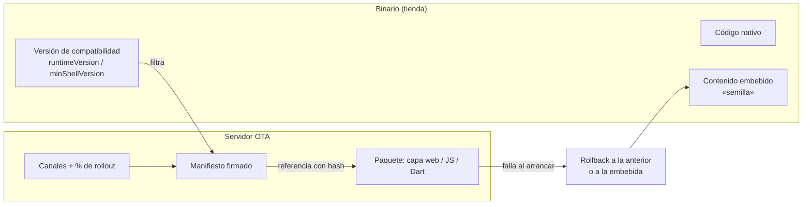

# N1: Actualización dinámica sin tienda

> Dossier del investigador especializado del núcleo N1 (descomposición en
> `/LAB/Lab-Documentos/Lab-Documentos.Documentacion/PROMPTs/Concepts/01-Framework-Concept/OUTPUTs/Bitacoras/01-Descomposicion-En-Nucleos.md`).
> Fecha de investigación y de consulta de todas las URL: **2026-10-25**.
> Convención de evidencia: cada afirmación lleva **[Fn]** (fuente web numerada en §9.1), **[Ln]** (archivo local con
> línea, §9.2) o **[Cn]** (comando con su salida, §9.3). Lo que no se pudo confirmar dice **NO VERIFICADO** y el
> motivo. Lo que es opinión del investigador dice **Criterio propio**.
> Las citas normativas (Apple, Google) se copian **en inglés y textuales** para no alterar su alcance; la traducción
> que las acompaña es del investigador.

## Índice

1. [Índice](#índice)
2. [Alcance del núcleo y frases que lo originan](#2-alcance-del-núcleo-y-frases-que-lo-originan)
3. [Definiciones: qué es y qué no es](#3-definiciones-qué-es-y-qué-no-es)
4. [Estado del arte y estándares](#4-estado-del-arte-y-estándares)
   - 4.1 [Qué permite Apple](#41-qué-permite-apple)
   - 4.2 [Qué permite Google Play](#42-qué-permite-google-play)
   - 4.3 [Lectura conjunta de las dos políticas](#43-lectura-conjunta-de-las-dos-políticas)
   - 4.4 [Cómo lo resuelve la industria](#44-cómo-lo-resuelve-la-industria)
   - 4.5 [¿Existe algo equivalente para .NET MAUI?](#45-existe-algo-equivalente-para-net-maui)
   - 4.6 [Interfaz dirigida por el servidor (server-driven UI)](#46-interfaz-dirigida-por-el-servidor-server-driven-ui)
   - 4.7 [BlazorWebView, HybridWebView y Blazor WebAssembly en .NET 9/10](#47-blazorwebview-hybridwebview-y-blazor-webassembly-en-net-910)
   - 4.8 [Tamaño de una app Blazor WebAssembly publicada (medido)](#48-tamaño-de-una-app-blazor-webassembly-publicada-medido)
   - 4.9 [Seguridad del canal de actualización](#49-seguridad-del-canal-de-actualización)
   - 4.10 [Manifiesto: campos que usa la industria](#410-manifiesto-campos-que-usa-la-industria)
5. [Opciones y tabla comparativa](#5-opciones-y-tabla-comparativa)
6. [Recomendación preliminar (criterio propio)](#6-recomendación-preliminar-criterio-propio)
7. [Preguntas para la mesa](#7-preguntas-para-la-mesa)
8. [Dependencias con otros núcleos](#8-dependencias-con-otros-núcleos)
9. [Fuentes](#9-fuentes)
10. [Lo que quedó sin verificar y bloqueos](#10-lo-que-quedó-sin-verificar-y-bloqueos)
11. [Verificación de fuentes](#11-verificación-de-fuentes)

---

## 2. Alcance del núcleo y frases que lo originan

**Problema que resuelve N1:** cómo cambiar las pantallas de negocio de una app .NET MAUI **sin publicar en la
tienda**, de modo que la app baje la novedad sola al abrirse, sin violar las políticas de Apple y Google, y sin
abrir una puerta para que un tercero tome el control de la app por el canal de actualización.

| Frase del prompt / borrador | Qué le exige a N1 |
| --- | --- |
| «un modelo de aplicación que permita aplicar actualizaciones desde el servidor sin pasar por el ciclo de actualización rigido que imponen los store» [L1 l.18] | Separar lo que se actualiza por tienda de lo que se actualiza por servidor |
| «cuando el usuario abre la aplicación esta aplicación solicita bajar las actualizaciones de forma automatica» [L1 l.18] | Flujo de actualización al arrancar, sin intervención del usuario |
| «paginas .net blazor hibridas en .NET MAUI» [L1 l.12] | Que el contenido actualizable se escriba en Razor |
| «Es importante basarse en las tendencias del mercado y los estandares de la industria» [L1 §Solicitudes] | Contrastar con CodePush, EAS Update, Capacitor, Shorebird, TUF |
| §2 «El punto crítico: qué se puede actualizar sin tienda», opciones A/B/C/D, D-01 [L2 l.35-105] | Evaluar A/B/C/D con evidencia |
| §3 manifiesto, firma, staging, rollback, paquete semilla, D-02 [L2 l.107-144] | Fijar el canal seguro y el formato del manifiesto |
| §14 riesgos: rechazo en App Store, peso del WASM, seguridad del canal [L2 l.376-381] | Medir y citar cada riesgo |

**Fuera de N1:** el diseño de los módulos del puente y los servicios nativos (N2), el ciclo de PR y dónde se firma
en el pipeline (N3), las suites que prueban el actualizador (N4), la redacción didáctica (N5). N1 sí fija **qué
exige** al puente y al pipeline (§8).

## 3. Definiciones: qué es y qué no es

| Término | Qué es | Qué **no** es |
| --- | --- | --- |
| **Cascarón** (*shell*) | La app MAUI compilada que se instala desde la tienda: servicios nativos, actualizador, puente, pantallas mínimas [L2 l.45-48] | La app de negocio entera: las pantallas de negocio viven en el contenido |
| **Contenido** | Paquete descargable con las pantallas de negocio, que se ejecuta dentro de un WebView [L2 l.48] | Código nativo ni ensamblados .NET cargados por el proceso de la app |
| **Actualización OTA** (*over-the-air*, también *code push* o *live update*) | Reemplazo de la capa no nativa de una app sin pasar por la tienda; así la definen Expo («update its own non-native pieces (such as JS, styling, and images) over-the-air») [F7] y Capawesome («only modifies the web layer») [F9] | Una actualización del binario: cambiar código nativo exige nueva versión en la tienda en todos los productos relevados [F7][F9][F11] |
| **Código interpretado** | En el contrato de Apple, código descargado que se puede bajar bajo tres condiciones (§4.1) [F2] | «Código ejecutable», que Apple prohíbe descargar [F2] |
| **Versión de compatibilidad** (`minShellVersion` en el borrador; `runtimeVersion` en Expo) | El número que ata un contenido a los cascarones capaces de ejecutarlo [L2 l.134][F8] | La versión del contenido: son dos líneas distintas |
| **Paquete semilla** | Contenido embebido en el cascarón para el primer arranque sin red [L2 l.140]; Expo lo llama «update embedded in the host application» [F8] | Una copia de respaldo del servidor |
| **Rollback** | Volver a la versión anterior de contenido instalada, o a la embebida [L2 l.139][F8] | Volver a una versión vieja **por orden de un atacante**: eso es un *ataque de rollback*, que el cliente debe rechazar [F14] |
| **Server-driven UI (SDUI)** | La app trae un renderizador fijo y el servidor manda la descripción de las pantallas [L2 l.92-95][F17] | Contenido con lógica nueva: lo que el renderizador no sabe dibujar exige una versión nueva del cascarón [L2 l.95] |

## 4. Estado del arte y estándares

### 4.1 Qué permite Apple

Se descargaron los textos vigentes con `curl` y se extrajeron los párrafos [C1][C2]. La página de las guías dice
«Last Updated: October 16, 2026» [C1]; el contrato dice «Developer Program License Agreement, including its
Schedule 1 last updated October 13, 2026» [C2].

**App Review Guidelines 2.5.2** [F1][C1]:

> «Apps should be self-contained in their bundles, and may not read or write data outside the designated container
> area, nor may they download, install, or execute code which introduces or changes features or functionality of the
> app, including other apps. Educational apps designed to teach, develop, or allow students to test executable code
> may, in limited circumstances, download code provided that such code is not used for other purposes. […]»

En castellano: la app no puede bajar, instalar ni ejecutar código que **agregue o cambie funciones**.

**Apple Developer Program License Agreement, §3.3.1 B «Executable Code»** [F2][C2] (el pedido nombraba
«3.3.1(b)»; en el texto vigente es la letra B de §3.3.1 «APIs and Functionality»):

> «Except as set forth in the next paragraph, an Application may not download or install executable code.
> Interpreted code may be downloaded to an Application but only so long as such code: (a) does not change the primary
> purpose of the Application by providing features or functionality that are inconsistent with the intended and
> advertised purpose of the Application (b) does not bypass signing, sandbox, or other security features of the OS;
> and (c) for Applications distributed on the App Store, does not create a store or storefront for other
> Applications.»

**Misma sección, §3.3.1 C «Additional Features or Functionality»** [F2][C2]:

> «Without Apple's prior written approval or as permitted under Section 3.3.9(A) (In-App Purchase API), an
> Application may not provide, unlock or enable additional features or functionality through distribution mechanisms
> other than the App Store, Custom App Distribution or TestFlight.»

**Guía 4.7 (mini apps, HTML5 y JavaScript)** y **4.7.2** [F1][C1]:

> «Apps may offer certain software that is not embedded in the binary, specifically HTML5 and JavaScript mini apps
> and mini games, streaming games, chatbots, and plug-ins. […]»
>
> «4.7.2 Your app may not extend or expose native platform APIs or technologies to the software without prior
> permission from Apple.»

**Guía 4.2 (funcionalidad mínima)** [F1][C1]:

> «Your app should include features, content, and UI that elevate it beyond a repackaged website.»

**Guía 2.5.6** [F1][C1]: «Apps that browse the web must use the appropriate WebKit framework and WebKit JavaScript.»

**Lo que los textos no dicen.** Ninguno de los dos documentos menciona *WebAssembly*: la búsqueda de la palabra en el
texto extraído de las guías y del contrato devolvió 0 coincidencias [C3]. **NO VERIFICADO:** si Apple trata un
`.wasm` ejecutado por WebKit como «interpreted code» (permitido con condiciones) o como «executable code»
(prohibido). No se encontró ningún pronunciamiento oficial de Apple sobre ese punto.

Dato técnico que pesa en esa lectura: sin AOT, Blazor WebAssembly ejecuta la app «using a .NET Intermediate Language
(IL) interpreter implemented in WebAssembly with partial just-in-time (JIT) runtime support, informally referred to
as the *Jiterpreter*» [F21] (texto de la versión .NET 8-12 de la página; la cita anterior de este dossier cortaba la
frase antes de «with partial just-in-time…»). O sea, las DLL de negocio no se compilan a código máquina por
adelantado: las interpreta un intérprete que corre dentro del motor de WebKit, **pero** ese intérprete tiene un JIT
parcial. **Criterio propio:** esto acerca la opción A a la categoría «interpreted code», pero no la convierte en un
hecho; el JIT parcial del *Jiterpreter* es un matiz que Apple podría leer en contra (**NO VERIFICADO** cómo se
comporta el *Jiterpreter* dentro de `WKWebView` ni si queda activo allí), y con AOT (`RunAOTCompilation`) el código
de negocio **sí** queda compilado a WebAssembly [F21] y el argumento se debilita.

### 4.2 Qué permite Google Play

Política *Device and Network Abuse*, descargada con `curl` [C4][F3]:

> «An app distributed via Google Play may not modify, replace, or update itself using any method other than Google
> Play's update mechanism. Likewise, an app may not download executable code (such as dex, JAR, .so files) from a
> source other than Google Play. This restriction does not apply to code that runs in a virtual machine or an
> interpreter where either provides indirect access to Android APIs (such as JavaScript in a webview or browser).
> Apps or third-party code, like SDKs, with interpreted languages (JavaScript, Python, Lua, etc.) loaded at run time
> (for example, not packaged with the app) must not allow potential violations of Google Play policies.»

Y entre los ejemplos de violación de la misma página [C4][F3]:

> «Apps or third party code (for example, SDKs) containing a webview with added JavaScript Interface that loads
> untrusted web content (for example, http:// URL) or unverified URLs obtained from untrusted sources (for example,
> URLs obtained with untrusted Intents).»

Consecuencias directas para el framework:

1. La excepción cubre explícitamente «JavaScript in a webview». Un paquete que corre dentro del WebView entra en la
   categoría «virtual machine or an interpreter» con acceso **indirecto** a las API de Android (por el puente).
2. Un WebView **con puente** (JavaScript Interface) que cargue contenido **no confiable** es una violación expresa.
   El contenido debe ser **verificado** (firma) y servido desde un origen propio, nunca desde un `http://` cualquiera.
3. Para el cascarón, Play ofrece la API *In-App Updates* (flujos *flexible* e *immediate*, Android 5.0 / API 21 o
   superior) [F4]; coincide con lo previsto en el borrador [L2 l.142].

### 4.3 Lectura conjunta de las dos políticas

| Pregunta | Apple | Google Play |
| --- | --- | --- |
| ¿Se pueden bajar DLL .NET y cargarlas en el proceso de la app? | No: «may not download or install executable code» [F2] | No: «may not download executable code (such as dex, JAR, .so files)» [F3] |
| ¿Se puede bajar código que corre en el WebView? | Sí, como «interpreted code», con tres condiciones [F2] | Sí: «JavaScript in a webview or browser» está exceptuado [F3] |
| ¿Puede ese código agregar funciones? | Tensión: 2.5.2 prohíbe código que «introduces or changes features» [F1]; §3.3.1 C prohíbe habilitar funciones nuevas por fuera de la tienda [F2]; §3.3.1 B lo permite si no cambia el propósito [F2] | No debe permitir «potential violations of Google Play policies» [F3] |
| ¿Puede el contenido usar API nativas? | 4.7.2 exige permiso previo para exponer API nativas a *software* ofrecido en la app (mini apps) [F1] | Sólo «indirect access»; puente + contenido no confiable = violación [F3] |
| ¿Un sitio remoto envuelto? | 4.2: debe ir «beyond a repackaged website» [F1] | Sin regla equivalente en la página relevada |

**Criterio propio sobre la tensión de Apple.** El texto prohíbe, leído al pie de la letra, que la OTA **agregue
funciones** (2.5.2 y §3.3.1 C), y a la vez permite el código interpretado que **no cambie el propósito** (§3.3.1 B).
Toda la industria relevada (§4.4) opera en esa zona y lo resuelve con una regla de uso, no técnica: Shorebird dice
que «most app stores prohibit shipping code that changes the behavior of the app in a significant way» y que esos
cambios van por la tienda [F12]; Expo dice que «you need to follow the rules of the platforms and app stores you are
building for» [F7]. La regla operativa que se propone (§6) es: **OTA para correcciones y evolución de pantallas
dentro del propósito declarado; función nueva de peso, por tienda.** Sobre 4.7.2: la guía habla de *software
ofrecido* en la app (mini apps, mini juegos, plug-ins), no de la interfaz propia de la app. Que el puente exponga
cámara o biometría al contenido **propio** caiga o no en 4.7.2 es **NO VERIFICADO** (no hay texto de Apple que lo
aclare). Es el riesgo de rechazo más concreto de la opción A y se lo pasa a N2 (§8).

### 4.4 Cómo lo resuelve la industria

| Producto | Ecosistema | Qué actualiza | Qué no | Estado al 2026-10-25 | Fuente |
| --- | --- | --- | --- | --- | --- |
| **Microsoft CodePush** (App Center) | React Native / Cordova | El paquete JS | Nativo | App Center se retiró el **2025-03-31** (salvo *Analytics & Diagnostics*, con soporte extendido «until the end of March 2027» según la actualización del 2026-04-15 de la misma página; CodePush no entra en esa extensión); Microsoft publicó «a special version of CodePush that can be integrated into your app and run independently from App Center» (`microsoft/code-push-server`) | [F5] |
| `microsoft/code-push-server` | Ídem, autoalojado | Ídem | Ídem | **Archivado el 2025-05-20**, sólo lectura; «Microsoft will not provide support services for it» | [F6] |
| **Expo EAS Update** | React Native (Expo) | «non-native pieces (such as JS, styling, and images)» | «Change to native code or native dependencies» | Activo. Usa `runtimeVersion` para no mandar un update a un binario incompatible; rollouts por porcentaje; rollback al update embebido | [F7][F8][F10] |
| **Ionic Appflow** (Live Updates) | Capacitor / Cordova | Capa web | Nativo | Ionic cortó la venta nueva el **2025-02-11**; los clientes tienen acceso «through December 31, 2027» | [F13] |
| **Capawesome Cloud Live Updates** | Capacitor | «the web layer (HTML, CSS, JavaScript, and assets)» | Plugins y dependencias nativas | Activo. Canales, pausa de canal, rollback automático si la app se cae, firma RSA de 2048-4096 bits, rollout por porcentaje. Afirma cumplimiento «fully compliant» con ambas tiendas (**dicho del proveedor**, no verificado de forma independiente) | [F9] |
| **Shorebird** | Flutter | «any Dart code» | Código nativo; imágenes y fuentes (planificado); versión del motor Flutter | Activo. En iOS usa «a custom interpreter designed specifically for physical arm64 iOS devices» para quedar dentro de la regla de código interpretado | [F11][F12] |

**Patrón común (síntesis del investigador, cada pieza con su fuente):**



1. Sólo se actualiza la capa no nativa [F7][F9][F11].
2. Una versión de compatibilidad ata el contenido al binario [F8][F7].
3. El manifiesto referencia los archivos por hash y va firmado [F8][F9].
4. Hay canales y rollout por porcentaje [F9][F10].
5. Hay rollback automático y vuelta al contenido embebido [F8][F9][F10].

El borrador del PO [L2 l.107-144] trae los elementos 1, 2 y 5 completos; del 3 trae hash y firma pero **un solo
`sha256` por paquete**, no por archivo [L2 l.135]; del 4 trae canales [L2 l.132] y menciona el rollout por porcentaje
sólo como alternativa abierta de D-02 [L2 l.144]. La industria **confirma** el diseño en lo esencial, no lo corrige.
Lo que el borrador no tiene y la industria sí: **rollout por porcentaje** como mecanismo decidido, **hash por
archivo** y **pausa de canal** (ver §4.10).

### 4.5 ¿Existe algo equivalente para .NET MAUI?

- **De Microsoft: no se encontró.** La guía de retiro de App Center no ofrece reemplazo para MAUI más allá del servidor
  de CodePush archivado [F5][F6]. **NO VERIFICADO** en sentido fuerte (no se puede probar una ausencia); la búsqueda
  web no devolvió ningún producto oficial [C5].
- **De terceros:** `CodePush.Maui` (NuGet), descripción del paquete «This is a prerelease version of CodePush.Maui.»;
  el lema «Ship hotfixes to your .NET MAUI apps instantly. No app store review. No waiting.» es del README, no de la
  descripción; versión **0.1.24-pre** (actualizada el 2026-04-03), **193 descargas totales**, licencia propia («Monkseal
  CodePush License», uso comercial pago), dueño FelipeBaltazar, repo `felipebaltazar/Maui.CodePush` [F15][F16]. Habla
  de «assembly reference analysis» y de quitar módulos del paquete, lo que **sugiere** que reemplaza ensamblados
  .NET; la página **no lo confirma** y tampoco explica cómo lo hace en iOS [F15][F16]. **NO VERIFICADO** su mecanismo.
  **Criterio propio:** si baja ensamblados .NET, choca de frente con §3.3.1 B de Apple y con la política de Play
  (§4.3, fila 1); además es preliminar, con poca adopción y licencia comercial. No sirve de base para un framework.
- **Blazor Hybrid no se puede actualizar por descarga:** «In a Blazor Hybrid app, Razor components run natively on the
  device. […] Components don't run in the browser, and WebAssembly isn't involved.» [F18]. Las pantallas Razor de
  `BlazorWebView` son código .NET dentro del proceso de la app. Eso confirma §2 del borrador [L2 l.39].

### 4.6 Interfaz dirigida por el servidor (server-driven UI)

- Airbnb publicó «A Deep Dive into Airbnb's Server-Driven UI System» (Ryan Brooks, 2021-06-29) sobre su sistema
  **Ghost Platform** [F17]. **NO VERIFICADO** el texto completo: la página de Medium devolvió 403 a la descarga
  automática; los datos (autor, fecha, nombre del sistema) salen del resultado de búsqueda y de resúmenes de terceros
  (InfoQ en japonés, Okoone) [C5]. No se citan detalles técnicos internos.
- **Criterio propio:** SDUI no ejecuta código descargado: baja **datos** que un renderizador compilado interpreta. Es
  la opción con menor riesgo de política, pero el precio lo dice el propio borrador: «Lógica nueva = release del
  cascarón» [L2 l.95].

### 4.7 BlazorWebView, HybridWebView y Blazor WebAssembly en .NET 9/10

| Control | Qué ejecuta | ¿Contenido descargable? | Fuente |
| --- | --- | --- | --- |
| `BlazorWebView` | Componentes Razor compilados a la DLL de la app, ejecutados por el runtime .NET del proceso | No (es código .NET de la app) | [F18] |
| `HybridWebView` (.NET 9+) | «arbitrary HTML/JS/CSS content in a web view», con comunicación JS↔C# | Sí, si se le sirve desde una carpeta propia (ver abajo) | [F19] |
| Blazor WebAssembly | Runtime .NET compilado a WebAssembly + ensamblados en formato Webcil (`.wasm`), interpretados por un intérprete IL en WebAssembly (sin AOT) | Sí: es un sitio estático | [F21][F22] |

Hechos de `HybridWebView` que condicionan la opción A [F19][F20]:

- `HybridRoot` es «the path within the app's raw asset resources», por defecto `Resources/Raw/wwwroot` [F19]: o sea,
  **dentro del paquete instalado**, que es de sólo lectura. Para servir un paquete **descargado** hay que interceptar.
- .NET 10 agrega `WebResourceRequested`: «You can now intercept and respond to web requests made from `BlazorWebView`
  and `HybridWebView`» [F20]. El manejador **debe ser sincrónico** y, si marca `Handled`, debe responder con
  `SetResponse` (acepta `Task<Stream>`) [F19].
- **Restricción por plataforma** (tabla de [F19]): Android intercepta HTTPS pero **no** esquemas propios; iOS y Mac
  Catalyst **no** interceptan `http`/`https`, **sí** esquemas propios. El servidor de archivos local tiene que
  adaptarse a cada plataforma. **NO VERIFICADO** con qué esquema y origen sirve `HybridWebView` su contenido en iOS
  y en Android en .NET 10; es lo que el ensayo E01 tiene que medir (§8).
- Con trimming completo o Native AOT, `HybridWebView` «won't be available» por defecto en .NET 9 y 10; en .NET 11 se
  habilita con metadatos JSON generados por código [F19]. **NO VERIFICADO** si la configuración de publicación iOS
  por defecto de MAUI 10 dispara esa restricción; el ensayo en iOS real lo dirá.
- La comunicación es por `SendRawMessage` / `RawMessageReceived` e `InvokeJavaScriptAsync` (JSON) [F19]: es la base
  del puente de N2.
- Motores: Android usa `android.webkit.WebView` (Chromium, versión del componente del sistema); iOS usa `WKWebView`
  (WebKit) [F19]. El g42 de ensayo trae WebView 155 (dato del despacho, relevado en R2 [L4]).
- Blazor WebAssembly en Safari/iOS puede necesitar bajar `EmccMaximumHeapSize` (por defecto 2 147 483 648 bytes)
  porque si no la app puede caerse cuando el navegador niega memoria [F22]. Hay que tenerlo en cuenta dentro de
  `WKWebView`.

**Ojo con el caso base:** `MovilidadUrbana.MAUI` es «XAML nativo y MVVM», no Blazor [L3 §2]. La demo que pide N5
**no** hereda pantallas Razor; las tiene que crear.

### 4.8 Tamaño de una app Blazor WebAssembly publicada (medido)

Medición propia [C6]: plantilla `dotnet new blazorwasm` sin cambios, `net10.0`, paquetes `10.0.11`, SDK `10.0.400`,
`dotnet publish -c Release`, en contenedor efímero de `escenario-sdk:10.0`. El SDK avisó «Publishing without
optimizations. […] we strongly recommend using `wasm-tools` workload!»: la medición es **sin** `wasm-tools` (sin
*relinking* del runtime nativo).

| Carpeta `wwwroot/_framework` | Bytes | MB (10⁶) |
| --- | ---: | ---: |
| Archivos sin comprimir (43 archivos) | 9 333 141 | 9,3 |
| Sus versiones `.br` (Brotli, generadas en el publish) | 2 813 946 | 2,8 |
| Sus versiones `.gz` (Gzip) | 3 603 479 | 3,6 |

Los más grandes, en orden: `dotnet.native.*.wasm`, `System.Private.CoreLib.*.wasm`, tres archivos ICU
(`icudt_no_CJK`, `icudt_CJK`, `icudt_EFIGS`), `System.Text.Json`, `Microsoft.AspNetCore.Components` [C6].

Lo que dice Microsoft y encaja con la medición:

- El publish comprime de forma estática con Brotli y Gzip [F22] (se ve en los `.br`/`.gz`).
- Cada build Release hace *IL trimming* [F22].
- AOT: «most AOT-compiled apps are about twice the size of their IL-compiled versions» [F21].

Lo que **no** se pudo medir:

- **NO VERIFICADO (dato indicativo)** el tamaño con `InvariantGlobalization=true`. El segundo publish **falló** al
  copiar un recurso estático fuera de `_framework` (`sample-data/weather.json`, `error MSB3021 … No space left on
  device`); lo que quedó escrito en `_framework` medía 6 652 613 bytes sin comprimir y 2 173 595 en Brotli, con 40
  archivos y **ningún** `icudt*` [C7]. Como el publish no terminó, no se puede garantizar que ese `_framework` esté
  completo. Si se confirma, sacar ICU ahorraría unos 0,6 MB en Brotli (~23 %) (§10).
- **NO VERIFICADO** cuánto baja de verdad el WebView: se sabe que hay tres archivos ICU, no si el runtime carga uno
  solo o todos.
- **NO VERIFICADO** el tiempo de primer arranque en el g42 y en iPhone (lo mide E01 / la prueba de concepto
  [L2 l.359]).

**Criterio propio:** con una plantilla vacía el **paquete descargable** ronda los 3 MB en Brotli; una app real suma
sus ensamblados encima. Una actualización completa por cambio de pantalla es aceptable en Wi-Fi y discutible con
datos móviles. Si el runtime (`dotnet.native.wasm`, `CoreLib`) no cambia entre versiones, conviene **bajar sólo los
archivos cuyo hash cambió** (el manifiesto por archivo de Expo [F8] lo hace posible). No se recomienda AOT: duplica
el tamaño [F21] y debilita el argumento de «interpreted code» (§4.1).

### 4.9 Seguridad del canal de actualización

**The Update Framework (TUF)** es el estándar de referencia:

- Es «a framework (a set of libraries, file formats, and utilities)» para asegurar sistemas de actualización [F14].
- Ataques que contempla, entre otros: **freeze** (servir siempre el mismo archivo para que el cliente no se entere de
  que hay una versión nueva), **rollback** (servir una versión vieja vulnerable como si fuera nueva), versión
  intermedia explotable y **robo de la clave de firma** [F14]. La página *Overview* los describe sin rótulo; los
  nombres formales están en la página *Security*: «Rollback attacks», «Indefinite freeze attacks», «Fast-forward
  attacks» y «Vulnerability to key compromises» [F30].
- Cuatro roles de primer nivel: **root** («Specifies the other top-level roles»), **targets** (hashes y tamaños de
  los archivos), **snapshot** (versiones de los metadatos de targets) y **timestamp** (hash del snapshot) [F23].
- Proyecto CNCF **Graduated** desde el 2019-12-18 (aceptado como Incubating el 2017-10-24) [F24].

**Firma de paquetes:**

| Herramienta / algoritmo | Qué es | Fuente |
| --- | --- | --- |
| **minisign** | «a dead simple tool to sign files and verify signatures»; usa Ed25519; sus firmas las verifica `signify`, al revés no | [F25] |
| **Sigstore** | Cosign (cliente), Fulcio (CA que ata la firma a una identidad), Rekor (registro de transparencia), firma con claves efímeras («no need to manage keys») | [F26] |
| Firma de Expo | Cabecera `expo-signature` (diccionario con `sig`, `keyid`, `alg`); certificado autofirmado o que encadena a una raíz confiable embebida en la app o el SO; el ejemplo `alg="rsa-v1_5-sha256"` aparece en la cabecera de pedido `expo-expect-signature` | [F8] |
| Firma de Capawesome | RSA de 2048, 3072 o 4096 bits | [F9] |

**Disponibilidad en .NET 10:**

- `System.Security.Cryptography.ECDsa` está en todas las versiones de .NET hasta la 11 [F27].
- **Ed25519 no viene de serie en .NET 10:** la propuesta `dotnet/runtime#63174` («Add support for Ed25519») está
  **abierta**, con etiqueta `api-approved` e hito «Future» (el 2026-08-16 se movió entre «11.0.0» y «Future»)
  [F28]. El pedido original `#14741` se cerró (como *completed*) el 2026-04-27 con la nota «there are other issues
  tracking this work in better detail», derivando a `#63174` (Ed25519) y a `#126206` (X25519) [F29].
- Para usar Ed25519, como pide el borrador [L2 l.137], hace falta una biblioteca de terceros. **NO VERIFICADO**
  cuál funciona en Android e iOS con MAUI 10 (BouncyCastle u otras: no se probaron).

**Criterio propio sobre Sigstore para este caso:** la firma sin claves necesita verificar contra Fulcio y Rekor, es
decir, con red y con infraestructura externa. Eso choca con el arranque sin red del cascarón. Sirve para firmar
**en el pipeline** (N3), no para que el teléfono verifique al arrancar.

**Medidas mínimas que se derivan de TUF (criterio propio, cada una contra un ataque citado):**

| Medida | Ataque que neutraliza [F14] |
| --- | --- |
| Clave pública embebida en el cascarón; firma del manifiesto y hash por archivo | Paquete alterado, servidor comprometido sin la clave |
| El cliente rechaza `version` ≤ la instalada (salvo rollback **local** por falla) | Rollback |
| Campo `expires` en el manifiesto firmado; vencido = no se confía | Freeze |
| Clave de firma fuera del servidor de distribución; procedimiento de rotación con una clave raíz aparte | Robo de clave (parcial: TUF completo usa umbrales y roles separados) |
| Sólo HTTPS **y además** firma; HTTPS solo no alcanza | Red controlada por un tercero [L2 l.137] |

### 4.10 Manifiesto: campos que usa la industria

| Campo del borrador [L2 l.132-136] | Equivalente en la industria | Comentario |
| --- | --- | --- |
| `version` | `id` (UUID) + `createdAt` en Expo [F8] | El borrador usa versión ordenable; sirve para la regla anti-rollback |
| `minShellVersion` | `runtimeVersion` en Expo [F8][F31] | Mismo concepto. La especificación de Expo sólo exige una versión «compatible with the client» sin definir el criterio [F8]; la guía de versiones de runtime trata como compatible la que tiene «the same runtime version» [F31]. **NO VERIFICADO** que sea comparación exacta de cadenas (ninguna de las dos páginas lo dice así). El borrador usa **mínimo**. Decisión para la mesa (§7) |
| `url`, `size` | `assets[].url` en Expo [F8] | — |
| `sha256` | `assets[].hash`, SHA-256 en Base64URL, **por archivo** [F8]; `targets` en TUF [F23] | Por archivo permite descargas diferenciales (§4.8) |
| `firma` | Cabecera `expo-signature` [F8]; firma RSA en Capawesome [F9] | En Expo, firma del manifiesto, no de cada archivo [F8] |
| `obligatorio` | — | No se encontró equivalente directo en las fuentes |
| Canal (`dev`, `beta`, `prod`) | Canales de Capawesome [F9]; ramas y canales de EAS [F10] | — |
| *(no está)* | Rollout por porcentaje [F9][F10] | Agregar si D-02 va a servidor con lógica |
| *(no está)* | `expires` (TUF) [F14] | Agregar: defensa contra freeze |
| *(no está)* | Directiva `rollBackToEmbedded` [F8] | Permite al servidor ordenar volver a la semilla |

Ejemplo de forma (ilustrativo, **criterio propio**, no es un formato estándar):

```json
{
  "channel": "prod",
  "version": "2026.10.25.3",
  "minShellVersion": "1.4.0",
  "bridgeVersion": "2",
  "createdAt": "2026-10-25T18:00:00Z",
  "expires": "2026-11-25T18:00:00Z",
  "mandatory": false,
  "rolloutPercent": 25,
  "files": [
    { "path": "_framework/dotnet.native.wasm", "size": 0, "sha256": "…" },
    { "path": "index.html", "size": 0, "sha256": "…" }
  ],
  "signature": { "alg": "…", "keyId": "content-2026", "value": "…" }
}
```

## 5. Opciones y tabla comparativa

Opciones del borrador [L2 l.83-103] más una variante que surgió de la investigación.

| Id | Opción | Resumen |
| --- | --- | --- |
| **A** | Blazor WASM empaquetado, servido localmente en `HybridWebView` | Razor publicado como WASM; el cascarón baja, verifica, guarda y sirve por `WebResourceRequested` |
| **A′** | Igual que A, pero el contenido es una SPA JavaScript/TypeScript (sin runtime .NET en el WebView) | Variante encontrada al relevar `HybridWebView` [F19]; pierde Razor |
| **B** | Server-driven UI: renderizador Razor compilado en el cascarón + JSON | Sólo datos descargables |
| **C** | Híbrido A + B | Formularios por datos, pantallas ricas en WASM |
| **D** | Sitio remoto en vivo en un WebView | Descartada en el borrador |

Escala: ●●● favorable, ●● intermedio, ● desfavorable. Cada celda lleva su fundamento.

| Criterio | A | A′ | B | C | D |
| --- | --- | --- | --- | --- | --- |
| **Simplicidad** | ●● Un solo lenguaje (C#/Razor) en contenido y cascarón; pero dos runtimes .NET, servidor local por plataforma (intercepción distinta en Android e iOS [F19]) y puente | ●● Sin segundo runtime; el puente y el servidor local son los mismos que en A | ●● Sin WASM ni servidor local; hay que diseñar y mantener un esquema de pantallas y su renderizador | ● Suma las complejidades de A y B | ●●● La más simple |
| **Practicidad** (para un equipo .NET y una guía para principiantes) | ●●● Se escribe Razor, lo que pide el prompt [L1 l.12] | ● Obliga a un segundo stack (JS/TS); contradice «paginas .net blazor» | ●● Rápido para formularios y listas; lógica nueva = release del cascarón [L2 l.95] | ● Dos modelos mentales para el alumno | ● Sin offline: choca con SQLite y la política de red [L2 l.101] |
| **Escalabilidad** (más pantallas, más apps) | ●●● Cualquier pantalla Razor; el cascarón se reutiliza entre apps | ●●● Ídem | ● Limitada a lo que el renderizador sabe dibujar | ●●● La más expresiva | ●● Escala en el servidor, no en el teléfono |
| **Riesgo de rechazo / política** | ●● Play: exceptuado como código en WebView [F3]. Apple: `.wasm` no mencionado, NO VERIFICADO si es «interpreted code» [C3]; el puente nativo roza 4.7.2 [F1] | ●●● JavaScript en WebKit es el caso que toda la industria usa [F7][F9]; mismo roce con 4.7.2 por el puente | ●●● Baja datos, no código | ●● El de A, en la parte WASM | ● 4.2 «repackaged website» [F1] |
| **Costo** (peso, arranque, trabajo) | ● ~2,8 MB Brotli con plantilla vacía [C6] + arranque del runtime WASM (NO VERIFICADO en teléfono) | ●● Paquete chico (NO VERIFICADO: no se midió) | ●●● Paquetes de KB (criterio propio: es JSON) | ● Se paga A + B | ●●● Nada que empaquetar |
| **Madurez del ecosistema** | ● No hay producto de mercado que haga OTA de Blazor WASM en MAUI (§4.5); todo es construcción propia | ●● El patrón es el de Capacitor/Expo [F7][F9], pero también hay que construirlo para MAUI | ●● Patrón probado (Airbnb [F17]); sin biblioteca .NET relevada | ● | ●●● |

## 6. Recomendación preliminar (criterio propio)

> Todo este apartado es **criterio propio** del investigador. Lo que se apoya en un hecho lleva la cita del hecho.

**Recomendación: opción A como arquitectura objetivo, condicionada al ensayo E01, con B como caída prevista y C como
evolución; D descartada.** El canal de actualización arranca **estático y firmado** (D-02 = estático), con los
campos anti-rollback y anti-freeze de §4.9 desde el día uno.

Cadena de razones:

1. El prompt pide pantallas Razor [L1 l.12] y actualización sin tienda [L1 l.18]. `BlazorWebView` no se puede
   actualizar por descarga [F18]. La única forma de seguir escribiendo Razor **y** bajarlo es publicarlo como WASM
   (A).
2. Google Play exceptúa expresamente el código que corre en un WebView [F3]. Apple permite código interpretado bajo
   tres condiciones [F2], y Blazor WASM sin AOT interpreta IL [F21]. El riesgo de política existe (§4.3) pero es el
   mismo que corre la industria con JavaScript, más la incógnita de `.wasm`.
3. La infraestructura que hace falta (manifiesto, firma, staging, rollback, semilla) ya está en el borrador
   [L2 l.130-142] y coincide con el patrón común de la industria (§4.4).

**Reglas que acompañan la recomendación (para no caer en rechazo):**

- R1. La OTA cambia pantallas y corrige errores **dentro del propósito declarado** de la app; una función nueva de
  peso se publica también por tienda (derivado de 2.5.2 y §3.3.1 C [F1][F2] y de la práctica citada por
  Shorebird [F12]).
- R2. El puente expone sólo capacidades que el cascarón ya declaró y usa en sus propias pantallas; ninguna API nativa
  nueva aparece por OTA (prudencia ante 4.7.2 [F1]).
- R3. El WebView con puente carga **sólo** contenido verificado por firma y servido desde el origen local; nunca URL
  externas (regla expresa de Play [F3]).
- R4. Sin AOT en el contenido (tamaño ×2 [F21] y argumento de «interpreted code»).

**Qué se pierde con cada alternativa (si la mesa no elige A):**

| Si se elige… | Se gana | Se pierde |
| --- | --- | --- |
| **A′** (SPA JS) | Paquete chico, patrón idéntico al de Capacitor/Expo, menor incógnita con Apple | Razor en el contenido: el alumno aprende dos stacks; se aparta del pedido literal [L1 l.12] |
| **B** (SDUI) | Riesgo de política casi nulo, arranque rápido, sin segundo runtime | Toda lógica nueva va por tienda [L2 l.95]: no cumple del todo «aplicar actualizaciones desde el servidor» para cambios de comportamiento |
| **C** (A + B) | Máxima expresividad | Simplicidad: dos modelos de contenido; para una guía de principiantes es demasiado al inicio (coincide con el borrador: «evolución, no inicio» [L2 l.99]) |
| **D** (sitio remoto) | Simplicidad total | Offline, SQLite y política de red [L2 l.101]; y choca con 4.2 [F1] |

**Condición de corte (cuándo caer de A a B o A′):** si E01 muestra que (a) `WebResourceRequested` no puede servir el
paquete descargado en Android **o** en iOS, o (b) el primer arranque en el g42 es inaceptable para la mesa, entonces
A′ si se quiere conservar el modelo de paquete web, B si se prioriza el riesgo cero de política.

**Firma:** como .NET 10 no trae Ed25519 [F28], se propone a la mesa **ECDSA P-256 de la biblioteca estándar**
(sin dependencias, presente en todas las versiones [F27]) para el cascarón, y dejar Ed25519/minisign como opción si
se acepta una dependencia de terceros. La herramienta de firma del pipeline (N3) puede ser cualquiera que produzca
ese formato.

## 7. Preguntas para la mesa

1. **D-01:** ¿A, A′, B o C? ¿Se acepta la condición de corte de §6 como criterio de la prueba de concepto?
2. ¿Se adopta la regla R1 (OTA dentro del propósito; función nueva de peso también por tienda)? ¿Quién decide si un
   cambio es «de peso»: el revisor del PR (N3)?
3. ¿El puente del contenido puede exponer cámara y biometría desde el principio, o se pide antes una consulta formal a
   Apple por 4.7.2? (NO VERIFICADO si aplica a contenido propio.)
4. **D-02:** ¿servidor estático (nginx/blob con `manifest.json` por canal) o con lógica (rollout por porcentaje,
   canales por usuario)? ¿El porcentaje se puede resolver del lado del cliente con un hash del id de dispositivo sobre
   un manifiesto estático? (Criterio propio; no se encontró fuente que lo documente.)
5. Compatibilidad: ¿`minShellVersion` como **mínimo** (borrador) o coincidencia exacta, al estilo de la «same runtime
   version» de Expo [F31] (el criterio exacto de Expo quedó NO VERIFICADO, §4.10)? ¿Se agrega `bridgeVersion` al manifiesto además de `minShellVersion`?
6. Firma: ¿ECDSA P-256 de la biblioteca estándar o Ed25519 con dependencia de terceros? ¿Dónde vive la clave privada
   y cómo se rota?
7. ¿Se adopta TUF completo (roles root/targets/snapshot/timestamp [F23]) o un subconjunto (firma + `expires` +
   anti-rollback)? Criterio propio: subconjunto para empezar, TUF completo si hay varias apps y varios firmantes.
8. ¿Descarga diferencial por archivo (hash por archivo) o paquete zip completo por versión?
9. ¿`InvariantGlobalization` en el contenido (app en español, sin necesidad de ICU completo)? Requiere una medición que
   quedó pendiente (§10).
10. ¿El paquete semilla se genera en el mismo pipeline que el paquete OTA, para que sean idénticos byte a byte?

## 8. Dependencias con otros núcleos

| Hacia | Qué entrega N1 | Qué necesita N1 de vuelta |
| --- | --- | --- |
| **N2** (cascarón y servicios) | El contenido corre en `HybridWebView` y llama al cascarón por mensajes JSON (`SendRawMessage` / `InvokeJavaScriptAsync`) [F19]; reglas R2 y R3; servidor local por intercepción con las restricciones de plataforma de [F19] | Diseño del puente versionado (`bridgeVersion`) y lista de capacidades declaradas en el cascarón |
| **N3** (PR, integración y versionado) | Tres líneas de versión: cascarón (tienda), contenido (servidor), puente (contrato); `minShellVersion` las ata [L2 l.134]; firma en el pipeline; canales `dev`/`beta`/`prod` | Custodia y rotación de la clave de firma; compuerta que impida publicar un paquete sin firma o con `minShellVersion` mal declarado; regla R1 en la plantilla de PR |
| **N4** (pruebas) | Casos obligatorios del actualizador: firma inválida → no activa; hash inválido → no activa; versión menor → rechaza (anti-rollback); manifiesto vencido → no confía; arranque fallido → rollback; sin red → semilla o instalado; `minShellVersion` mayor → pantalla «actualizá desde la tienda» [L2 l.111-128] | Dónde corre el E2E del actualizador (emulador, g42) |
| **N5** (guía y demo) | Las citas de política (§4.1, §4.2) para explicar al alumno **por qué** se separa cascarón y contenido; la medición de tamaño (§4.8) | La demo tiene que crear pantallas Razor: `MovilidadUrbana.MAUI` es XAML [L3 §2] |
| **Ensayo E01** | Preguntas que debe contestar: esquema y origen de `HybridWebView` por plataforma; si `WebResourceRequested` sirve un `_framework` descargado; MIME `application/wasm`; tamaño y tiempo de arranque en el g42 | Resultados medidos para cerrar D-01 |

**Contradicción a registrar en la cohesión global:** el borrador dice que en .NET 10 se puede interceptar «para
servir desde una carpeta propia» y pide **verificar** [L2 l.87]. Verificado a medias: la intercepción existe en
.NET 10 [F20], pero **no** se puede interceptar `https` en iOS ni esquemas propios en Android [F19]. El diseño del
servidor local depende de la plataforma.

## 9. Fuentes

### 9.1 Web (consultadas el 2026-10-25)

1. **[F1]** Apple. (2026, 16 de octubre). *App Review Guidelines* (2.5.2, 2.5.6, 4.2, 4.7, 4.7.2). https://developer.apple.com/app-store/review/guidelines/
2. **[F2]** Apple. (2026, 13 de octubre). *Apple Developer Program License Agreement* (§3.3.1 B «Executable Code», §3.3.1 C «Additional Features or Functionality»). https://developer.apple.com/support/terms/apple-developer-program-license-agreement/
3. **[F3]** Google. (s. f.). *Device and Network Abuse*. Play Console Help. https://support.google.com/googleplay/android-developer/answer/9888379?hl=en
4. **[F4]** Google. (s. f.). *In-app updates*. Android Developers. https://developer.android.com/guide/playcore/in-app-updates
5. **[F5]** Microsoft. (2026, 15 de abril). *Visual Studio App Center Retirement*. Microsoft Learn. https://learn.microsoft.com/en-us/appcenter/retirement
6. **[F6]** Microsoft. (s. f.). *microsoft/code-push-server* (archivado el 2025-05-20). GitHub. https://github.com/microsoft/code-push-server
7. **[F7]** Expo. (s. f.). *EAS Update — Introduction*. https://docs.expo.dev/eas-update/introduction/
8. **[F8]** Expo. (s. f.). *Expo Updates v1 (technical specification)*. https://docs.expo.dev/technical-specs/expo-updates-1/
9. **[F9]** Capawesome. (s. f.). *Capawesome Cloud — Live Updates*. https://capawesome.io/cloud/live-updates/
10. **[F10]** Expo. (s. f.). *Rollouts* (EAS Update). https://docs.expo.dev/eas-update/rollouts/
11. **[F11]** Shorebird. (s. f.). *Code Push*. https://docs.shorebird.dev/code-push/
12. **[F12]** Shorebird. (s. f.). *Code Push FAQ*. https://docs.shorebird.dev/code-push/faq/
13. **[F13]** Ionic. (2025, 11 de febrero). *Important Announcement: The Future of Ionic's Commercial Products*. https://ionic.io/blog/important-announcement-the-future-of-ionics-commercial-products (leída por https://ionic.io/blog/?p=6282)
14. **[F14]** The Update Framework. (s. f.). *Overview*. https://theupdateframework.io/docs/overview/
15. **[F15]** Monkseal / FelipeBaltazar. (2026, 3 de abril). *CodePush.Maui 0.1.24-pre*. NuGet. https://www.nuget.org/packages/CodePush.Maui
16. **[F16]** Baltazar, F. (s. f.). *Maui.CodePush*. GitHub. https://github.com/felipebaltazar/Maui.CodePush
17. **[F17]** Brooks, R. (2021, 29 de junio). *A Deep Dive into Airbnb's Server-Driven UI System*. The Airbnb Tech Blog (Medium). https://medium.com/airbnb-engineering/a-deep-dive-into-airbnbs-server-driven-ui-system-842244c5f5 — texto completo NO VERIFICADO (403 a la descarga automática)
18. **[F18]** Microsoft. (2025, 11 de noviembre). *ASP.NET Core Blazor Hybrid* (.NET 10). Microsoft Learn. https://learn.microsoft.com/en-us/aspnet/core/blazor/hybrid/?view=aspnetcore-10.0
19. **[F19]** Microsoft. (2026, 8 de julio). *HybridWebView* (.NET MAUI 10). Microsoft Learn. https://learn.microsoft.com/en-us/dotnet/maui/user-interface/controls/hybridwebview?view=net-maui-10.0
20. **[F20]** Microsoft. (2026, 14 de agosto). *What's new in .NET MAUI for .NET 10* («Intercept Web Requests»). Microsoft Learn. https://learn.microsoft.com/en-us/dotnet/maui/whats-new/dotnet-10
21. **[F21]** Microsoft. (2025, 11 de noviembre). *ASP.NET Core Blazor WebAssembly build tools and ahead-of-time (AOT) compilation*. Microsoft Learn. https://learn.microsoft.com/en-us/aspnet/core/blazor/webassembly-build-tools-and-aot?view=aspnetcore-10.0
22. **[F22]** Microsoft. (2025, 11 de noviembre). *Host and deploy ASP.NET Core Blazor WebAssembly* (Compression, Webcil, `EmccMaximumHeapSize`, Trimmer). Microsoft Learn. https://learn.microsoft.com/en-us/aspnet/core/blazor/host-and-deploy/webassembly/?view=aspnetcore-10.0
23. **[F23]** The Update Framework. (s. f.). *Roles and metadata*. https://theupdateframework.io/docs/metadata/
24. **[F24]** Cloud Native Computing Foundation. (s. f.). *The Update Framework (TUF)*. https://www.cncf.io/projects/the-update-framework-tuf/
25. **[F25]** Denis, F. (s. f.). *Minisign*. https://jedisct1.github.io/minisign/
26. **[F26]** Sigstore. (s. f.). *Sigstore overview*. https://docs.sigstore.dev/about/overview/
27. **[F27]** Microsoft. (2025, 1 de julio). *ECDsa Class (System.Security.Cryptography)*. Microsoft Learn. https://learn.microsoft.com/en-us/dotnet/api/system.security.cryptography.ecdsa
28. **[F28]** .NET Foundation. (s. f.). *Add support for Ed25519* (issue #63174, abierta, `api-approved`). GitHub. https://github.com/dotnet/runtime/issues/63174
29. **[F29]** .NET Foundation. (s. f.). *Proposal: Add Ed25519 and Curve25519 Algorithms to System.Security.Cryptography* (issue #14741, cerrada el 2026-04-27). GitHub. https://github.com/dotnet/runtime/issues/14741
30. **[F30]** The Update Framework. (s. f.). *Security* (Attacks and Weaknesses). https://theupdateframework.io/docs/security/ — agregada en la verificación de fuentes
31. **[F31]** Expo. (s. f.). *Runtime versions and updates* (EAS Update). https://docs.expo.dev/eas-update/runtime-versions/ — agregada en la verificación de fuentes

### 9.2 Archivos locales (rutas desde la raíz del espacio de trabajo)

- **[L1]** `/LAB/Lab-Documentos/Lab-Documentos.Documentacion/PROMPTs/Concepts/01-Framework-Concept/Crear-Framework-Concept.md` (l.12 Blazor híbrido; l.14 PR; l.18 actualización sin tienda)
- **[L2]** `/LAB/Lab-Documentos/Lab-Documentos/Concepts/Framework-Concept/Framework-APP.md` (§2 l.35-105; §3 l.107-144; §9 l.295-302; §12 l.352-362; §14 l.376-382)
- **[L3]** `/LAB/Lab-Documentos/Lab-Documentos.Documentacion/PROMPTs/Concepts/01-Framework-Concept/OUTPUTs/Bitacoras/Relevamientos/R1-MovilidadUrbana-MAUI.md` §2 («App Android de Movilidad Urbana con XAML nativo y MVVM»)
- **[L4]** `/LAB/Lab-Documentos/Lab-Documentos.Documentacion/PROMPTs/Concepts/01-Framework-Concept/OUTPUTs/Bitacoras/Relevamientos/R2-Entorno-De-Compilacion-Y-Ensayo.md` §2.4 (propiedades del g42)

### 9.3 Comandos y salidas

Los archivos de trabajo quedaron en el scratchpad de la sesión (fuera del espacio de trabajo).

- **[C1]** `curl -sL https://developer.apple.com/app-store/review/guidelines/` → 240 818 bytes, sha256
  `71073ed5b7b180fb565bc74ef67145e36b28742cab4c2960c8e5596510dc5cc0`; extracción de texto con Python; búsqueda de
  `2.5.2`, `4.7`, `4.2 Minimum`, `Last Updated` → «Last Updated: October 16, 2026». Los textos citados en §4.1 son
  copia literal de esa extracción.
- **[C2]** `curl -sL https://developer.apple.com/support/terms/apple-developer-program-license-agreement/` →
  848 279 bytes, sha256 `3a484d88bfad19c45f17a3e9f9d43005fcca70c1f6279c534565a5d360b2b6af`; extracción de
  «B. Executable Code» y «C. Additional Features or Functionality»; pie: «Developer Program License Agreement,
  including its Schedule 1 last updated October 13, 2026».
- **[C3]** `grep -ci webassembly apple-guidelines.txt dpla.txt` → `apple-guidelines.txt:0`, `dpla.txt:0`.
- **[C4]** `curl -sL "https://support.google.com/googleplay/android-developer/answer/9888379?hl=en"` → 1 660 068
  bytes; extracción de los párrafos citados en §4.2.
- **[C5]** Búsquedas web (2026-10-25): «.NET MAUI over-the-air update code push Blazor hybrid live update library»
  (sólo `CodePush.Maui`, sin producto de Microsoft); «Airbnb "Ghost Platform" server-driven UI deep dive Ryan Brooks»
  (título, autor y fecha; texto completo no accesible); «Ionic Appflow discontinued…» (llevó al blog de Ionic [F13]).
- **[C6]** Medición de Blazor WebAssembly:
  ```
  $ docker run --rm --entrypoint bash -v <scratchpad>/wasm:/w -w /w escenario-sdk:10.0 \
      -c 'dotnet new blazorwasm -o ContenidoDemo && cd ContenidoDemo && dotnet publish -c Release -o /w/pub'
    Publishing without optimizations. Although it's optional for Blazor, we strongly recommend using `wasm-tools` workload! …
    ContenidoDemo -> /w/pub/
  (dotnet --version → 10.0.400; ContenidoDemo.csproj: TargetFramework net10.0, Version="10.0.11")
  $ cd pub/wwwroot
  $ find _framework -type f ! -name '*.br' ! -name '*.gz' -printf '%s\n' | awk '{s+=$1} END{print s}'  → 9333141
  $ find _framework -type f -name '*.br' -printf '%s\n' | awk '{s+=$1} END{print s}'                    → 2813946
  $ find _framework -type f -name '*.gz' -printf '%s\n' | awk '{s+=$1} END{print s}'                    → 3603479
  $ ls _framework | grep -vE '\.(br|gz)$' | wc -l                                                         → 43
  $ ls -S _framework | grep -vE '\.(br|gz)$' | head -8
    dotnet.native.nxw7lo0lh5.wasm  System.Private.CoreLib.qbmv4kh37c.wasm  icudt_no_CJK.lfu7j35m59.dat
    icudt_CJK.tjcz0u77k5.dat  icudt_EFIGS.tptq2av103.dat  System.Text.Json.vvdvu9fpb3.wasm
    Microsoft.AspNetCore.Components.cwml6uovxj.wasm  dotnet.runtime.zbexyp8zrs.js
  ```
  Un primer intento con el proyecto llamado `App` falló por choque de nombres con el componente `App`
  (`error CS0138`); se cambió una sola variable (el nombre del proyecto) y cerró.
- **[C7]** Variante con `InvariantGlobalization` (publish **incompleto**):
  ```
  $ docker run --rm --entrypoint bash -v <scratchpad>/wasm:/w -w /w/ContenidoDemo escenario-sdk:10.0 \
      -c 'dotnet publish -c Release -p:InvariantGlobalization=true -o /w/pub-inv'
    error MSB3021: Unable to copy file "/w/ContenidoDemo/wwwroot/sample-data/weather.json" to
    "/w/pub-inv/wwwroot/sample-data/weather.json". No space left on device
  (en ese momento `df -h /vm` → 674G total, 531G libres: el ENOSPC no se explica por el espacio del disco)
  $ (sobre lo escrito en pub-inv/wwwroot/_framework) raw → 6652613 · br → 2173595 · archivos → 40 · icudt → 0
  ```

## 10. Lo que quedó sin verificar y bloqueos

| Ítem | Estado | Motivo |
| --- | --- | --- |
| Si Apple trata `.wasm` como «interpreted code» | NO VERIFICADO | Ni las guías ni el contrato mencionan WebAssembly [C3]; no hay pronunciamiento oficial |
| Si 4.7.2 alcanza al puente que expone API nativas a contenido **propio** | NO VERIFICADO | El texto habla de *software ofrecido* (mini apps); no hay aclaración de Apple |
| Esquema y origen de `HybridWebView` por plataforma; si sirve un `_framework` descargado | NO VERIFICADO | Lo mide el ensayo E01 (fuera del alcance de este dossier) |
| Tamaño con `InvariantGlobalization=true` | **BLOQUEO** (dato indicativo en §4.8) | Paso: segundo `dotnet publish` de la medición. Salida: `error MSB3021: … No space left on device` (dos veces), aunque `df -h /vm` mostraba 531G libres. Prueba de una variable: publicar dentro del contenedor (sin escribir en el scratchpad); el entorno no llegó a ejecutarlo («this computer's disk is full (ENOSPC) … Nothing ran»). El ENOSPC es intermitente y no coincide con `df`: **NO VERIFICADO** si es una cuota del área de scratchpad. Los archivos propios de la medición (~160 MB en el scratchpad, carpeta `n1/wasm`) **no se pudieron borrar** por el mismo error |
| Tiempo de arranque del WASM en el g42 y en iPhone | NO VERIFICADO | No se instaló nada en el g42 desde este núcleo; corresponde a E01 / prueba de concepto |
| Mecanismo de `CodePush.Maui` (¿reemplaza ensamblados?) | NO VERIFICADO | Ni NuGet ni el README lo explican [F15][F16] |
| Biblioteca Ed25519 que funcione en MAUI 10 Android/iOS | NO VERIFICADO | No se probó ninguna |
| Texto completo del artículo de Airbnb | NO VERIFICADO | Medium devolvió 403 |
| Criterio exacto de compatibilidad de `runtimeVersion` en Expo (¿igualdad de cadenas?) | NO VERIFICADO | Agregado en la verificación (§11): ni [F8] ni [F31] lo definen como comparación exacta |
| Si el *Jiterpreter* de Blazor WASM queda activo dentro de `WKWebView` y cómo pesa en la lectura de Apple | NO VERIFICADO | Agregado en la verificación (§11): [F21] lo nombra, pero no hay texto sobre iOS ni sobre Apple |

## 11. Verificación de fuentes

> Verificación adversarial hecha el **2026-10-25** por el verificador de fuentes de la mesa: se buscó **refutar** cada
> afirmación fáctica abriendo de nuevo la fuente citada (WebFetch) o la oficial. Las correcciones se hicieron **en el
> lugar**; esta sección deja el registro.

### 11.1 Alcance

- **Afirmaciones revisadas: 64** (citas normativas de Apple y Google, APIs de `HybridWebView`/`BlazorWebView`/Blazor
  WASM, fechas y estados de productos, nombres y cifras de paquetes, issues de `dotnet/runtime`, TUF/CNCF, firma, y
  las referencias locales [L2] y [L3]).
- **Corregidas: 8** (§11.2). **Agregadas como NO VERIFICADO: 2** (§11.3). Las 8 filas NO VERIFICADO que ya tenía §10
  siguen vigentes.
- **Fuentes nuevas:** [F30] (TUF *Security*) y [F31] (Expo *Runtime versions*).

### 11.2 Correcciones (antes → después)

| # | Lugar | Antes | Después | Fuente que lo decide |
| --- | --- | --- | --- | --- |
| 1 | §4.1, dato técnico | Cita «using a .NET Intermediate Language (IL) interpreter implemented in WebAssembly» | Cita completa: «… implemented in WebAssembly with partial just-in-time (JIT) runtime support, informally referred to as the *Jiterpreter*»; se agrega el matiz al criterio propio | [F21], versión .NET 10 de la página (ms.date 2025-11-11) |
| 2 | §4.4, fila CodePush | «App Center se retiró el 2025-03-31» | Igual, salvo *Analytics & Diagnostics*, extendido hasta fin de marzo de 2027 (actualización del 2026-04-15) | [F5] |
| 3 | §4.5, `CodePush.Maui` | Descripción NuGet = «Ship hotfixes…» | Descripción NuGet = «This is a prerelease version of CodePush.Maui.»; el lema «Ship hotfixes…» es del README | [F15] |
| 4 | §4.4, cierre del patrón | «El borrador ya trae los cinco elementos» | Trae 1, 2 y 5; del 3, un solo `sha256` por paquete; del 4, canales y el rollout sólo como alternativa de D-02 | [L2 l.132-144] |
| 5 | §4.9, TUF | Nombres de ataques atribuidos a *Overview* | *Overview* los describe sin rótulo; los nombres formales («Rollback attacks», «Indefinite freeze attacks», «Fast-forward attacks», «Vulnerability to key compromises») están en *Security* | [F14], [F30] |
| 6 | §4.9, tabla de firma | Expo: «ejemplo `alg="rsa-v1_5-sha256"`» (como si fuera de `expo-signature`) | El ejemplo está en la cabecera `expo-expect-signature`; `expo-signature` lleva `sig`, `keyid`, `alg`; raíz confiable embebida en la app o el SO | [F8] |
| 7 | §4.9 y §9.1, issue #14741 | Título «Ed25519 and Curve25519 support»; «se cerró derivando a #63174» | Título real «Proposal: Add Ed25519 and Curve25519 Algorithms to System.Security.Cryptography»; cerrada como *completed* derivando a #63174 **y** #126206 (X25519) | [F29] |
| 8 | §4.10 y §7 pregunta 5 | «Expo usa **igualdad** de cadenas» | La especificación sólo dice «compatible with the client»; la guía habla de «the same runtime version»; la igualdad exacta queda NO VERIFICADO | [F8], [F31] |

### 11.3 Confirmadas sin cambios (lo más sensible)

| Afirmación | Resultado |
| --- | --- |
| App Review Guidelines 2.5.2, 2.5.6, 4.2, 4.7 (primera frase) y 4.7.2: texto literal | **Coincide palabra por palabra** con la página; «Last Updated: October 16, 2026» confirmado [F1] |
| DPLA §3.3.1 B «Executable Code» y §3.3.1 C «Additional Features or Functionality»: texto literal | **Coincide palabra por palabra** [F2]. No se pudo reconfirmar por WebFetch la línea «last updated October 13, 2026» (la página es de 660 414 caracteres y el pie no se leyó); queda respaldada sólo por [C2] |
| «WebAssembly» no aparece en las guías ni en el DPLA | Guías: 0 apariciones en el texto completo [F1]. DPLA: 0 en los primeros 200 000 caracteres leídos; el resto se apoya en [C3] |
| Política de Google Play (*Device and Network Abuse*): actualización sólo por Play, prohibición de dex/JAR/.so, excepción «JavaScript in a webview or browser», regla de lenguajes interpretados y ejemplo de WebView con JavaScript Interface y contenido no confiable | **Coincide en sustancia y en los fragmentos literales** que devolvió la herramienta (no devolvió el párrafo entero de un tirón); el literal completo se apoya en [C4] [F3] |
| In-App Updates: flujos *flexible* e *immediate*, Android 5.0 / API 21 | Confirmado [F4] |
| `microsoft/code-push-server` archivado el 2025-05-20; «Microsoft will not provide support services for it» | Confirmado [F6] |
| Ionic: anuncio del 2025-02-11; acceso «through December 31, 2027» | Confirmado [F13] |
| Expo: «non-native pieces (such as JS, styling, and images)», «Change to native code or native dependencies», `rollBackToEmbedded`, «update embedded in the host application», `id` UUID, `assets[].hash` SHA-256 Base64URL, rollouts por porcentaje | Confirmado [F7][F8][F10] |
| Capawesome: «only modifies the web layer (HTML, CSS, JavaScript, and assets)», RSA 2048/3072/4096, canales, pausa, rollback automático, «fully compliant» (dicho del proveedor) | Confirmado [F9] |
| Shorebird: «any Dart code», intérprete propio para arm64 iOS, «most app stores prohibit…», imágenes y fuentes «planned for the near future» | Confirmado [F11][F12] |
| `HybridWebView`: `HybridRoot` = `wwwroot` → `Resources/Raw/wwwroot`; `WebResourceRequested` sincrónico con `SetResponse(…, streamOrTaskOfStream)`; tabla de intercepción por plataforma; trimming completo / Native AOT en .NET 9 y 10 y metadatos JSON en .NET 11; `SendRawMessage`/`RawMessageReceived`/`InvokeJavaScriptAsync`; motores por plataforma; ms.date 2026-07-08 | Confirmado [F19] |
| .NET 10 agrega la intercepción de pedidos en `BlazorWebView` y `HybridWebView`; ms.date 2026-08-14 | Confirmado [F20] |
| Blazor Hybrid: «Components don't run in the browser, and WebAssembly isn't involved» | Confirmado [F18] |
| AOT «about twice the size»; `RunAOTCompilation`; Brotli + Gzip; Webcil `.wasm`; `EmccMaximumHeapSize` = 2 147 483 648 y el motivo de Safari/iOS; IL trimming en cada Release | Confirmado [F21][F22] |
| TUF: definición, cuatro roles y lo que firma cada uno; CNCF Incubating 2017-10-24, Graduated 2019-12-18 | Confirmado [F14][F23][F24] |
| minisign (Ed25519, compatibilidad sólo minisign → signify); Sigstore (Cosign, Fulcio, Rekor, «no need to manage keys») | Confirmado [F25][F26] |
| `ECDsa` presente desde .NET Framework 3.5 / .NET Core 1.0 hasta .NET 11 | Confirmado [F27] |
| Issue #63174: abierta, `api-approved`, hito «Future», cambio de hito el 2026-08-16 | Confirmado [F28] (también hubo otro cambio el 2026-04-20) |
| `CodePush.Maui` 0.1.24-pre (2026-04-03), 193 descargas, «Monkseal CodePush License», dueño FelipeBaltazar; mecanismo e iOS no explicados | Confirmado [F15][F16] |
| [L2] §2-§3 (líneas citadas) y [L3] §2 «XAML nativo y MVVM» | Confirmado contra los archivos |

### 11.4 No verificado en esta pasada

| Ítem | Motivo |
| --- | --- |
| Igualdad exacta de `runtimeVersion` en Expo | Ninguna fuente oficial lo dice así (§11.2 #8) |
| *Jiterpreter* dentro de `WKWebView` y su lectura por Apple | Sin texto oficial (§11.2 #1) |
| Mediciones [C6] y [C7] | **No se repitieron**: el entorno de esta pasada devolvió «this computer's disk is full (ENOSPC) … Nothing ran» a todo comando de shell. Quedan respaldadas sólo por la bitácora original |
| Artículo de Airbnb [F17] | No se reintentó (Medium ya había devuelto 403); sigue NO VERIFICADO |

**Nota sobre el despacho:** el encargo pedía cuidado especial con la disponibilidad de *branch protection* en planes
Free. Este dossier **no** hace ninguna afirmación sobre ese tema (es materia de N3), así que no hubo nada que verificar
aquí.
