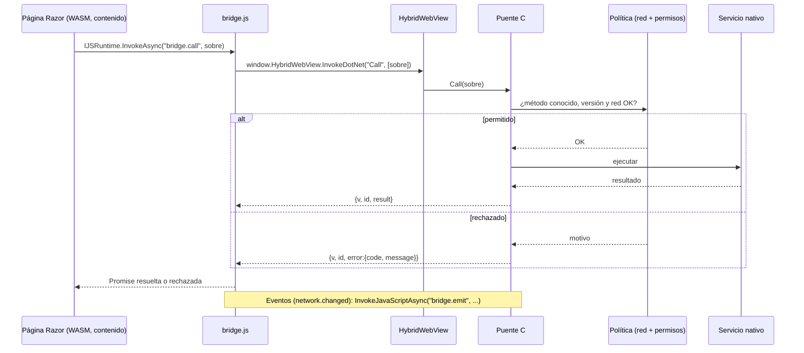
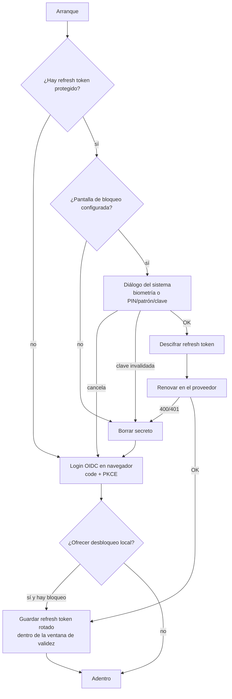
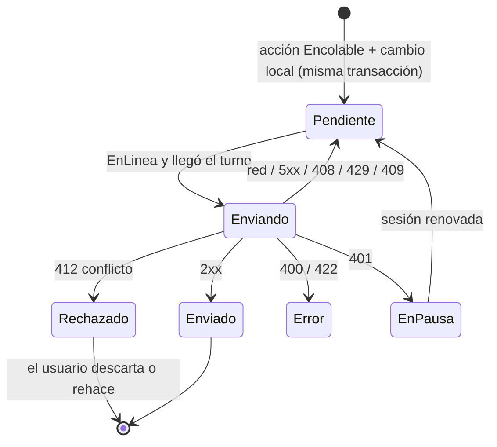

# N2: Cascarón y servicios nativos

> Dossier del investigador especializado del núcleo N2 (descomposición en
> `/LAB/Lab-Documentos/Lab-Documentos.Documentacion/PROMPTs/Concepts/01-Framework-Concept/OUTPUTs/Bitacoras/01-Descomposicion-En-Nucleos.md`).
> Fecha de investigación y de consulta de todas las URL: **2026-10-25**.
> Convención de evidencia: cada afirmación lleva **[Fn]** (fuente web numerada en §9.1), **[Ln]** (archivo local, con
> línea o sección, §9.2) o **[Cn]** (comando con su salida, §9.3). Lo que no se pudo confirmar dice **NO VERIFICADO**
> y el motivo. Lo que es juicio del investigador dice **Criterio propio**.

## Índice

1. [Índice](#índice)
2. [Alcance del núcleo y frases que lo originan](#2-alcance-del-núcleo-y-frases-que-lo-originan)
3. [Definiciones: qué es y qué no es](#3-definiciones-qué-es-y-qué-no-es)
4. [Estado del arte y estándares](#4-estado-del-arte-y-estándares)
   - 4.1 [Puente JS↔C# en .NET MAUI 10](#41-puente-jsc-en-net-maui-10)
   - 4.2 [Versionado de un contrato de puente](#42-versionado-de-un-contrato-de-puente)
   - 4.3 [Login OIDC en una app nativa](#43-login-oidc-en-una-app-nativa)
   - 4.4 [Desbloqueo con la seguridad del teléfono](#44-desbloqueo-con-la-seguridad-del-teléfono)
   - 4.5 [SecureStorage de MAUI y sus límites](#45-securestorage-de-maui-y-sus-límites)
   - 4.6 [Cámara](#46-cámara)
   - 4.7 [Red: estado, salud y resiliencia](#47-red-estado-salud-y-resiliencia)
   - 4.8 [Offline-first: outbox local e idempotencia](#48-offline-first-outbox-local-e-idempotencia)
   - 4.9 [SQLite en MAUI: librería, iOS y cifrado](#49-sqlite-en-maui-librería-ios-y-cifrado)
   - 4.10 [Lo que trae el caso base MovilidadUrbana.MAUI](#410-lo-que-trae-el-caso-base-movilidadurbanamaui)
5. [Opciones y tablas comparativas](#5-opciones-y-tablas-comparativas)
6. [Recomendación preliminar (criterio propio)](#6-recomendación-preliminar-criterio-propio)
7. [Preguntas para la mesa](#7-preguntas-para-la-mesa)
8. [Dependencias con otros núcleos](#8-dependencias-con-otros-núcleos)
9. [Fuentes](#9-fuentes)
10. [Ensayos pendientes y bloqueos](#10-ensayos-pendientes-y-bloqueos)
11. [Verificación de fuentes](#11-verificación-de-fuentes)

---

## 2. Alcance del núcleo y frases que lo originan

**Problema que resuelve N2:** definir la parte que **se actualiza por tienda** (el cascarón MAUI) y el **contrato**
por el que el contenido que se actualiza solo la usa: puente JS↔C#, identidad y desbloqueo local, cámara, red,
política de acciones sin red, bandeja de salida y base local.

| Frase del prompt / borrador | Qué le exige a N2 |
| --- | --- |
| «idea de aplicación movil en .net construida con paginas .net blazor hibridas en .NET MAUI» [L1 §Contexto] | Que las páginas Razor puedan usar servicios nativos desde un WebView |
| «el "cascarón" es la parte nativa de este framework» [L2 l.4] | Delimitar qué vive en el cascarón |
| «Login … la primera vez … su cuenta; después … la seguridad del teléfono (huella, rostro, patrón, PIN o clave)» [L2 §1, l.150-155] | OIDC + desbloqueo local con caída a credencial del dispositivo |
| «Tiene acceso controlado a cámara» [L2 §1, §5 l.198-206] | Captura por el cascarón, no desde el WebView |
| «Conoce el estado de la red y registra la actividad de red» [L2 §6 l.208-240] | Estado combinado y registro |
| «política de acciones según haya red o no: qué … offline, qué se encola y qué se bloquea» [L2 §7 l.242-284] | Clases de acción, outbox, idempotencia, conflictos (D-04) |
| «Tiene una base local SQLite» [L2 §8 l.286-293] | Librería (D-05), migraciones, cifrado |
| «Puente cascarón ↔ contenido … API versionada (`bridgeVersion`)» [L2 §9 l.295-302] | Forma y versionado del contrato |
| D-03, D-04, D-05, D-07 [L2 §13] | Evaluarlas con simplicidad y valor didáctico |

Queda **fuera** de N2: si el contenido es WASM o por datos (D-01, N1), cómo se descarga y firma el paquete (N1), qué
corre la compuerta del PR (N3/N4), la redacción de la guía (N5).

## 3. Definiciones: qué es y qué no es

| Término | Qué es | Qué **no** es |
| --- | --- | --- |
| **Cascarón** | La app MAUI compilada y publicada por tienda: servicios nativos, pantallas mínimas propias y el puente [L2 §2] | Las pantallas del negocio |
| **Puente** | El único canal por el que el contenido del WebView pide algo al cascarón; en MAUI 10 se apoya en `HybridWebView` (`InvokeDotNet`, `SendRawMessage`, `InvokeJavaScriptAsync`) [F1] | JS interop de Blazor Hybrid: en `BlazorWebView` los componentes corren en el proceso .NET y no necesitan puente para llegar a C# [F3] |
| **Contrato del puente** | Lista de métodos, formas de sobre (pedido/respuesta/error/evento) y su versión | El código de cada servicio |
| **Login OIDC** | Flujo *authorization code* con PKCE ejecutado en un navegador externo [F7][F9] | Un formulario de usuario y clave dentro de la app (RFC 9700 prohíbe el grant de contraseña) [F9] |
| **Desbloqueo local** | Autenticarse ante el **teléfono** para liberar un secreto guardado (el refresh token) | Un login: la identidad la sigue dando el servidor [L2 l.155] |
| **Credencial del dispositivo** | PIN, patrón o clave de pantalla de bloqueo (Android `DEVICE_CREDENTIAL`; iOS *passcode*) [F14][F17] | La clave de la cuenta del usuario |
| **Outbox (bandeja de salida)** | Tabla local donde una acción se guarda en la misma transacción que el cambio local, para enviarse después [F30, adaptado al cliente] | Una cola en memoria |
| **Clave de idempotencia** | Valor único por operación que el servidor usa para no ejecutarla dos veces (`Idempotency-Key`) [F29] | El id de la entidad |
| **Conflicto** | El servidor no puede aplicar una operación encolada porque el recurso cambió desde que se leyó [F31] | Un error de red (eso se reintenta) |

## 4. Estado del arte y estándares

### 4.1 Puente JS↔C# en .NET MAUI 10

**Qué ofrece `HybridWebView` (MAUI 9 y 10)** [F1]:

| Dirección | API | Evidencia |
| --- | --- | --- |
| JS → C#, mensaje crudo | `window.HybridWebView.SendRawMessage(msg)` → evento `RawMessageReceived` en C# | [F1] |
| C# → JS, mensaje crudo | `hybridWebView.SendRawMessage(...)` | [F1] |
| C# → JS, invocación | `InvokeJavaScriptAsync<T>(método, …, JsonTypeInfo)`; parámetros y retorno «JSON encoded»; .NET 10 suma una sobrecarga sin tipo de retorno | [F1][F2] |
| JS → C#, invocación | `SetInvokeJavaScriptTarget(objeto)` en C# y `await window.HybridWebView.InvokeDotNet('Metodo', [args])` en JS; métodos sincrónicos y asincrónicos, con o sin retorno | [F1] |
| Errores | En .NET 10, por defecto, las excepciones de JS se re-lanzan como excepciones .NET | [F1][F2] |
| Servir contenido | `HybridRoot` (por defecto `Resources/Raw/wwwroot`) y `DefaultFile` (`index.html`); .NET 10 agrega `WebResourceRequested` para interceptar pedidos y responder desde C# (método **sincrónico**, debe responder siempre) | [F1][F2] |

**Límites que importan al framework:**

- En .NET 9 y 10, «`HybridWebView` no está disponible cuando se habilita el *full trimming* o Native AOT» salvo
  activando un *feature switch* [F1]. Recién en .NET 11 hay una sobrecarga de `SetInvokeJavaScriptTarget` con
  `JsonSerializerContext` segura para trimming/AOT; en .NET 10 la deserialización JS→C# es por reflexión [F1].
- En iOS no se puede ejecutar código generado dinámicamente; MAUI compila AOT y en .NET 10 el runtime por defecto
  es Mono; el intérprete está activo en Debug y es opcional en Release (`UseInterpreter`) [F36].

**Blazor Hybrid (`BlazorWebView`)**: los componentes Razor «corren nativamente en el dispositivo … no corren en el
navegador y WebAssembly no participa» y «tienen acceso completo a las capacidades nativas» [F3]. Las pantallas
**propias** del cascarón (arranque, login, error) pueden ser Blazor Hybrid y llamar a los servicios por inyección de
dependencias, sin puente. El puente sólo hace falta para el **contenido descargado** (opción A de D-01), que corre en
el motor web. Desde Blazor WebAssembly, JS llama a .NET con `DotNet.invokeMethodAsync` y `[JSInvokable]` [F4]; la
página WASM llegaría al cascarón con la cadena Razor(WASM) → `IJSRuntime` → `bridge.js` →
`window.HybridWebView.InvokeDotNet` → C# del cascarón. **NO VERIFICADO** en ejecución: que un Blazor WASM servido por
`HybridWebView` desde una carpeta descargada arranque y use `InvokeDotNet`. Es el ensayo E01 de N1 (bitácora 00,
entrada 5) [L5].



### 4.2 Versionado de un contrato de puente

- No hay un estándar específico de «puente WebView». El estándar abierto más cercano para un sobre pedido/respuesta
  es **JSON-RPC 2.0**: pedido con `jsonrpc`, `method`, `params`, `id`; notificación = pedido sin `id` (no lleva
  respuesta); respuesta con `result` **o** `error` y el mismo `id`; error con `code`, `message`, `data`; códigos
  reservados −32700 (parse), −32600 (pedido inválido), −32601 (método no encontrado), −32602 (parámetros
  inválidos), −32603 (interno), −32000 a −32099 (definidos por la implementación) [F5].
- Para el número de versión, N3 ya relevó SemVer y las líneas cascarón/contenido/puente atadas por `minShellVersion`
  [L4 §4.6, §4.8]. El borrador fija: «Cambios incompatibles → subir `minShellVersion` en el manifiesto» [L2 l.302].
- **Criterio propio:** usar **un solo método .NET expuesto** (`Call(sobre)`) en lugar de un método por operación.
  Consecuencias: (a) un único punto donde validar método, versión, permisos y red; (b) agregar una operación no
  cambia la superficie expuesta al JS; (c) el contrato se fija con una prueba de contrato sobre el sobre (N4); (d) en
  .NET 11, un solo tipo de sobre en el `JsonSerializerContext` [F1].
- **Criterio propio:** **negociación al arrancar** (`bridge.handshake` → `{shellVersion, bridgeVersion, capacidades}`)
  además de `minShellVersion`: el manifiesto evita bajar contenido que no corre; el *handshake* permite al contenido
  degradar una función opcional (p. ej. ocultar «escanear» si el cascarón no la trae) sin pedir actualización de tienda.

### 4.3 Login OIDC en una app nativa

| Norma | Qué exige | Fuente |
| --- | --- | --- |
| RFC 8252 (BCP 212, oct-2017), §5 | «native apps MUST use an external user-agent» (el navegador) | [F7] |
| RFC 8252 §4 y §8.12 | No usar *user-agents* embebidos (WebViews): la app puede leer credenciales y cookies, el usuario no puede verificar el sitio y no se comparte la sesión | [F7] |
| RFC 8252 §6 y §8.1 | Los clientes públicos nativos MUST implementar PKCE (RFC 7636) y el servidor SHOULD rechazar pedidos sin PKCE | [F7] |
| RFC 8252 §7 | Redirección: esquema privado (`com.ejemplo.app:/oauth2redirect`), `https` reclamado (preferido cuando se puede) o *loopback* | [F7] |
| RFC 9700 (BCP 240, ene-2025), §2.1.1 | «Public clients MUST use PKCE» | [F9] |
| RFC 9700 §2.4 | El grant de contraseña (ROPC) «MUST NOT be used» | [F9] |
| RFC 9700 §2.2.2 | Refresh tokens de clientes públicos: «MUST be sender-constrained or use refresh token rotation» | [F9] |

**Herramientas en .NET MAUI:**

- **`WebAuthenticator`** [F10]: abre el flujo en navegador y espera el *callback* a un URI registrado. Android usa
  **Custom Tabs** si están (si no, el navegador); iOS 12+ usa `ASWebAuthenticationSession`. Requiere en Android una
  `Activity` que herede de `WebAuthenticatorCallbackActivity` con `IntentFilter` y, desde API 30, el bloque
  `<queries>` de Custom Tabs; en iOS, `CFBundleURLTypes`. .NET 10 suma una sobrecarga con `CancellationToken`
  [F2][F10]. La doc **no** describe PKCE ni intercambio de código: recomienda un backend intermedio por los secretos
  de cliente [F10]. En Windows, `WebAuthenticator` «isn't working» (issue #2702) [F10].
- **`Duende.IdentityModel.OidcClient`** 7.1.1 (16-oct-2026), Apache-2.0, ~4,3 M descargas; el paquete incluye
  ensamblados para netstandard2.0, net8.0, net9.0 y net10.0 [F11]. Es «a certified OpenID Connect relying party
  implementation» que «implements RFC 8252» y lista .NET MAUI entre sus usos [F12]. El navegador se inyecta
  implementando `IBrowser` (`InvokeAsync(BrowserOptions, CancellationToken)`); `LoginAsync` devuelve tokens y un
  `RefreshTokenHandler` preconfigurado [F13]. En el código fuente (rama `main`, `AuthorizeClient.cs`) el pedido de
  autorización **siempre** lleva `code_challenge` con `code_challenge_method` S256 y un `state` generado [F39].
  **NO VERIFICADO**: que valide `state` en la respuesta y que use `nonce` (ese archivo no agrega `nonce`; no se
  revisaron los otros archivos ni el código exacto de la etiqueta 7.1.1).
- Patrón resultante (**criterio propio**, coincide con [F10]+[F13]): `OidcClient` hace el protocolo; un `IBrowser`
  de 20 líneas delega en `WebAuthenticator` la apertura del navegador y la captura del *callback*.
- **Proveedor (D-07):** la guía de administración vigente de Keycloak es la 26.8.1 [F38]. La guía dice «Keycloak also
  supports the Proof Key for Code Exchange specification» y, para el ajuste *Revoke Refresh Token*: «When Enabled,
  Keycloak revokes refresh tokens and issues another token that the client must use» (rotación) [F38].
  **NO VERIFICADO**: el nombre y el texto exactos del ajuste de cliente que **obliga** PKCE (no apareció en la lectura
  por tramos de la guía, de ~688 000 caracteres).

### 4.4 Desbloqueo con la seguridad del teléfono

**Android** (verificado en la documentación oficial):

| Hecho | Fuente |
| --- | --- |
| `setAllowedAuthenticators`: «`DEVICE_CREDENTIAL` alone is unsupported prior to API 30, and `BIOMETRIC_STRONG \| DEVICE_CREDENTIAL` is unsupported on API 28-29»; un valor no soportado da error en `build` | [F14] |
| Con `DEVICE_CREDENTIAL` habilitado **no** se puede poner botón negativo (`setNegativeButtonText` es incompatible) | [F14] |
| Antes de habilitar credencial, chequear `isDeviceSecure`; si no es seguro, falla con `ERROR_NO_DEVICE_CREDENTIAL` (el texto está en `setDeviceCredentialAllowed`, que la misma página indica reemplazar por `setAllowedAuthenticators`) | [F14] |
| Clave «por tiempo» que acepta biometría **o** pantalla de bloqueo: «you can't pass an instance of CryptoObject into the authenticate() method»; se configura con `setUserAuthenticationParameters(VALIDITY_DURATION_SECONDS, ALLOWED_AUTHENTICATORS)` | [F15] |
| `setUserAuthenticationParameters(timeout, type)` existe desde **API 30**; `timeout = 0` = autenticar en cada uso; `type` = `AUTH_BIOMETRIC_STRONG` y/o `AUTH_DEVICE_CREDENTIAL` | [F16] |
| `setUserAuthenticationRequired(true)`: «The key can only be generated if secure lock screen is set up»; la clave queda «irreversibly invalidated once the secure lock screen is disabled» | [F16] |
| Clave por uso: se invalida al enrolar una biometría nueva **salvo** que se use `setInvalidatedByBiometricEnrollment(false)` (API 24) o `AUTH_DEVICE_CREDENTIAL` en `setUserAuthenticationParameters` | [F16] |

**iOS** (verificado en la documentación oficial, vía su JSON [C5]):

| Hecho | Fuente |
| --- | --- |
| `LAPolicy.deviceOwnerAuthentication`: usa biometría si está disponible y enrolada; si no, pide el código del dispositivo; en iOS falla con `passcodeNotSet` si no hay código | [F17][F20] |
| `SecAccessControlCreateFlags.userPresence`: «either biometry or passcode»; la biometría no necesita estar enrolada; el ítem sigue accesible si se agregan o quitan huellas o se re-enrola Face ID; equivale a `biometryAny` **o** `devicePasscode` | [F18] |
| `kSecAttrAccessibleWhenPasscodeSetThisDeviceOnly`: no se pueden guardar ítems sin código; **desactivar el código borra** los ítems de esa clase; no migran a otro dispositivo | [F19] |

**Plugins MAUI revisados:**

| Plugin | Qué hace | Evidencia |
| --- | --- | --- |
| `Plugin.Maui.Biometric` (MIT; última en NuGet 0.1.2; último commit 2026-08-16; Android API 26+, iOS 15+) | Sí tiene caída a credencial: `AllowPasswordAuth` → Android `strength \| DeviceCredential`, iOS `LAPolicy.DeviceOwnerAuthentication`. **No** usa `CryptoObject`, Keystore ni Keychain: es una compuerta sí/no | [F21][C1][C2] |
| `Plugin.Maui.SecureSession` 1.0.7 (MIT, ~1 000 descargas, 11-sep-2026) | Tokens cifrados con AES-256-GCM; «The lock is an in-memory gate» | [F22] |

- Consecuencia (**criterio propio**): con una compuerta sí/no el secreto queda legible para quien tenga el proceso o
  el almacenamiento aunque no pase la biometría; atar el secreto al hardware exige código de plataforma propio
  (Keystore + `BiometricPrompt` en Android; Keychain con `userPresence` en iOS). Además, el plugin habilita
  `BiometricStrong | DeviceCredential` sin chequear el nivel de API [C1], combinación que en API 28-29 falla en
  `build` según [F14] (inferencia, **NO VERIFICADO** en ejecución).
- **Interacción con la rotación de refresh token** (RFC 9700 §2.2.2 [F9]): si el proveedor rota el refresh token, el
  cascarón debe **reescribir** el secreto protegido en cada renovación. Con una clave Android «por uso» (`timeout 0`),
  cifrar el token nuevo pediría otra autenticación; con una clave «por tiempo» de pocos segundos, un solo diálogo
  alcanza para descifrar el viejo y cifrar el nuevo [F15][F16] (inferencia; **NO VERIFICADO** en el g42, ensayo
  E-N2-1). En iOS, **NO VERIFICADO** si actualizar un ítem con `userPresence` pide autenticación.



### 4.5 SecureStorage de MAUI y sus límites

| Límite | Evidencia |
| --- | --- |
| Pensado para «small amounts of text»; guardar mucho afecta el rendimiento | [F23] |
| Android: cifra con `EncryptedSharedPreferences` (AES-256 GCM en valores) | [F23] |
| `androidx.security:security-crypto` (que contiene `EncryptedSharedPreferences`) deprecó **todas** sus API en 1.1.0-alpha07 (9-abr-2025) y 1.1.0-beta01 (4-jun-2025) «in favour of existing platform APIs and direct use of Android Keystore»; la 1.1.0 estable salió el 30-jul-2025 | [F24] |
| Android Auto Backup restaura valores que no se pueden descifrar en otro equipo; MAUI borra la clave pero `GetAsync` puede lanzar excepción → `try/catch` + `RemoveAll`, o excluir el archivo del backup | [F23] |
| iOS: Keychain; desinstalar **no** borra los ítems; con iCloud Keychain los valores pueden sincronizar a otros equipos del usuario «not controllable from .NET MAUI» | [F23] |
| No ata la lectura a autenticación del usuario (no expone flags de control de acceso) | [F23] (la API documentada sólo tiene `SetAsync`/`GetAsync`/`Remove`/`RemoveAll`); coincide con [L2 l.189] |

**Criterio propio:** `SecureStorage` alcanza para secretos **sin** desbloqueo local (p. ej. la clave de la base si se
cifrara, la marca de primer arranque). El refresh token con desbloqueo local va por el camino de §4.4.

### 4.6 Cámara

- **`MediaPicker`** (.NET 10) [F25]: `CapturePhotoAsync`/`CaptureVideoAsync` devuelven `FileResult?`;
  `PickPhotosAsync`/`PickVideosAsync` devuelven listas; `MediaPickerOptions` trae `SelectionLimit`, `MaximumWidth`,
  `MaximumHeight`, `CompressionQuality`, `RotateImage`, `PreserveMetaData`. Debe llamarse en el hilo de UI. Android:
  permiso `CAMERA` y, desde API 30, `<queries>` con `android.media.action.IMAGE_CAPTURE`; iOS: `NSCameraUsageDescription`
  (y micrófono/galería según uso). `FullPath` no siempre es la ruta física: leer con `OpenReadAsync` y copiar a
  almacenamiento propio [F25]. .NET 10 rota según EXIF y conserva metadatos [F2].
- **`CameraView`** (`CommunityToolkit.Maui.Camera`) [F26]: vista previa, captura, video, flash, zoom, resolución,
  selección de cámara; permisos pedidos a mano (`Permissions.RequestAsync<Permissions.Camera>()`). Es un control
  MAUI: para usarlo desde contenido web el cascarón tiene que mostrar **una página nativa** encima del WebView
  (**criterio propio**, deducido de que es un `View` de MAUI [F26]).
- **Desde el WebView** (`getUserMedia`): el borrador lo considera más frágil (permisos del WebView por plataforma)
  [L2 l.204]. No se investigó más: la recomendación del borrador (pedir al cascarón por el puente) coincide con la
  centralización de permisos y política de §4.1.
- **Mostrar la foto en la página web** (**criterio propio**): devolver por el puente un identificador, no una ruta,
  y servir el archivo con `WebResourceRequested` (p. ej. `/media/{id}`) [F2]; evita pasar megabytes en base64 por
  el sobre JSON.

### 4.7 Red: estado, salud y resiliencia

- `Connectivity.Current.NetworkAccess`: `Internet`, `ConstrainedInternet` (portal cautivo), `Local`, `None`,
  `Unknown`; `ConnectionProfiles` (WiFi, celular, Ethernet, Bluetooth); evento `ConnectivityChanged`; Android
  requiere `ACCESS_NETWORK_STATE` [F27].
- Límite documentado: puede reportar `Internet` «but full access to the web isn't available» (p. ej. WiFi con el
  router sin salida) [F27]. Confirma el `GET /health` y el estado combinado del borrador [L2 l.214-234].
- `Microsoft.Extensions.Http.Resilience` (sobre Polly) [F28]: `AddStandardResilienceHandler` encadena *rate limiter*
  (1 000 permisos), *timeout* total 30 s, reintento (3, exponencial, *jitter*, 2 s), *circuit breaker* (10 %, mínimo
  100, muestreo 30 s, corte 5 s) y *timeout* por intento 10 s; maneja 5xx, 408, 429, `HttpRequestException` y
  `TimeoutRejectedException`. **Por defecto reintenta todos los métodos**; `DisableForUnsafeHttpMethods()` corta
  los reintentos de POST/PATCH/PUT/DELETE/CONNECT porque «a POST … could lead to data duplication» [F28]. No apilar
  varios *handlers* de resiliencia [F28].
- **Criterio propio:** el reintento de las acciones `Encolable` lo hace el **sincronizador del outbox** (que
  persiste intentos y sobrevive a cerrar la app). El `HttpClient` reintenta sólo métodos seguros
  (`DisableForUnsafeHttpMethods`). Dos capas de reintento sobre el mismo POST multiplican envíos y ocultan el estado
  real al usuario.

### 4.8 Offline-first: outbox local e idempotencia

- **Transactional Outbox** (Richardson): guardar el mensaje «in the database as part of the transaction that updates
  the business entities»; un *relay* lo envía; el *relay* «might publish a message more than once», así que el
  consumidor debe ser idempotente [F30]. El patrón nace en servicios; su aplicación al teléfono (SQLite local como
  base, API como consumidor) es **criterio propio** coherente con [L2 l.279-284].
- **`Idempotency-Key`** (draft-ietf-httpapi-idempotency-key-header-**08**, 22-oct-2026, Internet-Draft activo del
  WG httpapi, *Standards Track*, vence 25-abr-2027) [F29]: campo *Structured Header* de tipo String; único, recomienda
  UUID; no reutilizar con otro cuerpo; apunta a POST y PATCH; el servidor SHOULD responder **400** si falta,
  **422** si se reusó con otro cuerpo, **409** si el original sigue en proceso; un reintento tras completar recibe
  una respuesta consistente; el recurso MUST publicar su política (incluida la expiración) [F29]. **Es un borrador,
  no un RFC**: se usa como convención documentada.
- **Conflictos (D-04)**: HTTP ya tiene la herramienta. Con `If-Match` (ETag/versión) el servidor evita el «lost
  update»: si la condición falla MUST NOT ejecutar y MAY responder **412** [F31].

| Respuesta al sincronizar | Qué hace el outbox (**criterio propio**) |
| --- | --- |
| 2xx, o la respuesta guardada del original | `Enviado` |
| Red, 5xx, 408, 429 | `Pendiente`, próximo intento con backoff |
| 409 (original en curso) | `Pendiente`, reintentar luego [F29] |
| 412 (conflicto de versión) | `Rechazado` → la UI muestra «otro cambió esto» y ofrece descartar o rehacer |
| 422 / 400 (clave mal usada) | `Error` (bug del cliente), no se reintenta |
| 401 | Pausa el outbox y pide desbloqueo/login |



### 4.9 SQLite en MAUI: librería, iOS y cifrado

| Hecho | Fuente |
| --- | --- |
| La doc oficial de MAUI usa `sqlite-net-pcl` (owner praeclarum; «third-party») y menciona `Microsoft.Data.Sqlite` como alternativa ADO.NET; advierte que hay paquetes de nombre parecido | [F32] |
| `SQLiteOpenFlags` incluye protección de archivo de iOS (`ProtectionComplete`, `…UnlessOpen`, `…UntilFirstUserAuthentication`); WAL con `EnableWriteAheadLoggingAsync` | [F32] |
| `sqlite-net-pcl` 1.11.285 (13-jul-2026, 25 M descargas) depende de **SQLitePCLRaw 3.0.3** y `SourceGear.sqlite3`; en `net8.0-ios18.0` usa el SQLite del sistema | [F33] |
| SQLitePCLRaw 3.0: se quitó `bundle_green`; «I no longer distribute any no-cost SQLite builds with encryption»; **`.bundle_e_sqlcipher` está deprecado**; SQLCipher se compra a Zetetic o se compila desde su código abierto; el autor recomienda SEE (licencia paga del equipo de SQLite); los NuGet de SEE y de SQLite3 Multiple Ciphers (código abierto) se ofrecen a clientes del servicio pago de compilación de SourceGear | [F34] |
| Última versión publicada de `SQLitePCLRaw.bundle_e_sqlcipher`: 2.1.11; de `sqlite-net-sqlcipher`: 1.10.196-beta | [C4] |
| EF Core NativeAOT y consultas precompiladas: «highly experimental … not yet suited for production use»; no soporta consultas dinámicas, sintaxis de consulta LINQ ni *value converters* con estado capturado | [F35] |
| iOS: sin código dinámico (`System.Reflection.Emit` no disponible); el intérprete Mono rescata casos que fallan en Release, con costo de velocidad | [F36] |
| Caso real (MAUI 8, EF Core SQLite): crash al arrancar sólo por TestFlight; los participantes lo resolvieron bajando EF Core 8.0.4→8.0.1 o volviendo a Xcode 15.2; sin respuesta aceptada | [F37] |

- **NO VERIFICADO**: EF Core 10 + SQLite en un iPhone real con .NET 10. No hay Mac ni runner iOS disponible para
  ensayarlo (D-06, N3). Lo de [F37] es anecdótico y de .NET 8.
- El borrador propone «SQLCipher (`sqlite-net-sqlcipher` / `SQLitePCLRaw.bundle_e_sqlcipher`)» [L2 l.290]: con
  [F34] y [C4] **esa vía gratuita quedó deprecada**. Es una contradicción a registrar en la cohesión (§8).

### 4.10 Lo que trae el caso base MovilidadUrbana.MAUI

| Hecho | Evidencia |
| --- | --- |
| Persistencia con EF Core SQLite 10.0.11 vía `AddDbContextFactory` + `UseSqlite` | [L3 §8, §10]; `/LAB/Lab-E2E.WebBlazor/Lab-E2E.WebBlazor/src/MovilidadUrbana.MAUI/Infrastructure/DependencyInjection.cs:20` |
| `EnsureCreated()` sin migraciones, a propósito | `…/Infrastructure/Persistence/DatabaseInitializer.cs:10,25` |
| Resuelve `Microsoft.Data.Sqlite.Core` 10.0.11 y `SQLitePCLRaw.bundle_e_sqlite3` **2.1.12** (no la 3.x) | [C3] |
| Sólo Android, `SupportedOSPlatformVersion` 23; sin login, sin red, sin permisos | [L3 §2, §9, §10] |
| La **encuesta** es de alta pura (`RegistrarAsync` agrega una respuesta con `RegistradaEn`); las **localidades** se editan y borran | [L3 §4.2, §4.3] |

Consecuencia didáctica (**criterio propio**): la encuesta es el caso ideal para enseñar `Encolable` + idempotencia
**sin** conflictos (sólo altas); la edición de localidades es el caso para enseñar el conflicto (412).

## 5. Opciones y tablas comparativas

Escala: ●●● favorable, ●● medio, ● desfavorable (riesgo y costo: ●●● = bajo). Las celdas son **criterio propio**
apoyado en §4.

### 5.1 Forma del puente

| Opción | Simplicidad | Practicidad | Escalabilidad | Riesgo | Costo | Nota |
| --- | --- | --- | --- | --- | --- | --- |
| P1. Un método por operación (`InvokeDotNet('CapturePhoto')`) | ●●● | ●● | ● | ●● | ●●● | Cada operación nueva cambia la superficie; validación repartida |
| **P2. Un método `Call(sobre)` + sobre tipo JSON-RPC + `handshake`** | ●● | ●●● | ●●● | ●●● | ●● | Validación central; contrato testeable [F5] |
| P3. Sólo `SendRawMessage` con protocolo propio | ● | ● | ●● | ●● | ● | Hay que reimplementar correlación de respuestas y errores que `InvokeDotNet` ya da [F1] |

### 5.2 Login y desbloqueo

| Opción | Simplicidad | Practicidad | Escalabilidad | Riesgo | Costo |
| --- | --- | --- | --- | --- | --- |
| L1. Formulario usuario/clave propio (ROPC) | ●●● | ●● | ● | ● (prohibido por RFC 9700 §2.4 [F9]) | ●●● |
| L2. `WebAuthenticator` + backend propio que hace el intercambio | ●● | ●● | ●● | ●● | ●● |
| **L3. `OidcClient` (code+PKCE) con `IBrowser` sobre `WebAuthenticator`** | ●● | ●●● | ●●● | ●●● | ●●● (Apache-2.0) |
| D1. Desbloqueo con plugin sí/no (`Plugin.Maui.Biometric`) + `SecureStorage` | ●●● | ●●● | ●● | ● (secreto no atado al hardware) | ●●● |
| **D2. Código de plataforma: Keystore (`setUserAuthenticationParameters`) + `BiometricPrompt`; Keychain `userPresence`** | ● | ●● | ●●● | ●●● | ●● |

### 5.3 D-03: teléfono sin bloqueo configurado

| Opción | Simplicidad | Practicidad | Escalabilidad | Riesgo | Costo |
| --- | --- | --- | --- | --- | --- |
| **T1. No ofrecer desbloqueo local; login con cuenta en cada arranque; aviso «configurá un bloqueo para entrar más rápido»** | ●●● | ●● | ●●● | ●●● | ●●● |
| T2. Guardar el refresh token en `SecureStorage` sin atarlo a autenticación | ●●● | ●●● | ●● | ● | ●●● |
| T3. PIN propio de la app | ● | ●● | ●● | ●● | ● |

Hecho que condiciona: en Android la clave con `setUserAuthenticationRequired` **no se puede generar** sin bloqueo
seguro [F16]; en iOS los ítems `WhenPasscodeSetThisDeviceOnly` no se pueden guardar sin código y `deviceOwnerAuthentication`
falla con `passcodeNotSet` [F17][F19][F20]. T1 es lo que las plataformas ya imponen; T2 y T3 lo rodean.

### 5.4 D-04: conflictos del outbox

| Opción | Simplicidad | Practicidad | Escalabilidad | Riesgo | Costo |
| --- | --- | --- | --- | --- | --- |
| C1. Último gana siempre | ●●● | ●● | ● | ● (pérdida silenciosa) | ●●● |
| **C2. El servidor decide con versión (`If-Match` → 412); el cliente marca `Rechazado` y el usuario resuelve** | ●● | ●● | ●●● | ●●● | ●● |
| C3. Fusión automática por campo / CRDT | ● | ● | ●●● | ●● | ● |
| C2 + declarar por acción «último gana» sólo donde el negocio lo admite | ●● | ●●● | ●●● | ●●● | ●● |

### 5.5 D-05: librería SQLite

| Opción | Simplicidad | Practicidad | Escalabilidad | Riesgo | Costo |
| --- | --- | --- | --- | --- | --- |
| **S1. `sqlite-net-pcl`** (doc oficial MAUI [F32]) | ●●● | ●●● | ●● | ●●● | ●●● |
| S2. EF Core SQLite (lo usa el caso base [C3]) | ●● | ●●● (continuidad didáctica) | ●●● | ●● en iOS (NativeAOT experimental [F35], caso [F37]; **NO VERIFICADO** en .NET 10) | ●●● |
| S3. `Microsoft.Data.Sqlite` (ADO.NET) | ●● | ●● | ●●● | ●●● | ●●● |

### 5.6 Cifrado de la base

| Opción | Simplicidad | Riesgo | Costo |
| --- | --- | --- | --- |
| E0. Sin cifrado propio; protección de archivo del SO (iOS `ProtectionComplete…` [F32]) | ●●● | ●● | ●●● |
| E1. `bundle_e_sqlcipher` / `sqlite-net-sqlcipher` | ●● | ● (deprecado/sin mantenimiento [F34][C4]) | ●●● |
| E2. SQLCipher comercial de Zetetic o SQLite3MC por servicio pago | ●● | ●●● | ● |
| E3. Cifrar sólo campos sensibles con una clave del Keystore/Keychain | ● | ●● | ●●● |

### 5.7 D-07: proveedor de identidad

| Opción | Simplicidad | Practicidad | Escalabilidad | Riesgo | Costo |
| --- | --- | --- | --- | --- | --- |
| **I1. Cualquier OIDC; la demo con Keycloak en contenedor** | ●● | ●●● | ●●● | ●●● | ●●● |
| I2. Backend propio que emite tokens | ● | ●● | ●● | ● (reimplementar OIDC) | ● |
| I3. Proveedor SaaS | ●●● | ●● | ●●● | ●● (dependencia externa en una demo académica) | ●● |

## 6. Recomendación preliminar (criterio propio)

> Todo este apartado es **criterio propio** del investigador, apoyado en §4 y sujeto a la mesa y a los ensayos de §10.

### 6.1 Puente

**Recomiendo P2:** un único método .NET `Call(sobre)` registrado con `SetInvokeJavaScriptTarget`, sobre con forma
JSON-RPC 2.0 más el campo `v` (versión del puente), códigos de error propios en −32000…−32099, eventos del cascarón al
contenido como notificaciones (sin `id`) vía `InvokeJavaScriptAsync("bridge.emit", …)`, y `bridge.handshake` al
cargar. Versión del puente `MAYOR.MENOR`: MENOR para agregados, MAYOR para quiebres, que además sube `minShellVersion`.

- Cadena de consecuencias: un punto de validación → la política de red y permisos se aplica una vez → la prueba de
  contrato (N4) fija un solo esquema → N3 versiona una línea clara.
- Lo que pierde P1: simplicidad del primer ejemplo (un método por botón se entiende antes). Se puede mostrar P1 en la
  guía como «primer paso» y refactorizar a P2 como lección.
- Si D-01 termina en B (pantallas por datos dentro de `BlazorWebView`), **el puente JS desaparece**: los componentes
  corren en .NET [F3] y llaman a los servicios por DI. El sobre y la política se conservan como interfaz C#.

### 6.2 Login y desbloqueo

**Recomiendo L3 + D2:** `Duende.IdentityModel.OidcClient` con `IBrowser` sobre `WebAuthenticator`, redirección por
esquema privado basado en el `applicationId` (RFC 8252 §7.1), PKCE obligatorio en el proveedor, refresh token con
rotación (RFC 9700 §2.2.2). Desbloqueo local con código de plataforma:

- Android API 30+: clave AES en Keystore con `setUserAuthenticationRequired(true)` y
  `setUserAuthenticationParameters(N segundos, AUTH_BIOMETRIC_STRONG | AUTH_DEVICE_CREDENTIAL)`; `BiometricPrompt` con
  `BIOMETRIC_STRONG | DEVICE_CREDENTIAL`, sin botón negativo. La clave «por tiempo» permite descifrar y re-cifrar el
  token rotado con un solo diálogo y no se invalida al enrolar huellas [F15][F16].
- Android 24–29: **pregunta a la mesa** (§7): o se sube el mínimo a API 30 para el desbloqueo local, o en 28-29 se
  ofrece sólo biometría fuerte [F14].
- iOS: ítem Keychain con `SecAccessControl` `userPresence` y `kSecAttrAccessibleWhenPasscodeSetThisDeviceOnly` [F18][F19].
- Lo que pierde D1 (plugin sí/no): menos código; pero el refresh token queda legible sin pasar el diálogo, que es
  justo lo que el borrador quiere evitar [L2 l.151]. `Plugin.Maui.Biometric` puede usarse para mostrar el diálogo en
  el **primer** paso didáctico, y declararlo insuficiente en la guía.

**D-03 → T1.** No ofrecer desbloqueo local sin bloqueo de pantalla; si el usuario quita el bloqueo, la clave se
invalida (Android) o el ítem se borra (iOS) [F16][F19] → el cascarón lo detecta, borra lo que quede y pide login.
Lo que pierde T2: la comodidad de no loguearse en un teléfono sin bloqueo, a cambio de que cualquiera que lo tome
entre a la cuenta.

**D-07 → I1.** El framework depende sólo de un *issuer* OIDC; la demo usa Keycloak (26.8.1 [F38]) en un contenedor
del entorno de ensayo. Lo que pierde I2: control total del formato de tokens; reimplementar OIDC no tiene valor
didáctico y suma riesgo.

### 6.3 Cámara, red y outbox

- Cámara: `MediaPicker.CapturePhotoAsync` detrás de `camera.capture` del puente; el archivo se copia a
  `AppDataDirectory/media`, se registra en SQLite y se sirve a la página por `WebResourceRequested`. `CameraView` y
  escaneo quedan fuera de la demo (exigen página nativa superpuesta).
- Red: estado combinado del borrador (`SinRed`/`RedSinServidor`/`EnLinea`/`EnLineaMedida`) con `Connectivity` +
  `/health`; `AddStandardResilienceHandler` con `DisableForUnsafeHttpMethods()`; registro de actividad en un
  `DelegatingHandler` → tabla circular.
- Outbox: fila escrita en la **misma transacción SQLite** que el cambio local; `Idempotency-Key` = UUID creado al
  encolar; sincronizador secuencial con backoff; tabla de estados de §4.8.
- **D-04 → C2 + «último gana» declarado por acción.** Lo que pierde C1: simplicidad; lo que se evita: pérdidas
  silenciosas que un alumno no ve. C3 es desproporcionado para la guía.

### 6.4 Base local

**D-05 → S1 (`sqlite-net-pcl`) para el framework.** Motivo central: con la opción A de D-01 las entidades del negocio
viven en el **contenido** que cambia sin tienda, así que el cascarón no puede compilar un modelo EF de esas
entidades; necesita una API genérica (`db.query/save` por colección, con el documento en JSON) [L2 l.293]. Las
fortalezas de EF Core (modelo tipado, migraciones) quedan ancladas al tiempo de compilación del cascarón, que es
justo lo que se quiere desacoplar; y su soporte AOT sigue experimental [F35]. Lo que pierde: continuidad con el caso
base (EF Core [C3]) y LINQ tipado; la guía debe explicar el cambio como decisión de arquitectura, no de gusto.

**Cifrado → E0 en la demo**, con la decisión de producción (E2 o E3) documentada; no recomendar E1 (deprecado [F34]).

### 6.5 Qué mostrar en la demo (N5)

| Pieza | En la demo | Por qué |
| --- | --- | --- |
| Puente P2 con `handshake`, `device.info`, `camera.capture`, `outbox.enqueue`, evento `network.changed` | Sí | Cubre pedido, respuesta, error, evento y versión |
| Login OIDC + PKCE contra Keycloak en contenedor | Sí | Estándar real, ensayable en Linux + Android |
| Desbloqueo local | Sí en Android (g42, API 33); iOS sólo en la guía | No hay compilación iOS (D-06) |
| Encuesta `Encolable` con idempotencia; edición de localidad con 412 | Sí | El caso base ya trae los dos tipos de operación [L3] |
| `CameraView`, escaneo, SQLCipher, CRDT | No | Costo alto, poco valor didáctico inicial |

## 7. Preguntas para la mesa

1. ¿Se acepta P2 (un `Call(sobre)`) como forma del puente, con P1 sólo como paso didáctico previo?
2. ¿La versión del puente vive en el manifiesto (`minShellVersion`) **y** en un `handshake`, o sólo en el manifiesto?
3. Android mínimo: ¿API 30 para tener desbloqueo con caída a PIN/patrón uniforme, o se soportan 24–29 con biometría
   sola? (el caso base declara 23 [L3 §10]; .NET 10 recomienda 24 [F2]).
4. ¿Se exige rotación de refresh token en el proveedor (RFC 9700) aunque obligue a reescribir el secreto en cada
   renovación?
5. D-03: ¿se adopta T1 (sin bloqueo no hay desbloqueo local)?
6. D-04: ¿C2 como regla general y «último gana» sólo por declaración explícita de la acción?
7. D-05: ¿se acepta abandonar EF Core del caso base en favor de `sqlite-net-pcl` + colecciones JSON, y cómo lo cuenta
   la guía?
8. ¿Se borra del borrador la recomendación de `sqlite-net-sqlcipher`/`bundle_e_sqlcipher` y se registra el cifrado
   como decisión de producción?
9. D-07: ¿Keycloak en contenedor para la demo es aceptable para el entorno del laboratorio?
10. ¿La política de acciones (clase por acción) viaja en el manifiesto del contenido (N1) o en el cascarón?

## 8. Dependencias con otros núcleos

| Con | Qué recibe N2 | Qué entrega N2 |
| --- | --- | --- |
| N1 | D-01 (A/B/C) define si hay puente JS; `WebResourceRequested` para servir contenido **y** medios; `minShellVersion` y política de acciones en el manifiesto | `bridgeVersion` y capacidades; `bridge.ready` como señal de «arranqué bien» para el rollback |
| N3 | Línea de versión del puente; mínimo de Android; dónde compila iOS (D-06) para verificar §4.4 y §4.9 en iOS | Regla MAYOR/MENOR del puente |
| N4 | — | Esquema del sobre para pruebas de contrato; outbox probable con servidor falso (409/412/422); desbloqueo sólo en teléfono real (E2E manual o semiautomático en el g42) |
| N5 | Alcance de la demo | Tabla §6.5; los dos casos didácticos del caso base |

**Contradicciones para `02-Cohesion-Global.md` §3:**

| Id | Contradicción | Evidencia |
| --- | --- | --- |
| X-N2-1 | El borrador recomienda `sqlite-net-sqlcipher`/`bundle_e_sqlcipher`; SQLitePCLRaw 3.0 lo deprecó | [L2 l.290] vs [F34][C4] |
| X-N2-2 | El borrador sugiere evaluar `Plugin.Maui.Biometric` para atar el secreto; el plugin no usa Keystore/Keychain | [L2 l.189] vs [C1] |
| X-N2-3 | El caso base usa EF Core; la recomendación D-05 es `sqlite-net-pcl` | [C3] vs §6.4 |
| X-N2-4 | El borrador combina `BIOMETRIC_STRONG \| DEVICE_CREDENTIAL` sin nivel de API; no funciona en 28-29 | [L2 l.187] vs [F14] |
| X-N2-5 | `SecureStorage` en Android descansa en una librería deprecada upstream | [F23] vs [F24] |

## 9. Fuentes

### 9.1 Web (consultadas el 2026-10-25)

1. **[F1]** Microsoft. (2026, 8 de julio). *HybridWebView – .NET MAUI*. Microsoft Learn. https://learn.microsoft.com/en-us/dotnet/maui/user-interface/controls/hybridwebview?view=net-maui-10.0
2. **[F2]** Microsoft. (2026, 14 de agosto). *What's new in .NET MAUI for .NET 10*. Microsoft Learn. https://learn.microsoft.com/en-us/dotnet/maui/whats-new/dotnet-10?view=net-maui-10.0
3. **[F3]** Microsoft. (2025, 11 de noviembre). *ASP.NET Core Blazor Hybrid*. Microsoft Learn. https://learn.microsoft.com/en-us/aspnet/core/blazor/hybrid/?view=aspnetcore-10.0
4. **[F4]** Microsoft. (2026, 14 de julio). *Call .NET methods from JavaScript functions in ASP.NET Core Blazor*. Microsoft Learn. https://learn.microsoft.com/en-us/aspnet/core/blazor/javascript-interoperability/call-dotnet-from-javascript?view=aspnetcore-10.0
5. **[F5]** JSON-RPC Working Group. (2013, 4 de enero). *JSON-RPC 2.0 Specification*. https://www.jsonrpc.org/specification
6. **[F6]** Sakimura, N., Bradley, J. y Agarwal, N. (2015). *RFC 7636: Proof Key for Code Exchange by OAuth Public Clients*. IETF. https://www.rfc-editor.org/rfc/rfc7636 (citada a través de [F7] y [F9]; no se leyó el texto propio)
7. **[F7]** Denniss, W. y Bradley, J. (2017, octubre). *RFC 8252: OAuth 2.0 for Native Apps* (BCP 212). IETF. https://www.rfc-editor.org/rfc/rfc8252
8. **[F9]** Lodderstedt, T., Bradley, J., Labunets, A. y Fett, D. (2025, enero). *RFC 9700: Best Current Practice for OAuth 2.0 Security* (BCP 240). IETF. https://www.rfc-editor.org/rfc/rfc9700 — fecha confirmada en https://datatracker.ietf.org/doc/rfc9700/
9. **[F10]** Microsoft. (2025, 2 de abril). *Web Authenticator – .NET MAUI*. Microsoft Learn. https://learn.microsoft.com/en-us/dotnet/maui/platform-integration/communication/authentication?view=net-maui-10.0
10. **[F11]** Duende Software. (2026, 16 de octubre). *Duende.IdentityModel.OidcClient 7.1.1*. NuGet. https://www.nuget.org/packages/Duende.IdentityModel.OidcClient
11. **[F12]** Duende Software. (s. f.). *IdentityModel.OidcClient*. https://docs.duendesoftware.com/identitymodel-oidcclient/
12. **[F13]** Duende Software. (s. f.). *Automatic Mode – OidcClient*. https://docs.duendesoftware.com/identitymodel-oidcclient/automatic/
13. **[F14]** Google. (s. f.). *BiometricPrompt.PromptInfo.Builder* (AndroidX). Android Developers. https://developer.android.com/reference/androidx/biometric/BiometricPrompt.PromptInfo.Builder
14. **[F15]** Google. (s. f.). *Show a biometric authentication dialog*. Android Developers. https://developer.android.com/identity/sign-in/biometric-auth
15. **[F16]** Google. (s. f.). *KeyGenParameterSpec.Builder*. Android Developers. https://developer.android.com/reference/android/security/keystore/KeyGenParameterSpec.Builder
16. **[F17]** Apple. (s. f.). *LAPolicy.deviceOwnerAuthentication*. Apple Developer Documentation. https://developer.apple.com/documentation/localauthentication/lapolicy/deviceownerauthentication
17. **[F18]** Apple. (s. f.). *SecAccessControlCreateFlags.userPresence*. Apple Developer Documentation. https://developer.apple.com/documentation/security/secaccesscontrolcreateflags/userpresence
18. **[F19]** Apple. (s. f.). *kSecAttrAccessibleWhenPasscodeSetThisDeviceOnly*. Apple Developer Documentation. https://developer.apple.com/documentation/security/ksecattraccessiblewhenpasscodesetthisdeviceonly
19. **[F20]** Apple. (s. f.). *LAError.Code.passcodeNotSet*. Apple Developer Documentation. https://developer.apple.com/documentation/localauthentication/laerror-swift.struct/code/passcodenotset
20. **[F21]** FreakyAli. (2026). *Plugin.Maui.Biometric* [repositorio, commit 8f6a6e3 del 2026-08-16]. GitHub. https://github.com/FreakyAli/Plugin.Maui.Biometric
21. **[F22]** nuvyntralabs. (2026, 11 de septiembre). *Plugin.Maui.SecureSession 1.0.7*. NuGet. https://www.nuget.org/packages/Plugin.Maui.SecureSession
22. **[F23]** Microsoft. (2026, 24 de marzo). *Secure storage – .NET MAUI*. Microsoft Learn. https://learn.microsoft.com/en-us/dotnet/maui/platform-integration/storage/secure-storage?view=net-maui-10.0
23. **[F24]** Google. (2025). *Security – AndroidX releases* (security-crypto 1.1.0-alpha07, 1.1.0-beta01). Android Developers. https://developer.android.com/jetpack/androidx/releases/security
24. **[F25]** Microsoft. (2026, 6 de agosto). *Media picker for photos and videos – .NET MAUI*. Microsoft Learn. https://learn.microsoft.com/en-us/dotnet/maui/platform-integration/device-media/picker?view=net-maui-10.0
25. **[F26]** Microsoft. (2026, 17 de marzo). *CameraView – .NET MAUI Community Toolkit*. Microsoft Learn. https://learn.microsoft.com/en-us/dotnet/communitytoolkit/maui/views/camera-view
26. **[F27]** Microsoft. (2023, 2 de febrero). *Connectivity – .NET MAUI*. Microsoft Learn. https://learn.microsoft.com/en-us/dotnet/maui/platform-integration/communication/networking?view=net-maui-10.0
27. **[F28]** Microsoft. (2026, 24 de febrero). *Build resilient HTTP apps: Key development patterns*. Microsoft Learn. https://learn.microsoft.com/en-us/dotnet/core/resilience/http-resilience
28. **[F29]** IETF httpapi WG. (2026, 22 de octubre). *The Idempotency-Key HTTP Header Field* (draft-ietf-httpapi-idempotency-key-header-08). https://datatracker.ietf.org/doc/draft-ietf-httpapi-idempotency-key-header/
29. **[F30]** Richardson, C. (s. f.). *Pattern: Transactional outbox*. microservices.io. https://microservices.io/patterns/data/transactional-outbox.html
30. **[F31]** Fielding, R., Nottingham, M. y Reschke, J. (2022). *RFC 9110: HTTP Semantics*, §13.1.1 If-Match. IETF. https://www.rfc-editor.org/rfc/rfc9110
31. **[F32]** Microsoft. (2024, 30 de agosto; actualizado 2025-07-31). *.NET MAUI local databases*. Microsoft Learn. https://learn.microsoft.com/en-us/dotnet/maui/data-cloud/database-sqlite?view=net-maui-10.0
32. **[F33]** praeclarum. (2026, 13 de julio). *sqlite-net-pcl 1.11.285*. NuGet. https://www.nuget.org/packages/sqlite-net-pcl
33. **[F34]** Sink, E. (s. f.). *SQLitePCLRaw 3.0 release notes* (`v3.md`). GitHub. https://github.com/ericsink/SQLitePCL.raw/blob/main/v3.md
34. **[F35]** Microsoft. (2024, 10 de noviembre; actualizado 2026-06-24). *NativeAOT Support and Precompiled Queries (Experimental) – EF Core*. Microsoft Learn. https://learn.microsoft.com/en-us/ef/core/performance/nativeaot-and-precompiled-queries
35. **[F36]** Microsoft. (2026, 25 de septiembre). *Interpreters on iOS and Mac Catalyst – .NET MAUI*. Microsoft Learn. https://learn.microsoft.com/en-us/dotnet/maui/macios/interpreter?view=net-maui-10.0
36. **[F37]** Microsoft Q&A. (2024, 28 de marzo). *Fixing issues with AOT compilation* [hilo]. https://learn.microsoft.com/en-us/answers/questions/1635057/fixing-issues-with-aot-compilation
37. **[F38]** Keycloak. (s. f.). *Server Administration Guide* (versión 26.8.1). https://www.keycloak.org/docs/latest/server_admin/index.html
38. **[F39]** Duende Software. (s. f.). *AuthorizeClient.cs* (rama `main`, consultada el 2026-10-25). GitHub. https://github.com/DuendeSoftware/foss/blob/main/identity-model-oidc-client/src/IdentityModel.OidcClient/AuthorizeClient.cs

> Nota: [F8] no se usa (numeración reservada en la redacción).

### 9.2 Archivos locales (rutas desde la raíz del workspace)

| Id | Archivo |
| --- | --- |
| L1 | `/LAB/Lab-Documentos/Lab-Documentos.Documentacion/PROMPTs/Concepts/01-Framework-Concept/Crear-Framework-Concept.md` |
| L2 | `/LAB/Lab-Documentos/Lab-Documentos/Concepts/Framework-Concept/Framework-APP.md` (líneas citadas leídas el 2026-10-25) |
| L3 | `/LAB/Lab-Documentos/Lab-Documentos.Documentacion/PROMPTs/Concepts/01-Framework-Concept/OUTPUTs/Bitacoras/Relevamientos/R1-MovilidadUrbana-MAUI.md` |
| L4 | `/LAB/Lab-Documentos/Lab-Documentos.Documentacion/PROMPTs/Concepts/01-Framework-Concept/OUTPUTs/Bitacoras/Nucleos/N3-PR-Integracion-Y-Versionado.md` |
| L5 | `/LAB/Lab-Documentos/Lab-Documentos.Documentacion/PROMPTs/Concepts/01-Framework-Concept/OUTPUTs/Bitacoras/00-Registro.md` (entrada 5) |
| L6 | `/LAB/Lab-Documentos/Lab-Documentos.Documentacion/PROMPTs/Concepts/01-Framework-Concept/OUTPUTs/Bitacoras/Relevamientos/R2-Entorno-De-Compilacion-Y-Ensayo.md` (g42: Android 13 / API 33, arm64-v8a, WebView 155) |

### 9.3 Comandos (corridos el 2026-10-25 en i7infra)

**[C1]** Código de `Plugin.Maui.Biometric` (clon superficial en el scratchpad, sólo lectura con `grep`):

```
$ git clone --depth 1 https://github.com/FreakyAli/Plugin.Maui.Biometric.git pmb && git -C pmb log -1 --format='%H %ci'
8f6a6e39361175d299c5b80d3bcf63be119c605d 2026-08-16 03:29:08 +0530
$ grep -rn -iE "DeviceCredential|DeviceOwnerAuthentication|CryptoObject|Keystore|SecAccessControl" --include=*.cs pmb
…/BiometricService.android.cs:82: allInfo.SetAllowedAuthenticators(strength | BiometricManager.Authenticators.DeviceCredential);
…/BiometricService.apple.cs:39-41: LAPolicy policy = request.AllowPasswordAuth ? LAPolicy.DeviceOwnerAuthentication : LAPolicy.DeviceOwnerAuthenticationWithBiometrics;
$ grep -rn -iE "CryptoObject|Cipher|KeyStore|Keychain|SecRecord" --include=*.cs pmb
(sin resultados)
$ grep -n SupportedOSPlatformVersion pmb/Plugin.Maui.Biometric/Plugin.Maui.Biometric/*.csproj
… ios 15.0 … android 26.0 …
```

**[C2]** `curl -s https://api.nuget.org/v3-flatcontainer/plugin.maui.biometric/index.json` → última versión listada `"0.1.2"`.

**[C3]** `grep -o '"(SQLitePCLRaw…|Microsoft.Data.Sqlite…)/…"' /LAB/Lab-E2E.WebBlazor/Lab-E2E.WebBlazor/src/MovilidadUrbana.MAUI/obj/project.assets.json`
(archivo del 2026-09-18 08:56) →
`Microsoft.Data.Sqlite.Core/10.0.11`, `SQLitePCLRaw.bundle_e_sqlite3/2.1.12`, `SQLitePCLRaw.core/2.1.12`,
`SQLitePCLRaw.lib.e_sqlite3.android/2.1.12`, `SQLitePCLRaw.provider.e_sqlite3/2.1.12`.

**[C4]** Índices de NuGet: `…/sqlitepclraw.bundle_e_sqlcipher/index.json` termina en `"2.1.11"`;
`…/sqlite-net-sqlcipher/index.json` termina en `"1.10.196-beta"`. `v3.md` de SQLitePCLRaw, l.46-56:
«The `.bundle_e_sqlcipher` package is deprecated».

**[C5]** Documentación de Apple por su JSON (`https://developer.apple.com/tutorials/data/documentation/<ruta>.json`)
para `lapolicy/deviceownerauthentication`, `secaccesscontrolcreateflags/userpresence`,
`ksecattraccessiblewhenpasscodesetthisdeviceonly` y `laerror-swift.struct/code/passcodenotset`; los textos citados en
§4.4 son la salida literal (`abstract` + contenido principal).

## 10. Ensayos pendientes y bloqueos

| Id | Ensayo propuesto (g42, paquete `com.frameworkconcept.n2.*`) | Qué cierra | Estado |
| --- | --- | --- | --- |
| E-N2-1 | Clave Keystore «por tiempo» (`setUserAuthenticationParameters(10, STRONG\|DEVICE_CREDENTIAL)`) + `BiometricPrompt`; descifrar y re-cifrar con un solo diálogo | §4.4 rotación; §6.2 | No ejecutado |
| E-N2-2 | Quitar el bloqueo de pantalla y comprobar `KeyPermanentlyInvalidatedException` | D-03 | **No se hará en el g42**: cambia ajustes del teléfono del PO (prohibido); queda para emulador |
| E-N2-3 | `WebAuthenticator` + Custom Tabs + esquema `com.frameworkconcept.n2:/callback` contra Keycloak en contenedor | §4.3 | No ejecutado |
| E-N2-4 | `HybridWebView` + Blazor WASM + `InvokeDotNet('Call', …)` | §4.1 | Corresponde a E01 de N1 |

**BLOQUEO (entorno):** al intentar continuar la investigación por consola (descarga de la guía de Keycloak al
scratchpad), el sistema devolvió «this computer's disk is full (ENOSPC), so the file that captures command output could
not be created»; se repitió el comando `df -h /vm /home` dos veces (una variable: comando mínimo, sin escritura propia)
y falló igual. Ningún ensayo de §10 se pudo correr; no se borró nada para liberar espacio (requiere decisión del PO).

## 11. Verificación de fuentes

> Pasada del **verificador adversarial**, **2026-10-25**. El encargo era refutar: cada afirmación fáctica se cotejó
> contra la fuente citada, abierta de nuevo ese día (WebFetch, `curl` + extracción de texto, JSON de la documentación de
> Apple, índices y registro de NuGet, clon superficial del plugin, lectura directa de archivos locales).

### 11.1 Alcance y resultado

| Bloque | Afirmaciones revisadas | Resultado |
| --- | --- | --- |
| §3 Definiciones | 8 | Confirmadas [F1][F3][F7][F9][F14][F17][F29][F30][F31] |
| §4.1 Puente (`HybridWebView`, Blazor Hybrid, interop WASM, iOS AOT) | 15 | Confirmadas; la de reflexión en .NET 10 y la sobrecarga con `JsonSerializerContext` de .NET 11 constan textualmente en [F1] |
| §4.2 JSON-RPC 2.0 y `minShellVersion` | 5 | Confirmadas [F5][L2 l.302] |
| §4.3 OAuth/OIDC (RFC 8252, RFC 9700, `WebAuthenticator`, OidcClient, Keycloak) | 26 | 2 corregidas, 1 precisada con fuente nueva, 2 siguen **NO VERIFICADO** |
| §4.4 Desbloqueo (Android, iOS, plugins) | 25 | 1 precisada; resto confirmado (texto literal de [F14][F16], JSON de Apple, NuGet y código del plugin) |
| §4.5 `SecureStorage` y `security-crypto` | 6 | 1 precisada (fechas); resto confirmado |
| §4.6 Cámara | 11 | Confirmadas [F2][F25][F26] |
| §4.7 Red y resiliencia | 10 | Confirmadas, valores por defecto incluidos [F27][F28] |
| §4.8 Outbox, `Idempotency-Key`, `If-Match` | 13 | Confirmadas; el borrador -08 es del 22-oct-2026, *Standards Track*, vence el 25-abr-2027 |
| §4.9 SQLite (librerías, cifrado, EF Core AOT, intérprete, caso Q&A) | 12 | 1 precisada; resto confirmado |
| §4.10 Caso base | 5 | Confirmadas (archivos leídos; versión de SQLitePCLRaw corroborada por las dependencias de EF Core Sqlite 10.0.11 en NuGet) |
| **Total** | **136** | **5 corregidas o precisadas; 7 quedan NO VERIFICADO** |

Además se cotejaron las fechas (`ms.date`) y versiones de las 38 fuentes de §9.1: coinciden con lo publicado.

**Temas pedidos al verificador que no aparecen en este dossier:** el texto de App Review Guidelines 2.5.2, el del
DPLA sobre código interpretado, la política de Google Play sobre código descargado, el retiro de App Center/CodePush y
la protección de ramas en planes Free. N2 no afirma nada sobre ellos (son de N1 y N3), así que no hubo qué verificar
acá. La única mención a 2.5.2 está en el borrador [L2 l.40], que no se toca.

### 11.2 Corregidas (antes → después)

| # | Lugar | Antes | Después | Evidencia |
| --- | --- | --- | --- | --- |
| 1 | §4.3, OidcClient | «TFMs net8/netstandard2.0 (dependencias declaradas para net9/net10)» | El paquete **incluye** ensamblados para netstandard2.0, net8.0, net9.0 y net10.0 | [F11]: sección *Included in package* |
| 2 | §4.3, OidcClient | «**NO VERIFICADO** en el código: que genere PKCE y valide `state`/`nonce`» | Verificado que el pedido **siempre** lleva `code_challenge` S256 y `state`; sigue NO VERIFICADO la validación de `state` en la respuesta y el uso de `nonce` | [F39] (nueva fuente) |
| 3 | §4.3, Keycloak | «**NO VERIFICADO**: los textos exactos de PKCE obligatorio y rotación de refresh token» | Rotación verificada con cita textual de *Revoke Refresh Token*; soporte PKCE verificado; sólo queda NO VERIFICADO el nombre del ajuste que **obliga** PKCE | [F38], lectura por tramos |
| 4 | §4.4, tabla Android | «Antes de habilitar credencial, chequear `isDeviceSecure` …» atribuido sin matiz | Se aclara que ese texto está en `setDeviceCredentialAllowed`, método que la misma página indica reemplazar por `setAllowedAuthenticators` | [F14] |
| 5 | §4.9, SQLitePCLRaw 3.0 | «SQLite3MC/SEE por servicio pago de SourceGear» | SEE tiene licencia paga del equipo de SQLite y es la recomendación del autor; los NuGet de SEE y de SQLite3MC (código abierto) son para clientes del servicio pago de SourceGear; SQLCipher también puede compilarse desde su código abierto | [F34] `v3.md` l.17-19, 46-58 |
| — | §4.5, `security-crypto` | «1.1.0-beta01» sin fecha | Agregadas las fechas: beta01 del 4-jun-2025 y 1.1.0 estable del 30-jul-2025 (es una precisión, no un error) | [F24] |

### 11.3 Siguen NO VERIFICADO

| # | Afirmación | Motivo |
| --- | --- | --- |
| 1 | Que un Blazor WASM servido por `HybridWebView` desde una carpeta descargada arranque y use `InvokeDotNet` (§4.1) | Requiere el ensayo E01 de N1; no hay documentación que lo afirme |
| 2 | Que OidcClient valide `state` en la respuesta y use `nonce` (§4.3) | Sólo se revisó `AuthorizeClient.cs` de `main`, no la etiqueta 7.1.1 ni el resto del código |
| 3 | Nombre y texto del ajuste de Keycloak 26.8.1 que obliga PKCE (§4.3) | No apareció en la lectura por tramos de la guía (~688 000 caracteres) |
| 4 | Que `Plugin.Maui.Biometric` falle en `build` en API 28-29 (§4.4) | Inferencia de [F14] + [C1]; sin ejecución en un dispositivo con esa API |
| 5 | Que una clave «por tiempo» permita descifrar y re-cifrar el token rotado con un solo diálogo (§4.4) | Inferencia de [F15][F16]; ensayo E-N2-1 no ejecutado en el g42 |
| 6 | Si actualizar un ítem del Keychain con `userPresence` pide autenticación (§4.4) | Ninguna página de Apple leída lo dice; no hay Mac ni iPhone para probarlo |
| 7 | EF Core 10 + SQLite en un iPhone real con .NET 10 (§4.9) | Sin compilación iOS (D-06); [F37] es de .NET 8 |

### 11.4 Observaciones del verificador

- **Ninguna afirmación que sostenga una recomendación resultó falsa.** La #1 era inexacta: subestimaba los TFMs. Las
  demás correcciones son de precisión o de atribución, o cierran parte de un NO VERIFICADO. Las citas textuales
  de [F1], [F2], [F14], [F15], [F16], [F23], [F28], [F29], [F30], [F31], [F35] y [F36] coinciden palabra por palabra.
- [F14] y [F16] no se pueden leer con WebFetch (la navegación lateral ocupa más de 300 000 caracteres). Se leyeron con
  `curl` y extracción de texto. Las frases sobre API 28-29, el botón negativo, `setUserAuthenticationParameters`
  (API 30, `timeout 0` = autenticar en cada uso) y la invalidación de la clave salieron literales de esa extracción.
- [C1] se repitió: el commit `8f6a6e3` del 2026-08-16 sigue siendo el último. `BiometricService.android.cs:82` habilita
  `strength | DeviceCredential` sin chequear la versión de Android. Los únicos chequeos de versión del archivo son
  `IsAndroidVersionAtLeast(29)`, para rostro. El código no tiene `CryptoObject`, `Cipher`, `KeyStore` ni `Keychain`.
- [C2] y [C4] se repitieron contra los índices de NuGet y dieron las mismas últimas versiones: 0.1.2, 2.1.11 y
  1.10.196-beta.
- **Entorno:** durante esta pasada la consola volvió a devolver ENOSPC de forma intermitente (§10). [C3] no se pudo
  volver a correr. Quedó corroborado por otra vía: el `.csproj` declara EF Core Sqlite 10.0.11 y NuGet muestra que esa
  versión depende de `SQLitePCLRaw.bundle_e_sqlite3 >= 2.1.12`. No se borró nada.
