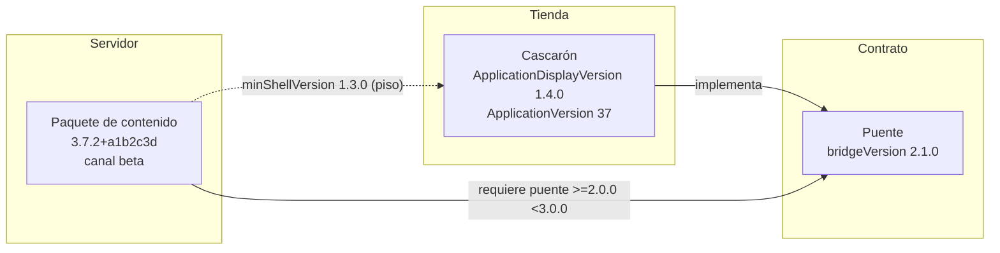
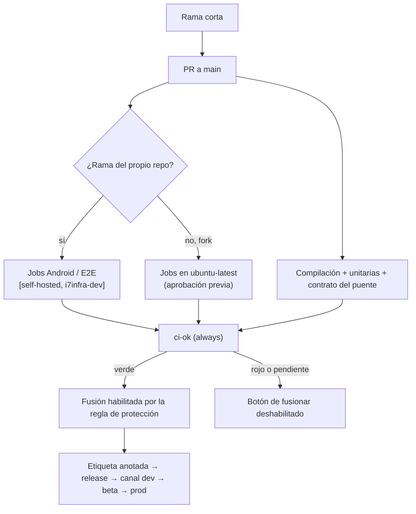

# N3: PR, integración y versionado del producto

> Dossier del investigador especializado del núcleo N3 (descomposición en
> `/LAB/Lab-Documentos/Lab-Documentos.Documentacion/PROMPTs/Concepts/01-Framework-Concept/OUTPUTs/Bitacoras/01-Descomposicion-En-Nucleos.md`).
> Fecha de investigación y de consulta de todas las URL: **2026-10-25**.
> Convención de evidencia: cada afirmación lleva **[Fn]** (fuente web numerada en §9), **[Ln]** (archivo local, con
> línea) o **[Cn]** (comando con su salida, en §9.3). Lo que no se pudo confirmar dice **NO VERIFICADO** y el motivo.
> Lo que es opinión del investigador dice **Criterio propio**.

## Índice

1. [Índice](#índice)
2. [Alcance del núcleo y frases que lo originan](#2-alcance-del-núcleo-y-frases-que-lo-originan)
3. [Definiciones: qué es y qué no es](#3-definiciones-qué-es-y-qué-no-es)
4. [Estado del arte y estándares](#4-estado-del-arte-y-estándares)
   - 4.1 [Modelos de ramas](#41-modelos-de-ramas-github-flow-y-trunk-based-development)
   - 4.2 [Lo que impide fusionar: protección de rama, rulesets, checks obligatorios](#42-lo-que-impide-fusionar-protección-de-rama-rulesets-y-checks-obligatorios)
   - 4.3 [CODEOWNERS, plantilla de PR y merge queue](#43-codeowners-plantilla-de-pr-y-merge-queue)
   - 4.4 [GitHub Actions disparado por PR](#44-github-actions-disparado-por-pull-request)
   - 4.5 [Runners autoalojados y su riesgo](#45-runners-autoalojados-y-su-riesgo-en-repos-públicos)
   - 4.6 [Versionado: SemVer, Conventional Commits, Keep a Changelog](#46-versionado-semver-conventional-commits-keep-a-changelog)
   - 4.7 [Versionado de apps móviles en MAUI](#47-versionado-de-apps-móviles-en-maui)
   - 4.8 [Líneas de versión del framework y su compatibilidad](#48-líneas-de-versión-del-framework-cascarón-contenido-puente)
   - 4.9 [Canales dev/beta/prod](#49-canales-devbetaprod)
   - 4.10 [Dónde compila iOS (D-06)](#410-dónde-compila-ios-d-06)
   - 4.11 [Cómo lo hace hoy Lab-E2E.WebBlazor y qué dicen los conocimientos locales](#411-cómo-lo-hace-hoy-lab-e2ewebblazor-y-qué-dicen-los-conocimientos-locales)
5. [Opciones y tabla comparativa](#5-opciones-y-tabla-comparativa)
6. [Recomendación preliminar (criterio propio)](#6-recomendación-preliminar-criterio-propio)
7. [Preguntas para la mesa](#7-preguntas-para-la-mesa)
8. [Dependencias con otros núcleos](#8-dependencias-con-otros-núcleos)
9. [Fuentes](#9-fuentes)
10. [Verificación de fuentes](#10-verificación-de-fuentes)

---

## 2. Alcance del núcleo y frases que lo originan

**Problema que resuelve N3:** que un PR sobre una rama estable no pueda romper lo que ya funcionaba, porque las
pruebas automatizadas se disparan siempre y su resultado **impide** (no sólo avisa) la fusión; y que cada pieza del
producto (cascarón, contenido, puente) tenga una versión que permita saber qué corre y con qué es compatible.

| Frase del prompt / borrador | Qué le exige a N3 |
| --- | --- |
| «al introducir un PR sobre una rama estable, al no dispararse pruebas automatizadas puede romper funcionaldiades que ya funcionaban» [L1 l.14] | Disparo obligatorio de pruebas en todo PR y compuerta que bloquee la fusión |
| «tener prodicimientos claros en los PR y en los conceptos de integración y versionado del producto» [L1 l.14] | Procedimiento de PR escrito, modelo de ramas, gramática de versión |
| «Configura el wofklow con este runner de github: `runs-on: [self-hosted, i7infra-dev]`» [L1 l.32] | Workflows que usen el runner propio, con su análisis de riesgo |
| `minShellVersion`, canales `dev`/`beta`/`prod`, `bridgeVersion` [L2 l.132-136, l.299-302] | Líneas de versión separadas y su regla de compatibilidad |
| «Posible publicación como NuGets … con versión unificada» [L2 l.350] | Versión unificada de los paquetes del framework |
| «D-06: dónde compila iOS» [L2 l.330, l.373] | Opciones de compilación y firma de iOS sin Mac propio |

Queda **fuera** de N3: qué pruebas concretas corre la compuerta (N4), el formato del manifiesto y la firma del
paquete (N1), el diseño del puente (N2).

## 3. Definiciones: qué es y qué no es

| Término | Qué es | Qué **no** es |
| --- | --- | --- |
| **Rama estable** | La rama desde la que se publica; en este dossier, `main` | Una rama de integración donde «se prueba después» |
| **Pull request (PR)** | Pedido de fusión de una rama corta hacia la estable, con revisión y checks [F3] | Un trámite de notificación: sin check obligatorio sólo avisa |
| **Check obligatorio** (*required status check*) | Un check que debe terminar en `success`, `skipped` o `neutral` para que la fusión se habilite [F4] | Un workflow que corre y se pinta en rojo: eso es un **aviso** [L4 §3.3] |
| **Compuerta** | Combinación de un check + una regla de la plataforma que lo vuelve obligatorio | Un YAML suelto |
| **Integración continua (CI)** | Construir y probar automáticamente cada cambio propuesto antes de entrar al tronco | Un despliegue (eso es CD) |
| **Runner autoalojado** | Máquina propia registrada en GitHub que ejecuta jobs; no es efímera ni limpia por defecto [F11] | Un entorno aislado como los runners de GitHub [F11] |
| **Versión de visualización** | La que ve el usuario: `ApplicationDisplayVersion` → `versionName` / `CFBundleShortVersionString` [F18][F19] | La que decide si un paquete es actualización |
| **Versión de build** | Entero (Android) o 1-3 enteros (iOS) creciente: `ApplicationVersion` → `versionCode` / `CFBundleVersion` [F18][F20][F21] | Un SemVer |
| **Línea de versión** | Cada pieza con número propio: cascarón, paquete de contenido, contrato del puente | Un único número para todo |
| **Canal** | Flujo de publicación (`dev`, `beta`, `prod`) del que un dispositivo toma su contenido | Una rama de git |

## 4. Estado del arte y estándares

### 4.1 Modelos de ramas: GitHub Flow y trunk-based development

- **GitHub Flow**: «flujo de trabajo liviano basado en ramas»: crear rama, hacer cambios, abrir PR, atender la
  revisión, fusionar y borrar la rama [F1]. La doc dice que «si el repositorio tiene checks configurados para correr en
  los pull requests, vas a ver los que fallaron … antes de fusionar» [F1].
- **Trunk-based development**: «modelo de ramas donde los desarrolladores colaboran en una sola rama llamada
  "trunk"» y resisten la presión de crear otras ramas de desarrollo de larga vida [F2]. Las ramas de funcionalidad
  deben ser «de vida corta» y producto de una sola estación de trabajo; todos integran al tronco «al menos una vez cada
  24 horas»; las ramas de release son opcionales y se cortan «justo a tiempo» [F2].
- **Lo común a los dos**: una sola rama de larga vida; el PR es la única puerta de entrada. Ninguno de los dos, por sí
  mismo, impide fusionar con pruebas en rojo: eso lo hace la plataforma (§4.2).

### 4.2 Lo que impide fusionar: protección de rama, rulesets y checks obligatorios

| Hecho | Fuente |
| --- | --- |
| Con «Require status checks before merging» no se puede cambiar la rama protegida hasta que los checks obligatorios pasen; estados exitosos: `success`, `skipped`, `neutral` | [F4][F8] |
| Modo **estricto** (por defecto): la rama del PR debe estar al día con la base; modo **laxo**: menos builds, pero puede romper después de fusionar si choca con la base | [F4] |
| Los **rulesets** se pueden apilar (varios sobre la misma rama; gana lo más restrictivo), tienen lista de *bypass* y estado activo/desactivado | [F5] |
| Disponibilidad de rulesets: el aviso de disponibilidad de la misma página dice que están disponibles «en repositorios públicos con GitHub Free y GitHub Free para organizaciones, y en públicos y privados con Pro, Team y Enterprise Cloud»; el cuerpo del texto, en cambio, nombra sólo «clientes de los planes GitHub Team y GitHub Enterprise» (la página se contradice; vale el aviso de disponibilidad, que es el que define el alcance por plan) | [F5][F5b] |
| Disponibilidad de ramas protegidas: «en repositorios públicos con GitHub Free y GitHub Free para organizaciones», y en públicos y privados con Pro, Team y Enterprise | [F4][F5b] |
| **Plan Free**: repos públicos «con el conjunto completo de funciones»; en privados, las ramas protegidas y los *code owners* figuran como herramientas de los planes pagos (Pro/Team) | [F6] |
| La organización `hdcm-dev` está en plan **`free`** | [C3] |
| `hdcm-dev/Lab-Documentos` y `hdcm-dev/Lab-E2E.WebBlazor` son **públicos** y su `main` tiene `protected: false` y ninguna regla de ruleset aplicada | [C1][C2] |
| Sobre el repo público, `GET …/branches/main/protection` responde HTTP 404 «Branch not protected» (no un 403 de «actualizá el plan») | [C4] |
| Precedente medido en el espacio de trabajo: en un repo **privado** de una org Free, protección y rulesets devuelven **403 «Upgrade to GitHub Pro or make this repository public»** | [L4 §3.3], [L5] |

**Conclusión verificada:** en `hdcm-dev` (Free) la protección de rama **sí** se puede configurar mientras el repo sea
público, y **hoy no está configurada** en ninguno de los dos repos consultados [C1][C4]. Si el repo de la demo fuera
privado, no habría forma de que un check impida fusionar [L5].

**Rulesets en repos públicos de una org Free:** la documentación los declara disponibles [F5b] (ver la tabla). La API
pública devolvió `200 []` para `/rulesets` en los repos públicos [C2]. **NO VERIFICADO por ensayo:** no se creó
ninguno, porque crear un ruleset requiere permisos de administración que este investigador no ejerció.

**Trampa documentada: checks salteados.** Si un workflow obligatorio no corre por filtro de `paths`, de ramas o por
mensaje de commit, su check queda **«Pending» y bloquea la fusión**; la doc recomienda no exigir workflows que se
puedan saltear [F8][F9]. Un job que depende de uno fallido queda `skipped` y «puede no bloquear»: para checks
obligatorios con `needs` usar `always()` [F8].

### 4.3 CODEOWNERS, plantilla de PR y merge queue

- **CODEOWNERS**: archivo `CODEOWNERS` en `.github/`, la raíz o `docs/` (se toma el primero en ese orden); la última
  coincidencia gana; las líneas inválidas se saltean. Se vuelve obligatorio con «Require review from Code Owners» en
  la protección de rama; la doc aconseja que el propio `CODEOWNERS` tenga dueño (`/.github/ @owner`) [F7].
- **Plantilla de PR**: `pull_request_template.md` en la raíz, `docs/` o `.github/`; varias plantillas en un
  subdirectorio `PULL_REQUEST_TEMPLATE/` dentro de cualquiera de esas carpetas, elegidas con el parámetro `template`
  de la URL. Sólo queda disponible cuando está fusionada en la rama por defecto [F10].
- **Merge queue**: da el mismo beneficio que «branch al día antes de fusionar» sin obligar al autor a actualizar su
  rama; arma grupos temporales con la base más los PR anteriores de la cola y fusiona si pasan los checks requeridos.
  **Exige** que el workflow escuche `merge_group`; si no, el check nunca se reporta y la fusión falla. No admite reglas
  con comodines en el nombre de la rama [F12]. Sirve sobre todo en ramas con muchos PR por día de muchos autores [F12].
- **Disponibilidad de merge queue**: el aviso de disponibilidad de la página dice que está disponible «en cualquier
  repositorio público propiedad de una organización», y en privados sólo con GitHub Enterprise Cloud [F12][F5b].
  No se intentó habilitarla (requiere administración).

### 4.4 GitHub Actions disparado por pull request

| Elemento | Qué dice la doc | Fuente |
| --- | --- | --- |
| `on: pull_request` con `paths` / `paths-ignore` | Filtra por archivos cambiados; no se evalúa en push de etiquetas; un workflow salteado deja su check «Pending» | [F9] |
| `concurrency` | Como máximo un job o workflow en curso por grupo; `cancel-in-progress: true` cancela el anterior; el nombre del grupo debe ser único entre workflows del repo, o se cancelan entre sí | [F9][F13] |
| `needs` + `always()` | Un job que depende de uno fallido o salteado se saltea salvo que use una condición como `always()` | [F9] |
| `runs-on: [self-hosted, …]` | Un arreglo de etiquetas: el job va a un runner que tenga **todas** | [F14] |
| Runners estándar de GitHub en repos públicos | «Gratis e ilimitados» | [F14][F15] |

### 4.5 Runners autoalojados y su riesgo en repos públicos

Citas de la doc oficial (traducidas):

- «Los runners autoalojados … no garantizan correr en máquinas virtuales efímeras y limpias, y **pueden quedar
  comprometidos de forma persistente** por código no confiable de un workflow» [F11].
- «Por eso, los runners autoalojados **casi nunca deberían usarse en repositorios públicos**, porque cualquier usuario
  puede abrir pull requests contra el repositorio y comprometer el entorno» [F11].
- «Recomendamos usar runners autoalojados sólo con repositorios privados», porque un fork del repo público puede
  ejecutar código peligroso en la máquina mediante un PR [F16].
- Un runner a nivel organización puede recibir jobs de varios repos: un compromiso tiene impacto amplio; se acota con
  **grupos de runners** limitados a ciertos repos [F11].
- Destruir el runner tras cada job no alcanza del todo; existen runners **JIT** que corren a lo sumo un job [F11].
- Política de aprobación de workflows de forks en repos públicos: por defecto requieren aprobación los
  **contribuyentes primerizos**; la doc advierte que esa opción es débil (basta con que a alguien le acepten un typo) y
  que **con runners autoalojados** el código malicioso corre en la infraestructura propia si el usuario sortea la
  aprobación o el PR es aprobado [F17].

Situación medida en el espacio de trabajo:

| Hecho | Fuente |
| --- | --- |
| El runner es `i7infra-runner-dev`, a nivel de la org `hdcm-dev`, con etiquetas `i7infra,i7infra-dev,dotnet,maui-android` | [L3 entrada 4] |
| En `Lab-E2E.WebBlazor`, el job `publicar` de `e2e.yml` corre en `[self-hosted, i7infra-dev]` | [L6 e2e.yml:89], [L7 l.97] |
| `ci.yml` invoca `e2e.yml` en `pull_request` a `main`/`develop` | [L6 ci.yml:19-22, 104-107], [L7 l.118-129] |
| La política de aprobación de forks de `Lab-E2E.WebBlazor` es `first_time_contributors` | [C4] |
| `ci.yml` ya restringe a ramas del propio repo **sólo** el job `comentario-en-pr` (`head.repo.full_name == github.repository`) | [L6 ci.yml:113-116] |
| El runner es un contenedor sin socket de Docker; un job con `container:` no arranca | [L7 l.188-190] |
| La doc dice que, por defecto, «sólo los repositorios privados pueden acceder a los runners de un grupo», salvo que se cambie esa opción | [F16] |
| Listar runners y grupos de la org devuelve «You must be an org admin…»: no se pudo ver si el grupo de `i7infra-runner-dev` tiene habilitados los repos públicos | [C4] — **NO VERIFICADO** (requiere admin de la org) |

**Consecuencia (deducida de [F11][F17] + [L6][C4]):** hoy, un PR desde un fork de un contribuyente que ya tuvo un
cambio aceptado ejecutaría `dotnet publish` del código del PR en `i7infra-dev`, siempre que el grupo del runner
admita repos públicos (que no es el valor por defecto [F16] y no se pudo leer [C4]). `dotnet publish` evalúa MSBuild del
proyecto, que puede ejecutar tareas arbitrarias — **NO VERIFICADO por ensayo**; es inferencia de cómo funciona
MSBuild, no se provocó.

### 4.6 Versionado: SemVer, Conventional Commits, Keep a Changelog

- **SemVer 2.0.0**: `MAYOR.MENOR.PARCHE`; mayor ante cambios de API incompatibles, menor ante funcionalidad
  compatible, parche ante correcciones compatibles. `0.y.z` es desarrollo inicial: «cualquier cosa PUEDE cambiar» y la
  API «NO DEBERÍA considerarse estable». Pre-release con guion (`-beta.1`), metadatos de build con `+` (`+abc1234`),
  precedencia por la primera diferencia de izquierda a derecha [F22].
- **Conventional Commits 1.0.0**: `<tipo>[ámbito opcional]: <descripción>`; `fix` ↔ PARCHE, `feat` ↔ MENOR,
  `BREAKING CHANGE` (o `!`) ↔ MAYOR, sea cual sea el tipo [F23].
- **Keep a Changelog 1.1.0**: el changelog es para humanos; una entrada por versión, la última primero, con fecha;
  grupos `Added`, `Changed`, `Deprecated`, `Removed`, `Fixed`, `Security`; sección `Unreleased` arriba [F24].

### 4.7 Versionado de apps móviles en MAUI

| Propiedad MAUI (en el `.csproj`) | Doc MAUI | Android | iOS |
| --- | --- | --- | --- |
| `ApplicationDisplayVersion` | «El número de versión de la app» [F18] | `versionName` (lo que ve el usuario) [F20]; el SDK de .NET para Android asigna `_AndroidVersionName = $(ApplicationDisplayVersion)` [F28] | Campo *Version* del Info.plist [F19] = `CFBundleShortVersionString`, «número de release o versión del bundle», con formato obligatorio de **tres enteros separados por punto, sólo dígitos y puntos** [F21b] |
| `ApplicationVersion` | «La versión del build que identifica una iteración de la app» [F18] | `versionCode`: entero positivo, mayor en cada release; Android impide instalar uno menor; máximo en Play 2 100 000 000; no se puede resubir un `versionCode` usado [F20]; el SDK asigna `_AndroidVersionCode = $(ApplicationVersion)` [F28] | Campo *Build* del Info.plist [F19] = `CFBundleVersion`: 1 a 3 enteros separados por punto, obligatorio para App Store [F21] |

Nota de fuente: la página de propiedades de build de .NET para Android describe `ApplicationVersion` como
alternativa a `android:versionName` [F28b], lo que contradice el código del SDK [F28] (que lo lleva a `versionCode`,
igual que la doc de `AndroidVersionCode`). Se toma el código como verdad; la discrepancia queda anotada.

Consecuencia (deducida de [F20][F21]): `ApplicationVersion` debe ser **un entero monótono** que sirva a la vez para
Android (entero) y para iOS (entero es válido como `CFBundleVersion` abreviado: `10` = `10.0.0` [F21]). Coincide con
la gramática «SemVer visible más contador monótono de build» que el conocimiento local fija para apps de tienda
[L4 §2.3]. Restricción (deducida de [F21b]): la versión visible del cascarón sólo puede ser `MAYOR.MENOR.PARCHE`
numérico; los sufijos SemVer de pre-release (`-beta.1`) o metadatos (`+abc`) no caben en `CFBundleShortVersionString`.

### 4.8 Líneas de versión del framework: cascarón, contenido, puente

El borrador del PO ya separa las líneas: el cascarón se actualiza por tienda, el contenido desde el servidor, y el
manifiesto lleva `version` del paquete y `minShellVersion`; el puente lleva `bridgeVersion` y «cambios incompatibles
→ subir `minShellVersion`» [L2 l.45-48, 132-136, 299-302].

Lo que dice el conocimiento local sobre esto:

| Regla | Fuente |
| --- | --- |
| Lleva número propio toda pieza con un **acto** que lo incremente (distribución o sustitución) | [L4 §2.2] |
| Gramática por clase: app de tienda = SemVer visible + contador monótono; paquete/servicio = SemVer completo | [L4 §2.3] |
| Una pieza declara con qué versiones de otra funciona **con piso y techo**: `>=A.B.C <(A+1).0.0`; **nunca un piso a secas**, porque por la precedencia de SemVer §11 lo satisface cualquier mayor | [L4 §2.6] |
| La forma canónica es una línea parseable `compatible-con-<pieza>: >=A.B.C <D.0.0` | [L4 §2.6] |
| Un release es un artefacto inmutable construido una vez y promovido sin recompilar; la identidad versión+commit no se reutiliza | [L8 §2.2 inv. 1-2] |
| Integridad: resumen criptográfico publicado y verificado sobre lo descargado, antes de desempaquetar | [L8 §2.2 inv. 12] |

**Tensión detectada (para la mesa):** `minShellVersion` es un **piso a secas**. Con la regla de [L4 §2.6], un paquete
de contenido escrito para el puente v1 sería aceptado por un cascarón con puente v2 incompatible. La alternativa
alineada es declarar en el manifiesto un rango del puente (`bridge: >=1.2.0 <2.0.0`) además, o en lugar, de
`minShellVersion`. Cuál de las dos es la que decide es materia de N1/N2.

### 4.9 Canales dev/beta/prod

- **Contenido**: el borrador ya define un manifiesto **por canal** [L2 l.132]. El conocimiento local exige construir
  una vez y **promover** el mismo artefacto [L8 §2.2 inv. 1]: dev → beta → prod debería ser mover el puntero del
  manifiesto al mismo paquete, no recompilar (deducción de [L8]).
- **Cascarón**: las tiendas ofrecen sus propios canales. Play tiene pistas de prueba interna (hasta 100 testers),
  cerrada y abierta [F25]; TestFlight admite hasta 100 testers internos y hasta 10 000 externos [F26]. Un build de
  TestFlight se puede probar «hasta 90 días» y después deja de estar disponible para los testers [F26b].
- El borrador prevé distribución de prueba Android por APK/Play interno e iOS por TestFlight [L2 l.331].

### 4.10 Dónde compila iOS (D-06)

| Hecho | Fuente |
| --- | --- |
| «Compilar apps iOS nativas con .NET MAUI requiere las herramientas de compilación de Apple, que sólo corren en una Mac»; desde Windows se conecta a una Mac en red (*Pair to Mac*) | [F27] |
| GitHub ofrece runners macOS arm64 (`macos-latest`, `macos-14`, `macos-15`, `macos-26`, `xcode-27`) e Intel (`macos-15-intel`, `macos-26-intel`) | [F14] |
| Runners estándar de GitHub: **gratis e ilimitados en repos públicos** | [F14][F15] |
| En repos privados: cuota mensual (Free 2 000 min) y luego tarifa; macOS 3-4 núcleos **USD 0,062/min**, Linux 2 núcleos USD 0,006/min (≈10×) | [F15] |
| Los runners autoalojados son gratis en minutos; el costo es mantener la máquina | [F15][F16b] |
| Hoy el workflow Android de Lab-E2E corre en `ubuntu-latest` y es el único que instala el workload | [L7 l.137-152] |

**NO VERIFICADO:** que `dotnet publish -f net10.0-ios` con firma corra sin pasos extra (selección de Xcode) en la
imagen `macos-latest` vigente. Motivo: no se ensayó; requiere certificados y perfil de Apple Developer que no están
disponibles. Es candidato a ensayo pericial.

### 4.11 Cómo lo hace hoy Lab-E2E.WebBlazor y qué dicen los conocimientos locales

**Lab-E2E.WebBlazor** (índice 06, vigencia 2026-10-18) [L7]:

- `ci.yml` corre en `pull_request` a `main`/`develop`, `push` a `main` con `paths-ignore` y `merge_group`;
  `concurrency: ci-<ref>` cancelando sólo en PR; `permissions: contents: read` en la raíz [L7 l.118-124].
- Un job agregador `ci-ok` con `needs: [compilacion, e2e]` y `always()` es «el único check que conviene exigir»
  [L7 l.131-133]. Coincide con la recomendación oficial de [F8].
- Los workflows por proyecto usan `paths`; `ci.yml` no, salvo `paths-ignore` para docs [L7 l.170]. Correcto respecto
  de [F9] siempre que sólo se exija `ci-ok`.
- La regla de protección **no se pudo verificar** cuando se escribió el índice [L7 l.133-135]; hoy se verificó que no
  existe [C1][C4].
- Corrida roja de `946d023`: `-warnaserror` frenó un `CS1574` que el build local no mostró [L7 l.208-212]: ejemplo
  real de lo que la compuerta atrapa.

**Conocimientos locales**:

- `Versionado-Producto-Integral` §3.3: «aviso no es impedimento»; si la plataforma no ofrece el bloqueo en el plan,
  se declara [L4 §3.3]. §3.4: **primero lo que hace cumplir** (T1: integración como control requerido y PR
  obligatorio; prueba de implantación = botón de fusionar **deshabilitado**), después las compuertas [L4 §3.4].
- `Release-Y-Despliegue-Versionado`: release = artefacto inmutable, etiqueta anotada, «saltado nunca pinta verde»,
  hotfix desde la etiqueta y retorno por PR [L8 §2.2, §3.3].
- `Conformacion-Pull-Request-Automatico`: guarda de merge que exige `mergeable_state == clean`, al menos una corrida
  para el SHA y todas en éxito; «todas en éxito» sobre lista vacía da verdadero y es anti-patrón; `unstable` es
  controles fallando [L9 §3.3, §4, §7]. Commit de merge, no `squash`, cuando la rama lleva expediente [L9 §3.5].

## 5. Opciones y tabla comparativa

Escala: ●●● favorable · ●● intermedio · ● desfavorable. Las valoraciones son **criterio propio** apoyado en los
hechos de §4.

### 5.1 Modelo de ramas

| Opción | Simplicidad | Practicidad | Escalabilidad | Riesgo | Costo |
| --- | --- | --- | --- | --- | --- |
| A. GitHub Flow (main + ramas cortas + PR) [F1] | ●●● | ●●● | ●● | ●●● con check obligatorio | ●●● |
| B. Trunk-based con ramas de release justo a tiempo [F2] | ●● | ●● | ●●● | ●●● | ●●● |
| C. `main` + `develop` de larga vida (GitFlow) | ● | ●● | ●● | ●● (doble integración) | ●● |

### 5.2 Mecanismo que impide fusionar

| Opción | Simplicidad | Practicidad | Escalabilidad | Riesgo | Costo |
| --- | --- | --- | --- | --- | --- |
| A. Regla de protección clásica sobre `main` con `ci-ok` obligatorio, PR obligatorio | ●●● | ●●● | ●● | ●●● | ●●● (gratis en público [F6]) |
| B. Rulesets | ●● | ●● | ●●● (apilables [F5]) | ●●● | ●●● (gratis en público según [F5b]; no ensayado) |
| C. Sin bloqueo de plataforma; guarda en el agente/guion (como [L9]) | ●● | ●● | ● | ● (un humano lo saltea) | ●●● |
| D. Pasar a plan Team para repos privados | ●●● | ●●● | ●●● | ●●● | ● (pago) |

### 5.3 Dónde corren los jobs del PR

| Opción | Simplicidad | Practicidad | Escalabilidad | Riesgo | Costo |
| --- | --- | --- | --- | --- | --- |
| A. Todo en `[self-hosted, i7infra-dev]`, repo público | ●●● | ●●● (tiene el workload Android [L3]) | ● (una máquina) | ● (doc: «casi nunca» [F11]) | ●●● |
| B. PR en `ubuntu-latest`; `i7infra-dev` sólo para eventos de confianza (push a `main`, `workflow_dispatch`, `schedule`) y PR del mismo repo | ●● | ●● | ●●● | ●●● | ●●● (gratis en público [F15]) |
| C. `i7infra-dev` en PR con guarda `head.repo.full_name == github.repository`, aprobación de forks en «todos los externos», grupo de runners limitado al repo | ●● | ●●● | ●● | ●● | ●●● |
| D. Repo privado + `i7infra-dev` | ●●● | ●●● | ●● | ●● (doc: precaución también en privados [F11]) — pero **sin bloqueo de fusión** en Free [L5] | ●●● |

### 5.4 Versionado

| Opción | Simplicidad | Practicidad | Escalabilidad | Riesgo | Costo |
| --- | --- | --- | --- | --- | --- |
| A. Un número único para todo el producto | ●●● | ● (el contenido sale varias veces por versión de cascarón) | ● | ● (no dice compatibilidad) | ●●● |
| B. Tres líneas (cascarón, contenido, puente) + `minShellVersion` piso | ●● | ●●● | ●● | ●● (piso a secas [L4 §2.6]) | ●●● |
| C. Tres líneas + rango del puente con techo en el manifiesto | ●● | ●●● | ●●● | ●●● | ●●● |

### 5.5 D-06: compilación iOS

| Opción | Simplicidad | Practicidad | Escalabilidad | Riesgo | Costo |
| --- | --- | --- | --- | --- | --- |
| A. Runner `macos-latest` de GitHub | ●●● | ●● (NO VERIFICADO el build firmado) | ●●● | ●● (secretos de firma en GitHub) | ●●● público / ● privado (USD 0,062/min [F15]) |
| B. Mac propia como runner autoalojado | ●● | ●●● | ● | ● en repo público [F11] | ● (hardware) |
| C. Postergar iOS: el framework se valida en Android y se deja el workflow iOS escrito y sin ejecutar | ●●● | ●● | ●● | ●● (el riesgo grande del borrador es iOS [L2 §2]) | ●●● |

## 6. Recomendación preliminar (criterio propio)

> **Todo lo de esta sección es criterio propio del investigador**, apoyado en las fuentes citadas en §4.

1. **Ramas: GitHub Flow** (§5.1 A) con `main` como única rama estable, ramas cortas y PR obligatorio; ramas de release
   sólo justo a tiempo para un hotfix desde la etiqueta, como pide [L8 §3.3].
   *Qué pierde la alternativa C (develop):* una segunda rama de larga vida duplica la integración y deja a `main` como
   copia tardía; es justo el lugar donde «lo que funcionaba» se rompe sin que nadie lo vea.
2. **Primero lo que impide** ([L4 §3.4] T1): repo **público** en `hdcm-dev` y regla de protección sobre `main` con
   PR obligatorio, check obligatorio **único** `ci-ok` (agregador con `always()`), modo estricto, y prueba de
   implantación = captura del botón de fusionar deshabilitado ante un rojo provocado.
   *Qué pierde la alternativa C (sin bloqueo):* con un workflow que sólo avisa, el problema que dio origen al prompt
   sigue intacto [L4 §3.3]. *Qué pierde D (privado en Free):* el bloqueo no existe [L5].
3. **Workflows de PR** (§5.3, combinación de B y C): cumplir el mandato `runs-on: [self-hosted, i7infra-dev]` en los
   jobs que lo necesitan (APK Android, pruebas en emulador o teléfono), pero **sólo** cuando el PR viene de una rama
   del propio repo (`github.event.pull_request.head.repo.full_name == github.repository`) o en eventos de confianza;
   PR de forks → `ubuntu-latest`. Además: aprobación de forks en «todos los contribuyentes externos» [F17], grupo de
   runners limitado a los repos que lo usan [F11], `permissions: contents: read`, nada de secretos en el runner,
   `concurrency` por workflow y ref, y **nunca** exigir un workflow con `paths` [F8][F9].
   *Qué pierde A (todo self-hosted sin guarda):* la doc oficial lo desaconseja en repos públicos [F11][F16] y la
   política actual `first_time_contributors` es la que la doc califica de débil [F17][C4].
4. **Versionado** (§5.4 C):
   - Cascarón: `ApplicationDisplayVersion` = `MAYOR.MENOR.PARCHE` numérico, sin pre-release ni metadatos (exigencia
     de `CFBundleShortVersionString` [F21b]); `ApplicationVersion` = entero monótono (sirve para `versionCode` y
     `CFBundleVersion`) [F18][F20][F21][F28][L4 §2.3].
   - Paquete de contenido: SemVer + metadatos de build con el commit (`3.7.2+a1b2c3d`) [F22]; construido una vez y
     promovido entre canales [L8].
   - Puente: SemVer propio; el manifiesto declara rango con techo además de `minShellVersion` [L4 §2.6].
   - NuGets del framework: versión unificada, como pide el borrador [L2 l.350].
   - Conventional Commits como convención (no compuerta, al principio) y `CHANGELOG.md` en formato Keep a Changelog
     [F23][F24]. Línea `0.x` declarada explícitamente como inestable mientras dure [F22][L4 §2.6].
   *Qué pierde A (número único):* no se puede decir qué contenido corre en qué cascarón ni detectar incompatibilidad
   del puente antes de que falle en el dispositivo.
5. **D-06**: escribir el workflow iOS sobre `macos-latest` (gratis en repo público [F15]) y **ensayarlo** antes de
   recomendarlo como definitivo; mientras no exista cuenta Apple Developer, el entregable se valida en Android (§5.5 C
   como transición, A como destino).
   *Qué pierde B (Mac propia):* hardware a mantener y el mismo riesgo de self-hosted en repo público.

## 7. Preguntas para la mesa

1. ¿El repo del framework y la demo es **público** (protección gratis, riesgo del runner propio) o **privado** (runner
   más seguro, sin bloqueo de fusión en Free)? ¿Se acepta pagar Team? Es la bifurcación de la que dependen 5.2 y 5.3.
2. ¿El mandato `runs-on: [self-hosted, i7infra-dev]` se lee como «todos los jobs» o «los jobs que necesitan la
   infraestructura propia»? ¿Se acepta la guarda que manda los PR de forks a `ubuntu-latest`?
3. ¿Quién configura la regla de protección (requiere admin de `hdcm-dev`) y dónde queda la evidencia (captura
   versionada, [L4 §3.4] T1)?
4. ¿`minShellVersion` (piso) se mantiene, se reemplaza o se complementa con un rango del puente con techo
   [L4 §2.6]? ¿Lo decide N1, N2 o la mesa?
5. ¿El número del puente es SemVer o un entero (`bridgeVersion: 2`)? Con entero el «techo» es implícito (`== 2`).
6. ¿Se adopta Conventional Commits como compuerta (lint de títulos de PR) o sólo como convención?
7. ¿Merge queue ahora o cuando haya muchos PR por día [F12]? Lab-E2E ya escucha `merge_group` [L7 l.122].
8. D-06: ¿hay cuenta Apple Developer y quién guarda certificados y perfiles? Sin eso el workflow iOS no se puede
   ensayar.
9. ¿`develop` sigue existiendo en los repos que copien a Lab-E2E (su `ci.yml` apunta a `main`/`develop` [L7 l.120])?
10. ¿Qué fase declara el producto ([L4 §2.8]: `diseño`/`candidata`/`operativa`) para saber qué reglas de versionado
    rigen en la demo?

## 8. Dependencias con otros núcleos

| Con | Dirección | Qué pasa por el borde |
| --- | --- | --- |
| N1 Actualización sin tienda | N1 → N3 | Qué se versiona (paquete de contenido, manifiesto por canal), formato de `version`, `minShellVersion`, firma y `sha256`; el pipeline de N3 empaqueta y firma |
| N2 Cascarón y servicios | N2 → N3 | `bridgeVersion` y su regla de compatibilidad (pregunta 4 y 5); dónde se lee la versión del cascarón en tiempo de ejecución |
| N4 Estrategia de pruebas | N4 → N3 | Qué suites alimentan `ci-ok`; cuáles necesitan el runner propio (emulador/teléfono) y cuáles corren en `ubuntu-latest` |
| N3 → N4 | N3 → N4 | Restricción: ninguna suite obligatoria puede estar detrás de un filtro `paths` [F8] |
| N5 Guía y demo | N3 → N5 | Procedimiento de PR, plantilla de PR, workflows de la demo y explicación didáctica de versiones y canales |
| Transversal | — | **Contradicción candidata** para `02-Cohesion-Global.md` §3: `minShellVersion` como piso vs. la regla de rango con techo [L4 §2.6] |

## 9. Fuentes

### 9.1 Web (consultadas el 2026-10-25)

1. **[F1]** GitHub. (s. f.). *GitHub flow*. GitHub Docs. https://docs.github.com/en/get-started/using-github/github-flow
2. **[F2]** Hammant, P. y colaboradores. (s. f.). *Trunk Based Development*. https://trunkbaseddevelopment.com/
3. **[F3]** GitHub. (s. f.). *GitHub flow — Create a pull request*. https://docs.github.com/en/get-started/using-github/github-flow#create-a-pull-request
4. **[F4]** GitHub. (s. f.). *About protected branches*. https://docs.github.com/en/repositories/configuring-branches-and-merges-in-your-repository/managing-protected-branches/about-protected-branches
5. **[F5]** GitHub. (s. f.). *About rulesets*. https://docs.github.com/en/repositories/configuring-branches-and-merges-in-your-repository/managing-rulesets/about-rulesets
6. **[F6]** GitHub. (s. f.). *GitHub's plans*. https://docs.github.com/en/get-started/learning-about-github/githubs-plans
7. **[F7]** GitHub. (s. f.). *About code owners*. https://docs.github.com/en/repositories/managing-your-repositorys-settings-and-features/customizing-your-repository/about-code-owners
8. **[F8]** GitHub. (s. f.). *Troubleshooting required status checks*. https://docs.github.com/en/pull-requests/collaborating-with-pull-requests/collaborating-on-repositories-with-code-quality-features/troubleshooting-required-status-checks
9. **[F9]** GitHub. (s. f.). *Workflow syntax for GitHub Actions*. https://docs.github.com/en/actions/reference/workflows-and-actions/workflow-syntax
10. **[F10]** GitHub. (s. f.). *Creating a pull request template for your repository*. https://docs.github.com/en/communities/using-templates-to-encourage-useful-issues-and-pull-requests/creating-a-pull-request-template-for-your-repository
11. **[F11]** GitHub. (s. f.). *Secure use reference — Hardening for self-hosted runners*. https://docs.github.com/en/actions/reference/security/secure-use
12. **[F12]** GitHub. (s. f.). *Managing a merge queue*. https://docs.github.com/en/repositories/configuring-branches-and-merges-in-your-repository/configuring-pull-request-merges/managing-a-merge-queue
13. **[F13]** GitHub. (s. f.). *Control the concurrency of workflows and jobs*. https://docs.github.com/en/actions/how-tos/write-workflows/choose-when-workflows-run/control-workflow-concurrency
14. **[F14]** GitHub. (s. f.). *Choosing the runner for a job*. https://docs.github.com/en/actions/how-tos/write-workflows/choose-where-workflows-run/choose-the-runner-for-a-job
15. **[F15]** GitHub. (s. f.). *GitHub Actions billing*. https://docs.github.com/en/billing/concepts/product-billing/github-actions
16. **[F16]** GitHub. (s. f.). *Managing access to self-hosted runners using groups*. https://docs.github.com/en/actions/how-tos/manage-runners/self-hosted-runners/manage-access
    **[F16b]** GitHub. (s. f.). *Self-hosted runners*. https://docs.github.com/en/actions/concepts/runners/self-hosted-runners
17. **[F17]** GitHub. (s. f.). *Managing GitHub Actions settings for a repository*. https://docs.github.com/en/repositories/managing-your-repositorys-settings-and-features/enabling-features-for-your-repository/managing-github-actions-settings-for-a-repository
18. **[F18]** Microsoft. (s. f.). *Publish a .NET MAUI app for Android using the command line* (tabla de propiedades `ApplicationVersion` / `ApplicationDisplayVersion`). https://learn.microsoft.com/en-us/dotnet/maui/android/deployment/publish-cli
19. **[F19]** Microsoft. (s. f.). *Info.plist (.NET MAUI)* — «Provide app info». https://learn.microsoft.com/en-us/dotnet/maui/macios/info-plist
20. **[F20]** Google. (s. f.). *Version your app*. Android Developers. https://developer.android.com/studio/publish/versioning
21. **[F21]** Apple. (s. f.). *CFBundleVersion*. Apple Developer Documentation. https://developer.apple.com/documentation/bundleresources/information-property-list/cfbundleversion
22. **[F22]** Preston-Werner, T. (s. f.). *Semantic Versioning 2.0.0*. https://semver.org/
23. **[F23]** Conventional Commits. (s. f.). *Conventional Commits 1.0.0*. https://www.conventionalcommits.org/en/v1.0.0/
24. **[F24]** Lacan, O. (s. f.). *Keep a Changelog 1.1.0*. https://keepachangelog.com/en/1.1.0/
25. **[F25]** Google. (s. f.). *Set up an open, closed, or internal test*. Play Console Help. https://support.google.com/googleplay/android-developer/answer/9845334
26. **[F26]** Apple. (s. f.). *TestFlight*. https://developer.apple.com/testflight/
27. **[F27]** Microsoft. (s. f.). *Publish a .NET MAUI app for iOS using the command line* — «Publish an iOS app from Windows». https://learn.microsoft.com/en-us/dotnet/maui/ios/deployment/publish-cli
28. **[F28]** Microsoft / .NET Foundation. *dotnet/android*, `src/Xamarin.Android.Build.Tasks/Xamarin.Android.Common.targets`, target `_GetAndroidPackageName` (`_AndroidVersionName = $(ApplicationDisplayVersion)`, `_AndroidVersionCode = $(ApplicationVersion)`), rama `main` en el commit `a3c24de3e77a85e9d36b61a15e86b358f1a26bee` (2026-10-23). https://github.com/dotnet/android/blob/a3c24de3e77a85e9d36b61a15e86b358f1a26bee/src/Xamarin.Android.Build.Tasks/Xamarin.Android.Common.targets
    **[F28b]** Microsoft. (s. f.). *Build properties* (.NET para Android), secciones `ApplicationVersion` y `AndroidVersionCode`. Fuente: https://github.com/dotnet/android/blob/main/Documentation/docs-mobile/building-apps/build-properties.md
    **[F5b]** GitHub. Fuente de GitHub Docs, avisos de disponibilidad por plan (`data/reusables/gated-features/repo-rules.md`, `protected-branches.md`, `merge-queue.md`), commit `02c25d16369fe27f9bdb28d1201f6b452f0d21dd` (2026-10-23). https://github.com/github/docs/tree/02c25d16369fe27f9bdb28d1201f6b452f0d21dd/data/reusables/gated-features — son los textos que GitHub Docs muestra como «product» al pie del título de [F4], [F5] y [F12].
    **[F21b]** Apple. (s. f.). *CFBundleShortVersionString*. https://developer.apple.com/documentation/bundleresources/information-property-list/cfbundleshortversionstring (leída por su JSON: `https://developer.apple.com/tutorials/data/documentation/bundleresources/information-property-list/cfbundleshortversionstring.json`, porque la página se arma con JavaScript)
    **[F26b]** Apple. (s. f.). *TestFlight overview*. App Store Connect Help. https://developer.apple.com/help/app-store-connect/test-a-beta-version/testflight-overview/

### 9.2 Archivos locales (rutas desde la raíz del espacio de trabajo)

- **[L1]** `/LAB/Lab-Documentos/Lab-Documentos.Documentacion/PROMPTs/Concepts/01-Framework-Concept/Crear-Framework-Concept.md`
- **[L2]** `/LAB/Lab-Documentos/Lab-Documentos/Concepts/Framework-Concept/Framework-APP.md`
- **[L3]** `/LAB/Lab-Documentos/Lab-Documentos.Documentacion/PROMPTs/Concepts/01-Framework-Concept/OUTPUTs/Bitacoras/00-Registro.md`
- **[L4]** `<base de conocimiento>/Knowledges/Knowledge-Versionado-Producto-Integral.md` (v2.0)
- **[L5]** Nota de memoria del proyecto «Sin protección de rama en plan free» (medición del 2026-09-20 sobre un repo privado de una org Free: 403 «Upgrade to GitHub Pro or make this repository public»); la misma medición está asentada en [L4 §3.3]
- **[L6]** `/LAB/Lab-E2E.WebBlazor/Lab-E2E.WebBlazor/.github/workflows/ci.yml` y `e2e.yml` (líneas citadas, leídas el 2026-10-25)
- **[L7]** `/LAB/Lab-E2E.WebBlazor/Lab-E2E.WebBlazor.Documentacion/ia-db/indexes/06_CI-Y-Workflows.md` (v3.0, vigencia 2026-10-18)
- **[L8]** `<base de conocimiento>/Knowledges/Knowledge-Release-Y-Despliegue-Versionado.md`
- **[L9]** `<base de conocimiento>/Knowledges/Knowledge-Conformacion-Pull-Request-Automatico.md` (v2.0)

### 9.3 Comandos (2026-10-25, ~19:26 UTC)

- **[C1]** `curl -s https://api.github.com/repos/hdcm-dev/<repo>` y `…/branches/main` →
  Lab-Documentos: `private: false, visibility: public`, `main protected: false`;
  Lab-E2E.WebBlazor: `private: false, visibility: public`, `main protected: false`.
- **[C2]** `curl -s https://api.github.com/repos/hdcm-dev/<repo>/rulesets` y `…/rules/branches/main` → `HTTP 200`,
  `[]` en los dos repos.
- **[C3]** `GET /orgs/hdcm-dev` autenticado con la credencial de git → `plan: "free"` (sin autenticar, `plan: null`).
- **[C4]** Autenticado, sólo lectura: `GET /repos/hdcm-dev/Lab-E2E.WebBlazor/branches/main/protection` →
  HTTP 404 `"Branch not protected"`; `GET …/actions/permissions/fork-pr-contributor-approval` →
  `approval_policy: "first_time_contributors"`; `GET /orgs/hdcm-dev/actions/runners` y `…/runner-groups` →
  «You must be an org admin or have the runners and runner groups fine-grained permission».

## 10. Verificación de fuentes

> Verificación adversarial hecha el **2026-10-25 (~19:30 UTC)**. Se abrió cada fuente citada (WebFetch, el código
> fuente de GitHub Docs y de `dotnet/android`, la API JSON de la documentación de Apple), se volvieron a correr
> los comandos [C1]–[C4] (mismo resultado) y se cotejaron las líneas locales citadas [L1]–[L9].

### 10.1 Alcance

| Grupo | Afirmaciones revisadas |
| --- | --- |
| Plataforma GitHub: modelos de ramas, protección, rulesets, planes, CODEOWNERS, plantillas, merge queue, Actions, runners autoalojados, facturación | 38 |
| Estándares de versionado (SemVer, Conventional Commits, Keep a Changelog) | 9 |
| Versionado MAUI / Android / Apple y compilación iOS | 12 |
| Canales de prueba de las tiendas (Play, TestFlight) | 4 |
| Comandos [C1]–[C4] (repetidos) | 8 |
| Archivos locales [L1]–[L9] (líneas y secciones citadas) | 15 |
| **Total** | **86** |

Temas que el encargo pedía cuidar y que **no aparecen** en este dossier (son de N1/N2): texto de App Review
Guidelines 2.5.2, cláusula del DPLA sobre código interpretado, política de Google Play sobre código descargado,
APIs de `HybridWebView` en .NET 9 y .NET 10, retiro de App Center/CodePush. No se revisaron aquí porque N3 no
afirma nada sobre ellos.

### 10.2 Correcciones (antes → después)

| # | Lugar | Antes | Después | Evidencia |
| --- | --- | --- | --- | --- |
| 1 | §4.2, tabla | «La doc de rulesets dice que están disponibles para Team y Enterprise» (presentado como único dato de plan) | La misma página tiene un aviso de disponibilidad que los declara disponibles en repos públicos con Free y Free para organizaciones; el cuerpo se contradice y se anota | [F5b] `repo-rules.md` |
| 2 | §4.2, párrafo | «NO VERIFICADO: si los rulesets funcionan en repos públicos de una org Free» | Disponibilidad documentada [F5b]; queda NO VERIFICADO sólo el ensayo de crear uno | [F5b] |
| 3 | §4.2, tabla | (no estaba) | Fila nueva: disponibilidad de ramas protegidas por plan, según el aviso oficial | [F5b] `protected-branches.md` |
| 4 | §4.3 | «NO VERIFICADO: disponibilidad de merge queue en repos públicos de organizaciones Free» | Disponible «en cualquier repositorio público propiedad de una organización»; en privados, sólo Enterprise Cloud | [F5b] `merge-queue.md` |
| 5 | §4.3 | «varias plantillas en `.github/PULL_REQUEST_TEMPLATE/`» | subdirectorio `PULL_REQUEST_TEMPLATE/` en cualquiera de las carpetas admitidas, elegido con `template` | [F10] |
| 6 | §4.5, tabla | «no se pudo ver si el grupo admite repos públicos» | Se suma el dato de la doc: por defecto sólo los repos privados acceden a un grupo de runners; la configuración real sigue NO VERIFICADA | [F16] |
| 7 | §4.5, consecuencia | «ejecutaría `dotnet publish` … en `i7infra-dev`» | Igual, condicionado a que el grupo admita repos públicos | [F16][C4] |
| 8 | §4.5, tabla | `[L6 ci.yml:19-22, 106-107]` | `[L6 ci.yml:19-22, 104-107]` (el `uses: ./.github/workflows/e2e.yml` está en la línea 104) | lectura del archivo |
| 9 | §4.7, tabla | «mapeo MAUI→Android: NO VERIFICADO en doc oficial de Microsoft» | Verificado en el código del SDK de .NET para Android: `ApplicationDisplayVersion` → `versionName`, `ApplicationVersion` → `versionCode`; se anota que la página de propiedades de build describe `ApplicationVersion` como alternativa a `versionName` (contradice al código) | [F28][F28b] |
| 10 | §4.7, tabla | `CFBundleShortVersionString` citado con [F19][F21] (F21 es la página de `CFBundleVersion`) | Cita propia [F21b], con su formato obligatorio: tres enteros, sólo dígitos y puntos | [F21b] |
| 11 | §4.7 y §6.4 | «`ApplicationDisplayVersion` = SemVer» | `MAYOR.MENOR.PARCHE` numérico, sin pre-release ni metadatos (no caben en `CFBundleShortVersionString`) | [F21b] |
| 12 | §4.9 | «NO VERIFICADO: cuántos días queda disponible un build de TestFlight» | «hasta 90 días»; después deja de estar disponible para los testers | [F26b] |
| 13 | §4.10 | «`macos-latest`, `macos-14`, `macos-15`, `macos-26` (arm64) y `-intel`» | arm64: `macos-latest`, `macos-14`, `macos-15`, `macos-26`, `xcode-27`; Intel: `macos-15-intel`, `macos-26-intel` | [F14] |
| 14 | §5.2, opción B | Costo «NO VERIFICADO en Free público» | «gratis en público según [F5b]; no ensayado» | [F5b] |
| 15 | §4.2 y §9.3 [C4] | «Branch not protected» | HTTP 404 «Branch not protected» (código real de la respuesta) | [C4] repetido |

### 10.3 Confirmadas sin cambios (muestras relevantes)

- Estados que habilitan la fusión (`success`/`skipped`/`neutral`), modo estricto por defecto [F4]; checks salteados
  por `paths` quedan «Pending» y bloquean; `always()` con `needs` [F8][F9].
- Citas de endurecimiento de runners autoalojados («should almost never be used for public repositories»,
  compromiso persistente, JIT, destruir tras cada job no garantiza un solo job, precaución también en privados) [F11];
  «recomendamos usarlos sólo con repositorios privados» [F16]; aprobación de forks por defecto para primerizos y
  advertencia del typo aceptado [F17].
- Facturación: gratis en públicos con runners estándar y en autoalojados; Free 2 000 min/mes en privados; Linux
  2 núcleos USD 0,006/min; macOS 3-4 núcleos USD 0,062/min [F15]; «free and unlimited on public repositories» [F14].
- SemVer §4, §9-§11; Conventional Commits; Keep a Changelog 1.1.0 [F22][F23][F24]. `versionCode` y su máximo de
  2 100 000 000 [F20]; `CFBundleVersion` (1-3 enteros, `10` = `10.0.0`, obligatorio en App Store) [F21];
  internas de Play hasta 100 testers [F25]; TestFlight 100 internos / 10 000 externos [F26]; iOS sólo compila en Mac
  y *Pair to Mac* [F27].
- [C1]–[C4] repetidos el 2026-10-25: ambos repos públicos, `main` sin proteger, rulesets `[]`, plan `free`,
  `first_time_contributors`, runners de la org sin acceso.
- Líneas locales: [L1 l.14, l.32], [L2 l.45-48, 132-136, 299-302, 330-331, 350, 373], [L6 e2e.yml:89,
  ci.yml:113-116], [L7 l.97, 118-135, 152, 170, 188-190, 208-212], [L3 entrada 4], [L4 §2.3, §2.6, §3.3, §3.4].

### 10.4 Siguen NO VERIFICADAS

| Afirmación | Motivo |
| --- | --- |
| Si el grupo de runners de `i7infra-runner-dev` admite repos públicos | La API exige ser admin de la org [C4] |
| Que `dotnet publish` de un PR malicioso ejecute código arbitrario vía MSBuild en el runner | Inferencia sobre MSBuild; no se provocó |
| Que `dotnet publish -f net10.0-ios` firmado corra en `macos-latest` sin pasos extra | Sin cuenta Apple Developer ni certificados para ensayar |
| Que se pueda crear un ruleset en los repos públicos de `hdcm-dev` | Documentado [F5b], pero no ensayado (requiere admin) |
