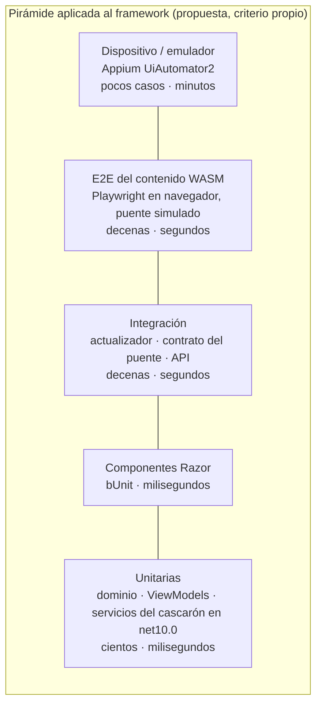
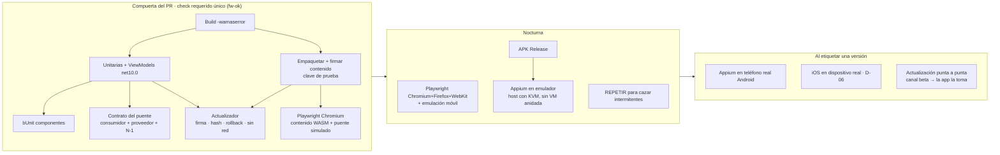

# N4 — Estrategia de pruebas (dossier del investigador especializado)

> **Núcleo**: N4 de `/LAB/Lab-Documentos/Lab-Documentos.Documentacion/PROMPTs/Concepts/01-Framework-Concept/OUTPUTs/Bitacoras/01-Descomposicion-En-Nucleos.md`.
> **Autor**: investigador especializado del núcleo N4 (subagente de la mesa).
> **Fecha**: 2026-10-25. Todas las URL se consultaron en esa fecha.
> **Estado**: insumo para la mesa. No decide: recomienda, y lo que es criterio propio se declara como tal.
> **Convenciones**: «NO VERIFICADO» = no se pudo confirmar en esta corrida, con el motivo. «Criterio propio» = juicio del
> investigador, sin fuente que lo respalde de manera directa.

## Índice

1. [Alcance del núcleo y frases del prompt que lo originan](#1-alcance-del-núcleo-y-frases-del-prompt-que-lo-originan)
2. [Definiciones](#2-definiciones)
3. [Estado del arte y estándares](#3-estado-del-arte-y-estándares)
   1. [La pirámide de pruebas](#31-la-pirámide-de-pruebas)
   2. [Unitarias de dominio y ViewModels en net10.0 sin workload](#32-unitarias-de-dominio-y-viewmodels-en-net100-sin-workload)
   3. [Componentes Razor con bUnit](#33-componentes-razor-con-bunit)
   4. [E2E del contenido WASM con Playwright en navegador](#34-e2e-del-contenido-wasm-con-playwright-en-navegador)
   5. [Contrato del puente](#35-contrato-del-puente)
   6. [Pruebas del actualizador](#36-pruebas-del-actualizador)
   7. [Dispositivo y emulador](#37-dispositivo-y-emulador)
   8. [Compuerta del PR: checks requeridos](#38-compuerta-del-pr-checks-requeridos)
   9. [Tiempos y estabilidad: datos medidos y citados](#39-tiempos-y-estabilidad-datos-medidos-y-citados)
4. [Opciones y comparación](#4-opciones-y-comparación)
5. [Recomendación preliminar del investigador](#5-recomendación-preliminar-del-investigador)
6. [Preguntas para la mesa](#6-preguntas-para-la-mesa)
7. [Dependencias con otros núcleos](#7-dependencias-con-otros-núcleos)
8. [Fuentes](#8-fuentes)
9. [Verificación de fuentes](#9-verificación-de-fuentes)

---

## 1. Alcance del núcleo y frases del prompt que lo originan

### 1.1 Frases que lo originan

| Frase (textual, con su ortografía) | Fuente |
| --- | --- |
| «Actualmente el equipo tiene problemas al introducir un PR sobre una rama estable, al no dispararse pruebas automatizadas puede romper funcionaldiades que ya funcionaban correctamente.» | Prompt `Crear-Framework-Concept.md`, sección «Contexto» |
| «La necesidad pasa por tener prodicimientos claros en los PR y en los conceptos de integración y versionado del producto» | Ídem (compartida con N3) |
| «Los investigadores especializados pueden ensayar y realizar todas las pruebas que sean necesarias» | Ídem, «Solicitudes» |
| §12 «Prueba de concepto» y §14 «Riesgos» (deriva del puente, seguridad del canal de actualización) | Borrador `/LAB/Lab-Documentos/Lab-Documentos/Concepts/Framework-Concept/Framework-APP.md` |

### 1.2 Qué cubre N4

- **Qué se prueba en cada capa** del framework (dominio, ViewModels, componentes Razor del contenido, contenido WASM completo,
  puente cascarón ↔ contenido, actualizador, app instalada) y **con qué herramienta**.
- **Dónde y cuándo corre** cada suite: compuerta del PR (check requerido), nocturna, o al etiquetar una versión.
- **Cómo se mantiene la confianza** en la compuerta: estabilidad (pruebas intermitentes) y tiempo de ejecución.

### 1.3 Qué no cubre N4

- La forma del puente y de los servicios nativos (es N2): N4 sólo fija **cómo se prueba** el contrato.
- La mecánica de PR, ramas, protección de rama y líneas de versión (es N3): N4 entrega **qué suites** exige la compuerta.
- El diseño del actualizador (es N1): N4 entrega **los casos** que lo deben poner en rojo.

---

## 2. Definiciones

| Término | Qué es | Qué no es |
| --- | --- | --- |
| **Pirámide de pruebas** | Metáfora que agrupa las pruebas en niveles de distinta granularidad: muchas pruebas chicas y rápidas abajo, pocas pruebas amplias arriba [1] | Una cuota numérica obligatoria por nivel; el artículo de referencia da dos reglas generales, no porcentajes [1] |
| **Prueba unitaria** | Toma una unidad chica (típicamente un método), la aísla y verifica que se comporte como se espera [4] | Una prueba que necesita el teléfono, el WebView o la red |
| **Prueba de componente Razor (bUnit)** | Renderiza un componente Razor en memoria, dispara eventos y verifica el marcado; las dependencias como JS interop se simulan [3][5] | Una prueba en navegador: no ejecuta CSS ni JS reales [3] |
| **Prueba E2E del contenido** | Un ejecutor levanta la app y automatiza un navegador real; prueba el componente con CSS, JS, DOM y APIs del navegador [3] | Una prueba del cascarón nativo: en el navegador el puente no existe y hay que sustituirlo (criterio propio) |
| **Prueba de contrato** | Técnica para probar un punto de integración verificando cada aplicación por separado [7] | Una E2E que levanta ambos lados juntos |
| **Contrato dirigido por el consumidor (CDC)** | Los consumidores impulsan la implementación del contrato; el proveedor implementa sólo lo que los consumidores necesitan [1] | Un esquema que el proveedor publica sin saber quién lo usa |
| **Prueba de integración del actualizador** | Ejercita manifiesto, descarga, verificación de firma y hash, activación y vuelta atrás contra un servidor y un sistema de archivos reales de la corrida (criterio propio, derivado del flujo de §3 del borrador) | Una unitaria de la función de hash aislada |
| **Prueba en dispositivo** | Ejercita la app instalada en un teléfono o emulador mediante un driver de automatización (Appium UiAutomator2 en Android) [10] | Una prueba de ViewModel en `net10.0` |
| **Prueba intermitente (flaky)** | Prueba que no es determinista: pasa y falla sobre el mismo código [11] | Una prueba que falla siempre (esa es útil: señala un defecto) |
| **Check requerido** | Check de estado que debe estar en verde para poder fusionar en la rama protegida [8] | Un workflow que corre y sólo avisa |

---

## 3. Estado del arte y estándares

### 3.1 La pirámide de pruebas

- El concepto lo introdujo **Mike Cohn** en el libro *Succeeding with Agile* [1][2].
- El artículo «The Practical Test Pyramid» (Ham Vocke, publicado en martinfowler.com el 2018-02-26) resume dos reglas: escribir
  pruebas de distinta granularidad y «cuanto más alto el nivel, menos pruebas» [1].
- El mismo artículo describe las E2E como «notoriamente intermitentes», con mucho mantenimiento y lentas [1].
- Microsoft, en la documentación de pruebas de Blazor, compara unitarias y E2E: unitarias en **milisegundos**, E2E en
  **segundos**; las unitarias «más confiables», las E2E sensibles al entorno porque lanzan varios procesos, red y disco [3].

### 3.2 Unitarias de dominio y ViewModels en net10.0 sin workload

**Lo que dice Microsoft.** La guía de pruebas unitarias de .NET MAUI (versión `net-maui-10.0`, `ms.date` 2026-09-02) indica:

- xUnit es el framework de pruebas recomendado para apps .NET MAUI [4].
- Para probar código de la app hay que **agregar el TFM del proyecto de pruebas** (p. ej. `net9.0` en su ejemplo) a los
  `TargetFrameworks` del proyecto MAUI y condicionar el `OutputType` para que no genere ejecutable en ese TFM [4].
- Para .NET 11 aparecen plantillas de pruebas que corren **dentro de una app de plataforma** (`androidtest`, `iostest`, entre
  otras) con Microsoft.Testing.Platform; cada una crea un proyecto MSTest; `androidtest` corre en un dispositivo o emulador
  conectado y `iostest` en un dispositivo o simulador [4] (la sección sólo aparece en la vista `net-maui-11.0`).

**Lo que hace el caso base (Lab-E2E).** `MovilidadUrbana.MAUI.Tests` no sigue esa receta: compila las capas de la app como
**archivos enlazados** en `net10.0`, porque el proyecto Android es `net10.0-android` y no se puede referenciar desde
`net10.0` sin el workload (`/LAB/Lab-E2E.WebBlazor/Lab-E2E.WebBlazor.Documentacion/ia-db/indexes/13_App-Android.md:148-167`).
Corre los ViewModels contra las capas reales sobre un SQLite propio de cada caso, con dos dobles de plataforma
(`FakeNavigationService`, `FakeAlertService`) (`.../05_Pruebas.md:92-103`). Son 18 casos y corren en `ci.yml` y en
`android.yml` **antes** de instalar el workload (`.../06_CI-Y-Workflows.md`, sección «`android.yml`»).

| Técnica | Ventaja | Costo |
| --- | --- | --- |
| TFM extra en el proyecto MAUI (Microsoft) [4] | Referencia directa, sin duplicar listas de archivos | El proyecto MAUI se evalúa con el workload instalado en la máquina que corre las pruebas (inferencia; NO VERIFICADO si `dotnet test` del TFM `net10.0` restaura sin workload — no se ensayó en esta corrida) |
| Archivos enlazados (Lab-E2E) | Corre en un runner sin workload: verificado en `ci.yml` del caso base | Hay que mantener el `<Compile Include>`; lo que use APIs de plataforma queda afuera |
| **Bibliotecas `net10.0` puras** para dominio, contratos y lógica del cascarón (criterio propio, en línea con `Framework.Core` del borrador §11) | Ni TFM extra ni enlaces: se referencian normal | Obliga a la disciplina de separar la lógica de la plataforma detrás de interfaces |

### 3.3 Componentes Razor con bUnit

- Microsoft: «no hay un framework oficial de Microsoft para probar Blazor»; señala a **bUnit**, proyecto comunitario, no
  mantenido por Microsoft [3].
- bUnit funciona con MSTest, NUnit y xUnit [3]; su sitio agrega TUnit [5]. Su sitio afirma que «corre una prueba en
  milisegundos» frente a los segundos de una prueba de interfaz en navegador [5].
- Microsoft recomienda unitaria (bUnit) para componentes sin JS interop o con JS interop simple —se simula `IJSRuntime`— y
  **E2E** cuando la lógica depende de JS que manipula el DOM [3].
- Aplicado al framework (criterio propio): las páginas del contenido llaman al puente vía JS interop; con bUnit se reemplaza
  el cliente C# del puente (`Framework.Bridge.Wasm` en el borrador §11) por un doble, y se prueban las páginas sin
  navegador. La versión vigente de bUnit **NO VERIFICADA** (su sitio no la muestra en texto [5]).

### 3.4 E2E del contenido WASM con Playwright en navegador

- Microsoft menciona Playwright para .NET como ejemplo de framework E2E para apps Blazor [3].
- Playwright para .NET soporta Chromium, WebKit y Firefox, y clases base para MSTest, NUnit y xUnit [6].
- El caso base ya lo usa: tres proyectos E2E con `Microsoft.Playwright.NUnit` 1.62.0, 33 casos, `NumberOfTestWorkers` 4,
  trazas sólo en fallos (`.../05_Pruebas.md:41-42`, `:150-168`, `:207-219`), y una regresión nocturna `e2e.yml` en cuatro
  configuraciones (`.../06_CI-Y-Workflows.md`, «Corridas observadas»).
- **Por qué es más barato que en el teléfono** (criterio propio con evidencia de apoyo): el contenido es un paquete estático
  Blazor WASM (borrador §2, opción A); se sirve con un servidor HTTP en la corrida y se automatiza en un navegador sin cabeza,
  sin compilar el APK, sin emulador ni KVM. En el caso base la suite Appium de 5 casos tardó 3 min 21 s y 3 min 5 s
  (`.../13_App-Android.md:270`), mientras la traza de Playwright cuesta «unos 2 s sobre los 22 casos» (`.../05_Pruebas.md:161-162`);
  la duración total de los 22 casos de Playwright **NO VERIFICADA** (el índice no la registra).
- **Límite**: en el navegador no hay cascarón. Hace falta un **puente simulado** (`bridge.js` de prueba) que responda como el
  real. Esto acopla N4 con el contrato del puente (§3.5): si el simulado y el real divergen, la E2E da verde falso.
- **WebKit de Playwright ≠ WKWebView de iOS ni Android System WebView**. Que una corrida en WebKit de escritorio anticipe el
  comportamiento en el WebView de iOS es **NO VERIFICADO** (no se encontró fuente oficial que lo afirme); se propone como
  aproximación barata, no como sustituto.

### 3.5 Contrato del puente

- Martin Fowler / Vocke: los **CDC tests** dejan que los consumidores impulsen el contrato; Pact es la herramienta
  destacada [1].
- Pact se define como herramienta de contrato «code-first» dirigida por el consumidor, para integraciones **HTTP y de
  mensajes** [7]. PactNet es su versión .NET; la línea 5.x soporta las especificaciones 2, 3 y 4 y los sistemas dirigidos por
  eventos [9]. Versión exacta y TFMs soportados: **NO VERIFICADO** (el README no los indica en texto [9]).
- El puente del borrador §9 **no es HTTP**: son mensajes `{modulo, accion, args, id}` entre JS y C#. Encaja en la forma de
  «pacto de mensajes» de Pact [7][9], pero que PactNet pueda verificar del lado proveedor un transporte `HybridWebView`
  es **NO VERIFICADO** (no se ensayó).
- Alternativa liviana (criterio propio): contrato como **archivo versionado** (esquema JSON por mensaje + `bridgeVersion`)
  en `Framework.Core`, con dos suites:
  - **lado consumidor** (contenido WASM): cada llamada del cliente del puente produce mensajes que validan contra el esquema;
  - **lado proveedor** (cascarón, en `net10.0` con servicios nativos simulados): cada mensaje de ejemplo del esquema produce
    una respuesta que valida; y una prueba de **compatibilidad hacia atrás** que corre los ejemplos de la versión `N-1`.
  Toma de Pact la idea (consumidor dirige, ejemplos compartidos) sin su broker.

### 3.6 Pruebas del actualizador

El borrador fija el flujo (§3): manifiesto por canal, `minShellVersion`, descarga a `staging/`, verificación de **firma** y
**sha256**, cambio atómico de puntero, conservación de `vN-1`, rollback si el contenido no avisa «arranqué bien», paquete
semilla, espera máxima de red. Cada rama del diagrama es un caso de prueba. No se encontró un estándar de la industria que
enumere estos casos para apps híbridas; la lista es **criterio propio** derivada del diagrama del borrador.

| Caso | Entrada preparada | Resultado esperado |
| --- | --- | --- |
| Sin red | Servidor caído / timeout | Usa el paquete instalado; el arranque no supera N s |
| Sin cambios | Manifiesto con la versión instalada | No descarga |
| Actualización válida | Paquete nuevo firmado y con hash correcto | Queda activo `vN+1`; `vN` conservado |
| **Firma inválida** | Paquete firmado con otra clave | No activa; sigue `vN`; se registra el motivo |
| **Hash inválido** | Bytes alterados tras firmar el manifiesto | No activa; sigue `vN` |
| Descarga cortada | Respuesta truncada | `staging/` se limpia; sigue `vN` |
| `minShellVersion` mayor | Manifiesto exige cascarón más nuevo | Pantalla «actualizá desde la tienda»; no activa |
| **Rollback** | Paquete válido que nunca envía «arranqué bien» | Vuelve a `vN` y reporta |
| Primer arranque sin red | Sin paquete instalado, sin red | Usa la semilla embebida |
| Corte durante la activación | Proceso interrumpido entre verificar y cambiar puntero | Al reiniciar, `current` apunta a una versión completa (atomicidad) |

Cómo (criterio propio): el actualizador vive en `net10.0` detrás de interfaces de sistema de archivos, reloj y HTTP; la
prueba levanta un servidor HTTP local de la corrida (como el `WebApplicationFactory` del caso base,
`.../05_Pruebas.md:80-90`) que sirve manifiestos y paquetes generados por la misma herramienta de empaquetado del pipeline
(`tools/empaquetar-contenido`, borrador §11), con una **clave de prueba**. Así la herramienta de empaquetado y el verificador
se prueban juntos.

### 3.7 Dispositivo y emulador

**Appium UiAutomator2.** Driver de Appium para pruebas de caja negra en Android sobre UI Automator; requiere SDK de Android,
JDK, emulador o dispositivo con depuración USB; desde 6.0.0 el mínimo es API 26 y desde 5.0.0 exige Appium 3 [10]. Para apps
híbridas cambia al **contexto WEBVIEW** con chromedriver (`autoWebview`, `chromedriverExecutable`) [10]; eso exige que la app
habilite `setWebContentsDebuggingEnabled(true)` (Android 4.4+), que afecta a todos los WebView de la app y no depende de la
marca `debuggable` del manifiesto [12]. Implicancia (criterio propio): habilitarlo sólo en el canal de pruebas.

**Caso base.** Suite Appium de 5 casos, `[assembly: NonParallelizable]`, una sesión por corrida, **no corre en CI** porque
necesita el dispositivo (`.../05_Pruebas.md:188-205`); dos corridas 5/5 en un moto e6 play (3 min 21 s y 3 min 5 s) y una
falsificación controlada (1 en rojo) (`.../13_App-Android.md:270`).

**Emulador en CI hospedada.** GitHub habilitó aceleración por hardware para Android en runners Linux grandes (2023, con
mejora «2-3 veces» en 4 núcleos) [13] y la extendió a los runners Linux estándar de 2 vCPU el 2024-04-02; el anuncio pide
dar acceso a KVM al usuario del runner y lo ejemplifica con una regla udev (`/dev/kvm` en grupo `kvm`, modo `0666`) [14]. La acción `ReactiveCircus/android-emulator-runner` crea el AVD,
arranca el emulador, espera el boot y corre el script; recomienda runners Ubuntu y el caché de instantáneas del AVD para
reducir el arranque [15].

**Virtualización anidada (restricción dura).** Google: «no se puede correr un emulador acelerado por VM dentro de otra VM,
como una VM de VirtualBox, VMware o Docker» [16]. Evidencia local coherente:

- En `infravm` (VirtualBox con VT-x anidado) el emulador colgó la VM entera; el operador decidió no correr QEMU ahí
  (`/Repos-Hosts/InfraVM/Host.Infra.VM/Incidentes/202610250739-Cuelgue-VM-Coredump-Emulador.md:50-51`, «Decisión del
  operador (folio 017)»; la cita textual de Google en`
  `/Repos-Hosts/InfraVM/Host.Infra.VM.Documentacion/Analisis/Virtualizacion-Anidada/Expedientes/0001-Cuelgue-VM-Y-Perro-Guardian/actuaciones/010-informe-emulador-android-qemu.md:169-180`).
- En el host i7infra, esta corrida midió: `ls /dev/kvm` → `/dev/kvm`; `grep -c -E 'vmx|svm' /proc/cpuinfo` → `16`. Hay KVM en
  el host físico.
- El runner `[self-hosted, i7infra-dev]` es **un contenedor sin el socket de Docker** (`.../06_CI-Y-Workflows.md`, «Runner»).
  Si ese contenedor tiene `/dev/kvm` mapeado: **NO VERIFICADO** (no se inspeccionó su compose).
- En i7infra sólo arranca el emulador **32.1.15**; el 37.x se cuelga en ese CPU (registro operativo del workspace, escenario
  <escenario privado>; no re-medido en esta corrida → **NO VERIFICADO** aquí). Apoyo parcial: el incidente de `infravm`
  registra que en i7infra el emulator 32.1.15 bootea en unos 30 s y que el 37.x murió por `segfault` en `infravm`
  (`.../202610250739-Cuelgue-VM-Coredump-Emulador.md:86`, `:129-130`); no documenta el cuelgue del 37.x en i7infra.

### 3.8 Compuerta del PR: checks requeridos

- GitHub: con «Require status checks to pass before merging», todos los checks requeridos deben estar en `successful`,
  `skipped` o `neutral` antes de fusionar (un check requerido `skipped` **no bloquea**);
  en modo estricto la rama debe estar al día con la base (más corridas), en modo laxo no (menos corridas, riesgo de romper
  tras fusionar) [8].
- Patrón del caso base: un único job agregador `ci-ok` («CI aprobada») con `needs: [compilacion, e2e]`, que falla si alguno no
  es `success` ni `skipped`; el YAML lo señala como «el único check que conviene exigir» (`.../06_CI-Y-Workflows.md`,
  sección «`ci.yml`»). Ventaja (criterio propio): la regla de protección no cambia cuando se agregan suites.
- **Restricción observada en el workspace**: en otra organización del mismo PO, en plan free con repos privados, la API de
  protección de rama respondió 403 «Upgrade to GitHub Pro or make this repository public to enable this feature»
  (medición del 2026-09-20, registrada en la memoria del proyecto; el mismo 403 para `rulesets`). Coincide con la página
  oficial de planes de GitHub, que lista «Protected branches» para GitHub Pro bajo «Advanced tools and insights in private
  repositories» y describe los planes Free con «unlimited private repositories with a limited feature set» [19].
  Para el repositorio donde viva el framework: **NO
  VERIFICADO** (no se sabe todavía qué repositorio ni qué plan). Sin check requerido, la compuerta **avisa pero no impide**:
  es la falla exacta que el prompt describe. Se deriva a N3.

### 3.9 Tiempos y estabilidad: datos medidos y citados

| Dato | Valor | Fuente |
| --- | --- | --- |
| Unitaria de componente vs E2E | milisegundos vs segundos | Microsoft [3]; bUnit [5] |
| Causas principales de intermitencia (estudio de 201 commits en 51 proyectos; porcentajes sobre los 161 con causa clasificada) | Async Wait 45 % (74/161), Concurrency 20 % (32/161), Test Order Dependency 12 % (19/161) | Luo et al., 2014 [11] (PDF leído con `pdftotext`, líneas de resultados) |
| Intermitentes desde que se escriben | 78 % | Luo et al. [11], hallazgo F.2 |
| Fallas por intermitencia en el TAP de Google | 73 K de 1,6 M fallas diarias (4,56 %) | Citado por Luo et al. [11] |
| «~1,5 % de las corridas» y «~16 % de las pruebas» con intermitencia en Google | — | **NO VERIFICADO**: el cuerpo del post de Google Testing Blog (2016-05-27) no se pudo leer (segundo intento en la verificación: la página devuelve sólo los comentarios, sin «1.5%» ni «16%»); sólo aparece en fuentes secundarias [17] |
| Aceleración KVM del emulador en runner de 4 núcleos | 2-3 veces más rápido | GitHub [13] |
| Ubuntu vs macOS para el emulador | 2-3 veces más rápido en Ubuntu | android-emulator-runner [15] |
| Appium, 5 casos en moto e6 play | 3 min 21 s / 3 min 5 s | `.../13_App-Android.md:270` |
| Intermitencia por no esperar a que Blazor sea interactivo | 1 de 8 corridas en rojo, corregida esperando el testigo `data-interactivo` | `.../10_Hola-Mundo-Y-Login.md:111` (el propio índice la marca no verificable desde ese repo) |
| Regresión nocturna Playwright del caso base | 59 corridas, 59 en verde (2026-08-24 a 2026-10-18) | `.../06_CI-Y-Workflows.md`, «Corridas observadas» |
| Demora del `schedule` de GitHub | nunca arrancó a la hora; mediana 08:35 UTC para un cron de 03:15 | Ídem |

Lectura (criterio propio): la causa dominante —esperas asíncronas— es exactamente la que el caso base ya sufrió y resolvió con
un testigo de interactividad. El framework debería **publicar un testigo equivalente** (p. ej. el «arranqué bien» del
actualizador también como atributo DOM) para que E2E y Appium esperen por condición y no por tiempo.

---

## 4. Opciones y comparación

| Id | Opción | Qué exige el PR | Qué queda fuera del PR |
| --- | --- | --- | --- |
| **O1** | Sólo unitarias en el PR | Build + unitarias + ViewModels | Todo lo demás, a mano |
| **O2** | Pirámide sin dispositivo en el PR (patrón Lab-E2E extendido) | Build `-warnaserror` + unitarias + ViewModels + bUnit + contrato del puente + actualizador + Playwright (Chromium) del contenido con puente simulado, agregados en un único check | Navegadores extra, APK + emulador → nocturna; dispositivo real e iOS → al etiquetar |
| **O3** | O2 + emulador Android en cada PR | O2 + APK + Appium en emulador | Dispositivo real e iOS |
| **O4** | Todo en dispositivo | Appium sobre teléfono real en cada PR | — |

Escala: Alta / Media / Baja. «Riesgo» = riesgo de que un PR rompa algo sin que la compuerta lo vea **o** de que la compuerta
se vuelva poco confiable.

| Criterio | O1 | O2 | O3 | O4 |
| --- | --- | --- | --- | --- |
| Simplicidad | Alta | Media | Baja | Baja |
| Practicidad (minutos por PR, sin hardware especial) | Alta | Alta | Media: depende de KVM en el runner (§3.7) | Baja: un dispositivo es una sola pantalla, no paraleliza (`.../05_Pruebas.md:193`) |
| Escalabilidad (más páginas, más módulos del puente) | Media | Alta: lo que crece (páginas) cae en bUnit/Playwright, que paralelizan | Media | Baja |
| Riesgo de romper sin ver | **Alto**: no ve contenido, puente ni actualizador | Medio-bajo: no ve integración WebView real ni plataforma | Bajo | Bajo |
| Riesgo de compuerta intermitente | Bajo | Medio (E2E) | Alto (emulador + E2E) [1][11] | Alto |
| Costo (infra y mantenimiento) | Bajo | Medio | Alto: emulador, KVM, imágenes del sistema | Alto: hardware, iOS aparte |

---

## 5. Recomendación preliminar del investigador

> **Todo este apartado es criterio propio**, apoyado en las fuentes de §3.

**Recomiendo O2**: pirámide sin dispositivo en la compuerta del PR, con un único check agregador, y el resto escalonado.

### 5.1 Conjunto mínimo exigido en el PR

1. Build de la solución sin el proyecto MAUI con avisos como error (como `ci.yml` del caso base).
2. Unitarias de dominio, de los servicios del cascarón (red, política de acciones, outbox, SQLite) y de ViewModels, todas en
   `net10.0` sin workload.
3. bUnit sobre las páginas del contenido con el cliente del puente simulado.
4. Contrato del puente: consumidor, proveedor y compatibilidad con la versión `N-1` del contrato.
5. Actualizador: los diez casos de §3.6, con paquetes producidos por la herramienta real de empaquetado.
6. Playwright en Chromium sobre el paquete WASM publicado, con puente simulado **generado o validado contra el mismo
   contrato** del punto 4.
7. Un job agregador (`fw-ok` o similar) como **único** check requerido.

### 5.2 Nocturna y al etiquetar

- **Nocturna**: Playwright en los tres motores y con emulación móvil; build del APK; Appium en emulador **sólo en un host
  físico con KVM** (nunca en VM anidada [16]); repetición de suites para medir intermitencia.
- **Al etiquetar**: Appium en un teléfono Android real; iOS en dispositivo real (depende de D-06); prueba punta a punta de
  publicar un paquete en el canal `beta` y verificar que la app instalada lo toma en el siguiente arranque.
- **Política de intermitentes**: una prueba intermitente sale de la compuerta a cuarentena con un expediente; no se
  «arregla» con reintentos automáticos en la compuerta (lo que Luo et al. llaman el enfoque «poco satisfactorio» de
  repetir hasta que pase [11]).

### 5.3 Cadena de consecuencias

| Si se elige O2 | Consecuencia |
| --- | --- |
| La compuerta no ve el WebView real | Un fallo que sólo aparece en Android System WebView o WKWebView pasa el PR y lo detecta la nocturna (horas después) o la etiqueta |
| El puente simulado es parte de la verdad | Obliga a que el simulado nazca del contrato; si no, Playwright da verde falso |
| El actualizador se prueba en `net10.0` | Obliga a abstraer sistema de archivos y HTTP en el diseño de N1/N2 |
| La compuerta tarda minutos, no decenas de minutos | Se puede exigir en cada PR sin que el equipo la saltee |

| Qué pierde cada alternativa frente a O2 |
| --- |
| **O1**: deja sin cubrir justamente lo nuevo y riesgoso del framework (contenido, puente, actualizador). Repite el problema del prompt: el PR puede romper una pantalla sin que nada se ponga en rojo. |
| **O3**: gana detección temprana de fallas de plataforma, pero ata la compuerta a KVM en el runner (en el runner propio, NO VERIFICADO), al emulador fijado en 32.1.15 en i7infra y a la causa dominante de intermitencia (esperas asíncronas [11]); una compuerta que falla sin motivo enseña a ignorarla. Si la mesa la quiere, puede usar runners hospedados de GitHub con KVM [14][15], a costa de que el job no corra en `[self-hosted, i7infra-dev]` que pide el prompt. |
| **O4**: no paraleliza (un dispositivo, una pantalla), necesita hardware atendido y no cubre iOS sin Mac. |

---

## 6. Preguntas para la mesa

1. ¿El repositorio del framework permitirá **checks requeridos** (plan y visibilidad)? Si no, ¿qué control compensatorio se
   acepta? (N3)
2. ¿El contrato del puente se modela con **PactNet (pactos de mensajes)** o con **esquema JSON versionado + ejemplos**? Se
   propone un ensayo corto de PactNet sobre un mensaje del puente antes de decidir.
3. ¿El contenedor del runner `[self-hosted, i7infra-dev]` tiene o puede tener `/dev/kvm`? ¿Se acepta un runner hospedado de
   GitHub sólo para la nocturna del emulador?
4. ¿Se exige **cobertura mínima** como compuerta, o sólo suites en verde? (El caso base no la exige: `06_CI-Y-Workflows.md` no registra umbral de cobertura y
   `coverlet.collector` está sólo en los tres `.csproj` E2E, `00_MASTER-INDEX.md:69`.)
5. ¿Qué umbral de tiempo de la compuerta se considera aceptable (p. ej. 10 o 15 minutos)? El caso base fija 15 min para
   `compilacion`.
6. ¿WebKit de Playwright se acepta como aproximación de iOS para la nocturna, sabiendo que no es WKWebView?
7. ¿La prueba punta a punta del actualizador al etiquetar usa el canal `beta` real o un servidor efímero?
8. Para la demo didáctica (N5): ¿la guía muestra **todas** las capas de la pirámide o sólo unitaria + bUnit + Playwright +
   actualizador, dejando Appium como anexo?

---

## 7. Dependencias con otros núcleos

| Con | Qué recibe N4 | Qué entrega N4 |
| --- | --- | --- |
| **N1** Actualización sin tienda | Flujo del actualizador, formato del manifiesto, algoritmo de firma, `minShellVersion`, opción de contenido (D-01) | Los diez casos de §3.6; exigencia de abstraer FS/HTTP/reloj; la herramienta de empaquetado como parte de la compuerta |
| **N2** Cascarón y servicios | Contrato del puente (`bridgeVersion`, módulos, mensajes) | Forma de la prueba de contrato (consumidor + proveedor + `N-1`); puente simulado derivado del contrato; testigo «arranqué bien» observable desde DOM |
| **N3** PR, integración y versionado | Dónde corre (runner `[self-hosted, i7infra-dev]`), si hay checks requeridos, líneas de versión y canales | Suites del check requerido, nocturna y etiqueta; el job agregador único; la política de intermitentes |
| **N5** Guía y demo | — | Qué capas de la pirámide ilustra la demo basada en `MovilidadUrbana.MAUI`; los ejemplos de prueba por capa |

**Contradicción potencial a registrar en la cohesión**: si N3 decide que todo corre en `[self-hosted, i7infra-dev]` (pedido del
prompt) y N4 necesita emulador nocturno, la restricción de virtualización anidada [16] y el runner en contenedor
(NO VERIFICADO si tiene KVM) pueden chocar. Se propone que la mesa lo resuelva en la fase de integración.

---

## 8. Fuentes

Todas consultadas el 2026-10-25.

1. Vocke, H. (2018, 26 de febrero). *The Practical Test Pyramid*. martinfowler.com. https://martinfowler.com/articles/practical-test-pyramid.html
2. Cohn, M. (2009). *Succeeding with Agile: Software Development Using Scrum*. Addison-Wesley. (Citado a través de [1]; el libro no se consultó directamente — NO VERIFICADO de primera mano.)
3. Microsoft. (2025, 11 de noviembre; actualizado 2026-10-13). *Test Razor components in ASP.NET Core Blazor*. Microsoft Learn. https://learn.microsoft.com/en-us/aspnet/core/blazor/test?view=aspnetcore-10.0
4. Microsoft. (2026, 2 de septiembre). *Unit testing — .NET MAUI*. Microsoft Learn. https://learn.microsoft.com/en-us/dotnet/maui/deployment/unit-testing?view=net-maui-10.0
5. bUnit. (s. f.; documentación actualizada 2026-09-08). *bUnit — a testing library for Blazor components*. https://bunit.dev/
6. Microsoft. (s. f.). *Installation — Playwright .NET*. https://playwright.dev/dotnet/docs/intro
7. Pact Foundation. (s. f.). *Introduction — Pact Docs*. https://docs.pact.io/
8. GitHub. (s. f.). *About protected branches*. GitHub Docs. https://docs.github.com/en/repositories/configuring-branches-and-merges-in-your-repository/managing-protected-branches/about-protected-branches
9. Pact Foundation. (s. f.). *pact-net* [repositorio]. GitHub. https://github.com/pact-foundation/pact-net
10. Appium. (s. f.). *appium-uiautomator2-driver* [repositorio]. GitHub. https://github.com/appium/appium-uiautomator2-driver
11. Luo, Q., Hariri, F., Eloussi, L. y Marinov, D. (2014). An empirical analysis of flaky tests. En *Proceedings of the 22nd ACM SIGSOFT International Symposium on Foundations of Software Engineering (FSE 2014)*. https://doi.org/10.1145/2635868.2635920 (PDF leído: https://huang.isis.vanderbilt.edu/cs8395/paper/flakytest.pdf)
12. Google. (s. f.). *Remote debug WebViews*. Chrome for Developers. https://developer.chrome.com/docs/devtools/remote-debugging/webviews
13. GitHub. (2023, 23 de febrero). *Hardware accelerated Android virtualization on Actions Windows and Linux larger hosted runners*. GitHub Changelog. https://github.blog/changelog/2023-02-23-hardware-accelerated-android-virtualization-on-actions-windows-and-linux-larger-hosted-runners (verificación: página abierta el 2026-10-25; dice «Testing on a 4-core machine with hardware acceleration is around 2-3 times faster than not using hardware acceleration» y se refiere a los runners Linux *larger*)
14. GitHub. (2024, 2 de abril). *GitHub Actions: Hardware accelerated Android virtualization now available*. GitHub Changelog. https://github.blog/changelog/2024-04-02-github-actions-hardware-accelerated-android-virtualization-now-available/
15. ReactiveCircus. (s. f.). *android-emulator-runner* [repositorio]. GitHub. https://github.com/ReactiveCircus/android-emulator-runner
16. Google. (s. f.). *Configure hardware acceleration for the Android Emulator*. Android Developers. https://developer.android.com/studio/run/emulator-acceleration
17. Micco, J. (2016, 27 de mayo). *Flaky Tests at Google and How We Mitigate Them*. Google Testing Blog. https://testing.googleblog.com/2016/05/flaky-tests-at-google-and-how-we.html (cuerpo no legible en esta corrida: cifras NO VERIFICADAS)
18. Evidencia local (rutas desde la raíz del workspace):
    - `/LAB/Lab-E2E.WebBlazor/Lab-E2E.WebBlazor.Documentacion/ia-db/indexes/05_Pruebas.md`
    - `/LAB/Lab-E2E.WebBlazor/Lab-E2E.WebBlazor.Documentacion/ia-db/indexes/06_CI-Y-Workflows.md`
    - `/LAB/Lab-E2E.WebBlazor/Lab-E2E.WebBlazor.Documentacion/ia-db/indexes/10_Hola-Mundo-Y-Login.md`
    - `/LAB/Lab-E2E.WebBlazor/Lab-E2E.WebBlazor.Documentacion/ia-db/indexes/13_App-Android.md`
    - `/LAB/Lab-Documentos/Lab-Documentos/Concepts/Framework-Concept/Framework-APP.md`
    - `/Repos-Hosts/InfraVM/Host.Infra.VM/Incidentes/202610250739-Cuelgue-VM-Coredump-Emulador.md`
    - `/Repos-Hosts/InfraVM/Host.Infra.VM.Documentacion/Analisis/Virtualizacion-Anidada/Expedientes/0001-Cuelgue-VM-Y-Perro-Guardian/actuaciones/010-informe-emulador-android-qemu.md`
    - Comandos en el host i7infra (2026-10-25): `ls /dev/kvm` → `/dev/kvm`; `grep -c -E 'vmx|svm' /proc/cpuinfo` → `16`.
19. GitHub. (s. f.). *GitHub's plans*. GitHub Docs. https://docs.github.com/en/get-started/learning-about-github/githubs-plans (agregada en la verificación de fuentes)

---

## 9. Verificación de fuentes

> **Verificador adversarial de fuentes**, 2026-10-25. Encargo: refutar, no confirmar. Cada fuente web se reabrió en esta
> fecha; la evidencia local se releyó por línea; el PDF de Luo et al. se bajó de nuevo y se leyó con `pdftotext`.

### 9.1 Alcance

- **Afirmaciones fácticas revisadas: 52** (definiciones con fuente, §3.1–§3.9, tabla de tiempos, referencias, §6 y §7).
- Los focos especiales del encargo (App Review Guidelines 2.5.2, DPLA de Apple, política de Google Play sobre código
  descargado, APIs de `HybridWebView` en .NET 9 vs .NET 10, retiro de App Center/CodePush) **no aparecen en este dossier**:
  N4 no hace afirmaciones sobre ellos. El único foco presente es la **protección de rama en planes Free** (§3.8).

### 9.2 Corregidas (antes → después)

| # | Lugar | Antes | Después | Motivo |
| --- | --- | --- | --- | --- |
| 1 | §2, CDC | «sólo se prueba lo que el consumidor usa [1][7]» | «el proveedor implementa sólo lo que los consumidores necesitan [1]» | Vocke dice «allows the providing team to implement only what's really necessary»; Pact Docs [7] no lo afirma |
| 2 | §3.2, .NET 11 | plantillas `androidtest`, `iostest` «necesitan emulador o dispositivo» | proyectos MSTest; `androidtest` en dispositivo o emulador, `iostest` en dispositivo o **simulador**; sólo en la vista `net-maui-11.0` | Tabla de [4] |
| 3 | §3.7, KVM 2024 | «agregando el usuario del runner al grupo KVM con una regla udev» | el anuncio pide dar acceso a KVM y lo ejemplifica con una regla udev (`/dev/kvm`, grupo `kvm`, modo `0666`) | [14] muestra la regla, no un comando que agregue el usuario al grupo |
| 4 | §3.7, infravm | «el PO decidió no correr QEMU ahí» citando el informe 010:169-180 | «el operador decidió…», cita el incidente `:50-51` («Decisión del operador (folio 017)»); 010:169-180 queda como cita de Google | 010:169-180 contiene la cita de Google, no la decisión |
| 5 | §3.8, checks requeridos | «todos los checks requeridos deben pasar» | deben estar `successful`, `skipped` o `neutral`; un `skipped` no bloquea | Texto de [8]; relevante para el job agregador |
| 6 | §3.8, plan Free | sólo la medición 403 de la memoria | se agrega respaldo oficial [19]: Pro lista «Protected branches» bajo «Advanced tools and insights in private repositories» | La página [8] no trae declaración de disponibilidad por plan; la de planes sí |
| 7 | Ref. [13] | «la página no se abrió — dato secundario» | página abierta; cita textual de «2-3 times faster» en máquina de 4 núcleos | Verificado de primera mano |

Agregados de evidencia sin cambiar la afirmación: apoyo parcial para el emulator 32.1.15 en §3.7 (incidente `:86`,
`:129-130`); respaldo de «el caso base no exige cobertura» en §6 (`00_MASTER-INDEX.md:69`); segundo intento fallido sobre
el post de Google en §3.9.

### 9.3 Confirmadas (muestra de lo verificado sin cambios)

| Afirmación | Fuente | Resultado |
| --- | --- | --- |
| Cohn introdujo la pirámide; dos reglas; E2E «notoriamente intermitentes»; Pact como herramienta destacada; 2018-02-26 | [1] | Confirmado |
| xUnit recomendado; TFM `net9.0` en el ejemplo; `OutputType` condicionado; `ms.date` 2026-09-02 | [4] | Confirmado |
| Sin framework oficial de Microsoft; bUnit no mantenido por Microsoft; MSTest/NUnit/xUnit; ms vs s; IJSRuntime simulado; E2E si JS manipula el DOM; fechas 2025-11-11 / 2026-10-13 | [3] | Confirmado |
| bUnit: TUnit; «runs a test in milliseconds»; sin versión en texto; actualizado 2026-09-08 | [5] | Confirmado |
| Playwright .NET: Chromium, WebKit, Firefox; clases base MSTest, NUnit, xUnit | [6] | Confirmado |
| Pact «code-first… HTTP and message integrations»; definición de prueba de contrato | [7] | Confirmado |
| PactNet 5.x: especificaciones 2, 3, 4; HTTP y dirigido por eventos; TFMs y versión no indicados | [9] | Confirmado (incluido el NO VERIFICADO) |
| UiAutomator2: API 26 desde 6.0.0; sólo Appium 3 desde 5.0.0; `autoWebview`, `chromedriverExecutable` | [10] | Confirmado |
| `setWebContentsDebuggingEnabled`, Android 4.4+, todos los WebView, independiente de `debuggable` | [12] | Confirmado |
| Runners de 2 vCPU con aceleración desde 2024-04-02 | [14] | Confirmado |
| android-emulator-runner: crea AVD, arranca, espera boot, corre script; Ubuntu «2-3 times faster than the macOS ones»; caché de instantáneas | [15] | Confirmado |
| «You can't run a VM-accelerated emulator inside another VM…» | [16] | Confirmado textual |
| Luo et al.: 201 commits, 51 proyectos, 161 clasificados; 74 (45 %), 32 (20 %), 19 (12 %); F.2 78 %; 73K/1,6M (4,56 %); reintentos «rather unsatisfactory»; definición de flaky | [11] | Confirmado (PDF, líneas 18-19, 53-55, 70-74, 103, 767, 832, 880) |
| Evidencia local de Lab-E2E (18 casos, dobles, `android.yml` antes del workload, Playwright 1.62.0, 33 casos = 22+10+1, workers 4, trazas, Appium 5/5 en 3 min 21 s y 3 min 5 s, `ci-ok`, 15 min, runner sin socket, 59/59 nocturnas, mediana 08:35, 1 de 8 en rojo) | [18] | Confirmado por línea |
| `ls /dev/kvm` y `grep -c` en i7infra | Comando re-ejecutado | `/dev/kvm` y `16` |

### 9.4 Quedan NO VERIFICADAS

| Afirmación | Motivo |
| --- | --- |
| Cifras «~1,5 % de corridas» y «~16 % de pruebas» intermitentes en Google [17] | El cuerpo del post no se pudo leer (dos intentos) |
| El libro de Cohn [2] | No se consultó de primera mano |
| Si `dotnet test` sobre el TFM `net10.0` de un proyecto MAUI restaura sin workload | No se ensayó |
| Versión vigente de bUnit; versión y TFMs de PactNet | Los sitios no los muestran en texto |
| Que PactNet verifique del lado proveedor un transporte `HybridWebView` | No se ensayó |
| Que WebKit de Playwright anticipe el comportamiento de WKWebView | Sin fuente oficial |
| `/dev/kvm` dentro del contenedor del runner `i7infra-dev` | No se inspeccionó su compose |
| El 37.x se cuelga en i7infra | Sólo hay registro operativo; el incidente documenta 37.x en `infravm` |
| Duración total de los 22 casos de Playwright | El índice no la registra |
| Plan y visibilidad del repositorio del framework | Aún no definidos |
