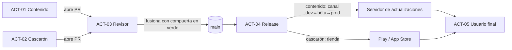

# N5: Guía didáctica y demo

> Dossier del investigador especializado del núcleo N5 (descomposición en
> `/LAB/Lab-Documentos/Lab-Documentos.Documentacion/PROMPTs/Concepts/01-Framework-Concept/OUTPUTs/Bitacoras/01-Descomposicion-En-Nucleos.md`).
> Fecha de investigación y de consulta de todas las URL: **2026-10-25**.
> Convención de evidencia: **[Fn]** fuente web numerada en §9.1; **[Ln]** archivo local (§9.2), con línea o sección;
> **[Cn]** comando con su salida (§9.3). Lo que no se pudo confirmar dice **NO VERIFICADO** y el motivo. Lo que es
> opinión del investigador dice **Criterio propio**.

## Índice

1. [Índice](#índice)
2. [Alcance del núcleo y frases que lo originan](#2-alcance-del-núcleo-y-frases-que-lo-originan)
3. [Definiciones: qué es y qué no es](#3-definiciones-qué-es-y-qué-no-es)
4. [Estado del arte y estándares](#4-estado-del-arte-y-estándares)
   - 4.1 [Diátaxis: cuatro necesidades, cuatro formas](#41-diátaxis-cuatro-necesidades-cuatro-formas)
   - 4.2 [Teoría de la carga cognitiva aplicada a material técnico](#42-teoría-de-la-carga-cognitiva-aplicada-a-material-técnico)
   - 4.3 [Ejemplos trabajados, desvanecimiento y aprendizaje progresivo](#43-ejemplos-trabajados-desvanecimiento-y-aprendizaje-progresivo)
   - 4.4 [Cómo enseñan la industria y los fabricantes](#44-cómo-enseñan-la-industria-y-los-fabricantes-microsoft-learn-github-expo-capacitor)
   - 4.5 [Normas de edición: citas, bibliografía y glosario](#45-normas-de-edición-citas-bibliografía-y-glosario)
   - 4.6 [Lo que fija el perfil Study-Guide y cómo lo resolvieron las guías del repositorio](#46-lo-que-fija-el-perfil-study-guide-y-cómo-lo-resolvieron-las-guías-del-repositorio)
   - 4.7 [El caso base `MovilidadUrbana.MAUI` como materia de la demo](#47-el-caso-base-movilidadurbanamaui-como-materia-de-la-demo)
   - 4.8 [Tensiones detectadas](#48-tensiones-detectadas)
5. [Opciones y tabla comparativa](#5-opciones-y-tabla-comparativa)
   - 5.1 [Forma del conjunto documental](#51-forma-del-conjunto-documental)
   - 5.2 [Vínculo guía ↔ demo](#52-vínculo-guía--demo)
   - 5.3 [Formato de referencias](#53-formato-de-referencias)
6. [Recomendación preliminar (criterio propio)](#6-recomendación-preliminar-criterio-propio)
   - 6.1 [Marco de referencia instanciado](#61-marco-de-referencia-instanciado)
   - 6.2 [Estructura de `Framework-Concept/`](#62-estructura-de-framework-concept)
   - 6.3 [Estructura de `Demo/`](#63-estructura-de-demo)
   - 6.4 [Ruta de aprendizaje por etapas y su vínculo con la demo](#64-ruta-de-aprendizaje-por-etapas-y-su-vínculo-con-la-demo)
   - 6.5 [Reglas de diseño didáctico derivadas](#65-reglas-de-diseño-didáctico-derivadas)
   - 6.6 [Cadena de consecuencias](#66-cadena-de-consecuencias)
7. [Preguntas para la mesa](#7-preguntas-para-la-mesa)
8. [Dependencias con otros núcleos](#8-dependencias-con-otros-núcleos)
9. [Fuentes](#9-fuentes)
10. [Observaciones y lo que queda NO VERIFICADO](#10-observaciones-y-lo-que-queda-no-verificado)
11. [Verificación de fuentes](#11-verificación-de-fuentes)

---

## 2. Alcance del núcleo y frases que lo originan

**Problema que resuelve N5:** convertir lo que deciden N1–N4 en algo que un desarrollador **sin experiencia** pueda
aprender, reproducir y usar para decidir; y construir una demo, derivada de `MovilidadUrbana.MAUI`, que sea a la vez
la prueba de que la técnica funciona y el material de los ejemplos de la guía.

| Frase del prompt / perfil | Qué le exige a N5 |
| --- | --- |
| «Desarrollar una guía instructiva academica enfocada a un desarrollador sin experiencia que describa la tecnica en `…/Developer-Guide.md`» [L1 l.30] | Diseño didáctico para novatos; `Developer-Guide.md` como punto de entrada obligatorio |
| «en base a esto construir … ejemplo de demostración en `…/Demo` que a su vez sirva esta demo para ilustrar con ejemplo a dicha guía. Tomar base … `MovilidadUrbana.MAUI`» [L1 l.30] | Demo trazable paso a paso con la guía; dominio de Movilidad Urbana |
| «Toda la documentación generarla en `/LAB/Lab-Documentos/Lab-Documentos/Concepts/Framework-Concept`» [L1 l.34] | Todo el conjunto vive en esa carpeta (incluidos anexos y README) |
| «secciones jerárquicas … definiciones, explicaciones, ejemplos claros … mermaid … autocontenida y no delta … indices» [L1 §Reglas, viñeta 1] | Forma de cada documento |
| «cita también academicos en edición de material bibliografico para consultar y crear ejemplos y material de consulta» [L1 l.36] | Normas de cita, bibliografía y glosario; ejemplos y material de consulta |
| Perfil `Study-Guide-Documentation`: marco de referencia (escenarios, contextos, actores), mapa conceptual, documentos por tema con seis apartados, métodos y marcos, anexos, README [L3 §Enfoque, §Objetivos específicos, §Estructura] | Esqueleto obligatorio del conjunto |

Queda **fuera** de N5: decidir la técnica en sí (opción de contenido, firma, puente: N1/N2), el procedimiento de PR y las
líneas de versión (N3) y la pirámide de pruebas (N4). N5 los **enseña** y los **ejecuta en la demo**; no los decide.

## 3. Definiciones: qué es y qué no es

| Término | Qué es | Qué **no** es |
| --- | --- | --- |
| **Guía de estudio** | Cuerpo documental formativo organizado como recorrido de aprendizaje, que deja al lector en condiciones de decidir y de producir los artefactos del dominio [L3 §Objetivo] | Una colección de fichas sueltas ni un manual de referencia [L3 §Objetivo] |
| **Tutorial** | «Una experiencia que tiene lugar bajo la guía de un tutor», orientada al aprendizaje [F2] | Una receta para quien ya sabe (eso es un *how-to*) [F7] |
| **Guía práctica (how-to)** | Indicaciones que llevan al lector a través de un problema o hacia un resultado; sirven al usuario ya competente [F3] | Un tutorial: no enseña, asume competencia [F3][F7] |
| **Referencia** | Descripción técnica de la maquinaria y de cómo operarla, orientada a la información [F4] | Explicación ni instrucciones |
| **Explicación** | Tratamiento discursivo que permite la reflexión, orientado a la comprensión [F5] | Pasos a seguir |
| **Ejemplo trabajado** (*worked example*) | Problema ya resuelto para el aprendiz, con cada paso explicado [F19 p.7]; «la solución de un experto para que el aprendiz la estudie» [F16] | Un fragmento de código sin contexto ni explicación de la decisión |
| **Carga cognitiva intrínseca / extrínseca** | Intrínseca: la complejidad propia del material según el conocimiento previo del lector; extrínseca: la que agrega una instrucción mal diseñada [F19 p.3] | Una medida de «dificultad» del texto |
| **Demo** | Solución ejecutable en `Framework-Concept/Demo`, derivada de `MovilidadUrbana.MAUI`, de la que salen todos los ejemplos de la guía [L1 l.30] | Un «ejemplo ilustrativo» que nunca se ejecutó (eso se rotula aparte [L6 OB-EV-07]) |
| **Marco de referencia** | Escenarios, contextos y actores definidos una vez y referenciados por toda la guía [L3 §Enfoque] | Un glosario |
| **Vínculo guía ↔ demo** | Correspondencia comprobable entre cada paso/ejemplo de la guía y un archivo, rango de líneas y versión de la demo [L6 OB-DA-06] | Una mención genérica «ver la demo» |

## 4. Estado del arte y estándares

### 4.1 Diátaxis: cuatro necesidades, cuatro formas

- Diátaxis se presenta como «una forma de pensar y de hacer documentación» y distingue cuatro tipos: tutoriales, guías
  prácticas (*how-to*), referencia técnica y explicación [F1].
- La **brújula** del marco clasifica un texto con dos preguntas: ¿informa la acción o la cognición? ¿sirve a la
  adquisición o a la aplicación de una habilidad? Acción + adquisición → tutorial; acción + aplicación → *how-to*;
  cognición + aplicación → referencia; cognición + adquisición → explicación [F6].
- **Tutorial** [F2]: mostrar desde el comienzo adónde va el aprendiz; «cada paso que sigue el aprendiz debe producir un
  resultado comprensible, por pequeño que sea»; narrar lo esperado, incluida la salida de ejemplo; apuntar a la
  confiabilidad («tan bien construido que nada pueda salir mal»); minimizar la explicación («un tutorial no es el lugar
  para la explicación»: enlazarla); concentrarse en lo concreto; fomentar la repetición; ignorar alternativas.
- **Tutorial vs. *how-to*** [F7]: el tutorial sigue una sola línea, en un escenario preparado, y «debe ser seguro»; la
  responsabilidad es del docente. El *how-to* se bifurca, se aplica al mundo real, «no puede prometer seguridad», y la
  responsabilidad es del usuario.
- Adopción: Canonical anunció el 15-12-2021 (Daniele Procida) que adoptaba Diátaxis para su documentación técnica [F9].

**Qué implica para N5.** El lector de la guía es un novato (§2): su primer contacto tiene que ser un **tutorial** de una
sola línea, seguro y con resultados visibles; los procedimientos operativos del equipo (publicar una actualización,
revertir, subir `minShellVersion`, abrir un PR) son **how-to**, para cuando ya es competente; el contrato del puente, el
formato del manifiesto y las líneas de versión son **referencia**; el porqué (tiendas, firma, rollback) es
**explicación**. **Criterio propio.**

### 4.2 Teoría de la carga cognitiva aplicada a material técnico

- Fundación: Sweller (1988) planteó que el análisis medios-fines de la resolución de problemas consume memoria de trabajo
  que de otro modo iría a construir esquemas [F10, metadatos verificados por Crossref C1; contenido del resumen
  **NO VERIFICADO** en el texto original: el resumen está elidido por el editor, C2].
- Arquitectura cognitiva: «la teoría supone una memoria de trabajo de capacidad limitada» y orienta diseños basados en
  reducir su carga y fomentar la construcción de esquemas [F12]. La revisión de 2019 resume que toda información nueva se
  procesa primero en una memoria de trabajo limitada en capacidad y duración y luego se almacena en una memoria de largo
  plazo ilimitada; una vez almacenada, esos límites desaparecen [F13, resumen].
- Tipos de carga [F19 p.3]: **intrínseca** (complejidad del material y conocimiento previo del aprendiz; necesaria pero
  dañina si es excesiva), **extrínseca** (instrucción mal diseñada; dañina), **germana** (instrucción que facilita la
  construcción de esquemas). El mismo documento advierte que Sweller (2010) propuso una redefinición de los tipos [F19
  nota 6]; **NO VERIFICADO** el contenido de esa redefinición (no se consultó Sweller 2010).
- Efectos con consecuencia directa sobre material técnico [F19 p.7]:
  - **Atención dividida**: aparece cuando el aprendiz debe integrar mentalmente dos fuentes (un diagrama que no se
    entiende sin un texto separado); se reduce **integrando físicamente** las fuentes.
  - **Redundancia**: información adicional no relevante, o la misma información en varias formas (texto y diagrama que
    repiten lo mismo), sobrecarga la memoria de trabajo.
  - **Inversión por pericia**: el uso intensivo de ejemplos trabajados pierde eficacia a medida que crece la pericia y
    puede volverse redundante o contraproducente; la teoría respalda instrucción totalmente guiada para novatos y la
    incorporación gradual de problemas independientes [F19 p.7; trabajos de base: F14, F15, metadatos verificados C1].

### 4.3 Ejemplos trabajados, desvanecimiento y aprendizaje progresivo

- **Efecto del ejemplo trabajado**: hallazgo ampliamente replicado de que novatos que estudian ejemplos resueltos rinden
  mejor en pruebas posteriores que quienes resuelven los problemas equivalentes [F19 p.7]; demostrado desde Sweller y
  Cooper (1985) [F11].
- Principios de diseño de ejemplos (Atkinson, Derry, Renkl y Wortham, 2000) [F16, resumen]: componentes muy
  integrados; varias modalidades; estructura conceptual señalada por rótulos o segmentación; **varios ejemplos por tipo
  de problema** con formatos variados; rasgos de superficie que señalen la estructura profunda; ejemplos **próximos a
  problemas de práctica equivalentes**; y fomentar la **autoexplicación** del aprendiz.
- **Transición del ejemplo al problema**: Renkl y Atkinson (2003) tratan cómo estructurar el paso del estudio de
  ejemplos a la resolución de problemas desde la carga cognitiva [F17]. **NO VERIFICADO** el método concreto
  («desvanecimiento» de pasos resueltos): sólo se verificaron título y metadatos; el texto está tras muro de pago.
- **Aprendizaje de tareas complejas**: van Merriënboer, Kirschner y Kester (2003) [F18] y el modelo 4C/ID (tareas
  completas y auténticas como núcleo, información de apoyo, información procedimental y práctica de partes) [F28].
  Los cuatro componentes constan en el resumen del registro institucional de Maastricht [F28] (capítulo de 2018 en el
  *International Handbook of the Learning Sciences*, pp. 169–179). **NO VERIFICADO** en el texto del capítulo.
- **Instrucción minimalista** para habilidades de computación: Carroll (1990), *The Nurnberg Funnel*, MIT Press
  [F29]. **NO VERIFICADO** el contenido: sólo se confirmó el registro bibliográfico.

**Qué implica para N5 (criterio propio).** La técnica tiene alta carga intrínseca (cascarón, contenido, manifiesto,
firma, puente, canales, PR). La guía la segmenta en **etapas**, cada una con *un* concepto nuevo, *un* ejemplo trabajado
ejecutado en la demo y *un* ejercicio de completar o variar; el andamiaje se retira a medida que avanzan las etapas
(§6.5).

### 4.4 Cómo enseñan la industria y los fabricantes: Microsoft Learn, GitHub, Expo, Capacitor

| Fuente | Forma observada | Evidencia |
| --- | --- | --- |
| Plantilla de tutorial de Microsoft Learn | Antes del primer H2, una lista «In this tutorial, you learn how to:»; **Prerequisites** como primer H2; un H2 por procedimiento; **Clean up resources** antes del cierre; **Next step** (un solo enlace al paso siguiente de una secuencia) o **Related content**, pero no ambos; el tutorial muestra «el mejor procedimiento único» para una tarea principal | [F20] |
| Microsoft Learn, «Build your first .NET MAUI app» | Prerrequisitos → crear la app → pasos numerados que terminan en un resultado observable («press the Click me button … observe that the count … is incremented») → **Troubleshooting** → Next steps; variantes por plataforma con pivotes (Android, iOS, Windows); `ms.date` 2026-10-08 | [F21] |
| GitHub Docs, tipo de contenido «tutorial» | Introducción (audiencia, prerrequisitos, qué se construye, ejemplo de proyecto exitoso, sin estimar tiempo) → secciones procedimentales con ejemplos realistas → **Troubleshooting** → **Conclusión** que vuelve al proyecto del inicio → **Next steps** con 2–3 acciones; exige que exista antes un *quickstart* | [F22] |
| Expo, EAS Update «Get started» | Prerrequisitos → ocho pasos (instalar CLI, login, configurar, canal, **build**, cambio local, **publicar actualización**, **probar la actualización**) → recuadro «Something not working?» dentro del último paso (remite a la guía de depuración; no hay sección «Troubleshooting» propia) → próximos pasos | [F23] |
| Expo, *runtime versions* | «propiedad que garantiza la compatibilidad entre el código nativo de un build y una actualización»; si una actualización llama a código nativo ausente, `expo-updates` puede detectar el error e intentar volver a la actualización anterior | [F24] |
| Capawesome (Capacitor) Live Updates «Setup» | Prerrequisitos → pasos 1–5 (crear app, instalar SDK, configurar, **publicar la primera actualización**, **probar** con un cambio visible y reinicio) → sección **«Make Updates Version-Compatible»** → próximos pasos (publicar, firmar bundles); «un Live Update sólo puede cambiar la capa web»; «fijar cada release nativo a su propio canal» | [F25] |
| Ionic Appflow Deploy | Live Updates sólo para cambios binariamente compatibles (HTML, CSS, JS); cambios nativos exigen un binario nuevo en las tiendas | [F26] |

Hallazgos (hechos):

1. Los dos tutoriales de actualización OTA revisados (Expo y Capawesome; Ionic [F26] es una introducción, no un
   tutorial) terminan con **una actualización publicada y vista en el dispositivo** [F23][F25] y separan el **concepto de
   compatibilidad** (runtime version, canal por release nativo) en una sección o página propia [F24][F25].
2. Las dos guías de estilo y el tutorial de MAUI coinciden en prerrequisitos explícitos y un siguiente paso
   [F20][F21][F22]; la solución de problemas y el resultado visible aparecen en [F21] y [F22], pero **no** en la plantilla
   de Microsoft [F20], que sólo pide «code block, diagram, or screenshot if appropriate» en cada H2 de tarea.
3. En una búsqueda, **no apareció** documentación oficial de Microsoft sobre actualizar contenido de una app MAUI Blazor
   Hybrid sin tienda [C3]. **NO VERIFICADO** que no exista: fue una sola búsqueda.
4. La URL del tutorial de Blazor Hybrid con MAUI (`learn.microsoft.com/en-us/aspnet/core/blazor/hybrid/tutorials/maui?view=aspnetcore-10.0`)
   redirigió el 2026-10-25 a «Build your first .NET MAUI app» con `viewFallbackFrom=aspnetcore-10.0` [C4]. **NO
   VERIFICADO** si ese tutorial se movió a otra URL o dejó de existir para .NET 10.

### 4.5 Normas de edición: citas, bibliografía y glosario

- **APA 7, fechas de consulta.** Una fuente secundaria (guía de biblioteca universitaria) indica que el *Publication
  Manual* (7.ª ed.) pide fecha de consulta para páginas **no archivadas (diseñadas para cambiar)**; si la página tiene
  enlace permanente se considera archivada y no la lleva [F31]. Su ejemplo es «Retrieved 20 January, 2020, from URL»
  al final de la entrada de la lista de referencias, no en la cita en el texto [F31]. **NO VERIFICADO** el orden
  «Month Day, Year» en la fuente primaria: [F31] usa día-mes-año y `apastyle.apa.org` devolvió contenido vacío a la
  herramienta (se renderiza con JavaScript) [C5].
- **Consecuencia para esta guía (criterio propio):** la documentación de .NET, MAUI y de las tiendas cambia sin
  archivarse (p. ej. `ms.date` 2026-10-08 en [F21]); toda referencia a ellas lleva fecha de consulta, lo que coincide con
  la obligación OB-EV-03/OB-EV-10 del relevamiento normativo [L6 §6].
- **Terminología.** ISO 704:2022 (*Terminology work — Principles and methods*) fija principios y métodos para preparar
  terminologías (relación objeto–concepto–definición–designación) y remite la presentación de entradas a ISO 10241-1;
  ISO 10241-1:2011 fija requisitos para redactar y estructurar entradas terminológicas en normas [F30][F32]. **NO
  VERIFICADO** el texto normativo: sólo los alcances publicados por organismos nacionales; el texto está tras pago.
- **Práctica del repositorio:** el glosario de la guía IS usa las columnas «Término canónico | Definición | Alias /
  inglés | Fuente», y las referencias, un catálogo por nivel de autoridad (`N-`, `G-`, `O-`, `F-`, `P-`) con fecha de
  verificación [L9b][L9c]. La guía de .NET usa citas autor-fecha con ancla («[Microsoft, 2026k](#ref-microsoft-2026k)»)
  [L10 l.116].

### 4.6 Lo que fija el perfil Study-Guide y cómo lo resolvieron las guías del repositorio

| Exigencia del perfil [L3] | Cómo la resolvió la guía IS (multiarchivo) [L9] | Cómo la resolvió la guía .NET (un archivo + laboratorio) [L10] |
| --- | --- | --- |
| Marco de referencia en documentos propios | `00-Marco-de-Referencia/{Escenarios,Contextos,Actores,Convenciones}.md` | No tiene marco de escenarios; usa un problema conductor |
| Mapa conceptual «estoy acá → qué aplico» | `01-Mapa-Conceptual/Mapa-Conceptual.md` | Índice por partes |
| Un documento por tema, misma estructura | Familias `10-`…`50-` con siete apartados | Capítulos de un único archivo |
| Anexos (plantillas, verificación, glosario) | `99-Anexos/` (Plantilla, Glosario, Lista, Referencias, Pendientes) | Anexos dentro del archivo |
| README con ruta de lectura | `README.md` con «Cómo usar esta guía» (tres entradas: aprender, hacerlo ahora, evaluar) | Sección 0 «Cómo usar esta guía» |
| Ejemplos reales | Dominio ficticio coherente (gestión de audiencias) | **Laboratorio ejecutado**: `Examples/…/lab.sh` corre los pasos, guarda `capturas/` y `aserciones.log`; bloques rotulados «Compilado: `MyProject/src/…`» y «Salida registrada: `capturas/Lnn-….txt`» |

El relevamiento normativo ya tradujo el perfil en obligaciones comprobables (OB-EST, OB-TEM, OB-DA…) y una plantilla
de documento temático [L6 §4, §13], y dejó abierta la decisión «guía de un archivo» vs. «conjunto con
`Developer-Guide.md` como índice» [L6 H-06].

### 4.7 El caso base `MovilidadUrbana.MAUI` como materia de la demo

Del relevamiento R1 [L5], lo que importa a la didáctica:

- Es un dominio «de juguete», didáctico: ABM de localidades y encuesta de tres pasos [L5 §2; L11 README].
- `Domain/` y `Application/` no tocan MAUI y son idénticos (salvo `namespace`) a los de la web Blazor, que ya los
  consume desde Razor: se reutilizan tal cual; las pantallas Razor de la web son el punto de partida del contenido
  [L5 §14.2, §14.3]. **NO VERIFICADO** que compilen dentro de Blazor WebAssembly [L5 §14.2].
- La suite de ViewModels con archivos enlazados en `net10.0` corre 18/18 en 3 s sin teléfono [L5 §12.1]: patrón para
  la compuerta rápida (N3/N4) y para ejercicios del alumno.
- No tiene red, servidor, login, migraciones ni versión de producto [L5 §15]: **todo lo que el framework agrega es
  nuevo para el alumno**, lo que confirma la alta carga intrínseca (§4.3).

Lugar de destino hoy: `Framework-Concept/` contiene `Framework-APP.md`, `Developer-Guide.md` (0 bytes) y `Demo/`
(vacío) [L12]. El borrador nombra `Cascaron-Aplicacion-Maui.md` como relacionado [L2 l.4], pero ese archivo **no
existe** en la carpeta [L12].

### 4.8 Tensiones detectadas

| Id | Tensión | Evidencia |
| --- | --- | --- |
| T-1 | El perfil impone a cada documento temático seis apartados (definición, escenarios, ejemplos, preguntas, calidad, plantilla), que mezclan explicación y referencia; Diátaxis desaconseja mezclar formas y pide que el tutorial minimice la explicación | [L3 §Estructura]; [F2][F7] |
| T-2 | El prompt pide la guía «en `Developer-Guide.md`»; el perfil pide un conjunto con README, ejes, temas y anexos | [L1 l.30]; [L3 §Objetivos específicos]; [L6 H-06] |
| T-3 | GitHub sólo ejecuta workflows de `.github/workflows` de la raíz del repositorio [F27]; `Demo/` está dentro del repositorio Lab-Documentos (carpeta `Concepts/` sin seguimiento, [L6 H-05]): un workflow en `Demo/.github/workflows/` **no se ejecutaría**, y el prompt pide configurar el workflow con `runs-on: [self-hosted, i7infra-dev]` [L1 l.32] y documentar todo en `Framework-Concept` [L1 l.34] | [F27]; [L6 H-05]; [L1 l.32, l.34] |
| T-4 | Escribir en el `CHANGELOG.md` raíz de Lab-Documentos sale de la ruta autorizada | [L6 H-04] |
| T-5 | La demo depende de decisiones abiertas (D-01 contenido A/B/C; D-06 iOS): si la mesa elige B (UI dirigida por datos), cambian el contenido, el puente y la mitad de las etapas | [L2 §13] |

## 5. Opciones y tabla comparativa

Escala: ++ muy favorable · + favorable · 0 neutro · − desfavorable · −− muy desfavorable. La puntuación es **criterio
propio** apoyado en §4.

### 5.1 Forma del conjunto documental

- **O1 — Un solo archivo** (`Developer-Guide.md` con partes y anexos; modelo de la guía .NET [L10]).
- **O2 — Conjunto Study-Guide puro** (modelo IS [L9]); `Developer-Guide.md` es el índice; los temas siguen los seis
  apartados; los procedimientos van dentro de los temas.
- **O3 — Conjunto Study-Guide con las cuatro formas de Diátaxis declaradas como variantes** (§6.2): `Developer-Guide.md`
  es índice y ruta de aprendizaje; una familia **Tutorial** por etapas, una familia **Cómo hacer**, temas del perfil
  (explicación + referencia) y anexos.
- **O4 — Tutorial de una página al estilo de los fabricantes** (Expo/Capawesome [F23][F25]) más referencia.

| Criterio | O1 | O2 | O3 | O4 |
| --- | --- | --- | --- | --- |
| Simplicidad (de escribir y de mantener) | + un archivo | − muchas piezas | − muchas piezas | ++ |
| Practicidad para el novato | 0 (largo; la ruta se pierde en un archivo de miles de líneas) | − (sin tutorial: el novato entra por definiciones) | ++ (entra por un tutorial seguro y con resultado visible [F2]) | + |
| Escalabilidad (agregar temas, servicios, plataformas) | − | + | + | −− |
| Riesgo de incumplir el perfil / prompt | − (sin marco de escenarios, como la guía .NET) | + cumple el perfil, choca con T-1 | + cumple el perfil declarando variantes (precedente: IS declara una variante [L6 §4.2]) | −− incumple el perfil |
| Costo | + | − | −− (es el que más escribe) | ++ |

### 5.2 Vínculo guía ↔ demo

- **V1 — Etiquetas git por etapa** en la demo.
- **V2 — Carpeta por etapa** (copia completa de la solución en cada una).
- **V3 — Código final + guion de laboratorio** que reconstruye cada etapa, guarda capturas y aserciones (modelo
  `lab.sh` de la guía .NET [L10]); cada bloque de la guía lleva su procedencia `Demo/<ruta> L<a>–L<b>` [L6 OB-DA-06].
- **V4 — V3 + parches por etapa**: cada etapa que «cambia algo» (una nueva versión del contenido, un cambio que rompe un
  PR) es un archivo `.patch` pequeño que el guion aplica; el parche **es** el ejemplo trabajado.

| Criterio | V1 | V2 | V3 | V4 |
| --- | --- | --- | --- | --- |
| Simplicidad | + | + | 0 | 0 |
| Practicidad (el alumno ve qué cambió entre etapas) | 0 (necesita `git diff` y que `Demo/` sea repositorio propio) | − (copias enormes; el cambio se esconde) | + | ++ (el diff es el ejemplo) |
| Escalabilidad | 0 | −− | + | + |
| Riesgo | − `Concepts/` no está en git hoy [L6 H-05] | − deriva entre copias | + verificable por aserciones | + ídem; riesgo de parche que no aplica (se detecta en el guion) |
| Costo | + | − | 0 | 0 |

### 5.3 Formato de referencias

- **R1 — Catálogo por nivel de autoridad con IDs** (`N-`, `G-`, `O-`, `F-`, `P-`) y fecha de verificación (modelo IS
  [L9c]).
- **R2 — Autor-fecha APA 7 con anclas** (modelo .NET [L10]).
- **R3 — R1 + entrada en formato APA 7 en cada fila**: el texto cita por ID (estable para agentes, Rule-Dual-Audience
  [L6 OB-DA-02]); la fila trae la entrada APA 7 con DOI o URL y fecha de consulta.

| Criterio | R1 | R2 | R3 |
| --- | --- | --- | --- |
| Simplicidad | + | + | 0 |
| Practicidad (lector académico) | 0 | ++ | + |
| Escalabilidad / doble audiencia | ++ | − (los anclajes `2026k` no dicen nada al agente) | ++ |
| Riesgo | + | 0 | + |
| Costo | + | + | 0 |

## 6. Recomendación preliminar (criterio propio)

> **Todo este apartado es criterio propio del investigador**, apoyado en §4. Los nombres de etapas, archivos y
> escenarios son **propuestas**: dependen de lo que decidan N1–N4 y la mesa.

Recomiendo **O3 + V4 + R3**.

### 6.1 Marco de referencia instanciado

**Escenarios** (`ESC-n`). Cada uno es una situación que el lector vive y en la que el framework hace algo distinto.

| Id | Escenario | Qué pasa | Núcleo que lo decide |
| --- | --- | --- | --- |
| `ESC-1` | Primer arranque sin red | La app recién instalada abre con el **paquete semilla** embebido | N1 |
| `ESC-2` | Actualización de contenido | Se publica una versión nueva del contenido en el canal; al abrir la app se descarga, verifica y activa | N1 |
| `ESC-3` | Actualización que falla | Firma o hash inválidos, o el contenido no avisa «arranqué bien»: se descarta o se revierte al anterior | N1 |
| `ESC-4` | Cambio incompatible del puente | El contenido nuevo necesita un módulo del puente que el cascarón instalado no tiene: `minShellVersion` lo frena y se pide actualizar desde la tienda | N1, N2, N3 |
| `ESC-5` | Trabajo sin red | Una acción se ejecuta, se encola en el outbox o se bloquea según su clase | N2 |
| `ESC-6` | PR que rompe | Un PR a `main` introduce una regresión; la compuerta lo pone en rojo y, **si `main` tiene protección de rama con el check requerido**, el botón de fusionar queda deshabilitado. La protección de rama está disponible en repositorios públicos con GitHub Free y en públicos y privados con Pro, Team y Enterprise [F33][F34]; en un repositorio privado de plan Free el check queda rojo pero la fusión **no** se bloquea | N3, N4 |
| `ESC-7` | Publicación y promoción | Una versión etiquetada pasa por `dev → beta → prod`; se publica en tienda sólo si cambió el cascarón | N3 |

Siete es el máximo razonable: el perfil obliga a que **cada** documento temático recorra **todos** los escenarios
[L3 §Enfoque; L6 OB-TEM-02], y cada escenario agregado multiplica el costo. Si la mesa quiere reducir, `ESC-3` puede
fundirse en `ESC-2` y `ESC-7` en `ESC-6`.

**Contextos** (`CTX-…`), en tres dimensiones que cambian la respuesta dentro de un mismo escenario:

| Dimensión | Id | Contexto | Qué cambia |
| --- | --- | --- | --- |
| Plataforma | `CTX-AND` | Android | Compila en Linux; se ensaya en el g42 o en emulador; WebView del sistema |
| Plataforma | `CTX-IOS` | iOS | Mac y firma (D-06); WKWebView; reglas de App Store sobre código descargado [L2 §2]. La guía 2.5.2 prohíbe «download, install, or execute code which introduces or changes features or functionality of the app» y la 4.7 admite «HTML5 and JavaScript mini apps» bajo las condiciones 4.7.1–4.7.5 [F35]; si el contenido WASM cae en esa excepción lo decide N1 (no N5) |
| Conectividad | `CTX-ONL` | En línea | Se consulta el manifiesto; se sincroniza el outbox |
| Conectividad | `CTX-OFF` | Sin red | Paquete instalado; acciones encolables o bloqueadas |
| Conectividad | `CTX-RSS` | Red sin servidor | Hay red pero `/health` falla [L2 §6]: el caso que más confunde |
| Canal | `CTX-DEV` / `CTX-BETA` / `CTX-PROD` | Canal de publicación | Quién recibe la versión y con qué riesgo [L7 §4.9] |

**Actores** (`ACT-nn`), con lo que le toca decidir a cada uno:

| Id | Actor | Decide | No decide |
| --- | --- | --- | --- |
| `ACT-01` | Desarrollador de contenido | Páginas Razor, reglas de presentación, cuándo un cambio requiere puente nuevo | Firma, canales, cascarón |
| `ACT-02` | Desarrollador del cascarón | Servicios nativos, módulos y versión del puente, migraciones de SQLite | Contenido de negocio |
| `ACT-03` | Revisor de PR | Si el cambio cumple el procedimiento y la compuerta está en verde | Si se publica |
| `ACT-04` | Responsable de release | Etiqueta, promoción entre canales, `minShellVersion`, envío a tiendas, custodia de la clave de firma | El código del cambio |
| `ACT-05` | Usuario final | Nada técnico: abre la app, trabaja con o sin red, acepta actualizar desde la tienda | — |

El lector novato de la guía se ubica primero como `ACT-01`; la ruta lo lleva después a `ACT-02` y `ACT-03`.



### 6.2 Estructura de `Framework-Concept/`

```text
Framework-Concept/
├── README.md                          # Portada corta (lo que GitHub muestra): qué es, enlace a Developer-Guide.md y a Demo/
├── Developer-Guide.md                 # GUIA-INDICE: resumen, «Cómo usar esta guía» (aprender / hacerlo ahora / evaluar),
│                                      #   tabla de contenido con IDs, ruta de lectura (mermaid), rutas por actor, versión SemVer
├── Framework-APP.md                   # Borrador del PO: no se toca; se cita como antecedente
├── 00-Marco-de-Referencia/
│   ├── Escenarios.md   Contextos.md   Actores.md
│   └── Convenciones.md                # IDs, frontmatter, variantes declaradas (Tutorial, Cómo hacer), niveles de autoridad
├── 01-Mapa-Conceptual/Mapa-Conceptual.md   # «estoy en ESC-x / CTX-y → leo esto / corro esta etapa de la demo»
├── 10-Tutorial/                       # Diátaxis: tutorial (variante declarada). Una línea, segura, resultado visible por etapa
│   ├── README.md                      # FAM-TUT: qué se construye, prerrequisitos, mapa de etapas
│   └── Etapa-00-Entorno.md … Etapa-09-Canales.md     # ver §6.4
├── 20-Fundamentos/                    # Explicación (perfil): por qué existe la técnica
│   ├── Cascaron-y-Contenido.md   Lo-Que-Permiten-Las-Tiendas.md   Opciones-de-Contenido.md (métodos y marcos: A/B/C)
├── 30-Actualizacion/                  # Temas N1
│   ├── Manifiesto-y-Canales.md   Firma-y-Verificacion.md   Activacion-y-Rollback.md   Paquete-Semilla.md
├── 40-Cascaron-y-Puente/              # Temas N2
│   ├── Puente-Versionado.md   Servicios-Nativos.md   Politica-de-Red-y-Outbox.md   SQLite-y-Migraciones.md   Login-y-Biometria.md
├── 50-Integracion-y-Versionado/       # Temas N3 (con bloques Entradas/Salidas/Validaciones, OB-DA-05)
│   ├── Procedimiento-de-PR.md   Compuerta-de-CI.md   Lineas-de-Version.md   Publicacion-y-Promocion.md
├── 60-Pruebas/                        # Temas N4
│   ├── Piramide-del-Framework.md   Contrato-del-Puente.md   Pruebas-del-Actualizador.md
├── 70-Como-Hacer/                     # Diátaxis: how-to (variante declarada), para el ya competente
│   ├── Publicar-una-Actualizacion.md   Revertir-una-Version.md   Subir-minShellVersion.md
│   ├── Agregar-un-Modulo-al-Puente.md   Abrir-un-PR.md   Promover-de-Beta-a-Prod.md
├── 90-Comparacion-con-la-Industria/Expo-Capacitor-y-este-Framework.md   # métodos y marcos [F23–F26]
└── 99-Anexos/
    ├── Glosario.md   Referencias.md   Lista-de-Verificacion.md   Pendientes.md   Revision-de-Consistencia.md
    ├── Plantillas.md                  # plantilla de PR, manifest.json comentado, CHANGELOG del producto, entrada de glosario
    └── Mapa-Guia-Demo.md              # tabla etapa/ejemplo ↔ archivo, rango, parche, captura y aserción de la demo
```

Decisiones de forma incluidas en la propuesta:

- `Developer-Guide.md` cumple el rol de índice (`doc_type: indice`, `doc_id: GUIA-INDICE`) que el perfil asigna al README,
  como ya propuso el relevamiento normativo [L6 §10.2]; el `README.md` queda como portada mínima que remite a él. Así se
  cumplen a la vez el prompt (T-2) y el perfil.
- Los temas `20-`…`60-` siguen los seis apartados del perfil más el resumen ejecutivo [L6 §4.2]. Las familias `10-Tutorial`
  y `70-Como-Hacer` son **variantes declaradas** en `Convenciones.md` (T-1): un tutorial con «Definición» y «Criterios de
  calidad» dejaría de ser tutorial [F2]. Cada etapa del tutorial enlaza al tema que explica lo que hizo.
- Numeración `10-`→`70-` = orden de lectura del novato (tutorial antes que temas), siguiendo la convención de prefijos del
  repositorio [L6 OB-LAB-01].
- El `CHANGELOG` del conjunto vive dentro de `Framework-Concept/` hasta que la mesa resuelva T-4.

### 6.3 Estructura de `Demo/`

Base: la estructura tentativa del borrador [L2 §11] y el mapa de reutilización de R1 [L5 §14].

```text
Demo/
├── README.md                    # Cómo se corre: requisitos, `./lab.sh`, `./lab.sh etapa 03`, teléfono o emulador
├── global.json                  # SDK fijado (hueco del caso base [L5 §10, §15])
├── Directory.Packages.props     # versiones centralizadas
├── FrameworkConcept.Demo.slnx
├── src/
│   ├── Framework.Core/          # contratos: IUpdater, IManifestSource, IBridge, INetworkState, IOutbox (net10.0)
│   ├── Framework.Updater/       # manifiesto, sha256, firma, staging, puntero atómico, rollback (net10.0, sin MAUI)
│   ├── Framework.Bridge/        # lado cascarón + bridge.js
│   ├── Framework.Bridge.Wasm/   # cliente del puente para el contenido
│   ├── Movilidad.Shell/         # app MAUI (cascarón); ApplicationId com.frameworkconcept.movilidad
│   │                            #   Infrastructure/ EF Core SQLite del caso base, con migraciones en vez de EnsureCreated [L5 §14.3]
│   └── Movilidad.Contenido/     # Blazor WASM: Domain/ y Application/ copiados del caso base; páginas Localidades,
│                                #   Editor y Encuesta portadas desde la web Razor [L5 §14.2–14.3]; repositorios por el puente
├── tools/Empaquetar/            # publish → zip → sha256 → firma → manifest.json (N1)
├── servidor/                    # servidor estático de actualizaciones: canales/dev|beta|prod/manifest.json + paquetes
├── tests/                       # Unitarias, Updater, Contrato del puente, bUnit, Playwright (N4)
├── etapas/                      # E03-agregar-medio.patch, E06-foto-de-localidad.patch, E08-pr-que-rompe.patch …
├── workflows/                   # YAML de referencia con runs-on: [self-hosted, i7infra-dev] (ver T-3)
├── lab.sh                       # corre cada etapa en contenedor, aplica parches, guarda capturas/ y aserciones.log
└── capturas/                    # salida literal de cada etapa, con encabezado (fecha, imagen, SDK, comando) como en [L10]
```

- La copia (no referencia) de `Domain/` y `Application/` respeta la regla del laboratorio de no compartir proyectos
  [L5 §14.5 punto 4].
- Todo paquete que se instale en el teléfono de ensayo usa un `applicationId` que empieza con `com.frameworkconcept.`
  (regla del despacho de la presidencia, que reserva el resto del teléfono a apps de producción del PO).
- **T-3:** la carpeta se llama `workflows/` y no `.github/workflows/` a propósito, porque ahí GitHub no la ejecutaría
  [F27]. Para que «corra» hay dos caminos y los decide la mesa con N3: publicar `Demo/` como repositorio propio (donde sí
  tendría `.github/workflows/`) o copiar el YAML a la raíz de Lab-Documentos (fuera de la ruta autorizada [L1 l.34]).

### 6.4 Ruta de aprendizaje por etapas y su vínculo con la demo

Cada etapa sigue la forma común de [F21][F22] (la plantilla [F20] aporta prerrequisitos y siguiente paso, pero no
solución de problemas ni resultado esperado): objetivo visible, prerrequisitos, pasos, **resultado esperado con
captura**, solución de problemas, siguiente etapa. Un concepto nuevo por etapa (§4.2). Las etapas suponen la opción A
del borrador (contenido WASM); si la mesa elige B, se reescriben `E02`–`E06`.

| Etapa | Concepto nuevo | Ejemplo trabajado en el dominio de Movilidad Urbana | Escenario / contexto | Archivo o parche de la demo | Evidencia que el alumno ve |
| --- | --- | --- | --- | --- | --- |
| E00 | Entorno reproducible | Restaurar y compilar con SDK fijado | — | `global.json`, `lab.sh` | `capturas/E00-entorno.txt` |
| E01 | La app de siempre, ahora con pantallas Razor | Localidades y Encuesta corriendo en el cascarón con el **paquete semilla** | `ESC-1` · `CTX-OFF` | `Movilidad.Contenido/`, `Movilidad.Shell/` | App abre en modo avión |
| E02 | Cascarón vs. contenido; puente mínimo | Los repositorios de `Localidad` pasan por `db.*` del puente | `ESC-1` | `Framework.Bridge*/` | Prueba de contrato en verde |
| E03 | Manifiesto y canal | Agregar un medio de transporte al catálogo y publicarlo como contenido nuevo (ilustrativo, a decidir) | `ESC-2` · `CTX-ONL` · `CTX-DEV` | `etapas/E03-*.patch`, `servidor/canales/dev/` | La opción nueva aparece al reabrir la app |
| E04 | Firma y hash | Paquete adulterado: un byte cambiado | `ESC-3` | `tools/Empaquetar/`, `Framework.Updater/` | El actualizador lo rechaza y sigue la versión anterior |
| E05 | Activación atómica y rollback | Contenido que nunca avisa «arranqué bien» | `ESC-3` | `Framework.Updater/` | Vuelve solo a la versión previa |
| E06 | Puente versionado y `minShellVersion` | Foto de la localidad con `camera.capture()`: necesita cascarón nuevo | `ESC-4` · `CTX-AND`/`CTX-IOS` | `etapas/E06-*.patch` | Pantalla «actualizá desde la tienda» en el cascarón viejo |
| E07 | Política sin red y outbox | Registrar una encuesta sin red y sincronizarla después | `ESC-5` · `CTX-OFF`/`CTX-RSS` | `Framework.Core/` (outbox) | Encuesta «pendiente» que pasa a «enviada» |
| E08 | PR que rompe y compuerta | Cambiar la regla del código postal (`^\d{4}$` [L5 §3.3]) y abrir el PR | `ESC-6` | `etapas/E08-*.patch`, `workflows/` | Check rojo; fusión deshabilitada sólo si hay protección de rama (ver `ESC-6`, [F33]) |
| E09 | Canales y promoción | Promover la versión de E03 de `dev` a `beta` y a `prod` | `ESC-7` · `CTX-BETA`/`CTX-PROD` | `servidor/canales/` | El teléfono en `beta` la recibe; el de `prod` todavía no |

`99-Anexos/Mapa-Guia-Demo.md` repite esta tabla con rangos de líneas, nombre de captura y aserción, y `lab.sh` verifica
que cada rango citado siga existiendo (deriva guía/demo detectada por el guion, como hace la guía .NET con sus
aserciones [L10]).

### 6.5 Reglas de diseño didáctico derivadas

| Regla | Fuente que la sostiene | Cómo se comprueba |
| --- | --- | --- |
| Cada etapa produce un resultado visible, con salida esperada | [F2][F21][F23][F25] | Cada etapa tiene captura en `capturas/` |
| Un concepto nuevo por etapa; explicación fuera del tutorial, por enlace | [F2]; carga intrínseca [F19] | Revisión contra §6.4 |
| Código pegado al texto que lo explica, con procedencia; nunca «ver el archivo X» solo | Atención dividida [F19]; OB-DA-06 [L6] | Línea `*Fuente: Demo/… L–L*` bajo cada bloque |
| Diagrama o texto, no los dos diciendo lo mismo | Redundancia [F19] | Revisión |
| Ejemplo resuelto seguido de un ejercicio equivalente («ahora agregá tal provincia y publicala») | Efecto del ejemplo trabajado [F16][F19] | Cada etapa cierra con «Ejercicio» |
| Andamiaje decreciente: en E01–E03 todo resuelto; desde E07 el alumno completa partes | Inversión por pericia [F19]; [F17] (NO VERIFICADO el método) | Ejercicios marcados «completar» |
| Dos entradas: novato (tutorial) y competente (cómo hacer / referencia) | Inversión por pericia [F19]; Diátaxis [F7]; «Cómo usar esta guía» de IS [L9] | `Developer-Guide.md` §Cómo usar |
| Compatibilidad explicada aparte y antes del primer cambio incompatible | Expo y Capawesome la separan [F24][F25] | Tema `Puente-Versionado.md` enlazado desde E06 |
| Términos: canónico en español, designación inglesa como alias, fuente | Práctica IS [L9b]; ISO 704/10241-1 (alcance) [F30][F32] | `Glosario.md` con columna Alias |

### 6.6 Cadena de consecuencias

| Si se elige… | Consecuencia | Qué pierde la alternativa |
| --- | --- | --- |
| **O3** (Study-Guide + variantes Diátaxis) | Más documentos y una `Convenciones.md` que declare dos variantes; el verificador V-03 [L6 §11] debe exceptuarlas por nombre | **O1** pierde el marco de escenarios y la escalabilidad; **O2** obliga al novato a entrar por definiciones (sin tutorial); **O4** incumple el perfil |
| **V4** (laboratorio + parches) | La demo se mantiene con `lab.sh`; si un parche no aplica, la etapa falla y se ve | **V1** necesita que `Demo/` sea repositorio git propio; **V2** multiplica copias que derivan |
| **R3** (IDs + APA 7) | Cada fila de `Referencias.md` lleva entrada APA y fecha de consulta | **R2** no da IDs estables para agentes; **R1** sólo deja al lector académico sin el formato que espera |
| **Etapas sobre la opción A** | Si la mesa elige B o C (D-01), las etapas E02–E06 se reescriben | Escribir las etapas antes de que N1 cierre D-01 es trabajo en riesgo |
| **Siete escenarios** | Cada tema recorre siete subsecciones | Con menos escenarios, `ESC-3` y `ESC-7` quedan implícitos y el lector no ve el rollback ni la promoción como situaciones propias |

## 7. Preguntas para la mesa

1. ¿Se acepta que `Developer-Guide.md` sea el índice (`GUIA-INDICE`) y `README.md` una portada mínima (T-2)?
2. ¿Se aceptan **Tutorial** y **Cómo hacer** como variantes declaradas del documento temático (T-1)?
3. ¿Siete escenarios o cinco (fundiendo `ESC-3` en `ESC-2` y `ESC-7` en `ESC-6`)?
4. T-3: ¿`Demo/` se publica como repositorio propio (con `.github/workflows/` ejecutables en `[self-hosted, i7infra-dev]`) o
   el workflow se copia a la raíz de Lab-Documentos? ¿Quién lo autoriza, dado que el prompt limita la escritura a
   `Framework-Concept`? (Depende de la pregunta 1 de N3 sobre repositorio público o privado.)
5. ¿La demo cubre iOS o sólo Android hasta que se resuelva D-06? Si es sólo Android, ¿cómo se marca `CTX-IOS` en las etapas
   (teoría sin ejecución, rotulada)?
6. ¿Qué capas de la pirámide de N4 ilustra la demo (N4, pregunta 8)? Propuesta: unitarias, contrato, actualizador y
   Playwright en el tutorial; Appium en un anexo.
7. ¿Referencias en formato R3 (IDs + APA 7) o se sigue el autor-fecha de la guía .NET?
8. T-4: ¿el `CHANGELOG` del conjunto vive dentro de `Framework-Concept/` o se registra en el raíz?
9. ¿Los ejemplos trabajados de E03, E06 y E08 (nuevo medio, foto de localidad, cambio del código postal) se aceptan como
   casos del dominio, sabiendo que son **ilustrativos** y no requisitos de Movilidad Urbana?
10. ¿Se ensaya el tutorial con un lector novato real antes de darlo por cerrado? Diátaxis pide refinar el tutorial con
    pruebas de usuario [F2].

## 8. Dependencias con otros núcleos

| Con | Dirección | Qué pasa por el borde |
| --- | --- | --- |
| N1 Actualización sin tienda | N1 → N5 | D-01 (A/B/C) fija las etapas E02–E06; formato del manifiesto, firma, staging y rollback son el contenido de `30-Actualizacion/` y de E03–E05 |
| N2 Cascarón y servicios | N2 → N5 | Módulos y versión del puente (E02, E06), política de red y outbox (E07), login (D-07) y SQLite con migraciones |
| N3 PR, integración y versionado | N3 → N5 | Procedimiento y plantilla de PR, compuerta `ci-ok`, líneas de versión, canales (E08, E09, `50-…`); repo público/privado decide T-3 |
| N4 Estrategia de pruebas | N4 → N5 | Qué suites muestra la demo y cuáles ejecuta `lab.sh`; puente simulado derivado del contrato |
| N5 → N1–N4 | N5 → todos | Restricción didáctica: cada decisión debe poder mostrarse en una etapa con resultado visible y ejecutable en Android sin Mac; lo que no, se rotula como teoría |
| Transversal | — | **Contradicción candidata** para `02-Cohesion-Global.md` §3: T-3 (workflow pedido por el prompt vs. ruta autorizada y ubicación que GitHub ejecuta) |

## 9. Fuentes

### 9.1 Web (consultadas el 2026-10-25)

1. **[F1]** Diátaxis. (s. f.). *Diátaxis*. https://diataxis.fr/
2. **[F2]** Diátaxis. (s. f.). *Tutorials*. https://diataxis.fr/tutorials/
3. **[F3]** Diátaxis. (s. f.). *How-to guides*. https://diataxis.fr/how-to-guides/
4. **[F4]** Diátaxis. (s. f.). *Reference*. https://diataxis.fr/reference/
5. **[F5]** Diátaxis. (s. f.). *Explanation*. https://diataxis.fr/explanation/
6. **[F6]** Diátaxis. (s. f.). *The compass*. https://diataxis.fr/compass/
7. **[F7]** Diátaxis. (s. f.). *The difference between a tutorial and how-to guide*. https://diataxis.fr/tutorials-how-to/
8. **[F8]** Diátaxis. (s. f.). *The map*. https://diataxis.fr/map/ (consultada; los ejes sólo están en la imagen, no se usaron)
9. **[F9]** Procida, D. (2021, 15 de diciembre). *Diátaxis, a new foundation for Canonical documentation*. Canonical.
   https://canonical.com/blog/diataxis-a-new-foundation-for-canonical-documentation
10. **[F10]** Sweller, J. (1988). Cognitive load during problem solving: Effects on learning. *Cognitive Science, 12*(2),
    257–285. https://doi.org/10.1207/s15516709cog1202_4
11. **[F11]** Sweller, J., & Cooper, G. A. (1985). The use of worked examples as a substitute for problem solving in
    learning algebra. *Cognition and Instruction, 2*(1), 59–89. https://doi.org/10.1207/s1532690xci0201_3
12. **[F12]** Sweller, J., van Merriënboer, J. J. G., & Paas, F. G. W. C. (1998). Cognitive architecture and
    instructional design. *Educational Psychology Review, 10*(3), 251–296. https://doi.org/10.1023/A:1022193728205
13. **[F13]** Sweller, J., van Merriënboer, J. J. G., & Paas, F. (2019). Cognitive architecture and instructional design:
    20 years later. *Educational Psychology Review, 31*(2), 261–292. https://doi.org/10.1007/s10648-019-09465-5
14. **[F14]** Kalyuga, S., Ayres, P., Chandler, P., & Sweller, J. (2003). The expertise reversal effect. *Educational
    Psychologist, 38*(1), 23–31. https://doi.org/10.1207/S15326985EP3801_4
15. **[F15]** Kalyuga, S. (2007). Expertise reversal effect and its implications for learner-tailored instruction.
    *Educational Psychology Review, 19*(4), 509–539. https://doi.org/10.1007/s10648-007-9054-3
16. **[F16]** Atkinson, R. K., Derry, S. J., Renkl, A., & Wortham, D. (2000). Learning from examples: Instructional
    principles from the worked examples research. *Review of Educational Research, 70*(2), 181–214.
    https://doi.org/10.3102/00346543070002181
17. **[F17]** Renkl, A., & Atkinson, R. K. (2003). Structuring the transition from example study to problem solving in
    cognitive skill acquisition: A cognitive load perspective. *Educational Psychologist, 38*(1), 15–22.
    https://doi.org/10.1207/S15326985EP3801_3
18. **[F18]** van Merriënboer, J. J. G., Kirschner, P. A., & Kester, L. (2003). Taking the load off a learner's mind:
    Instructional design for complex learning. *Educational Psychologist, 38*(1), 5–13.
    https://doi.org/10.1207/S15326985EP3801_2
19. **[F19]** Centre for Education Statistics and Evaluation. (2017). *Cognitive load theory: Research that teachers
    really need to understand*. NSW Department of Education.
    https://education.nsw.gov.au/content/dam/main-education/about-us/educational-data/cese/2017-cognitive-load-theory.pdf
    (páginas citadas: tabla «Types of cognitive load», p. 3; recuadros de efectos, p. 7)
20. **[F20]** Microsoft. (s. f.). *docs-tutorial-article.md* [Plantilla]. MicrosoftDocs/content-templates, GitHub.
    https://raw.githubusercontent.com/MicrosoftDocs/content-templates/master/templates/docs-tutorial-article.md
21. **[F21]** Microsoft. (2026, 8 de octubre). *Build your first .NET MAUI app*. Microsoft Learn.
    https://learn.microsoft.com/en-us/dotnet/maui/get-started/first-app?view=net-maui-10.0
22. **[F22]** GitHub. (s. f.). *Tutorial content type*. GitHub Docs.
    https://docs.github.com/en/contributing/style-guide-and-content-model/tutorial-content-type
23. **[F23]** Expo. (s. f.). *Get started with EAS Update*. https://docs.expo.dev/eas-update/getting-started/
24. **[F24]** Expo. (s. f.). *Runtime versions and updates*. https://docs.expo.dev/eas-update/runtime-versions/
25. **[F25]** Capawesome. (s. f.). *Live Updates: Setup*. https://capawesome.io/docs/cloud/live-updates/setup/
26. **[F26]** Ionic. (s. f.). *Appflow Deploy: Introduction*. https://ionic.io/docs/appflow/deploy/intro
27. **[F27]** GitHub. (s. f.). *Workflows*. GitHub Docs.
    https://docs.github.com/en/actions/concepts/workflows-and-actions/workflows
28. **[F28]** van Merriënboer, J. J. G., & Kirschner, P. A. (2018). 4C/ID in the context of instructional design and the
    learning sciences. En F. Fischer, C. E. Hmelo-Silver, S. R. Goldman y P. Reimann (Eds.), *International Handbook of
    the Learning Sciences* (pp. 169–179). Taylor & Francis. Registro: Maastricht University.
    https://cris.maastrichtuniversity.nl/en/publications/4cid-in-the-context-of-instructional-design-and-the-learning-scie/
    (sólo resumen del registro; ver §10)
29. **[F29]** Carroll, J. M. (1990). *The Nurnberg funnel: Designing minimalist instruction for practical computer skill*.
    MIT Press. Registro: https://libcat.library.tamu.edu/Record/in00000921634 (sólo vía buscador; ver §10)
30. **[F30]** ISO. (2022). *ISO 704:2022 Terminology work — Principles and methods*. Alcance publicado por Estonian Centre
    for Standardisation: https://www.evs.ee/en/iso-704-2022
31. **[F31]** Wintec Library. (s. f.). *APA 7th: Retrieval dates*. https://libguides.wintec.ac.nz/APA7/postgrads/rdates
    (fuente secundaria sobre el *Publication Manual*, 7.ª ed.)
32. **[F32]** ISO. (2011). *ISO 10241-1:2011 Terminological entries in standards — Part 1: General requirements and examples
    of presentation*. Alcance publicado por Estonian Centre for Standardisation: https://evs.ee/en/iso-10241-1-2011
33. **[F33]** GitHub. (s. f.). *Protected branches* [fragmento reutilizable de disponibilidad]. github/docs.
    https://raw.githubusercontent.com/github/docs/main/data/reusables/gated-features/protected-branches.md
    (agregada por la verificación de fuentes, consultada el 2026-10-25)
34. **[F34]** GitHub. (s. f.). *GitHub's plans*. GitHub Docs.
    https://docs.github.com/en/get-started/learning-about-github/githubs-plans (Pro agrega «Protected branches» en
    repositorios privados; agregada por la verificación de fuentes, consultada el 2026-10-25)
35. **[F35]** Apple. (s. f.). *App Review Guidelines*. https://developer.apple.com/app-store/review/guidelines/
    (guías 2.5.2 y 4.7; agregada por la verificación de fuentes, consultada el 2026-10-25)

### 9.2 Archivos locales (rutas desde la raíz del espacio de trabajo)

| Id | Archivo | Elemento |
| --- | --- | --- |
| L1 | `/LAB/Lab-Documentos/Lab-Documentos.Documentacion/PROMPTs/Concepts/01-Framework-Concept/Crear-Framework-Concept.md` | l.30 (guía y demo), l.32 (runner), l.34 (ruta), l.36 (mesa y académicos), §Reglas, §Framework |
| L2 | `/LAB/Lab-Documentos/Lab-Documentos/Concepts/Framework-Concept/Framework-APP.md` | l.4 (relacionado `Cascaron-Aplicacion-Maui.md`), §2, §6, §11, §12, §13 |
| L3 | `/IA/PROMPTs/IA.Prompts/PromptFramework/Profiles/Study-Guide-Documentation.md` | §Objetivo, §Enfoque (tres ejes), §Objetivos específicos, §Estructura de cada documento temático, §Criterios de calidad |
| L4 | `/IA/PROMPTs/IA.Prompts/PromptFramework/RuleSets/RuleSet-Study-Guide.md` | Nueve reglas aplicables |
| L5 | `…/OUTPUTs/Bitacoras/Relevamientos/R1-MovilidadUrbana-MAUI.md` | §2, §3.3, §10, §12.1, §14, §15 |
| L6 | `…/OUTPUTs/Bitacoras/Relevamientos/R3-Reglas-De-Documentacion.md` | §4.2, §6, §10, §11, §13; H-04, H-05, H-06 |
| L7 | `…/OUTPUTs/Bitacoras/Nucleos/N3-PR-Integracion-Y-Versionado.md` | §4.9, §6, §7 preg. 1, §8 |
| L8 | `…/OUTPUTs/Bitacoras/Nucleos/N4-Estrategia-De-Pruebas.md` | §5, §6 preg. 8, §7 |
| L9 | `/LAB/Lab-Documentos/Lab-Documentos/Guides/Despliegue/Documentacion-Informe-Despliegue/README.md` | «Cómo usar esta guía», tabla de contenido con IDs |
| L9b | `…/Documentacion-Informe-Despliegue/99-Anexos/Glosario.md` | Columnas del glosario |
| L9c | `…/Documentacion-Informe-Despliegue/99-Anexos/Referencias.md` | Catálogo `N-/G-/O-/F-/P-` con fecha de verificación |
| L10 | `/LAB/Lab-Documentos/Lab-Documentos/Guides/Dot-NET-Arquitectura-Guide/Dot-NET-Arquitectura-Guide.md` y `Examples/Dot-NET-Arquitectura-Lab/lab.sh` | Guía l.85–86 (rótulos «Compilado» y «Salida registrada»), l.116 (cita autor-fecha), l.2642 (guion y capturas); `lab.sh` l.1–6 |
| L11 | `/LAB/Lab-E2E.WebBlazor/Lab-E2E.WebBlazor.Documentacion/ia-db/README.md` | Resumen ejecutivo (dominio de juguete, tres apps independientes) |
| L12 | `/LAB/Lab-Documentos/Lab-Documentos/Concepts/Framework-Concept/` | `ls -la`: `Developer-Guide.md` 0 bytes, `Demo/` vacío, `Framework-APP.md`; sin `Cascaron-Aplicacion-Maui.md` |

`…` = `/LAB/Lab-Documentos/Lab-Documentos.Documentacion/PROMPTs/Concepts/01-Framework-Concept`.

### 9.3 Comandos (2026-10-25)

| Id | Comando | Resultado relevante |
| --- | --- | --- |
| C1 | `curl https://api.crossref.org/works/<DOI>` para F10–F18 | Autores, año, revista, volumen, número y páginas tal como figuran en §9.1; resumen sólo para F16 |
| C2 | `curl https://api.semanticscholar.org/graph/v1/paper/DOI:<DOI>` | Resumen de F13 (y acceso abierto CC BY); F10 con resumen «elidido por el editor»; F14 no encontrado |
| C3 | Búsqueda web «.NET MAUI Blazor Hybrid over-the-air update … learn.microsoft.com» | Sin resultados de `learn.microsoft.com` sobre el tema |
| C4 | `curl -L 'https://learn.microsoft.com/en-us/aspnet/core/blazor/hybrid/tutorials/maui?view=aspnetcore-10.0'` | 200 en `…/dotnet/maui/get-started/first-app?view=net-maui-10.0&viewFallbackFrom=aspnetcore-10.0` |
| C5 | Lectura de `apastyle.apa.org` (tres páginas) | Contenido vacío para la herramienta |
| C6 | `curl` del PDF de F19 + `pdftotext -layout` | Tabla de tipos de carga (p. 3) y recuadros de efectos (p. 7) citados en §4.2–4.3 |

## 10. Observaciones y lo que queda NO VERIFICADO

| Qué | Motivo |
| --- | --- |
| Contenido de F10, F14, F15, F17, F18 más allá de título y metadatos | Texto tras muro de pago; se usó F19 (revisión pública) para los efectos |
| F13: texto completo | El PDF de Springer redirige a una página de autorización para `curl`; se usó el resumen (C2) |
| Método de desvanecimiento de Renkl y Atkinson | Sólo título (F17) |
| Cuatro componentes de 4C/ID (F28) en el texto del capítulo, y contenido de Carroll (F29) | F28: sólo el resumen del registro institucional; F29: sólo registros de catálogo (el de TAMU devolvió 403 a la verificación; el registro bibliográfico se confirmó en otros catálogos vía búsqueda) |
| Regla de fechas de consulta de APA 7 en la fuente primaria | `apastyle.apa.org` no se pudo leer (C5); se usó F31 |
| Texto normativo de ISO 704 e ISO 10241-1 | Tras pago; sólo alcances (F30, F32) |
| Inexistencia de documentación oficial de Microsoft sobre OTA para MAUI Blazor Hybrid | Una sola búsqueda (C3) |
| Destino actual del tutorial de Blazor Hybrid con MAUI | Sólo se observó la redirección (C4) |
| Que `Domain/` y `Application/` compilen en Blazor WebAssembly | Heredado de R1 [L5 §14.2]; corresponde al ensayo E01 |
| Datos del Moto g42 (Android 13, API 33, WebView 155) | Provistos por el despacho de la presidencia; este investigador no ejecutó `adb` (no hacía falta para el núcleo) |
| Ensayo del tutorial con un lector novato | No se hizo; es la pregunta 10 para la mesa |

**Observación de entorno (hecho).** Durante esta investigación el disco del host se llenó (`ENOSPC`): desde ese
momento ninguna orden de shell pudo ejecutarse, ni siquiera `df -h`. Las consultas posteriores se hicieron sólo con
búsqueda y lectura web. No se borró nada para liberar espacio.

## 11. Verificación de fuentes

> Verificador adversarial de fuentes. Fecha: **2026-10-25**. Método: se abrió cada fuente citada (WebFetch o `curl`),
> se consultaron Crossref y OpenAlex para los DOI, se descargó el PDF de F19 y se leyó con `pdftotext`, y se releyeron
> los archivos locales citados (L1, L2, L5, L10, L12). El encargo era refutar, no confirmar.

### 11.1 Alcance

| Bloque | Afirmaciones revisadas |
| --- | --- |
| §3 Definiciones (Diátaxis, F16, F19) | 7 |
| §4.1 Diátaxis (F1, F2, F6, F7, F9) | 5 |
| §4.2 Carga cognitiva (F10, F12, F13, F14, F15, F19 p. 3 y p. 7, nota 6) | 6 |
| §4.3 Ejemplos trabajados (F11, F16, F17, F18, F28, F29) | 6 |
| §4.4 Tabla de fabricantes (F20–F26) y hallazgos 1–4 (C3, C4) | 11 |
| §4.5 Normas de edición (F30, F31, F32, L9b/L9c, L10) | 4 |
| §4.6–4.7 y §6.3 Hechos locales (L1 l.30–36, L2 l.4 y §2/§6/§11/§13, L5 §2/§3.3/§12.1/§14/§15, L10 l.85–86/l.116/l.2642, L12) | 8 |
| §4.8 T-3 (F27) | 1 |
| §6.1 `ESC-6`, `CTX-IOS`; §6.4 forma de las etapas y fila E08 | 4 |
| §9.1 Entradas bibliográficas (autores, año, título, revista, volumen, páginas, URL) | 32 |
| **Total** | **84** |

Resultados confirmados sin cambios (muestra): metadatos de F10–F18 coinciden con Crossref (C1 repetido hoy); el
resumen de F13 (OpenAlex; acceso abierto CC BY) dice lo que §4.2 afirma; el resumen de F12 en el portal de la
Universidad de Twente dice «a limited capacity working memory» y propone «reducing working memory load and encouraging
schema construction»; F16 (resumen en Crossref) enumera los principios citados; F19 p. 3 (tabla de tipos de carga),
p. 7 (ejemplo trabajado, inversión por pericia, redundancia, atención dividida) y nota 6 (Sweller 2010) coinciden; las
citas de Diátaxis de F1–F7 son textuales («A tutorial is an experience that takes place under the guidance of a tutor»,
«Every step the learner follows should produce a comprehensible result, however small», «so well constructed that
things can't go wrong», «A tutorial is not the place for explanation», la brújula y la tabla tutorial/how-to); F9:
Daniele Procida, 15-12-2021, «We are adopting the Diátaxis documentation framework»; F20: «In this tutorial, you learn
how to:», Prerequisites como primer H2, «don't use both» (Next step / Related content), «single best procedure»; F21:
`ms.date` 2026-10-08, «Click me … observe that the count … is incremented», Troubleshooting y Next steps presentes;
F22: «Products with tutorials must already have a quickstart», sin estimación de tiempo, «2-3 actionable next steps»;
F24: «Runtime versions are a property that guarantees compatibility between a build's native code and an update»;
F25: «A Live Update can only change your web layer», «pin each native release to its own channel»; F26: «only works on
binary compatible changes (HTML, CSS, and JS)»; F27: «the `.github/workflows` directory in the root of your
repository»; F30 y F32: alcances publicados por EVS; C4: la URL del tutorial de Blazor Hybrid sigue redirigiendo a
*Build your first .NET MAUI app*. Archivos locales: L1 l.30/32/34/36, L2 l.4 y §13, L5 §3.3 (`^\d{4}$`) y §12.1 (18/18,
3 s), L10 l.85–86 y l.2642, L12 (`Developer-Guide.md` 0 bytes, `Demo/` vacío, sin `Cascaron-Aplicacion-Maui.md`).

### 11.2 Correcciones aplicadas (antes → después)

| # | Lugar | Antes | Después | Evidencia |
| --- | --- | --- | --- | --- |
| 1 | §4.4, fila Expo | «… probar la actualización) → troubleshooting → próximos pasos» | «… → recuadro "Something not working?" dentro del último paso (remite a la guía de depuración; no hay sección "Troubleshooting" propia) → próximos pasos» | Encabezados de F23 (`curl` + extracción de `<h2>`/`<h3>`): ocho pasos y «Next steps»; ningún encabezado «Troubleshooting» |
| 2 | §4.4, hallazgo 1 | «Los tres tutoriales de actualización OTA revisados terminan …» [F23][F25] | «Los dos tutoriales … (Expo y Capawesome; Ionic [F26] es una introducción, no un tutorial)» | Sólo dos tutoriales citados; F26 es «Appflow Deploy: Introduction» |
| 3 | §4.4, hallazgo 2 | «Las tres guías de estilo coinciden en: prerrequisitos …, pasos con resultado visible, solución de problemas y un siguiente paso [F20][F21][F22]» | Coinciden en prerrequisitos y siguiente paso; solución de problemas y resultado visible sólo en F21 y F22, no en la plantilla F20 | F20 no menciona «Troubleshooting» ni resultado esperado; F21 es un tutorial, no una guía de estilo |
| 4 | §6.4, primer párrafo | «Cada etapa sigue la forma común de [F20][F21][F22] …» | «… de [F21][F22] (la plantilla [F20] aporta prerrequisitos y siguiente paso, pero no solución de problemas ni resultado esperado) …» | Misma evidencia que la corrección 3 |
| 5 | §4.5, APA 7 | «pide fecha de consulta sólo para páginas no archivadas … con la forma "Retrieved Month Day, Year, from URL"» [F31] | F31 la pide para páginas no archivadas (sin enlace permanente); su ejemplo es «Retrieved 20 January, 2020, from URL», en la lista de referencias; el orden «Month Day, Year» queda NO VERIFICADO | Texto de F31 (`curl`): «Retrieved 20 January, 2020, from https://www.stats.govt.nz/…» |
| 6 | §4.3 y §9.1 F28 | «(s. f.) … [Registro]»; «los cuatro componentes se tomaron de resúmenes … devueltos por la búsqueda, no del libro» | 2018, capítulo del *International Handbook of the Learning Sciences*, pp. 169–179; los cuatro componentes constan en el resumen del registro institucional | Registro de Maastricht (WebFetch): año, editores, páginas y resumen con «authentic learning tasks … supportive information … procedural information … part-task practice» |
| 7 | §6.1, `ESC-6` | «la compuerta lo pone en rojo y el botón de fusionar queda deshabilitado» (incondicional) | Se deshabilita **sólo si `main` tiene protección de rama** con el check requerido; disponible en públicos con Free y en públicos y privados con Pro/Team/Enterprise; en privado Free no se bloquea [F33][F34] | F33 (fragmento de disponibilidad de GitHub Docs) y F34 (Pro agrega «Protected branches» en privados) |
| 8 | §6.4, fila E08 | «Check rojo y fusión deshabilitada» | «Check rojo; fusión deshabilitada sólo si hay protección de rama (ver `ESC-6`, [F33])» | Ídem 7 |
| 9 | §6.1, `CTX-IOS` | «reglas de App Store sobre código descargado [L2 §2]» (sin fuente primaria) | Se agrega el texto literal de 2.5.2 y de 4.7 (mini apps HTML5/JavaScript) [F35]; se aclara que el encaje del contenido WASM lo decide N1 | App Review Guidelines (WebFetch) |
| 10 | §10 | Fila 4C/ID + Carroll: «Sólo resúmenes y registros devueltos por el buscador» | Precisa qué se vio de cada una (F28 resumen del registro; F29 sólo catálogos, TAMU 403) | WebFetch de F28 y F29 |

Fuentes agregadas en §9.1: **F33**, **F34**, **F35**.

### 11.3 Lo que quedó NO VERIFICADO

| Afirmación | Motivo |
| --- | --- |
| §4.2: contenido de Sweller (1988) [F10] (análisis medios-fines) | Resumen elidido por el editor (Semantic Scholar, repetido hoy); texto tras pago |
| §4.2: redefinición de los tipos de carga de Sweller (2010) | Sólo consta la mención de F19 nota 6 |
| §4.3: método de desvanecimiento de Renkl y Atkinson [F17] | Sólo título y metadatos (Crossref) |
| §4.3: 4C/ID en el texto del capítulo [F28] | Sólo el resumen institucional |
| §4.3: contenido de Carroll (1990) [F29] | Sólo registros de catálogo; el de TAMU devolvió 403 |
| F14 y F15: contenido más allá de metadatos | Texto tras pago; C2 (Semantic Scholar) devolvió 429 al repetirlo hoy, no se pudo reconfirmar «F14 no encontrado» |
| §4.5: orden «Month Day, Year» de APA 7 en la fuente primaria | F31 usa día-mes-año; `apastyle.apa.org` no se pudo leer |
| §4.5: texto normativo de ISO 704 e ISO 10241-1 | Tras pago; sólo alcances |
| §4.4 hallazgo 3: inexistencia de documentación oficial de Microsoft sobre OTA para MAUI Blazor Hybrid | Una sola búsqueda (C3); no se repitió |
| §4.4 hallazgo 4: destino actual del tutorial de Blazor Hybrid con MAUI | Sólo se reconfirmó la redirección |
| `CTX-IOS` / L2 §2: que App Store «permite contenido web/JS interpretado por WebKit» y lo que dice el DPLA sobre código interpretado | Es afirmación del borrador (L2), no de N5; el DPLA no se consultó en esta verificación (N5 no lo cita). Las guías 2.5.2 y 4.7 sí se verificaron [F35]. Corresponde al verificador de N1 |
| §4.7: que `Domain/` y `Application/` compilen en Blazor WebAssembly | Heredado de L5 §14.2; es el ensayo E01 |
| Datos del Moto g42 | No hacía falta `adb` para este núcleo |
| Ensayo del tutorial con un lector novato | No se hizo (pregunta 10) |

El dossier no afirma nada sobre la política de Google Play de código descargado, las APIs de `HybridWebView` en
.NET 9/10 ni el retiro de App Center/CodePush: no hubo afirmaciones de ese tipo que verificar en N5.

**Observación de entorno (hecho).** A mitad de esta verificación el disco volvió a llenarse (`ENOSPC`: «No queda espacio
en el dispositivo» al crear el archivo de salida del shell); a partir de ahí sólo se usaron lectura web y lectura y
edición de archivos. No se borró nada.
