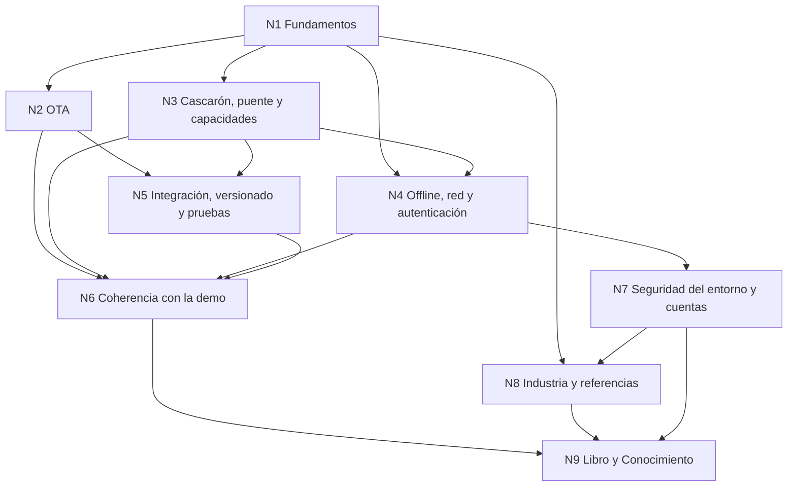

# Bitácora 01 — Núcleos conceptuales de la reedición

> Unidad = afinidad y dependencia entre ideas, no archivos. Cada núcleo se trabaja en `Nucleos/NX-*.md` de esta carpeta; las relaciones van en el documento de cohesión global y la integración en el libro.

## Índice

1. [Mapa de dependencias](#1-mapa-de-dependencias)
2. [Núcleos](#2-núcleos)
3. [Trazabilidad pedido → núcleo](#3-trazabilidad-pedido--núcleo)

## 1. Mapa de dependencias

## 2. Núcleos

### N1 — Fundamentos: app híbrida, OTA, offline-first
- **Alcance:** definiciones y modelo mental del framework (cascarón MAUI + contenido web/Blazor en WebView, live updates, offline-first con outbox) y ubicación de los secundarios. Base de la sección inicial del libro.
- **Fuentes:** prompt 04 §Contexto; `00-Marco.md`; `Framework-APP.md`; `README.md`; `08-Cohesion-Global.md`.
- **Preguntas de coherencia:** ¿los tres rasgos se definen igual en todos los documentos? ¿«Blazor Hybrid» se usa correctamente frente a WASM descargado (E01)? ¿los escenarios/contextos/actores del perfil están fijados una vez?
- **Depende de:** —.

### N2 — Actualización OTA firmada con rollback
- **Alcance:** manifiesto, firma, staging, activación en el próximo arranque, rollback, paquete semilla, límites de las tiendas.
- **Fuentes:** `01-Actualizacion-Sin-Tienda.md`; `Demo/semilla`, `Demo/claves`, `Demo/versionado`; ensayos E01, E04; actuaciones del expediente sobre D-01/D-02.
- **Preguntas:** ¿el formato de manifiesto y el algoritmo de firma del texto coinciden con el código de la demo? ¿la regla de activación y rollback está implementada y probada como se describe?
- **Depende de:** N1.

### N3 — Cascarón, contrato del puente y capacidades
- **Alcance:** puente versionado (P3), catálogo de capacidades del dispositivo, negociación de versión, límites cascarón/contenido.
- **Fuentes:** `02-Cascaron-Puente-Y-Capacidades.md`; `Demo/src`, `Demo/definiciones`; tests de contrato.
- **Preguntas:** ¿los nombres de mensajes y capacidades del texto existen en el código? ¿la regla de compatibilidad de versión del puente es la misma en doc, código y pruebas?
- **Depende de:** N1.

### N4 — Offline-first, red y autenticación del dispositivo
- **Alcance:** outbox y SQLite, estado de red e internet, login, biometría/PIN/patrón, Keystore, login en el contenido.
- **Fuentes:** `07-Red-Y-Autenticacion.md`; `Demo/DISENO-RED-Y-AUTENTICACION.md`; ensayos E03, E05; parte de `02`.
- **Preguntas:** ¿el diseño de red/autenticación coincide con lo medido en E03/E05? ¿«red» vs «internet» se distinguen igual? ¿el uso del Keystore es el que hace la demo?
- **Depende de:** N1, N3.

### N5 — Integración, versionado y estrategia de pruebas
- **Alcance:** PR con pruebas obligatorias, compuertas, tres líneas de versión (cascarón, contenido, puente), canales, pirámide de pruebas, procedimientos.
- **Fuentes:** `03-Integracion-Y-Versionado.md`; `04-Estrategia-De-Pruebas.md`; `06-Procedimientos-PR-Integracion-Versionado.md`; `Demo/tests`, `Demo/etapas`, `Demo/scripts`, workflows; ensayo E02.
- **Preguntas:** ¿03 y 06 se solapan o contradicen? ¿las pruebas y compuertas citadas existen? ¿la etiqueta de runner del texto es apta para repo público?
- **Depende de:** N2, N3.

### N6 — Coherencia redacción ↔ demo (Solicitud 1)
- **Alcance:** auditoría cruzada afirmación por afirmación entre documentos y Demo (README, MAPA-CASO-BASE, src, tests); lista de divergencias y su corrección.
- **Fuentes:** `05-La-Demo-Como-Caso-De-Estudio.md`; `Developer-Guide.md`; `Demo/README.md`; `Demo/MAPA-CASO-BASE.md`; resultados de N2–N5.
- **Preguntas:** ¿cada ejemplo citado compila/corre como dice? ¿hay rutas o comandos vencidos? ¿Developer-Guide y 00–08 dicen lo mismo?
- **Depende de:** N2, N3, N4, N5.

### N7 — Seguridad del entorno y cuentas en la industria
- **Alcance:** (a) BNA+: mecanismos RASP —detección de depuración/adb (`Settings.Global.ADB_ENABLED`, `Debug.isDebuggerConnected`), root, emulador, hooking/Frida, acceso remoto y superposición, servicios de accesibilidad, Play Integrity API, FLAG_SECURE, ofuscación— con especulación fundamentada y marcada sobre el cierre a ~3 s (muerte autoinfligida, `isKilledByAm=false`, toast, clases con caracteres de varios alfabetos). (b) Mercado Libre: Credential Manager, Sign in with Google / One Tap, account linking, creación de cuenta delegada fuera de la app. Qué podría adoptar el framework (política, no copia), en relación con OWASP MASVS-RESILIENCE.
- **Fuentes:** observación del PO (2026-11-01); documentación oficial Android/Google (URL); OWASP MASVS/MASTG (URL); `07-Red-Y-Autenticacion.md` para el enganche.
- **Preguntas:** ¿qué parte es observación, cuál inferencia y cuál especulación? ¿qué conviene al framework (p. ej. Play Integrity en el servidor, Credential Manager) sin romper el modo de desarrollo con depuración?
- **Depende de:** N4.

### N8 — Industria, estándares y referencias (Solicitud 4)
- **Alcance:** casos y referencias verificables: Capacitor/Ionic, Cordova, Blazor Hybrid, Expo/EAS Update, CodePush (retiro), Capawesome, Appflow, PWA service workers, políticas de tiendas, OWASP MASVS; tendencias.
- **Fuentes:** relevamiento ya hecho en `Bitacoras/Investigacion` y `Relevamientos`; `99-Anexos.md`; URLs oficiales.
- **Preguntas:** ¿cada referencia tiene URL vigente? ¿los casos sostienen las decisiones del libro o sólo decoran?
- **Depende de:** N1, N7.

### N9 — Libro unificado, edición bibliográfica y Conocimiento (Solicitudes 2 y 3)
- **Alcance:** `MAUI-Framework-Developer-Guide.md` autocontenido, con índice, sección inicial de fundamentos, integración de N1–N8, seis intervenciones editoriales; y el Conocimiento en `Conocimientos/`.
- **Fuentes:** todos los anteriores; perfil Study-Guide; Knowledge de forma de conocimiento.
- **Preguntas:** ¿el libro es autocontenido (sin «ver documento X» imprescindible)? ¿terminología única? ¿mermaid y ejemplos verificados? ¿el Conocimiento no duplica el libro y declara su consumidor?
- **Depende de:** N6, N7, N8.

## 3. Trazabilidad pedido → núcleo

| Pedido | Núcleo |
|---|---|
| Contexto (tres rasgos + secundarios) | N1, N2, N3, N4 |
| Solicitud 1 coherencia | N6 (con N2–N5) |
| Solicitud 2 libro + revisión editorial + fundamentos | N9, N1 |
| Solicitud 3 Conocimiento | N9 |
| Solicitud 4 referencias y casos | N8 |
| «arquitectura clara … simplicidad, practicidad, escalabilidad» | Transversal (criterio del analista de decisiones) |
| BNA+ RASP · Mercado Libre cuentas | N7 |
