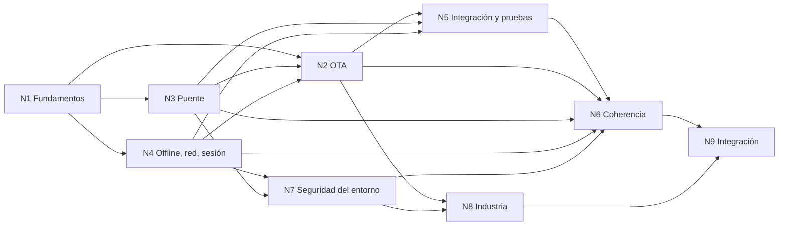

# 02 — Cohesión global de la reedición 04

> Registro retomable. Integra los documentos `Nucleo-N1.md` … `Nucleo-N9.md` de esta carpeta. Fecha: 2026-11-01. Las afirmaciones remiten al núcleo que las sostiene; cada núcleo trae su evidencia (archivo:línea, folio o URL).

## Índice

1. Mapa de núcleos y relaciones
2. Dependencias (quién bloquea a quién)
3. Contradicciones entre núcleos y su resolución
4. Hallazgos repetidos (deduplicación)
5. Decisiones consolidadas
6. Pendientes que el libro declara como NO VERIFICADO
7. Qué va al libro, qué va a otro PR

## 1. Mapa de núcleos y relaciones

| Núcleo | Tema | Capítulo(s) del libro |
|---|---|---|
| N1 | Fundamentos: híbrida, OTA, offline-first, secundarios | 1 |
| N2 | OTA firmada con rollback | 3 |
| N3 | Cascarón y contrato del puente | 4 |
| N4 | Offline-first, red y sesión del dispositivo | 5, 6 |
| N5 | Integración, versionado y pruebas | 7, 8 |
| N6 | Coherencia documental (método) | 11 + anexos H y E |
| N7 | Seguridad del entorno y cuentas (BNA+, Mercado Libre) | 9 |
| N8 | Industria y fuentes | 12 + anexo B + recuadros |
| N9 | Integración editorial | todo el libro, Conocimiento |

## 2. Dependencias

- **N1 es fuente única de definiciones** (N9 L7). Todo capítulo usa sus términos; ninguno redefine.
- **N3 → N2**: predicado de compatibilidad, mayor del puente en la ruta del índice, `bridge.ready`/`Listo` como confirmación del rollback.
- **N4 → N2**: el outbox no se toca al actualizar (P13.7); disparadores de la consulta.
- **N5 bloqueaba la Parte III** (N9) hasta decidir líneas de versión y la fusión 03+06: ambas resueltas en §3.
- **N8 valida todas las URL** de N1–N7. Ninguna se consultó en esta corrida: cada URL entra al libro marcada «a verificar» con su fecha vacía hasta la pasada de N8 (pendiente P-2).
- **N6 recibe las divergencias** de todos y fija la regla «manda lo medido».

## 3. Contradicciones entre núcleos y su resolución

| # | Contradicción | Núcleos | Resolución |
|---|---|---|---|
| X1 | Tres o cuatro líneas de versión | acta, N1 H2, N5 H7, N9 L3 | **Cuatro líneas visibles** (`Developer-Guide.md:37`, `03:154`, `06:285`), más tres internas y dos caminos de publicación (tienda y canal), según N5 H7. Se corrige el acta. |
| X2 | Conteos de pruebas | N1 (220/102/56+2), N5 (220/102/58 con base), N6/N9 (56+2) | No hay contradicción real: Gate da 58/58 con `FC_GATE_BASE` y 56+2 omitidas sin ella. **Regla:** el texto normativo no fija cifras; el anexo H trae la corrida fechada 2026-11-01 con ambas variantes. |
| X3 | Cuántos arranques lleva el rollback | N2 H1 | Manda el código: `CargasSinListoParaFallar = 2` (`Actualizador.cs:35-39`). El libro lo describe como parámetro (decisión N2) y cuenta el recorrido real. |
| X4 | Dónde va el detalle del outbox | N1 D4, N3 (sale de 02), N4 | Capítulo 5 (N4). N1 sólo define. |
| X5 | Dos backoffs (salud 5–60 s, outbox 5 s–10 min) | N1 H8, N4 C5 | Tabla única de tiempos en el capítulo 6 que los separa, junto con los 15 min de reanudación y los 5 min de bloqueo. |
| X6 | Comentario de `CofreDeSesion.cs:128` | N4 C1, N6 D5, N7 C1, N9 L11 | Mismo hallazgo cuatro veces. El libro dice lo medido (E03 H-1); el comentario se corrige en un PR de código aparte. |
| X7 | Datos de infraestructura | N1 H9, N5 H11, N6 D6, N8 C7, N9 L6 | Roles neutros: «teléfono de medida», «host de compilación», «runner autoalojado», «emulador de ensayo». El libro no los nombra; la corrección de pruebas cierra con búsqueda en cero. |
| X8 | «Blazor Hybrid» con dos sentidos | N1 H7, N8 C5, N9 L7 | Recuadro en el cap. 1: «Blazor Hybrid no es esto»; lo real es Blazor WebAssembly servido por `HybridWebView`. |
| X9 | Dos «manifiestos» | N1 H6, N9 L7 | «Índice del canal» (`IndiceDelCanal.cs`) y «manifiesto del paquete» (`ManifiestoContenido.cs`); nunca «manifiesto» a secas. |
| X10 | Libro con índice propio vs. P10 (Developer-Guide como índice único) | N9 L1 | Conviven: el libro es la lectura de corrido; el Developer-Guide sigue como índice y enlaza al libro; apartamiento declarado en `99-Anexos.md` §8 (aditivo, reversible). |
| X11 | Numeración N1–N5 del Developer-Guide vs. N1–N9 de la reedición | N9 L2 | El libro numera capítulos y no usa «N#». |
| X12 | El contrato «no son interfaces C# compartidas» | N3 C1 | El libro aclara: en ejecución sólo cruza `Call(string)`; en compilación Content comparte los tipos del contrato con Core. |
| X13 | Login implementado que no dispara la consulta del canal | N1 H1 | Se declara pendiente en el libro (ESC-6 NO VERIFICADO); el arreglo va en otra rama. |
| X14 | Borrador del PO vs. demo (activación, rollback, nombres, firma, `sqlite-net-pcl`, SQLCipher, `/health`) | N1 H3–H5, N4 C3–C7, N7 C2–C3 | El borrador no se edita. El libro describe la demo; el anexo G trae la tabla de equivalencias. |
| X15 | Arranque superpuesto (E04 V1/V1S) | N2 H7 | Variante ensayada en ramas sin fusionar; no es comportamiento de `main`. Decisión abierta para el PO. |
| X16 | Cifras de TPR mezcladas | N2 H8 | Una tabla única con fecha, variante y si está fusionada (cap. 3 §8). |
| X17 | Protección de `main`: protegida / pendiente / no verificada | N5 H2–H3 | Folio 051 L27 la registra; el libro la cita así y corrige la atribución al 048. |
| X18 | Evidencia de BNA+ y Mercado Libre | N7 | Sólo el relato del PO en sesión; el «cierre a los 3 s» no tiene folio. El capítulo 9 marca todo como **especulación**, con ensayo E-N7-1 propuesto. |
| X19 | ¿Son híbridas las apps de referencia? | N7 §5, N8 | Mercado Libre: Server Driven UI nativo según F-058, no WebView; las páginas web embebidas, con lista blanca y Custom Tabs. BNA+: sin evidencia de arquitectura, queda sin afirmar. |

## 4. Hallazgos repetidos (deduplicación)

- Cofre/huella: N4 C1 = N6 D5 = N7 C1 = N9 L11.
- Conteos viejos (211/52): N5 H1 = N6 D1 = N9 L4.
- `Demo/README.md` L160 «11 métodos, 2 eventos»: N3 C3 = N6 D2.
- Enlaces `/LAB…` absolutos: N6 D7 = N9 L5 (125 en 00–08/99 y 177 contando el Developer-Guide).
- 03 y 06 solapados: N5 = N6 D10 = N9 L8.
- Glosario sin fuentes ni duplicados: N8 C1–C4 (únicos de N8).

## 5. Decisiones consolidadas (documentales, aditivas y reversibles)

1. Capítulo 1 de fundamentos propio, que remite a 00-Marco (N1 D1).
2. Términos en español con el equivalente de industria entre paréntesis la primera vez (N1 D5).
3. 03 y 06 forman un solo capítulo en dos partes, *Conceptos* y *Procedimientos* (N5); los archivos fuente sólo se corrigen.
4. Firma ES256 propia; TUF como camino de crecimiento; servidor estático propio (N2, N8 D2–D3).
5. Sin cifras fijas de pruebas en el texto normativo (N5, N6).
6. Enlaces relativos dentro del repo; lo privado se cita por folio sin enlace (N6, N9).
7. Capítulo de industria más un recuadro «En la industria» por capítulo (N8 D4).
8. Contrato: mantener tipos compartidos y documentarlo; prueba o generación del puente simulado desde `contrato.json` (N3 D2, D5) → propuesta de código, PR aparte.

**Decisiones que tocan código (avisar al PO, no se aplican en este PR):** N7 D-N7-1 (`FLAG_SECURE` por capacidad, Play Integrity opcional), D-N7-2 (ante riesgo avisar y limitar, nunca descartar el outbox), D-N7-3 (`allowBackup=false`), N4 D-N4-3 (SQLCipher con datos personales), comentario del cofre, `Tablas.cs:13`, comentarios de `ConsultasDelCanal.cs`/`Resultados.cs`, encabezado del workflow (SDK 10.0.403).

## 6. Pendientes declarados en el libro como NO VERIFICADO

- WASM como «código interpretado» ante las tiendas (N1, N2).
- Login que dispare la consulta del canal (ESC-6).
- Versión obligatoria (`mandatory`) nunca ejecutada en la demo (N2 H9).
- `requires` faltante en dispositivo (N3 C8).
- `EnLineaMedida` en dispositivo, regresión sin cuenta en emulador, teléfono físico, iOS (N4 C13).
- Mecanismos de BNA+ y Mercado Libre (N7).
- Todas las URL de industria hasta la pasada de N8 (P-2), y el inciso del acuerdo de Apple (N8 C8, P-1).
- Que el repo del caso base sea público antes de nombrarlo (N6 D8).

## 7. Qué va al libro y qué va a otro PR

- **Este PR (documental):** libro, `Conocimientos/Knowledge-App-Hibrida-OTA-Offline-First.md`, nota de convivencia en `99-Anexos.md` §8, correcciones de cifras y de atribuciones (N5 H2–H5), glosario sin duplicados (N8 C3–C4).
- **PR de código aparte:** lo listado en §5 «tocan código».
- **No se edita:** `Framework-APP.md` (insumo del PO).
