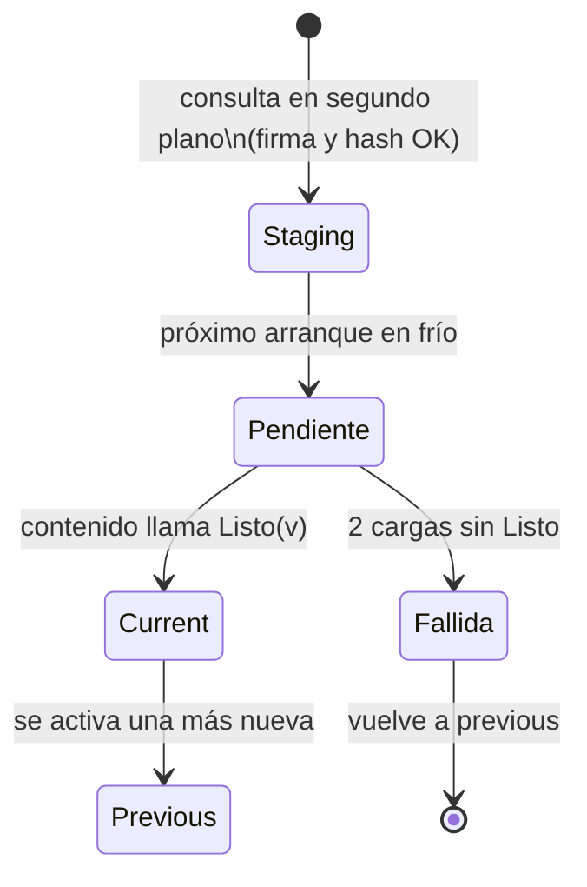
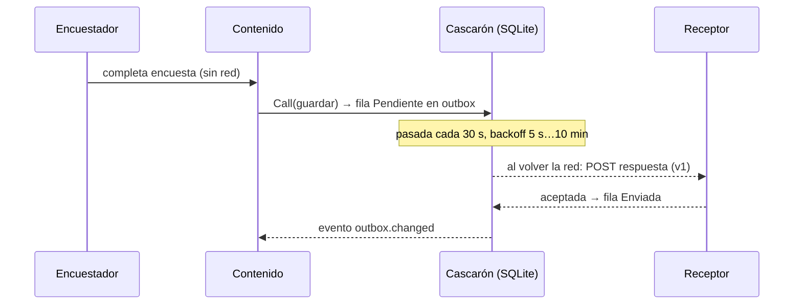

# Núcleo N1 — Fundamentos: app híbrida, OTA, offline-first

Reedición 04 · bitácora de núcleo · 2026-11-01 · estado: análisis de mesa terminado, listo para integrar en N9.

## Índice

1. [Alcance y mesa](#1-alcance-y-mesa)
2. [Ensayo registrado](#2-ensayo-registrado)
3. [Hallazgos de coherencia](#3-hallazgos-de-coherencia)
4. [Contenido para el libro](#4-contenido-para-el-libro)
5. [Decisiones y alternativas](#5-decisiones-y-alternativas)
6. [Propuesta de capítulo](#6-propuesta-de-capítulo)
7. [Dependencias con otros núcleos](#7-dependencias-con-otros-núcleos)
8. [Referencias](#8-referencias)

Convención: las rutas son relativas a `Concepts/Framework-Concept/` del repo Lab-Documentos (rama
`fc/libro-guia-desarrolladores`); `Demo/...` es la demo. Los folios son del expediente 0001.

## 1. Alcance y mesa

N1 da la base conceptual de la sección inicial del libro: qué es una app híbrida en este framework, qué es una
actualización OTA (*live update*), qué es offline-first con outbox y dónde caen los temas secundarios (red,
autenticación del dispositivo y Keystore, contrato del puente, capacidades).

Especialistas convocados (según Knowledge-Mesa-De-Expertos-A-Pedido): arquitecto móvil híbrido, especialista en
entrega OTA, especialista en sincronización offline, editor didáctico, refutador. El refutador revisó cada hallazgo
contra el código. No hizo falta consultar a un tercero: las dudas se resolvieron con el código y los ensayos.

## 2. Ensayo registrado

- **Qué se corrió.** `dotnet test Demo/FrameworkConcept.Demo.SinMaui.slnf` con el SDK del host (10.0.403; `global.json`
  pide 10.0.400 con `rollForward: latestPatch`).
- **Resultado (2026-11-01).** `Core.Tests` 220/220, `Update.Tests` 102/102, `Gate.Tests` 56 superadas y 2 omitidas.
  Cero fallas. El árbol de trabajo quedó limpio (`git status` vacío).
- **Qué prueba para N1.** Las afirmaciones sobre activación, rollback, predicado y outbox que siguen se apoyan en
  código que hoy compila y pasa sus suites. No prueba nada en el dispositivo: para eso siguen valiendo E01 a E03.

## 3. Hallazgos de coherencia

| # | Hallazgo | Evidencia | Corrección propuesta |
|---|---|---|---|
| H1 | **El disparador «login exitoso» no está implementado, pero el login ya existe.** `00-Marco` ESC-6 lo marca NO VERIFICADO, que es correcto. Pero el código todavía dice «la demo no tiene login (P4)», y eso quedó desactualizado desde el folio 038 / E03. Ningún llamador usa `DisparadorDeConsulta.LoginExitoso`. | `Demo/src/FrameworkConcept.Shell/Actualizacion/ConsultasDelCanal.cs:9-11`; `Demo/src/FrameworkConcept.Core/Update/Resultados.cs:7-12`; solo se llama con `ArranqueEnFrio` (`ArranquePage.xaml.cs:103,112`, `ContenidoPage.xaml.cs:129`, `EstadoTerminalPage.xaml.cs:61,67`) y con `Reanudacion` (`App.cs:32`) | En el libro: «tres disparadores diseñados, dos implementados». En la demo (otra rama): corregir el comentario o cablear el disparador tras el ingreso. Va a N4/N6. |
| H2 | **¿Tres o cuatro líneas de versión?** El Developer-Guide, 03, 06 y 00-Marco §6.3 hablan de **cuatro** (contenido, definición, puente, cascarón). El alcance de N5 en el acta habla de «las tres líneas». | `Developer-Guide.md:37`; `03-Integracion-Y-Versionado.md:154`; `06-Procedimientos-PR-Integracion-Versionado.md:285`; `00-Marco.md` §6.3; `01-Nucleos.md` (N5) | El libro usa **cuatro**, que es lo que dice el repo. Corregir el acta/N5. |
| H3 | **El borrador y la demo no coinciden en cuándo se activa una versión.** El diagrama del borrador consulta el manifiesto *antes* de mostrar y activa en el mismo arranque. La demo consulta siempre en segundo plano (N = 0), nunca activa en la consulta y activa en el **próximo** arranque en frío. | `Framework-APP.md` §3 (diagrama «Flujo»); `ConsultasDelCanal.cs:5-7`; `Actualizador.cs:139-160` | Es una decisión legítima (P2), no un error, porque el borrador está fuera del conjunto. El libro tiene que explicar el cambio con una figura de «antes/ahora», porque el lector que venga del borrador se va a confundir. |
| H4 | **El borrador y la demo no coinciden en el criterio de rollback.** El borrador dice «si no avisa en X segundos». La demo cuenta **2 cargas empezadas sin `Listo`** y no usa tiempo. | `Framework-APP.md` §3 «Piezas»; `Actualizador.cs:35-39,92-109` | El libro define el rollback por conteo de cargas e indica que es distinto del borrador. |
| H5 | **Cambian los nombres de los artefactos.** El borrador habla de `manifest.json`, firma «Ed25519 o RSA» y campo `obligatorio`. La demo usa un `indice.json` firmado por canal y por mayor del puente, ES256 y `mandatory`. | `Framework-APP.md` §3; `Demo/src/FrameworkConcept.Core/Update/FirmaEs256.cs`; `Contracts/Canal/IndiceDelCanal.cs`; `00-Marco.md` ESC-7 | Tabla de equivalencias borrador ↔ demo en el capítulo de fundamentos o en un anexo. |
| H6 | **Hay dos «manifiestos».** En la demo existe `ManifiestoContenido` (el del paquete), que no es el índice del canal. El borrador llama «manifiesto» a lo que la demo llama índice. | `Contracts/Contenido/ManifiestoContenido.cs` vs `Contracts/Canal/IndiceDelCanal.cs` | En el glosario del libro: *índice del canal* (qué hay publicado) ≠ *manifiesto del paquete* (qué trae y qué pide). |
| H7 | **«Blazor Hybrid» se usa con dos sentidos.** El borrador §1 pide «pantallas Blazor Hybrid». La guía aclara que el contenido **no** es Blazor Hybrid (`BlazorWebView`, Razor compilado en la DLL) sino Blazor WebAssembly servido por `HybridWebView`. | `Framework-APP.md` §1 y §2; `01-Actualizacion-Sin-Tienda.md:63`; `ContenidoPage.xaml.cs:41-44` | Definición explícita en el capítulo 1, con un recuadro «qué NO es». Es el error conceptual más probable del lector. |
| H8 | **El «outbox» de la demo no es solo una cola.** Tiene backoff exponencial (5 s a 10 min), una pasada cada 30 s, «Enviar ahora» y reconexión que ignoran el backoff, y filtra por dueño de la sesión. La guía lo define en una línea («lo que necesita servidor sale después»). | `Demo/src/FrameworkConcept.Shell/Sync/SincronizadorDelOutbox.cs:23-25,98-135,170`; `99-Anexos.md:71` | El libro baja estos parámetros como hechos de la demo, no como norma. |
| H9 | **El repo público trae datos de infraestructura.** Aparecen el nombre del runner o host, el modelo del teléfono y el nombre del emulador: 40 apariciones en los `.md` de la carpeta. | `grep -rn "i7infra\|g42\|fc-android-emu-hpdev" Concepts/Framework-Concept --include=*.md` | Para N9: en el libro, usar genéricos («runner autohospedado», «teléfono de medida Android 13»). No es incoherencia de contenido, pero choca con la regla del repo público. |
| H10 | **El README define el vocabulario en una línea en inglés y el resto en español.** Mezcla *native shell*, *update bundle* y *live updates* sin definirlos. | `README.md:29-30` | El capítulo 1 del libro es el lugar canónico de esas definiciones, con el término de industria entre paréntesis. |

No se encontraron contradicciones entre 00-Marco, 01 y la demo sobre staging, current/previous, semilla, vigencia del
índice (30 días) ni WebView mínimo 94. Coinciden con `ParametrosDeProducto.cs:10-34` y
`AlmacenDeContenidoEnDisco.cs:12-15`.

## 4. Contenido para el libro

### 4.1 Definiciones (texto propuesto)

- **App híbrida (en este framework).** Es una app nativa instalada por tienda (el **cascarón**, .NET MAUI) que muestra sus
  pantallas de negocio en un WebView. Esas pantallas son un paquete web (Blazor WebAssembly) que el cascarón sirve
  desde el disco del teléfono y que hablan con el sistema solo a través de un **puente**. Evidencia:
  `ContenidoPage.xaml.cs:41-44` (un `HybridWebView`, `WebResourceRequested`, `SetInvokeJavaScriptTarget(puente)`).
  Término de industria: *hybrid app*, *native shell* (modelo de Capacitor y Cordova).
- **Qué NO es.** No es Blazor Hybrid (Razor compilado en la DLL, que no se puede bajar), no es un sitio remoto en vivo
  (no funcionaría sin red) y no es server-driven UI pura (aunque las encuestas sí viajan como datos).
- **Actualización OTA / live update.** Reemplaza el contenido web sin reinstalar el binario: consulta en segundo plano,
  baja a `staging/`, verifica firma y hash, activa en el próximo arranque en frío y vuelve atrás si la versión no
  confirma `Listo`. Evidencia: `Actualizador.cs:12,92-160`; `AlmacenDeContenidoEnDisco.cs:12-15`. Los términos de
  industria equivalentes son *live updates* (Capacitor/Ionic Appflow, Capawesome), *EAS Update* (Expo) y *CodePush*.
- **Offline-first con outbox.** La app trabaja contra su base local SQLite. Toda operación que necesita servidor se
  guarda como fila en una tabla *outbox* y sale cuando hay red, con reintentos y backoff. Evidencia:
  `Demo/src/FrameworkConcept.Shell/Data/DbSqlite.cs`, `SincronizadorDelOutbox.cs`. Término: *transactional outbox*
  aplicado al cliente.
- **Cascarón / contenido / definición / canal.** Se reutiliza el vocabulario de `00-Marco` §2, que ya trae definición,
  «cómo se aplica» y un caso.

### 4.2 Por qué hace falta la separación (el argumento central)

1. Las tiendas prohíben que la app se modifique por fuera de su mecanismo, **salvo** el código interpretado en un
   WebView que llega a la plataforma de forma indirecta. Las citas de Play *Device and Network Abuse* y Apple 2.5.2
   están en `01-Actualizacion-Sin-Tienda.md:68-95`.
2. Por eso el contenido se compila **sin AOT** (`FrameworkConcept.Content.csproj` L15–L18) y todo acceso nativo pasa
   por el puente.
3. Si un `.wasm` cuenta como «código interpretado» sigue **NO VERIFICADO** ante las dos tiendas (P1, folio 035). El
   libro tiene que decirlo en el capítulo 1, no esconderlo en un anexo.

### 4.3 Ejemplos tomados de la demo

| Concepto | Ejemplo real | Archivo |
|---|---|---|
| El cascarón sirve el contenido descargado | Un `HybridWebView` con `HybridRoot = "hwv"` como reserva, mientras `WebResourceRequested` sirve `content/versions/vN` desde el origen `https://0.0.0.1/` | `Demo/src/FrameworkConcept.Shell/Pages/ContenidoPage.xaml.cs:37-44`; `Hosting/ServidorDeContenido.cs:6-17` |
| El puente tiene un solo punto de entrada | `window.HybridWebView.InvokeDotNet('Call', [sobreJson])` con un sobre JSON-RPC 2.0 | `Bridge/PuenteDelCascaron.cs:4-6` |
| Los parámetros con nombre | WebView ≥ 94, índice válido 30 días, consulta al reanudar como mucho cada 15 min, `current` + `previous` | `Contracts/ParametrosDeProducto.cs:10-34` |
| OTA de punta a punta | 1.0.0 → 1.1.0: el primer arranque deja la versión en staging, el segundo muestra la cabecera azul | `01-Actualizacion-Sin-Tienda.md` §2.1 (E02) |
| Rollback | 1.2.0 «sin Listo» vuelve a 1.1.0 | `00-Marco.md` ESC-2; `Actualizador.cs:99-104` |
| Offline-first | Respuesta tomada con la v1 sin red, enviada con `versionDefinicion: 1` después de que llega la v2 | `00-Marco.md` ESC-4; `definiciones/encuesta-movilidad/` |

### 4.4 Diagramas propuestos

Figura 1.1, anatomía de la app híbrida:

```mermaid
flowchart TB
    subgraph APK["Cascarón MAUI (por tienda)"]
        UI[Pantallas XAML propias<br/>arranque · error · WebView viejo]
        ACT[Actualizador]
        PUE[Puente: Call(sobre)]
        DB[(SQLite + outbox)]
        SRV[Servidor local<br/>WebResourceRequested]
    end
    subgraph WV["HybridWebView · https://0.0.0.1/"]
        C[Contenido Blazor WASM<br/>firmado, en disco]
    end
    SRV -- archivos de versions/vN --> C
    C -- InvokeDotNet('Call') --> PUE
    PUE --> DB
    ACT -- staging → versions --> SRV
```

Figura 1.2, ciclo de vida de una versión (estados del puntero):



Figura 1.3, offline-first:



Figura 1.4: «antes/ahora» entre el flujo del borrador (`Framework-APP.md` §3) y la regla P2 de la demo (ver H3).

### 4.5 Dónde encajan los temas secundarios (mapa para el lector)

| Tema | Pertenece a | Una línea para el capítulo 1 | Capítulo de detalle |
|---|---|---|---|
| Red | Cascarón | Cuatro estados (`EnLinea`, `EnLineaMedida`, `RedSinServidor`, `SinRed`) que deciden qué acción se permite, se encola o se bloquea | N4 / tema 07 |
| Autenticación del dispositivo y Keystore | Cascarón | La primera vez se ingresa con la cuenta; después se desbloquea con la seguridad del teléfono, y el secreto queda en el almacén seguro del sistema | N4 / tema 07 |
| Contrato del puente | Borde cascarón ↔ contenido | Una sola función versionada; el contenido pide capacidades y el cascarón decide | N3 / tema 02 |
| Capacidades | Cascarón | Lo que el teléfono ofrece (cámara, red, etc.). Una capacidad nueva es un cambio de tienda | N3 / tema 02 |

### 4.6 Referencias de industria (a verificar en N8 antes de publicar)

- Capacitor, *Live Updates* / Appflow: https://ionic.io/docs/appflow/deploy/intro
- Capawesome Live Update: https://capawesome.io/plugins/live-update/
- Expo EAS Update: https://docs.expo.dev/eas-update/introduction/
- .NET MAUI `HybridWebView`: https://learn.microsoft.com/en-us/dotnet/maui/user-interface/controls/hybridwebview?view=net-maui-10.0 (ya citada en `02-...md:282`)
- Google Play, Device and Network Abuse: https://support.google.com/googleplay/android-developer/answer/9888379 (`99-Anexos.md:99`)
- Apple App Review Guidelines 2.5.2: https://developer.apple.com/app-store/review/guidelines/ (`99-Anexos.md:97`)
- Offline-first / outbox: https://microservices.io/patterns/data/transactional-outbox.html

Las URL que no están en `99-Anexos.md` las tiene que confirmar N8 con fecha de consulta. Las de Capacitor, Capawesome y
Expo están marcadas aquí como **a verificar**.

## 5. Decisiones y alternativas

| Decisión | Alternativas | Criterio | Recomendación |
|---|---|---|---|
| D1. Dónde va «Fundamentos» en el libro | (a) capítulo 1 propio; (b) fusionarlo con 00-Marco; (c) dejarlo en el Developer-Guide §4 | Simplicidad para el lector, sin duplicar | **(a)**: un capítulo 1 que define los conceptos y remite a 00-Marco para escenarios y actores. Es lo que pide el PO («sección inicial de fundamentos»). |
| D2. Cómo tratar el borrador del PO | (a) ignorarlo; (b) tabla de equivalencias; (c) reescribirlo | No inventar y respetar que está fuera del conjunto | **(b)**: tabla borrador ↔ demo (H3 a H6), sin editar el borrador. |
| D3. Disparador «login exitoso» (H1) | (a) declararlo pendiente; (b) implementarlo en la demo antes del libro | Practicidad: no frenar el libro | **(a)** en el libro ahora y **(b)** como ítem para N6, en una rama aparte de la demo. |
| D4. Cuánto detalle del outbox entra en el capítulo 1 | Una línea; parámetros completos | Escalabilidad didáctica | El capítulo 1 da la definición y la figura 1.3; los parámetros (backoff, pasada) van al capítulo de N4. |
| D5. Términos en inglés | Traducirlos; dejarlos entre paréntesis | Estándares de mercado | Término en español + equivalente de industria entre paréntesis la primera vez. |

## 6. Propuesta de capítulo

**Capítulo 1. Fundamentos: qué es una app híbrida que se actualiza sola y trabaja sin red**

1. El problema: pantallas que cambian seguido y una tienda que tarda
2. App híbrida
   2.1 Cascarón y contenido (figura 1.1)
   2.2 Qué NO es: Blazor Hybrid, sitio envuelto, server-driven UI (H7)
   2.3 Lo que permiten las tiendas y lo que queda NO VERIFICADO (WASM y AOT)
3. Actualización OTA (*live updates*)
   3.1 Canal, índice firmado y manifiesto del paquete (H6)
   3.2 Ciclo de vida de una versión (figura 1.2): staging, próximo arranque, Listo, rollback, semilla
   3.3 Disparadores: dos implementados, uno diseñado (H1)
4. Offline-first con outbox
   4.1 La base local como fuente de verdad
   4.2 El outbox (figura 1.3)
   4.3 Versiones de definición en vuelo (ESC-4)
5. Los temas secundarios en una página (tabla 4.5)
6. Del borrador a la demo: tabla de equivalencias (figura 1.4; H3 a H5)
7. La industria hace lo mismo: Capacitor, Expo, CodePush (remite a N8)
8. Preguntas guía y criterios de calidad
9. Referencias

## 7. Dependencias con otros núcleos

- **N2 (OTA).** Detalla §3 del capítulo: firma ES256, vigencia, `mandatory`, límites de las tiendas. N1 solo define y
  remite.
- **N3 (puente y capacidades).** Detalla §2.1 y §5: sobre JSON-RPC, catálogo, predicado de compatibilidad.
- **N4 (offline, red, auth).** Detalla §4 y §5: parámetros del outbox, estados de red, Keystore. Recibe H1.
- **N5 (versionado).** Usa las **cuatro** líneas de versión (H2 corrige el acta).
- **N6 (coherencia).** Recibe H1, H3 a H6 y H9 para la lista de divergencias.
- **N7 (seguridad e industria).** Retoma el WebView como superficie de ataque y la integridad del entorno.
- **N8 (referencias).** Tiene que verificar las URL de §4.6 que no están en `99-Anexos.md`.
- **N9 (libro).** Integra el capítulo 1 tal como está en §6 y aplica la sustitución de H9.

## 8. Referencias

- Repo: `README.md`, `00-Marco.md`, `01-Actualizacion-Sin-Tienda.md`, `Developer-Guide.md`, `Framework-APP.md`,
  `99-Anexos.md`, y los archivos de `Demo/src` citados con línea.
- Expediente 0001: folios 035 (P1–P13), 037 (plan), 038 (red y autenticación), 049 (TPR).
- Ensayos: E01 (WASM descargado en WebView), E02 (integración), E03 (red y autenticación).
- Ensayo de esta bitácora: §2.
