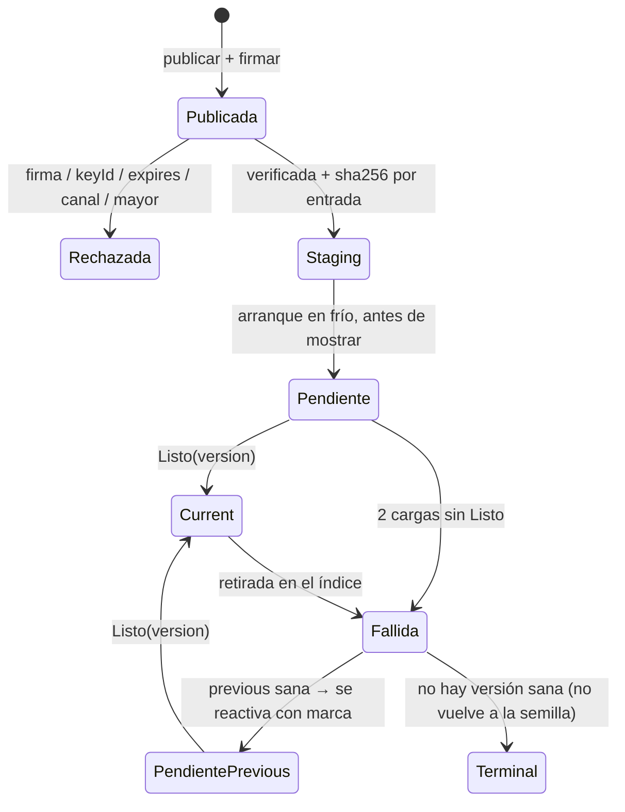
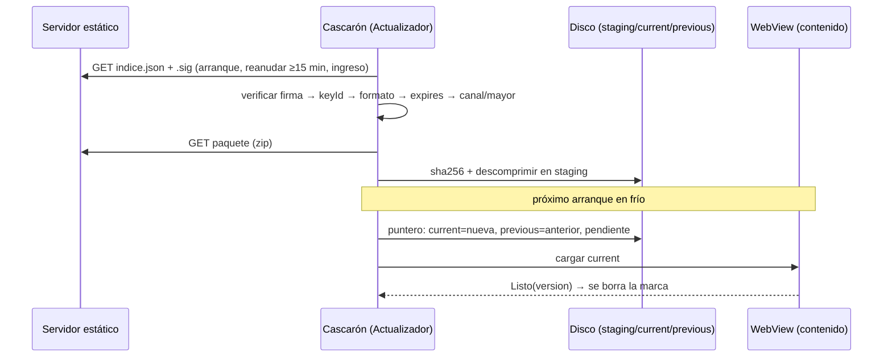

# Núcleo N2: actualización OTA firmada con rollback

Bitácora de la Reedición 04, retomable. Fecha: 2026-11-01. Especialistas consultados: arquitecto de
actualizaciones (dueño), especialista en seguridad de la cadena de suministro, ingeniero de pruebas, editor técnico y
refutador.

## Índice

1. [Alcance y fuentes](#1-alcance-y-fuentes)
2. [Ensayo de este núcleo](#2-ensayo-de-este-núcleo)
3. [Hallazgos de coherencia](#3-hallazgos-de-coherencia)
4. [Contenido para el libro](#4-contenido-para-el-libro)
5. [Decisiones y alternativas](#5-decisiones-y-alternativas)
6. [Propuesta de capítulo](#6-propuesta-de-capítulo)
7. [Dependencias con otros núcleos](#7-dependencias-con-otros-núcleos)

## 1. Alcance y fuentes

El núcleo cubre el manifiesto (índice del canal), la firma, el staging, la activación en el próximo arranque, el
rollback, la semilla y los límites de las tiendas. Las rutas son relativas a `Concepts/Framework-Concept/` del repo
Lab-Documentos y las líneas son las de la rama `fc/libro-guia-desarrolladores` al 2026-11-01.

- Texto: `01-Actualizacion-Sin-Tienda.md` (FC-TEM-01), `00-Marco.md` §ESC-2, `Developer-Guide.md`, `Framework-APP.md`
  (insumo del PO) y `Demo/README.md`.
- Código: `Demo/src/FrameworkConcept.Core/Update/` (`Actualizador.cs`, `VerificacionDelIndice.cs`, `FirmaEs256.cs`,
  `AlmacenDeContenidoEnDisco.cs`) y `Demo/src/FrameworkConcept.Core/Contracts/ParametrosDeProducto.cs`.
- Ensayos: E02 (el recorrido de la demo, citado en FC-TEM-01 §4) y E04 `INFORME.md` (arranque superpuesto y semilla
  servida desde el APK, folio 053).

## 2. Ensayo de este núcleo

- **Qué se corrió.** `dotnet test tests/FrameworkConcept.Update.Tests` (SDK 10.0.403 del host), sobre una copia de
  `Demo/` sin `bin/` ni `obj/` en el directorio temporal de la sesión.
- **Por qué en una copia.** Dentro del worktree el build falló con `MSB4018` en `GenerateDepsFile` (`File.Create`),
  probablemente porque había otra compilación en paralelo sobre el mismo `obj/`. Para no pisar a las otras sesiones se
  compiló afuera.
- **Resultado.** «Superado: 102, Con error: 0, Total: 102» en 2 s. La suite del actualizador está en verde y respalda
  las afirmaciones de §4 que remiten a `Update.Tests`.

## 3. Hallazgos de coherencia

| # | Hallazgo | Evidencia | Corrección propuesta |
| --- | --- | --- | --- |
| H1 | Los documentos no dicen lo mismo sobre cuántos arranques hacen falta para el rollback. El README de la demo habla de «abrir en frío cuatro veces… en el cuarto arranque vuelve a 1.1.0». FC-TEM-01 §4.3 cita «pasos 7a–7c» (tres), y la Developer-Guide dice «varias veces». | `Demo/README.md` L89; `01-…md` §4.3; `Developer-Guide.md` L224 | En el libro, una sola cuenta derivada del código: arranque 1 activa, arranques 2 y 3 cargan sin `Listo`, arranque 4 hace el rollback. Se toma el README como fuente y se explica por qué |
| H2 | La nota de rollback citada en FC-TEM-01 §4.3 («1.2.0 no confirmó Listo») no es la que escribe el código actual («empezó a cargar N veces sin confirmar Listo»). La cita sale de una corrida de E02 anterior a las correcciones | `Actualizador.cs` L103 | Citar el texto actual, o marcar la cita como salida de E02 con su fecha |
| H3 | La tabla de §2.5 dice «Semilla… no es destino de rollback». Es cierto, pero no cuenta que la semilla **sí** se activa cuando un cascarón nuevo, instalado por tienda, trae una más nueva que `current` | `Actualizador.cs` L164–L181 (condición en L173–L174) | Sumar la fila «La semilla también actualiza si el cascarón nuevo la trae más nueva» |
| H4 | El diagrama de estados de FC-TEM-01 §2.6 pasa de `Fallida` a «vuelve a previous». En el código son dos pasos: primero se anota la fallida y se borra la marca, y después el paso 5 vuelve a `previous` si está sana. Volver a `previous` es otra activación, con su propia marca pendiente | `Actualizador.cs` L97–L106 y L121–L135 (L127–L130) | Redibujar el diagrama con el estado intermedio y con el estado terminal «sin versión sana» (L135) |
| H5 | Hay que aclarar «archivos planos». FC-TEM-01 §5 pide un paquete «sin `.br` ni `.gz`», pero el paquete se transporta como zip y el cascarón lo descomprime en staging. Lo plano son los archivos que quedan adentro (sin precompresión Brotli/Gzip), no el transporte | `AlmacenDeContenidoEnDisco.cs` L61–L76; E04 `INFORME.md` §V1S («sha256 del zip») | Definir «paquete» (zip firmado por hash) y «archivos planos» (su contenido) en el glosario del libro |
| H6 | `Framework-APP.md` (insumo del PO) describe la instalación atómica como «descargar, verificar, descomprimir y cambiar el puntero». Coincide con el código, pero no menciona el índice firmado ni `expires`, que son el núcleo de la confianza | `Framework-APP.md` L138; `VerificacionDelIndice.cs` L18–L22 | No se toca el insumo del PO. El libro lo presenta como origen y remite a la versión decidida (P2) |
| H7 | FC-TEM-01 pone el arranque superpuesto (E04) sólo en Observaciones (§8, L255). Sin embargo, cambia el orden real del arranque: el WebView sirve la versión por adelantado y el cascarón retiene el saludo hasta que el actualizador decide | E04 `INFORME.md` «Qué hace cada variante», V1 y V1S; está en ramas descartables sin fusionar (`e64f4fd`, `a6cc5e5`) | El libro lo presenta como **variante ensayada y no fusionada**, en un recuadro. No es el comportamiento de `main` |
| H8 | Las cifras de TPR dependen de la fecha. En FC-TEM-01 §8 y en el README conviven 8,2 s, 6,9–7,3 s, 9,2 s y las de E04 (V1 4,8–5,2 s en régimen, V1S 7,9–8,8 s en el primer arranque) | `01-…md` §8; `Demo/README.md` L248 y L277; E04 tablas | Una sola tabla con fecha, variante y si está fusionada o no |
| H9 | La política de la versión obligatoria es coherente (se activa en el primer arranque en frío, igual que las demás), pero no se ejecutó en la demo | `ParametrosDeProducto.cs` («ArranquesHastaAplicarUnaObligatoria = 1»); `IndiceDelCanal.cs` L49; FC-TEM-01 §3, ESC-7 «No ejecutado» | Mantener la marca **NO EJECUTADO** en el libro |

Sin contradicción: el orden de verificación (`VerificacionDelIndice.cs` L18–L22 y L48–L50), los 30 días de vigencia
(`ParametrosDeProducto.cs` L15–L16, `Demo/README.md` L58, `Developer-Guide.md` L174), la retención de 2 versiones en
el teléfono y 3 en el servidor, el `CargasSinListoParaFallar = 2` (`Actualizador.cs` L39) y las retiradas tratadas
como fallidas locales (L113–L114).

## 4. Contenido para el libro

### 4.1 Definiciones

- **OTA de contenido (live update).** Se reemplaza el contenido web que corre dentro del WebView sin reinstalar la
  app. El cascarón nativo sólo cambia por tienda.
- **Índice del canal (manifiesto).** JSON con las entradas `contenido` y `definicion` (versión, `size`, `sha256`),
  `expires`, `retiradas` y `keyId`, publicado en `/{canal}/puente-{mayor}/indice.json`
  (`Contracts/Canal/IndiceDelCanal.cs`).
- **Firma del índice.** ECDSA P-256 con SHA-256 sobre los bytes exactos del índice, en `indice.json.sig`
  (`Update/FirmaEs256.cs`).
- **Staging.** Directorio donde la versión bajada y verificada espera su activación.
- **Puntero.** Archivo con `current`, `previous`, `pendiente` y `CargasSinListo`. Es la única fuente de verdad sobre
  qué versión se muestra.
- **Marca pendiente y `Listo(version)`.** Una versión recién activada queda «pendiente» hasta que el contenido llama
  `Listo` por el puente.
- **Fallida y retirada.** Una fallida la decide el teléfono. Una retirada la decide el servidor, en el índice firmado,
  y el teléfono la trata como fallida (`Actualizador.cs` L113).
- **Semilla.** Versión completa que viene embebida en el APK y que está firmada igual que el canal.

### 4.2 Explicación en tres reglas

1. **Primero se verifica, después se lee** (`VerificacionDelIndice.cs` L50). La confianza depende de la firma, no del
   servidor ni de TLS.
2. **Bajar no es aplicar.** La versión nueva se activa en el próximo arranque en frío, antes de mostrar nada. Nunca se
   activa en caliente.
3. **Un rollback se decide por evidencia.** Sólo cuenta como falla una carga que empezó y no llegó a `Listo`. Un
   arranque cortado no cuenta (`Demo/README.md` L91–L97 y L273).

### 4.3 Ejemplos tomados de la demo (corridas de E02)

- 1.0.0 → 1.1.0: `scripts/guion.sh publicar v2`, `definicion v2`, `firmar`. El primer arranque deja la versión en
  staging y el segundo muestra «activada 1.1.0+5d5c2b4 (desde staging)».
- Firma inválida: `scripts/guion.sh firma-invalida` da «Rechazado FirmaInvalida» y la app sigue en 1.1.0.
- Sin `Listo`: `scripts/guion.sh publicar sin-listo` publica 1.2.0, que hace rollback a 1.1.0 y queda como fallida.
- Fragmento canónico: `Actualizador.cs` L97–L106. El orden «primero se anota la fallida y después se mueve el
  puntero» (L95–L96) lo hace idempotente frente a un corte.

### 4.4 Diagramas propuestos

Diagrama de estados corregido (H4):

Secuencia de la consulta y la activación:

### 4.5 Referencias de la industria (para N8; las URL se verifican allí)

- The Update Framework (TUF): firma de metadatos, vencimiento contra el *freeze attack* y rollback protegido,
  <https://theupdateframework.io/>. El `expires` de P2 viene de esa familia (C08 en el código).
- Expo EAS Update, con rollback a la versión embebida, <https://docs.expo.dev/eas-update/introduction/>.
- Capacitor Live Updates: Capawesome Cloud <https://capawesome.io/cloud/live-updates/> y Ionic Appflow
  <https://ionic.io/docs/appflow/deploy/intro>.
- Microsoft CodePush: se retiró junto con App Center el 2025-03-31,
  <https://learn.microsoft.com/appcenter/retirement>. Muestra el riesgo de depender del servicio de un tercero.
- Actualizaciones A/B de Android (dos ranuras y marca de arranque exitoso), una analogía directa de
  `current`/`previous` + `Listo`: <https://source.android.com/docs/core/ota/ab>.
- Políticas de las tiendas: ya están citadas en FC-TEM-01 §2.4 (Play *Device and Network Abuse*, Apple 2.5.2). Que
  WASM cuente como «código interpretado» sigue **NO VERIFICADO** (folio 035).

## 5. Decisiones y alternativas

| Tema | Alternativas | Criterio | Recomendación |
| --- | --- | --- | --- |
| Formato de firma | ES256 propio / JWS / TUF completo / Sigstore | Simplicidad frente a escalabilidad | Mantener ES256 sobre los bytes. TUF queda como camino de crecimiento si aparecen varios firmantes o delegación de roles |
| Momento de la activación | Arranque en frío / en caliente con recarga / inmediata en la obligatoria | Practicidad y riesgo de perder estado | En frío. Ya está decidido (P2) y es coherente con el outbox |
| Umbral de rollback | 1 carga / 2 cargas (actual) / tiempo hasta `Listo` | Falsos positivos frente a la exposición | 2. Es criterio de la demo: el libro lo presenta como parámetro y no como valor de producto |
| Arranque superpuesto (E04) | No adoptar / V1 / V1S | Mejora del TPR medida frente a la complejidad | Sigue abierta y está en manos del PO. El libro la muestra como variante ensayada |
| Servicio administrado | Propio estático / EAS, Capawesome, Appflow | Dependencia de un proveedor (el caso CodePush) | Servidor estático propio, sin bloquear la adopción futura |

## 6. Propuesta de capítulo

**Capítulo «Actualizar sin tienda: OTA firmada con rollback»** (después de Fundamentos y antes del capítulo del
puente):

1. El problema y lo que permiten las tiendas (citas, AOT apagado, NO VERIFICADO de WASM).
2. Vocabulario: índice, firma, staging, puntero, marca, fallida, retirada y semilla (con el paquete zip frente a los
   archivos planos, H5).
3. La confianza: el orden de verificación, `expires` y la rotación o revocación de claves, con referencia a TUF.
4. El ciclo de vida de una versión (diagrama corregido, H4) y la secuencia de consulta y activación.
5. El rollback por evidencia: `Listo`, la cuenta de arranques (H1), la idempotencia y el estado terminal.
6. La semilla: primer arranque, actualización por un cascarón nuevo (H3), claves en un clon nuevo.
7. Retención, retiradas y versión obligatoria (H9 NO EJECUTADO).
8. Costos y arranque: tabla única de TPR por fecha y variante (H7, H8), y ~9,13 MB por versión retenida (E01).
9. Práctica guiada con `scripts/guion.sh`: los pasos 3, 4, 6 y 7 del recorrido.
10. Comparación con la industria (EAS, Capawesome, Appflow, CodePush, A/B de Android).
11. Lista de verificación de publicación (plantilla de FC-TEM-01 §7) y preguntas guía.

## 7. Dependencias con otros núcleos

- **N1:** define «híbrida», «OTA» y «offline-first», que este capítulo da por sabidos.
- **N3:** aporta el predicado de compatibilidad y el mayor del puente en la ruta del índice. Además, `Listo` es un
  mensaje del puente.
- **N4:** aporta la regla «nunca tocar los pendientes del outbox al actualizar» y los disparadores de consulta (el
  ingreso con cuenta).
- **N5:** aporta el canal y la promoción del mismo artefacto, la etiqueta alcanzable desde `main` (P6.7) y las
  compuertas (`ElContenidoNoUsaAot`, `SemillaTests`).
- **N6:** recibe H1 a H9 para corregirlos en FC-TEM-01, la Developer-Guide y el README de la demo.
- **N7:** la firma y RASP comparten el modelo de amenazas (MASVS-CODE y RESILIENCE).
- **N8:** verifica las URL de §4.5.
- **N9:** integra el capítulo del §6.
