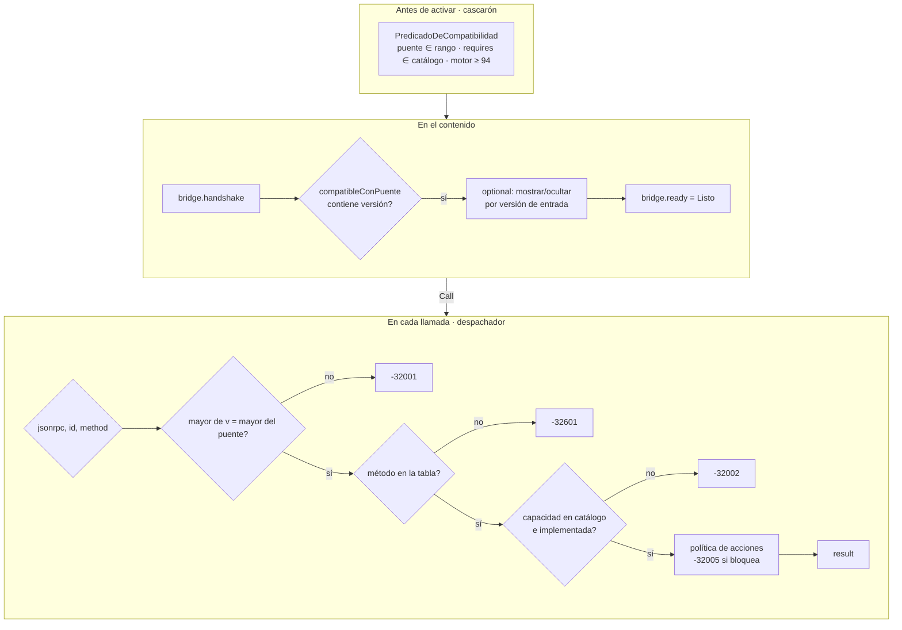

# Núcleo N3: cascarón, contrato del puente y capacidades

Reedición 04 · núcleo N3 · 2026-11-01. Rutas relativas a `Concepts/Framework-Concept/` en la rama
`fc/libro-guia-desarrolladores` de Lab-Documentos.

## Índice

1. [Mesa y método](#1-mesa-y-método)
2. [Ensayo E-N3 (lectura de código y pruebas)](#2-ensayo-e-n3)
3. [Hallazgos de coherencia](#3-hallazgos-de-coherencia)
4. [Contenido para el libro](#4-contenido-para-el-libro)
5. [Decisiones y alternativas](#5-decisiones-y-alternativas)
6. [Referencias de la industria](#6-referencias-de-la-industria)
7. [Propuesta de capítulo](#7-propuesta-de-capítulo)
8. [Dependencias con otros núcleos](#8-dependencias-con-otros-núcleos)

## 1. Mesa y método

Especialistas convocados, del acta (`00-Acta-De-Constitucion.md`): arquitecto de cascarón MAUI, especialista en
contratos y versionado, desarrollador de contenido Blazor, especialista en pruebas, refutador y editor técnico.
El método fue leer cada afirmación de `02-Cascaron-Puente-Y-Capacidades.md`, `99-Anexos.md`, `Developer-Guide.md`,
`Demo/README.md` y `Demo/DISENO-RED-Y-AUTENTICACION.md`, cotejarla con `Demo/src` y `Demo/tests`, y correr las
suites que fijan el contrato. Quedó afuera la base local y el outbox, que entran en N4.

## 2. Ensayo E-N3

Corrido con el SDK 10.0.403 del host (`global.json` pide 10.0.400 con `rollForward: latestPatch`), dentro de `Demo/`:

| Comando | Resultado |
| --- | --- |
| `dotnet test tests/FrameworkConcept.Gate.Tests --filter "…Contrato\|…Catalogo"` | 38 correctas, 1 omitida (`LaVersionSubeSegunLaClasificacionFrenteALaBase`) |
| `dotnet test tests/FrameworkConcept.Core.Tests --filter "…Contrato"` | 18 correctas |
| `dotnet test tests/FrameworkConcept.Update.Tests --filter "…Predicado"` | 16 correctas |

La prueba omitida necesita la demo de la rama de destino en `FC_GATE_BASE`, que arma `scripts/ci-local.sh` o el
workflow (`tests/FrameworkConcept.Gate.Tests/Infraestructura/Repositorio.cs` L48–L54). Corrida suelta, no
compara contra la base. Esto no es un defecto, pero el libro tiene que decirlo.

Conteo de `src/FrameworkConcept.Core/Contracts/contrato.json`: versión 1.2.0, **21 métodos, 4 eventos y 3
entradas de catálogo**, con `mauiMayor: 10`.

## 3. Hallazgos de coherencia

| # | Afirmación | Evidencia contraria o matiz | Severidad | Corrección propuesta |
| --- | --- | --- | --- | --- |
| C1 | 02 §2.3 y 99-Anexos L45: el contrato «no son interfaces C# compartidas» ni «interfaces que el contenido referencia» | `FrameworkConcept.Content.csproj` L80 referencia `FrameworkConcept.Core`, y `BridgeClient.cs` L27 toma `VersionEsperada => ContratoDelPuente.Version`. El contenido comparte en compilación los tipos del contrato (records, `CodigosDeError`) | Media | Aclarar que no hay superficie C# en tiempo de ejecución, porque se cruza sólo `Call(string)` (`PuenteDelCascaron.cs` L16). Los DTO sí se comparten al compilar, y por eso el `v` que manda el contenido es el puente contra el que se compiló |
| C2 | 02 §2.5: el predicado decide «antes de activar» | Hay **dos** guardas más que el libro no reúne: el despachador rechaza un mayor distinto con -32001 y una capacidad ausente con -32002 (`DespachadorDelPuente.cs` L104–L114), y el contenido vuelve a comprobar `compatibleConPuente` después del handshake (`BridgeSession.cs` L80) | Media | Presentar la compatibilidad en tres capas: predicado (antes de activar), despachador (cada llamada) y contenido (handshake y `optional`) |
| C3 | `Demo/README.md` L160: «tabla de métodos (11 métodos, 2 eventos), catálogo (`device.info`, `network.status`…)» | `contrato.json` tiene 21 métodos, 4 eventos y 3 entradas (`auth.session`). Es la foto del tramo A1, pero no lo marca como histórico | Baja | Agregar «en A1» o actualizar las cifras |
| C4 | `Demo/README.md` L291 «Contrato del puente **1.1.0**» y el índice de DISENO (L22, ancla `#6-contrato-del-puente-110`) | El título real es «6. Contrato del puente 1.1.0 (1.2.0 desde el login tradicional)» (L442), así que el ancla del índice no resuelve. 02 §2.6 usa el ancla larga, que sí resuelve | Baja | Arreglar el ancla del índice de DISENO |
| C5 | 02 §2.6 y la plantilla de 01 L234 «¿Tiene techo?» | `RangoDeVersion.TryParse` rechaza cualquier rango cuyo techo no sea el próximo mayor (`RangoDeVersion.cs` L52–L55). El techo no es opcional, es estructural | Baja | Cambiar la pregunta por «¿el piso es el puente mínimo que de verdad usás?» |
| C6 | `declaracion-del-contenido.json`: `compatibleConPuente: ">=1.1.0 <2.0.0"`, aunque el contenido usa `auth.signInWithPassword` y `auth.lock` (puente 1.2) | No es contradicción. El contenido detecta la función por la versión de la entrada `auth.session` (`SesionDelContenido.cs` L42–L46). Pero 02 no explica el patrón y parece un piso mal puesto | Media (didáctica) | Explicar la **detección de funciones por versión de entrada**: piso bajo y degradación |
| C7 | 02 §2.3: las API web del navegador están prohibidas «y la compuerta lo prueba» | Se sostiene: `tests/FrameworkConcept.Gate.Tests/Contenido/ContenidoTests.cs` busca `geolocation` y `getUserMedia` | — | Citar el archivo |
| C8 | `requires: []` en la demo | Todo es `optional`, y `camera.capture` no está en el catálogo a propósito (02 §2.1). La demo nunca ejercita en el dispositivo un `requires` que falte, sólo en `PredicadoTests.cs` y en el navegador | Baja | Decirlo en el libro y no sugerir que se ensayó en dispositivo |
| C9 | El puente simulado repite las versiones del catálogo | `Testing/puente-simulado.js` L47 escribe a mano `{'device.info':'1.0.0', …}` y L32 `puente: '1.2.0'`. Ninguna prueba lo ata a `CatalogoDeCapacidades.cs`, así que puede quedar desfasado en silencio | Media | Generar esos valores desde `contrato.json`, o sumar una prueba de compuerta que los compare |
| C10 | Developer-Guide L225–L227: «puente 1.0.0» en el paso 8 de E02 | Ya está aclarado como dato histórico (L227) | — | Ninguna |
| C11 | Tabla de métodos con «Capacidad» opcional | Sólo `device.info`, `network.status` y los `auth.*` llevan capacidad. `documents.*` y `outbox.*` no la llevan porque son servicios del cascarón y no del dispositivo, pero el libro no hace esa distinción | Baja | Separar **servicio del cascarón** de **capacidad del dispositivo** |

## 4. Contenido para el libro

### 4.1 Definiciones

- **Cascarón.** La app MAUI que se instala por tienda. Incluye las pantallas XAML propias, el actualizador, el servidor
  de contenido, el puente, el catálogo y la base (`00-Marco.md` L45; `99-Anexos.md` L38). Su regla de frontera:
  si algo necesita un permiso o un código nativo que el catálogo no tiene, va al cascarón y viaja por tienda. Si
  no, es contenido (`00-Marco.md` L49).
- **Puente.** Un solo método nativo, `Call(sobre)`, registrado con `HybridWebView.SetInvokeJavaScriptTarget`
  (`Shell/Pages/ContenidoPage.xaml.cs` L44; `Shell/Bridge/PuenteDelCascaron.cs` L16). Los eventos vuelven con
  `InvokeJavaScriptAsync` (`Sobre.cs` L33–L37).
- **Sobre.** Un JSON-RPC 2.0 con un campo extra, `v`: la versión del puente que espera el contenido (`Sobre.cs` L5–L19).
  Hay códigos propios de -32001 a -32007 (`Sobre.cs` L39–L71).
- **Contrato del puente.** La tabla de métodos, el catálogo (id y versión) y el transporte, serializados en un orden fijo
  en `contrato.json` (`ContratoDelPuente.cs` L6–L43). Las descripciones no entran (L20), así que cambiar un
  comentario no cambia el contrato. La **huella** sha256 sirve para diagnóstico y no es una versión (L54–L56).
- **Transporte.** El script `_framework/hybridwebview.js`, la ruta `POST /__hwvInvokeDotNet`, el método `Call(sobre)`,
  los eventos y el **mayor de MAUI** (`TransporteDelPuente.cs` L10–L26). Subir el mayor de MAUI es un cambio mayor del puente.
- **Catálogo de capacidades.** Una constante en Core con id estable, versión propia, permisos de Android, claves de
  Info.plist y `<queries>` (`CatalogoDeCapacidades.cs` L14–L50). Está en Core para que la compuerta lo lea sin
  compilar Android (L29–L30).
- **Rango de versión.** Siempre `>=A.B.C <(A+1).0.0` (`RangoDeVersion.cs` L6–L12).
- **Predicado de compatibilidad.** Puente en rango, cada `requires` presente y en rango, y motor mayor o igual al mínimo, con
  WebView 94 como piso (`Update/PredicadoDeCompatibilidad.cs` L10–L36). Junta todos los motivos y no corta en el primero.

### 4.2 Explicación: tres capas de compatibilidad (corrige C2)



Evidencia: `DespachadorDelPuente.cs` L19–L25 y L69–L114; `BridgeSession.cs` L71–L148.

### 4.3 Ejemplos tomados de la demo

1. **Un sobre real.** `BridgeClient.cs` L38 llama `puente.llamar(v, método, parámetros)`. `puente.js` L48 arma `v`.
   El texto se manda en ASCII con escapes `\uXXXX`, porque el transporte de Android lo lleva en un encabezado (02 §2.4).
2. **Cambio menor en la práctica.** Para pasar de 1.1.0 a 1.2.0 se sumaron `auth.signInWithPassword` y `auth.lock`, y la
   entrada `auth.session` subió a 1.1.0 (`CatalogoDeCapacidades.cs` L47–L49; `TablaDeMetodos.cs` L4–L5).
3. **Degradación por `optional`.** El contenido declara `camera.capture` y el catálogo no la tiene (02 §2.1). Así
   muestra cómo ocultar una función sin fallar.
4. **Detección por versión de entrada** (C6): con `auth.session` 1.0.0 el contenido no muestra «Bloquear»
   (`SesionDelContenido.cs` L42–L46).
5. **Instantánea en rojo.** En E02 se cambió la forma de un método sin subir la versión, y la compuerta lo bloqueó
   (`04-Estrategia-De-Pruebas.md` L119).

### 4.4 Ciclo de un cambio de contrato

```mermaid
sequenceDiagram
    participant Dev as Desarrollador del cascarón
    participant T as TablaDeMetodos / Catálogo
    participant Tool as FrameworkConcept.Tools contrato
    participant G as Gate.Tests (fw-ok)
    Dev->>T: agrega método o entrada
    Dev->>Dev: clasifica: menor o mayor (02 §2.6)
    Dev->>Tool: regenera contrato.json
    Dev->>Dev: sube versionado/puente.json y ContratoDelPuente.Version
    G->>G: instantánea = código; versión subió ⇔ hubo cambio
    G->>G: frente a la base: subió lo que exige la clasificación
    G->>G: catálogo ⇔ AndroidManifest (permisos, features, queries)
    G-->>Dev: verde → PR; rojo → corregir
```

Evidencia: `ContratoDelPuente.cs` L9–L13; `InstantaneaDelContratoTests.cs` L50–L58;
`Contrato/ClasificadorDeCambios.cs`; `CatalogoFrenteAlManifiestoTests.cs` L47–L119.

## 5. Decisiones y alternativas

| Decisión | Alternativas | Criterio | Recomendación |
| --- | --- | --- | --- |
| D1. Un método `Call(sobre)` con tabla versionada | Un método nativo por función (estilo `addJavascriptInterface`); plugins con registro dinámico (Capacitor) | Simplicidad: la superficie nativa queda fija. Escalabilidad: una función nueva es una fila. Seguridad: un solo punto de validación | Mantener (P3) |
| D2. Los DTO del contrato se comparten en compilación (C1) | Generar un cliente TS o C# desde `contrato.json`; duplicar a mano | Practicidad: hoy el contenido es Blazor y comparte C# sin costo. Escala mal si llega contenido no .NET | Mantener y documentarlo. Si aparece contenido JS, generar el cliente desde `contrato.json` (evita C9) |
| D3. Techo fijo en el próximo mayor | Rangos libres de npm | Simplicidad: un solo formato válido | Mantener |
| D4. El mayor de MAUI entra en el transporte | Ignorarlo | Seguridad: `hybridwebview.js` cambia con MAUI | Mantener. El libro tiene que avisar que actualizar MAUI de mayor obliga a un índice nuevo `/puente-N+1/` |
| D5. Puente simulado con valores a mano (C9) | Valores generados desde `contrato.json`; prueba de igualdad | Escalabilidad y menos desfase | Abrir una tarea de demo: prueba de compuerta o generación |
| D6. Catálogo mínimo, sin permisos de tiempo de ejecución | Declarar permisos «por las dudas» | Política de tiendas y P12 | Mantener |

## 6. Referencias de la industria

URLs públicas que no se volvieron a abrir en esta sesión. N8 las tiene que verificar antes de citarlas en el libro.

- JSON-RPC 2.0: https://www.jsonrpc.org/specification
- SemVer 2.0.0: https://semver.org/
- .NET MAUI HybridWebView: https://learn.microsoft.com/dotnet/maui/user-interface/controls/hybridwebview
- Riesgo de los puentes nativos en WebView (Android): https://developer.android.com/privacy-and-security/risks/insecure-webview-native-bridges
- Capacitor, plugins y puente: https://capacitorjs.com/docs/plugins
- Cordova, plugins: https://cordova.apache.org/docs/en/latest/guide/hybrid/plugins/
- Expo, *runtime version* (análogo del mayor del puente, 03 L133): https://docs.expo.dev/eas-update/runtime-versions/
- Contratos dirigidos por el consumidor (análogo de la instantánea): https://docs.pact.io/
- OWASP MASVS-PLATFORM (WebView y puentes): https://mas.owasp.org/MASVS/

## 7. Propuesta de capítulo

**Capítulo «El cascarón y el contrato del puente»** (reemplaza la parte de puente de 02. Base, outbox y encuestas
pasan a los capítulos de N4 y N2):

1. La frontera: qué es cascarón y qué es contenido (regla del catálogo).
2. El puente: `Call(sobre)`, JSON-RPC 2.0 y `v`, eventos y códigos de error.
3. El transporte y sus condiciones (HybridWebView, `hybridwebview.js`, ASCII, mayor de MAUI).
4. El contrato: tabla, catálogo y transporte, instantánea y huella.
5. Capacidades: servicio del cascarón frente a capacidad del dispositivo, `requires` y `optional`, detección por versión de entrada.
6. Compatibilidad en tres capas (diagrama 4.2).
7. Evolución: menor y mayor, ciclo de un cambio (diagrama 4.4), índice por mayor.
8. Cómo se prueba: Gate, Core y Update, el puente simulado y sus límites (C8, C9).
9. Decisiones y alternativas (tabla 5), comparación con Capacitor, Cordova y EAS.
10. Lista de verificación y plantilla de método nuevo (de 02 §6, con C5 corregido).

## 8. Dependencias con otros núcleos

- **N1:** usa las definiciones de cascarón y contenido, y la regla de frontera.
- **N2:** el predicado y el índice por mayor del puente (`/canal/puente-N/`) unen la OTA con el contrato; `bridge.ready` es la confirmación del rollback.
- **N4:** `auth.*`, `network.*`, `actions.*` y los códigos -32005 a -32007; `SinTokensEnElPuenteTests` (la credencial no cruza el puente).
- **N5:** la instantánea, el clasificador y la prueba omitida sin `FC_GATE_BASE`; la línea de versión del puente.
- **N6:** recibe C1 a C11.
- **N7:** puentes nativos y MASVS-PLATFORM.
- **N8:** verifica las URLs del §6.
- **N9:** el capítulo del §7.
