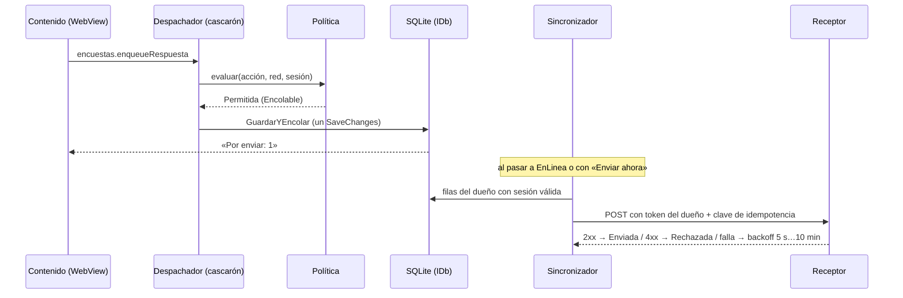
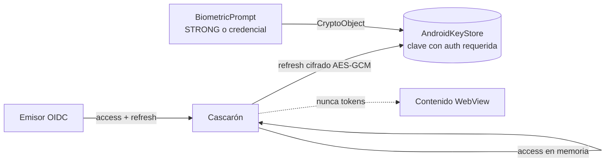

# Núcleo N4: offline-first, red y autenticación del dispositivo

Reedición 04 · fecha 2026-11-01 · estado: dictamen del núcleo, listo para integrarlo en N9

## Índice

1. [Alcance y mesa](#1-alcance-y-mesa)
2. [Ensayo de lectura y pruebas](#2-ensayo-de-lectura-y-pruebas)
3. [Hallazgos de coherencia](#3-hallazgos-de-coherencia)
4. [Contenido para el libro](#4-contenido-para-el-libro)
5. [Decisiones y alternativas](#5-decisiones-y-alternativas)
6. [Referencias de industria](#6-referencias-de-industria)
7. [Dependencias con otros núcleos](#7-dependencias-con-otros-núcleos)

Las rutas son relativas a `Concepts/Framework-Concept/` del repo Lab-Documentos, rama `fc/libro-guia-desarrolladores`.
Los ensayos y folios son los del expediente 0001 (repo Lab-Documentos.Documentacion).

## 1. Alcance y mesa

El núcleo cubre el outbox y SQLite, el estado de red y de internet, la biometría, el PIN y el patrón, el Keystore y el
login en el contenido. Lo contrasté con E03 y E05.

Especialistas que intervinieron:

- arquitecto móvil offline-first (outbox, SQLite);
- especialista en identidad (OAuth, OIDC, Keystore);
- QA (ensayos y pruebas);
- editor técnico (terminología);
- refutador.

## 2. Ensayo de lectura y pruebas

- Corrí `dotnet test tests/FrameworkConcept.Core.Tests --filter "FullyQualifiedName~Red|FullyQualifiedName~Auth"` en
  `Demo/` con el dotnet del host, el 2026-11-01. Resultado: **155 superadas, 0 con error**, en 244 ms. Cubren las
  transiciones de red y de sesión, la política y el evaluador de acciones, y la propiedad del outbox.
- No volví a correr nada en el emulador. Los hechos de dispositivo salen de E03 (`INFORME.md`, `correcciones.md`) y de
  las capturas de E05.

## 3. Hallazgos de coherencia

| # | Hallazgo | Evidencia | Corrección propuesta |
| --- | --- | --- | --- |
| C1 | El comentario del cofre dice que una huella nueva invalida la clave. Con `BIOMETRIC_STRONG \| DEVICE_CREDENTIAL` no es así (H-1). 07 §8 ya lo registra, pero el código sigue igual | `Demo/src/FrameworkConcept.Shell/Auth/CofreDeSesion.cs:128-129`; `07-Red-Y-Autenticacion.md` §8; E03 §5 H-1 | Corregir el comentario: «sin efecto con DeviceCredential (H-1)». Otra opción es quitar la llamada. El libro cuenta H-1 como apartamiento declarado |
| C2 | El comentario de `Dueno` dice «la sesión por dispositivo (no hay login)». Eso ya no vale en modo con cuenta (CTX-5) | `Demo/src/FrameworkConcept.Shell/Data/Tablas.cs:13`; `00-Marco.md:165-166` | Cambiarlo por «id de instalación en modo Dispositivo, `sub` de la cuenta en modo con cuenta» |
| C3 | Framework-APP inclina D-05 hacia `sqlite-net-pcl`. La demo usa EF Core SQLite detrás de `IDb` | `Framework-APP.md:288,372`; `08-Cohesion-Global.md:113`; `Demo/src/FrameworkConcept.Shell/Data/ContextoDelCascaron.cs:8-12` | Marcar D-05 como cerrada (P5, EF Core) en Framework-APP o remitir a 08 |
| C4 | Framework-APP lista las tablas `Outbox, RegistroRed, Sesion, ContenidoVersion, Config`. La demo tiene `Outbox, Documentos, Definiciones, VersionesDeContenido, Configuracion`. `RegistroRed` y `Sesion` no existen como tablas | `Framework-APP.md:292`; `ContextoDelCascaron.cs:8-12`; `grep RegistroRed src` sin resultados | El libro describe las tablas reales. En Framework-APP, una nota de «diseño previo» |
| C5 | Hay dos backoffs y 07 nombra uno solo. La salud reintenta de 5 a 60 s. El outbox reintenta de 5 s a **10 min** por fila. La frase «5 → 60 s de backoff» de 07 §8 se puede leer como si valiera para el outbox | `Demo/src/FrameworkConcept.Core/Red/TransicionesDeRed.cs:65-68`; `Demo/src/FrameworkConcept.Shell/Sync/SincronizadorDelOutbox.cs:24-25,170`; `07-Red-Y-Autenticacion.md` §8; DISENO L96, L118 | Separar en el libro «reintento de salud» y «reintento por fila del outbox» |
| C6 | El endpoint de salud tiene dos nombres: `GET /health` en Framework-APP y `GET /salud` en la demo | `Framework-APP.md:214`; DISENO L92 | Usar `/salud` y aclarar que el nombre lo decide cada servidor |
| C7 | Framework-APP recomienda SQLCipher si se guardan datos de usuarios. La demo no cifra la base (no hay referencias a SQLCipher en `src`). Ningún documento dice que eso sea un apartamiento | `Framework-APP.md:290`; `grep -i sqlcipher Demo/src` sin resultados | Declararlo como límite de la demo y dejarlo como decisión de producto (ver §5, D-N4-3) |
| C8 | Hay dos tiempos parecidos que no conviene mezclar: 15 min para la reanudación que consulta el canal OTA y 5 min para el bloqueo en segundo plano | `00-Marco.md:142`; `Demo/src/FrameworkConcept.Core/Auth/Oidc.cs:249`; `99-Anexos.md:219` | El libro los presenta juntos en una tabla de tiempos con su propósito |
| C9 | Consistente, sin cambios: la salud con timeout de 3 s y caché de 10 s coincide entre 07, DISENO y el código | `TransicionesDeRed.cs:59-62`; DISENO L92 | Ninguna |
| C10 | Consistente: «documento y fila del outbox en la misma transacción» (02) coincide con un único `SaveChanges` | `Demo/src/FrameworkConcept.Shell/Data/DbSqlite.cs:89,114-115`; `02-Cascaron-Puente-Y-Capacidades.md:66,254` | Citar esa línea como ejemplo en el libro |
| C11 | Consistente: «el refresh nunca cruza el puente» lo hace cumplir una prueba de la compuerta | `Demo/tests/FrameworkConcept.Gate.Tests/Contrato/SinTokensEnElPuenteTests.cs:14` | Ninguna |
| C12 | Framework-APP dice que `SecureStorage` no ata la lectura a la biometría y propone evaluar un plugin. La demo resolvió con código de plataforma (`android.hardware.biometrics.BiometricPrompt` + `CryptoObject`), sin plugin | `Framework-APP.md:189`; `CofreDeSesion.cs:22-28,158-163` | Cerrar esa pregunta en el libro con la solución de la demo. iOS (Keychain) sigue sin verificar |
| C13 | Faltan cosas por verificar: `EnLineaMedida` en un dispositivo, la regresión sin cuenta en el emulador y todo en un teléfono físico | E03 §7; `07-Red-Y-Autenticacion.md` §8 | Mantener el rótulo «NO VERIFICADO» en el libro |

## 4. Contenido para el libro

### 4.1 Definiciones

- **Offline-first.** La app guarda primero en local y sincroniza después. La red es una mejora, no una condición para
  operar. En la demo, `SoloLocal` y `Encolable` funcionan sin red (`Demo/src/FrameworkConcept.Core/Red/PoliticaDeAcciones.cs:41-51`).
- **Outbox (bandeja de salida).** Es el patrón *transactional outbox*: la intención de enviar algo se escribe en la misma
  transacción que el cambio local, y un sincronizador la entrega después. Cada fila lleva clave de idempotencia, dueño,
  entidad (orden por entidad), versión de la definición y estado, que puede ser `Pendiente`, `Enviada`, `Rechazada` o
  `Error`. Las dos últimas son carta muerta y no se borran (`Demo/src/FrameworkConcept.Shell/Data/Tablas.cs:10-66`).
- **Estado de red combinado.** Junta `Connectivity` del sistema con la salud del servidor y da cuatro estados:
  `EnLinea`, `EnLineaMedida`, `RedSinServidor` y `SinRed`.
- **Política de acciones.** Clasifica cada acción como `SoloLocal`, `Encolable` o `SoloEnLinea`. La evalúa el cascarón
  y el despachador la hace cumplir con el error -32005.
- **Sesión y desbloqueo local.** La identidad la da el emisor OIDC. La seguridad del teléfono (huella, rostro, PIN o
  patrón) sólo abre la clave AES-256-GCM del AndroidKeyStore que sella el refresh token (`CofreDeSesion.cs:22-38,121-129`).
- **Login en el contenido.** Hay dos modos. En modo Formulario se usa `auth.signInWithPassword`: la clave cruza el
  puente una sola vez y el canje es ROPC, que sólo se acepta con el emisor de ensayo. En modo Navegador se usa
  `auth.signIn` con code + PKCE en la Custom Tab, según RFC 8252 (`Demo/src/FrameworkConcept.Core/Auth/Oidc.cs:74-79,100-115`).

### 4.2 Diagramas propuestos

Flujo de una acción encolable:

Arquitectura del secreto:

También se reutilizan las dos máquinas de estado de `07-Red-Y-Autenticacion.md` §2.5, que coinciden con
`TransicionesDeRed` y `TransicionesDeSesion`.

### 4.3 Ejemplos reales, ya medidos

- Encuesta registrada sin red. El receptor vuelve y la app pasa sola a `EnLinea` en 6,4 s. La fila sale a +0,57 s con su
  dueño (E03 §4.3).
- Cerrar sesión conserva lo pendiente. La fila no sale sin sesión y sale 0,7 s después del reingreso (E03, paso `g`).
- Si se quita el bloqueo de pantalla, la clave queda invalidada y la sesión pasa de `Bloqueada` a `SinCuenta`
  (E03, `correcciones.md`).
- E05: login en el contenido, sesión activa, bloqueo y desbloqueo sin red, en el emulador y en un teléfono físico de
  medida (capturas `emu-01..05`, `g42-01..03` del ensayo; en el libro conviene nombrarlas sin la serie del equipo).

### 4.4 Tabla de tiempos (resuelve C5 y C8)

| Parámetro | Valor | Fuente | Naturaleza |
| --- | --- | --- | --- |
| Timeout de salud | 3 s | `TransicionesDeRed.cs:59` | demo |
| Caché de salud | 10 s | `TransicionesDeRed.cs:62` | demo |
| Reintento de salud | de 5 a 60 s, después cada 60 s | `TransicionesDeRed.cs:65-71` | demo |
| Backoff por fila del outbox | de 5 s a 10 min (exponencial) | `SincronizadorDelOutbox.cs:24-25,170` | demo |
| Bloqueo tras segundo plano | 5 min | `Oidc.cs:249` | demo |
| Renovación anticipada del access | 30 s | `Oidc.cs:252` | demo |
| Reanudación con consulta OTA | 15 min | `99-Anexos.md:219` | producto (folio 036) |
| Sesión SSO del emisor de ensayo | 30 min sin uso, 10 h como máximo | `realm-fc-demo.json` (07 §2.4.1) | ensayo |

## 5. Decisiones y alternativas

| Id | Pregunta | Alternativas | Recomendación y criterio |
| --- | --- | --- | --- |
| D-N4-1 | ¿Con qué canje se hace el login en producción? | (a) Navegador con RFC 8252 + PKCE; (b) formulario con draft-ietf-oauth-first-party-apps; (c) ROPC | **(a) por defecto**: es el estándar maduro y trae MFA y SSO sin costo. (b) vale cuando el emisor lo soporte y el PO quiera una UI propia. (c) nunca en producción (RFC 9700 §2.4). Simplicidad: (a). Escalabilidad: (a) y (b) |
| D-N4-2 | ¿Qué hacer con la invalidación por enrolamiento (H-1)? | (a) Mantener STRONG\|CREDENTIAL y declararlo; (b) sólo biometría, que sí invalida pero deja afuera el PIN y el patrón | **(a)**. Es lo que pidió el PO en P4, y la invalidación al quitar el bloqueo de pantalla sigue vigente |
| D-N4-3 | ¿Se cifra la base local? | (a) No (la demo); (b) SQLCipher con la clave en el Keystore; (c) cifrar sólo los payloads sensibles | La decide el producto según el dato. (b) cuando haya datos personales (MASVS-STORAGE). Para la demo, (a) declarado |
| D-N4-4 | ¿Se piden *offline tokens*? | (a) `openid profile`, que vence con la sesión SSO; (b) `offline_access` | La deja abierta el producto. (a) es más simple y segura. (b) evita reingresos en jornadas largas sin red |
| D-N4-5 | ¿Cuántos backoffs exponer? | Uno solo, o dos (salud y fila) | Dos: los problemas son distintos (alcanzar el servidor y que el servidor acepte la fila). Hay que documentarlos por separado |

## 6. Referencias de industria

- RFC 8252, OAuth 2.0 for Native Apps: https://www.rfc-editor.org/rfc/rfc8252
- RFC 7636, PKCE: https://www.rfc-editor.org/rfc/rfc7636
- RFC 9700, OAuth 2.0 Security BCP: https://www.rfc-editor.org/rfc/rfc9700
- OAuth 2.0 for First-Party Applications (borrador): https://datatracker.ietf.org/doc/draft-ietf-oauth-first-party-apps/
- Android Keystore: https://developer.android.com/privacy-and-security/keystore
- BiometricPrompt y autenticadores: https://developer.android.com/identity/sign-in/biometric-auth
- .NET MAUI Connectivity: https://learn.microsoft.com/dotnet/maui/platform-integration/communication/networking
- .NET MAUI WebAuthenticator: https://learn.microsoft.com/dotnet/maui/platform-integration/communication/authentication
- Patrón Transactional Outbox: https://microservices.io/patterns/data/transactional-outbox.html
- Android, guía de *offline-first*: https://developer.android.com/topic/architecture/data-layer/offline-first
- OWASP MASVS (STORAGE, AUTH, NETWORK): https://mas.owasp.org/MASVS/
- SQLCipher: https://www.zetetic.net/sqlcipher/

Las URLs de esta lista no se volvieron a abrir en esta sesión. N8 debe verificarlas y registrar la fecha de consulta
antes de llevarlas al libro.

## 7. Dependencias con otros núcleos

- **N1**: toma las definiciones de offline-first, outbox y desbloqueo local de §4.1 para la sección de fundamentos.
- **N3**: los métodos `auth.*`, `actions.*`, `outbox.sendNow`, `network.changed` y el error -32005 pertenecen al
  contrato del puente (1.1.0 y 1.2.0). Las capacidades `auth.session` y `requires` también.
- **N2**: la regla «ninguna actualización espera a vaciar el outbox» (P13.7) y la diferencia entre la reanudación de
  15 min y el bloqueo de 5 min.
- **N5**: `SinTokensEnElPuenteTests` y las pruebas de transiciones (155 en verde) en la pirámide y la compuerta.
- **N6**: los hallazgos C1 a C8 y C12 entran en su lista de divergencias, y C1, C2 y C4 piden cambiar el código o el
  documento.
- **N7**: MASVS-AUTH y MASVS-STORAGE, y el contraste con el login de Mercado Libre (Credential Manager) frente al modo
  Navegador.
- **N8**: verificar las URLs de §6.
- **N9**: integrar el capítulo propuesto (ver el resumen devuelto).
