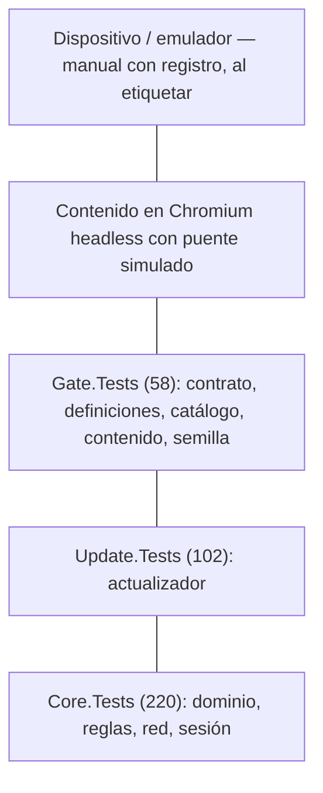
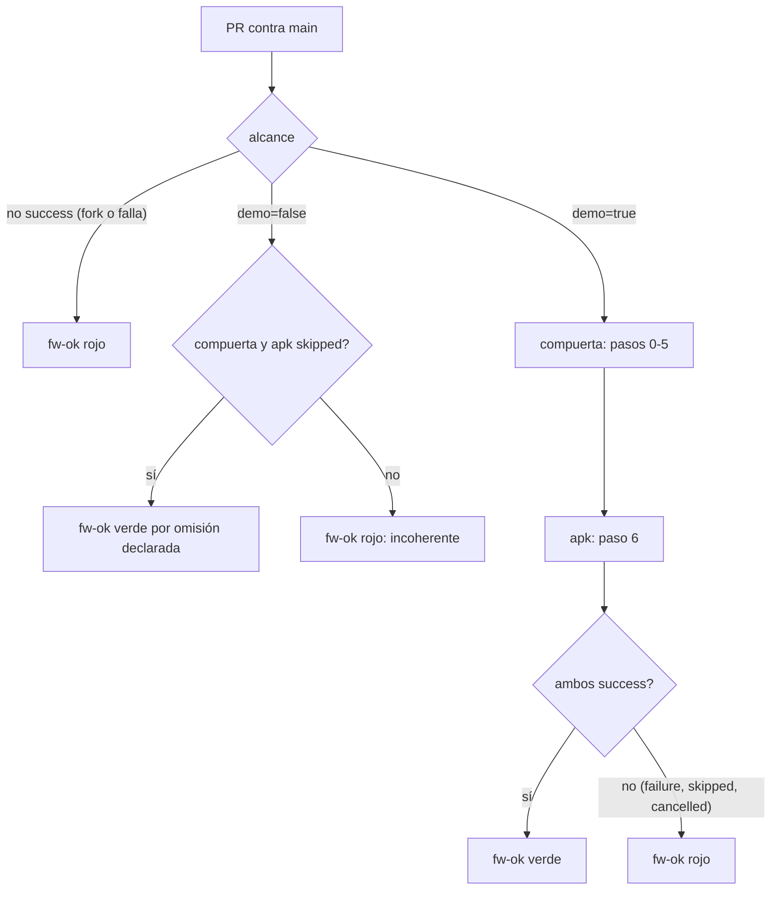
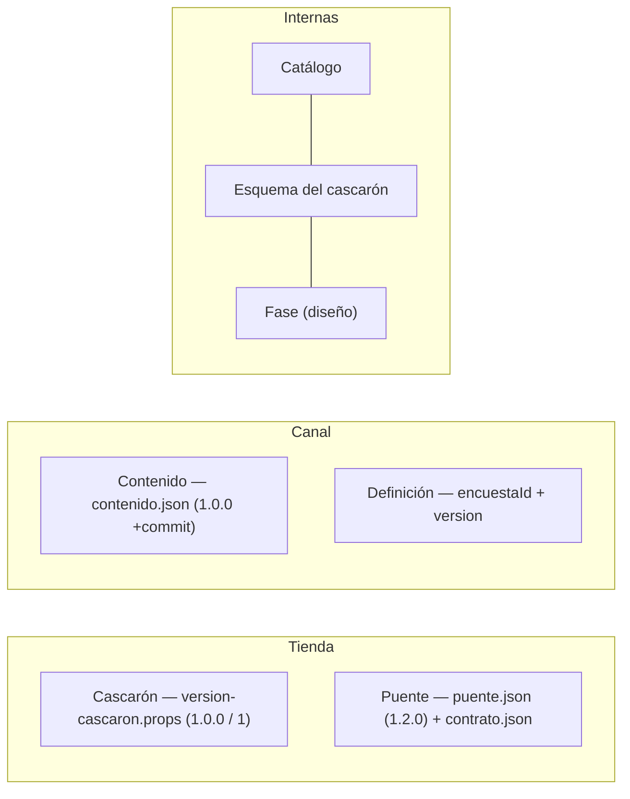

# Núcleo N5 — Integración, versionado y estrategia de pruebas

## Índice

1. [Alcance y mesa del núcleo](#1-alcance-y-mesa-del-núcleo)
2. [Ensayo E-N5-01: la compuerta corrida otra vez](#2-ensayo-e-n5-01-la-compuerta-corrida-otra-vez)
3. [Hallazgos de coherencia](#3-hallazgos-de-coherencia)
4. [¿Se solapan 03 y 06?](#4-se-solapan-03-y-06)
5. [Contenido para el libro](#5-contenido-para-el-libro)
6. [Decisiones y alternativas](#6-decisiones-y-alternativas)
7. [Propuesta de capítulo](#7-propuesta-de-capítulo)
8. [Dependencias con otros núcleos](#8-dependencias-con-otros-núcleos)
9. [Referencias](#9-referencias)

Convención de rutas: `LD:` es la raíz del repositorio Lab-Documentos (rama `fc/libro-guia-desarrolladores`, commit
`9b5b5ad`, igual a `origin/main` el 2026-11-01); `Demo/` abrevia `LD:Concepts/Framework-Concept/Demo/`; `LDD:` es
Lab-Documentos.Documentacion y `folio NNN` es una actuación del expediente 0001.

## 1. Alcance y mesa del núcleo

**Alcance.** PR con pruebas obligatorias, compuertas, líneas de versión, canales, pirámide de pruebas y solapamiento
entre `03-Integracion-Y-Versionado.md` (FC-TEM-03) y `06-Procedimientos-PR-Integracion-Versionado.md` (FC-TEM-06),
contrastados con el ensayo E02 y con el código.

**Especialistas que intervinieron** (del acta 00): DevOps/CI de plataforma GitHub, arquitecto MAUI .NET, analista de
calidad y pruebas, analista de decisiones, editor académico y refutador. El refutador revisó cada hallazgo de §3: sólo
quedan los que tienen evidencia de archivo y línea, de folio o de corrida.

## 2. Ensayo E-N5-01: la compuerta corrida otra vez

**Objetivo.** Ver si las cifras que citan los documentos (Core 211, Update 102, Gate 52) siguen valiendo para el código
de hoy, y repetir los dos rojos provocados que tienen parche.

**Método.** Copia de `Demo/` (sin `bin`, `obj` ni `salida`) en un directorio temporal. La base del PR es
`git archive origin/main Concepts/Framework-Concept/Demo`, pasada como `FC_GATE_BASE`. Se usó el `dotnet` del host
(SDK 10.0.403, aceptado por `Demo/global.json`: 10.0.400 con `rollForward: latestPatch`), así que `ci-local.sh` no usó
el contenedor (`Demo/scripts/ci-local.sh` L112–L113). Fecha: 2026-11-01.

| Corrida | Resultado medido |
| --- | --- |
| `ci-local.sh --hasta 4` | Build sin avisos; **Core 220/220; Update 102/102; Gate 58/58**; `rc=0` |
| `+ etapas/M-13-codigo-postal-cinco-digitos.patch` | `Core.Tests`: «Con error: 6, Superado: 214, Total: 220»; `rc=1` |
| `+ etapas/aviso-promovido-a-error.patch`, `--hasta 1` | `LocalidadRules.cs(23,13): error CS0219`; `rc=1` |

Los parches se revirtieron con `patch -R` y la copia se descartó. **No** se corrieron los pasos 5 (publish) ni 6
(APK), ni el workflow en el runner.

**Conclusión.** La compuerta sigue mirando lo que dice mirar: los dos rojos se reproducen. Pero desde el 2026-10-26
crecieron Core.Tests (+9) y Gate.Tests (+6), así que las cifras escritas en tres documentos quedaron viejas (H1).

## 3. Hallazgos de coherencia

Severidad: **A** contradice un hecho o la evidencia; **M** es un dato viejo o una evidencia mal citada; **B** es
forma o redacción.

| # | Sev. | Hallazgo | Evidencia | Corrección propuesta |
| --- | --- | --- | --- | --- |
| H1 | M | Las cifras de pruebas citadas son 211/102/52; hoy son 220/102/58. El rojo de M-13 es «6 de 220» (214 superadas), no «6 de 211» | FC-TEM-04 L48–L49, L117, L136; FC-TEM-06 L127–L128; `Developer-Guide.md` L295–L299, L323; ensayo §2 | En el libro, no escribir la cifra como dato estable: citar la corrida con fecha o decir «todas en verde». Si se cita, usar la de E-N5-01 con fecha |
| H2 | A | FC-TEM-06 §1 y §9 dicen que `main` exige `fw-ok` desde el 2026-10-29, pero §2.1 («Pendiente (A5)») y §8.2 («NO VERIFICADO al 2026-10-26») siguen en presente. FC-TEM-03 §2.4 dice que `main` tenía `protected: false` y que protegerla «es el tramo A5». El mismo documento afirma las dos cosas | FC-TEM-06 L43–L44, L65–L66, L245, L326–L328; FC-TEM-03 L104–L105 | Un único estado, con fecha: «protegida (estricta, sin excepción para administradores); falta la prueba del rojo con M-13 en un PR» |
| H3 | M | La protección de `main` se atribuye al folio 048, que no la menciona: 048 registra la corrida `40847315104`. La única constancia que nombra la protección (`fw-ok` obligatorio y para administradores) es el folio 051, L27 | FC-TEM-06 L44, L326–L328; folio 048 completo; folio 051 L27 | Citar 051 para la protección y 048 para la corrida |
| H4 | M | FC-TEM-05 sigue diciendo «runner NO VERIFICADO (A5)» para ESC-5, cuando la corrida completa del runner está asentada | FC-TEM-05 L122; folio 048 L12–L15 | «Verificado en local (E-N5-01) y en el runner (folio 048)» |
| H5 | M | Las citas del workflow están fijadas por `sha256` `928f181a00dd` y por líneas L165–L169 y L198–L204. Hoy el archivo da `13d85f7d40d8` y esos bloques están en L166–L170 (`fw-ok:`) y L198–L205 | FC-TEM-03 L101; FC-TEM-06 L104; `LD:.github/workflows/framework-concept-demo.yml` L166–L205 | Citar por commit (`9b5b5ad`) y no por la huella de un árbol sin commit |
| H6 | M | El encabezado del workflow dice que el runner «trae SDK 10.0.402» y que `global.json` «acepta 10.0.402». El runner vigente trae 10.0.403 (folio 048 L15) y FC-TEM-03 §8 ya lo corrige | workflow L12–L16; FC-TEM-03 L221–L225 | Es código, fuera de este núcleo: anotarlo para el PR de coherencia (N6). En el libro, citar el folio y no el comentario |
| H7 | A | El núcleo habla de «las tres líneas de versión» (acta 01). Los documentos dicen **cuatro líneas visibles** (cascarón, puente, contenido, definición) y una tabla de **siete** (más catálogo, esquema y fase). Ninguna fuente dice tres | `01-Nucleos.md` (N5); FC-TEM-03 L128–L155; FC-TEM-06 L285; `Developer-Guide.md` L37 | El libro usa la jerarquía: 2 caminos de publicación (tienda y canal), 4 líneas visibles y 3 líneas internas. Corregir el rótulo del núcleo |
| H8 | M | La plantilla de FC-TEM-03 §7 pone «Puente: 1.1.0». La fuente única dice 1.2.0. La captura de diagnóstico de E02 dice «puente 1.0.0, contenido 1.1.0+5d5c2b4». Son tres momentos distintos y ninguno lleva fecha | FC-TEM-03 L133, L212; `Demo/versionado/puente.json` L2; E02 `hpdev-12-diagnostico.txt` L3 | En el ejemplo de diagnóstico, poner «(E02, antes de A3)». La plantilla parte de los valores de `versionado/` |
| H9 | B | Las «ocho capas» de FC-TEM-04 §1 no cuentan el publish y empaquetado del contenido, que P8 y el workflow sí cuentan como paso (5). En cambio cuentan como capas aparte los cuatro grupos de `Gate.Tests` | FC-TEM-04 L34–L37, L114–L123; workflow L9–L10; `ci-local.sh` L5–L11 | Mostrar los dos ejes por separado: **siete pasos** del pipeline (0–6) y **qué mira** cada suite |
| H10 | B | La decisión de `fw-ok` aparece completa tres veces (FC-TEM-03 §2.4, FC-TEM-06 §4.1–4.2, `Developer-Guide`) y la tabla «qué versión sube» dos veces (FC-TEM-03 §2.6, FC-TEM-06 §8.4) | §4 de este documento | Una sola versión en el libro (§5.3 y §5.4), con referencias cruzadas |
| H11 | M (repositorio público) | Los temas nombran hosts internos (`i7infra-runner-dev`, `hpdev-runner-dev`), un modelo de teléfono y una URL de prueba con puerto | FC-TEM-03 L221–L222; FC-TEM-06 L244–L245; FC-TEM-05 L76 | El libro dice «runner propio autoalojado (etiqueta del workflow)» y no nombra hosts. Lo decide N9 junto con la regla de repositorio público |

Lo que **sí** coincide, verificado contra el código: un solo workflow sin `paths` en `on:` (workflow L4, L21–L24);
`permissions: contents: read` (L26–L27); `concurrency` con cancelación (L29–L31); `fw-ok` con `needs` y
`if: always()` (L166–L170); las cinco filas de la tabla de decisión de FC-TEM-06 §4.2 (L183–L205); el aviso de P6.8
(L78–L81); avisos como error sólo con `CI=true` (`Demo/Directory.Build.props` L18); `MauiVersion` 10.0.20 (L26).

## 4. ¿Se solapan 03 y 06?

**Sí, en parte, y se puede justificar.** FC-TEM-03 explica conceptos y alternativas; FC-TEM-06 da pasos con entradas,
salidas y validaciones (FC-TEM-03 L33–L35; FC-TEM-06 L37–L41). El solapamiento real está en cuatro bloques:

| Bloque | En 03 | En 06 | En el libro |
| --- | --- | --- | --- |
| Agregador estricto y `skipped` = éxito | §2.4 | §2.1, §4.1, §4.2 | Concepto y tabla de decisión juntos, una sola vez |
| Qué versión sube cada cambio | §2.6 (tabla de líneas) | §8.4 (tabla por cambio) | Una tabla con dos vistas: línea → fuente; cambio → línea |
| Modelos de ramas | §2.5 | §8.1 (paso 1, remite a 03) | Concepto; el procedimiento sólo remite |
| Estado de A5 y protección | §2.4 | §1, §2.1, §8.3, §9 | Un recuadro de estado con fecha (H2) |

**Recomendación de la mesa.** En el libro, un capítulo con dos partes: *Conceptos* y *Procedimientos*. Los archivos 03
y 06 siguen como están (el libro los reúne y no los reemplaza, según el acta) y se corrigen sólo H2 a H5.

## 5. Contenido para el libro

### 5.1 Definiciones

- **Compuerta.** Las pruebas que un PR tiene que pasar para poder fusionarse. Su versión local es
  `Demo/scripts/ci-local.sh` y su versión remota, el workflow: los mismos pasos en el mismo orden (`ci-local.sh` L2–L3).
- **Check obligatorio agregador (`fw-ok`).** Un job que corre siempre y resume los demás. Es el único check requerido
  de `main`.
- **Omisión declarada.** El único `skipped` que se acepta: el PR no toca la demo. Se informa con su motivo
  (workflow L188–L196).
- **Base del PR.** La demo tal como está en la rama de destino. Es la referencia con la que se comparan el contrato y
  las definiciones (`ci-local.sh` L83–L110).
- **Rojo provocado.** Un cambio mínimo que tiene que hacer fallar una suite (FC-TEM-04 §2.1).
- **Línea de versión.** Una secuencia de números para algo que se publica por un camino propio (FC-TEM-03 §2.1).
- **Canal.** Un puntero (`dev`, `beta`, `prod`) que promueve el mismo artefacto. No es una versión (FC-TEM-03 L75).

### 5.2 La pirámide aplicada

Base rápida sin dispositivo (net10.0, en milisegundos según E-N5-01) y dispositivo arriba, fuera del PR
(FC-TEM-04 §2.4).

*Cifras de E-N5-01 (2026-11-01).*

### 5.3 Ciclo de un PR y decisión de `fw-ok`

*Fuente: `LD:.github/workflows/framework-concept-demo.yml` L182–L205.*

Ejemplo real para el lector: correr `scripts/ci-local.sh --hasta 4`, aplicar M-13, ver el rojo y deshacerlo con
`patch -R` (el ensayo §2 da la salida esperada).

### 5.4 Líneas de versión: dos caminos, cuatro visibles, tres internas

*Valores: `Demo/versionado/*.json` y `version-cascaron.props` al commit `9b5b5ad`.*

Regla práctica (FC-TEM-06 §8.4): Razor, CSS o JS → contenido; encuesta → definición; métodos, catálogo o transporte
→ puente; permisos, XAML, nativo, SDK o MAUI → cascarón. El puente sale por tienda porque lo implementa el cascarón,
aunque su número viva en un JSON.

### 5.5 Del merge a la publicación

Merge commit atado al SHA probado → etiqueta en `main` → firma → canal `dev` → promoción del mismo artefacto
(FC-TEM-06 §8.5). La firma en un job con *environment* protegido es **diseño, no implantado** (FC-TEM-06 L306–L307).

## 6. Decisiones y alternativas

| Decisión | Elegida | Alternativas | Criterio |
| --- | --- | --- | --- |
| Modelo de ramas | GitHub Flow con `main` protegida | Trunk-based (compatible); `develop` (descartada) | Simplicidad: una sola integración |
| Check requerido | Uno, agregador y estricto | Varios checks; filtro `paths` | Que ningún `skipped` pase por verde |
| Versionado | Líneas separadas | Número único; piso `minShellVersion`; fecha | Atribuir un error a versiones exactas |
| Dispositivo en el PR | No (manual con registro) | Emulador en CI | El runner no tiene KVM (workflow L12–L13) |
| Cola de fusión | No por ahora | GitHub merge queue | Se revisa si hay 3 o más PR por mes que pasan de verde a rojo (FC-TEM-03 L226–L227) |
| Cifras en la prosa | **Nueva (mesa N5):** no fijarlas en el texto normativo | Repetirlas en cada documento | Mantenimiento: H1 muestra que envejecen en días |

Escalabilidad: si se suman módulos, el agregador sigue siendo uno solo y cada módulo agrega su job a `needs`. Es lo
mismo que GitHub recomienda para checks requeridos con `needs`.

## 7. Propuesta de capítulo

**Capítulo «Integración, versionado y pruebas»**

1. El problema: un PR que rompe lo que funcionaba
2. Conceptos
   1. Una rama estable y PR obligatorio (modelos de ramas)
   2. El check agregador y por qué `skipped` es peligroso
   3. Compuerta local = compuerta remota
   4. La pirámide de pruebas aplicada y el rojo provocado
   5. Pruebas intermitentes: cuarentena, no reintentos
   6. Líneas de versión y canales (dos caminos, cuatro visibles, tres internas)
3. Procedimientos
   1. Rama y PR (con la plantilla)
   2. Qué corre el workflow (tabla de decisión de `fw-ok`)
   3. Proteger `main` y probar la protección
   4. Qué versión sube cada cambio
   5. Fusionar, etiquetar, firmar y promover
4. Ejercicio guiado: verde, rojo con M-13 y rojo con el aviso
5. Estado al día (recuadro con fecha: protección, corrida en el runner, pendientes)
6. Preguntas guía y criterios de calidad
7. Referencias

## 8. Dependencias con otros núcleos

- **N2 (OTA):** canal, firma y promoción; el contenido sale por canal.
- **N3 (puente):** clasificación menor/mayor del puente e instantánea del contrato en `Gate.Tests`.
- **N4 (offline y red):** las suites `Core.Tests/Red` y `Auth` forman parte de la base de la pirámide.
- **N6 (coherencia):** H1 a H6, H8 y H9 entran en su lista de divergencias. H6 toca código (comentario del workflow).
- **N8 (industria):** las referencias de §9.
- **N9 (libro):** H7, H10 y H11, el recuadro de estado y la decisión sobre las cifras.

## 9. Referencias

Consultadas por la mesa original (folio 035, dossier N3/N4, 2026-10-25):

- GitHub, *GitHub flow*: https://docs.github.com/en/get-started/using-github/github-flow
- GitHub, *About protected branches*: https://docs.github.com/en/repositories/configuring-branches-and-merges-in-your-repository/managing-protected-branches/about-protected-branches
- GitHub, *Troubleshooting required status checks*: https://docs.github.com/en/pull-requests/collaborating-with-pull-requests/collaborating-on-repositories-with-code-quality-features/troubleshooting-required-status-checks
- GitHub, *Secure use reference*: https://docs.github.com/en/actions/reference/security/secure-use
- *Trunk Based Development*: https://trunkbaseddevelopment.com/
- *Semantic Versioning 2.0.0*: https://semver.org/
- Vocke, *The Practical Test Pyramid*: https://martinfowler.com/articles/practical-test-pyramid.html
- Luo y otros (2014), *An empirical analysis of flaky tests*: https://doi.org/10.1145/2635868.2635920

Propuestas para N8 (**no consultadas en esta sesión**; verificarlas antes de citarlas en el libro):

- GitHub, *Managing a merge queue*: https://docs.github.com/en/repositories/configuring-branches-and-merges-in-your-repository/configuring-pull-request-merges/managing-a-merge-queue
- Expo, *EAS Update — runtime versions*: https://docs.expo.dev/eas-update/runtime-versions/ (análogo del mayor del puente)
- Android Developers, *Fundamentals of testing*: https://developer.android.com/training/testing/fundamentals
- Microsoft Learn, *Unit testing .NET MAUI apps*: https://learn.microsoft.com/en-us/dotnet/maui/deployment/unit-testing
- Winters y otros, *Software Engineering at Google*, cap. 11 «Testing Overview» (tamaños de pruebas): https://abseil.io/resources/swe-book/html/ch11.html
