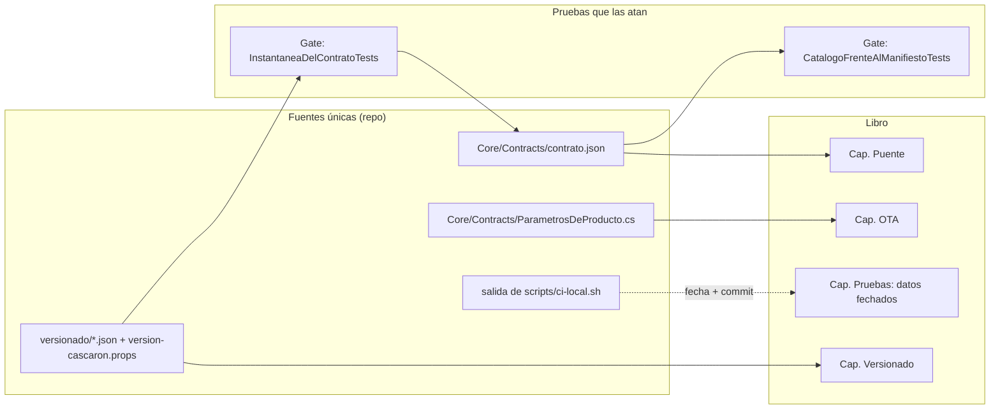

# Núcleo N6: coherencia entre la redacción y la demo

> Reedición 04 · rama `fc/libro-guia-desarrolladores` · 2026-11-01
> Material revisado: `Concepts/Framework-Concept/` (00 a 08, 99, Developer-Guide, Framework-APP, README, `Demo/`).
> Todas las rutas son relativas a `Concepts/Framework-Concept/` salvo que se diga otra cosa.

## Índice

1. [Mesa y método](#1-mesa-y-método)
2. [Ensayo N6-E1: verificación mecánica](#2-ensayo-n6-e1-verificación-mecánica)
3. [Divergencias encontradas](#3-divergencias-encontradas)
4. [Lo que concuerda (muestras verificadas)](#4-lo-que-concuerda-muestras-verificadas)
5. [Contenido para el libro](#5-contenido-para-el-libro)
6. [Decisiones y alternativas](#6-decisiones-y-alternativas)
7. [Dependencias con otros núcleos](#7-dependencias-con-otros-núcleos)
8. [Cómo retomar](#8-cómo-retomar)

## 1. Mesa y método

Participaron estos especialistas: un revisor de trazabilidad (afirmación → archivo:línea), un ingeniero .NET/MAUI (que
corrió las suites), un editor técnico, un auditor de publicación para el repo público y un refutador. El método tuvo
cuatro pasos:

1. Extraje todas las referencias a archivos entre comillas invertidas de los `.md` y comprobé que existieran en el árbol.
2. Contrasté las cifras afirmadas (versiones, plazos, conteos de pruebas y de métodos) con el código y con una corrida real.
3. Verifiqué por muestreo las citas con número de línea.
4. Revisé si el repo público contenía datos que no corresponden publicar.

El refutador descartó los falsos positivos del paso 1: rutas relativas a otra carpeta (`Core/Update/...`), artefactos
generados (`salida/...`) y archivos del expediente (`rojos-*.md`, `correcciones.md`), que viven en el repo privado de
documentación y no en este.

## 2. Ensayo N6-E1: verificación mecánica

- **Entorno.** dotnet del host, SDK fijado por `Demo/global.json` (10.0.400).
- **Comando.** `dotnet test FrameworkConcept.Demo.SinMaui.slnf`, desde `Demo/`, sin `FC_GATE_BASE`.
- **Resultado (2026-11-01, HEAD `9b5b5ad`).**

```text
Core.Tests    Superado: 220  Omitido: 0  Total: 220
Update.Tests  Superado: 102  Omitido: 0  Total: 102
Gate.Tests    Superado:  56  Omitido: 2  Total:  58
```

Las dos omitidas salen de `Assert.Ignore` en `Demo/tests/FrameworkConcept.Gate.Tests/Infraestructura/Repositorio.cs:57`,
que se ignora cuando falta `FC_GATE_BASE`. Es lo esperado fuera de `ci-local.sh`.

- **Contrato.** Según `Demo/src/FrameworkConcept.Core/Contracts/contrato.json`, la versión es 1.2.0, con 21 métodos,
  4 eventos y 3 entradas de catálogo: `auth.session` 1.1.0, `device.info` 1.0.0 y `network.status` 1.1.0.
- **Parámetros.** `Demo/src/FrameworkConcept.Core/Contracts/ParametrosDeProducto.cs` fija vigencia 30 d, renovación
  7 d, reanudación 15 min, 3 paquetes en el servidor, 2 en el teléfono y WebView 94. Coinciden con
  `01-Actualizacion-Sin-Tienda.md:105-113`.

## 3. Divergencias encontradas

La severidad se gradúa así: **A** afirma algo falso hoy, **B** es un dato envejecido o un problema de publicación y
**C** es una mejora editorial.

| # | Sev. | Dónde | Qué dice | Qué hay | Corrección propuesta |
|---|---|---|---|---|---|
| D1 | A | `04-Estrategia-De-Pruebas.md:48-49`, `06-Procedimientos-PR-Integracion-Versionado.md:127`, `99-Anexos.md:117`, `Developer-Guide.md:293-299` | Core 211/211, Gate 52/52 | Core 220, Gate 56 + 2 omitidas (N6-E1) | En el libro, **no escribir conteos fijos**: describir la forma («todas en verde, `rc=0`») y remitir a la salida de `ci-local.sh`. Si se cita una corrida, ponerle fecha y commit |
| D2 | B | `Demo/README.md:160` (tramo A1) | «11 métodos, 2 eventos», catálogo `device.info`, `network.status` | 21 métodos, 4 eventos, 3 entradas (contrato 1.2.0) | Es bitácora histórica: marcarla «estado al cierre de A1» o moverla a un anexo de historia. El libro toma las cifras de `contrato.json` |
| D3 | B | `Demo/README.md:170, 223, 269-270, 389` | Core 65, 96, 202; Gate 46, 47 | Ídem D1 | Igual que D2: rotular como historia de tramos |
| D4 | A | `99-Anexos.md:116` (L-05) | «la carpeta `Demo/` todavía no tiene commit» | `Demo/` está en el historial (PR #38 y #39) | Actualizar L-05 con el commit de referencia |
| D5 | A (código) | `Demo/src/FrameworkConcept.Shell/Auth/CofreDeSesion.cs:128` | Comentario «Una huella nueva invalida la clave» | Con `BiometricStrong \| DeviceCredential` no la invalida (E03 H-1, citado en `07-Red-Y-Autenticacion.md:300-310`) | Corregir el comentario en el código, no en la guía. La guía ya lo declara; cuando se arregle, retirar la observación de 07 §8 |
| D6 | B (publicación) | `Developer-Guide.md`, 00, 01, 05, 08, 99, `Demo/README.md`, `Demo/DISENO-*` | Modelo del teléfono de medida (≈30 menciones), nombres de hosts de laboratorio (`hpdev`, `i7infra`), nombre del emulador con el host | Repo público | Reemplazar por roles neutros: «teléfono de medida (Android 13, API 33)», «host de laboratorio», «emulador de la demo». Va a N9 |
| D7 | B (publicación) | 00 a 08 y 99 (≈125 enlaces) | Enlaces absolutos `/LAB/Lab-Documentos/...` | En GitHub y en un clon aislado dan 404 | El libro tiene que ser autocontenido: enlaces relativos dentro del repo. Las referencias al expediente privado se citan por folio, sin enlace |
| D8 | C | `Demo/MAPA-CASO-BASE.md`, 05, Developer-Guide | Nombre del proyecto de origen (`MovilidadUrbana.MAUI`) y blobs | Es el caso base declarado y público en el repo | Conservarlo: es trazabilidad legítima. Verificar con N9 que el repo de origen sea público |
| D9 | C | `03-Integracion-Y-Versionado.md:138`, `08-Cohesion-Global.md:110`, `Demo/versionado/fase.json` | La fase en `rutas.json` (dictamen) o en `fase.json` (demo) | Desvío declarado en los tres lugares | Coherente. En el libro, nombrar sólo `fase.json` y dejar el desvío en una nota al pie |
| D10 | C | 03 y 06 | Versionado y procedimiento de PR, desarrollados en dos documentos | Se repiten el comando de CI y las cifras (06:127 replica 04:48) | Un solo capítulo: el concepto (03) y la receta (06) como subsecciones. La decisión de fondo es de N5 |

Sin divergencia: las citas con número de línea muestreadas en 02 (`ServidorDeContenido.cs` L10 y L53,
`TransporteDelPuente.cs` L22) apuntan al texto que describen.

## 4. Lo que concuerda (muestras verificadas)

| Afirmación del texto | Evidencia en la demo |
|---|---|
| Versiones del cascarón 1.0.0/1, puente 1.2.0, contenido 1.0.0 (`03-...:132-134`) | `Demo/versionado/version-cascaron.props`, `puente.json`, `contenido.json`; `contrato.json:2` |
| Activación sólo en el arranque en frío, antes de mostrar (`01-...:111`) | `Demo/src/FrameworkConcept.Core/Update/Actualizador.cs:13,139`; `IActualizador.cs:11-14` |
| `expires` = emisión + 30 días | `Demo/tools/FrameworkConcept.Tools/Indexador.cs:18`; `ParametrosDeProducto.cs` |
| El transporte del puente no se atrapa (02:113-116) | `ServidorDeContenido.cs:10,52-53`; `TransporteDelPuente.cs:22` |
| Un solo método nativo `Call(sobre)` por HybridWebView | `Demo/src/FrameworkConcept.Content/wwwroot/js/puente.js:3-5` |
| Catálogo con `auth.session` (02:56, Developer-Guide:228) | `contrato.json`, sección `catalogo` |
| Incrementos menores 1.0.0 → 1.1.0 → 1.2.0 (02:170-173) | Métodos `actions.*`, `outbox.sendNow`, `auth.signInWithPassword` presentes en `contrato.json` |

## 5. Contenido para el libro

### 5.1 Definiciones

- **Coherencia documental.** Cada afirmación verificable del texto tiene una fuente en el repo (archivo:línea) o en el
  expediente (folio), y esa fuente dice lo mismo hoy.
- **Dato vivo / dato fechado.** Un dato vivo se lee de una fuente única en el repo (por ejemplo, la versión del
  puente). Un dato fechado es la salida de una corrida y lleva fecha y commit. El texto narrativo no copia datos vivos
  a mano.
- **Fuente única de verdad.** Para cada cifra hay un único archivo que la define. La guía apunta a ese archivo y no la
  repite: `contrato.json` para el contrato, `ParametrosDeProducto.cs` para los plazos, `versionado/` para las versiones.
  El código ya sigue esta idea; el comentario de `ParametrosDeProducto.cs` lo dice explícitamente.

### 5.2 Diagrama propuesto: de dónde sale cada cifra



### 5.3 Ejemplo para el libro: una divergencia y cómo se cierra

Tomo D5 como caso didáctico. La guía (07 §8) mide un comportamiento de Android: con `DeviceCredential`, enrolar una
huella no invalida la clave. El código dice lo contrario en un comentario
(`Demo/src/FrameworkConcept.Shell/Auth/CofreDeSesion.cs:128`). La regla que se enseña es que **manda lo medido** y se
corrige la fuente equivocada, que en este caso es el comentario, no la guía. Mientras no se corrija, la guía lo
declara como observación.

### 5.4 Referencias de industria

- Docs as code y *single sourcing*: Write the Docs, <https://www.writethedocs.org/guide/docs-as-code/>.
- Documentación verificada por pruebas (*doctest*, ejecutable): .NET usa `dotnet test` sobre los ejemplos,
  <https://learn.microsoft.com/dotnet/core/testing/>. Rust doc-tests, <https://doc.rust-lang.org/rustdoc/write-documentation/documentation-tests.html>.
- Pruebas de instantánea (*snapshot*) del contrato público: Verify, <https://github.com/VerifyTests/Verify>, y la
  práctica de API baseline, <https://learn.microsoft.com/dotnet/fundamentals/apicompat/overview>.
- Diátaxis, para separar tutorial, guía práctica, referencia y explicación (sirve para resolver D10):
  <https://diataxis.fr/>.

## 6. Decisiones y alternativas

| Tema | Alternativas | Recomendación | Criterio |
|---|---|---|---|
| Conteos de pruebas en el texto (D1, D3) | (a) actualizarlos a mano; (b) generarlos con un script; (c) no escribirlos y describir la forma | **(c)**, más una corrida fechada en el anexo | Simplicidad: (a) vuelve a envejecer; (b) agrega una herramienta para un dato menor |
| Bitácoras de tramos en `Demo/README.md` (D2, D3) | (a) reescribirlas; (b) rotularlas como historia; (c) moverlas al expediente | **(b)** | Practicidad: conserva la trazabilidad sin tocar lo histórico |
| Enlaces `/LAB/...` (D7) | (a) mantenerlos; (b) relativos dentro del repo y folios sin enlace para lo privado | **(b)** en el libro | Autocontenido y público. Los documentos 00 a 08 pueden seguir como están si se los toma como fuentes |
| Datos de laboratorio (D6) | (a) mantenerlos; (b) neutralizarlos | **(b)** | Regla de publicación del repo público |
| Prevenir nuevas divergencias | (a) revisión manual; (b) una prueba de Gate que compare las cifras del libro con `contrato.json`; (c) un verificador de enlaces en CI (ya existe `docs-enlaces-semanal.yml`) | **(c) ya + (b) opcional** | Escalabilidad: (b) sólo vale si el libro conserva cifras vivas |

## 7. Dependencias con otros núcleos

- **N2.** Usa la tabla de §4 (activación, vigencia, retención) como base confirmada.
- **N3.** Toma las cifras del contrato (21 métodos, 4 eventos, 3 capacidades) y verifica las citas con número de línea de 02.
- **N4.** Se hace cargo de D5 (H-1 y el comentario de `CofreDeSesion.cs`).
- **N5.** Resuelve D1, D10 y la fusión de 03 con 06; N6 recomienda no escribir conteos fijos.
- **N9.** Aplica D4, D6, D7 y D8 durante la corrección de pruebas y el diseño editorial; usa §5 como capítulo o anexo de método.

## 8. Cómo retomar

Para repetir la verificación: correr el comando de §2 y el chequeo de referencias, que extrae los nombres entre
comillas invertidas con `grep -noE` y busca cada uno en `find Demo`. Comparar los resultados con la tabla de §3. Las
divergencias de código (D5) no se tocan desde la reedición documental: quedan para un PR aparte.
