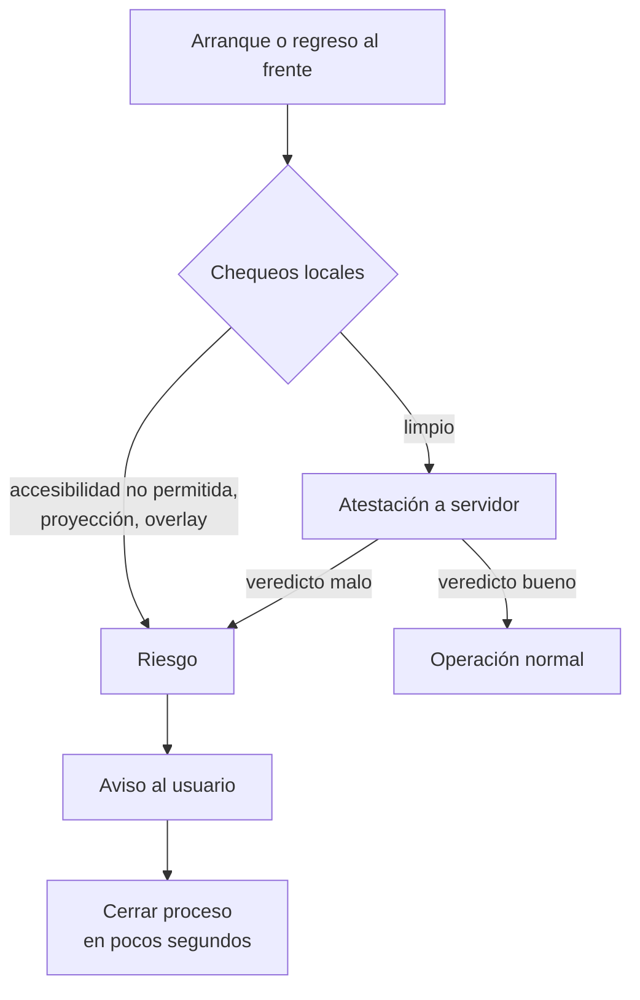
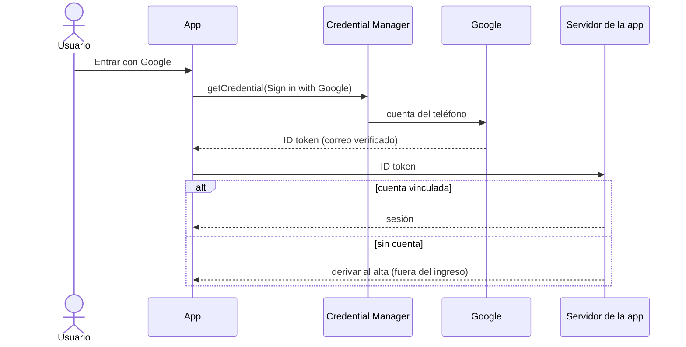

# Núcleo N7: seguridad del entorno y cuentas en la industria

Reedición 04. Documento autocontenido del núcleo N7 (ver `01-Nucleos.md`). Mesa: especialista en seguridad móvil
(MASVS), especialista en identidad (OIDC y Credential Manager), arquitecto del cascarón, refutador y editor.

**Marcas de evidencia.** **[REPO]**: archivo:línea del repo público. **[F-nnn]**: folio del expediente 0001.
**[OBS-PO]**: lo que contó el PO en la sesión del 2026-11-01, sin captura en el expediente. **[SUP]**: especulación
fundamentada, siempre marcada. **[NV]**: URL de referencia que no se abrió en esta corrida.

## Índice

1. Alcance y fuentes
2. Hallazgos de coherencia
3. Conceptos para el libro
4. BNA+: mecanismos de protección del entorno (RASP)
5. Mercado Libre: ingreso con la cuenta del teléfono y alta fuera de la app
6. ¿Son híbridas estas apps?
7. Qué puede adoptar el framework (MASVS)
8. Decisiones y alternativas
9. Propuesta de capítulo
10. Dependencias
11. Referencias

## 1. Alcance y fuentes

- Hechos del repo: `Demo/src/FrameworkConcept.Shell/Auth/CofreDeSesion.cs`, el `AndroidManifest.xml` del cascarón,
  `network_security_config.xml` (Debug y Release), `Framework-APP.md` §4, `07-Red-Y-Autenticacion.md`,
  `08-Cohesion-Global.md`.
- Expediente: F-058 («Lo que hacen las apps de referencia» y plan de estudio en el teléfono de medida, sólo observación
  sin iniciar sesión en cuentas del PO).
- Lo de BNA+ (detección de acceso remoto) y lo de Mercado Libre (ingreso con la cuenta del teléfono; una cuenta de Gmail
  no registrada no da de alta la cuenta dentro de la app) viene del PO **[OBS-PO]**. No hay captura ni volcado de la app:
  **no se descompiló ni se instrumentó ninguna app de terceros** (sería contrario a las reglas de F-058 y a los términos
  de uso). El «cierre a los 3 s» figura en el acta de núcleos; no se encontró folio que lo registre, así que queda
  **[OBS-PO]** pendiente de captura.

## 2. Hallazgos de coherencia

| # | Hallazgo | Evidencia | Corrección propuesta |
|---|---|---|---|
| C1 | El comentario del código afirma que una huella nueva invalida la clave; lo medido (H-1) dice que no, cuando se aceptan PIN o patrón | `CofreDeSesion.cs` L128-129 **[REPO]**; `Developer-Guide.md` L506; `08-Cohesion-Global.md` L114 («Sin resolver») | Reescribir el comentario: «Pedido a la plataforma; con `DeviceCredential` aceptado, Android no la invalida (H-1, E03 §5)». El libro lo cuenta como límite conocido |
| C2 | `Framework-APP.md` propone `SecureStorage` + plugin comunitario a evaluar; la demo usa `android.hardware.biometrics.BiometricPrompt` y `AndroidKeyStore` directos, sin paquete | `Framework-APP.md` §4 «Por plataforma» (L189); `CofreDeSesion.cs` L20-25 | Marcar en `Framework-APP.md` que la decisión se tomó (código de plataforma propio) y remitir al cofre |
| C3 | `Framework-APP.md` mantiene «Decisión abierta D-03»; el código la da por cerrada (D-03 = T1, API ≥ 30) | `Framework-APP.md` §4 «Reglas»; `Sesion.cs` L172; `Oidc.cs` L245 **[REPO]** | Actualizar a «D-03 = T1» |
| C4 | El manifiesto declara `android:allowBackup="true"`; ningún documento lo discute. El refresh no se filtra (la clave vive en el Keystore y no viaja en el respaldo), pero el SQLite del outbox y las preferencias sí podrían respaldarse | `AndroidManifest.xml` (línea `<application …>`) **[REPO]** | Decisión de N7 (§8, D-N7-3): `allowBackup="false"` o reglas de exclusión; documentarlo en el capítulo 07 |
| C5 | Nada en los documentos trata la protección del entorno (root, depuración, superposición, captura de pantalla). No es contradicción, es un hueco: el libro debe decir explícitamente que la demo **no** implementa RASP | búsqueda sin resultados de `FLAG_SECURE`, `Integrity`, `Debuggable` en `Demo/src` (ensayo §2.1) | Sección «Fuera de alcance de la demo» en el capítulo |
| C6 | F-058 dice que las apps de referencia «no sirven de modelo para el pool»; el pedido del PO las trae por seguridad y cuentas. No choca, pero el libro debe repetir la acotación para que no se lean como modelo de sesión compartida | F-058 «Lectura» | Párrafo de encuadre al inicio del capítulo |

### 2.1 Ensayo de lectura (registrado)

`grep -rnE "FLAG_SECURE|Debuggable|WebContentsDebugging|Integrity|SetHideOverlayWindows" Demo/src` → sin coincidencias
fuera de `obj/`. La red sí está endurecida: `cleartextTrafficPermitted="false"` y la CA de demostración sólo en
`debug-overrides`, que un APK de Release ignora (`network_security_config.xml`, ambas variantes) **[REPO]**. No se
corrieron pruebas: el núcleo no cambia código.

## 3. Conceptos para el libro

- **RASP** (*Runtime Application Self-Protection*): la app observa el entorno en el que corre y reacciona (avisar,
  limitar, cerrar). Complementa, no reemplaza, la seguridad del servidor: todo lo que la app chequea en el teléfono
  puede ser burlado por quien controla el teléfono. Por eso la señal fuerte es la que **verifica el servidor**
  (atestación).
- **Atestación**: un tercero confiable (Google con Play Integrity, Apple con App Attest) firma un veredicto sobre la
  app y el dispositivo; el servidor lo valida. La app no decide sola.
- **Superposición** (*overlay*) y **accesibilidad**: dos vías por las que otra app puede ver o tocar la pantalla. El
  malware bancario de Android las usa para robar credenciales o operar a distancia.
- **Acceso remoto**: herramientas que transmiten la pantalla y aceptan toques (soporte remoto, o fraude por ingeniería
  social: «instalá esta app que te ayudo»).
- **Credential Manager**: API de Android que unifica claves guardadas, *passkeys* y «Iniciar sesión con Google» en una
  sola hoja del sistema.
- **Account linking / alta federada**: vincular la identidad de un proveedor (Google) con una cuenta propia; si la cuenta
  propia no existe, el servicio decide si la crea en el momento o deriva el alta a otro flujo.

## 4. BNA+: mecanismos de protección del entorno (RASP)

**Lo observado [OBS-PO]:** la app detecta acceso remoto y, según el acta, cierra a los pocos segundos.
**Lo documentado [F-058]:** biometría opcional desde el menú; casi no sirve sin red; se reemplazó por una app nueva con
migración por turnos.

### 4.1 Catálogo de mecanismos probables

Todo lo que sigue es **[SUP]**: lo que una app bancaria de Android hace típicamente, con la API pública que lo
permite. Ninguna fila afirma que BNA+ lo use.

| Mecanismo | Qué detecta o impide | Cómo se hace en Android | Burlable en el teléfono |
|---|---|---|---|
| Depuración y adb | Depuración USB activa, depurador adjunto, APK depurable | `Settings.Global.ADB_ENABLED`, `Debug.isDebuggerConnected()`, `ApplicationInfo.FLAG_DEBUGGABLE` | Sí |
| Root | `su`, Magisk, particiones modificadas | Búsqueda de binarios y propiedades; mejor: veredicto de Play Integrity | Sí (Magisk oculta) |
| Emulador | Hardware genérico, propiedades `ro.kernel.qemu` | Heurísticas de `Build.*`; Play Integrity | Sí |
| Frida y *hooking* | Inyección de código en el proceso | Puertos y librerías conocidas en `/proc/self/maps`, chequeo de integridad del código | Sí, es carrera armamentista |
| **Acceso remoto** | App de control remoto activa o pantalla proyectada | Lista de servicios de accesibilidad habilitados (`AccessibilityManager.getEnabledAccessibilityServiceList`), `MediaProjection` en curso, paquetes conocidos (requiere declarar `<queries>`), Android 15: detección de grabación de pantalla (`WindowManager.addScreenRecordingCallback`) | Parcial |
| Superposición | Ventanas de otra app encima de la propia | `Window.setHideOverlayWindows(true)` (API 31, permiso `HIDE_OVERLAY_WINDOWS`), `filterTouchesWhenObscured` | No, lo aplica el sistema |
| Accesibilidad | Servicios que leen o tocan la UI | Lista de servicios activos; `View.setAccessibilityDataSensitive` (API 34) para ocultar vistas a servicios que no son de accesibilidad real | Parcial |
| Play Integrity | App original, dispositivo certificado, licencia | Token firmado por Google que valida **el servidor** | No en el servidor |
| FLAG_SECURE | Capturas, grabación y vista en recientes | `Window.addFlags(FLAG_SECURE)` | No, lo aplica el sistema |
| Ofuscación | Lectura del código | R8/ProGuard; ofuscadores comerciales | Retrasa, no impide |

### 4.2 El cierre a los pocos segundos [SUP]

Hipótesis, de más a menos probable:

1. **Política de «cerrar ante riesgo» con gracia corta.** La detección corre en un hilo al arrancar o al volver al
   frente; si encuentra un servicio de accesibilidad no permitido o una proyección de pantalla activa, muestra un
   aviso y termina el proceso. Los segundos son el tiempo del chequeo más el aviso.
2. **Veredicto del servidor.** La app manda la atestación (Play Integrity) y señales del entorno; el servidor responde
   «bloquear» y la app cierra. Explicaría una demora fija de red.
3. **SDK comercial de RASP o antifraude** (es la práctica habitual en banca): estos productos ofrecen exactamente
   «detección de acceso remoto y de superposición» como función. No hay evidencia de cuál.

**Cómo se confirmaría sin violar las reglas de F-058:** registrar con `adb logcat` (sin datos personales) el momento
del cierre y el `ActivityManager` que lo informa; repetir con la herramienta remota apagada. Queda como ensayo
propuesto **E-N7-1**, sólo observación.

## 5. Mercado Libre: ingreso con la cuenta del teléfono y alta fuera de la app

**Lo observado [OBS-PO]:** la app ofrece entrar con la cuenta de Google cargada en el teléfono; con una cuenta de Gmail
que no tiene cuenta en Mercado Libre, la app **no crea la cuenta en el momento**: el alta pasa por otro lado.

**Lectura [SUP]:**

- La hoja del sistema corresponde a **Credential Manager** con «Iniciar sesión con Google» (o al One Tap anterior,
  que Google reemplazó por Credential Manager). La app recibe un *ID token* firmado por Google con el correo verificado.
- El servidor de Mercado Libre busca una cuenta **vinculada** a ese correo. Si existe, entra. Si no, **no hace alta
  automática**. Razones plausibles: es un *marketplace* con pagos, donde el alta exige datos y verificaciones (teléfono,
  identidad) que el ID token no trae; y evitar cuentas creadas en masa con correos descartables.
- Es una política de **alta separada del ingreso**: Google prueba quién sos; Mercado Libre decide si te conoce. Es la
  misma separación que el framework ya aplica: «La biometría no es el login… la identidad la sigue dando el servidor»
  (`Framework-APP.md` §4).

## 6. ¿Son híbridas estas apps?

- **Mercado Libre:** F-058 registra *Server Driven UI* («la pantalla cambia sin pasar por la tienda») **[OBS]**. Eso es
  otra forma de actualizar sin tienda: el servidor manda la **descripción** de la pantalla y la app la dibuja con
  componentes **nativos**. No es una WebView con HTML. Es probable **[SUP]** que algunas secciones (ayuda, términos,
  campañas) sí sean web embebida.
- **BNA+:** **[SUP]** nativa o multiplataforma compilada; F-058 dice que la actualización fue reemplazar la app.
- **Cómo manejan las páginas web cuando las embeben [SUP]:** WebView con lista blanca de dominios, interceptación de
  navegación (`shouldOverrideUrlLoading`), puente acotado y, para el login de terceros, **Custom Tabs** (RFC 8252), que
  es lo que hace la demo con la variante de navegador (`AndroidManifest.xml`, `<queries>` CustomTabsService) **[REPO]**.
- **Comparación con el framework:** el framework carga contenido **empaquetado y firmado** (ES256, `FirmaEs256.cs`
  **[REPO]**) desde el disco, no páginas del servidor. Se parece más a SDUI en el objetivo (cambiar sin tienda) que en
  la técnica.

## 7. Qué puede adoptar el framework (MASVS)

| Control MASVS | Estado en la demo | Propuesta |
|---|---|---|
| MASVS-STORAGE-1/2 | Refresh sellado en Keystore con autenticación por uso **[REPO]** `CofreDeSesion.cs` L121-130; `allowBackup="true"` | Excluir del respaldo el SQLite y las preferencias (C4) |
| MASVS-NETWORK-1 | Sólo HTTPS; CA de demo sólo en Debug **[REPO]** | Mantener; *pinning* sólo si el emisor lo justifica (costo de rotación) |
| MASVS-AUTH-2/3 | OIDC + desbloqueo local P4 | Mantener; evaluar *passkeys* vía Credential Manager para el emisor |
| MASVS-CODE-1 | Contenido firmado y verificado antes de activar (N2) | Mantener |
| MASVS-PLATFORM-3 | Sin `FLAG_SECURE` | Capacidad opcional `screen.secure` por pantalla, pedida por el contenido |
| MASVS-RESILIENCE-1..4 | Nada | Nivel R opcional: Play Integrity validado por el servidor del emisor; ocultar overlays; sin chequeos locales caseros |

## 8. Decisiones y alternativas

| ID | Decisión | Alternativas | Criterio | Recomendación de la mesa |
|---|---|---|---|---|
| D-N7-1 | ¿RASP en el cascarón? | (a) nada; (b) mínimo de plataforma (FLAG_SECURE por capacidad, ocultar overlays); (c) Play Integrity + servidor; (d) SDK comercial | Simplicidad: (b). Escalabilidad: (c) sin dependencia de proveedor. (d) caro y opaco | **(b) en el framework, (c) como capacidad opcional documentada**; (d) fuera |
| D-N7-2 | Reacción ante riesgo | cerrar; avisar y limitar; informar al servidor | En un pool offline-first cerrar pierde trabajo del outbox | **Avisar y limitar**, nunca descartar el outbox; el servidor decide bloquear |
| D-N7-3 | Respaldo | `allowBackup=false`; reglas `dataExtractionRules` | Simplicidad | **`false`**: el equipo es de pool y se reaprovisiona |
| D-N7-4 | Ingreso federado | sólo formulario OIDC; + Credential Manager | El pool usa cuentas de organización, no personales | Formulario OIDC (actual); Credential Manager como nota de industria |
| D-N7-5 | Alta de cuentas | en el ingreso; separada | Igual que Mercado Libre y que el modelo actual | **Separada** (la crea el emisor) |

Las decisiones van a la mesa (memoria: «la mesa decide y queda aprobado»); D-N7-1 y D-N7-2 tocan código y deben
avisarse al PO como cambio de alcance.

## 9. Propuesta de capítulo

**Capítulo «Seguridad del entorno y cuentas: lo que hace la industria»** (después de «Red y autenticación»):

1. Encuadre: por qué las apps de consumo no son modelo del pool (F-058) y qué sí se toma.
2. Conceptos: RASP, atestación, superposición, accesibilidad, acceso remoto.
3. Caso BNA+: mecanismos y la especulación marcada sobre el cierre (diagrama de §4.2).
4. Caso Mercado Libre: Credential Manager y alta separada (diagrama de §5).
5. ¿Híbridas? SDUI, WebView y Custom Tabs frente al contenido firmado del framework.
6. La demo frente a MASVS (tabla §7) y lo que queda fuera de alcance.
7. Decisiones (tabla §8).
8. Para revisar: tres preguntas de autoevaluación.

En la sección inicial de fundamentos (N1), un recuadro de una página: «la biometría abre un secreto; la identidad la
da el servidor; el entorno lo atestigua un tercero».

## 10. Dependencias

- **N4** (autenticación del dispositivo y Keystore): C1, C3 y D-N7-4 se corrigen ahí; N7 sólo lo cita.
- **N3** (capacidades): `screen.secure` sería capacidad nueva del catálogo y del manifiesto (P12, compuerta P8).
- **N2** (OTA firmada): MASVS-CODE se apoya en la firma ES256.
- **N6** (coherencia): C1 a C5 entran en su lista de divergencias.
- **N8** (industria): las URLs de §11 se consolidan ahí.
- **N9** (libro): capítulo de §9 y recuadro en fundamentos.

## 11. Referencias [NV]

- OWASP MASVS: https://mas.owasp.org/MASVS/ — Resiliencia: https://mas.owasp.org/MASVS/11-MASVS-RESILIENCE/
- Play Integrity API: https://developer.android.com/google/play/integrity
- FLAG_SECURE: https://developer.android.com/reference/android/view/WindowManager.LayoutParams#FLAG_SECURE
- Detección de grabación de pantalla (Android 15): https://developer.android.com/about/versions/15/features
- `setHideOverlayWindows`: https://developer.android.com/reference/android/view/Window#setHideOverlayWindows(boolean)
- Credential Manager: https://developer.android.com/identity/sign-in/credential-manager
- Iniciar sesión con Google por Credential Manager: https://developer.android.com/identity/sign-in/credential-manager-siwg
- Google Account Linking: https://developers.google.com/identity/account-linking
- Passkeys (FIDO Alliance): https://fidoalliance.org/passkeys/
- RFC 8252, OAuth 2.0 para apps nativas: https://www.rfc-editor.org/rfc/rfc8252
- BNA+ preguntas frecuentes (citada en F-058): https://bna.com.ar/Personas/BNAMas/PreguntasFrecuentesBNAmas
