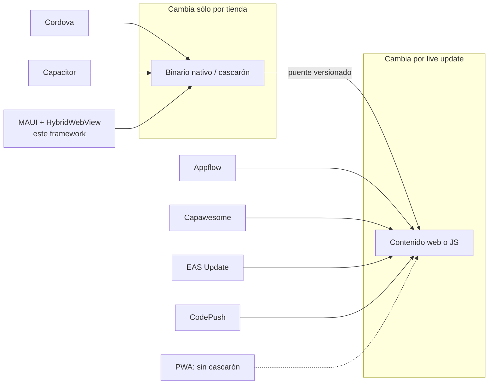

# Núcleo N8: industria, estándares y referencias

> Reedición 04, mesa del núcleo N8. Fecha: 2026-11-01. Material revisado: `Concepts/Framework-Concept/` de la rama
> `fc/libro-guia-desarrolladores` (worktree `ld-libro`). Especialistas: arquitecto móvil híbrido, especialista en
> actualizaciones OTA, especialista en seguridad móvil (MASVS), editor de referencias y refutador.

## Índice

1. [Alcance y método](#1-alcance-y-método)
2. [Hallazgos de coherencia](#2-hallazgos-de-coherencia)
3. [Contenido para el libro](#3-contenido-para-el-libro)
4. [Decisiones y alternativas](#4-decisiones-y-alternativas)
5. [Propuesta de capítulo](#5-propuesta-de-capítulo)
6. [Dependencias con otros núcleos](#6-dependencias-con-otros-núcleos)
7. [Referencias](#7-referencias)
8. [Pendientes para retomar](#8-pendientes-para-retomar)

## 1. Alcance y método

- Se relevaron con `grep` todas las menciones de productos y todas las URL del conjunto (README, Developer-Guide,
  00 a 08, 99-Anexos, Demo/README y DISENO). Las rutas citadas son relativas a `Concepts/Framework-Concept/`.
- Se contrastaron las afirmaciones técnicas que se apoyan en la industria con el código de la demo.
- Regla de la mesa: una URL de la industria que no figura en `99-Anexos` §3 entra al libro marcada **«a verificar»**
  hasta que se consulte y se le ponga fecha. En esta corrida no se consultó la web: lo que sigue sobre productos
  de terceros es conocimiento de la mesa y queda **pendiente de consulta** (ver §8).

## 2. Hallazgos de coherencia

| # | Hallazgo | Evidencia | Corrección propuesta |
| --- | --- | --- | --- |
| C1 | La guía nombra EAS Update, CodePush y Capawesome como alias de «actualización sin tienda», pero ninguno tiene fuente en la tabla de fuentes | `99-Anexos.md:69-70` (glosario) contra `99-Anexos.md:93-111` (F-01…F-15) | Sumar F-16 en adelante con URL y fecha (ver §7) |
| C2 | Capacitor, Cordova, PWA y OWASP MASVS no aparecen en ningún documento, aunque el prompt 04 los pide | `grep` sin coincidencias en todo el conjunto | Capítulo nuevo de industria (§5) |
| C3 | El glosario define dos veces «Cascarón» y dos veces «Contenido», con textos distintos (P3 contra P1, P1 contra P2) | `99-Anexos.md:38-39` y `99-Anexos.md:67-68` | Fusionar en una fila cada uno y llevar los alias en inglés (*native shell*, *update bundle*) a la columna Alias |
| C4 | El glosario dice «E01, E02, E03: los tres ensayos», pero existen E04 y E05, y el propio anexo cita E04 | `99-Anexos.md:76` contra `99-Anexos.md:167` y la carpeta `OUTPUTs/Ensayos/` (E01–E05) | «Los cinco ensayos» y agregar E04 (arranque superpuesto) y E05 (login en el contenido) |
| C5 | El borrador del PO se titula «MAUI + Blazor Hybrid» y dice «las pantallas son Blazor Hybrid», pero lo elegido no es Blazor Hybrid (`BlazorWebView`): es Blazor WASM servido por `HybridWebView` | `Framework-APP.md:1`, `Framework-APP.md:27` contra `01-Actualizacion-Sin-Tienda.md:63` y el código `Demo/src/FrameworkConcept.Core/Contracts/Puente/TransporteDelPuente.cs:25` | No es contradicción a corregir (el borrador es un insumo que no se edita, `99-Anexos` §8). El libro tiene que poner la distinción al principio, en fundamentos, con un recuadro «Blazor Hybrid no es esto» |
| C6 | El borrador menciona un `Cascaron-Aplicacion-Maui.md` que no existe | `Framework-APP.md:4`; el archivo falta en la carpeta | En el libro: no citarlo |
| C7 | El glosario de un repo público nombra máquinas de la infraestructura propia (runners con nombre de host) | `99-Anexos.md:57` | En el libro: «runner autoalojado con etiqueta propia», sin nombres de host. Lo verifica N9 |
| C8 | La cita del acuerdo de Apple usa §3.3.1. En versiones anteriores del DPLA la cláusula de código interpretado tenía otra numeración (3.3.2) | `99-Anexos.md:98` (F-02) | Volver a consultar el DPLA vigente y citar el inciso exacto con su fecha (pendiente P-1) |
| C9 | La firma del índice es ECDSA P-256 (ES256) con `keyId` y `expires`. Es el mismo diseño que The Update Framework (TUF) y que la firma de código de EAS Update, pero la guía no lo relaciona con ninguno de los dos | `Demo/src/FrameworkConcept.Core/Update/FirmaEs256.cs:8-20`, `99-Anexos.md:42` (índice con `expires`, `retiradas` y `keyId`) | Sumar en el libro el cuadro «equivalencias con la industria» (§3.4). Fortalece el diseño y no cambia el código |

Fuera de esto, la mesa **no encontró contradicciones** entre lo que la guía afirma de las tiendas y la demo:

- El contenido corre dentro del WebView: `RunAOTCompilation=false` en
  `Demo/src/FrameworkConcept.Content/FrameworkConcept.Content.csproj:18`.
- Llega a Android sólo a través del puente (`TransporteDelPuente.cs`).
- Va firmado (`FirmaEs256.cs`).

Las tres cosas cumplen la condición citada de Google Play (`01-Actualizacion-Sin-Tienda.md:68-74`).

## 3. Contenido para el libro

### 3.1 Definiciones

- **App híbrida**: una app nativa instalada por tienda que muestra su interfaz, toda o en parte, con un WebView y
  ofrece capacidades del teléfono a través de un puente. En este framework, cascarón MAUI + `HybridWebView`.
- **Live update (OTA, *code push*)**: cambiar el contenido web o interpretado de una app híbrida sin pasar por la
  tienda. El binario nativo no cambia.
- **Runtime version / mayor del puente**: la identidad de compatibilidad entre el binario y el paquete. Si no
  coinciden, el paquete no se aplica (`99-Anexos.md:70`; `versionado/puente.json`).
- **PWA**: una aplicación web que, con un *service worker* y un manifiesto, se instala y funciona sin red, sin
  cascarón nativo.
- **MASVS**: el estándar de OWASP de requisitos de seguridad para apps móviles, en grupos como STORAGE, CRYPTO,
  AUTH, NETWORK, PLATFORM, CODE y RESILIENCE.

### 3.2 Mapa del mercado (propuesta de tabla; las afirmaciones sobre terceros están a verificar, P-2)

| Familia | Cascarón | Contenido | Live update | Qué toma o descarta este framework |
| --- | --- | --- | --- | --- |
| Apache Cordova | Nativo mínimo con plugins | HTML/JS en WebView | Plugins de terceros, varios sin mantenimiento | Toma el modelo de puente por plugins. Descarta su ecosistema por el estado de mantenimiento |
| Ionic Capacitor | Proyecto nativo propio, editable | Web en WebView | Ionic Appflow Deploy, Capawesome Cloud y Capgo | Es el análogo más cercano: cascarón nativo, plugins versionados y bundles bajados con canales |
| React Native + Expo | Nativo, con UI nativa | JS interpretado por Hermes | EAS Update (runtime version, canales, firma, rollback) | Toma el vocabulario: runtime version es el mayor del puente, y los canales |
| CodePush (Microsoft App Center) | RN o Cordova | JS | Hosteado hasta el retiro de App Center; hoy existe un servidor de código abierto | Lección: no atar la actualización a un SaaS. La demo sirve un índice firmado desde un servidor estático propio |
| Flutter + Shorebird | Nativo Flutter | Dart con parches | Shorebird | Fuera del stack, pero confirma la tendencia |
| .NET Blazor Hybrid (`BlazorWebView`) | MAUI | Razor compilado en la app | No hay (el contenido es código de la app) | Se descarta para el contenido. Ver C5 y `01-Actualizacion-Sin-Tienda.md:63` |
| PWA | No hay | Web con service worker | Nativa de la web | Se descarta porque no da Keystore, biometría ni cámara con control del cascarón (lo decide N4) |

### 3.3 Diagrama propuesto: dónde cae cada producto

### 3.4 Equivalencias con la industria, tomadas de la demo real

| Mecanismo de la demo | Archivo | Equivalente de la industria |
| --- | --- | --- |
| Mayor del puente | `Demo/versionado/puente.json`, `contrato.json` | *runtime version* de EAS Update; versión de plugins en Capacitor |
| Canal `dev`/`beta`/`prod` con índice firmado | `99-Anexos.md:41-42`; `FirmaEs256.cs` | *channels* de EAS y Appflow; metadatos firmados con expiración de TUF |
| Staging y activación en el próximo arranque en frío | `99-Anexos.md:62` | Política «on next launch» de EAS y CodePush |
| Rollback por marca (no llama `Listo` en 2 cargas) | `99-Anexos.md:63` | `notifyAppReady` de los plugins de live update de Capacitor; rollback automático de CodePush |
| Semilla embebida | `Demo/semilla/` | *embedded update* de Expo |
| Retirada en el índice | `99-Anexos.md:64` | *republish*/rollback de EAS (a verificar) |
| Contenido sin AOT, interpretado en el WebView | `FrameworkConcept.Content.csproj:18` | Condición de Play: «JavaScript in a webview» (F-03) |

### 3.5 Estándares que el libro tendría que citar

- **OWASP MASVS / MASTG**: MASVS-CODE (actualizaciones e integridad del código), MASVS-PLATFORM (WebView y puente),
  MASVS-STORAGE (refresh sellado), MASVS-RESILIENCE (lo que se discute en N7).
- **RFC 8252 y RFC 7636**: ya están citados (F-06 y F-07).
- **TUF**: el modelo de referencia para actualizaciones firmadas (roles, expiración, rotación de claves).
- **Políticas de las tiendas**: F-01, F-02 y F-03, con fecha de consulta y una nota de que cambian.

### 3.6 Tendencias del mercado (cada una es un enunciado a verificar con su fuente)

1. La live update se consolida como un servicio aparte del framework (EAS, Capawesome, Capgo, Shorebird) y aparecen
   servidores autoalojados.
2. La firma de código del paquete pasa de opcional a esperable.
3. Los canales y el despliegue gradual (*rollout* por porcentaje) son lo normal.
4. Las tiendas exigen cada vez más *attestation* (Play Integrity, App Attest), que es el puente hacia N7.
5. Microsoft empuja `HybridWebView` desde .NET 9 como alternativa a `BlazorWebView` para contenido web.

## 4. Decisiones y alternativas

| Decisión | Alternativas | Criterio | Recomendación |
| --- | --- | --- | --- |
| D1. ¿Agregar *rollout* por porcentaje al índice? | (a) No; (b) un campo `porcentaje` en la entrada; (c) canales por grupo | Simplicidad: (a). Escalabilidad: (b) | (a) por ahora. El libro lo menciona como extensión natural y no se toca la demo |
| D2. ¿Adoptar TUF tal cual? | (a) Índice propio con firma ES256 (actual); (b) TUF completo | Practicidad: (a) | (a), declarando en el libro qué roles de TUF faltan (rotación de claves y umbral de firmas) |
| D3. ¿Usar un servicio de live update de terceros? | (a) Servidor estático propio; (b) SaaS | Por la lección de CodePush, el control propio pesa más | (a) |
| D4. ¿Cómo citar a la industria en el libro? | (a) Capítulo propio; (b) notas dispersas | Escala mejor (a) y se mantiene en un solo lugar | (a), y en cada capítulo un recuadro «En la industria» que remite al capítulo |

Ninguna decisión es irreversible: todas son documentales y van en el acta como propuestas de la mesa.

## 5. Propuesta de capítulo

**Capítulo «El framework en la industria»** (penúltimo, antes de los anexos):

1. Familias de apps híbridas (Cordova, Capacitor, RN/Expo, Flutter, Blazor Hybrid y PWA), con la tabla de §3.2.
2. Live updates en el mercado (EAS Update, Appflow, Capawesome, Capgo, CodePush y su retiro, Shorebird).
3. Equivalencias mecanismo por mecanismo con la demo (§3.4) y el diagrama de §3.3.
4. Lo que permiten las tiendas: lo que dicen Apple y Google, y cómo lo cumple la demo.
5. Estándares: MASVS, TUF, RFC 8252/7636 y SemVer.
6. Tendencias y extensiones posibles (rollout, attestation, rotación de claves).
7. Fuentes con fecha de consulta.

En la sección inicial de fundamentos va un recuadro corto que distingue «Blazor Hybrid» de «Blazor WASM en
HybridWebView» y que nombra el análogo más cercano (Capacitor con live updates).

## 6. Dependencias con otros núcleos

- **N1**: necesita las definiciones de §3.1 y el recuadro de Blazor Hybrid (C5).
- **N2**: las equivalencias de staging, rollback y semilla (§3.4) tienen que coincidir con lo que N2 verifique en el código.
- **N3**: equivalencia entre el mayor del puente y la runtime version, y la comparación de plugins de Capacitor con el catálogo de capacidades.
- **N4**: el descarte de las PWA depende de los requisitos de Keystore y biometría.
- **N5**: los canales y las líneas de versión, y SemVer.
- **N7**: MASVS-RESILIENCE, Play Integrity y App Attest. N8 sólo da las fuentes.
- **N9**: aplica C1–C4, C7 y C8 en el libro y en `99-Anexos`, e integra el capítulo.

## 7. Referencias

Ya en la guía (consultadas el 2026-10-25): F-01 a F-15 de `99-Anexos.md:93-111`.

Propuestas, **a verificar** (no se consultaron en esta corrida):

- Capacitor: https://capacitorjs.com/docs
- Apache Cordova: https://cordova.apache.org/
- Expo EAS Update: https://docs.expo.dev/eas-update/introduction/ (y `/eas-update/runtime-versions/`,
  `/eas-update/code-signing/`, `/eas-update/rollbacks/`)
- Ionic Appflow Deploy: https://ionic.io/docs/appflow/deploy/intro
- Capawesome Cloud Live Updates: https://capawesome.io/cloud/live-updates/
- Capgo: https://capgo.app/
- Retiro de App Center: https://learn.microsoft.com/en-us/appcenter/retirement
- Servidor CodePush de código abierto: https://github.com/microsoft/code-push-server
- Shorebird: https://shorebird.dev/
- Blazor Hybrid: https://learn.microsoft.com/en-us/aspnet/core/blazor/hybrid/
- PWA: https://web.dev/explore/progressive-web-apps ; Service Workers (W3C): https://www.w3.org/TR/service-workers/
- OWASP MASVS: https://mas.owasp.org/MASVS/ ; MASTG: https://mas.owasp.org/MASTG/
- The Update Framework: https://theupdateframework.io/
- Play Integrity: https://developer.android.com/google/play/integrity
- WebViewAssetLoader: https://developer.android.com/reference/androidx/webkit/WebViewAssetLoader

## 8. Pendientes para retomar

- **P-1**: consultar el DPLA de Apple vigente y fijar el inciso de código interpretado (C8).
- **P-2**: consultar cada URL de §7, confirmar las afirmaciones de §3.2 y §3.6 (en particular la fecha de retiro
  de App Center y el estado comercial de Appflow) y ponerles fecha antes de que entren al libro.
- **P-3**: N9 decide si el modelo del teléfono de las mediciones (`99-Anexos.md:197`) se mantiene en el repo público.
