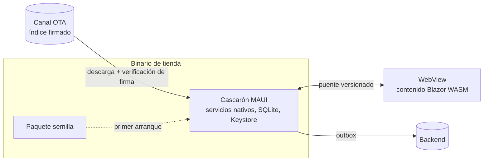
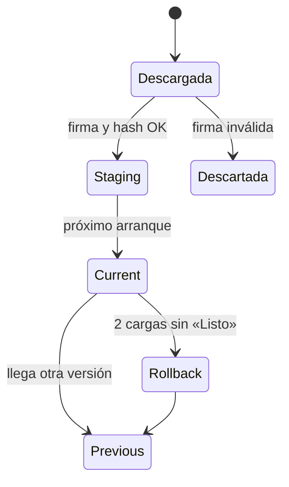
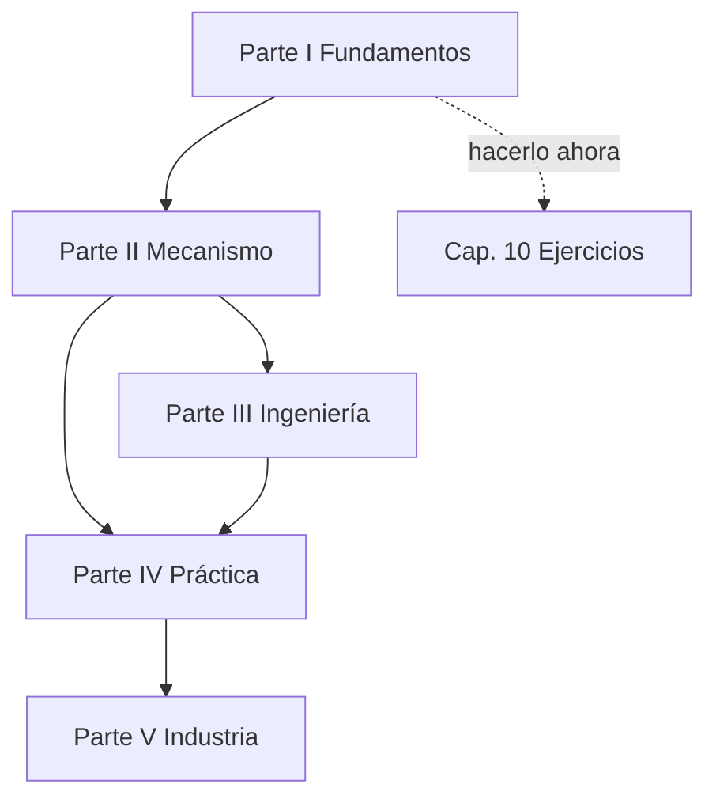

# Núcleo N9 — Libro unificado, edición bibliográfica y Conocimiento

Reedición 04, rama `fc/libro-guia-desarrolladores` de Lab-Documentos (repo público). Las rutas son relativas a
`Concepts/Framework-Concept/`. Los folios son del expediente 0001.

## Índice

1. [Alcance y especialistas](#1-alcance-y-especialistas)
2. [Ensayo N9-E1: las pruebas de la demo hoy](#2-ensayo-n9-e1-las-pruebas-de-la-demo-hoy)
3. [Hallazgos de coherencia propios del libro](#3-hallazgos-de-coherencia-propios-del-libro)
4. [Esquema del libro](#4-esquema-del-libro)
5. [Diagramas propuestos](#5-diagramas-propuestos)
6. [Las seis intervenciones editoriales](#6-las-seis-intervenciones-editoriales)
7. [El Conocimiento](#7-el-conocimiento)
8. [Decisiones y alternativas](#8-decisiones-y-alternativas)
9. [Dependencias con otros núcleos](#9-dependencias-con-otros-núcleos)

## 1. Alcance y especialistas

N9 integra lo que producen N1 a N8 en `MAUI-Framework-Developer-Guide.md`, un libro autocontenido que reúne los
documentos sin reemplazarlos (lectura del acta). También deja un Conocimiento en `Conocimientos/`. Para esto
intervinieron el editor de contenido, el editor académico (evidencia), el corrector de estilo, el ortotipográfico, el
diseñador editorial (mermaid, tablas), el corrector de pruebas, el refutador y el lector sin contexto. Las fuentes
son el prompt 04 (líneas 48 y 60), el perfil Study-Guide-Documentation y los núcleos N1, N2, N3, N4 y N6 que ya
están escritos. N5, N7 y N8 todavía no tienen documento: el libro deja su lugar reservado y lo marca.

## 2. Ensayo N9-E1: las pruebas de la demo hoy

Corrí `dotnet test FrameworkConcept.Demo.SinMaui.slnf` en `Demo/` con el dotnet del host el 2026-11-01:

| Proyecto | Resultado |
|---|---|
| Core.Tests | 220/220 |
| Update.Tests | 102/102 |
| Gate.Tests | 56 superadas + 2 omitidas (58) |

Esto confirma lo que midió N6-E1 (D1) y suma Update, que ningún documento cita. Las cifras cambian con cada PR, y
por eso el libro no las fija (ver §8, D-3).

## 3. Hallazgos de coherencia propios del libro

| # | Hallazgo | Evidencia | Qué hacer en el libro |
|---|---|---|---|
| L1 | **El libro choca con P10.** P10 fija que `Developer-Guide.md` es el único índice. Un libro con índice propio sería un segundo punto de entrada. | `README.md:38-44`; folio 037, línea 26 | Hace falta una decisión explícita (§8, D-1). Propuesta: el libro pasa a ser la lectura de corrido, y el Developer-Guide sigue como índice y tabla de ruteo con un enlace al libro. Se registra como apartamiento en `99-Anexos.md` §8 |
| L2 | **Hay dos numeraciones de núcleos.** La tabla del Developer-Guide llama N1 a N5 a los temas 01 a 05, y la reedición llama N1 a N9 a otros cortes. | `Developer-Guide.md:93-97`; `01-Nucleos.md` | El libro no usa «N#». Numera capítulos y deja la sigla de núcleo sólo en las bitácoras |
| L3 | **¿Tres o cuatro líneas de versión?** Los documentos dicen cuatro (contenido, definición, puente, cascarón). El acta dice tres. | `Developer-Guide.md:37`; `03-…:154`; `06-…:285`; N1 H2 | Se queda con **cuatro**, como el código y los documentos, salvo que N5 demuestre otra cosa |
| L4 | **Los conteos de pruebas envejecieron.** Los documentos dicen 211 y 52. Hoy son 220, 56+2 y 102 (N9-E1). | N6 D1 y D3 | Describir la forma («todo en verde, `rc=0`») y remitir a `ci-local.sh` |
| L5 | **Enlaces absolutos `/LAB/...`.** Son 177 en total: Developer-Guide 46, 99 29, 00 26 y el resto en los demás. Dan 404 en GitHub. | `grep -c '](/LAB'` | En el libro, enlaces relativos (`Demo/src/...`). Los folios del expediente privado se citan sin enlace |
| L6 | **Datos de infraestructura en el repo público.** `g42` aparece 27 veces, `hpdev` 15 e `i7infra` 10, en 10 archivos `.md`. | `grep -roh` en esta sesión; N1 H9, N6 D6 | Usar roles neutros: «teléfono de medida (Android 13, API 33)», «host de laboratorio», «emulador de la demo». El libro no los nombra. Corregir los documentos de origen es un PR aparte (N6) |
| L7 | **Hay vocabulario sin definir y en dos idiomas.** El README mete *native shell*, *update bundle* y *live updates* en una línea. «Blazor Hybrid» aparece con dos sentidos. «Manifiesto» nombra dos cosas distintas. | `README.md:29-30`; N1 H6 y H7 | El cap. 1 es la fuente canónica. Cada término lleva una definición en español con su equivalente en inglés entre paréntesis la primera vez. «Índice del canal» y «manifiesto del paquete» quedan como dos términos separados |
| L8 | **03 y 06 se solapan.** 06:127 repite 04:48 y los dos cuentan el versionado. | N6 D10 | Un solo capítulo: el concepto primero y la receta como subsección (sujeto a N5) |
| L9 | **El borrador del PO contradice la demo** en cuándo se activa una versión, en el criterio de rollback y en los nombres de los artefactos. | N1 H3 a H5; `99-Anexos.md` §8 | El libro describe la demo, que es la verdad verificada. El borrador va como insumo fuera del conjunto, con una nota de diferencias en el anexo |
| L10 | **Falta la carpeta `Conocimientos/`.** | `ls` en esta sesión | Se crea con el entregable 3 |
| L11 | **Comentario de código falso** en `CofreDeSesion.cs:128`: dice que una huella nueva invalida la clave. | N4 C1, N6 D5 | El libro afirma el comportamiento medido (E03 H-1). La corrección del código va en un PR aparte |

## 4. Esquema del libro

El libro sigue el perfil: primero el marco, después un capítulo por tema con la estructura fija (definición,
aplicación por escenario, ejemplos, preguntas guía, criterios de calidad, plantilla) y al final los anexos.

```text
MAUI-Framework-Developer-Guide.md
  Portada (metadatos YAML, estado, cómo citar) · Índice general · Cómo leer este libro
  Parte I — Fundamentos
    1. App híbrida, actualización OTA y offline-first          (N1)
       1.1 Definiciones (cascarón, contenido, puente, índice del canal, manifiesto del paquete, outbox)
       1.2 Qué se puede actualizar sin tienda y qué no (políticas de las tiendas)
       1.3 Temas secundarios: red, autenticación del dispositivo y Keystore, contrato del puente, capacidades
    2. Marco de referencia: siete escenarios, contextos, actores y mapa «estoy acá → qué aplico»   (00-Marco)
  Parte II — El mecanismo
    3. Actualización OTA firmada con rollback                  (N2; 01)
    4. El cascarón y el contrato del puente                    (N3; 02, parte del puente)
    5. Offline-first: base local, outbox, encuestas como datos  (N4; 02, parte de datos)
    6. Red y autenticación del dispositivo                     (N4; 07)
  Parte III — Ingeniería del producto
    7. Integración, versionado y procedimiento de PR           (N5; 03 + 06)
    8. Estrategia de pruebas y rojos provocados                (N5; 04)
    9. Seguridad del entorno de ejecución (RASP, MASVS)        (N7) [reservado]
  Parte IV — Práctica
   10. La demo como caso de estudio y ejercicios guiados       (05 + Developer-Guide §5–§7)
   11. Cohesión: el modelo completo en un recorrido            (08)
  Parte V — Contexto
   12. La industria: Capacitor, Cordova, Blazor Hybrid, EAS Update, CodePush, Capawesome, Appflow, PWA   (N8) [reservado]
  Anexos
    A. Glosario bilingüe   B. Fuentes y referencias (URL verificadas)   C. Trazabilidad a folios
    D. Mapa libro ↔ demo (archivo por concepto)   E. Limitaciones abiertas y NO VERIFICADO
    F. Plantillas comentadas   G. Diferencias con el borrador del PO   H. Historia de tramos (cifras rotuladas con fecha)
```

**Ejemplos que salen de la demo real.** Todos se citan por ruta relativa:

- Activación y rollback: `Demo/src/.../Actualizador.cs` (L39, `CargasSinListoParaFallar = 2`) y
  `VerificacionDelIndice.cs` (L18-22 y L48-50). Ver N2.
- Vigencia de 30 días y WebView mínimo 94: `ParametrosDeProducto.cs:10-34`. Ver N1.
- Transacción del documento y su fila en el outbox: `Shell/Data/DbSqlite.cs:89, 114-115`. Ver N4 C10.
- Transporte del puente: `TransporteDelPuente.cs:22`. Servidor de contenido: `ServidorDeContenido.cs:10, 53`. Ver N6.
- Rojo provocado: el ejercicio M-13 del Developer-Guide §6, ejercicio 3.

## 5. Diagramas propuestos

Para cap. 1, la vista de las piezas:



Para cap. 3, el ciclo de una versión en el teléfono:



Para la portada, el mapa de lectura (reemplaza el diagrama lineal del Developer-Guide L106-119):



## 6. Las seis intervenciones editoriales

| Intervención | Qué se revisa | Criterio de cierre |
|---|---|---|
| Edición de contenido | Que la secuencia vaya de lo general a lo particular. Sin huecos ni solapamientos (L8). Cada capítulo cruza al menos un escenario | Revisar contra el mapa del cap. 2 sin huecos |
| Edición académica | Cada afirmación tiene archivo:línea, folio o URL. Lo especulativo (RASP de BNA+, N7) va marcado «especulación fundamentada» | No queda ninguna afirmación sin ancla |
| Corrección de estilo | Español rioplatense técnico con una sola voz. Frases cortas. Términos en inglés sólo la primera vez y entre paréntesis | Lectura del lector sin contexto |
| Ortotipografía | Código entre acentos graves, comillas «», rayas, unidades («5 s», «10 min»), mayúsculas en títulos sólo en la inicial | Pasada mecánica con lista |
| Diseño editorial | Jerarquía H1 > H2 > H3 sin saltos. Tablas de ancho razonable. Un mermaid por concepto, no decorativo. Índice con anclas que funcionan | Las anclas resuelven en el render de GitHub |
| Corrección de pruebas | Enlaces relativos que existen, comandos que corren, cero datos de infraestructura (L6) | Script: `grep '](/LAB'` y `grep 'g42\|hpdev\|i7infra'` dan 0; enlaces verificados |

## 7. El Conocimiento

`Conocimientos/Knowledge-App-Hibrida-OTA-Offline-First.md`. Es una pieza de decisión que reutiliza otro proyecto, no
un resumen del libro. Contenido propuesto:

1. Cuándo aplica y cuándo no: contenido que cambia más seguido que el binario, sin lógica nativa nueva.
2. Las reglas que no se negocian: firma del índice, activación en el próximo arranque, rollback por falta de «Listo»,
   puente versionado con predicado de compatibilidad, outbox transaccional, nada de código ejecutable nativo por OTA
   (políticas de las tiendas).
3. El árbol de decisión: ¿hace falta una capacidad nativa nueva? Entonces va por tienda. ¿Cambia sólo el contenido o
   la definición? Entonces va por OTA.
4. La lista de verificación del PR (de 06) y las cuatro líneas de versión.
5. Los antipatrones medidos: conteos fijos en los documentos, enlaces absolutos, comentarios que contradicen el
   comportamiento.
6. Referencias de la industria (URL que verifica N8) y la trazabilidad a la demo.

Formato: se toma la plantilla de los Knowledge de `IA.Knowledge.Base` (Knowledges/), pero el archivo vive en el repo
público y no cita rutas del home.

## 8. Decisiones y alternativas

| Decisión | Alternativas | Recomendación | Criterio |
|---|---|---|---|
| D-1 Relación libro ↔ P10 | (a) el libro reemplaza al Developer-Guide; (b) el libro convive y el Developer-Guide sigue como único índice; (c) el libro pasa a ser el índice y el Developer-Guide se vuelve guía rápida | **(b)**, con el apartamiento declarado en 99 §8 | Es la opción que menos cambia, es reversible y respeta el acta y P10. Para la mesa |
| D-2 Autocontención | (a) el libro copia el contenido; (b) el libro resume y enlaza los documentos | **(a) para definiciones, reglas y ejemplos; (b) para los procedimientos largos** (06 §8) | Un lector con el libro solo tiene que poder entender. Para operar se le puede pedir que abra la receta |
| D-3 Cifras volátiles | (a) fijarlas; (b) fecharlas; (c) describir la forma | **(c) en el cuerpo, (b) en el anexo H** | Escala sin mantenimiento |
| D-4 Divergencias del código (D5) | Corregirlas en esta reedición o en otro PR | **Otro PR** | Mantiene el PR documental puro y deja el merge automático |
| D-5 Capítulos de N7 y N8 | Esperarlos o reservar su lugar | **Reservar** con el marcador «pendiente de N7/N8» | El libro no se traba |
| D-6 Prevenir la regresión | (a) a mano; (b) prueba de Gate o script de CI que busque `/LAB` y datos de infraestructura | **(b)** junto al `docs-enlaces-semanal.yml` que ya existe (N6) | Hace mecánico lo que hoy depende de memoria |

## 9. Dependencias con otros núcleos

- **N1**: aporta el capítulo 1 y las definiciones (L7) y resuelve H2 o L3.
- **N2**: capítulo 3 y su diagrama de estados.
- **N3**: capítulo 4 (su §7).
- **N4**: capítulos 5 y 6. Los hallazgos C1, C5 y C8 afectan la redacción.
- **N5**: decide L3 (cuatro líneas) y L8 (fusionar 03 y 06), y escribe los capítulos 7 y 8. Hasta que lo haga, esto
  bloquea la Parte III.
- **N6**: la lista D1 a D10 es la entrada de la corrección de pruebas. D8 queda pendiente: hay que confirmar que el
  repo del caso base sea público antes de nombrarlo.
- **N7**: capítulo 9. Hay que marcar lo especulativo.
- **N8**: capítulo 12 y anexo B. Todas las URL de los núcleos tienen que pasar por N8.
