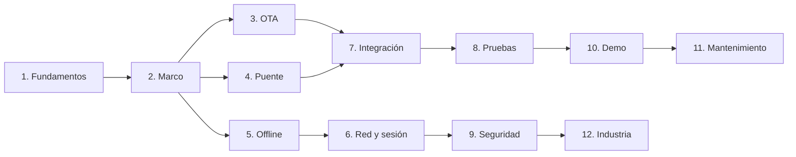
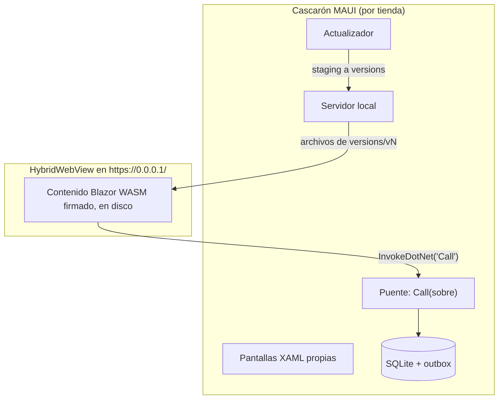
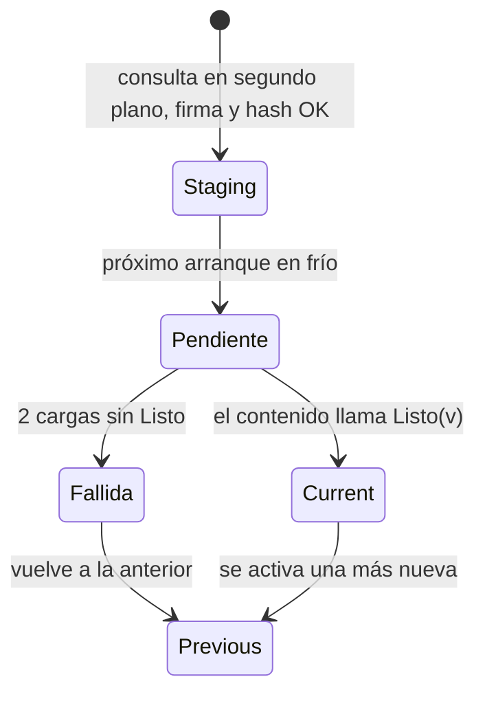
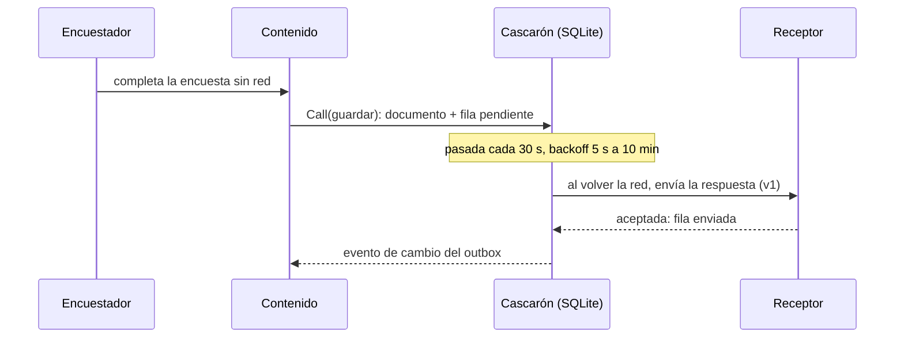
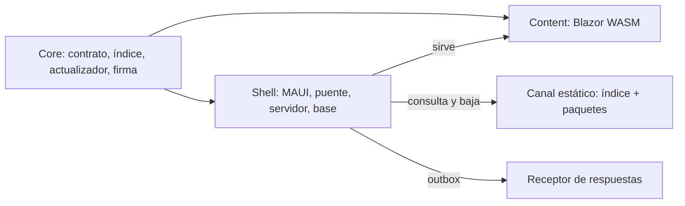

# Guía del desarrollador del framework MAUI híbrido

**Versión del libro:** 1.0.0-borrador · **Fecha:** 2026-11-01 · **Estado:** en edición (reedición 04).

> Este libro explica cómo construir una app .NET MAUI cuyas pantallas de negocio se bajan firmadas desde un servidor
> propio, se activan sin pasar por la tienda y funcionan sin red. Todo lo que afirma remite a la demo que lo
> acompaña (`Demo/`), a los documentos de la guía o a una fuente pública. Las rutas son relativas a
> `Concepts/Framework-Concept/`.

## Índice general

*(Lo regenera la integración final a partir de los títulos de las cinco partes.)*

## Cómo leer este libro

El libro tiene cinco partes. La Parte I define el vocabulario y el marco; las demás lo usan sin redefinirlo.

Tabla 0.1. Rutas de lectura por perfil.

| Perfil | Ruta recomendada | Para qué |
|---|---|---|
| Quien llega sin contexto | Caps. 1 → 2 → 10 | Entender la idea y correr la demo |
| Desarrollador del contenido | Caps. 1 → 4 → 5 → 8 | Escribir pantallas Razor que respeten el puente y trabajen sin red |
| Desarrollador del cascarón | Caps. 1 → 3 → 4 → 6 → 9 | Mantener el actualizador, el puente, la red y la sesión |
| Quien integra y publica | Caps. 1 → 7 → 8 → 3.10 | Abrir PR, pasar la compuerta, publicar en un canal |
| Quien evalúa la arquitectura | Caps. 1 → 2 → 12 → 9 | Compararla con la industria y con los estándares |



Figura 0.1. Dependencias de lectura entre capítulos. Mirá que todo sale del capítulo 1: ahí se define cada término.

### Convención de marcas

Tabla 0.2. Marcas de estado que usa el libro.

| Marca | Significa |
|---|---|
| **NO VERIFICADO** | Diseño o afirmación sin evidencia medida todavía. |
| **NO EJECUTADO** | El código existe, pero ningún recorrido de la demo lo ejercitó. |
| **ESPECULACIÓN** | Inferencia sobre sistemas de terceros a partir de lo observable; no es un hecho. |
| **HISTÓRICO (fecha)** | Vale para esa fecha; puede haber cambiado. |

Las citas van entre corchetes al final de la oración: `[archivo:líneas]` para el repo, `[folio NNN]` para el
expediente del proyecto (privado, sin enlace), `[E0x]` para los ensayos y `[Rn]` para la web (Anexo B). Las cifras
de pruebas y de tiempos medidos no figuran en el texto: están en la corrida fechada del Anexo H.

---

## Parte I. Fundamentos

### Capítulo 1. Fundamentos: una app híbrida que se actualiza sola y trabaja sin red

**Objetivos**

- Definir app híbrida, cascarón, contenido, puente y capacidad tal como los usa este framework.
- Distinguir este modelo de Blazor Hybrid, de un sitio web envuelto y de la interfaz dirigida por servidor.
- Explicar qué es una actualización OTA, qué la vuelve confiable y en qué momento se activa una versión.
- Explicar qué es offline-first y para qué sirve el outbox.
- Ubicar los temas secundarios (red, sesión y Keystore, contrato del puente, capacidades) y las cuatro líneas de versión.

**Requisitos previos.** Ninguno dentro del libro. Ayuda conocer C#, .NET MAUI y nociones de HTTP y JSON.

#### 1.1 El problema: pantallas que cambian seguido y una tienda que tarda

Una app de encuestas de campo cambia sus pantallas a menudo: una pregunta nueva, un texto corregido, un orden
distinto. Cada cambio de una app nativa pasa por la revisión de la tienda y por la actualización que hace cada
persona en su teléfono. El borrador que dio origen al framework lo pide así: «Si cambio esas pantallas, la app **se
autoactualiza al arrancar**, sin pasar por la tienda» [Framework-APP.md §1]. La guía lo resume en una frase: una
corrección de texto en una encuesta no debería esperar el ciclo de revisión de una tienda
[01-Actualizacion-Sin-Tienda.md:55-57].

La respuesta del framework tiene tres ideas que se sostienen entre sí:

1. **Separar** lo que cambia poco (la app instalada) de lo que cambia seguido (las pantallas).
2. **Actualizar** las pantallas por un canal propio, firmado, con vuelta atrás automática.
3. **Trabajar sin red**: la app guarda todo en el teléfono y envía después.

El resto del capítulo define cada idea. Los capítulos 3 a 6 cuentan cómo están construidas.

#### 1.2 App híbrida

##### 1.2.1 Cascarón y contenido

Una **app híbrida** (*hybrid app*) es, en este framework, una app nativa instalada por tienda que muestra sus pantallas
de negocio en un WebView. Esas pantallas son un paquete web que la app sirve desde el disco del teléfono y que habla
con el sistema sólo a través de un puente. Es el modelo de Cordova y Capacitor [R-B1-1] [R-B1-2], con otra
tecnología de base.

El **cascarón** (*native shell*) es la app .NET MAUI que se instala por tienda: tiene pantallas propias en XAML
(arranque, error, «WebView viejo»), el actualizador, el puente y la base local, y no contiene pantallas de negocio
[00-Marco.md:44-45]. El **contenido** (*web content*) son las pantallas de negocio: páginas Razor compiladas a Blazor
WebAssembly, empaquetadas, firmadas y bajadas por el cascarón [00-Marco.md:54-55].

La regla para decidir dónde va un cambio sale del vocabulario de la guía: si el cambio necesita un permiso nuevo,
código nativo o una API del teléfono que el catálogo no tiene, es del cascarón y viaja por tienda; si no, es contenido
[00-Marco.md:47-48]. Por ejemplo, agregar la cámara a la encuesta pide un permiso en el `AndroidManifest`: es un cambio
del cascarón [00-Marco.md:50-51].

En la demo, la pantalla que muestra el contenido crea un único `HybridWebView`, le engancha un servidor local y
registra el puente como único objeto invocable:

```csharp
// Demo/src/FrameworkConcept.Shell/Pages/ContenidoPage.xaml.cs:37-44
// C-1 de E01 — un único HybridWebView; el contenido lo sirve WebResourceRequested desde content/versions/vN.
// HybridRoot apunta a una página de reserva del APK («hwv»): nunca se usa para el contenido descargado.
servidor.Raiz = contenido.Directorio;
servidor.CargaIniciada += AlIniciarLaCarga;
var vista = new HybridWebView { HybridRoot = "hwv", DefaultFile = "index.html" };
_vista = vista;
vista.WebResourceRequested += servidor.AlPedirRecurso;
vista.SetInvokeJavaScriptTarget(puente);   // P3 — un solo objeto, un solo método: Call(sobre)
```

El servidor local atiende cada pedido del WebView desde la carpeta de la versión activa y corta cualquier pedido a
otro origen distinto de `https://0.0.0.1/` con un 403 [Demo/src/FrameworkConcept.Shell/Hosting/ServidorDeContenido.cs:16-17,39-45].
`HybridWebView` es el control de .NET MAUI que hospeda contenido web y permite llamadas entre JavaScript y C# [R-B1-3].

El **puente** (*bridge*) es la única vía entre contenido y cascarón: un objeto con un solo método, `Call`, que el
contenido invoca desde JavaScript con `window.HybridWebView.InvokeDotNet('Call', [sobreJson])`, donde el sobre es un
mensaje JSON-RPC 2.0 con un campo de versión `v` [Demo/src/FrameworkConcept.Shell/Bridge/PuenteDelCascaron.cs:3-7].
Agregar una operación no agrega un método C#: agrega una fila a la tabla de métodos del contrato
[Demo/src/FrameworkConcept.Shell/Bridge/PuenteDelCascaron.cs:9-10]. El capítulo 4 lo detalla.

Una **capacidad** (*capability*) es algo que el teléfono ofrece al contenido a través del cascarón (cámara, estado de
red, etc.). El contenido declara cuáles necesita (`requires`) y cuáles aprovecha si están (`optional`) en el manifiesto
de su paquete [Demo/src/FrameworkConcept.Core/Contracts/Contenido/ManifiestoContenido.cs:15,26-29]. Un **servicio del
cascarón** es una operación del puente que no depende de hardware (por ejemplo, guardar en la base local); el capítulo
4.5 trata la diferencia.



Figura 1.1. Anatomía de la app híbrida. Mirá que el contenido sólo toca el cascarón por una flecha: el puente.

##### 1.2.2 Qué no es

> **Recuadro. Blazor Hybrid no es esto.** Microsoft llama *Blazor Hybrid* a hospedar componentes Razor con
> `BlazorWebView`: los componentes se compilan dentro de la DLL de la app y corren en el proceso .NET nativo [R-B1-4].
> Ese código no se puede bajar sin reinstalar. En este framework el contenido es **Blazor WebAssembly** servido por
> `HybridWebView`: corre dentro del motor del WebView y se reemplaza por el canal [01-Actualizacion-Sin-Tienda.md:63]
> [Demo/src/FrameworkConcept.Shell/Pages/ContenidoPage.xaml.cs:37-44]. El borrador original habla de «pantallas
> Blazor Hybrid» [Framework-APP.md:1,27]; el libro usa ese nombre sólo en este recuadro.

Tabla 1.1. Con qué se confunde el modelo y por qué no es lo mismo.

| Se confunde con | Por qué no es lo mismo | Fuente |
|---|---|---|
| Blazor Hybrid (`BlazorWebView`) | Razor compilado en la DLL; no se baja | [01-Actualizacion-Sin-Tienda.md:63] |
| Un sitio web dentro de la app | Un sitio remoto en vivo no anda sin red; acá el contenido está en el teléfono | [01-Actualizacion-Sin-Tienda.md:64] |
| Actualizar el cascarón | Permisos, código nativo y SDK sólo cambian por tienda | [01-Actualizacion-Sin-Tienda.md:65] |
| Interfaz dirigida por servidor (*server-driven UI*) | Acá el código de las pantallas viaja empaquetado; sólo las encuestas viajan como datos (definiciones) | [00-Marco.md:63-64] |
| Rollback remoto | No se «baja» de versión: se corrige hacia adelante o se retira la mala | [01-Actualizacion-Sin-Tienda.md:66] |

##### 1.2.3 Qué permiten las tiendas

La separación no es un capricho: es lo que habilitan las políticas de las tiendas. Google Play prohíbe que una app se
modifique por un mecanismo distinto del suyo, pero excluye «code that runs in a virtual machine or an interpreter where
either provides indirect access to Android APIs (such as JavaScript in a webview or browser)» [R-B1-5]
[01-Actualizacion-Sin-Tienda.md:72-75]. Apple, en la pauta 2.5.2, prohíbe bajar código que introduzca o cambie
funciones de la app [R-B1-6] [01-Actualizacion-Sin-Tienda.md:82-83].

Dos consecuencias en la demo:

- Todo acceso nativo pasa por el puente, es decir, llega a Android de forma indirecta (§1.2.1).
- El contenido se compila **sin AOT**, para que lo bajado siga siendo IL interpretado:

```xml
<!-- Demo/src/FrameworkConcept.Content/FrameworkConcept.Content.csproj:15-18 -->
<!-- P1 — SIN AOT. Con AOT el código descargado deja de ser IL interpretado y cambia de clase ante las
     tiendas: habilitarlo es una decisión con su propia revisión, no una optimización. ... -->
<RunAOTCompilation>false</RunAOTCompilation>
```

Ninguna de las dos políticas nombra WebAssembly. Si un `.wasm` interpretado cuenta como «código interpretado» ante
Apple y ante Play es **NO VERIFICADO** [01-Actualizacion-Sin-Tienda.md:88-89] [folio 035]. Un contenido que cambie el
propósito declarado en la ficha de la tienda tiene que salir por tienda; la plantilla de PR lo pregunta (capítulo 7).

#### 1.3 Actualización OTA

Una **actualización OTA** (*over-the-air*, *live update*) reemplaza el contenido web sin reinstalar el binario. En la
demo, el cascarón consulta el canal en segundo plano, baja a `staging/`, verifica firma y hash, activa en el próximo
arranque en frío y vuelve atrás si la versión no confirma `Listo` [Demo/src/FrameworkConcept.Shell/Actualizacion/ConsultasDelCanal.cs:5-7]
[Demo/src/FrameworkConcept.Core/Update/Actualizador.cs:35-39,92-160]. La industria ofrece lo mismo como servicio:
Expo EAS Update, Ionic Appflow, Capawesome, CodePush (capítulo 12) [R-B1-7] [R-B1-8].

##### 1.3.1 Índice del canal frente a manifiesto del paquete

Un **canal** (*channel*) es una carpeta estática del servidor (`dev`, `beta`, `prod`) con un índice firmado por canal y
por mayor del puente [00-Marco.md:69-70]. Hay dos documentos que se suelen llamar «manifiesto» y que no hay que
confundir:

- El **índice del canal** (*channel index*) es la lista firmada de lo que se puede bajar. Vive en
  `/{canal}/puente-{mayor}/indice.json`, se firma byte a byte y la firma va al lado, en `indice.json.sig`. Trae canal,
  mayor del puente, clave de firma (`KeyId`), fecha de emisión, vencimiento (`Expires`), entradas de contenido y de
  definiciones, y versiones retiradas [Demo/src/FrameworkConcept.Core/Contracts/Canal/IndiceDelCanal.cs:3-34].
- El **manifiesto del paquete** (*package manifest*) es `manifiesto.json`, que viaja dentro del zip del contenido y
  dice qué versión es, con qué rango del puente es compatible, qué capacidades pide y qué motor web mínimo exige
  [Demo/src/FrameworkConcept.Core/Contracts/Contenido/ManifiestoContenido.cs:3-24].

El propio código lo aclara: el índice «NO es el "manifiesto del paquete de contenido" ni el "manifiesto de la app"
(AndroidManifest.xml / Info.plist, que sólo cambia por tienda)»
[Demo/src/FrameworkConcept.Core/Contracts/Canal/IndiceDelCanal.cs:10-12]. En este libro nunca se dice «manifiesto» a
secas.

El índice vale 30 días desde su emisión y se renueva cada 7 [Demo/src/FrameworkConcept.Core/Contracts/ParametrosDeProducto.cs:15-19].
Si la firma no verifica o venció, el cascarón lo descarta; la demo lo provoca con `scripts/guion.sh firma-invalida`
[00-Marco.md:72-76]. La firma es ES256 [Demo/src/FrameworkConcept.Core/Update/FirmaEs256.cs]; el capítulo 3 explica
el orden de verificación y su relación con The Update Framework (TUF) [R-B1-9].

##### 1.3.2 Ciclo de vida de una versión

Una versión de contenido pasa por estos estados:

1. **Staging.** La consulta en segundo plano baja el paquete a `staging/` y verifica firma y hash. Nunca activa nada
   [Demo/src/FrameworkConcept.Shell/Actualizacion/ConsultasDelCanal.cs:5-7].
2. **Pendiente.** En el próximo arranque en frío, antes de mostrar, el actualizador la activa y la carga
   [00-Marco.md:105-107].
3. **Current.** Si el contenido llama `Listo(v)`, queda confirmada y la anterior pasa a `previous`. El teléfono guarda
   dos versiones, `current` y `previous` [Demo/src/FrameworkConcept.Core/Contracts/ParametrosDeProducto.cs:30-31].
4. **Fallida.** Si la versión acumula `CargasSinListoParaFallar` cargas empezadas sin `Listo` (hoy, 2), el cascarón la
   anota como fallida y vuelve a `previous` [Demo/src/FrameworkConcept.Core/Update/Actualizador.cs:39,92-109]. Sólo
   cuenta una carga que llegó a pedir `_framework/dotnet.js`, la evidencia de que el contenido empezó a cargar
   [Demo/src/FrameworkConcept.Shell/Hosting/ServidorDeContenido.cs:19-32]. El criterio es un conteo, no un tiempo; el
   borrador decía «si no avisa en X segundos» [Framework-APP.md §3].

La **semilla** (*seed*) es el contenido y la definición que el APK trae embebidos, firmados igual que el canal; el
primer arranque la instala y la muestra mientras consulta el canal [00-Marco.md:96-98]. Una **retirada** es una
versión que el índice marca como mala: el próximo arranque en frío la trata como fallida
[Demo/src/FrameworkConcept.Core/Contracts/Canal/IndiceDelCanal.cs:21].



Figura 1.2. Ciclo de vida simplificado de una versión. Mirá que la activación nunca ocurre en la misma corrida que la
descarga. El capítulo 3 agrega el estado terminal «sin versión sana».

En la demo, el ensayo de integración lo recorrió de punta a punta: 1.0.0 → 1.1.0 (el primer arranque deja la versión
en staging, el segundo muestra la cabecera azul) y una 1.2.0 «sin Listo» que vuelve a 1.1.0 [00-Marco.md:109-110] [E02].

> **Del borrador a la demo.** El borrador consultaba el índice antes de mostrar y activaba en el mismo arranque
> [Framework-APP.md §3]. La demo consulta siempre en segundo plano y activa en el **próximo** arranque en frío
> [Demo/src/FrameworkConcept.Shell/Actualizacion/ConsultasDelCanal.cs:5-7]. La razón: nunca hacer esperar al abrir.
> El Anexo G trae la tabla completa de equivalencias.

##### 1.3.3 Disparadores de la consulta

El diseño prevé tres disparadores: arranque en frío, ingreso exitoso y reanudación [00-Marco.md:141-142]. En el código
hay dos implementados:

- **Arranque en frío**, después de decidir qué pantalla mostrar [Demo/src/FrameworkConcept.Shell/Pages/ArranquePage.xaml.cs:103,112].
- **Reanudación**, al volver desde segundo plano; el actualizador la omite si no pasaron 15 minutos desde la última
  consulta exitosa [Demo/src/FrameworkConcept.Shell/App.cs:31-32] [Demo/src/FrameworkConcept.Core/Contracts/ParametrosDeProducto.cs:21-22].

```csharp
// Demo/src/FrameworkConcept.Shell/App.cs:25-33
ventana.Resumed += (_, _) =>
{
    Bitacora.Log("app: reanudada");
    servicios.GetRequiredService<ISesionDelUsuario>().AlVolverAlFrente();
    servicios.GetRequiredService<IMonitorDeRed>().Reevaluar();
    if (servicios.GetRequiredService<ContenidoActivo>().Version is not null)
        servicios.GetRequiredService<ConsultasDelCanal>().ConsultarEnSegundoPlano(DisparadorDeConsulta.Reanudacion);
    servicios.GetRequiredService<SincronizadorDelOutbox>().Despertar();
};
```

El ingreso con cuenta existe en la demo [E03], pero ningún llamador usa el disparador de ingreso exitoso: que el
ingreso dispare la consulta es **NO VERIFICADO** [00-Marco.md:144-146]. El comentario de `ConsultasDelCanal.cs:9-11`
todavía dice que «la demo no tiene login»; quedó desactualizado y se corrige en un cambio de código aparte.

#### 1.4 Offline-first

##### 1.4.1 La base local como fuente de verdad

Una app **offline-first** trabaja siempre contra su base local y trata la red como un recurso que puede faltar. En la
demo, el cascarón guarda documentos, definiciones y versiones de contenido en SQLite con EF Core
[Demo/src/FrameworkConcept.Shell/Data/DbSqlite.cs]. El contenido no habla con el servidor: le pide al cascarón que
guarde, y el cascarón decide cuándo enviar. El capítulo 5 describe las tablas.

##### 1.4.2 El outbox

El **outbox** (*transactional outbox*, aplicado al cliente) es una tabla de la base local donde cada operación que
necesita servidor queda como fila pendiente, escrita en la misma transacción que el documento [R-B1-10]. Un
sincronizador las envía cuando hay red. En la demo hace una pasada cada 30 segundos, con espera exponencial
(*backoff*) entre 5 segundos y 10 minutos:

```csharp
// Demo/src/FrameworkConcept.Shell/Sync/SincronizadorDelOutbox.cs:23-25
private static readonly TimeSpan EsperaEntrePasadas = TimeSpan.FromSeconds(30);
private static readonly TimeSpan BackoffInicial = TimeSpan.FromSeconds(5);
private static readonly TimeSpan BackoffMaximo = TimeSpan.FromMinutes(10);
```

Al reanudar la app, el cascarón lo despierta [Demo/src/FrameworkConcept.Shell/App.cs:32]. Estos son parámetros de la
demo, no norma; el capítulo 5 cuenta la idempotencia, el dueño de cada fila, «Enviar ahora» y la carta muerta.



Figura 1.3. Recorrido de una respuesta tomada sin red. Mirá que el contenido nunca espera al servidor.

##### 1.4.3 Versiones de definición en vuelo

Una **definición** es una encuesta escrita como datos JSON (`encuestaId` + `version`) que dibujan las páginas genéricas
del contenido; cambiar una pregunta publicada exige subir `version` [00-Marco.md:60-64]. El escenario ESC-4 muestra por
qué la versión viaja con la respuesta: una encuesta tomada sin red con la v1 queda en el outbox; mientras tanto se
publica la v2; al volver la red, la respuesta se envía con `versionDefinicion: 1` y el servidor la acepta como v1
[00-Marco.md:123-126] [E02].

#### 1.5 Temas secundarios en una página

Tabla 1.2. Temas secundarios: qué son, de quién son y dónde se detallan.

| Tema | Pertenece a | En una frase | Detalle |
|---|---|---|---|
| Red | Cascarón | Cuatro estados (`EnLinea`, `EnLineaMedida`, `RedSinServidor`, `SinRed`) deciden qué acción se permite, se encola o se bloquea [Demo/src/FrameworkConcept.Core/Red/EstadoDeRed.cs:8-16] [00-Marco.md:166] | Cap. 6 |
| Autenticación del dispositivo y Keystore | Cascarón | La primera vez se ingresa con la cuenta; después se desbloquea con la seguridad del teléfono y el secreto queda en el almacén seguro del sistema [00-Marco.md:165] | Cap. 6 |
| Contrato del puente | Borde cascarón ↔ contenido | Una sola función versionada; el contenido pide y el cascarón decide [Demo/src/FrameworkConcept.Shell/Bridge/PuenteDelCascaron.cs:3-10] | Cap. 4 |
| Capacidades | Cascarón | Lo que el teléfono ofrece; una capacidad nueva es un cambio de tienda [00-Marco.md:47-51] | Cap. 4 |

> **Recuadro. Tres responsabilidades distintas.** La biometría abre un secreto, la identidad la da el servidor y el
> entorno lo atestigua un tercero. El diseño de la demo lo dice así: «La biometría no es el login: es la llave que abre
> el refresh token guardado. La identidad la da el emisor» [Demo/DISENO-RED-Y-AUTENTICACION.md:145]. Que el teléfono
> no esté comprometido (sin root, sin acceso remoto) no lo puede afirmar la app sola: lo atestiguan servicios como
> Play Integrity [R-B1-11]. La demo no usa atestación; el capítulo 9 lo discute con casos de apps de consumo.

#### 1.6 Cuatro líneas de versión

En una app que se actualiza por partes, «la versión» no alcanza para saber qué corre en un teléfono. La guía define
**cuatro líneas de versión** visibles en la pantalla de diagnóstico: cascarón, puente, contenido y definición, con la
huella del contrato al lado [03-Integracion-Y-Versionado.md:154-155] [Developer-Guide.md:37]. Cada una cambia por un
motivo distinto: el cascarón por tienda, el puente cuando cambia el contrato, el contenido por el canal y la definición
cuando cambia una encuesta. El capítulo 7 explica qué sube cada cambio y las líneas internas.

> **En la industria.** La separación entre un binario nativo y un paquete web actualizable es la base de Cordova y
> Capacitor [R-B1-1] [R-B1-2]; los servicios de *live updates* (EAS Update, Appflow, Capawesome) la explotan
> comercialmente [R-B1-7] [R-B1-8]. Expo ata cada actualización a una *runtime version*, la misma idea que el índice
> por mayor del puente [R-B1-7]. El patrón outbox viene del mundo de microservicios [R-B1-10]. El capítulo 12 compara
> mecanismo por mecanismo.

**Preguntas guía**

1. Un cambio agrega una pregunta a una encuesta y otro agrega la lectura de código QR. ¿Cuál va por canal y cuál por
   tienda? ¿Por qué?
2. ¿Qué diferencia hay entre el índice del canal y el manifiesto del paquete? ¿Quién lee cada uno y cuándo?
3. ¿Por qué la demo no activa una versión en el mismo arranque en que la baja?
4. ¿Qué pasaría con una respuesta tomada sin red si la versión de la definición no viajara con ella?
5. ¿Qué decisión de compilación sostiene la lectura de las políticas de las tiendas, y qué queda sin verificar?

**Resumen.** El framework separa un cascarón nativo, que cambia por tienda, de un contenido Blazor WebAssembly que se
baja firmado, se sirve desde el disco por `HybridWebView` y habla con el sistema sólo por un puente con un método. La
actualización OTA baja en segundo plano, activa en el próximo arranque en frío y vuelve atrás por conteo de cargas sin
`Listo`. La app trabaja contra su base local y envía por un outbox con reintentos. Red, sesión, contrato y capacidades
son responsabilidades del cascarón que se detallan en los capítulos 4 a 6.

---

### Capítulo 2. Marco de referencia

**Objetivos**

- Conocer los siete escenarios que ordenan la guía y su estado de verificación.
- Conocer los contextos que cambian las respuestas y los actores que deciden.
- Ubicar cada pieza del framework en la demo.
- Saber qué capítulo leer según el escenario.

**Requisitos previos.** Capítulo 1.

#### 2.1 Siete escenarios

Un **escenario** es una situación concreta del ciclo de vida de la app con un identificador estable (`ESC-n`) que el
resto de la guía cita [00-Marco.md:31-32]. Los siete salen del dictamen de diseño del proyecto; ESC-6 y ESC-7 nacen de
pedidos posteriores [00-Marco.md:243] [folio 035].

Tabla 2.1. Escenarios, qué pasa y su estado en la demo.

| Id | Escenario | Qué pasa | Estado en la demo | Capítulo |
|---|---|---|---|---|
| ESC-1 | Primer arranque | El cascarón instala la semilla, la muestra y consulta el canal en segundo plano | Recorrido: «activada la semilla 1.0.0» y `Listo(1.0.0)` [00-Marco.md:96-101] [E02] | 3 |
| ESC-2 | Actualización con fallo y rollback | Baja a staging, activa en el próximo arranque, vuelve a `previous` tras dos cargas sin `Listo` | Recorrido: 1.0.0 → 1.1.0; 1.2.0 vuelve a 1.1.0; índice con firma inválida rechazado [00-Marco.md:105-110] [E02] | 3 |
| ESC-3 | Contenido incompatible o capacidad faltante | El actualizador no activa un paquete que pide otro puente, una capacidad ausente o un WebView menor a 94, y dice por qué | Probado por la suite de actualización y en navegador con puente simulado; en dispositivo sólo existe la pantalla «WebView viejo» [00-Marco.md:114-119] | 4 |
| ESC-4 | Sin red con versión de definición en vuelo | La respuesta v1 queda en el outbox y se acepta como v1 aunque ya exista la v2 | Recorrido y E03 (aviso «Sin conexión», reconexión) [00-Marco.md:123-128] | 5 |
| ESC-5 | PR y release | La compuerta corre en el PR; un `fw-ok` rojo impide fusionar; después se publica por la línea que corresponda | `scripts/ci-local.sh` reproduce la compuerta; los parches de `etapas/` provocan rojos [00-Marco.md:132-137] | 7, 8 |
| ESC-6 | Actualizar al iniciar sesión | El ingreso exitoso dispara la consulta del canal | Ingreso implementado [E03]; disparo **NO VERIFICADO** [00-Marco.md:141-147] | 1.3.3, 6 |
| ESC-7 | Actualización obligatoria | Un contenido `mandatory` se activa en el primer arranque en frío tras quedar verificado; nunca sin red ni descartando pendientes | Diseño; **NO EJECUTADO** en la demo [00-Marco.md:151-156] | 3 |

#### 2.2 Contextos y actores

Un **contexto** es una condición del entorno que cambia la respuesta de un escenario [00-Marco.md:158-166].

Tabla 2.2. Contextos.

| Id | Contexto | Qué cambia | Estado |
|---|---|---|---|
| CTX-1 | Android con WebView ≥ 94 | Contexto de referencia: todo el recorrido funciona | Verificado en el emulador de ensayo; en el teléfono de medida, contenido servido y tiempos de arranque medidos (Anexo H) sin recorrido completo [E01] [folio 049] |
| CTX-2 | Android con WebView < 94 | El contenido no arranca; el cascarón muestra «WebView viejo» | Medido en E01 (WebView 83) |
| CTX-3 | iOS | Mismo diseño, otras API (Keychain, `app://`) y otras reglas | **NO VERIFICADO** [folio 023] |
| CTX-4 | Modo Dispositivo (sin emisor OIDC) | No hay cuenta: el dueño del outbox es el id de instalación | Verificado en E02 |
| CTX-5 | Modo con cuenta | Ingreso, desbloqueo con la seguridad del teléfono, bloqueo a los 5 min en segundo plano, outbox con dueño | Verificado en E03 en el emulador |
| CTX-6 | Estado de la red | Qué acciones se permiten, quedan pendientes o se bloquean | Verificado en E03 salvo `EnLineaMedida` |

Un **actor** es quien decide algo en el sistema. Los tres primeros los nombra el dictamen; los demás son criterio de
la guía [00-Marco.md:169-181].

Tabla 2.3. Actores.

| Id | Actor | Qué decide | Qué no decide |
|---|---|---|---|
| ACT-01 | Encuestador | Qué carga y cuándo; si activa el desbloqueo | Qué versión corre |
| ACT-02 | Coordinador que publica | Cuándo publicar, en qué canal; retirar versiones | El código |
| ACT-03 | Servidor (canal + receptor) | Sirve índice y paquetes; acepta respuestas de versiones no retiradas | Qué se activa en el teléfono |
| ACT-04 | Desarrollador del contenido | Páginas Razor, renderizado de encuestas, `requires`/`optional` | El catálogo de capacidades y la base |
| ACT-05 | Desarrollador del cascarón | Puente, catálogo, actualizador, base, versión del cascarón | El contenido |
| ACT-06 | Revisor del PR | Si un PR se fusiona | Saltar `fw-ok` |
| ACT-07 | Compuerta (workflow + runner autoalojado) | Verde o rojo | Nada fuera de lo que prueba |

#### 2.3 Mapa del framework y de la demo

La demo es el hilo conductor del libro. Cada concepto del capítulo 1 tiene una pieza concreta.

Tabla 2.4. Concepto → pieza de la demo.

| Concepto | Pieza | Ruta (relativa a `Demo/`) |
|---|---|---|
| Cascarón | Proyecto MAUI | `src/FrameworkConcept.Shell/` |
| Contenido | Proyecto Blazor WebAssembly sin AOT | `src/FrameworkConcept.Content/` |
| Contrato e índice | Tipos compartidos | `src/FrameworkConcept.Core/Contracts/` |
| Actualizador y firma | Núcleo de la OTA | `src/FrameworkConcept.Core/Update/` |
| Servidor local | `ServidorDeContenido` | `src/FrameworkConcept.Shell/Hosting/` |
| Puente | `PuenteDelCascaron` y despachador | `src/FrameworkConcept.Shell/Bridge/` |
| Base local y outbox | `DbSqlite`, `SincronizadorDelOutbox` | `src/FrameworkConcept.Shell/Data/`, `src/FrameworkConcept.Shell/Sync/` |
| Parámetros de producto | `ParametrosDeProducto` | `src/FrameworkConcept.Core/Contracts/ParametrosDeProducto.cs` |
| Definiciones | Encuestas en JSON | `definiciones/encuesta-movilidad/` |
| Recorrido y compuerta | Guion y CI local | `scripts/guion.sh`, `scripts/ci-local.sh` |
| Rojos provocados | Parches | `etapas/` |

Fuente de la tabla: [00-Marco.md:208-218] y el árbol de `Demo/src`.



Figura 2.1. Mapa de piezas. Mirá que Content y Shell comparten los tipos de Core en compilación, pero en ejecución
sólo se hablan por el puente (capítulo 4.4).

#### 2.4 Cómo se relacionan los capítulos

Tabla 2.5. Escenario → capítulo que lo resuelve.

| Si estás en… | Leé | Y mirá en la demo |
|---|---|---|
| ESC-1, ESC-2, ESC-7 | Cap. 3 | `semilla/`, `Actualizador.cs`, `ParametrosDeProducto.cs` |
| ESC-3 | Cap. 4 | `PredicadoDeCompatibilidad.cs` |
| ESC-4 | Caps. 5 y 6 | `definiciones/encuesta-movilidad/`, `Shell/Sync/` |
| ESC-5 | Caps. 7 y 8 | `scripts/ci-local.sh`, `etapas/` |
| ESC-6 | Cap. 6 | `Shell/Auth/` |

Fuente: [00-Marco.md:208-218]. La figura 0.1 muestra el mismo mapa como orden de lectura.

> **En la industria.** Ordenar una guía por escenarios con identificador estable es la práctica de los casos de uso y
> de los requisitos trazables; los catálogos de controles como OWASP MASVS hacen lo mismo con sus identificadores
> (`MASVS-STORAGE-1`, etc.) [R-B1-12]. El capítulo 9 usa ese catálogo.

**Preguntas guía**

1. ¿Qué escenarios están verificados de punta a punta y cuáles sólo diseñados?
2. En el contexto CTX-4, ¿quién es el dueño de una fila del outbox?
3. ¿Qué actor decide qué versión corre en un teléfono? ¿Y cuál decide qué se publica?
4. Un PR rompe una prueba del contrato. ¿Qué escenario es y qué capítulos leés?

**Resumen.** Siete escenarios (ESC-1 a ESC-7), seis contextos y siete actores ordenan la guía. Cuatro escenarios están
recorridos en la demo, ESC-3 sólo en pruebas y navegador, y ESC-6 y ESC-7 quedan pendientes. Cada concepto tiene una
pieza de la demo, y cada escenario un capítulo.

<!-- GLOSARIO:
app híbrida | app nativa instalada por tienda que muestra sus pantallas de negocio en un WebView, servidas desde el disco y con acceso al sistema sólo por un puente | hybrid app | §1.2.1
cascarón | app .NET MAUI instalada por tienda con pantallas propias, actualizador, puente y base local; sin pantallas de negocio | native shell | §1.2.1
contenido | pantallas de negocio Razor compiladas a Blazor WebAssembly, empaquetadas, firmadas y bajadas por el cascarón | web content | §1.2.1
puente | único objeto invocable por el contenido, con un método Call que recibe un sobre JSON-RPC 2.0 con campo v | bridge | §1.2.1
capacidad | función del teléfono que el cascarón ofrece al contenido; se declara en requires u optional | capability | §1.2.1
servicio del cascarón | operación del puente que no depende de hardware | shell service | §1.2.1
actualización OTA | reemplazo del contenido sin reinstalar el binario, con verificación, activación diferida y vuelta atrás | over-the-air / live update | §1.3
canal | carpeta estática del servidor (dev, beta, prod) con un índice firmado por canal y mayor del puente | channel | §1.3.1
índice del canal | lista firmada de lo que se puede bajar, en /{canal}/puente-{mayor}/indice.json | channel index | §1.3.1
manifiesto del paquete | manifiesto.json dentro del zip: versión, rango del puente, capacidades y motor mínimo | package manifest | §1.3.1
staging | carpeta donde queda una versión bajada y verificada hasta el próximo arranque en frío | staging | §1.3.2
current / previous | punteros a la versión confirmada y a la anterior; el teléfono guarda dos | current / previous | §1.3.2
marca Listo | llamada del contenido que confirma que la versión arrancó sana | ready signal | §1.3.2
fallida | versión anotada tras CargasSinListoParaFallar cargas sin Listo | failed release | §1.3.2
semilla | contenido y definición embebidos en el APK, firmados igual que el canal | seed / embedded bundle | §1.3.2
retirada | versión que el índice marca como mala; el próximo arranque la trata como fallida | revoked release | §1.3.2
disparador | evento que inicia una consulta del canal (arranque en frío, reanudación; ingreso diseñado) | update trigger | §1.3.3
offline-first | diseño en que la app trabaja contra su base local y trata la red como recurso que puede faltar | offline-first | §1.4.1
outbox | tabla local con las operaciones que necesitan servidor, escritas en la misma transacción que el documento | transactional outbox | §1.4.2
definición | encuesta escrita como datos JSON (encuestaId + version) | form definition | §1.4.3
cuatro líneas de versión | cascarón, puente, contenido y definición, visibles en diagnóstico | version lines | §1.6
escenario | situación del ciclo de vida con identificador ESC-n | scenario | §2.1
contexto | condición del entorno que cambia la respuesta de un escenario (CTX-n) | context | §2.2
actor | quien decide algo en el sistema (ACT-nn) | actor | §2.2
-->

<!-- REFERENCIAS (todas «Consulta: a verificar» hasta la pasada de N8, salvo R-B1-5 y R-B1-6, consultadas según la guía el 2026-10-25):
R-B1-1. Apache Software Foundation. Apache Cordova. https://cordova.apache.org/
R-B1-2. Ionic. Capacitor Documentation. https://capacitorjs.com/docs
R-B1-3. Microsoft. HybridWebView (.NET MAUI 10). https://learn.microsoft.com/en-us/dotnet/maui/user-interface/controls/hybridwebview?view=net-maui-10.0
R-B1-4. Microsoft. ASP.NET Core Blazor Hybrid. https://learn.microsoft.com/en-us/aspnet/core/blazor/hybrid/
R-B1-5. Google. Play Console Help: Device and Network Abuse. https://support.google.com/googleplay/android-developer/answer/9888379 (consultada 2026-10-25 según 01-Actualizacion-Sin-Tienda.md:72)
R-B1-6. Apple. App Review Guidelines, 2.5.2. https://developer.apple.com/app-store/review/guidelines/ (versión 2026-10-16 según 01-Actualizacion-Sin-Tienda.md:84)
R-B1-7. Expo. EAS Update: introduction. https://docs.expo.dev/eas-update/introduction/
R-B1-8. Ionic. Appflow Deploy (Live Updates). https://ionic.io/docs/appflow/deploy/intro
R-B1-9. The Update Framework. https://theupdateframework.io/
R-B1-10. Chris Richardson. Pattern: Transactional outbox. https://microservices.io/patterns/data/transactional-outbox.html
R-B1-11. Google. Play Integrity API. https://developer.android.com/google/play/integrity
R-B1-12. OWASP. Mobile Application Security Verification Standard. https://mas.owasp.org/MASVS/
-->

<!-- MARCAS:
NO VERIFICADO | §1.2.3 | WASM como código interpretado ante Apple y Play
NO VERIFICADO | §1.3.3, Tabla 2.1 | el ingreso exitoso dispara la consulta del canal (ESC-6)
NO EJECUTADO | Tabla 2.1 | actualización obligatoria mandatory (ESC-7)
NO VERIFICADO | Tabla 2.2 | iOS (CTX-3)
-->
