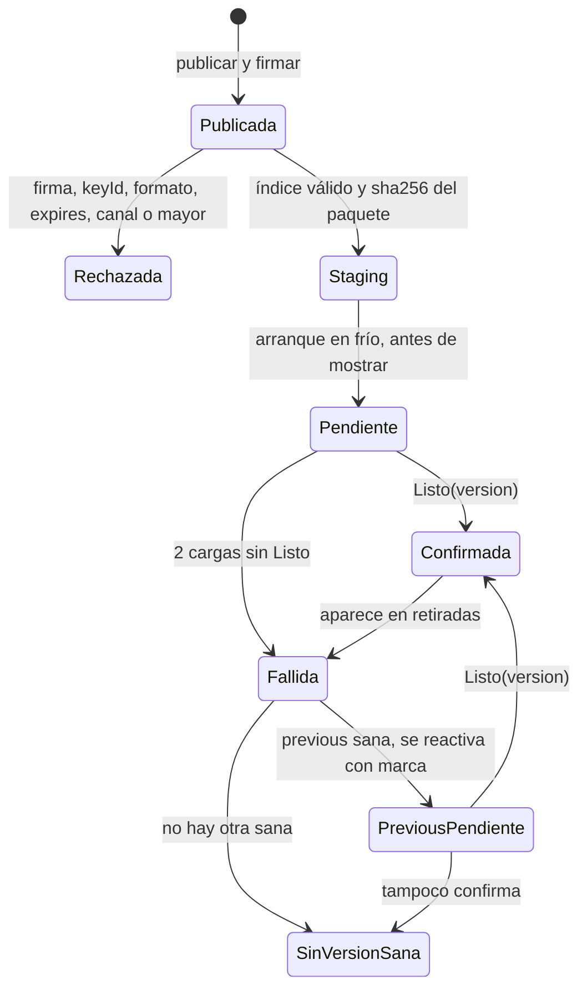
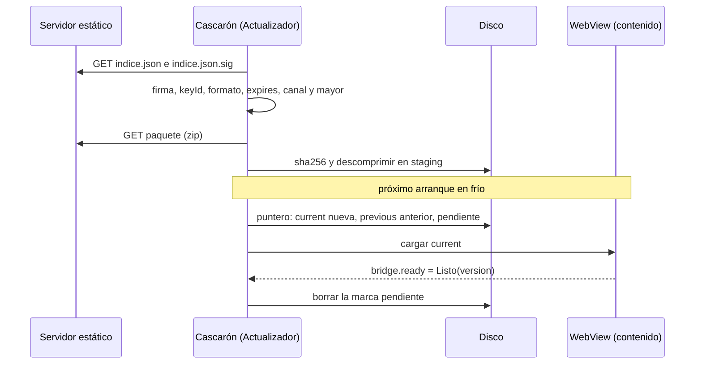
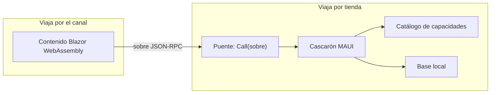
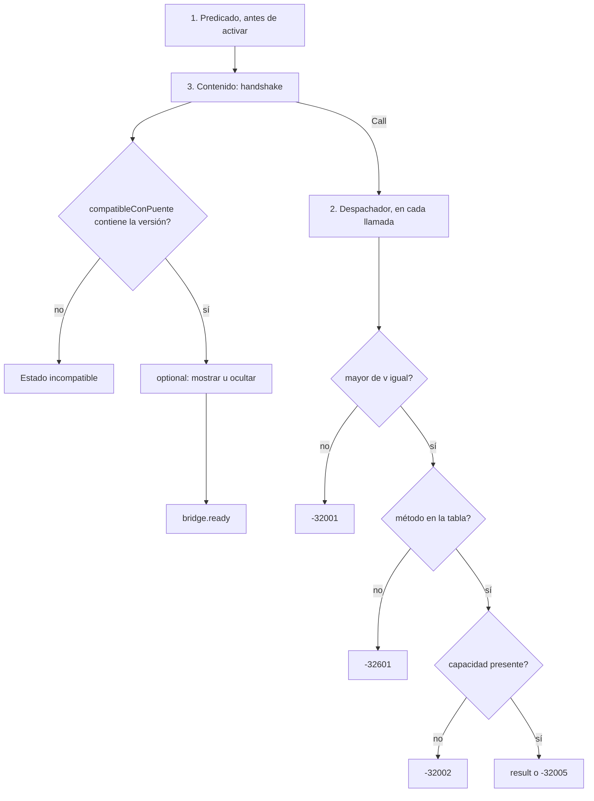

## Parte II. Mecanismo

### Capítulo 3. Actualizar sin tienda: OTA firmada con rollback

**Objetivos**

- Entender por qué el contenido puede cambiar sin pasar por la tienda y qué límites ponen las políticas de Google Play y Apple.
- Conocer cada pieza de la actualización: índice del canal, firma, staging, puntero, marca pendiente, fallida, retirada y semilla.
- Seguir el ciclo de vida completo de una versión, desde que se publica hasta que queda confirmada o fallida.
- Saber cuándo el cascarón decide un rollback y por qué esa decisión resiste un corte de energía.
- Ejercitar el mecanismo con el guion de la demo y publicar con una lista de verificación.

**Requisitos previos:** capítulo 1 (app híbrida, OTA, offline-first) y capítulo 2 (marco de referencia).

#### 3.1 El problema y lo que permiten las tiendas

Una app instalada desde la tienda cambia sólo cuando la tienda aprueba una versión nueva y la persona la instala. Para corregir un texto, una validación o una pantalla, ese ciclo es lento. La **actualización de contenido por aire** (*OTA live update*) separa la app en dos: el cascarón nativo, que sigue viajando por la tienda, y el contenido web que corre dentro del WebView, que se reemplaza bajando un paquete firmado.

Las dos tiendas lo permiten con condiciones. Google Play prohíbe que una app se modifique por un camino que no sea el suyo, pero exceptúa «code that runs in a virtual machine or an interpreter where either provides indirect access to Android APIs (such as JavaScript in a webview or browser)» [01-Actualizacion-Sin-Tienda.md:70-74] [R-B2-1]. Apple, en la pauta 2.5.2, prohíbe bajar código que «introduces or changes features or functionality of the app» [01-Actualizacion-Sin-Tienda.md:80-83] [R-B2-2].

De esas dos lecturas salen tres reglas de diseño:

1. El contenido corre *dentro* del WebView y llega al sistema sólo **indirectamente**, por el puente (capítulo 4).
2. Un cambio que altera el propósito declarado en la ficha de la tienda sale por tienda, no por el canal.
3. El contenido se compila **sin AOT**, para que lo que se baja siga siendo código interpretado [Demo/src/FrameworkConcept.Content/FrameworkConcept.Content.csproj:15-18].

Ninguna de las dos políticas nombra WebAssembly. Si un `.wasm` interpretado cuenta como «código interpretado» es **NO VERIFICADO** ante Apple y ante Play [01-Actualizacion-Sin-Tienda.md:88-89] [folio 035].

#### 3.2 Vocabulario

Tabla 3.1. Términos de la actualización.

| Término | Definición | Dónde está |
|---|---|---|
| **Índice del canal** (*channel index*) | JSON firmado que lista lo que se puede bajar: entradas de contenido y de definiciones (versión, `size`, `sha256`), `expires`, `retiradas` y `keyId`. Vive en `/{canal}/puente-{mayor}/indice.json`. | [Demo/src/FrameworkConcept.Core/Contracts/Canal/IndiceDelCanal.cs:3-37] |
| **Manifiesto del paquete** (*package manifest*) | Declaración que viaja *dentro* del zip: compatibilidad con el puente y capacidades. No es el índice del canal. | [IndiceDelCanal.cs:10-12] |
| **Firma del índice** | ECDSA P-256 con SHA-256 (ES256) sobre los bytes exactos de `indice.json`, guardada al lado en `indice.json.sig`. | [Demo/src/FrameworkConcept.Core/Update/FirmaEs256.cs:6-17] |
| **Paquete** | Zip de una versión del contenido; el índice fija su tamaño y su `sha256`. | [IndiceDelCanal.cs:44-55] |
| **Archivos planos** | Los archivos que quedan *adentro* del zip, sin precompresión `.br` ni `.gz`. Lo plano es el contenido, no el transporte. | [IndiceDelCanal.cs:44] |
| **Staging** | Directorio donde la versión bajada y verificada espera su activación. Hay una sola a la vez. | [Demo/src/FrameworkConcept.Core/Update/AlmacenDeContenidoEnDisco.cs:61-78] |
| **Puntero** | Archivo con `current`, `previous`, `pendiente` y `CargasSinListo`. Es la única fuente de verdad sobre qué versión se muestra. | [Demo/src/FrameworkConcept.Core/Update/IAlmacenDeContenido.cs:68] |
| **Marca pendiente** | Estado de una versión recién activada hasta que el contenido confirma `Listo(version)` por el puente. | [Actualizador.cs:293-307] |
| **Fallida** | Versión que *el teléfono* descarta porque no llegó a `Listo`. Nunca se vuelve a activar. | [Actualizador.cs:97-106] |
| **Retirada** | Versión que *el servidor* descarta, anunciándola en el índice firmado; el teléfono la trata como fallida. | [Actualizador.cs:113-119] |
| **Semilla** (*seed*) | Versión completa embebida en el APK, firmada igual que el canal. | [Actualizador.cs:164-174] |

Una aclaración de vocabulario: «manifiesto» a secas no se usa. Hay tres archivos que la industria llama así y son distintos: el índice del canal, el manifiesto del paquete y el manifiesto de la app (`AndroidManifest.xml` o `Info.plist`), que sólo cambia por tienda [IndiceDelCanal.cs:10-12].

#### 3.3 Por qué confiar: verificación, vigencia y claves

La confianza no depende del servidor ni de TLS: depende de la firma. Un servidor comprometido o un intermediario pueden servir cualquier archivo, pero no pueden fabricar una firma válida sin la clave privada, que no sale de quien publica [FirmaEs256.cs:15-17].

##### 3.3.1 El orden de verificación

`VerificacionDelIndice` es una función pura: recibe bytes y devuelve un veredicto, sin red ni archivos, para que cada paso tenga su prueba [Demo/src/FrameworkConcept.Core/Update/VerificacionDelIndice.cs:14-25]. El orden es:

```csharp
// Demo/src/FrameworkConcept.Core/Update/VerificacionDelIndice.cs:18-22
//   1. firma y clave (conocida, no revocada)   — sobre los BYTES recibidos, antes de leer el JSON
//   2. el keyId de adentro coincide con el de la firma
//   3. formato conocido
//   4. expires                                 — un índice vencido no vale aunque la firma sea buena (C08, «freeze»)
//   5. canal y mayor del puente                — un índice de otro canal u otro mayor no es para este cascarón
```

La regla que sostiene todo está en una línea: «Sólo ahora se lee el JSON: nada de lo que dice un índice sin firma válida se usa» [VerificacionDelIndice.cs:50]. Primero se verifica, después se lee. La versión estrictamente mayor y el `sha256` de cada paquete se comprueban después, entrada por entrada [VerificacionDelIndice.cs:24]. Además, el actualizador no baja un paquete que declare más de 64 MB, para proteger la memoria del teléfono de un índice mal escrito [Actualizador.cs:31-32].

##### 3.3.2 Vigencia: `expires`

Un índice firmado y vencido no vale. Sin vencimiento, un atacante que guardó un índice viejo y legítimo podría servirlo para siempre y dejar al teléfono congelado en una versión con un defecto conocido: es el **ataque de congelamiento** (*freeze attack*) que describe The Update Framework (TUF) [R-B2-3]. En la demo, `expires` es la fecha de emisión más 30 días, y el índice se renueva cada 7 [Demo/src/FrameworkConcept.Core/Contracts/ParametrosDeProducto.cs:15-19].

##### 3.3.3 Claves: activa, reserva y revocación

El cascarón trae embebido un conjunto de claves públicas, cada una con su `keyId`, y acepta sólo las conocidas y no revocadas [FirmaEs256.cs:23-42]. El orden de los rechazos sirve al diagnóstico: primero «¿qué clave?» (`ClaveDesconocida`, `ClaveRevocada`) y después «¿la firma cierra?» (`FirmaInvalida`). Rotar o revocar una clave exige un cascarón nuevo por tienda, porque la lista viaja en el APK.

**En la industria.** TUF generaliza este esquema con roles separados (raíz, objetivos, instantánea, tiempo), umbrales de firmantes y delegación [R-B2-3]. La demo usa una sola firma ES256 sobre los bytes por simplicidad; TUF queda como camino de crecimiento si aparecen varios firmantes o delegación de roles [folio N2 §5, decisión «Formato de firma»].

#### 3.4 El ciclo de vida de una versión

Una versión pasa por estados bien definidos. El punto clave es que **bajar no es aplicar**: lo verificado espera en staging y se activa recién en el próximo arranque en frío, antes de mostrar nada. Nunca se activa en caliente [Actualizador.cs:139-141].



Figura 3.1. Estados de una versión de contenido. Mirá que de `Fallida` no se vuelve directo a mostrar: volver a `previous` es otra activación, con su propia marca pendiente, y si también falla queda el estado terminal «sin versión sana» [Actualizador.cs:121-137].

Dos detalles del código que la figura resume:

- **Mientras hay una marca pendiente, staging espera.** Si se activara lo nuevo, `previous` sería una versión sin confirmar y el rollback no tendría a dónde volver con seguridad [Actualizador.cs:139-148].
- **No se vuelve a la semilla.** Si ninguna versión está sana, el puntero queda como está, con las versiones a la vista para la pantalla terminal [Actualizador.cs:121-123].

La consulta al canal y la activación ocurren en momentos distintos:



Figura 3.2. Consulta, staging y activación. Los disparadores de la consulta son el arranque, la vuelta desde segundo plano (como mucho una vez cada 15 minutos) y el ingreso con cuenta [ParametrosDeProducto.cs:21-22]; el detalle de red está en el capítulo 6.

#### 3.5 Rollback por evidencia

Una versión recién activada puede estar rota: un error de JavaScript, un recurso faltante, una excepción al iniciar Blazor. El cascarón no puede inspeccionar el contenido por dentro, así que exige una prueba positiva: el contenido llama `bridge.ready` con su versión cuando terminó el primer render con el puente sano [Demo/src/FrameworkConcept.Core/Contracts/Puente/TablaDeMetodos.cs:25-28] [Demo/src/FrameworkConcept.Content/Bridge/BridgeSession.cs:112-124].

##### 3.5.1 Qué cuenta como falla

La marca sola no prueba nada: la persona pudo cerrar la app mientras cargaba. Por eso el cascarón anota cada arranque en que el WebView **empezó a cargar** la versión pendiente, detectado cuando pide `_framework/dotnet.js` [Demo/src/FrameworkConcept.Shell/Hosting/ServidorDeContenido.cs:20] [Demo/src/FrameworkConcept.Shell/Pages/ContenidoPage.xaml.cs:114]. Sólo cuando eso pasó `CargasSinListoParaFallar` veces sin `Listo`, el arranque siguiente da la versión por fallida.

```csharp
// Demo/src/FrameworkConcept.Core/Update/Actualizador.cs:34-39
/// P2 — Cuántos arranques con la carga EMPEZADA y sin «Listo» hacen falta para dar una versión por fallida.
/// Criterio de la demo (corrección de E02), no valor de producto del folio 036: con 1, cerrar la app mientras
/// carga (el TPR del teléfono de medida pasa de 8 s) dejaba una versión sana como fallida para siempre.
/// </summary>
public const int CargasSinListoParaFallar = 2;
```

El valor 2 es un **parámetro** de la demo, no un valor de producto. Bajarlo a 1 da más falsos positivos; subirlo expone más tiempo a la persona a una versión rota. La alternativa de medir el tiempo hasta `Listo` quedó registrada y no se adoptó [folio N2 §5, decisión «Umbral de rollback»].

##### 3.5.2 El recorrido real en la demo

Con el valor actual, el paso 7 del recorrido de la demo pide abrir la app en frío cuatro veces [Demo/README.md:89]:

Tabla 3.2. Arranques del rollback con `CargasSinListoParaFallar = 2`.

| Arranque | Qué pasa |
|---|---|
| 1 | Se muestra 1.1.0; la consulta baja 1.2.0 a staging. |
| 2 | Se activa 1.2.0 con marca pendiente; el WebView empieza a cargar (carga 1) y no llega a `Listo`. |
| 3 | Sigue pendiente (1 de 2): se reintenta; carga 2 sin `Listo`. |
| 4 | 2 cargas sin `Listo`: 1.2.0 queda fallida y se vuelve a 1.1.0, con su propia marca. |

Cuando eso ocurre, el cascarón deja en su bitácora la nota «rollback: 1.2.0 empezó a cargar 2 veces sin confirmar Listo; queda como fallida» [Actualizador.cs:103].

##### 3.5.3 Idempotencia frente a un corte

El orden de las escrituras es deliberado:

```csharp
// Demo/src/FrameworkConcept.Core/Update/Actualizador.cs:97-105
if (puntero.Pendiente is { } pendiente)
{
    if (puntero.CargasSinListo >= CargasSinListoParaFallar)
    {
        await almacen.AgregarFallidaAsync(pendiente, ct);
        fallidas.Add(pendiente);
        // …
        puntero = puntero with { Pendiente = null, CargasSinListo = 0 };
        await almacen.ReemplazarPunteroAsync(puntero, ct);
```

Primero se anota la fallida y después se mueve el puntero. Si el proceso se corta entre las dos escrituras, el próximo arranque encuentra la misma marca y repite el paso, sin reinstalar la versión mala [Actualizador.cs:95-96]. Las escrituras se hacen con escritura a temporal y renombre [AlmacenDeContenidoEnDisco.cs:58], y dos candados ordenados evitan que el arranque, la consulta y `Listo` se pisen [Actualizador.cs:41-44]. `Listo` sólo borra la marca de *esa* versión: un `Listo` viejo o de otra versión no confirma nada [Actualizador.cs:299-301].

**En la industria.** Las actualizaciones A/B de Android usan dos ranuras y una marca de «arranque exitoso»: si el sistema nuevo no la pone, el cargador vuelve a la ranura anterior [R-B2-4]. `current`/`previous` más `Listo` es la misma idea llevada al contenido. Expo EAS Update también vuelve a la versión embebida cuando una actualización falla al arrancar [R-B2-5].

#### 3.6 La semilla

La semilla resuelve el primer arranque: una app recién instalada, sin red, tiene que mostrar algo. Por eso el APK trae una versión completa, firmada igual que el canal, que se instala **por el mismo camino que un paquete bajado** [Actualizador.cs:164-165].

Se activa en dos casos [Actualizador.cs:173-174]:

1. **Primer arranque**, cuando nunca hubo puntero.
2. **Cascarón nuevo con una semilla más nueva que `current`**: si la tienda instala un cascarón cuya semilla supera lo instalado, esa semilla actualiza. Así, una actualización por tienda nunca deja al teléfono atrás del contenido que trae.

La semilla **no** es destino de rollback: si no queda versión sana, no se vuelve a ella (§3.4). Leerla y verificarla cuesta segundos, así que se carga sólo en el primer arranque o cuando cambió la huella de la instalación del cascarón [Actualizador.cs:166-171].

Un clon nuevo del repositorio no tiene claves de firma: `scripts/guion.sh claves` las genera y la semilla se firma con ellas al compilar [Demo/scripts/guion.sh:585].

**Variante ensayada, no fusionada.** El ensayo E04 probó un **arranque superpuesto**: el WebView sirve la versión por adelantado y el cascarón retiene el saludo hasta que el actualizador decide; una subvariante sirve la semilla directo desde el APK [E04] [folio 053]. Vive en ramas descartables sin fusionar y **no** es el comportamiento de `main`. Adoptarla es una decisión abierta.

#### 3.7 Retención, retiradas y versión obligatoria

Tabla 3.3. Parámetros de retención y forzado.

| Parámetro | Valor | Fuente |
|---|---|---|
| Versiones en el teléfono | 2 (`current` y `previous`) | [ParametrosDeProducto.cs:30-31] |
| Paquetes firmados en el servidor, por canal y mayor del puente | al menos 3 | [ParametrosDeProducto.cs:27-28] |
| Arranques hasta aplicar una obligatoria | 1 | [ParametrosDeProducto.cs:33-34] |

**No hay «bajar de versión» remoto.** Una versión mala se corrige hacia adelante, con una versión mayor, o se **retira**: el servidor la lista en `retiradas` del índice firmado y el próximo arranque en frío la trata como fallida local [01-Actualizacion-Sin-Tienda.md:66] [IndiceDelCanal.cs:21] [Actualizador.cs:113-119].

**Versión obligatoria.** Una entrada con `Mandatory = true` se activa en el próximo arranque en frío, igual que las demás [IndiceDelCanal.cs:49]. La política es coherente, pero no se ejercitó en la demo: **NO EJECUTADO**.

**Política de soporte.** El índice puede declarar `CascaronMinimoSoportado`. Si el cascarón está debajo, el arranque se bloquea con una pantalla propia, pero sólo con red, para que haya cómo actualizar [Actualizador.cs:68-75]. No es una declaración de compatibilidad: ésa la hace el predicado del capítulo 4.

#### 3.8 Costos y arranque

Retener una versión cuesta del orden de 9,13 MB en el teléfono, y el contenido Blazor exige un Android System WebView 94 o superior [01-Actualizacion-Sin-Tienda.md:221] [ParametrosDeProducto.cs:9-10] [E01]. Con un WebView más viejo el cascarón muestra su propia pantalla «actualizá el WebView» [Actualizador.cs:77-80].

El **tiempo hasta el primer render** (TPR) del arranque en frío se midió en el teléfono de medida en varias fechas. Las cifras dependen de la fecha y de la variante; por eso van juntas, en una sola tabla, y ninguna es un valor normativo. La corrida fechada completa está en el Anexo H.

Tabla 3.4. Mediciones de TPR en el teléfono de medida (APK Release).

| Fecha | Variante | ¿Fusionada? | TPR | Fuente |
|---|---|---|---|---|
| antes de la corrección | semilla en el camino crítico | histórica | ~8,2 s | [Demo/README.md:248] |
| 2026-10-29 | semilla fuera del camino crítico | sí | 6,9–7,3 s en régimen; 9,2 s primer arranque | [Demo/README.md:276-277] [folio 049] |
| E04 | arranque superpuesto V1 | no | 4,8–5,2 s en régimen | [E04] [folio 053] |
| E04 | V1 con semilla desde el APK (V1S) | no | 7,9–8,8 s primer arranque | [E04] [folio 053] |

El umbral del producto es TPR ≤ 5 000 ms; con la versión fusionada, la demo **no cumple** y se abrió la condición de revisión de P1 [Demo/README.md:246] [Demo/README.md:437-439].

#### 3.9 Práctica con `scripts/guion.sh`

El guion de la demo publica, firma y sirve un canal local. Los pasos 3, 4, 6 y 7 del recorrido ejercitan este capítulo [Demo/README.md:80-89]:

```bash
# Paso 3 y 4: 1.0.0 → 1.1.0
scripts/guion.sh publicar v2
scripts/guion.sh definicion v2
scripts/guion.sh firmar
scripts/guion.sh servir
# abrir en frío: se sigue viendo 1.0.0 y v2 baja a staging
# abrir en frío otra vez: «activada 1.1.0 (desde staging)»

# Paso 6: firma inválida
scripts/guion.sh firma-invalida   # abrir en frío: «Rechazado FirmaInvalida», sigue 1.1.0
scripts/guion.sh firmar           # restaura la firma buena

# Paso 7: versión que nunca confirma Listo
scripts/guion.sh publicar sin-listo
scripts/guion.sh firmar           # abrir en frío cuatro veces (Tabla 3.2)
```

La variante `sin-listo` publica una versión que se dibuja pero no avisa `Listo` [Demo/scripts/guion.sh:108] [BridgeSession.cs:122-124]. Para retirar una versión publicada, `scripts/guion.sh retirar` [Demo/scripts/guion.sh:593].

#### 3.10 Lista de verificación de publicación

- [ ] La versión es SemVer estrictamente mayor que la publicada, con `+commit` y sin pre-release [IndiceDelCanal.cs:45].
- [ ] El contenido se compiló sin AOT y los archivos del zip son planos.
- [ ] El cambio no altera el propósito declarado en la tienda; si lo altera, va por tienda.
- [ ] El manifiesto del paquete declara un `compatibleConPuente` que el cascarón en producción satisface (capítulo 4).
- [ ] El índice se firmó con la clave activa y `expires` quedó a 30 días.
- [ ] El servidor retiene al menos 3 paquetes firmados por canal y mayor.
- [ ] La versión llama `bridge.ready` después del primer render; se probó en un emulador de ensayo.
- [ ] Si hay que corregir, se planificó hacia adelante o con `retiradas`, nunca «bajando».

**En la industria.** Capacitor ofrece *live updates* administrados (Capawesome Cloud, Ionic Appflow) y Expo ofrece EAS Update [R-B2-5] [R-B2-6] [R-B2-7]. Microsoft CodePush se retiró junto con App Center el 2025-03-31 [R-B2-8]: depender del servicio de un tercero es un riesgo operativo. La demo usa un servidor estático propio, sin cerrar la puerta a un servicio administrado más adelante.

**Preguntas guía**

1. ¿Por qué se verifica la firma sobre los bytes y no sobre el JSON ya leído?
2. ¿Qué ataque evita `expires` que la firma sola no evita?
3. ¿Qué pasaría si `CargasSinListoParaFallar` valiera 1 y la persona cerrara la app durante la carga?
4. ¿Por qué lo que está en staging no se activa mientras `current` espera su `Listo`?
5. ¿En qué caso la semilla actualiza una instalación existente?

**Resumen.** El contenido cambia sin tienda porque corre interpretado dentro del WebView y llega al sistema sólo por el puente. La confianza viene de un índice firmado con ES256, verificado antes de leerse y con vencimiento. Bajar no es aplicar: lo verificado espera en staging y se activa en el próximo arranque en frío. Una versión queda confirmada sólo cuando el contenido dice `Listo`; si empezó a cargar dos veces sin decirlo, se vuelve a `previous`, en un orden de escrituras que resiste cortes. La semilla cubre el primer arranque y las actualizaciones por tienda, pero nunca es destino de rollback.

---

### Capítulo 4. El cascarón y el contrato del puente

**Objetivos**

- Distinguir qué pertenece al cascarón y qué al contenido, y por qué esa frontera define qué viaja por tienda.
- Entender el puente: un solo método nativo, sobres JSON-RPC 2.0 con versión y códigos de error propios.
- Leer el contrato del puente: tabla de métodos, catálogo de capacidades y transporte.
- Aplicar las tres capas de compatibilidad y clasificar un cambio como menor o mayor.
- Agregar un método nuevo con su plantilla y sus pruebas.

**Requisitos previos:** capítulos 1 y 3.

#### 4.1 La frontera entre cascarón y contenido

El **cascarón** (*shell*) es la app MAUI que se instala por tienda: pantallas XAML propias, actualizador, servidor de contenido local, puente, catálogo de capacidades y base de datos [00-Marco.md:45] [99-Anexos.md:38]. El **contenido** (*web content*) es la aplicación Blazor WebAssembly que corre en el WebView y se actualiza por el canal (capítulo 3).

La regla de frontera es una sola: si algo necesita un permiso o un código nativo que el catálogo no tiene, va al cascarón y viaja por tienda; si no, es contenido [00-Marco.md:49].



Figura 4.1. La frontera. El contenido no toca el sistema: todo lo que necesita del dispositivo pasa por el puente y lo resuelve el cascarón.

Por la misma regla, el contenido no puede usar las API web que piden permisos desde el WebView (geolocalización, `getUserMedia`): la compuerta de pruebas busca esos usos en el código del contenido y los rechaza [Demo/tests/FrameworkConcept.Gate.Tests/Contenido/ContenidoTests.cs:75-79].

#### 4.2 El puente

##### 4.2.1 Un solo método

El **puente** (*bridge*) es un único objeto con un único método, `Call(sobre)`, registrado en el `HybridWebView` [Demo/src/FrameworkConcept.Shell/Pages/ContenidoPage.xaml.cs:44]:

```csharp
// Demo/src/FrameworkConcept.Shell/Bridge/PuenteDelCascaron.cs:14-17
public sealed class PuenteDelCascaron(DespachadorDelPuente despachador)
{
    public Task<string> Call(string sobre) => despachador.AtenderAsync(sobre);
}
```

Agregar una operación no agrega un método acá: agrega una fila a la tabla de métodos y un caso en el despachador. Así la superficie C# expuesta al contenido no cambia nunca [PuenteDelCascaron.cs:9-10]. Esto concentra la validación en un punto y evita el riesgo clásico de exponer muchos métodos nativos a JavaScript [R-B2-9].

##### 4.2.2 El sobre

Lo que cruza es un **sobre** (*envelope*): un mensaje JSON-RPC 2.0 [R-B2-10] con un campo extra, `v`, que dice la versión del puente con la que se escribió el contenido [Demo/src/FrameworkConcept.Core/Contracts/Puente/Sobre.cs:5-19].

```json
{ "jsonrpc": "2.0", "v": "1.2.0", "id": "7", "method": "bridge.ready", "params": { "version": "1.1.0" } }
```

La respuesta repite `id` y lleva `result` o `error`, nunca los dos [Sobre.cs:21-28]. Los **eventos** del cascarón al contenido son notificaciones JSON-RPC sin `id`, enviadas con `HybridWebView.InvokeJavaScriptAsync` [Sobre.cs:33-37].

##### 4.2.3 Códigos de error

Tabla 4.1. Códigos de error del puente [Sobre.cs:39-71].

| Código | Nombre | Cuándo |
|---|---|---|
| -32700 / -32600 | `JsonInvalido` / `PedidoInvalido` | Sobre ilegible, o sin `jsonrpc`, `id` o `method` (JSON-RPC 2.0). |
| -32601 | `MetodoInexistente` | El método no está en la tabla. |
| -32602 / -32603 | `ParametrosInvalidos` / `ErrorInterno` | Faltan parámetros obligatorios / excepción no prevista. |
| -32001 | `VersionDelPuenteIncompatible` | El mayor de `v` no es el del cascarón. |
| -32002 | `CapacidadNoDisponible` | La capacidad que el método necesita no está en este cascarón. |
| -32003 | `PermisoDenegado` | La persona negó el permiso. |
| -32004 | `ConflictoDeVersion` | Otro cambió el documento. |
| -32005 | `AccionBloqueada` | La acción no está permitida ahora (sin servidor, sesión bloqueada). |
| -32006 / -32007 | `AutenticacionCancelada` / `AutenticacionFallida` | Ingreso cancelado por la persona / rechazado por el emisor o el Keystore. |

#### 4.3 El transporte

El **transporte** es cómo viaja el sobre entre el WebView y .NET. Lo pone MAUI y forma parte del contrato [Demo/src/FrameworkConcept.Core/Contracts/Puente/TransporteDelPuente.cs:5-26]:

- el script `_framework/hybridwebview.js`;
- la ruta `POST /__hwvInvokeDotNet`, que el servidor de contenido deja pasar sólo desde la página local [PuenteDelCascaron.cs:11-12];
- el método nativo `Call(sobre)` y los eventos por `InvokeJavaScriptAsync`;
- el **mayor de MAUI**, leído de `$(MauiVersion)`.

Dos condiciones prácticas salen del transporte. Primera: en Android, `hybridwebview.js` lleva el cuerpo en un encabezado HTTP que no admite UTF-8, así que el sobre se manda en ASCII con escapes `\uXXXX` [02-Cascaron-Puente-Y-Capacidades.md:116-117]. Segunda: como `hybridwebview.js` cambia con MAUI, **subir el mayor de MAUI es un cambio mayor del puente**, y obliga a un índice nuevo `/canal/puente-N+1/` [TransporteDelPuente.cs:6-8] [R-B2-11].

**Blazor Hybrid no es esto.** En Blazor Hybrid los componentes corren en .NET nativo y el WebView sólo dibuja. Acá el contenido es Blazor WebAssembly que corre *dentro* del WebView, servido por `HybridWebView`, y habla con .NET sólo por el puente. Esa diferencia es la que permite actualizarlo por el canal.

#### 4.4 El contrato

El **contrato del puente** son tres piezas: la tabla de métodos, el catálogo (id y versión de cada entrada) y el transporte [Demo/src/FrameworkConcept.Core/Contracts/Puente/ContratoDelPuente.cs:6-7]. Se serializan en un orden fijo en `contrato.json`, que está versionado.

##### 4.4.1 Instantánea y huella

La compuerta compara la instantánea del código con `contrato.json` [ContratoDelPuente.cs:9-13]:

- si difieren y la versión no subió, rojo;
- si la versión subió y no difieren, rojo.

Las descripciones no entran en la instantánea, así que cambiar un comentario no cambia el contrato [ContratoDelPuente.cs:20]. La **huella** sha256 de `contrato.json` se informa en el handshake sólo para diagnóstico: no es una línea de versión [ContratoDelPuente.cs:54-56].

En la versión 1.2.0, `contrato.json` tiene 21 métodos, 4 eventos y 3 entradas de catálogo [Demo/src/FrameworkConcept.Core/Contracts/contrato.json] [folio N3 §2].

##### 4.4.2 Qué se comparte y qué cruza

En **ejecución** sólo cruza texto: `Call(string)`. No hay interfaces C# que el contenido invoque. En **compilación**, en cambio, el proyecto del contenido referencia a Core [Demo/src/FrameworkConcept.Content/FrameworkConcept.Content.csproj:80] y comparte los tipos del contrato (records, `CodigosDeError`). Por eso el `v` que manda el contenido es la versión del puente contra la que se compiló [Demo/src/FrameworkConcept.Content/Bridge/BridgeClient.cs:27]. Si algún día llega contenido que no sea .NET, el camino es generar el cliente desde `contrato.json`.

#### 4.5 Servicios del cascarón y capacidades del dispositivo

No toda fila de la tabla es igual:

- Un **servicio del cascarón** es una operación que el cascarón siempre ofrece, sin permiso del sistema: `documents.*`, `outbox.*`, `bridge.*`. No lleva capacidad.
- Una **capacidad** (*capability*) es una función del dispositivo con id estable y versión propia, declarada en el catálogo con sus permisos de Android, claves de `Info.plist` y `<queries>` [Demo/src/FrameworkConcept.Core/Contracts/Puente/CatalogoDeCapacidades.cs:28-50].

El catálogo de la demo tiene tres entradas, y ninguna exige un permiso de tiempo de ejecución:

```csharp
// Demo/src/FrameworkConcept.Core/Contracts/Puente/CatalogoDeCapacidades.cs:37-49
new("device.info", VersionSemantica.Parse("1.0.0"), [], []),
new("network.status", VersionSemantica.Parse("1.1.0"), ["android.permission.ACCESS_NETWORK_STATE"], []),
new("auth.session", VersionSemantica.Parse("1.1.0"), ["android.permission.USE_BIOMETRIC"], ["NSFaceIDUsageDescription"],
    ["android.support.customtabs.action.CustomTabsService"])
```

El catálogo vive en Core, y no en el proyecto MAUI, para que la compuerta lo lea sin compilar Android [CatalogoDeCapacidades.cs:29-30].

##### 4.5.1 `requires` y `optional`

El manifiesto del paquete declara qué necesita:

```json
// Demo/src/FrameworkConcept.Content/declaracion-del-contenido.json
{
  "compatibleConPuente": ">=1.1.0 <2.0.0",
  "capabilities": {
    "requires": [],
    "optional": [
      { "id": "device.info", "rango": ">=1.0.0 <2.0.0" },
      { "id": "network.status", "rango": ">=1.1.0 <2.0.0" },
      { "id": "auth.session", "rango": ">=1.0.0 <2.0.0" },
      { "id": "camera.capture", "rango": ">=1.0.0 <2.0.0" }
    ]
  }
}
```

- `requires`: sin esa capacidad, el paquete no se activa.
- `optional`: el contenido funciona sin ella y oculta lo que dependa de ella. `camera.capture` está a propósito: el catálogo no la tiene, y la demo muestra cómo degradar sin fallar.

Un **rango de versión** tiene siempre la forma `>=A.B.C <(A+1).0.0`. El techo no es opcional: cualquier otro techo se rechaza al leer el rango [Demo/src/FrameworkConcept.Core/Contracts/RangoDeVersion.cs:6-12] [RangoDeVersion.cs:52-55].

##### 4.5.2 Detección por versión de entrada

El contenido usa `auth.lock`, que llegó con el puente 1.2, pero declara `>=1.1.0`. No es un error: el contenido detecta la función por la versión de la entrada `auth.session` del catálogo. Con `auth.session` 1.0.0 el botón «Bloquear» no se muestra [Demo/src/FrameworkConcept.Content/Auth/SesionDelContenido.cs:42-46]. El piso bajo amplía los cascarones donde el contenido corre; la detección hace que degrade bien.

#### 4.6 Compatibilidad en tres capas

La compatibilidad no se decide en un solo lugar sino en tres, cada una con su momento.



Figura 4.2. Las tres capas de compatibilidad. Seguí cada flecha «no»: cada capa atrapa un desfase distinto.

1. **Predicado, antes de activar.** Un paquete se activa sólo si el puente está en `compatibleConPuente`, cada `requires` está en el catálogo y en rango, y el WebView alcanza el mínimo (nunca menos de 94). Evalúa las tres dimensiones aunque la primera falle, para que el diagnóstico diga todo lo que falta. `optional` no entra [Demo/src/FrameworkConcept.Core/Update/PredicadoDeCompatibilidad.cs:6-43].
2. **Despachador, en cada llamada.** Valida el sobre en orden: forma JSON-RPC, mayor de `v`, método en la tabla, capacidad en el catálogo e implementada, parámetros obligatorios y política de acciones [Demo/src/FrameworkConcept.Shell/Bridge/DespachadorDelPuente.cs:21-28] [DespachadorDelPuente.cs:98-114].
3. **Contenido, después del handshake.** Vuelve a comprobar `compatibleConPuente`, porque es barato y porque el contenido pudo abrirse por otro camino (la semilla, una prueba) [BridgeSession.cs:78-84].

#### 4.7 Evolución del contrato

##### 4.7.1 Menor o mayor

Tabla 4.2. Clasificación de un cambio [TablaDeMetodos.cs:7-9] [02-Cascaron-Puente-Y-Capacidades.md:168].

| Cambio | Clase | Consecuencia |
|---|---|---|
| Método nuevo, entrada nueva del catálogo, campo opcional nuevo en una respuesta | **Menor** | Sube el menor del puente; el contenido viejo sigue andando. |
| Método quitado, parámetro obligatorio nuevo, cambio de tipo o forma, cambio del transporte (incluido el mayor de MAUI) | **Mayor** | Nuevo mayor del puente, índice nuevo `/canal/puente-N+1/` con su semilla, cascarón por tienda. |

Un ejemplo real de cambio menor: de 1.1.0 a 1.2.0 se sumaron `auth.signInWithPassword` y `auth.lock`, y la entrada `auth.session` subió a 1.1.0 [CatalogoDeCapacidades.cs:47-48] [TablaDeMetodos.cs:4-5].

El índice por mayor es lo que une este capítulo con el anterior: cada cascarón lee sólo el índice de su mayor del puente [IndiceDelCanal.cs:6-7], así que un contenido escrito para otro mayor nunca le llega.

##### 4.7.2 El ciclo de un cambio

```mermaid
sequenceDiagram
    participant Dev as Desarrollador del cascarón
    participant T as Tabla y catálogo
    participant Tool as Tools contrato
    participant G as Gate.Tests
    Dev->>T: agrega método o entrada
    Dev->>Dev: clasifica: menor o mayor
    Dev->>Tool: regenera contrato.json
    Dev->>Dev: sube la versión del puente
    G->>G: instantánea igual al código y versión subió si hubo cambio
    G->>G: frente a la base: subió lo que exige la clasificación
    G->>G: catálogo igual a AndroidManifest
    G-->>Dev: verde, PR; rojo, corregir
```

Figura 4.3. Ciclo de un cambio de contrato. La compuerta frena tanto el olvido de subir la versión como una subida sin cambio.

En el ensayo E02 se cambió la forma de un método sin subir la versión y la compuerta lo bloqueó [04-Estrategia-De-Pruebas.md:119]. La comparación «frente a la base» necesita la demo de la rama de destino en `FC_GATE_BASE`, que preparan `scripts/ci-local.sh` o el workflow; en una corrida suelta esa prueba se omite [Demo/tests/FrameworkConcept.Gate.Tests/Infraestructura/Repositorio.cs:48-54].

#### 4.8 Cómo se prueba y sus límites

- **Gate.Tests** fija la instantánea, el clasificador y la coincidencia del catálogo con el `AndroidManifest`.
- **Core.Tests** cubre el contrato y los sobres; **Update.Tests**, el predicado.
- Los conteos de cada corrida van en el Anexo H.

Dos límites conviene decirlos:

1. **El puente simulado puede desfasarse.** Para probar el contenido en un navegador, `puente-simulado.js` escribe a mano las versiones del catálogo y la del puente [Demo/src/FrameworkConcept.Content/Testing/puente-simulado.js:32] [puente-simulado.js:47]. Ninguna prueba las ata a `CatalogoDeCapacidades.cs`.
2. **`requires` no se ejercitó en el dispositivo.** La demo declara `requires: []`; un `requires` faltante se prueba sólo en el predicado y en el navegador, no en un teléfono.

#### 4.9 Plantilla de método nuevo

- [ ] Nombre `dominio.verbo`, parámetros y respuesta con tipo; ¿lleva capacidad o es servicio del cascarón?
- [ ] Si lleva capacidad: ¿está en el catálogo con sus permisos, claves de `Info.plist` y `<queries>`? ¿Evita permisos de tiempo de ejecución que no hagan falta?
- [ ] Clasificación menor o mayor según la Tabla 4.2.
- [ ] Caso en `DespachadorDelPuente` y códigos de error de la Tabla 4.1.
- [ ] `contrato.json` regenerado con `FrameworkConcept.Tools contrato` y versión del puente subida.
- [ ] El contenido detecta la función por la versión de la entrada y degrada si falta.
- [ ] ¿El piso del rango es el puente mínimo que de verdad usás?
- [ ] Puente simulado actualizado a mano (límite 1 de §4.8).

**En la industria.** Capacitor y Cordova exponen funciones nativas como plugins con registro dinámico [R-B2-12] [R-B2-13]. La demo elige una tabla versionada detrás de un solo método: la superficie nativa queda fija y una función nueva es una fila. La *runtime version* de Expo cumple el papel del mayor del puente: un paquete OTA sólo llega a binarios con la misma [R-B2-14]. La instantánea del contrato se parece a los contratos dirigidos por el consumidor de Pact [R-B2-15]. OWASP MASVS-PLATFORM trata los puentes de WebView como superficie de ataque [R-B2-16].

**Preguntas guía**

1. ¿Por qué agregar una función no cambia la superficie C# expuesta al contenido?
2. ¿Qué error recibe un contenido compilado contra el puente 2.x en un cascarón 1.x, y en qué capa?
3. ¿Por qué subir el mayor de MAUI es un cambio mayor del puente?
4. ¿Qué diferencia hay entre `requires` y `optional` para el predicado?
5. ¿Cómo muestra u oculta el contenido una función que llegó en un menor del puente?

**Resumen.** El cascarón es lo que viaja por tienda; el contenido, lo que viaja por el canal. Se hablan por un solo método, `Call(sobre)`, con sobres JSON-RPC 2.0 que llevan la versión del puente. El contrato reúne tabla, catálogo y transporte, y la compuerta lo congela en una instantánea. La compatibilidad se controla en tres capas: el predicado antes de activar, el despachador en cada llamada y el contenido después del handshake. Un cambio menor suma; uno mayor abre un índice nuevo y exige cascarón por tienda.

<!-- GLOSARIO:
índice del canal | JSON firmado con lo que se puede bajar, por canal y mayor del puente | channel index | §3.2
manifiesto del paquete | declaración dentro del zip: compatibilidad con el puente y capacidades | package manifest | §3.2
firma del índice | ECDSA P-256 con SHA-256 sobre los bytes de indice.json | ES256 signature | §3.2
paquete | zip de una versión de contenido, fijado por size y sha256 | package / bundle | §3.2
archivos planos | archivos del zip sin precompresión .br ni .gz | uncompressed assets | §3.2
staging | directorio donde lo verificado espera su activación | staging | §3.2
puntero | archivo con current, previous, pendiente y CargasSinListo | pointer | §3.2
marca pendiente | estado de una versión activada hasta Listo(version) | pending mark | §3.2
fallida | versión que el teléfono descarta por no llegar a Listo | failed update | §3.2
retirada | versión que el servidor descarta en el índice firmado | revoked / withdrawn release | §3.2
semilla | versión embebida en el APK, firmada como el canal | seed / embedded update | §3.2
ataque de congelamiento | servir un índice viejo y legítimo para frenar actualizaciones | freeze attack | §3.3.2
TPR | tiempo hasta el primer render en arranque en frío | time to first render | §3.8
cascarón | app MAUI instalada por tienda | shell | §4.1
contenido | app Blazor WebAssembly que corre en el WebView | web content | §4.1
puente | único método Call(sobre) entre contenido y cascarón | bridge | §4.2.1
sobre | mensaje JSON-RPC 2.0 con el campo v | envelope | §4.2.2
transporte | hybridwebview.js, ruta de invocación, método, eventos y mayor de MAUI | transport | §4.3
contrato del puente | tabla de métodos + catálogo + transporte | bridge contract | §4.4
huella | sha256 de contrato.json, sólo diagnóstico | fingerprint | §4.4.1
servicio del cascarón | operación sin permiso del sistema, sin capacidad | shell service | §4.5
capacidad | función del dispositivo con id y versión en el catálogo | capability | §4.5
rango de versión | >=A.B.C <(A+1).0.0 | version range | §4.5.1
predicado de compatibilidad | puente en rango, requires presentes, motor mínimo | compatibility predicate | §4.6
-->

<!-- REFERENCIAS (todas «Consulta: a verificar» salvo R-B2-1, R-B2-2 y R-B2-11, consultadas el 2026-10-25 según 01 y 02):
R-B2-1. Google. Device and Network Abuse. https://support.google.com/googleplay/android-developer/answer/9888379?hl=en
R-B2-2. Apple. App Review Guidelines, 2.5.2. https://developer.apple.com/app-store/review/guidelines/
R-B2-3. The Update Framework. https://theupdateframework.io/
R-B2-4. Android Open Source Project. A/B (seamless) system updates. https://source.android.com/docs/core/ota/ab
R-B2-5. Expo. EAS Update. https://docs.expo.dev/eas-update/introduction/
R-B2-6. Capawesome. Cloud Live Updates. https://capawesome.io/cloud/live-updates/
R-B2-7. Ionic. Appflow Deploy. https://ionic.io/docs/appflow/deploy/intro
R-B2-8. Microsoft. Visual Studio App Center retirement. https://learn.microsoft.com/appcenter/retirement
R-B2-9. Android Developers. Insecure WebView native bridges. https://developer.android.com/privacy-and-security/risks/insecure-webview-native-bridges
R-B2-10. JSON-RPC 2.0 Specification. https://www.jsonrpc.org/specification
R-B2-11. Microsoft. HybridWebView – .NET MAUI. https://learn.microsoft.com/en-us/dotnet/maui/user-interface/controls/hybridwebview?view=net-maui-10.0
R-B2-12. Capacitor. Plugins. https://capacitorjs.com/docs/plugins
R-B2-13. Apache Cordova. Plugin Development Guide. https://cordova.apache.org/docs/en/latest/guide/hybrid/plugins/
R-B2-14. Expo. Runtime versions. https://docs.expo.dev/eas-update/runtime-versions/
R-B2-15. Pact. https://docs.pact.io/
R-B2-16. OWASP. MASVS. https://mas.owasp.org/MASVS/
-->

<!-- MARCAS:
NO VERIFICADO | §3.1 | WASM interpretado como «código interpretado» ante Apple y Play (folio 035)
NO EJECUTADO | §3.7 | versión obligatoria (Mandatory) no ejercitada en la demo
VARIANTE NO FUSIONADA | §3.6, §3.8 | arranque superpuesto E04 (V1, V1S), folio 053
HISTÓRICO | §3.8 | TPR ~8,2 s con la semilla en el camino crítico
-->
