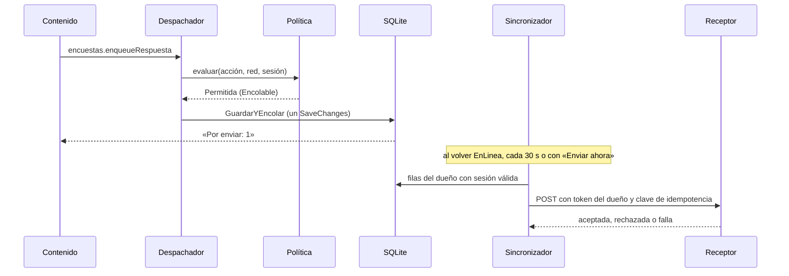
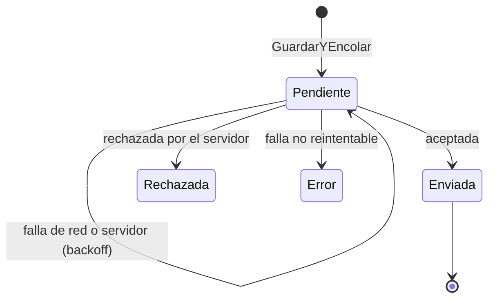
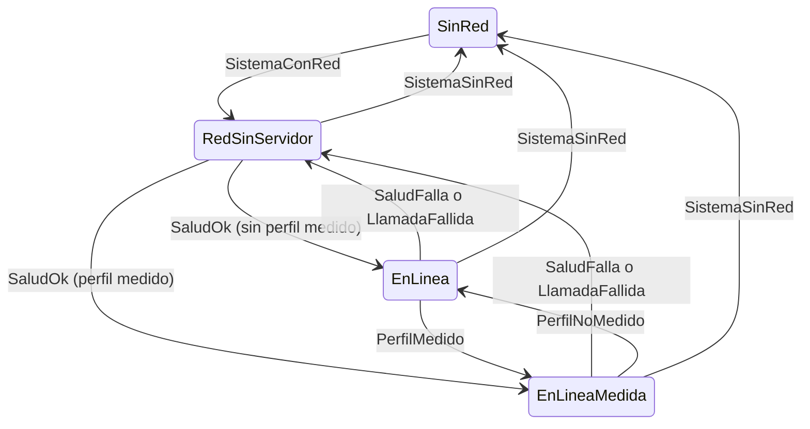
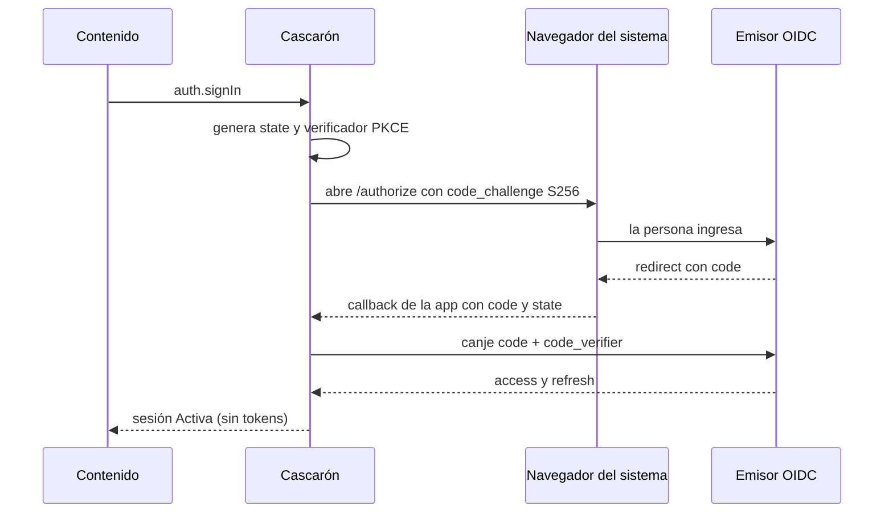
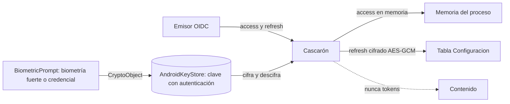

### Capítulo 5. Trabajo sin red: base local y outbox

**Objetivos**

- Definir *offline-first* y explicar por qué la base local es la fuente de verdad del teléfono.
- Conocer las cinco tablas reales del cascarón y quién es dueño de cada una.
- Entender por qué el documento y su fila del outbox se guardan en una sola transacción.
- Seguir paso a paso al sincronizador: idempotencia, dueño, orden por entidad, reintentos y carta muerta.
- Saber cómo conviven las versiones de definición en vuelo con las actualizaciones del contenido.

**Requisitos previos:** capítulo 1 (§1.4, offline-first y outbox) y capítulo 4 (contrato del puente).

#### 5.1 Offline-first: definición y por qué

**Offline-first** (*offline-first*) es un criterio de diseño en el que la app guarda primero en el teléfono y sincroniza después. La red mejora la experiencia, pero no es una condición para operar. En la demo esto se ve en la política de acciones: guardar una localidad (`SoloLocal`) y registrar una encuesta (`Encolable`) funcionan sin red [Demo/src/FrameworkConcept.Core/Red/PoliticaDeAcciones.cs:43-46].

Hay tres razones para elegirlo:

1. **Continuidad.** Quien trabaja en campo no puede depender de la cobertura. Si guardar exige red, se pierde trabajo.
2. **Latencia.** Leer de la base local responde en el acto, porque no hay ida y vuelta al servidor.
3. **Un único camino de escritura.** Si todo pasa por la base local, hay una sola manera de guardar, con o sin red. El caso «sin red» deja de ser una excepción.

Que la base local sea la fuente de verdad no significa que el servidor sobre. El teléfono es la fuente de verdad de **lo que la persona hizo**, y el servidor es la fuente de verdad de **lo que la organización aceptó**. El **outbox** (*transactional outbox*, bandeja de salida) es el puente entre las dos: guarda las intenciones de envío hasta que el servidor las acepta o las rechaza [R-B3-9].

#### 5.2 Las tablas reales

El cascarón es el dueño del esquema. El contenido nunca ejecuta DDL: sólo guarda documentos JSON a través del puente. El esquema funciona como un «sobre fijo» de columnas estables, así que una actualización de contenido nunca necesita migración. Un cambio de esquema exige subir `EsquemaDelCascaron.Version` y sale por tienda [Demo/src/FrameworkConcept.Shell/Data/Tablas.cs:3-5].

La persistencia usa EF Core sobre SQLite, detrás de la interfaz `IDb`. El `DbContext` declara cinco tablas [Demo/src/FrameworkConcept.Shell/Data/ContextoDelCascaron.cs:8-12]:

```csharp
// Demo/src/FrameworkConcept.Shell/Data/ContextoDelCascaron.cs:8-12
public DbSet<FilaDeOutbox> Outbox => Set<FilaDeOutbox>();
public DbSet<FilaDeDocumento> Documentos => Set<FilaDeDocumento>();
public DbSet<FilaDeDefinicion> Definiciones => Set<FilaDeDefinicion>();
public DbSet<FilaDeVersionDeContenido> VersionesDeContenido => Set<FilaDeVersionDeContenido>();
public DbSet<FilaDeConfiguracion> Configuracion => Set<FilaDeConfiguracion>();
```

Tabla 5.1. Tablas del cascarón.

| Tabla | Qué guarda | Fuente |
| --- | --- | --- |
| `Outbox` | Una fila por envío pendiente o resuelto: clave de idempotencia, dueño, acción, entidad, versiones, payload, estado, intentos y próximo intento | `Tablas.cs:10-55` |
| `Documentos` | Documentos JSON del contenido: colección, id, versión de forma, versión y el JSON tal cual | `Tablas.cs:69-80` |
| `Definiciones` | Cada versión de una definición de encuesta. Se conservan las que tienen respuestas sin enviar | `Tablas.cs:83-90` |
| `VersionesDeContenido` | Qué pasó con cada versión de contenido en este teléfono (activada, `Listo`, rollback) | `Tablas.cs:92-99` |
| `Configuracion` | Pares clave-valor del cascarón (id de instalación, última consulta, refresh sellado) | `Tablas.cs:101-106` |

Las fechas se guardan como milisegundos Unix (`long`), porque SQLite no compara ni ordena `DateTimeOffset` [Tablas.cs:7].

> **Nota de coherencia.** El diseño previo de `Framework-APP.md` listaba otras tablas (`RegistroRed`, `Sesion`, `ContenidoVersion`, `Config`) y se inclinaba por `sqlite-net-pcl`. La demo implementa las cinco tablas de la Tabla 5.1 con EF Core. El registro de red vive en memoria, en un buffer circular de 200 llamadas [Demo/src/FrameworkConcept.Core/Red/TransicionesDeRed.cs:73-74]. Este libro describe lo implementado [Framework-APP.md:288,292].

> **Límite declarado.** La demo no cifra la base local. `Framework-APP.md` recomienda SQLCipher cuando hay datos de personas [Framework-APP.md:290]. Es una decisión de producto (véase §6.8, D-N4-3) [R-B3-11][R-B3-12].

#### 5.3 Una transacción: documento y fila del outbox

La regla central del outbox es que **el cambio local y la intención de enviarlo se escriben juntos o no se escriben**. Si se guardara primero el documento y la app se cerrara antes de crear la fila, el dato quedaría en el teléfono sin salir nunca. Si se creara primero la fila, podría salir un envío de algo que no quedó guardado.

En la demo, `GuardarYEncolarAsync` resuelve esto con un único `SaveChanges`:

```csharp
// Demo/src/FrameworkConcept.Shell/Data/DbSqlite.cs:89-116 (recortado)
public Task<bool> GuardarYEncolarAsync(FilaDeDocumento documento, FilaDeOutbox fila, CancellationToken ct = default) =>
    ConCerrojo(async db =>
    {
        if (await db.Outbox.AnyAsync(f => f.ClaveIdempotencia == fila.ClaveIdempotencia, ct))
            return false;
        // … alta o actualización del documento …
        fila.CreadaEn = Ahora;
        fila.ProximoIntentoEn = Ahora;
        db.Outbox.Add(fila);

        // Un solo SaveChanges = una sola transacción de SQLite: el documento y la fila quedan juntos (P5).
        await db.SaveChangesAsync(ct);
        return true;
    }, ct);
```

Hay dos detalles que vale la pena mirar. El primero es que, si la clave de idempotencia ya existe, el método devuelve `false` y no duplica nada: reintentar el guardado desde la UI es inofensivo. El segundo es que la clave también tiene un índice único en la base [ContextoDelCascaron.cs:20], de modo que la garantía no depende sólo del código.

La Figura 5.1 muestra el recorrido completo de una acción encolable.



Figura 5.1. Guardar, encolar y sincronizar. Fijate en que el contenido recibe el «Por enviar» antes de que exista la red: el envío ocurre después y en otro proceso lógico.

#### 5.4 El sincronizador

El `SincronizadorDelOutbox` es el único componente que envía filas. Su diseño se resume en seis reglas.

##### 5.4.1 Idempotencia

Cada fila lleva una `ClaveIdempotencia` única y el receptor deduplica por ella, así que reenviar nunca duplica [Tablas.cs:14-15]. Esto permite reintentar sin miedo: si el servidor recibió el POST pero la respuesta se perdió, el segundo envío se descarta del lado del servidor.

##### 5.4.2 Dueño

Cada fila tiene un `Dueno` [Tablas.cs:17-18]. El sincronizador sólo mira las filas cuyo dueño es la identidad presente con sesión válida, y las filtra **antes** de aplicar el orden por entidad, para que una fila ajena no trabe a nadie [Demo/src/FrameworkConcept.Shell/Sync/SincronizadorDelOutbox.cs:128-130]. Justo antes de enviar, vuelve a validar al dueño y toma *su* token, porque la sesión pudo cambiar durante la pasada [SincronizadorDelOutbox.cs:142-153].

> **Nota de coherencia.** El comentario de `Dueno` todavía dice «la sesión por dispositivo (no hay login)» [Tablas.cs:17]. Con el modo con cuenta, el dueño es el `sub` de la cuenta; en modo Dispositivo, el id de instalación. La corrección del comentario queda para un PR de código.

##### 5.4.3 Orden por entidad

El orden se respeta **por entidad**, no globalmente. En cada pasada sale como mucho la primera fila pendiente de cada entidad, y si la primera fila de una entidad está en carta muerta, esa entidad queda trabada [SincronizadorDelOutbox.cs:131-136]:

```csharp
// Demo/src/FrameworkConcept.Shell/Sync/SincronizadorDelOutbox.cs:130-136
foreach (var fila in sinEnviar.Where(f => sesion.PuedeEnviarFilaDe(f.Dueno)))
{
    // La primera fila sin enviar de cada entidad decide: si está en carta muerta, la entidad queda trabada;
    // si está pendiente, es la única de su entidad que puede salir en esta pasada.
    if (!vistas.Add(fila.Entidad)) continue;
    if (fila.Estado == EstadoDeFila.Pendiente && (ignorarBackoff || fila.ProximoIntentoEn <= ahora)) elegidas.Add(fila);
}
```

El beneficio es que un problema queda acotado: una encuesta rechazada no frena las respuestas de otra encuesta.

##### 5.4.4 Reintentos con backoff exponencial

Ante una falla de red o del servidor, la fila espera antes del próximo intento: 5 s, 10 s, 20 s y así hasta un máximo de 10 min, sin límite de intentos [SincronizadorDelOutbox.cs:15,24-25,170]. Este **backoff por fila** es distinto del reintento del chequeo de salud (véase §6.1 y la Tabla 6.3).

##### 5.4.5 Cuándo corre una pasada

Corre una pasada en cuatro casos: cada 30 s [SincronizadorDelOutbox.cs:23,90], al volver la red a un estado con servidor, al volver la sesión a `Activa` [SincronizadorDelOutbox.cs:17-19] y cuando la persona toca **«Enviar ahora»** (`outbox.sendNow`). En la reconexión y en «Enviar ahora», la pasada ignora el backoff de las filas. Un semáforo garantiza que corra una sola pasada a la vez [SincronizadorDelOutbox.cs:28-29,99-112].

##### 5.4.6 Carta muerta

Una fila tiene cuatro estados [Tablas.cs:58-67]. `Rechazada` (el servidor la rechazó) y `Error` (algo que reintentar no arregla, como un payload ilegible) forman la **carta muerta** (*dead letter*): **no se borran**, se muestran al usuario y en la pantalla de Diagnóstico.



Figura 5.2. Estados de una fila del outbox. Lo que hay que notar es que de `Rechazada` y `Error` no sale ninguna flecha: la carta muerta queda a la vista y no se descarta.

#### 5.5 Encuestas y versiones de definición en vuelo

Las encuestas viajan como **datos**, no como código [02-Cascaron-Puente-Y-Capacidades.md:37]. Cada respuesta registra con qué definición se tomó (`EncuestaId` y `VersionDefinicion`) [Tablas.cs:31-35]. Antes de encolar, el despachador comprueba que esa versión de la definición esté en el teléfono [Demo/src/FrameworkConcept.Shell/Bridge/DespachadorDelPuente.cs:214-215].

El problema que esto resuelve es el de la **versión de definición en vuelo**: una persona completa una encuesta con la versión 3, sin red, y mientras tanto el servidor publica la versión 4. La respuesta guardada sigue siendo de la 3 y debe interpretarse como tal. Por eso la tabla `Definiciones` conserva las versiones que tienen respuestas sin enviar [Tablas.cs:83], y la carta muerta de Diagnóstico muestra la versión con que se tomó cada fila [Demo/src/FrameworkConcept.Shell/Pages/DiagnosticoPage.xaml.cs:131].

#### 5.6 Actualizar sin tocar los pendientes

Hay una regla que une este capítulo con el 3: **ninguna actualización espera a vaciar el outbox ni descarta pendientes** (P13.7) [02-Cascaron-Puente-Y-Capacidades.md:97][01-Actualizacion-Sin-Tienda.md:220]. Esto es posible por dos decisiones previas:

- el esquema es un sobre fijo, así que una versión nueva del contenido no migra la base (§5.2);
- cada fila guarda la versión del contenido y de la definición con que se tomó [Tablas.cs:28-35], así que el receptor sabe interpretarla aunque el contenido ya haya cambiado.

La alternativa, «sincronizar antes de actualizar», parece prudente, pero ata la actualización a la red y, si hay una fila en carta muerta, la deja bloqueada para siempre.

> **En la industria.** El patrón *transactional outbox* nació en los microservicios para publicar eventos sin transacciones distribuidas [R-B3-9]. La guía de arquitectura de Android propone la misma idea para móviles: la base local como fuente única y la sincronización como tarea en segundo plano [R-B3-10]. OWASP MASVS-STORAGE exige pensar qué datos sensibles quedan en el almacenamiento local y cómo se protegen [R-B3-11].

**Preguntas guía**

1. ¿Qué se pierde si el documento y la fila del outbox se guardan en dos transacciones?
2. ¿Por qué el orden es por entidad y no global?
3. ¿Qué diferencia hay entre `Rechazada` y una fila `Pendiente` con muchos intentos?
4. Si se publica una definición nueva mientras hay respuestas pendientes, ¿qué tabla las protege?
5. ¿Por qué no conviene vaciar el outbox antes de una actualización OTA?

**Resumen**

La base local es la fuente de verdad de lo que hizo la persona. El cascarón es dueño de cinco tablas con esquema fijo. El documento y su fila del outbox se guardan en un único `SaveChanges`. El sincronizador envía con idempotencia, sólo las filas del dueño con sesión válida y en orden por entidad, reintenta con backoff de 5 s a 10 min y nunca borra la carta muerta. Las versiones de definición en vuelo se conservan, y ninguna actualización toca los pendientes.

---

### Capítulo 6. Red y sesión del dispositivo

**Objetivos**

- Distinguir «hay red» de «llego a mi servidor» y conocer los cuatro estados de red combinados.
- Clasificar una acción del negocio según la red y saber cómo la hace cumplir el despachador.
- Elegir entre el modo Formulario y el modo Navegador para el ingreso, con su justificación en los estándares.
- Entender la cadena del secreto: biometría, Keystore y refresh token.
- Tener a mano todos los tiempos de red y sesión en una sola tabla.

**Requisitos previos:** capítulo 4 (contrato del puente, error -32005) y capítulo 5.

#### 6.1 Estado de red combinado

El sistema operativo informa si hay conectividad, pero eso no garantiza que el servidor responda: puede haber un portal cautivo, un DNS caído o un servidor en mantenimiento. Por eso la demo combina la señal de `Connectivity` del sistema [R-B3-7] con un chequeo de salud propio y obtiene el **estado de red combinado**, con cuatro valores:

Tabla 6.1. Estados de red.

| Estado | Significado | Aviso para la persona |
| --- | --- | --- |
| `EnLinea` | Hay red y el servidor responde | Ninguno |
| `EnLineaMedida` | Igual, pero por datos móviles sin WiFi | «Datos móviles» |
| `RedSinServidor` | Hay red, pero el servidor no responde | «Hay red pero el servidor no responde. Reintentando…» |
| `SinRed` | El sistema no tiene conectividad | «Sin conexión. Lo que hagas se guarda y se envía cuando vuelva.» |

Los textos salen de `TransicionesDeRed.MotivoDe` [Demo/src/FrameworkConcept.Core/Red/TransicionesDeRed.cs:44-50].

La máquina de estados es una función pura (estado actual más señal da el estado siguiente), sin MAUI ni reloj, lo que permite probarla sin dispositivo [TransicionesDeRed.cs:3-8,13-37]. Hay una regla de fondo: **sólo un chequeo de salud exitoso saca de `RedSinServidor`** [TransicionesDeRed.cs:25-26].



Figura 6.1. Estados de red. Observá que de `SinRed` nunca se pasa directo a `EnLinea`: siempre se pasa por `RedSinServidor` hasta que la salud lo confirme.

El chequeo de salud es un `GET /salud` con un timeout de 3 s, y su resultado se reutiliza durante 10 s. En `RedSinServidor` se reintenta con backoff de 5 a 60 s, sin límite de intentos, y en línea se confirma cada 60 s [TransicionesDeRed.cs:58-71]. El código aclara que estos valores son de la demo y no valores de producto [TransicionesDeRed.cs:53-55]. El nombre del endpoint lo decide cada servidor: `Framework-APP.md` usaba `GET /health` [Framework-APP.md:214].

#### 6.2 Política de acciones

La **política de acciones** clasifica cada acción del negocio según lo que necesita de la red [Demo/src/FrameworkConcept.Core/Red/PoliticaDeAcciones.cs:5-19]:

- `SoloLocal`: se ejecuta siempre.
- `Encolable`: se guarda en el outbox y sale cuando haya red y sesión válida.
- `SoloEnLinea`: sin servidor se bloquea, con el botón deshabilitado y un motivo.
- `SoloWiFi`: está contemplada en la lógica, pero ninguna acción de la demo la usa.

En la demo, la política es una constante del cascarón [PoliticaDeAcciones.cs:33-36,41-51]:

```csharp
// Demo/src/FrameworkConcept.Core/Red/PoliticaDeAcciones.cs:41-51 (recortado)
public static IReadOnlyList<AccionDeclarada> Acciones { get; } =
[
    new("localidades.guardar", ClaseDeAccion.SoloLocal, ["documents.put", "documents.delete"], /* … */),
    new("encuesta.enviar", ClaseDeAccion.Encolable, ["encuestas.enqueueRespuesta"], /* … */),
    new("outbox.enviarAhora", ClaseDeAccion.SoloEnLinea, ["outbox.sendNow"], /* … */),
    new(Ingresar, ClaseDeAccion.SoloEnLinea, ["auth.signIn", "auth.signInWithPassword"], /* … */)
];
```

La política se aplica en dos lugares, y ninguno reemplaza al otro:

1. **En el contenido**, que consulta la evaluación (`actions.policy`, `actions.check`, evento `actions.changed`) y deshabilita el botón con su motivo [PoliticaDeAcciones.cs:58-69].
2. **En el despachador del puente**, que evalúa cada método que es una acción del negocio y, si no está permitida, responde con `AccionBloqueada` (-32005) [Demo/src/FrameworkConcept.Shell/Bridge/DespachadorDelPuente.cs:27][Demo/src/FrameworkConcept.Core/Contracts/Puente/Sobre.cs:64].

El contenido puede tener un error y el despachador no. Esa es la frontera de confianza del capítulo 4.

**Plantilla para una acción nueva.** Para sumar una acción, respondé: ¿qué id estable tiene (dominio en español, por ejemplo «localidades.guardar»)? ¿Qué clase le corresponde? ¿Qué métodos del puente la ejecutan? ¿Qué texto explica el bloqueo? Si es `Encolable`, ¿cuál es su entidad para el orden del outbox? Las preguntas salen de la forma de `AccionDeclarada` [PoliticaDeAcciones.cs:21-30] y de la lista de chequeo de `02-Cascaron-Puente-Y-Capacidades.md:244`.

#### 6.3 Sesión e identidad

La identidad la da un **emisor OIDC** (*OpenID Provider*), no el teléfono. La sesión pasa por seis estados: `SinCuenta`, `Ingresando`, `Activa`, `Bloqueada`, `Vencida` y `Revocada` [Demo/src/FrameworkConcept.Core/Auth/Sesion.cs:18-32]. `Bloqueada` significa que hay identidad pero el refresh token está sellado en el Keystore y falta el desbloqueo local (§6.4).

El ingreso tiene dos modos, que se eligen al compilar con la propiedad `FcModoDeIngreso` [07-Red-Y-Autenticacion.md:157-164].

Tabla 6.2. Modos de ingreso.

| Modo | Método del puente | Canje | Cuándo |
| --- | --- | --- | --- |
| `Formulario` (por defecto) | `auth.signInWithPassword` | ROPC (`grant_type=password`) [Demo/src/FrameworkConcept.Core/Auth/Oidc.cs:108-115] | Sólo con el emisor de ensayo |
| `Navegador` | `auth.signIn` | Authorization code + PKCE S256 en la Custom Tab (`WebAuthenticator`) [Oidc.cs:70-80,86-93] | Producción |

**Modo Navegador.** Sigue RFC 8252: la app nativa abre el navegador del sistema, nunca una WebView propia, para que la app no vea la clave [R-B3-1]. Usa PKCE con `code_challenge_method=S256`, porque la app es un cliente público sin secreto [R-B3-2][Oidc.cs:76,86]. Además manda `prompt` en cada ingreso interactivo, para que la sesión SSO viva en el navegador no entre sola después de un cierre de sesión [Oidc.cs:77-79].



Figura 6.2. Ingreso en modo Navegador. Mirá la última flecha: el contenido se entera de que hay sesión, pero no recibe ningún token.

**Modo Formulario.** El contenido dibuja su propio formulario y la clave cruza el puente **una sola vez**, en un método específico. El cascarón la canjea con ROPC. El propio código explica que ROPC está desaconsejado por el BCP de seguridad de OAuth (RFC 9700 §2.4) y que se usa sólo porque el emisor de ensayo no trae el endpoint del borrador *OAuth 2.0 for First-Party Applications* [Oidc.cs:96-106][R-B3-3][R-B3-4]. Cambiar de emisor cambia ese cuerpo y nada más.

**Recomendación para producción.** Modo Navegador por defecto: es el estándar maduro y trae MFA y SSO sin costo. Un formulario propio vale cuando el emisor implemente el borrador de apps first-party. ROPC, nunca en producción (D-N4-1, §6.8).

#### 6.4 Desbloqueo local y Keystore

La seguridad del teléfono (huella, rostro, PIN o patrón) **no es identidad**. Sólo abre un secreto. El refresh token se sella con una clave AES-256-GCM del AndroidKeyStore con alias `fc.sesion.refresh` [Demo/src/FrameworkConcept.Shell/Auth/CofreDeSesion.cs:18-38][R-B3-5]. La clave exige autenticación en cada uso (timeout 0) y acepta biometría fuerte o la credencial del dispositivo:

```csharp
// Demo/src/FrameworkConcept.Shell/Auth/CofreDeSesion.cs:119-130 (recortado)
var especificacion = new KeyGenParameterSpec.Builder(Alias, KeyStorePurpose.Encrypt | KeyStorePurpose.Decrypt)
    .SetBlockModes(KeyProperties.BlockModeGcm)!
    .SetEncryptionPaddings(KeyProperties.EncryptionPaddingNone)!
    .SetKeySize(256)!
    .SetUserAuthenticationRequired(true)!
    .SetUserAuthenticationParameters(0, (int)(KeyPropertiesAuthType.BiometricStrong | KeyPropertiesAuthType.DeviceCredential))!
    .SetInvalidatedByBiometricEnrollment(true)!
    .Build();
```

La clave sólo se puede usar dentro de un `CryptoObject` de `BiometricPrompt`, el diálogo de la plataforma, sin paquete AndroidX [CofreDeSesion.cs:150-163][R-B3-6]. El desbloqueo se ofrece sólo con API 30 o superior y con bloqueo de pantalla configurado [CofreDeSesion.cs:24-26][Oidc.cs:246]. Si el Keystore invalida la clave (por ejemplo, porque se quitó el bloqueo de pantalla), la clave se borra y hay que volver a ingresar con la cuenta [CofreDeSesion.cs:15-16,27].



Figura 6.3. La cadena del secreto. El texto sellado vive en la base y la clave vive en el hardware. Ninguno de los dos sirve sin el otro ni sin la persona frente al teléfono.

> **Apartamiento declarado H-1.** El borrador pedía que una huella nueva invalidara la clave. Con `BIOMETRIC_STRONG | DEVICE_CREDENTIAL` eso no ocurre: enrolar una huella nueva no invalida la clave [07-Red-Y-Autenticacion.md:302-309][E03 H-1]. Se mantuvo la combinación porque el PO pidió aceptar también PIN y patrón (P4). La invalidación al quitar el bloqueo de pantalla sigue vigente. El comentario de `CofreDeSesion.cs:128-129` todavía afirma lo contrario y se corrige en un PR de código aparte.

`Framework-APP.md` advertía que `SecureStorage` no ata la lectura a la biometría y proponía evaluar un plugin [Framework-APP.md:189]. La demo cerró esa pregunta en Android con código de plataforma. En iOS (Keychain), el mecanismo equivalente está **NO VERIFICADO**.

#### 6.5 Ningún token cruza el puente

El contenido ve **el estado** de la sesión (quién es, si está activa o bloqueada), pero nunca un token. Esta regla (P3) la hace cumplir una prueba de la compuerta que recorre todos los parámetros, respuestas y eventos del contrato y falla si alguno nombra un token o una credencial [Demo/tests/FrameworkConcept.Gate.Tests/Contrato/SinTokensEnElPuenteTests.cs:8-20]:

```csharp
// Demo/tests/FrameworkConcept.Gate.Tests/Contrato/SinTokensEnElPuenteTests.cs:17-18
// «clave» no entra: claveIdempotencia es legítima (P13.6).
private static readonly string[] Prohibidas = ["token", "secret", "password", "contrasena", "credencial", "verifier", "verificador"];
```

La única excepción es `auth.signInWithPassword`, cuyos parámetros sí llevan la clave. Otra prueba verifica que la credencial cruce una sola vez y nunca vuelva [SinTokensEnElPuenteTests.cs:36-40]. La propia prueba se describe como «una red gruesa»: un nombre inocente que contenga «token» la hace saltar, y eso se discute en el PR [SinTokensEnElPuenteTests.cs:10-11].

#### 6.6 Tabla única de tiempos

Hay varios tiempos parecidos que conviene no mezclar. La Tabla 6.3 los junta con su propósito.

Tabla 6.3. Tiempos de red y sesión.

| Parámetro | Valor | Para qué | Fuente | Naturaleza |
| --- | --- | --- | --- | --- |
| Timeout de salud | 3 s | No colgar el chequeo | `TransicionesDeRed.cs:59` | demo |
| Caché de salud | 10 s | No preguntar dos veces seguidas | `TransicionesDeRed.cs:62` | demo |
| Reintento de salud | de 5 a 60 s; en línea, cada 60 s | Volver a alcanzar el servidor | `TransicionesDeRed.cs:65-71` | demo |
| Backoff por fila del outbox | de 5 s a 10 min, exponencial | Que el servidor acepte la fila | `SincronizadorDelOutbox.cs:24-25,170` | demo |
| Pasada del sincronizador | cada 30 s | Barrido periódico | `SincronizadorDelOutbox.cs:23` | demo |
| Bloqueo tras segundo plano | 5 min | Volver a pedir la seguridad del teléfono | `Oidc.cs:249` | demo |
| Renovación anticipada del access | 30 s antes de vencer | Evitar llamadas con token vencido | `Oidc.cs:252` | demo |
| Reanudación con consulta OTA | 15 min | Buscar versión nueva del contenido | `99-Anexos.md:219` | producto [folio 036] |
| Sesión SSO del emisor de ensayo | 30 min sin uso, 10 h como máximo | Vida de la sesión en el emisor | `07-Red-Y-Autenticacion.md` §2.4.1 | ensayo |

Los dos backoffs resuelven problemas distintos: el de salud mide si se alcanza el servidor, y el de fila mide si el servidor acepta ese envío. Los 15 min de la reanudación OTA y los 5 min del bloqueo también son independientes: uno consulta el canal y el otro protege la sesión.

#### 6.7 Casos medidos y lo que sigue sin verificar

Los ensayos E03 y E05 corrieron estos mecanismos en un emulador de ensayo y en un teléfono de medida. Las cifras de tiempo están en la corrida fechada (Anexo H).

- **Encuesta sin red y reconexión sola.** Se registró una encuesta en modo avión, se levantó el receptor, la app pasó sola a `EnLinea` y la fila salió con el dueño correcto [E03 §4.3][07-Red-Y-Autenticacion.md:245-250].
- **Cerrar sesión conserva lo pendiente.** Con red y sin sesión, el outbox no envió. Al reingresar con la misma cuenta, la fila salió [E03 paso g][07-Red-Y-Autenticacion.md:252-257]. El criterio es «retener es reversible, borrar no».
- **Quitar el bloqueo de pantalla.** La clave del Keystore quedó invalidada. Después de las correcciones de E03, la sesión pasa de `Bloqueada` a `SinCuenta` [07-Red-Y-Autenticacion.md:259-265].
- **Login en el contenido** (E05): ingreso, sesión activa, bloqueo y desbloqueo sin red, en el emulador y en el teléfono de medida [E05].

Siguen **NO VERIFICADOS**: el estado `EnLineaMedida` en un dispositivo, la regresión del modo sin cuenta en el emulador, el conjunto completo en un teléfono físico y el Keychain de iOS [E03 §7][07-Red-Y-Autenticacion.md §8].

#### 6.8 Decisiones abiertas

Tabla 6.4. Decisiones de red y sesión.

| Id | Pregunta | Alternativas | Recomendación |
| --- | --- | --- | --- |
| D-N4-1 | ¿Con qué canje se ingresa en producción? | (a) Navegador, RFC 8252 + PKCE; (b) formulario con el borrador de apps first-party; (c) ROPC | (a) por defecto; (b) cuando el emisor lo soporte y se quiera UI propia; (c) nunca [R-B3-3] |
| D-N4-2 | ¿Qué hacer con la invalidación por enrolamiento (H-1)? | (a) Mantener biometría fuerte o credencial y declararlo; (b) sólo biometría | (a): lo pidió el PO (P4) y la invalidación al quitar el bloqueo sigue vigente |
| D-N4-3 | ¿Se cifra la base local? | (a) No (la demo); (b) SQLCipher con la clave en el Keystore; (c) cifrar sólo payloads sensibles | La decide el producto según el dato; (b) cuando haya datos personales [R-B3-11][R-B3-12] |
| D-N4-4 | ¿Se piden *offline tokens*? | (a) `openid profile`, que vence con la sesión SSO; (b) `offline_access` | Abierta: (a) es más simple y segura; (b) evita reingresos en jornadas largas sin red |
| D-N4-5 | ¿Cuántos backoffs se exponen? | Uno o dos | Dos, documentados por separado (Tabla 6.3) |

> **En la industria.** RFC 8252 es la práctica actual para apps nativas: navegador del sistema, nunca una WebView embebida para el login [R-B3-1], con PKCE obligatorio para clientes públicos [R-B3-2]. El BCP de seguridad de OAuth (RFC 9700) desaconseja ROPC [R-B3-3], y el IETF trabaja en un camino estándar para formularios propios de apps first-party [R-B3-4]. Del lado de la plataforma, Android documenta el Keystore con claves atadas a la autenticación [R-B3-5] y `BiometricPrompt` con `CryptoObject` [R-B3-6]. .NET MAUI ofrece `Connectivity` y `WebAuthenticator` como piezas de base [R-B3-7][R-B3-8]. OWASP MASVS ordena los controles en STORAGE, AUTH y NETWORK [R-B3-11].

**Preguntas guía**

1. ¿Por qué `SistemaConRed` lleva a `RedSinServidor` y no a `EnLinea`?
2. Si el contenido tiene un error y no deshabilita un botón `SoloEnLinea`, ¿qué pasa cuando se invoca el método sin servidor?
3. ¿Qué gana el modo Navegador frente al modo Formulario, y qué pierde?
4. ¿Por qué la huella no es identidad? ¿Qué abre exactamente?
5. ¿Qué dos backoffs hay y qué mide cada uno?

**Resumen**

El estado de red combina el sistema con un chequeo de salud y tiene cuatro valores. Sólo la salud confirma que se llega al servidor. La política de acciones clasifica cada acción en `SoloLocal`, `Encolable` o `SoloEnLinea`; el contenido la muestra y el despachador la impone con -32005. La identidad la da el emisor OIDC: en producción se ingresa por el navegador del sistema con PKCE, y ROPC queda limitado al ensayo. La seguridad del teléfono abre una clave del Keystore que sella el refresh token, con el apartamiento H-1 declarado. Ningún token cruza el puente, y una prueba de la compuerta lo hace cumplir.

<!-- GLOSARIO:
offline-first | La app guarda primero en local y sincroniza después; la red es una mejora, no una condición para operar | offline-first | §5.1
outbox | Tabla donde la intención de enviar se escribe en la misma transacción que el cambio local; un sincronizador la entrega después | transactional outbox | §5.1
clave de idempotencia | Identificador único de una fila del outbox con el que el receptor deduplica los reenvíos | idempotency key | §5.4.1
dueño (de una fila) | Identidad a la que pertenece una fila del outbox; sólo sale con la sesión válida de esa identidad | owner | §5.4.2
orden por entidad | Regla por la que una fila trabada sólo frena a las siguientes de su misma entidad | per-entity ordering | §5.4.3
carta muerta | Filas `Rechazada` o `Error`: no se reintentan ni se borran, quedan a la vista | dead letter | §5.4.6
versión de definición en vuelo | Versión de una definición con la que se tomó una respuesta todavía no enviada | in-flight schema version | §5.5
estado de red combinado | Conectividad del sistema más chequeo de salud: EnLinea, EnLineaMedida, RedSinServidor, SinRed | reachability | §6.1
chequeo de salud | GET al servidor propio con timeout corto que confirma que se lo alcanza | health check | §6.1
política de acciones | Clasificación de cada acción en SoloLocal, Encolable o SoloEnLinea | action policy | §6.2
emisor OIDC | Servidor que autentica a la persona y emite los tokens | OpenID Provider | §6.3
modo Navegador | Ingreso con code + PKCE en el navegador del sistema (RFC 8252) | native app authorization | §6.3
modo Formulario | Ingreso con formulario propio; la clave cruza el puente una vez | first-party login | §6.3
desbloqueo local | Prueba de presencia (biometría o credencial del dispositivo) que abre la clave del Keystore | local authentication | §6.4
-->

<!-- REFERENCIAS:
R-B3-1. IETF. *RFC 8252, OAuth 2.0 for Native Apps*. https://www.rfc-editor.org/rfc/rfc8252. Consulta: a verificar
R-B3-2. IETF. *RFC 7636, Proof Key for Code Exchange (PKCE)*. https://www.rfc-editor.org/rfc/rfc7636. Consulta: a verificar
R-B3-3. IETF. *RFC 9700, Best Current Practice for OAuth 2.0 Security*. https://www.rfc-editor.org/rfc/rfc9700. Consulta: a verificar
R-B3-4. IETF. *OAuth 2.0 for First-Party Applications (borrador)*. https://datatracker.ietf.org/doc/draft-ietf-oauth-first-party-apps/. Consulta: a verificar
R-B3-5. Android Developers. *Android Keystore system*. https://developer.android.com/privacy-and-security/keystore. Consulta: a verificar
R-B3-6. Android Developers. *Show a biometric authentication dialog*. https://developer.android.com/identity/sign-in/biometric-auth. Consulta: a verificar
R-B3-7. Microsoft Learn. *.NET MAUI: Connectivity*. https://learn.microsoft.com/dotnet/maui/platform-integration/communication/networking. Consulta: a verificar
R-B3-8. Microsoft Learn. *.NET MAUI: Web authenticator*. https://learn.microsoft.com/dotnet/maui/platform-integration/communication/authentication. Consulta: a verificar
R-B3-9. C. Richardson. *Pattern: Transactional outbox*. https://microservices.io/patterns/data/transactional-outbox.html. Consulta: a verificar
R-B3-10. Android Developers. *Build an offline-first app*. https://developer.android.com/topic/architecture/data-layer/offline-first. Consulta: a verificar
R-B3-11. OWASP. *Mobile Application Security Verification Standard (MASVS)*. https://mas.owasp.org/MASVS/. Consulta: a verificar
R-B3-12. Zetetic. *SQLCipher*. https://www.zetetic.net/sqlcipher/. Consulta: a verificar
-->

<!-- MARCAS:
NO VERIFICADO | Keychain de iOS como equivalente del cofre | §6.4
NO VERIFICADO | EnLineaMedida en dispositivo; regresión sin cuenta en emulador; conjunto en teléfono físico; Keychain iOS | §6.7
Nota de coherencia (no es marca) | Tablas.cs:17 comentario de Dueno; CofreDeSesion.cs:128-129 comentario H-1 → PR de código aparte | §5.4.2, §6.4
-->
