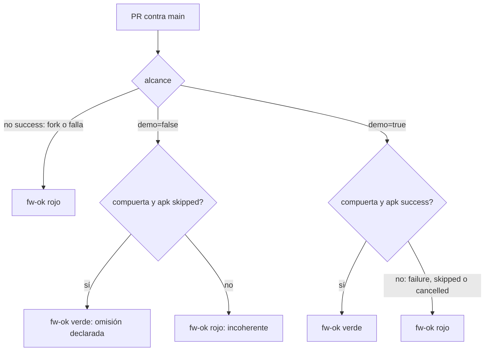
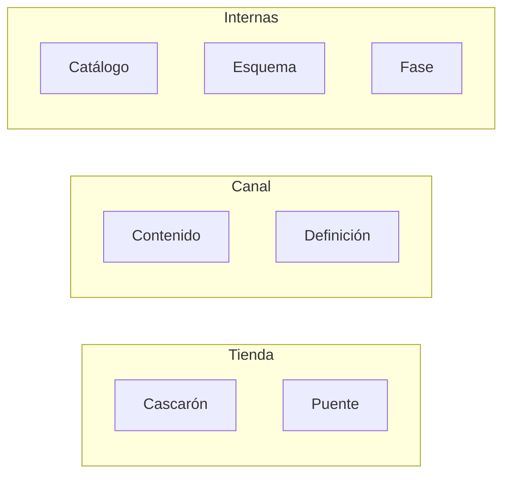
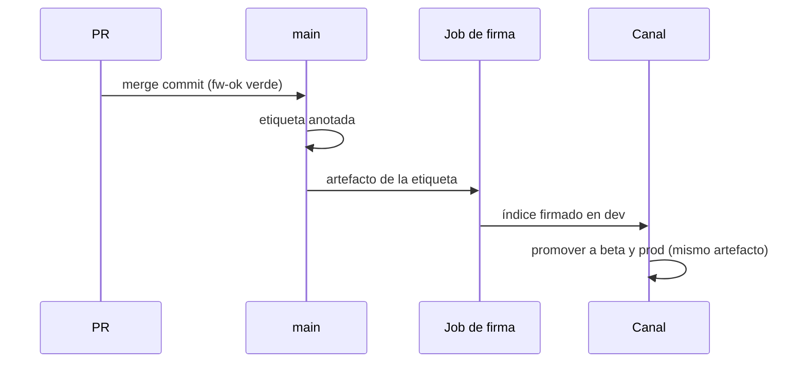
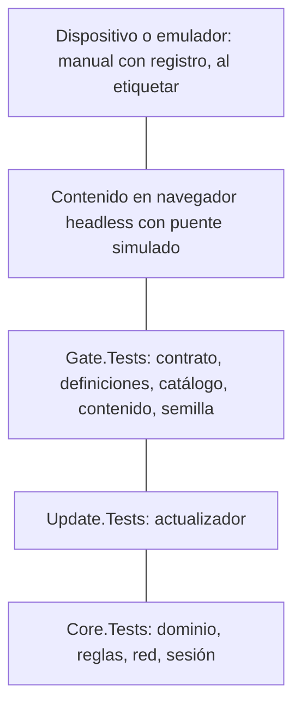
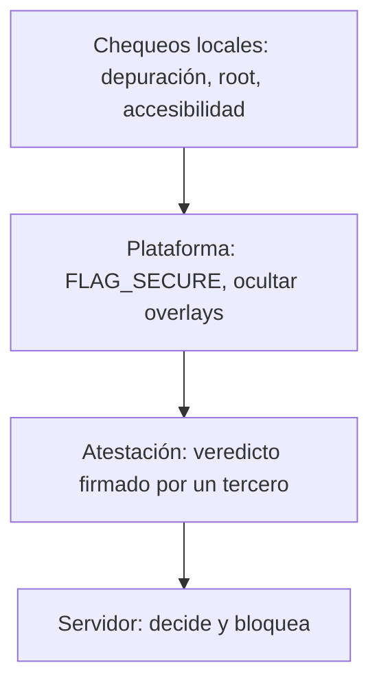
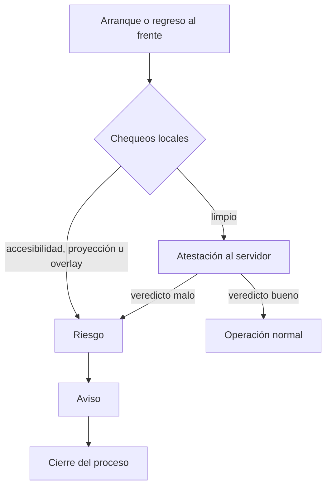
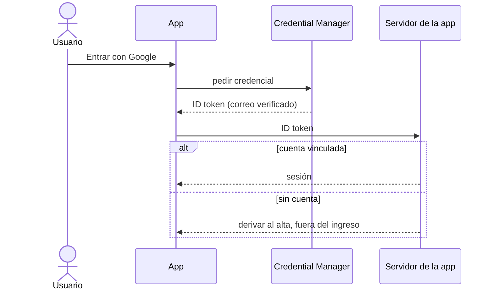

## Parte III. Ingeniería

Esta parte trata lo que rodea al mecanismo: cómo entra un cambio al repositorio sin romper lo que andaba (capítulo 7), cómo se prueba (capítulo 8) y qué hace la industria para proteger el entorno en el que corre la app y para dar de alta cuentas (capítulo 9). Las rutas de las citas son relativas a `Concepts/Framework-Concept/`. El workflow vive en la raíz del repositorio y se cita como `../../.github/workflows/framework-concept-demo.yml`, con líneas al commit `9b5b5ad`.

### Capítulo 7. Integración y versionado

**Objetivos**

- Entender por qué la demo tiene una sola rama estable y un único check obligatorio.
- Leer la tabla de decisión del agregador `fw-ok` y explicar por qué un `skipped` es peligroso.
- Correr en local la misma compuerta que corre el servidor de integración.
- Distinguir los dos caminos de publicación, las cuatro líneas de versión visibles y las tres internas.
- Saber qué número sube cada tipo de cambio y cómo llega un artefacto desde la fusión hasta un canal.

**Requisitos previos:** capítulo 1 (cuatro líneas de versión), capítulo 3 (índice del canal, firma y promoción) y capítulo 4 (contrato del puente).

#### Parte A. Conceptos

#### 7.1 Una rama estable y PR obligatorio

El problema que resuelve este capítulo es concreto: un PR que rompe lo que funcionaba. La respuesta de la demo es el modelo más simple que lo evita. Hay una sola rama de integración, `main`, y todo cambio entra por **pull request** (*PR*): una propuesta de fusión que se revisa y se prueba antes de entrar.

Es el modelo que GitHub llama *GitHub flow*: ramas cortas que salen de `main` y vuelven a `main` [R-B4-1]. Es compatible con el desarrollo basado en tronco (*trunk-based development*), que pide ramas todavía más cortas [R-B4-2]. Se descartó una rama `develop` intermedia: suma una segunda integración y no aporta nada a un equipo chico [03-Integracion-Y-Versionado.md §2.5].

Tabla 7.1. Modelos de ramas considerados.

| Modelo | Decisión | Criterio |
|---|---|---|
| GitHub flow con `main` protegida | Elegido | Una sola integración |
| Trunk-based | Compatible | Ramas más cortas; no cambia la compuerta |
| `develop` + `main` (git-flow) | Descartado | Dos integraciones para un equipo chico |

#### 7.2 La compuerta y el check agregador `fw-ok`

**Compuerta** (*gate*): el conjunto de pruebas que un PR tiene que pasar para poder fusionarse. En GitHub, una rama protegida exige que ciertos **checks obligatorios** (*required status checks*) estén en verde [R-B4-3].

El primer reflejo sería declarar obligatorios todos los jobs. Tiene un problema: GitHub toma un job **omitido** (`skipped`) como éxito a los fines del check obligatorio [R-B4-4]. Si un job no corre porque una condición lo saltea, el PR pasa sin que nadie haya probado nada.

La demo lo resuelve con un **check agregador** (*aggregator check*): un job que corre siempre, no lee el código del PR y sólo mira el resultado de los demás. Se llama `fw-ok` y es el único check obligatorio de `main` [../../.github/workflows/framework-concept-demo.yml:5-6, 164-170].

```yaml
# ../../.github/workflows/framework-concept-demo.yml:166-170
  fw-ok:
    needs: [alcance, compuerta, apk]
    if: always()
    # …
```

`if: always()` hace que corra aunque algo haya fallado o se haya omitido; `needs` le da acceso a los resultados.

La regla es **estricta**: `skipped` y `cancelled` cuentan como rojo. Hay una sola excepción, la **omisión declarada**: el PR no toca la demo y el job `alcance` lo informa con su motivo [../../.github/workflows/framework-concept-demo.yml:188-196].



Figura 7.1. Decisión del agregador `fw-ok`. Fijate que hay un solo camino verde por omisión, y que exige que *ambos* jobs estén omitidos [../../.github/workflows/framework-concept-demo.yml:182-205].

Dos detalles del job `alcance` completan el cuadro:

- **Sin filtro `paths` en `on:`.** Si el workflow tuviera `paths`, un PR que no toca la demo no dispararía nada y el check obligatorio quedaría esperando. El alcance lo decide un paso con `git diff --name-only "$BASE_SHA...$HEAD_SHA"` [../../.github/workflows/framework-concept-demo.yml:4, 21-24, 68]. Si cambia el propio workflow, corre todo [:70-71].
- **Guarda de mismo repositorio.** Un PR desde un *fork* no corre en el runner autoalojado: `alcance` queda omitido y, por la regla estricta, `fw-ok` da rojo [:42, 182-186]. El workflow pide sólo `permissions: contents: read` y no usa secretos [:26-27], como recomienda GitHub para runners propios [R-B4-5].

#### 7.3 Compuerta local igual a la remota

Un desarrollador tiene que poder ver el rojo antes de abrir el PR. Para eso, `Demo/scripts/ci-local.sh` corre **los mismos pasos, en el mismo orden** que el workflow [Demo/scripts/ci-local.sh:2-11].

Tabla 7.2. Los siete pasos de la compuerta.

| Paso | Qué hace |
|---|---|
| 0. Base del PR | Extrae la demo tal como está en la rama de destino para comparar contrato y definiciones |
| 1. Build | `FrameworkConcept.Demo.SinMaui.slnf` con avisos como error |
| 2. `Core.Tests` | Dominio, reglas portadas y contrato |
| 3. `Update.Tests` | Actualizador |
| 4. `Gate.Tests` | Instantánea del contrato, definiciones, catálogo frente al manifiesto, contenido sin AOT |
| 5. Contenido | `dotnet publish` del contenido y empaquetado con su manifiesto del paquete |
| 6. APK | El cascarón MAUI para `android-arm64` |

Fuente: [Demo/scripts/ci-local.sh:5-11].

La **base del PR** merece una definición propia: es la demo tal como está en la rama de destino. El paso 0 la arma con `git archive` y la pasa a las pruebas en la variable `FC_GATE_BASE` [Demo/scripts/ci-local.sh:83-110]. Sin base no hay con qué comparar lo publicado, y por eso `Gate.Tests` falla si corre en integración (`CI=true`) sin ella [Demo/tests/FrameworkConcept.Gate.Tests/Infraestructura/Repositorio.cs:51-56]. En local, las pruebas que la necesitan se omiten y lo informan (véase §8.4).

**Avisos como error sólo en integración.** La propiedad se activa cuando `CI` vale `true`, que GitHub define en todos sus runners:

```xml
<!-- Demo/Directory.Build.props:18 -->
<TreatWarningsAsErrors Condition="'$(CI)' == 'true'">true</TreatWarningsAsErrors>
```

`ci-local.sh` exporta `CI=true`, así que en local el aviso también rompe [Demo/scripts/ci-local.sh:43]. El runner no tiene KVM ni acceso a Docker, así que los pasos corren `dotnet` directo y el dispositivo queda fuera del PR [../../.github/workflows/framework-concept-demo.yml:12-13].

#### 7.4 Dos caminos de publicación, cuatro líneas visibles y tres internas

**Línea de versión:** una secuencia de números para algo que se publica por un camino propio [03-Integracion-Y-Versionado.md §2.1]. La demo separa las líneas para que un error se pueda atribuir a versiones exactas.

Hay **dos caminos de publicación**: la **tienda** (Play Store, App Store), lento y revisado, y el **canal** OTA del capítulo 3, inmediato y firmado. Sobre ellos viajan **cuatro líneas visibles**, las que muestra junta la pantalla de diagnóstico [Developer-Guide.md:37; 06-Procedimientos-PR-Integracion-Versionado.md:285], y **tres internas**.

Tabla 7.3. Las líneas de versión y su fuente única.

| Línea | Camino | Fuente única | Valor al commit `9b5b5ad` |
|---|---|---|---|
| Cascarón | Tienda | `Demo/versionado/version-cascaron.props` | `1.0.0` / entero `1` |
| Puente | Tienda | `Demo/versionado/puente.json` (+ `contrato.json`) | `1.2.0` |
| Contenido | Canal | `Demo/versionado/contenido.json` | `1.0.0` (+commit al empaquetar) |
| Definición | Canal | `encuestaId` + `version` de cada `definiciones/<id>/vN.json` | por encuesta |
| Catálogo de capacidades | interna | catálogo del contrato | — |
| Esquema de la base del cascarón | interna | migraciones del cascarón | — |
| Fase | interna | `Demo/versionado/fase.json` | `diseño` |

Fuentes: [Demo/versionado/puente.json:2; Demo/versionado/contenido.json:2; Demo/versionado/version-cascaron.props; Demo/versionado/fase.json:2; 03-Integracion-Y-Versionado.md:128-155].



Figura 7.2. Caminos y líneas de versión. Lo que importa mirar es que el **puente sale por tienda** aunque su número viva en un JSON: lo implementa el cascarón.

Dos reglas de la fuente única: el contenido usa SemVer 2.0.0 sin sufijo de pre-release, porque «la madurez la da el canal, no un sufijo» [Demo/versionado/contenido.json:3; R-B4-6]; y el mayor del puente es la identidad del contrato, que la instantánea de `Gate.Tests` compara con `ContratoDelPuente.Version` y con `contrato.json` [Demo/versionado/puente.json:3].

#### 7.5 Canales y promoción del mismo artefacto

**Canal:** un puntero con nombre (`dev`, `beta`, `prod`) que apunta a un artefacto publicado. **No es una versión** [03-Integracion-Y-Versionado.md:75]. Promover es mover el puntero al **mismo** artefacto ya firmado, sin reconstruirlo [06-Procedimientos-PR-Integracion-Versionado.md:308]. Así, lo que llega a `prod` es byte a byte lo que se probó en `dev`.

#### Parte B. Procedimientos

#### 7.6 Rama y PR

1. Crear una rama corta desde `main` actualizado.
2. Correr `scripts/ci-local.sh --hasta 4` (pasos 0 a 4, sin publicar ni APK) hasta verde.
3. Actualizar en el mismo PR los archivos de versión que correspondan (§7.9).
4. Abrir el PR contra `main` con la plantilla del anexo F.

```bash
scripts/ci-local.sh --hasta 4        # lo rápido
scripts/ci-local.sh                  # todo, con base origin/main
FC_BASE_REF=main scripts/ci-local.sh # otra rama de destino
```

Fuente: [Demo/scripts/ci-local.sh:13-17].

#### 7.7 Qué corre el workflow

Tabla 7.4. Jobs del workflow.

| Job | Corre en | Qué hace |
|---|---|---|
| `alcance` | Runner autoalojado, sólo PR del mismo repositorio | Decide si el PR toca la demo |
| `compuerta` | Ídem | Pasos 0 a 5 |
| `apk` | Ídem | Paso 6 |
| `fw-ok` | Siempre | Agregador estricto (figura 7.1) |

Fuente: [../../.github/workflows/framework-concept-demo.yml:41-205]. Un `concurrency` con `cancel-in-progress` cancela la corrida anterior del mismo PR cuando llega un commit nuevo [:29-31].

#### 7.8 Proteger `main` y probar la protección

La protección se configura en GitHub: check obligatorio `fw-ok`, rama al día con la base antes de fusionar (modo estricto) y sin excepción para administradores [R-B4-3]. Está asentada desde el 2026-10-29 [folio 051]. La corrida completa del workflow en el runner, con compuerta y APK, figura en [folio 048].

Probar una protección es provocar el caso que tiene que frenar: un PR con `etapas/M-13-codigo-postal-cinco-digitos.patch` tiene que dejar `fw-ok` en rojo y el botón de fusionar deshabilitado [06-Procedimientos-PR-Integracion-Versionado.md:273-274]. Esa prueba, con captura, es **NO EJECUTADO** al cierre de esta edición.

#### 7.9 Qué versión sube cada cambio

Tabla 7.5. Del cambio a la línea.

| Si el PR cambia… | Sube | Dónde | Sale por |
|---|---|---|---|
| Páginas Razor, CSS, JS del contenido | Contenido (menor si es nuevo y compatible) | `versionado/contenido.json` | Canal |
| Una encuesta | Definición (`version` + 1) | `definiciones/<encuestaId>/vN.json` nuevo | Canal, sin contenido nuevo |
| Tabla de métodos, catálogo o transporte | Puente (menor o mayor, §4) | `versionado/puente.json` + `contrato.json` | Tienda |
| Permisos, XAML, nativo, SDK, MAUI | Cascarón (`ApplicationDisplayVersion` y `ApplicationVersion` + 1) | `versionado/version-cascaron.props` | Tienda |

Fuente: [06-Procedimientos-PR-Integracion-Versionado.md:278-283]. `ApplicationVersion` es un entero monótono: cada build que llega a un teléfono lleva uno mayor que el anterior, como exigen las tiendas [Demo/versionado/version-cascaron.props:1-3].

#### 7.10 Fusionar, etiquetar, firmar y promover



Figura 7.3. Del merge al canal. Lo que hay que mirar: la firma sólo acepta artefactos de una etiqueta alcanzable desde `main`.

1. **Fusionar.** Manual por defecto, por alguien que no escribió el cambio; automático sólo con delegación asentada y guardas [06-Procedimientos-PR-Integracion-Versionado.md:303-304].
2. **Publicar contenido o definición** desde una etiqueta en `main`. En la demo: `scripts/guion.sh publicar`, `definicion`, `firmar` [:305-307]. En producción, la firma en un job aparte con *environment* protegido y revisor obligatorio es **diseño, no implantado** [:306-307].
3. **Verificar** con `scripts/guion.sh verificar`, que comprueba lo publicado como lo haría el teléfono [:320].
4. **Promover** entre canales sin reconstruir [:308].

#### 7.11 Estado al día (2026-11-01)

> **Recuadro.** `main` protegida con `fw-ok` obligatorio, estricta y para administradores [folio 051]. Corrida completa del workflow en el runner autoalojado [folio 048]. Compuerta local repetida el 2026-11-01 con los dos rojos reproducidos (véase la corrida fechada, anexo H). Pendiente: el PR de prueba con M-13 (**NO EJECUTADO**) y la firma en job protegido (diseño). Cola de fusión (*merge queue*): no por ahora; se revisa si hay tres o más PR por mes que pasan de verde a rojo después de fusionarse [03-Integracion-Y-Versionado.md:226-227; R-B4-7].

> **En la industria.** El patrón «un check agregador con `needs` y `if: always()`» es la respuesta habitual a la semántica de `skipped` de GitHub [R-B4-4]. Separar la versión del binario de la versión del contenido OTA es lo que Expo llama *runtime version*: un paquete OTA sólo se entrega a binarios con la misma versión de runtime, igual que acá el mayor del puente [R-B4-8; capítulo 12].

**Preguntas guía**

1. ¿Qué pasaría si `compuerta` fuera el check obligatorio y una condición la dejara en `skipped`?
2. Un PR cambia un método del puente y una página Razor. ¿Qué líneas suben y por qué caminos sale?
3. ¿Por qué el paso 0 necesita la rama de destino y no la rama del PR?

**Resumen.** Una rama estable, un PR obligatorio y un único check agregador estricto. La compuerta local y la remota son la misma. Dos caminos de publicación llevan cuatro líneas visibles y tres internas, cada una con su fuente única en `Demo/versionado/`. Los canales promueven el mismo artefacto firmado.

### Capítulo 8. Estrategia de pruebas

**Objetivos**

- Ubicar cada suite de la demo en la pirámide de pruebas.
- Provocar un rojo a propósito y leerlo.
- Aplicar la regla de cuarentena para pruebas intermitentes.
- Entender las pruebas que atan el texto con el código y el papel de `FC_GATE_BASE`.

**Requisitos previos:** capítulo 7.

#### 8.1 La pirámide aplicada

**Pirámide de pruebas** (*test pyramid*): muchas pruebas chicas y rápidas en la base, pocas grandes y lentas arriba. Cuanto más alto el nivel, menos pruebas, porque las de punta a punta son caras y tienden a ser intermitentes [R-B4-9; 04-Estrategia-De-Pruebas.md:84].

En la demo, la base corre en `net10.0`, sin dispositivo, y entra en el PR. El dispositivo queda arriba, fuera del PR [04-Estrategia-De-Pruebas.md §2.4].



Figura 8.1. La pirámide de la demo, de la punta a la base. Las cantidades de cada suite cambian con el código; están en la corrida fechada (anexo H).

`Gate.Tests` no prueba lógica de dominio: prueba **reglas de arquitectura**. Tres ejemplos:

- `ElContenidoNoUsaAot`: el contenido no se compila con AOT, porque las tiendas sólo permiten actualizar sin revisión código interpretado (capítulo 1) [Demo/tests/FrameworkConcept.Gate.Tests/Contenido/ContenidoTests.cs:53].
- `SemillaTests`: la semilla que viaja con el cascarón es coherente con lo publicado [Demo/tests/FrameworkConcept.Gate.Tests/Semilla/SemillaTests.cs:17].
- `SinTokensEnElPuenteTests`: ningún campo del contrato nombra un token o una credencial.

```csharp
// Demo/tests/FrameworkConcept.Gate.Tests/Contrato/SinTokensEnElPuenteTests.cs:14-20
public class SinTokensEnElPuenteTests
{
    // «clave» no entra: claveIdempotencia es legítima (P13.6).
    private static readonly string[] Prohibidas = ["token", "secret", "password", "contrasena", "credencial", "verifier", "verificador"];

    private static bool Prohibido(string nombre) =>
        Prohibidas.Any(p => nombre.Contains(p, StringComparison.OrdinalIgnoreCase));
```

Es una «red gruesa»: un nombre inocente que contenga «token» la hace saltar, y entonces se discute en el PR [:10-11]. Es deliberado: un falso positivo cuesta una conversación; un falso negativo, una credencial expuesta al contenido.

#### 8.2 El rojo provocado

**Rojo provocado:** un cambio mínimo que *tiene* que hacer fallar una suite. Prueba que la compuerta mira lo que dice mirar [04-Estrategia-De-Pruebas.md §2.1]. La demo trae parches listos en `Demo/etapas/`.

**M-13: el código postal de cinco dígitos.** Cambia la regla de cuatro dígitos por cinco:

```diff
# Demo/etapas/M-13-codigo-postal-cinco-digitos.patch
-    [GeneratedRegex(@"^\d{4}$")]
+    [GeneratedRegex(@"^\d{5}$")]
     private static partial Regex CodigoPostal();
```

`Core.Tests` tiene que dar rojo. Se reprodujo el 2026-11-01 [Nucleo-N5 §2; anexo H].

**El aviso promovido a error.** Agrega una variable asignada y nunca usada:

```diff
# Demo/etapas/aviso-promovido-a-error.patch
+        var sinUso = 0;   // CS0219: variable asignada y nunca usada (un aviso)
```

Con `CI=true`, el build falla con `error CS0219` en `LocalidadRules.cs` (§7.3). Hay un tercer parche, `error-de-compilacion-en-el-cascaron.patch`, para el paso 6.

#### 8.3 Pruebas intermitentes: cuarentena, no reintentos

**Prueba intermitente** (*flaky test*): una que pasa y falla sobre el mismo código [04-Estrategia-De-Pruebas.md:59; R-B4-10]. La regla de la demo: va a **cuarentena con expediente**, nunca a reintentos automáticos [04-Estrategia-De-Pruebas.md:61, 77]. Un reintento esconde la causa (orden, reloj, red) y le enseña al equipo a desconfiar del rojo. Ninguna prueba de la demo se registró como intermitente en los ensayos E02 y E03 [04-Estrategia-De-Pruebas.md:63].

#### 8.4 Pruebas que atan el texto con el código

Algunas pruebas comparan el código con lo que está **publicado** en la rama de destino: la instantánea del contrato del puente, las definiciones frente a sus versiones anteriores y el catálogo de capacidades frente al manifiesto del paquete. Para eso necesitan la base del PR en `FC_GATE_BASE` [Demo/tests/FrameworkConcept.Gate.Tests/Infraestructura/Repositorio.cs:11, 38].

Tabla 8.1. Comportamiento según `FC_GATE_BASE`.

| Situación | Resultado |
|---|---|
| `ci-local.sh` o workflow (arman la base) | Todas las pruebas de `Gate.Tests` corren |
| `dotnet test` suelto, sin `CI` | Las pruebas que comparan con lo publicado se omiten y lo informan |
| `CI=true` sin base | Falla con el mensaje «sin la base del PR no se puede comparar con lo publicado» |

Fuente: [Demo/tests/FrameworkConcept.Gate.Tests/Infraestructura/Repositorio.cs:51-57]. Por eso la cantidad de `Gate.Tests` superadas cambia según la variable: no es una contradicción (anexo H).

Una base armada a mano también sirve para provocar rojos de compatibilidad: `FC_GATE_BASE=/ruta/a/otra/demo scripts/ci-local.sh` [Demo/scripts/ci-local.sh:17].

#### 8.5 Ejercicio guiado: verde, rojo, rojo

```bash
# Desde Demo/
scripts/ci-local.sh --hasta 4                                   # 1. verde
patch -p1 < etapas/M-13-codigo-postal-cinco-digitos.patch
scripts/ci-local.sh --hasta 4                                   # 2. rojo en Core.Tests
patch -R -p1 < etapas/M-13-codigo-postal-cinco-digitos.patch
patch -p1 < etapas/aviso-promovido-a-error.patch
scripts/ci-local.sh --hasta 1                                   # 3. rojo de build: CS0219
patch -R -p1 < etapas/aviso-promovido-a-error.patch
```

**Criterio de logro:** el paso 1 termina con código de salida 0; el 2 con fallas en `Core.Tests` sobre la regla de código postal; el 3 con `error CS0219`. Las salidas medidas están en el anexo H.

> **En la industria.** Google clasifica las pruebas por tamaño (chica, mediana, grande) según qué recursos usan, más que por nombre [R-B4-11]. Android y .NET MAUI recomiendan lo mismo que la demo: la lógica fuera del proyecto de plataforma, para probarla sin dispositivo [R-B4-12; R-B4-13].

**Preguntas guía**

1. ¿Por qué `ElContenidoNoUsaAot` es una prueba y no una línea en la guía?
2. Mi prueba depende del reloj. ¿Puede ser intermitente? ¿Qué hago si lo es?
3. ¿Qué gana el equipo con un rojo provocado que ya conoce?

**Resumen.** Base ancha sin dispositivo, reglas de arquitectura en `Gate.Tests`, dispositivo fuera del PR. Los rojos provocados prueban la compuerta. Las intermitentes van a cuarentena. Las cifras viven en la corrida fechada, no en el texto.

### Capítulo 9. Seguridad del entorno y cuentas: lo que hace la industria

**Objetivos**

- Definir RASP, atestación, superposición, servicios de accesibilidad y acceso remoto.
- Separar lo que una app puede chequear en el teléfono de lo que tiene que verificar el servidor.
- Analizar dos casos de apps de consumo, distinguiendo lo observado de lo supuesto.
- Ubicar la demo frente a OWASP MASVS y conocer las decisiones abiertas.

**Requisitos previos:** capítulo 6 (red, sesión del dispositivo y Keystore).

#### 9.1 Encuadre

Las apps bancarias y de comercio electrónico son la referencia natural de seguridad móvil. Pero no son un modelo directo para este framework: atienden a una persona con su propio teléfono, mientras el framework apunta a equipos de trabajo compartidos que operan sin red [folio 058]. Se toma de ellas lo que sirve: el vocabulario, las APIs de plataforma y la separación entre ingreso y alta de cuentas.

Sobre la evidencia de este capítulo: lo de BNA+ y Mercado Libre es lo que observó y relató el responsable del producto en una sesión de trabajo del 2026-11-01, sin captura. **No se descompiló ni se instrumentó ninguna app de terceros.** Todo lo que se dice sobre cómo funcionan por dentro es **ESPECULACIÓN** fundada en las APIs públicas de Android.

#### 9.2 Conceptos

- **RASP** (*Runtime Application Self-Protection*): la app observa el entorno en el que corre y reacciona (avisa, limita o cierra). Complementa la seguridad del servidor, no la reemplaza: quien controla el teléfono puede burlar cualquier chequeo local [R-B4-14].
- **Atestación** (*attestation*): un tercero confiable firma un veredicto sobre la app y el dispositivo, y **el servidor** lo valida. En Android es Play Integrity [R-B4-15]; en iOS, App Attest.
- **Superposición** (*overlay*): una ventana de otra app dibujada encima de la propia, usada para engañar al usuario o capturar toques.
- **Servicio de accesibilidad:** un componente que puede leer la pantalla y actuar sobre ella. Existe para personas con discapacidad, y el malware bancario lo usa para operar a distancia.
- **Acceso remoto:** una herramienta que transmite la pantalla y acepta toques desde otro equipo. Puede ser soporte legítimo o fraude por ingeniería social («instalá esta app que te ayudo»).
- **`FLAG_SECURE`:** marca de ventana que impide capturas, grabación y la vista previa en recientes [R-B4-16].



Figura 9.1. Capas de defensa del entorno. Mirá la dirección: cuanto más arriba, más difícil de burlar desde el teléfono.

La idea que resume el capítulo: **la biometría abre un secreto, la identidad la da el servidor y el entorno lo atestigua un tercero** (capítulo 1, §1.5).

#### 9.3 Caso BNA+: detección de acceso remoto

**Lo observado.** La app detecta una herramienta de acceso remoto y cierra a los pocos segundos (relato del responsable del producto, sin folio). **Lo documentado:** biometría opcional desde el menú, poca utilidad sin red, y una migración desde la app anterior por turnos [folio 058; R-B4-17].

##### 9.3.1 Mecanismos posibles

Tabla 9.1. Mecanismos típicos de RASP en Android (**ESPECULACIÓN**: ninguna fila afirma que BNA+ lo use).

| Mecanismo | Qué detecta o impide | API pública de Android | ¿Burlable en el teléfono? |
|---|---|---|---|
| Depuración | Depuración USB, depurador adjunto | `Settings.Global.ADB_ENABLED`, `Debug.isDebuggerConnected()` | Sí |
| Root y emulador | `su`, propiedades del sistema | Heurísticas; mejor, Play Integrity | Sí |
| **Acceso remoto** | Pantalla proyectada o servicio que controla la UI | `AccessibilityManager.getEnabledAccessibilityServiceList`, `MediaProjection` en curso; desde Android 15, aviso de grabación de pantalla (`WindowManager.addScreenRecordingCallback`) [R-B4-18] | Parcial |
| Superposición | Ventanas de otra app encima | `Window.setHideOverlayWindows(true)` (API 31) [R-B4-19] | No: lo aplica el sistema |
| Captura | Capturas y grabación | `FLAG_SECURE` | No: lo aplica el sistema |
| Atestación | App original, dispositivo certificado | Play Integrity, validado por el servidor | No en el servidor |

##### 9.3.2 El cierre a los pocos segundos

Tres hipótesis, de más a menos probable, todas **ESPECULACIÓN**:

1. **Cerrar ante riesgo, con gracia corta.** Un chequeo al arrancar o al volver al frente encuentra un servicio de accesibilidad no permitido o una proyección activa, avisa y termina el proceso.
2. **Veredicto del servidor.** La app envía la atestación y señales del entorno; el servidor responde «bloquear». Explicaría una demora fija.
3. **SDK comercial de RASP o antifraude**, práctica habitual en banca. No hay evidencia de cuál.



Figura 9.2. Flujo probable de detección y cierre (**ESPECULACIÓN**). Fijate que las hipótesis 1 y 2 son las dos ramas que llegan a «Riesgo».

**Cómo se confirmaría sin violar reglas:** registrar con `adb logcat`, sin datos personales, el momento del cierre y qué componente lo informa; repetir con la herramienta remota apagada. Queda como ensayo propuesto E-N7-1, **NO EJECUTADO**.

#### 9.4 Caso Mercado Libre: ingreso con la cuenta del teléfono

**Lo observado.** La app ofrece entrar con la cuenta de Google cargada en el teléfono. Con una cuenta de Gmail que no tiene cuenta en Mercado Libre, la app **no la crea en el momento**: el alta pasa por otro lado (relato del responsable del producto, sin folio).

**Lectura (ESPECULACIÓN).** La hoja del sistema corresponde a **Credential Manager** con «Iniciar sesión con Google»: la API de Android que unifica claves, *passkeys* y cuentas federadas [R-B4-20; R-B4-21]. La app recibe un *ID token* firmado por Google con el correo verificado. El servidor busca una cuenta **vinculada** (*account linking*) a ese correo [R-B4-22]. Si no existe, no hace alta automática. Razones plausibles: un *marketplace* con pagos exige datos y verificaciones que el *ID token* no trae, y frenar cuentas creadas en masa.

Es una **política de alta separada del ingreso**: Google prueba quién sos; el servicio decide si te conoce.



Figura 9.3. Ingreso frente a alta (**ESPECULACIÓN**). Lo que hay que mirar es la rama `else`: el ingreso nunca crea la cuenta.

El framework ya aplica la misma separación: el dispositivo no crea identidades; la cuenta la da de alta el emisor, y la biometría sólo abre el secreto guardado (capítulo 6) [Framework-APP.md §4].

#### 9.5 ¿Son híbridas estas apps?

- **Mercado Libre** usa *Server Driven UI* (SDUI): el servidor manda la **descripción** de la pantalla y la app la dibuja con componentes **nativos** [folio 058]. Cambia sin tienda, como el framework, pero no es una WebView con HTML. Es probable (**ESPECULACIÓN**) que secciones como ayuda o términos sí sean web embebida.
- **BNA+:** nativa o multiplataforma compilada (**ESPECULACIÓN**); su actualización mayor fue reemplazar la app [folio 058].
- **Cómo manejan las páginas web cuando las embeben (ESPECULACIÓN):** WebView con lista blanca de dominios, interceptación de navegación (`shouldOverrideUrlLoading`), puente acotado y, para el login de terceros, **Custom Tabs**, que es lo que recomienda la RFC 8252 para OAuth en apps nativas [R-B4-23]. La demo hace eso en su variante de navegador: declara `CustomTabsService` en `<queries>` [Demo/src/FrameworkConcept.Shell/Platforms/Android/AndroidManifest.xml:15-19].

Tabla 9.2. Tres maneras de cambiar la pantalla sin tienda.

| Técnica | Qué viaja | Quién dibuja | Ejemplo |
|---|---|---|---|
| SDUI | Descripción (JSON) | Componentes nativos | Mercado Libre [folio 058] |
| Web remota en WebView | Páginas del servidor | Motor web | Secciones embebidas (**ESPECULACIÓN**) |
| Contenido empaquetado y firmado | Paquete verificado, cargado del disco | Motor web, con puente | Este framework (capítulo 3) |

#### 9.6 La demo frente a OWASP MASVS

**OWASP MASVS** es el estándar abierto de requisitos de seguridad para apps móviles, organizado por grupos de control [R-B4-14].

Tabla 9.3. Estado de la demo por grupo MASVS.

| Grupo | En la demo | Evidencia |
|---|---|---|
| STORAGE | Refresh sellado con una clave AES-256-GCM del Keystore que pide autenticación en cada uso. Pero `allowBackup="true"` y la base local sin cifrar | `CofreDeSesion.cs:121-130`; `AndroidManifest.xml:11` |
| NETWORK | Sólo HTTPS; la CA de demostración sólo en `debug-overrides`, que un APK de Release ignora | `network_security_config.xml:3-13` |
| AUTH | OIDC con desbloqueo local por biometría o credencial del dispositivo | capítulo 6 |
| CODE | Contenido firmado y verificado antes de activar | capítulo 3 |
| PLATFORM | Sin `FLAG_SECURE` | búsqueda sin resultados en `Demo/src` [Nucleo-N7 §2.1] |
| RESILIENCE | Nada: la demo **no implementa RASP** | ídem |

Rutas completas: `Demo/src/FrameworkConcept.Shell/Auth/CofreDeSesion.cs`, `Demo/src/FrameworkConcept.Shell/Platforms/Android/AndroidManifest.xml`, `Demo/src/FrameworkConcept.Shell/Platforms/Android/Red/ConCaDeDemo/network_security_config.xml`.

```csharp
// Demo/src/FrameworkConcept.Shell/Auth/CofreDeSesion.cs:125-129
            .SetUserAuthenticationRequired(true)!
            // P4 — timeout 0: cada uso pide autenticación; vale la biometría fuerte o la credencial del dispositivo.
            .SetUserAuthenticationParameters(0, (int)(KeyPropertiesAuthType.BiometricStrong | KeyPropertiesAuthType.DeviceCredential))!
            // Una huella nueva invalida la clave (borrador §4).
            .SetInvalidatedByBiometricEnrollment(true)!
```

**Límite conocido.** El comentario de la línea 128 dice que una huella nueva invalida la clave. Lo medido en el ensayo E03 dice otra cosa: con la credencial del dispositivo aceptada, Android **no** la invalida [E03 H-1]. Manda lo medido; el comentario se corrige en un PR de código aparte (capítulo 11).

#### 9.7 Decisiones abiertas

Tabla 9.4. Decisiones del núcleo de seguridad. Las que tocan código son **propuestas** al responsable del producto y no entran en esta edición.

| ID | Pregunta | Alternativas | Recomendación de la mesa |
|---|---|---|---|
| D-N7-1 | ¿RASP en el cascarón? | Nada; mínimo de plataforma; Play Integrity con servidor; SDK comercial | Mínimo de plataforma en el framework (`FLAG_SECURE` como capacidad pedida por pantalla, ocultar overlays) y Play Integrity como capacidad opcional documentada. SDK comercial, fuera |
| D-N7-2 | Reacción ante riesgo | Cerrar; avisar y limitar; informar al servidor | Avisar y limitar, **nunca descartar el outbox**; el servidor decide bloquear |
| D-N7-3 | Respaldo del sistema | `allowBackup="false"`; reglas de exclusión | `false`: el equipo es compartido y se reaprovisiona |
| D-N7-4 | Ingreso federado | Sólo OIDC; sumar Credential Manager | OIDC (actual): cuentas de organización, no personales |
| D-N7-5 | Alta de cuentas | En el ingreso; separada | Separada, la crea el emisor |

La razón de D-N7-2 es propia del framework: en una app offline-first, cerrar el proceso ante una sospecha puede perder trabajo que todavía está en el outbox (capítulo 5).

> **En la industria.** MASVS-RESILIENCE y su guía de pruebas MASTG describen los controles contra manipulación y aclaran que son defensa en profundidad, no sustituto de la seguridad del servidor [R-B4-14]. Google desaconseja confiar sólo en chequeos locales y propone Play Integrity validado del lado servidor [R-B4-15]. Para el ingreso, la tendencia es Credential Manager y *passkeys* [R-B4-20; R-B4-24].

**Preguntas guía**

1. ¿Por qué un chequeo de root hecho por la app no alcanza para que el servidor confíe en el teléfono?
2. En un equipo compartido sin red, ¿qué se pierde si la app cierra ante un riesgo?
3. ¿Qué diferencia hay entre SDUI y el contenido firmado del framework, si los dos cambian sin tienda?

**Resumen.** Lo que se chequea en el teléfono se puede burlar; lo que atestigua un tercero y valida el servidor, no. Los casos BNA+ y Mercado Libre muestran detección de acceso remoto y alta separada del ingreso, pero su funcionamiento interno es especulación. La demo cumple en red, almacenamiento de la sesión y firma de código, y no implementa RASP. Las decisiones que tocan código quedan como propuesta.

<!-- GLOSARIO:
compuerta | pruebas que un PR tiene que pasar para fusionarse | gate | §7.2
check obligatorio | check que la rama protegida exige en verde | required status check | §7.2
check agregador | job que corre siempre y resume el resultado de los demás | aggregator check | §7.2
omisión declarada | único skipped aceptado: el PR no toca la demo, con motivo | — | §7.2
base del PR | la demo tal como está en la rama de destino | PR base | §7.3
línea de versión | secuencia de números de algo que se publica por un camino propio | version line | §7.4
canal | puntero con nombre que apunta a un artefacto publicado; no es una versión | channel | §7.5
pirámide de pruebas | muchas pruebas chicas abajo, pocas grandes arriba | test pyramid | §8.1
rojo provocado | cambio mínimo que tiene que hacer fallar una suite | — | §8.2
prueba intermitente | pasa y falla sobre el mismo código | flaky test | §8.3
RASP | la app observa su entorno y reacciona | Runtime Application Self-Protection | §9.2
atestación | veredicto firmado por un tercero sobre app y dispositivo, validado por el servidor | attestation | §9.2
superposición | ventana de otra app encima de la propia | overlay | §9.2
servicio de accesibilidad | componente que lee y actúa sobre la pantalla | accessibility service | §9.2
acceso remoto | herramienta que transmite la pantalla y acepta toques | remote access | §9.2
Credential Manager | API de Android que unifica claves, passkeys y cuentas federadas | Credential Manager | §9.4
vinculación de cuentas | asociar una identidad federada con una cuenta propia | account linking | §9.4
SDUI | el servidor describe la pantalla y la app la dibuja con componentes nativos | Server Driven UI | §9.5
-->

<!-- REFERENCIAS (todas «Consulta: a verificar»; no se abrió ninguna URL en esta corrida):
R-B4-1. GitHub. GitHub flow. https://docs.github.com/en/get-started/using-github/github-flow
R-B4-2. Trunk Based Development. https://trunkbaseddevelopment.com/
R-B4-3. GitHub. About protected branches. https://docs.github.com/en/repositories/configuring-branches-and-merges-in-your-repository/managing-protected-branches/about-protected-branches
R-B4-4. GitHub. Troubleshooting required status checks. https://docs.github.com/en/pull-requests/collaborating-with-pull-requests/collaborating-on-repositories-with-code-quality-features/troubleshooting-required-status-checks
R-B4-5. GitHub. Secure use reference. https://docs.github.com/en/actions/reference/security/secure-use
R-B4-6. Semantic Versioning 2.0.0. https://semver.org/
R-B4-7. GitHub. Managing a merge queue. https://docs.github.com/en/repositories/configuring-branches-and-merges-in-your-repository/configuring-pull-request-merges/managing-a-merge-queue
R-B4-8. Expo. EAS Update: runtime versions. https://docs.expo.dev/eas-update/runtime-versions/
R-B4-9. Vocke, H. The Practical Test Pyramid. https://martinfowler.com/articles/practical-test-pyramid.html
R-B4-10. Luo, Q. y otros (2014). An empirical analysis of flaky tests. https://doi.org/10.1145/2635868.2635920
R-B4-11. Winters, T. y otros. Software Engineering at Google, cap. 11. https://abseil.io/resources/swe-book/html/ch11.html
R-B4-12. Android Developers. Fundamentals of testing. https://developer.android.com/training/testing/fundamentals
R-B4-13. Microsoft Learn. Unit testing .NET MAUI apps. https://learn.microsoft.com/en-us/dotnet/maui/deployment/unit-testing
R-B4-14. OWASP. MASVS (y MASVS-RESILIENCE). https://mas.owasp.org/MASVS/ ; https://mas.owasp.org/MASVS/11-MASVS-RESILIENCE/
R-B4-15. Android Developers. Play Integrity API. https://developer.android.com/google/play/integrity
R-B4-16. Android Developers. WindowManager.LayoutParams FLAG_SECURE. https://developer.android.com/reference/android/view/WindowManager.LayoutParams#FLAG_SECURE
R-B4-17. Banco de la Nación Argentina. BNA+ preguntas frecuentes. https://bna.com.ar/Personas/BNAMas/PreguntasFrecuentesBNAmas
R-B4-18. Android Developers. Android 15 features (detección de grabación de pantalla). https://developer.android.com/about/versions/15/features
R-B4-19. Android Developers. Window.setHideOverlayWindows. https://developer.android.com/reference/android/view/Window#setHideOverlayWindows(boolean)
R-B4-20. Android Developers. Credential Manager. https://developer.android.com/identity/sign-in/credential-manager
R-B4-21. Android Developers. Sign in with Google via Credential Manager. https://developer.android.com/identity/sign-in/credential-manager-siwg
R-B4-22. Google. Account Linking. https://developers.google.com/identity/account-linking
R-B4-23. IETF. RFC 8252, OAuth 2.0 for Native Apps. https://www.rfc-editor.org/rfc/rfc8252
R-B4-24. FIDO Alliance. Passkeys. https://fidoalliance.org/passkeys/
-->

<!-- MARCAS:
NO EJECUTADO | §7.8, §7.11 | PR de prueba con M-13 que deja fw-ok en rojo y la fusión deshabilitada
NO EJECUTADO | §9.3.2 | ensayo E-N7-1 (logcat del cierre de BNA+)
ESPECULACIÓN | §9.1, §9.3.1 (tabla 9.1), §9.3.2 (figura 9.2) | mecanismos internos y cierre de BNA+
ESPECULACIÓN | §9.4 (figura 9.3) | Credential Manager y alta separada en Mercado Libre
ESPECULACIÓN | §9.5, tabla 9.2 | web embebida en Mercado Libre; naturaleza técnica de BNA+; manejo de páginas web
diseño, no implantado | §7.10 | firma en job con environment protegido
-->
