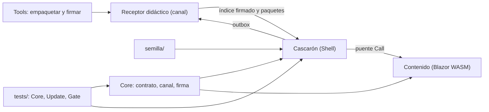
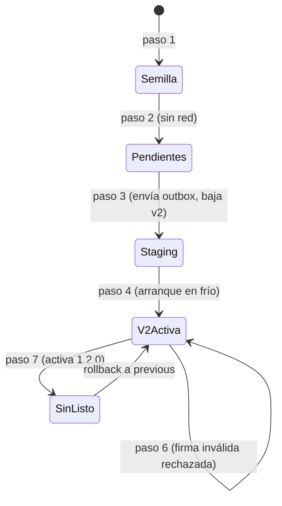
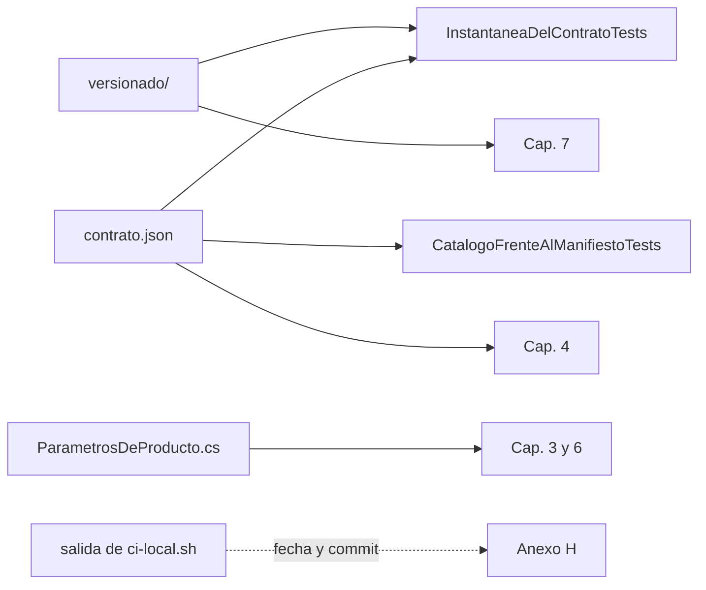
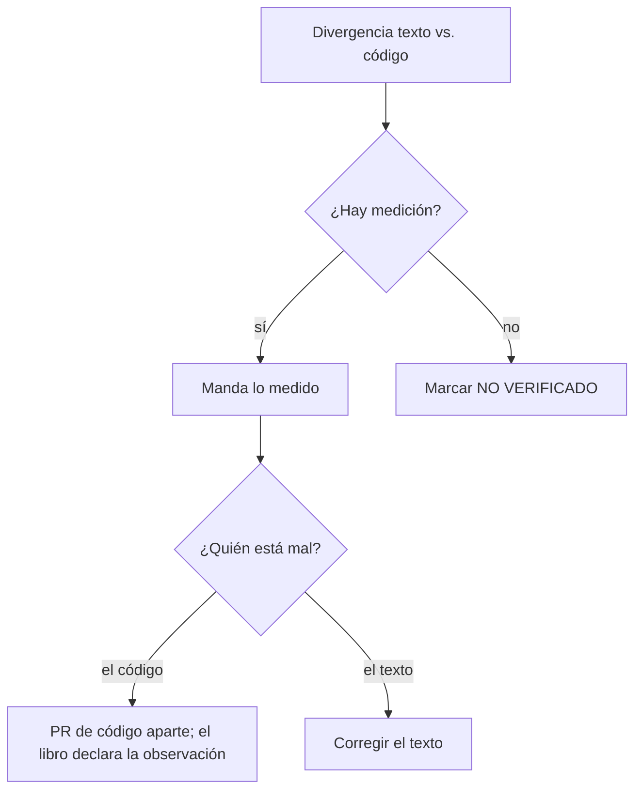
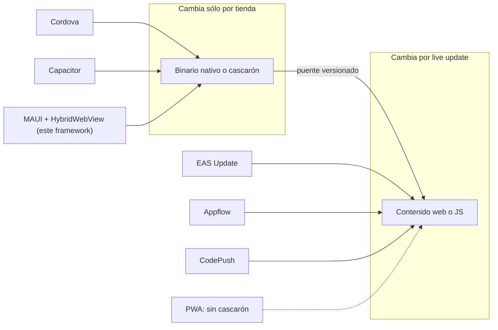

<!-- Bloque 5 (B5) de la reedición 04. Capítulos 10 a 12 y anexos A a H. Fuentes: Nucleo-N2, N5, N6, N8, 02-Cohesion-Global, 03-Plan-Del-Libro, el repo (rama fc/libro-guia-desarrolladores) y los folios del expediente 0001. Rutas relativas a Concepts/Framework-Concept/. -->

## Parte IV. Práctica

### Capítulo 10. La demo como caso de estudio y ejercicios

**Objetivos**

- Ubicar cada pieza del framework en la carpeta `Demo/`.
- Compilar y probar la demo sin el workload de Android, y correr la compuerta local.
- Recorrer el ciclo completo de una versión, v1 → v2 → firma inválida → rollback, con el guion único.
- Resolver ejercicios con un criterio de logro observable.

**Requisitos previos:** capítulos 3 (OTA), 4 (puente), 5 (outbox) y 7 y 8 (integración y pruebas).

#### 10.1 Qué es la demo y para qué sirve

La **demo** es una app Android completa que materializa el framework sobre un caso real: una encuesta de movilidad de tres pasos, tomada del caso base y llevada a datos [Demo/README.md:1-5] [Demo/MAPA-CASO-BASE.md]. No es un prototipo descartable. Es la referencia ejecutable del libro: cada mecanismo que describen los capítulos 3 a 8 tiene en ella un archivo y una prueba que lo atan.

La demo resuelve tres preguntas que el texto solo no responde:

1. **¿Funciona?** Las suites y el recorrido del guion lo muestran.
2. **¿Dónde está?** Cada decisión del dictamen se marca en el código con un comentario `// P<n>` [Demo/README.md, «Dónde está cada decisión en el código»].
3. **¿Qué se rompe si lo cambio?** Los rojos provocados de `etapas/` lo enseñan (véase §8.2).

#### 10.2 Estructura de `Demo/`

Tabla 10.1. Carpetas de la demo y su papel [Demo/README.md, «Qué hay en cada carpeta»].

| Carpeta | Qué es | Capítulo |
| --- | --- | --- |
| `src/FrameworkConcept.Core/` | Núcleo sin MAUI: dominio, contrato del puente, índice del canal, firma, interfaces del actualizador, red y sesión | 3, 4, 6 |
| `src/FrameworkConcept.Shell/` | El cascarón: app MAUI para Android, actualizador, servidor de contenido, puente, base local, cofre de sesión | 3–6 |
| `src/FrameworkConcept.Content/` | El contenido: Blazor WebAssembly sin AOT | 1, 4 |
| `tools/FrameworkConcept.Tools/` | Claves de demostración, empaquetar, firmar el índice, publicar definiciones, retirar, regenerar `contrato.json` | 3, 4 |
| `tools/FrameworkConcept.Receptor/` | Receptor didáctico: un doble de prueba que sirve el canal y recibe las respuestas | 3, 5 |
| `definiciones/encuesta-movilidad/` | La encuesta como datos: `v1.json`, `v2.json` y `esquema.json` | 5 |
| `versionado/` | Fuentes únicas de versión: cascarón, puente, contenido y fase | 7 |
| `semilla/` | Contenido y definición embebidos en el APK | 3 |
| `claves/` | Sólo la clave pública de demostración | 3 |
| `tests/` | `Core.Tests`, `Update.Tests` y `Gate.Tests` | 8 |
| `scripts/` | `contenedor.sh`, `imagen.sh`, `guion.sh` y `ci-local.sh` | 7, 10 |
| `contenedor/` | La receta del contenedor de compilación (`Dockerfile`) | 10 |
| `etapas/` | Parches de rojo provocado | 8 |
| `infra/keycloak/` | Emisor OIDC de ensayo para el modo con cuenta | 6 |



Figura 10.1. Piezas de la demo. Mirá que Core no depende de MAUI: por eso lo prueban las suites sin dispositivo, y que el contenido sólo llega al cascarón por el puente.

#### 10.3 Cómo se compila y se prueba

##### 10.3.1 El contenedor de compilación

No hace falta .NET instalado. `scripts/contenedor.sh` corre cada comando dentro de una imagen construida desde la receta versionada `contenedor/Dockerfile` (SDK .NET 10.0.400, workload `maui-android`, JDK 17, SDK de Android). La imagen se etiqueta con la huella de la receta: si la receta cambia, se construye otra [Demo/README.md:12-17]. Es el patrón de **entorno de compilación reproducible** (*reproducible build environment*): la receta es código y se revisa en el PR como cualquier otro cambio.

##### 10.3.2 La solución sin MAUI

`FrameworkConcept.Demo.SinMaui.slnf` es un filtro de solución que excluye el cascarón: compila y prueba todo lo que no necesita el workload de Android [Demo/README.md:31-35]. Es la parte rápida de la compuerta.

```bash
scripts/contenedor.sh dotnet build FrameworkConcept.Demo.SinMaui.slnf -c Release
scripts/contenedor.sh dotnet test FrameworkConcept.Demo.SinMaui.slnf -c Release
```

Con `CI=true`, los avisos se tratan como errores [Demo/Directory.Build.props].

Sin la variable `FC_GATE_BASE`, dos pruebas de `Gate.Tests` se omiten a propósito: comparan el contrato y las definiciones con la base del PR, y fuera de la compuerta no hay base. En integración continua, la falta de la variable no se omite: falla.

[Demo/tests/FrameworkConcept.Gate.Tests/Infraestructura/Repositorio.cs:50-60]

```csharp
var baseDelPr = Base;
const string comoSeArma = "La arma scripts/ci-local.sh (o el workflow) con la demo de la rama de destino y la pasa en FC_GATE_BASE.";

if (baseDelPr is null)
{
    if (EnIntegracionContinua)
        Assert.Fail("CI=true y falta FC_GATE_BASE: sin la base del PR no se puede comparar con lo publicado. " + comoSeArma);
    Assert.Ignore("Sin FC_GATE_BASE no hay base del PR para comparar. " + comoSeArma);
}
```

Las cifras de una corrida concreta están en la corrida fechada (Anexo H).

##### 10.3.3 La compuerta local

`scripts/ci-local.sh` corre los mismos pasos y en el mismo orden que el workflow del PR [Demo/scripts/ci-local.sh:1-21]:

Tabla 10.2. Pasos de la compuerta local.

| Paso | Qué hace |
| --- | --- |
| 0 | Arma la base del PR: copia de la demo en la rama de destino |
| 1 | Build sin MAUI con avisos como error |
| 2 | `Core.Tests`: dominio, reglas portadas y contrato |
| 3 | `Update.Tests`: actualizador |
| 4 | `Gate.Tests`: instantánea del contrato, definiciones, catálogo frente al manifiesto del paquete, contenido sin AOT |
| 5 | Publica el contenido Blazor y lo empaqueta |
| 6 | Compila el APK del cascarón para `android-arm64` |

```bash
scripts/ci-local.sh              # todo; la base es origin/main
scripts/ci-local.sh --hasta 4    # sólo lo rápido, sin publicar ni APK
```

La regla que enseña es la del capítulo 7: **si pasa en local, pasa en el PR**, porque es el mismo guion.

#### 10.4 El recorrido guiado con `scripts/guion.sh`

`scripts/guion.sh` es el **guion único** de la demo: un subcomando por acción, sin pasos escondidos [Demo/scripts/guion.sh:585-606]. Sin argumentos, lista los subcomandos.

##### 10.4.1 Preparación

```bash
IP=203.0.113.10                       # la IP por la que el dispositivo llega a esta máquina
scripts/guion.sh claves               # par ECDSA de demostración; la privada no se versiona
scripts/guion.sh publicar v1          # contenido 1.0.0, sin AOT, archivos planos
scripts/guion.sh definicion v1        # encuesta-movilidad v1
scripts/guion.sh firmar               # índice firmado, expires = ahora + 30 días
scripts/guion.sh semilla              # lo que ofrece el índice → semilla/
FC_TLS_IPS=$IP scripts/guion.sh tls   # CA y certificado HTTPS de demostración
scripts/guion.sh servir               # receptor didáctico por HTTPS
FC_RID=android-x64 FC_URL_CANAL=https://$IP:8099 scripts/guion.sh apk
```

[Demo/README.md, «Cómo se corre la demo»]. La dirección `203.0.113.10` es de documentación (RFC 5737): reemplazala por la tuya.

**Las claves en un clon nuevo.** El clon trae la clave pública y una semilla firmada con su privada, pero no la privada. Si generás un par nuevo con `claves --forzar`, tenés que rehacer `publicar v1`, `definicion v1`, `firmar` y `semilla` antes de compilar el APK; si no, el cascarón descarta la semilla y arranca sin contenido. `SemillaTests` lo frena en la compuerta [Demo/README.md, «Las claves en un clon nuevo»] [Demo/tests/FrameworkConcept.Gate.Tests/Semilla/SemillaTests.cs].

**Por qué hay una CA de demostración.** El canal es sólo HTTPS. El APK de Debug confía en la CA que genera `guion.sh tls` porque va en los `debug-overrides` de la configuración de red de Android; un APK de Release ignora ese bloque [Demo/README.md, «Por qué hay una CA de demostración»].

##### 10.4.2 Los siete pasos

`guion.sh demo` encadena todo; sólo el paso 2 es manual [Demo/scripts/guion.sh:383-420].

Tabla 10.3. Recorrido v1 → v2 y qué tiene que pasar [Demo/README.md, tabla del recorrido].

| Paso | Acción | Qué tiene que pasar | Capítulo |
| --- | --- | --- | --- |
| 1 | Abrir la app | Instala la semilla (contenido 1.0.0, definición v1) y la muestra | 3.6 |
| 2 | `parar`; tomar una encuesta | Queda «Por enviar: 1» en el outbox, con la definición v1 | 5 |
| 3 | `publicar v2`, `definicion v2`, `firmar`, `servir`; abrir en frío | Se sigue viendo 1.0.0; el outbox se envía; v2 baja a staging | 3.4, 5.4 |
| 4 | Abrir en frío | Se activa 1.1.0 antes de mostrar; la encuesta nueva usa v2 | 3.4, 5.5 |
| 5 | `respuestas` | La respuesta tomada con v1 figura aceptada con `versionDefinicion: 1` | 5.5 |
| 6 | `firma-invalida`; abrir en frío; `firmar` | `Rechazado FirmaInvalida`; sigue 1.1.0 | 3.3 |
| 7 | `publicar sin-listo`, `firmar`; abrir en frío cuatro veces | 1.2.0 se activa y no avisa `Listo`; al cuarto arranque vuelve a 1.1.0 y queda como fallida | 3.5 |



Figura 10.2. Recorrido del guion. Mirá el paso 3: la versión nueva baja pero no se muestra; recién el arranque en frío siguiente la activa.

El paso 7 lleva cuatro arranques porque el cascarón sólo da una versión por fallida cuando el WebView **empezó a cargarla** `CargasSinListoParaFallar` veces sin recibir `Listo`; un arranque cortado antes de cargar no cuenta.

[Demo/src/FrameworkConcept.Core/Update/Actualizador.cs:34-39]

```csharp
/// <summary>
/// P2 — Cuántos arranques con la carga EMPEZADA y sin «Listo» hacen falta para dar una versión por fallida.
/// Criterio de la demo (corrección de E02), no valor de producto del folio 036: con 1, cerrar la app mientras
/// carga (el TPR del teléfono de medida pasa de 8 s) dejaba una versión sana como fallida para siempre.
/// </summary>
public const int CargasSinListoParaFallar = 2;
```

Es un parámetro de la demo, no un valor de producto (véase §3.5).

**Cuidado con las esperas.** El guion espera un tiempo fijo por arranque (`FC_ESPERA`, 50 s por defecto). Una espera menor que lo que tarda `Listo` corta la app con la carga empezada, y dos cortes así seguidos dejan como fallida una versión sana [Demo/scripts/guion.sh:402-405]. Es el mismo fenómeno que motivó el parámetro.

##### 10.4.3 Pruebas sin dispositivo

- `scripts/guion.sh humo` prueba las herramientas y el receptor con claves propias en `salida/humo/`, sin tocar `claves/` ni `semilla/` [Demo/scripts/guion.sh:438-440].
- `src/FrameworkConcept.Content/Testing/probar-en-navegador.sh` prueba el contenido en Chromium headless con el puente simulado [Demo/README.md].

El dispositivo usado en las mediciones es un **emulador de ensayo** con Android 13 y WebView 155, y un **teléfono de medida** con Android 13 (API 33) [Demo/README.md:19-21] [folio 049]. El contenido Blazor exige Android System WebView 94 o mayor [Demo/src/FrameworkConcept.Core/Contracts/ParametrosDeProducto.cs:10].

**Desvío de red declarado.** El camino de red medido es que el dispositivo alcance por IP a la máquina del receptor. Cuando el teléfono de medida no llega por red, el único medio que funcionó fue un túnel efímero (`guion.sh tunel`), que queda como **medio de laboratorio**, no como camino de la demo. El reenvío inverso de puertos de adb sigue **NO VERIFICADO** [Demo/README.md:22-28] [E01].

#### 10.5 Ejercicios propuestos

Cada ejercicio tiene un criterio de logro que se puede comprobar sin interpretar.

Tabla 10.4. Ejercicios con criterio de logro.

| # | Ejercicio | Criterio de logro | Capítulo |
| --- | --- | --- | --- |
| E-10.1 | Compilá y probá la solución sin MAUI dentro del contenedor | `dotnet test` termina con `rc=0`; en `Gate.Tests` aparecen exactamente las omisiones de `FC_GATE_BASE` | 8.1 |
| E-10.2 | Corré `ci-local.sh --hasta 4` | `rc=0` en los pasos 0 a 4 | 7.3 |
| E-10.3 | Aplicá `etapas/M-13-codigo-postal-cinco-digitos.patch` y repetí E-10.2; deshacé con `-R` | `Core.Tests` en rojo, `rc=1`; tras deshacer, verde | 8.2 |
| E-10.4 | Aplicá `etapas/aviso-promovido-a-error.patch` y compilá con y sin `CI=true` | Con `CI=true`, `error CS0219`; sin `CI`, compila con un aviso | 8.2 |
| E-10.5 | Agregá un método al contrato sin regenerar `contrato.json` | `InstantaneaDelContratoTests` en rojo; tras regenerar con `FrameworkConcept.Tools contrato` y subir el menor del puente, verde | 4.7 |
| E-10.6 | Declarale al manifiesto del paquete un `requires` que no figura en el catálogo | `CatalogoFrenteAlManifiestoTests` en rojo | 4.5 |
| E-10.7 | Corré `guion.sh humo` | El informe termina sin comprobaciones «MAL» | 10.4.3 |
| E-10.8 | Con un dispositivo, hacé el recorrido de la Tabla 10.3 | Cada paso muestra lo de la columna «Qué tiene que pasar»; en el paso 5, `versionDefinicion: 1` | 3, 5 |
| E-10.9 | Generá claves nuevas con `claves --forzar` y compilá el APK **sin** rehacer la semilla | `SemillaTests` en rojo; tras rehacer la semilla, verde | 3.6 |

Los parches de `etapas/` y lo que provocan están descritos en [Demo/etapas/README.md]. El tercer parche, `error-de-compilacion-en-el-cascaron.patch`, asigna un texto a un `int` en `App.cs` (CS0029) y deja el APK sin compilar: sirve para ver el paso 6 de la compuerta en rojo.

> **En la industria.** Los frameworks de *live update* acompañan sus SDK con una app de ejemplo y un servidor de prueba; la demo hace lo mismo con el receptor didáctico. La compuerta local idéntica a la remota es la práctica que la documentación de GitHub llama verificar antes de fusionar con checks obligatorios [R10] [R11]; el rojo provocado es una forma liviana de lo que la literatura llama *mutation testing*. Véase el capítulo 12.

**Preguntas guía**

1. ¿Por qué Core no depende de MAUI, y qué ganan las pruebas con eso?
2. En el paso 3 la versión nueva ya bajó. ¿Por qué no se muestra?
3. ¿Qué pasaría en el paso 7 si `CargasSinListoParaFallar` valiera 1 y el teléfono tardara más que la espera?
4. ¿Por qué la compuerta falla, en vez de omitir, cuando falta `FC_GATE_BASE` en integración continua?

**Resumen.** La demo es la referencia ejecutable del libro. Se compila en un contenedor reproducible, se prueba sin dispositivo con la solución sin MAUI y se valida con la misma compuerta en local y en el PR. El guion único recorre el ciclo de una versión en siete pasos, y los rojos provocados muestran que cada suite mira lo que dice mirar.

---

### Capítulo 11. Cohesión y mantenimiento de la guía

**Objetivos**

- Distinguir dato vivo de dato fechado y aplicar la regla de fuente única.
- Saber de dónde sale cada cifra del libro.
- Resolver una divergencia entre texto y código con la regla «manda lo medido».
- Verificar la guía de forma mecánica antes de publicarla.

**Requisitos previos:** capítulos 7 y 8.

#### 11.1 Definiciones

- **Coherencia documental** (*documentation consistency*): cada afirmación verificable del texto tiene una fuente en el repo (archivo:línea) o en el expediente (folio), y esa fuente dice lo mismo hoy.
- **Dato vivo**: se lee de una fuente única del repo, por ejemplo la versión del puente. El texto no lo copia a mano; apunta a la fuente.
- **Dato fechado**: es la salida de una corrida (conteos de pruebas, tiempos medidos). Lleva fecha y commit, y vive en un solo lugar: el Anexo H.
- **Fuente única de verdad** (*single source of truth*): para cada cifra hay un único archivo que la define. El código ya sigue esta idea: el comentario de `ParametrosDeProducto.cs` dice que los valores están juntos «para que nadie los escriba a mano en otro lado» [Demo/src/FrameworkConcept.Core/Contracts/ParametrosDeProducto.cs:3-6].

#### 11.2 De dónde sale cada cifra

Tabla 11.1. Fuentes únicas y las pruebas que las atan.

| Dato | Fuente única | Prueba que la ata |
| --- | --- | --- |
| Versiones del cascarón, del puente y del contenido | `Demo/versionado/version-cascaron.props`, `puente.json`, `contenido.json` | `InstantaneaDelContratoTests` (puente) |
| Métodos, eventos y catálogo del puente | `Demo/src/FrameworkConcept.Core/Contracts/contrato.json` | `InstantaneaDelContratoTests` |
| Capacidades declaradas por el contenido | Manifiesto del paquete frente al catálogo | `CatalogoFrenteAlManifiestoTests` |
| Plazos y retenciones (vigencia 30 d, renovación 7 d, reanudación 15 min, 3 paquetes en el servidor, 2 en el teléfono, WebView 94) | `Demo/src/FrameworkConcept.Core/Contracts/ParametrosDeProducto.cs:10-34` | Pruebas de `Update.Tests` que los usan |
| Fase del versionado | `Demo/versionado/fase.json` | — |
| Conteos de pruebas | Salida de `scripts/ci-local.sh` | Dato fechado: Anexo H |

La nota de `puente.json` lo dice explícitamente: su versión «debe coincidir con `ContratoDelPuente.Version` y con `contrato.json`; la instantánea de la compuerta lo comprueba» [Demo/versionado/puente.json].



Figura 11.1. De dónde sale cada cifra. Mirá la flecha punteada: los conteos de pruebas no entran a los capítulos, sólo al anexo fechado.

#### 11.3 Por qué no hay conteos de pruebas en el texto

Los borradores de la guía fijaron conteos que envejecieron: decían 211 pruebas en `Core.Tests` y 52 en `Gate.Tests` [04-Estrategia-De-Pruebas.md:48-49] [99-Anexos.md:117], y las bitácoras de tramos de la demo citan 65, 96 o 202 [Demo/README.md, tramo A1]. Cada tramo sumó pruebas y el texto quedó atrás. Había tres alternativas: actualizarlos a mano (vuelve a envejecer), generarlos con un script (una herramienta para un dato menor) o no escribirlos y describir la forma («todas en verde, `rc=0`»). El libro adopta la tercera y deja una corrida fechada en el Anexo H. El criterio es la simplicidad.

Las bitácoras de tramos de `Demo/README.md` se conservan como **historia**: son trazabilidad legítima, no afirmaciones vigentes. El libro las rotula **HISTÓRICO** y toma las cifras actuales de la fuente única.

#### 11.4 Caso didáctico: manda lo medido

En el cofre de sesión hay un comentario que dice que «una huella nueva invalida la clave» [Demo/src/FrameworkConcept.Shell/Auth/CofreDeSesion.cs:128]. El ensayo E03 midió lo contrario: con autenticación `BiometricStrong | DeviceCredential`, enrolar una huella nueva **no** invalida la clave [E03 H-1] [07-Red-Y-Autenticacion.md:300-310].



Figura 11.2. Cómo se cierra una divergencia. Mirá que el libro nunca «arregla» el código desde un PR documental.

La regla tiene dos partes:

1. **Manda lo medido.** Se corrige la fuente equivocada, que en este caso es el comentario, no la guía.
2. **Cada PR hace una cosa.** La corrección del comentario va en un PR de código; mientras tanto, el libro declara la observación en el capítulo 6.

El mismo hallazgo apareció cuatro veces en la reedición, en cuatro núcleos distintos. Eso muestra por qué hace falta un registro de cohesión: sin él, la misma corrección se discute cuatro veces.

#### 11.5 Cómo verificar la guía antes de publicarla

Tabla 11.2. Verificaciones mecánicas.

| Verificación | Cómo | Qué cuenta como verde |
| --- | --- | --- |
| Referencias a archivos | Extraer los nombres entre comillas invertidas con `grep -noE` y buscar cada uno en `find Demo` | Toda referencia existe, salvo artefactos generados y rutas del expediente privado |
| Enlaces | `docs-enlaces-semanal.yml`: una vez por semana corre `lychee` sobre el árbol y abre o actualiza un único issue con el informe [.github/workflows/docs-enlaces-semanal.yml:1-6] | Issue sin enlaces rotos |
| Enlaces absolutos | `grep -nE '\]\(/'` sobre el libro (enlaces que empiezan con una ruta absoluta) | Cero coincidencias |
| Datos de infraestructura | Búsqueda de nombres de hosts, modelos o series de teléfonos, IPs y rutas del home | Cero coincidencias |
| Cifras | Ninguna cifra de pruebas fuera del Anexo H; toda marca listada en el Anexo E; toda `[Rn]` resuelta en el Anexo B | Las tres listas cierran |
| Corrida fechada | `ci-local.sh` y el resultado copiado al Anexo H con fecha y commit | Coincide con la salida |

La razón de los enlaces relativos: los enlaces absolutos a rutas del puesto de trabajo dan 404 en GitHub y en un clon aislado. Los documentos fuente tenían unos 125 enlaces así en 00 a 08 y 99 [Nucleo-N6 D7]. El libro usa enlaces relativos dentro del repo y cita lo privado por folio, sin enlace.

> **En la industria.** La práctica se llama *docs as code*: la documentación vive en el repo, se revisa por PR y se verifica en CI [R40]. La separación entre tutorial, guía práctica, referencia y explicación de Diátaxis [R41] justifica la estructura del capítulo 7 en *Conceptos* y *Procedimientos*. Las pruebas de instantánea del contrato son la versión local de las líneas base de API [R43] [R44].

**Preguntas guía**

1. ¿Por qué la versión del puente es un dato vivo y el conteo de pruebas un dato fechado?
2. Si un capítulo necesita citar el plazo de vigencia del índice, ¿cómo lo hace sin copiarlo?
3. ¿Qué harías si encontrás una divergencia sin ninguna medición que la resuelva?

**Resumen.** La guía se mantiene coherente con tres reglas: fuente única para cada dato vivo, datos fechados en un solo anexo y «manda lo medido» ante una divergencia. Las verificaciones son mecánicas: referencias, enlaces, búsqueda de datos de infraestructura y una corrida fechada.

---

## Parte V. Industria

### Capítulo 12. El framework en la industria

**Objetivos**

- Ubicar el framework en el mapa de las apps híbridas y de los servicios de *live update*.
- Traducir cada mecanismo de la demo a su equivalente de la industria.
- Conocer lo que permiten las tiendas y cómo lo cumple la demo.
- Identificar los estándares de referencia y las extensiones naturales.

**Requisitos previos:** capítulos 1, 3 y 4.

> **Estado de las fuentes.** Las afirmaciones sobre productos de terceros de este capítulo provienen del relevamiento de la mesa N8 y **no se verificaron contra la web en la corrida del 2026-11-01**. Cada referencia nueva figura en el Anexo B con «Consulta: a verificar». Las fuentes F-01 a F-15 de la guía sí se consultaron el 2026-10-25 [99-Anexos.md:93-111].

#### 12.1 Definiciones

- **App híbrida**: app nativa instalada por tienda que muestra su interfaz, toda o en parte, con un WebView y ofrece capacidades del teléfono a través de un puente. En este framework: cascarón MAUI más `HybridWebView`.
- **Live update** (*OTA*, *code push*): cambiar el contenido web o interpretado de una app híbrida sin pasar por la tienda. El binario nativo no cambia.
- **Runtime version**: la identidad de compatibilidad entre el binario y el paquete. En la demo es el **mayor del puente** [Demo/versionado/puente.json].
- **PWA** (*Progressive Web App*): aplicación web que, con un *service worker* y un manifiesto web, se instala y funciona sin red, sin cascarón nativo.
- **MASVS**: el estándar de OWASP de requisitos de seguridad para apps móviles, en grupos como STORAGE, CRYPTO, AUTH, NETWORK, PLATFORM, CODE y RESILIENCE [R30].

#### 12.2 Familias de apps híbridas

Tabla 12.1. Mapa del mercado. Afirmaciones sobre terceros **NO VERIFICADO** hasta la consulta de las fuentes.

| Familia | Cascarón | Contenido | Live update | Qué toma o descarta este framework |
| --- | --- | --- | --- | --- |
| Apache Cordova [R17] | Nativo mínimo con plugins | HTML y JS en WebView | Plugins de terceros | Toma el puente por plugins; descarta el ecosistema por su mantenimiento |
| Ionic Capacitor [R16] | Proyecto nativo propio, editable | Web en WebView | Appflow [R19], Capawesome [R20], Capgo [R21] | El análogo más cercano: cascarón nativo, plugins versionados, paquetes por canal |
| React Native + Expo | Nativo, con UI nativa | JS interpretado | EAS Update [R18] | Toma el vocabulario: *runtime version* y canales |
| CodePush (App Center) | RN o Cordova | JS | Servicio alojado hasta el retiro de App Center [R22]; servidor de código abierto [R23] | Lección: no atar la actualización a un SaaS |
| Flutter + Shorebird [R24] | Nativo Flutter | Dart con parches | Shorebird | Fuera del stack; confirma la tendencia |
| .NET Blazor Hybrid [R25] | MAUI con `BlazorWebView` | Razor compilado en la app | No hay | Descartado para el contenido: lo compilado en la app no se puede bajar [01-Actualizacion-Sin-Tienda.md:63] |
| PWA [R26] | No hay | Web con *service worker* | Propia de la web | Descartada: no da Keystore, biometría ni capacidades con control del cascarón |

La elección del framework es **Blazor WebAssembly servido por `HybridWebView`**, no Blazor Hybrid: el contenido corre dentro del WebView como WASM sin AOT [Demo/src/FrameworkConcept.Content/FrameworkConcept.Content.csproj:18] y llega a Android sólo por el puente [Demo/src/FrameworkConcept.Core/Contracts/Puente/TransporteDelPuente.cs:25]. `HybridWebView` está documentado por Microsoft para .NET MAUI [R4].



Figura 12.1. Dónde cae cada producto. Mirá que todos separan lo que cambia por tienda de lo que cambia por canal; la PWA no tiene la primera mitad.

#### 12.3 Equivalencias mecanismo a mecanismo

Tabla 12.2. Mecanismos de la demo y su equivalente de la industria. Equivalentes **NO VERIFICADO** hasta la consulta.

| Mecanismo de la demo | Dónde está | Equivalente |
| --- | --- | --- |
| Mayor del puente | `Demo/versionado/puente.json`, `contrato.json` | *Runtime version* de EAS Update; versión de plugins en Capacitor |
| Canal `dev`/`beta`/`prod` con índice firmado | `Demo/src/FrameworkConcept.Core/Contracts/Canal/IndiceDelCanal.cs`; `FirmaEs256.cs` | *Channels* de EAS y Appflow; metadatos firmados con expiración de TUF [R27] |
| Índice con `expires` (30 días) | `Demo/tools/FrameworkConcept.Tools/Indexador.cs:18`; `ParametrosDeProducto.cs:16` | Expiración de metadatos en TUF |
| Staging y activación en el próximo arranque en frío | `Demo/src/FrameworkConcept.Core/Update/Actualizador.cs:139-160` | Política «al próximo arranque» de EAS y CodePush |
| Rollback por cargas sin `Listo` | `Actualizador.cs:34-39` | `notifyAppReady` de los plugins de Capacitor; rollback automático de CodePush |
| Semilla embebida | `Demo/semilla/` | *Embedded update* de Expo |
| Retirada en el índice | `IndiceDelCanal.cs` (`retiradas`) | Republicación o rollback de EAS |
| Contenido sin AOT, interpretado en el WebView | `FrameworkConcept.Content.csproj:18` | Condición de Google Play para código en un WebView [R3] |
| Índice por mayor (`/canal/puente-N/`) | `Demo/scripts/guion.sh:151` | Separación por *runtime version* |

[Demo/src/FrameworkConcept.Core/Contracts/ParametrosDeProducto.cs:15-16]

```csharp
/// <summary>P2 — Vigencia del índice firmado (<c>expires</c> = emitido + 30 días).</summary>
public static readonly TimeSpan VigenciaDelIndice = TimeSpan.FromDays(30);
```

La vigencia acotada es la defensa contra el **ataque de congelamiento** (*freeze attack*) que describe TUF: un atacante que repite un índice viejo pero bien firmado no puede sostenerlo más allá de `expires`.

#### 12.4 Lo que permiten las tiendas

- **Google Play.** La política de abuso de dispositivos y redes admite código que corre en una máquina virtual o un intérprete con acceso indirecto a las API de Android, como JavaScript en un WebView [R3] [01-Actualizacion-Sin-Tienda.md:68-74]. La demo lo cumple con tres hechos verificables: el contenido corre en el WebView sin AOT, llega a Android sólo por el puente y va firmado [Demo/src/FrameworkConcept.Content/FrameworkConcept.Content.csproj:18] [Demo/src/FrameworkConcept.Core/Update/FirmaEs256.cs].
- **Apple.** Las pautas de revisión (2.5.2 y 4.7) y el acuerdo de licencia del programa de desarrolladores regulan el código interpretado descargado [R1] [R2]. El inciso exacto del acuerdo vigente queda **NO VERIFICADO**: la guía cita §3.3.1 y versiones anteriores lo numeraban de otra forma [Nucleo-N8 C8]. El cascarón iOS es diseño sin ensayo [ParametrosDeProducto.cs:12-13].
- **WebAssembly como «código interpretado»** ante las tiendas: **NO VERIFICADO** (véase §1.2.3).

Las políticas cambian: toda cita de una tienda lleva fecha de consulta.

#### 12.5 Estándares de referencia

Tabla 12.3. Estándares y dónde se aplican.

| Estándar | Qué aporta | Dónde en el libro |
| --- | --- | --- |
| OWASP MASVS y MASTG [R30] [R31] | Requisitos y pruebas de seguridad móvil | Cap. 9 |
| The Update Framework [R27] | Modelo de actualizaciones firmadas: roles, expiración, rotación de claves | Cap. 3 |
| RFC 8252 [R6] y RFC 7636 [R7] | OAuth en apps nativas por navegador externo y PKCE | Cap. 6 |
| SemVer 2.0.0 [R13] | Líneas de versión | Cap. 7 |
| JSON-RPC 2.0 [R28] | Formato del sobre del puente | Cap. 4 |
| Patrón *transactional outbox* [R29] | Escritura local y envío diferido en una transacción | Cap. 5 |

**Qué falta de TUF.** La demo firma el índice con una clave ES256 identificada por `keyId` y con `expires`, pero no implementa la separación de roles ni el umbral de firmas, y la rotación de claves es manual [Demo/src/FrameworkConcept.Core/Update/FirmaEs256.cs] [Nucleo-N8 D2]. Es un camino de crecimiento, no un defecto del diseño actual.

#### 12.6 Tendencias y extensiones

Las tendencias que siguen son enunciados de la mesa N8, **NO VERIFICADO** hasta consultar sus fuentes:

1. La *live update* se consolida como un servicio aparte del framework y aparecen servidores autoalojados.
2. La firma del paquete pasa de opcional a esperable.
3. Los canales y el despliegue gradual por porcentaje son lo habitual.
4. Las tiendas empujan la atestación (Play Integrity [R32], App Attest), que conecta con el capítulo 9.
5. Microsoft ofrece `HybridWebView` desde .NET 9 como alternativa a `BlazorWebView` para contenido web [R4].

Tabla 12.4. Extensiones naturales de la demo (decisiones documentales; ninguna toca código en este libro).

| Extensión | Alternativas | Recomendación |
| --- | --- | --- |
| Despliegue por porcentaje | (a) no; (b) campo `porcentaje` en la entrada del índice; (c) canales por grupo | (a) por ahora; (b) es la extensión natural |
| TUF completo | (a) índice propio ES256; (b) TUF | (a), declarando qué roles faltan |
| Servicio de terceros | (a) servidor estático propio; (b) SaaS | (a), por la lección del retiro de CodePush |

> **En la industria.** Este capítulo es el recuadro grande del libro: cada capítulo anterior remite acá con su propio recuadro.

**Preguntas guía**

1. ¿Qué tiene en común el mayor del puente con la *runtime version* de EAS Update?
2. ¿Por qué Blazor Hybrid no sirve para el contenido actualizable?
3. ¿Qué ataque evita `expires` y cuál no evita mientras no haya rotación de claves?
4. ¿Qué perdería el producto si la actualización dependiera de un SaaS que se retira?

**Resumen.** El framework pertenece a la familia de Capacitor con *live updates*: cascarón nativo, contenido web por canal y un puente versionado. Sus mecanismos (índice firmado con expiración, staging, rollback por confirmación, semilla, retirada) tienen equivalente directo en la industria. Lo distinto es el stack (.NET MAUI y Blazor WASM en `HybridWebView`) y el control propio del canal.

---

## Anexos

### Anexo A. Glosario

Consolidado de los cinco bloques. Una sola definición por término. Columna «§» = sección que lo define.

Tabla A.1. Glosario bilingüe.

| Término | Definición | Equivalente | § |
| --- | --- | --- | --- |
| App híbrida | App nativa instalada por tienda que muestra su interfaz con un WebView y ofrece capacidades por un puente | *hybrid app* | 1.2 |
| Cascarón | La app MAUI instalada por tienda: pantallas XAML propias, actualizador, servidor de contenido, puente, base local | *native shell* | 1.2.1 |
| Contenido | Pantallas de negocio en Blazor WebAssembly sin AOT, descargables por canal | *web content*, *update bundle* | 1.2.1 |
| Definición | Encuesta expresada como datos JSON validados por `esquema.json` | *survey definition* | 1.4.3 |
| Puente | Un solo método nativo, `Call(sobre)`, entre contenido y cascarón | *bridge* | 4.2 |
| Sobre | Mensaje JSON-RPC 2.0 con un campo extra `v`, la versión del puente que espera el contenido | *envelope* | 4.2 |
| Contrato del puente | Tabla de métodos, catálogo y transporte, serializados en `contrato.json` | *bridge contract* | 4.4 |
| Capacidad | Función del dispositivo ofrecida por el cascarón con id y versión propios en el catálogo | *capability* | 4.5 |
| Servicio del cascarón | Función que el cascarón presta sin depender del hardware | *shell service* | 4.5 |
| Rango de versión | Siempre `>=A.B.C <(A+1).0.0` | *version range* | 4.6 |
| Predicado de compatibilidad | Puente en rango, cada `requires` presente y en rango, motor ≥ mínimo | *compatibility check* | 4.6 |
| Índice del canal | Archivo firmado por canal y mayor del puente que ofrece paquetes, con `expires` y `retiradas` | *channel index* | 1.3.1 |
| Manifiesto del paquete | Descripción del paquete de contenido: compatibilidad con el puente, capacidades, motor mínimo | *bundle manifest* | 1.3.1 |
| Canal | Puntero (`dev`, `beta`, `prod`) que promueve el mismo artefacto; no es una versión | *channel* | 7.5 |
| Staging | Carpeta donde una versión bajada y verificada espera el próximo arranque en frío | *staging* | 3.2 |
| Marca pendiente | Señal que el cascarón pone al activar una versión y que el contenido borra con `Listo` | *pending flag* | 3.5 |
| Rollback | Volver a `previous` cuando una versión no confirmó `Listo` tras `CargasSinListoParaFallar` cargas | *rollback* | 3.5 |
| Retirada | Versión que el índice marca para no usar | *revoked release* | 3.7 |
| Semilla | Contenido y definición embebidos en el APK para el primer arranque | *seed*, *embedded update* | 3.6 |
| Live update | Cambiar el contenido sin pasar por la tienda | *OTA*, *code push* | 1.3 |
| Runtime version | Identidad de compatibilidad binario–paquete; en la demo, el mayor del puente | *runtime version* | 12.1 |
| Offline-first | La app guarda primero en local y sincroniza después; la red es una mejora | *offline-first* | 1.4 |
| Outbox | Intención de enviar escrita en la misma transacción que el dato | *transactional outbox* | 1.4.2 |
| Estado de red combinado | `Connectivity` del sistema más la salud del servidor, en cuatro estados | *network state* | 6.1 |
| Política de acciones | `SoloLocal`, `Encolable` o `SoloEnLinea` por acción | *action policy* | 6.2 |
| Desbloqueo local | Biometría o credencial del dispositivo que abre un secreto del Keystore; no da identidad | *local unlock* | 6.4 |
| Líneas de versión | Secuencias de números para lo que se publica por un camino propio; cuatro visibles | *version lines* | 1.6, 7.4 |
| Compuerta | Pruebas que un PR tiene que pasar para fusionarse | *gate* | 7.3 |
| Check agregador `fw-ok` | Job que corre siempre y resume los demás; único check obligatorio | *required aggregate check* | 7.2 |
| Base del PR | La demo en la rama de destino, para comparar contrato y definiciones | *PR base* | 8.4 |
| Rojo provocado | Cambio mínimo que tiene que hacer fallar una suite | *seeded failure* | 8.2 |
| Coherencia documental | Cada afirmación verificable tiene una fuente que dice lo mismo hoy | *documentation consistency* | 11.1 |
| Dato vivo / dato fechado | Leído de una fuente única / salida de una corrida con fecha y commit | — | 11.1 |
| Fuente única de verdad | Un único archivo define cada cifra | *single source of truth* | 11.1 |
| RASP | La app observa el entorno en que corre y reacciona | *Runtime Application Self-Protection* | 9.2 |
| Atestación | Veredicto firmado por un tercero sobre la integridad de la app y el dispositivo | *attestation* | 9.2 |
| PWA | App web instalable con *service worker*, sin cascarón | *Progressive Web App* | 12.1 |
| MASVS | Estándar de OWASP de requisitos de seguridad móvil | — | 12.1 |

Términos de los bloques 1 a 4 que no figuren acá se agregan en la unión (N9) desde sus comentarios `GLOSARIO`, verificando que no repitan una definición con otro texto.

### Anexo B. Referencias

Formato: `R<n>. Autor u organización. *Título*. URL. Consulta: fecha.` R1 a R15 son las fuentes F-01 a F-15 de la guía, consultadas el 2026-10-25 [99-Anexos.md:93-111]. Desde R16, propuestas por los núcleos y **no consultadas** en la corrida del 2026-11-01.

- R1. Apple. *App Review Guidelines* (2.5.2, 4.7). https://developer.apple.com/app-store/review/guidelines/. Consulta: 2026-10-25.
- R2. Apple. *Apple Developer Program License Agreement*. https://developer.apple.com/support/terms/apple-developer-program-license-agreement/. Consulta: 2026-10-25 (inciso a verificar).
- R3. Google. *Device and Network Abuse*. https://support.google.com/googleplay/android-developer/answer/9888379. Consulta: 2026-10-25.
- R4. Microsoft. *HybridWebView – .NET MAUI*. https://learn.microsoft.com/en-us/dotnet/maui/user-interface/controls/hybridwebview?view=net-maui-10.0. Consulta: 2026-10-25.
- R5. Microsoft. *Blazor WebAssembly build tools and AOT*. https://learn.microsoft.com/en-us/aspnet/core/blazor/webassembly-build-tools-and-aot?view=aspnetcore-10.0. Consulta: 2026-10-25.
- R6. IETF. *RFC 8252: OAuth 2.0 for Native Apps*. https://www.rfc-editor.org/rfc/rfc8252. Consulta: 2026-10-25.
- R7. IETF. *RFC 7636: Proof Key for Code Exchange*. https://www.rfc-editor.org/rfc/rfc7636. Consulta: 2026-10-25.
- R8. GitHub. *GitHub flow*. https://docs.github.com/en/get-started/using-github/github-flow. Consulta: 2026-10-25.
- R9. *Trunk Based Development*. https://trunkbaseddevelopment.com/. Consulta: 2026-10-25.
- R10. GitHub. *About protected branches*. https://docs.github.com/en/repositories/configuring-branches-and-merges-in-your-repository/managing-protected-branches/about-protected-branches. Consulta: 2026-10-25.
- R11. GitHub. *Troubleshooting required status checks*. https://docs.github.com/en/pull-requests/collaborating-with-pull-requests/collaborating-on-repositories-with-code-quality-features/troubleshooting-required-status-checks. Consulta: 2026-10-25.
- R12. GitHub. *Secure use reference*. https://docs.github.com/en/actions/reference/security/secure-use. Consulta: 2026-10-25.
- R13. *Semantic Versioning 2.0.0*. https://semver.org/. Consulta: 2026-10-25.
- R14. Vocke, H. *The Practical Test Pyramid*. https://martinfowler.com/articles/practical-test-pyramid.html. Consulta: 2026-10-25.
- R15. Luo, Q. y otros. *An empirical analysis of flaky tests* (FSE 2014). https://doi.org/10.1145/2635868.2635920. Consulta: 2026-10-25.
- R16. Ionic. *Capacitor* (documentación y plugins). https://capacitorjs.com/docs. Consulta: a verificar.
- R17. Apache. *Cordova: plugins*. https://cordova.apache.org/docs/en/latest/guide/hybrid/plugins/. Consulta: a verificar.
- R18. Expo. *EAS Update* (introducción y *runtime versions*). https://docs.expo.dev/eas-update/introduction/ y https://docs.expo.dev/eas-update/runtime-versions/. Consulta: a verificar.
- R19. Ionic. *Appflow Deploy*. https://ionic.io/docs/appflow/deploy/intro. Consulta: a verificar.
- R20. Capawesome. *Cloud Live Updates* y plugin *Live Update*. https://capawesome.io/cloud/live-updates/ y https://capawesome.io/plugins/live-update/. Consulta: a verificar.
- R21. Capgo. https://capgo.app/. Consulta: a verificar.
- R22. Microsoft. *Visual Studio App Center retirement*. https://learn.microsoft.com/appcenter/retirement. Consulta: a verificar.
- R23. Microsoft. *code-push-server*. https://github.com/microsoft/code-push-server. Consulta: a verificar.
- R24. Shorebird. https://shorebird.dev/. Consulta: a verificar.
- R25. Microsoft. *ASP.NET Core Blazor Hybrid*. https://learn.microsoft.com/en-us/aspnet/core/blazor/hybrid/. Consulta: a verificar.
- R26. Google. *Progressive Web Apps* (web.dev). https://web.dev/explore/progressive-web-apps. W3C. *Service Workers*. https://www.w3.org/TR/service-workers/. Consulta: a verificar.
- R27. *The Update Framework*. https://theupdateframework.io/. Consulta: a verificar.
- R28. *JSON-RPC 2.0 Specification*. https://www.jsonrpc.org/specification. Consulta: a verificar.
- R29. Richardson, C. *Pattern: Transactional outbox*. https://microservices.io/patterns/data/transactional-outbox.html. Consulta: a verificar.
- R30. OWASP. *MASVS* (incluye MASVS-RESILIENCE). https://mas.owasp.org/MASVS/. Consulta: a verificar.
- R31. OWASP. *MASTG*. https://mas.owasp.org/MASTG/. Consulta: a verificar.
- R32. Google. *Play Integrity API*. https://developer.android.com/google/play/integrity. Consulta: a verificar.
- R33. Google. *Credential Manager* y *Sign in with Google*. https://developer.android.com/identity/sign-in/credential-manager y https://developer.android.com/identity/sign-in/credential-manager-siwg. Consulta: a verificar.
- R34. Google. *Android Keystore system*. https://developer.android.com/privacy-and-security/keystore. Consulta: a verificar.
- R35. Google. *Biometric authentication*. https://developer.android.com/identity/sign-in/biometric-auth. Consulta: a verificar.
- R36. Google. *FLAG_SECURE* y *setHideOverlayWindows*. https://developer.android.com/reference/android/view/WindowManager.LayoutParams#FLAG_SECURE. Consulta: a verificar.
- R37. Google. *Insecure WebView native bridges*. https://developer.android.com/privacy-and-security/risks/insecure-webview-native-bridges. Consulta: a verificar.
- R38. Google. *Build an offline-first app*. https://developer.android.com/topic/architecture/data-layer/offline-first. Consulta: a verificar.
- R39. IETF. *RFC 9700: Best Current Practice for OAuth 2.0 Security*. https://www.rfc-editor.org/rfc/rfc9700. Consulta: a verificar.
- R40. Write the Docs. *Docs as Code*. https://www.writethedocs.org/guide/docs-as-code/. Consulta: a verificar.
- R41. Procida, D. *Diátaxis*. https://diataxis.fr/. Consulta: a verificar.
- R42. Microsoft. *Testing in .NET*. https://learn.microsoft.com/dotnet/core/testing/. Consulta: a verificar.
- R43. VerifyTests. *Verify*. https://github.com/VerifyTests/Verify. Consulta: a verificar.
- R44. Microsoft. *API compatibility (APICompat)*. https://learn.microsoft.com/dotnet/fundamentals/apicompat/overview. Consulta: a verificar.
- R45. Google. *A/B (seamless) system updates*. https://source.android.com/docs/core/ota/ab. Consulta: a verificar.
- R46. Banco de la Nación Argentina. *Preguntas frecuentes BNA+*. https://bna.com.ar/Personas/BNAMas/PreguntasFrecuentesBNAmas. Consulta: a verificar.
- R47. Google. *Account linking*. https://developers.google.com/identity/account-linking. Consulta: a verificar.
- R48. FIDO Alliance. *Passkeys*. https://fidoalliance.org/passkeys/. Consulta: a verificar.
- R49. Zetetic. *SQLCipher*. https://www.zetetic.net/sqlcipher/. Consulta: a verificar.
- R50. GitHub. *Managing a merge queue*. https://docs.github.com/en/repositories/configuring-branches-and-merges-in-your-repository/configuring-pull-request-merges/managing-a-merge-queue. Consulta: a verificar.
- R51. Pact. *Contract testing*. https://docs.pact.io/. Consulta: a verificar.
- R52. Winters, T. y otros. *Software Engineering at Google*, cap. 11 «Testing Overview». https://abseil.io/resources/swe-book/html/ch11.html. Consulta: a verificar.
- R53. Microsoft. *Unit testing .NET MAUI*. https://learn.microsoft.com/en-us/dotnet/maui/deployment/unit-testing. Consulta: a verificar.
- R54. Microsoft. *Web authenticator – .NET MAUI*. https://learn.microsoft.com/dotnet/maui/platform-integration/communication/authentication. Consulta: a verificar.
- R55. Microsoft. *Connectivity – .NET MAUI*. https://learn.microsoft.com/dotnet/maui/platform-integration/communication/networking. Consulta: a verificar.
- R56. IETF. *OAuth 2.0 for First-Party Applications* (borrador). https://datatracker.ietf.org/doc/draft-ietf-oauth-first-party-apps/. Consulta: a verificar.
- R57. Google. *Android 15 features*. https://developer.android.com/about/versions/15/features. Consulta: a verificar.
- R58. Google. *Fundamentals of testing Android apps*. https://developer.android.com/training/testing/fundamentals. Consulta: a verificar.
- R59. The Rust Project. *Documentation tests*. https://doc.rust-lang.org/rustdoc/write-documentation/documentation-tests.html. Consulta: a verificar.

**Renumeración.** En la unión, N9 reemplaza cada `R-B<k>-<n>` de los parciales 1 a 4 por el `R<n>` de esta lista que tenga la misma URL; si una URL no figura, se agrega al final con «Consulta: a verificar».

### Anexo C. Folios y ensayos citados

Los folios pertenecen al expediente 0001, que vive en un repositorio privado de documentación. Se citan por número, sin enlace. Las descripciones usan roles neutros.

Tabla C.1. Folios del expediente.

| Folios | Tema |
| --- | --- |
| 001–007 | Pedido del PO y providencias iniciales: contrato de entrada, actualización al ingresar, escenario de la encuesta, actualización forzada al iniciar, delegación de la fusión |
| 008–022 | Ronda 1 de la mesa: requisitos, verificación, lector sin contexto, arquitectura MAUI híbrida, decisiones, migración al abrir, integración y pruebas, seguridad del canal y tiendas, editor didáctico, caso de referencia y capacidades, refutador, veredicto |
| 023 | Respuesta del PO al lote de la ronda 1 |
| 024–035 | Ronda 2 de la mesa, con umbrales formales y veredicto |
| 036 | Respuesta del PO a la ronda 2: valores de producto (plazos y retenciones de `ParametrosDeProducto.cs`) |
| 037 | Resolución: plan de aplicación y cierre de la mesa |
| 038 | Providencia: autenticación del sistema operativo y manejo de red en la demo |
| 039–040 | Aprobación de la redacción y cierre del expediente |
| 041 | Liberación del teléfono de medida y limpieza |
| 042 | Marca de primer render y TPR |
| 043, 046 | Cambio de entorno de laboratorio y su corrección |
| 044–045 | Redacción de datos sensibles en el repo público y evidencia local |
| 047, 049 | TPR en el teléfono de medida, medido por el cascarón |
| 048 | Compuerta en el host de compilación y runner autoalojado |
| 050 | Dictamen: condición 2 de P1, evaluar el camino de reserva «C-min» |
| 051 | Historia reescrita; registra la protección de `main` |
| 052–053 | Ensayo E04: arranque superpuesto y semilla del APK |
| 054 | Dictamen de UX: arranque, actualización y trabajo sin conexión |
| 055 | Dictamen: decisiones abiertas, estándares, UX y diseño |
| 056 | Login en el contenido probado en el teléfono de medida |
| 057 | Desbloqueo local probado sin red |
| 058 | Dictamen: economía de datos y situaciones de uso; observaciones sobre apps de consumo (Server Driven UI) |

Tabla C.2. Ensayos.

| Ensayo | Tema |
| --- | --- |
| E01 | WASM descargado en el WebView: viabilidad y condición de WebView ≥ 94 |
| E02 | Integración de la demo: recorrido v1 → v2, rollback y correcciones |
| E03 | Red y autenticación: estados de red, Keystore y biometría (H-1: la huella nueva no invalida la clave con credencial del dispositivo) |
| E04 | Arranque superpuesto (variantes ensayadas en ramas sin fusionar) |
| E05 | Login en el contenido |

### Anexo D. Mapa libro ↔ demo

Tabla D.1. Sección del libro → archivos de la demo.

| Sección | Archivos |
| --- | --- |
| 1.2, 12.2 | `Demo/src/FrameworkConcept.Content/FrameworkConcept.Content.csproj`; `Demo/src/FrameworkConcept.Core/Contracts/Puente/TransporteDelPuente.cs` |
| 1.3, 3.2 | `Demo/src/FrameworkConcept.Core/Contracts/Canal/IndiceDelCanal.cs`; `Demo/src/FrameworkConcept.Core/Contracts/Contenido/ManifiestoContenido.cs` |
| 3.3 | `Demo/src/FrameworkConcept.Core/Update/FirmaEs256.cs`; `Demo/tools/FrameworkConcept.Tools/Indexador.cs` |
| 3.4, 3.5 | `Demo/src/FrameworkConcept.Core/Update/Actualizador.cs` |
| 3.6 | `Demo/semilla/`; `Demo/claves/`; `Demo/tests/FrameworkConcept.Gate.Tests/Semilla/SemillaTests.cs` |
| 3.7, 11.2 | `Demo/src/FrameworkConcept.Core/Contracts/ParametrosDeProducto.cs` |
| 4.2–4.4 | `Demo/src/FrameworkConcept.Core/Contracts/contrato.json`; `Demo/src/FrameworkConcept.Content/wwwroot/js/puente.js` |
| 4.5, 4.6 | `Demo/src/FrameworkConcept.Core/Contracts/Puente/CatalogoDeCapacidades.cs`; `Demo/src/FrameworkConcept.Core/Contracts/RangoDeVersion.cs` |
| 5.2–5.4 | `Demo/src/FrameworkConcept.Shell/Data/ContextoDelCascaron.cs`; `Demo/src/FrameworkConcept.Shell/Sync/SincronizadorDelOutbox.cs` |
| 5.5 | `Demo/definiciones/encuesta-movilidad/`; `Demo/src/FrameworkConcept.Core/Domain/Entities/RespuestaDeEncuesta.cs` |
| 6.1, 6.2 | `Demo/src/FrameworkConcept.Core/Red/`; `Demo/DISENO-RED-Y-AUTENTICACION.md` |
| 6.3–6.5 | `Demo/src/FrameworkConcept.Core/Auth/`; `Demo/src/FrameworkConcept.Shell/Auth/CofreDeSesion.cs`; `Demo/tests/FrameworkConcept.Gate.Tests/Contrato/SinTokensEnElPuenteTests.cs`; `Demo/infra/keycloak/` |
| 7 | `Demo/versionado/`; `Demo/scripts/ci-local.sh`; `.github/workflows/framework-concept-demo.yml` (raíz del repo) |
| 8 | `Demo/tests/`; `Demo/etapas/` |
| 9.6 | `Demo/src/FrameworkConcept.Shell/Platforms/Android/` (manifiesto y configuración de red) |
| 10 | `Demo/README.md`; `Demo/scripts/guion.sh`; `Demo/scripts/contenedor.sh`; `Demo/contenedor/Dockerfile` |
| 11.5 | `.github/workflows/docs-enlaces-semanal.yml` (raíz del repo) |

### Anexo E. Marcas de estado

Convención: **NO VERIFICADO** (no hay medición ni fuente consultada), **NO EJECUTADO** (diseñado e implementado, nunca corrido), **ESPECULACIÓN** (inferencia sin evidencia directa), **HISTÓRICO (fecha)** (dato vigente en esa fecha, hoy no).

Tabla E.1. Marcas del libro.

| Marca | Qué | Dónde |
| --- | --- | --- |
| NO VERIFICADO | WASM como «código interpretado» ante las tiendas | 1.2.3, 12.4 |
| NO VERIFICADO | Que el ingreso con cuenta dispare la consulta del canal (ESC-6) | 1.3.3, 2.1 |
| NO EJECUTADO | Versión obligatoria (`mandatory`) | 3.7 |
| NO VERIFICADO | `requires` faltante en un dispositivo real | 4.8 |
| NO VERIFICADO | `EnLineaMedida` en dispositivo; regresión sin cuenta en emulador; iOS | 6.7 |
| NO VERIFICADO | Cascarón iOS (piso 16.4, diseño sin ensayo) | 12.4 |
| NO VERIFICADO | Reenvío inverso de puertos de adb como camino de red | 10.4.3 |
| NO VERIFICADO | Inciso del acuerdo de Apple sobre código interpretado | 12.4 |
| NO VERIFICADO | Afirmaciones sobre productos de terceros y tendencias | 12.2, 12.3, 12.6 |
| ESPECULACIÓN | Mecanismos de detección de acceso remoto de BNA+ | 9.3 |
| ESPECULACIÓN | Mecanismo de ingreso y alta de cuenta de Mercado Libre | 9.4 |
| ESPECULACIÓN | Cómo manejan las apps de referencia las páginas web embebidas | 9.5 |
| HISTÓRICO (2026-10-25/26) | Conteos de pruebas de las bitácoras de tramos y de los borradores | 11.3, Anexo H |

En la unión, N9 suma las marcas de los comentarios `MARCAS` de los bloques 1 a 4 que no estén en esta tabla.

### Anexo F. Plantillas

#### F.1 Método nuevo del puente

```text
Método:            <dominio>.<accion>
Clase:             servicio del cascarón | capacidad <id>
Parámetros:        <nombre: tipo, obligatorio/opcional>
Resultado:         <tipo>
Errores:           -32601 (método no encontrado), -32002, -32005, …
Política de red:   SoloLocal | Encolable | SoloEnLinea
Cambio de versión: menor (agrega) | mayor (rompe)
Pasos:             1) tabla de métodos en Core  2) regenerar contrato.json
                   3) subir versionado/puente.json  4) prueba en Core.Tests
                   5) puente simulado del contenido
```

#### F.2 Acción nueva

```text
Acción:      <nombre>
Política:    SoloLocal | Encolable | SoloEnLinea
Sin red:     qué ve la persona y qué queda en el outbox
Idempotencia: clave de idempotencia y dueño
Prueba:      caso en Core.Tests/Red
```

#### F.3 Descripción de PR

```text
Qué cambia y por qué:
Línea de versión que sube: cascarón | puente | contenido | definición | ninguna
Compuerta local: scripts/ci-local.sh → rc=0 (fecha, commit)
Rojo provocado (si agrega una suite):
Documentación tocada:
```

#### F.4 Publicación de una versión de contenido

```text
1. publicar <variante>      → paquete sin AOT, con manifiesto
2. firmar                   → índice del canal, expires = emisión + 30 días
3. verificar                → firma y compatibilidad con el mayor del puente
4. promover dev → beta → prod el MISMO artefacto
5. vigilar el rollback (marcas sin Listo) en el canal
6. si falla: retirar <versión> en el índice y volver a firmar
```

### Anexo G. Diferencias con el borrador `Framework-APP.md`

El borrador del PO es un insumo fuera del conjunto y no se edita [99-Anexos.md §8]. Esta tabla le sirve a quien llega desde él.

Tabla G.1. Borrador frente a demo.

| Tema | Borrador | Demo | Evidencia |
| --- | --- | --- | --- |
| Activación | Consulta antes de mostrar y activa en el mismo arranque | Consulta en segundo plano; activa en el **próximo** arranque en frío | `Framework-APP.md` §3; `ConsultasDelCanal.cs:5-7`; `Actualizador.cs:139-160` |
| Rollback | «Si no avisa en X segundos» | Cuenta cargas empezadas sin `Listo` (`CargasSinListoParaFallar`); no usa tiempo | `Actualizador.cs:34-39` |
| Artefacto | `manifest.json` | `indice.json` (índice del canal) por canal y mayor del puente, más el manifiesto del paquete | `IndiceDelCanal.cs`; `ManifiestoContenido.cs` |
| Firma | Ed25519 o RSA | ECDSA P-256 (ES256) con `keyId` y `expires` | `FirmaEs256.cs` |
| Versión forzada | `obligatorio` | `mandatory` | `00-Marco.md` ESC-7 |
| Base local | Inclina hacia `sqlite-net-pcl` | EF Core SQLite detrás de `IDb` | `Framework-APP.md:288`; `ContextoDelCascaron.cs:8-12` |
| Cifrado de la base | SQLCipher si hay datos de usuarios | Sin cifrar; límite de la demo y decisión de producto | `Framework-APP.md:290` |
| Salud | `GET /health` | `GET /salud` (el nombre lo decide cada servidor) | `Framework-APP.md:214`; `DISENO-RED-Y-AUTENTICACION.md` |
| Tablas | `Outbox, RegistroRed, Sesion, ContenidoVersion, Config` | `Outbox, Documentos, Definiciones, VersionesDeContenido, Configuracion` | `Framework-APP.md:292`; `ContextoDelCascaron.cs:8-12` |
| Biometría | `SecureStorage` y un plugin comunitario a evaluar | `BiometricPrompt` y `AndroidKeyStore` directos, sin paquete | `CofreDeSesion.cs:20-25` |
| D-03 | Decisión abierta | Cerrada (T1, API ≥ 30) | `Sesion.cs:172`; `Oidc.cs:245` |
| Tipo de app | «MAUI + Blazor Hybrid» | Blazor WebAssembly servido por `HybridWebView` | `Framework-APP.md:1,27`; `01-Actualizacion-Sin-Tienda.md:63` |

### Anexo H. Historia de tramos y corrida fechada

#### H.1 Historia

Los conteos que siguen son **HISTÓRICO**: valían en su fecha y se conservan por trazabilidad.

Tabla H.1. Conteos históricos.

| Fecha | Fuente | Dato |
| --- | --- | --- |
| 2026-10-25 | `Demo/README.md`, tramo A1 | `Core.Tests` 65; contrato con 11 métodos y 2 eventos |
| 2026-10-26 | `99-Anexos.md`, C-01 | `Core.Tests` 211, `Update.Tests` 102, `Gate.Tests` 52, `rc=0` |
| 2026-10-26 | `99-Anexos.md`, C-02 y C-03 | Rojo M-13: 6 con error en `Core.Tests`, `rc=1`; aviso promovido: `error CS0219`, `rc=1` |
| 2026-10-26 | `99-Anexos.md`, C-04 | `guion.sh humo`: 47 correctas, 0 con error |

#### H.2 Corrida fechada 2026-11-01

- **Commit:** `9b5b5ad` de la rama `fc/libro-guia-desarrolladores`.
- **Comando:** `dotnet test FrameworkConcept.Demo.SinMaui.slnf`, desde `Demo/`.
- **SDK:** 10.0.40x (`global.json` fija 10.0.400 con `rollForward: latestPatch`; la corrida usó el SDK del host).

Tabla H.2. Resultado.

| Suite | Sin `FC_GATE_BASE` | Con `FC_GATE_BASE` |
| --- | --- | --- |
| `Core.Tests` | 220 superadas | 220 superadas |
| `Update.Tests` | 102 superadas | 102 superadas |
| `Gate.Tests` | 56 superadas, 2 omitidas | 58 superadas |

Contrato del puente en la misma fecha: versión 1.2.0, 21 métodos, 4 eventos y 3 entradas de catálogo (`auth.session` 1.1.0, `device.info` 1.0.0, `network.status` 1.1.0) [Demo/src/FrameworkConcept.Core/Contracts/contrato.json].

Para repetirla: correr `scripts/ci-local.sh` y reemplazar esta tabla con la nueva fecha y el nuevo commit.

<!-- GLOSARIO: consolidado en el Anexo A; términos propios de B5: coherencia documental | dato vivo / dato fechado | fuente única de verdad | runtime version | PWA | MASVS (§11.1, §12.1) -->
<!-- REFERENCIAS: R1–R59 definitivas en el Anexo B; R1–R15 = F-01–F-15 (consulta 2026-10-25); R16–R59 «a verificar». Pendiente de N9: mapear R-B1…R-B4 de los parciales a estos números. -->
<!-- MARCAS: NO VERIFICADO 10.4.3 (adb reverse), 12.2/12.3/12.6 (terceros), 12.4 (Apple, WASM, iOS); HISTÓRICO 11.3 y H.1 -->
