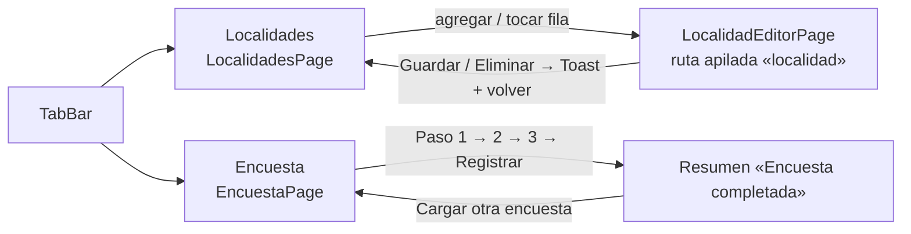
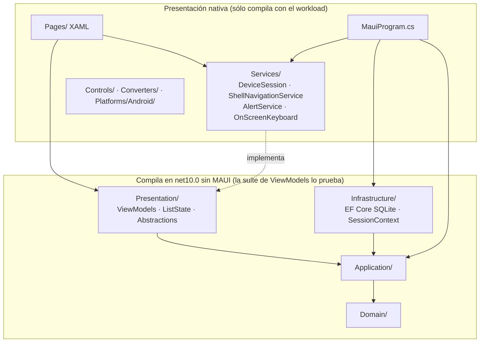
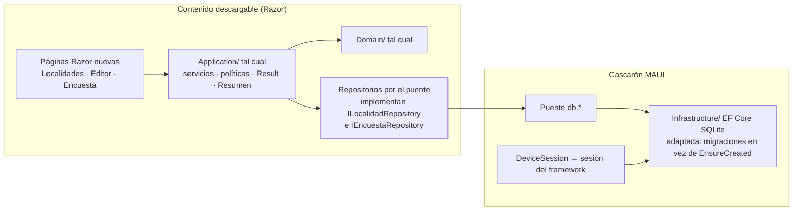

# R1 — Relevamiento del caso base `MovilidadUrbana.MAUI`

> **Qué es este documento**: el relevamiento del proyecto que el prompt manda «tomar de base para la construcción
> de la demo» (`/LAB/Lab-Documentos/Lab-Documentos.Documentacion/PROMPTs/Concepts/01-Framework-Concept/Crear-Framework-Concept.md:30`).
> Alimenta sobre todo al núcleo N5 (guía y demo) y, por sus pruebas y su workflow, a N3 y N4
> (`../01-Descomposicion-En-Nucleos.md`).
> **Fecha**: 2026-10-25. **Commit relevado**: `8fb4c3a8b1cc629027f456c7c3ce19e041164c06` (2026-09-18 10:59 -0300),
> rama `main`, árbol de trabajo limpio (`git status --short` sin salida).
> **Método**: primero la ia-db del repositorio (README e índices 01, 02, 03, 05, 06, 08 y 13); después cada afirmación
> se contrastó contra el código. Donde la ia-db y el código coinciden se cita el código; donde difieren, se dice.
> **Regla de evidencia**: cada afirmación lleva `archivo:línea`, o un comando con su salida. Lo marcado **CRITERIO** es
> juicio del relevador, no un hecho. Lo marcado **NO VERIFICADO** dice por qué.

## Índice

1. [Convenciones de cita](#1-convenciones-de-cita)
2. [Qué es la app](#2-qué-es-la-app)
3. [Dominio: entidades, catálogos y reglas](#3-dominio-entidades-catálogos-y-reglas)
4. [Casos de uso](#4-casos-de-uso)
5. [Pantallas](#5-pantallas)
6. [Arquitectura por capas](#6-arquitectura-por-capas)
7. [Convención de nombres](#7-convención-de-nombres)
8. [Persistencia: EF Core sobre SQLite](#8-persistencia-ef-core-sobre-sqlite)
9. [Sesión del dispositivo](#9-sesión-del-dispositivo)
10. [Versiones exactas](#10-versiones-exactas)
11. [Cómo se compila hoy](#11-cómo-se-compila-hoy)
12. [Cómo se prueba hoy](#12-cómo-se-prueba-hoy)
13. [El workflow que la compila](#13-el-workflow-que-la-compila)
14. [Qué tomar para la demo del framework](#14-qué-tomar-para-la-demo-del-framework)
15. [Huecos que este caso base deja al framework](#15-huecos-que-este-caso-base-deja-al-framework)
16. [Discrepancias y rastros encontrados](#16-discrepancias-y-rastros-encontrados)
17. [Lo que no se verificó](#17-lo-que-no-se-verificó)

## 1. Convenciones de cita

| Abreviatura | Ruta desde la raíz del workspace |
| --- | --- |
| `[repo]` | `/LAB/Lab-E2E.WebBlazor/Lab-E2E.WebBlazor` |
| `[app]` | `[repo]/src/MovilidadUrbana.MAUI` |
| `[web]` | `[repo]/src/MovilidadUrbana.Web` |
| `[vmt]` | `[repo]/tests/MovilidadUrbana.MAUI.Tests` |
| `[uit]` | `[repo]/tests/MovilidadUrbana.MAUI.UITests` |
| `[ia-db]` | `/LAB/Lab-E2E.WebBlazor/Lab-E2E.WebBlazor.Documentacion/ia-db` |
| `[borrador]` | `/LAB/Lab-Documentos/Lab-Documentos/Concepts/Framework-Concept/Framework-APP.md` |

## 2. Qué es la app

| Hecho | Evidencia |
| --- | --- |
| App Android de Movilidad Urbana con XAML nativo y MVVM; la base SQLite vive en el teléfono | `[app]/MovilidadUrbana.MAUI.csproj:3-4` |
| Es **independiente**: trae sus propias capas como carpetas, no referencia otro proyecto ni habla con ningún servidor | `[app]/MovilidadUrbana.MAUI.csproj:4-6` |
| Sólo Android: «el laboratorio se construye en Linux, donde iOS y Mac Catalyst no compilan» | `[app]/MovilidadUrbana.MAUI.csproj:7,9` |
| Sin permisos en el manifiesto (en Debug el SDK agrega `INTERNET` para el depurador) | `[app]/Platforms/Android/AndroidManifest.xml:2-5` |
| Dos módulos, una pestaña cada uno: **Localidades** y **Encuesta** | `[app]/AppShell.xaml:14-21` |
| Tema claro forzado | `[app]/App.xaml.cs:13-14` |
| Es una de tres aplicaciones (web, API, Android) sobre la misma temática que **repiten sus capas a propósito** | `[ia-db]/README.md:46-50`; `[ia-db]/indexes/08_Decisiones-Y-Trampas.md:19-20` (restricción «no proponer proyectos compartidos») |

El dominio es «de juguete», didáctico: un ABM de localidades y una encuesta de transporte en tres pasos
(`[ia-db]/README.md:39-44`).

## 3. Dominio: entidades, catálogos y reglas

### 3.1 Entidades (`[app]/Domain/Entities/`)

| Entidad | Campos | Evidencia |
| --- | --- | --- |
| `Localidad` | `Id`, `SessionId`, `Nombre`, `Provincia`, `CodigoPostal`, `Habitantes` (`int`) | `Localidad.cs:10-20` |
| `RespuestaDeEncuesta` | `Id`, `SessionId`, `Nombre`, `Edad`, `Localidad` (nombre, no clave), `Medios` (`IReadOnlyList<string>`), `Frecuencia`, `Distancia` (`double`), `Minutos`, `Motivo`, `RegistradaEn` (`DateTimeOffset`) | `RespuestaDeEncuesta.cs:6-27` |
| `Session` | `Id`, `CreatedAt` — marca de que la sesión ya recibió su siembra | `Session.cs:3-11` |

Son clases con setters públicos y sin comportamiento; las reglas viven aparte (lectura directa de los tres archivos).

### 3.2 Catálogos (`[app]/Domain/Catalogos.cs`)

| Catálogo | Valores | Evidencia |
| --- | --- | --- |
| `Provincias` | Buenos Aires, Chaco, Córdoba, Corrientes, Entre Ríos, Mendoza, Santa Fe | `:6-15` |
| `Medios` (clave, etiqueta) | colectivo, auto, bicicleta, moto, caminata («A pie»), tren | `:18-26` |
| `Frecuencias` | diaria, semanal, ocasional | `:28-33` |
| `Motivos` | trabajo, estudio, salud, otros | `:35-41` |
| `EtiquetaDe*` | devuelve la etiqueta o la clave si no existe | `:43-50` |

### 3.3 Reglas (`[app]/Domain/Rules/`)

| Regla | Valor / comportamiento | Evidencia |
| --- | --- | --- |
| Nombre de localidad | recortado, ≥ 3; máximo 60 (constante, no validada en la regla) | `LocalidadRules.cs:11-12,18-19` |
| Provincia | no vacía | `LocalidadRules.cs:21` |
| Código postal | exactamente 4 dígitos (`[GeneratedRegex(@"^\d{4}$")]`) | `LocalidadRules.cs:16,23-24,34-35` |
| Habitantes | entero no nulo ≥ 1 | `LocalidadRules.cs:13,26-27` |
| Misma localidad | nombre sin distinguir mayúsculas **y** provincia ordinal | `LocalidadRules.cs:30-32` |
| Encuesta: pasos | 3 | `EncuestaRules.cs:6` |
| Encuesta: nombre | ≥ 3 (máximo 80 como constante) | `EncuestaRules.cs:8-9,20-21` |
| Edad | 16 a 110 inclusive | `EncuestaRules.cs:11-12,23` |
| Distancia | 0 a 500 (cero válido) | `EncuestaRules.cs:14-15,25-26` |
| Minutos | 1 a 600 (cero no válido) | `EncuestaRules.cs:17-18,28` |

## 4. Casos de uso

### 4.1 `Result` y políticas

| Pieza | Qué hace | Evidencia |
| --- | --- | --- |
| `Result(IsSuccess, Message, Errors)` | `Success(msg)`; `Invalid(errors)` con mensaje fijo «Revise los campos marcados en rojo.»; claves de error = nombres de campo | `[app]/Application/Result.cs:8-19` |
| `LocalidadPolicy` | requisitos derivados de las constantes, para mostrar **antes** del intento | `[app]/Application/Localidades/LocalidadPolicy.cs:5-24` |
| `EncuestaPolicy` | ídem para los ocho campos de la encuesta | `[app]/Application/Encuestas/EncuestaPolicy.cs:5-30` |

### 4.2 Localidades (`LocalidadService`)

| Caso de uso | Flujo | Evidencia |
| --- | --- | --- |
| Listar | delega en el repositorio | `[app]/Application/Localidades/LocalidadService.cs:10-11` |
| Alta / modificación (`SaveAsync`) | valida campo por campo → rechaza duplicado (`MismaLocalidad`, excluyendo el propio `Id`) → si hay `Id` busca y actualiza, si no agrega | `LocalidadService.cs:13-58,72-95` |
| Baja (`DeleteAsync`) | si no existe, «La localidad ya no existe.»; si existe, borra | `LocalidadService.cs:60-70` |

### 4.3 Encuesta (`EncuestaService`)

| Caso de uso | Flujo | Evidencia |
| --- | --- | --- |
| Contar | encuestas de la sesión | `[app]/Application/Encuestas/EncuestaService.cs:14-15` |
| Validar un paso (`ValidarPaso`) | 1: nombre, edad, localidad · 2: medios, frecuencia · 3: distancia, minutos, motivo | `EncuestaService.cs:17-67` |
| Registrar (`RegistrarAsync`) | arma la respuesta con los medios **en el orden del catálogo**, `RegistradaEn = UtcNow`, persiste y la devuelve; asume pasos ya validados (`!.Value`) | `EncuestaService.cs:70-88` |
| Ficha de resumen (`ResumenDeEncuesta.De`) | siete campos con valor ya formateado («la vista no formatea») | `[app]/Application/Encuestas/ResumenDeEncuesta.cs:6-28` |

`EncuestaModel` acumula los tres pasos y expone `AlternarMedio` (`[app]/Application/Encuestas/EncuestaModel.cs:4-25`);
`LocalidadModel` usa `Habitantes` anulable para distinguir «vacío» de «cero» (`[app]/Application/Localidades/LocalidadModel.cs:14-15`).

## 5. Pantallas



| Pantalla | Comportamiento | ViewModel | Evidencia |
| --- | --- | --- | --- |
| **Localidades** (lista) | Buscador por nombre o CP, filtro por provincia, resumen «N de M localidades», cuatro estados (`Cargando`, `ConDatos`, `Vacio`, `FiltradoSinResultados`), pull-to-refresh, botón flotante «Agregar»; recarga al aparecer | `LocalidadesViewModel` | `[app]/Pages/LocalidadesPage.xaml:12-89`; `[app]/Pages/LocalidadesPage.xaml.cs:15-20`; `[app]/Presentation/Localidades/LocalidadesViewModel.cs:14-97`; `[app]/Presentation/ListState.cs:8-14` |
| **Editor de localidad** | Alta o edición según el parámetro de navegación; errores por campo; «Guardar» en barra fija inferior; «Eliminar» con confirmación; foco al primer campo en un alta | `LocalidadEditorViewModel` | `[app]/Pages/LocalidadEditorPage.xaml:9,63-64`; `[app]/Pages/LocalidadEditorPage.xaml.cs:17-28`; `[app]/Presentation/Localidades/LocalidadEditorViewModel.cs:49-128` |
| **Encuesta** | Asistente de 3 pasos con barra de progreso, contador de registradas, aviso «Complete los datos del paso antes de continuar.», medios con casillas (fila entera táctil), frecuencia y motivo con `RadioButton`, resumen al terminar | `EncuestaViewModel` (singleton) | `[app]/Pages/EncuestaPage.xaml:17-18,28,74-100,136-165`; `[app]/Presentation/Encuestas/EncuestaViewModel.cs:19,80-98,134-184`; `[app]/Presentation/Encuestas/Opciones.cs:10-22` |

Reglas de interacción comunes: corregir un campo borra su error (`LocalidadEditorViewModel.cs:60-64`,
`EncuestaViewModel.cs:109-116`); volver de paso nunca valida y conserva lo cargado (`EncuestaViewModel.cs:140-146`).

Los `AutomationId` que usan las pruebas Appium están en `[app]/Pages/LocalidadesPage.xaml:15,21,32,64,69,84`,
`[app]/Pages/LocalidadEditorPage.xaml:15,21,31,40,50,58,64` y `[app]/Pages/EncuestaPage.xaml:17,18,36,44,52,60,77,115,122,151,165,175,177,179`
(salida de `grep -n AutomationId [app]/Pages/*.xaml`).

## 6. Arquitectura por capas



| Capa | Contenido | Depende de | Evidencia |
| --- | --- | --- | --- |
| `Domain/` | entidades, reglas, catálogos | sólo `System.Text.RegularExpressions` | salida de `grep -rh '^using' [app]/Domain` |
| `Application/` | servicios, modelos, políticas, `Result`, abstracciones de repositorio y sesión | `Domain/` + `Microsoft.Extensions.DependencyInjection` | `[app]/Application/DependencyInjection.cs:1,10-15`; `[app]/Application/Abstractions/*.cs` |
| `Infrastructure/` | `AppDbContext`, repositorios, sembrador, inicializador, `SessionContext` | `Application/` + EF Core SQLite | `[app]/Infrastructure/DependencyInjection.cs:17-29` |
| `Presentation/` | ViewModels con CommunityToolkit.Mvvm; `INavigationService`, `IAlertService` (la plataforma vista desde el ViewModel) | `Application/`, `Domain/` | `[app]/Presentation/Abstractions/INavigationService.cs:9-16`; `[app]/Presentation/Abstractions/IAlertService.cs:4-11` |
| `Pages/`, `Services/`, `Controls/`, `Converters/`, `Platforms/` | lo que toca MAUI y Android | todo lo anterior | `[app]/Services/*.cs`; `[app]/MauiProgram.cs:37-38,66-97` |

Comprobación de la frontera: `grep -rln 'Microsoft.Maui\|Preferences\|Shell\.' Domain Application Infrastructure Presentation`
dentro de `[app]` no devuelve nada (código de salida 1). Las cuatro capas de abajo no tocan MAUI.

**Composición** (`[app]/MauiProgram.cs`): cultura `es-AR` en los hilos nuevos y en el principal (`:24-26`), fuentes
(`:31-35`), dos ajustes de handlers de Android (`:37-38`), capas con la base en `FileSystem.AppDataDirectory` (`:40-42`),
servicios de plataforma como singletons (`:44-46`), ViewModels creados por `DeviceSession.Create<T>()` (`:49-51`), páginas
transitorias (`:53-55`) y `DatabaseInitializer.Initialize` tras `Build()` (`:61-62`). El `Shell` resuelve las páginas desde
el contenedor y registra la ruta apilada del editor (`[app]/AppShell.xaml.cs:11-13`).

**Igualdad con la web**: `diff -r [app]/Domain [web]/Domain` da 12 líneas distintas, todas `namespace`; en `Application/`,
filtrando `namespace` y `using`, no queda ninguna diferencia (comandos corridos el 2026-10-25). Coincide con
`[ia-db]/indexes/01_Arquitectura.md:47-56`.

## 7. Convención de nombres

Rige desde el commit `946d023` (2026-09-18): «lo que viene del estándar va en inglés; lo que viene del problema va en
español» (`[ia-db]/indexes/01_Arquitectura.md:212-215`). Verificado en esta copia:

| Categoría | Idioma | Ejemplos en `[app]` |
| --- | --- | --- |
| Carpetas y espacios de nombres de capa | inglés | `Domain`, `Application`, `Infrastructure`, `Persistence`, `Presentation`, `Services` |
| Carpetas por concepto | español | `Application/Localidades/`, `Application/Encuestas/`, `Presentation/Encuestas/` |
| Sufijos de rol | inglés | `LocalidadService`, `ILocalidadRepository`, `EncuestaViewModel`, `LocalidadPolicy`, `LocalidadRules` |
| Operaciones de patrón | inglés | `GetAllAsync`, `SaveAsync`, `DeleteAsync`, `EnsureSeededAsync` (`LocalidadService.cs:10,13,60`; `SessionSeeder.cs:21`) |
| Piezas técnicas | inglés | `Result`, `AppDbContext`, `SessionContext`, `DeviceSession`, `ListState` |
| Entidades, atributos, catálogos | español | `Localidad.CodigoPostal`, `RespuestaDeEncuesta.Medios`, `Catalogos.Provincias` |
| Acciones propias del caso | español | `ValidarPaso`, `RegistrarAsync`, `AlternarMedio`, `NuevaEncuesta` |
| Contrato observable | español, a propósito | clave de preferencias `sesion-dispositivo` (`[app]/Services/DeviceSession.cs:16`), `AutomationId` |

Los comentarios en prosa **no** se tradujeron y conservan nombres viejos (`[ia-db]/indexes/01_Arquitectura.md:236-251`);
en esta copia, por ejemplo, `SesionDelDispositivo` (`[app]/Infrastructure/Sessions/SessionContext.cs:8`) y `ObtenerAsync`
(`[app]/Infrastructure/Persistence/LocalidadRepository.cs:52`).

## 8. Persistencia: EF Core sobre SQLite

| Pieza | Comportamiento | Evidencia |
| --- | --- | --- |
| Registro | `AddDbContextFactory<AppDbContext>` con `UseSqlite`; repositorios, sembrador y `SessionContext` *scoped* | `[app]/Infrastructure/DependencyInjection.cs:20-27` |
| Cadena en el teléfono | `Data Source={AppDataDirectory}/movilidad.db;Default Timeout=30` | `[app]/MauiProgram.cs:40-41` |
| Esquema | tres `DbSet` (`Localidades`, `Encuestas`, `Sessions`); largos máximos como literales; índice en `SessionId` | `[app]/Infrastructure/Persistence/AppDbContext.cs:11-39` |
| Lista en SQLite | `Medios` con `ValueConverter` a texto separado por comas y `ValueComparer` por secuencia | `AppDbContext.cs:41-52` |
| Arranque | crea carpeta, `EnsureCreated()` (**sin migraciones, a propósito**), `PRAGMA journal_mode=WAL` | `[app]/Infrastructure/Persistence/DatabaseInitializer.cs:7-29` |
| Repositorios | un contexto por operación; toda consulta filtra por `SessionId`; `UpdateAsync` no hace nada si la sesión no coincide; baja con `ExecuteDeleteAsync` | `[app]/Infrastructure/Persistence/LocalidadRepository.cs:20-67`; `EncuestaRepository.cs:11-24` |
| Siembra | la primera vez que se toca una sesión: marca `Session` + Corrientes y Resistencia; tolera la carrera con `catch (DbUpdateException)` | `[app]/Infrastructure/Persistence/SessionSeeder.cs:13-50` |

Consecuencia declarada: un cambio de entidad obliga a borrar la base, porque `EnsureCreated` no migra
(`[ia-db]/indexes/08_Decisiones-Y-Trampas.md:37`).

## 9. Sesión del dispositivo

`DeviceSession` lee la clave `sesion-dispositivo` de `Preferences`; si falta o no es válida genera un GUID y lo guarda;
abre **un único ámbito** de DI que vive lo que vive la app, fija ahí `SessionContext.Set(id)` y expone
`Create<T>() = ActivatorUtilities.CreateInstance<T>(ámbito)` (`[app]/Services/DeviceSession.cs:14-38`). El teléfono
entero es una sesión y los datos sobreviven a cerrar la app (`DeviceSession.cs:7-9`). `SessionContext` arranca con un
GUID provisorio y sólo acepta ids no vacíos de hasta 64 caracteres (`[app]/Infrastructure/Sessions/SessionContext.cs:13-23`).

No hay login, identidad ni token: la «sesión» es sólo el espacio de datos (lectura completa de `[app]/Services/` y
`[app]/Infrastructure/Sessions/`).

## 10. Versiones exactas

| Componente | Versión | Evidencia |
| --- | --- | --- |
| Target | `net10.0-android`, `SupportedOSPlatformVersion` 23.0 | `[app]/MovilidadUrbana.MAUI.csproj:9,23` |
| Identidad | `ApplicationId ar.lab.movilidadurbana`, `ApplicationDisplayVersion` 1.0, `ApplicationVersion` 1 | `[app]/MovilidadUrbana.MAUI.csproj:17-20` |
| `Microsoft.Maui.Controls` | `$(MauiVersion)` (no fijada en el csproj); la restauración local del 2026-09-18 08:56 resolvió **10.0.20** | `[app]/MovilidadUrbana.MAUI.csproj:34`; `grep -o '"Microsoft.Maui.Controls/[^"]*"' [app]/obj/project.assets.json` → `"Microsoft.Maui.Controls/10.0.20"` |
| `Microsoft.EntityFrameworkCore.Sqlite` | 10.0.11 | `[app]/MovilidadUrbana.MAUI.csproj:36` |
| `CommunityToolkit.Mvvm` | 8.4.2 | `[app]/MovilidadUrbana.MAUI.csproj:37` |
| `Microsoft.Extensions.Logging.Debug` | 10.0.11 | `[app]/MovilidadUrbana.MAUI.csproj:35` |
| Suite de ViewModels | NUnit 4.3.2, NUnit.Analyzers 4.7.0, NUnit3TestAdapter 5.0.0, Microsoft.NET.Test.Sdk 17.14.0, EF Core SQLite 10.0.11, CommunityToolkit.Mvvm 8.4.2 | `[vmt]/MovilidadUrbana.MAUI.Tests.csproj:15-23` |
| Suite Appium | Appium.WebDriver 8.0.0 + las mismas de NUnit | `[uit]/MovilidadUrbana.MAUI.UITests.csproj:14-18` |
| Imagen `lab-e2e-maui-dev:net10` (local) | SDK 10.0.400; workload `maui-android` manifiesto 10.0.20/10.0.100 (versión de carga 10.0.400.1); Appium 3.7.0; driver `uiautomator2@8.6.4` | `docker run --rm lab-e2e-maui-dev:net10 bash -lc 'dotnet --version; dotnet workload list; appium --version; appium driver list --installed'` (2026-10-25) |

No hay `global.json` ni `Directory.*.props` en `[repo]` (`ls` sin resultados): el SDK y la versión de MAUI los decide
el entorno que compila. **CRITERIO**: para un framework con compuerta de PR esto es una fuente de no reproducibilidad
(ver §15).

## 11. Cómo se compila hoy

Compilar la app exige el workload `maui-android`, JDK 17 y el SDK de Android; el host no los tiene y se usa un
contenedor (`[ia-db]/indexes/13_App-Android.md:226-227`).

| Pieza | Qué hace | Evidencia |
| --- | --- | --- |
| `Dockerfile` | `mcr.microsoft.com/dotnet/sdk:10.0` + OpenJDK 17 + cmdline-tools con `platforms;android-36/35`, `build-tools;36.0.0/35.0.0` + `dotnet workload install maui-android` + locales es_AR + Node 22 + Appium (sin versión fijada) + `uiautomator2` | `[repo]/.devcontainer/Dockerfile:9,17-27,37-59,64-69` |
| `devcontainer.json` | contenedor privilegiado con `/dev/bus/usb`, volúmenes para NuGet, la clave de adb ya autorizada y el keystore de Debug | `[repo]/.devcontainer/devcontainer.json:6-17` |
| `dev.sh build` | `dotnet build … -c Debug -f net10.0-android -p:AndroidPackageFormat=apk -p:RuntimeIdentifier=$ABI -p:EmbedAssembliesIntoApk=true`, ABI por defecto `android-arm` | `[repo]/.devcontainer/dev.sh:30,59-63` |
| `dev.sh install` / `run` | `adb install -r` del `*-Signed.apk`; abre con `monkey` | `dev.sh:65-78` |
| Dueño del teléfono | `up` apaga el adb de `adb-contenedor`; `devolver` se lo restituye | `dev.sh:15-18,37-55,101-107` |

## 12. Cómo se prueba hoy

### 12.1 ViewModels sin teléfono — 18 casos

El proyecto Android no se puede referenciar desde `net10.0` sin el workload, así que la suite **compila las capas como
archivos enlazados** (`Domain`, `Application`, `Infrastructure`, `Presentation`) y deja afuera `Pages/`, `Services/`,
`Controls/` y `MauiProgram` (`[vmt]/MovilidadUrbana.MAUI.Tests.csproj:3-6,26-31`). `TestEnvironment` compone las capas
reales sobre un SQLite temporal por caso, fija `es-AR` y ofrece dobles de navegación y avisos
(`[vmt]/TestEnvironment.cs:17-71`).

Conteo: `grep -c '\[Test\]'` da 7 (`EncuestaViewModelTests.cs`), 6 (`LocalidadEditorViewModelTests.cs`) y 5
(`LocalidadesViewModelTests.cs`) = 18.

**Corrida de hoy (2026-10-25)**, sobre una copia en el scratchpad para no escribir `bin/` ni `obj/` en el repositorio de
sólo lectura, con la imagen `mcr.microsoft.com/dotnet/sdk:10.0` (SDK 10.0.400):

```text
$ dotnet test tests/MovilidadUrbana.MAUI.Tests --configuration Release
  Restored /w/tests/MovilidadUrbana.MAUI.Tests/MovilidadUrbana.MAUI.Tests.csproj (in 6.07 sec).
  MovilidadUrbana.MAUI.Tests -> /w/tests/MovilidadUrbana.MAUI.Tests/bin/Release/net10.0/MovilidadUrbana.MAUI.Tests.dll
Passed!  - Failed:     0, Passed:    18, Skipped:     0, Total:    18, Duration: 3 s - MovilidadUrbana.MAUI.Tests.dll (net10.0)
```

Esto cubre un hueco que la ia-db declaraba («no hay evidencia versionada de los 18 … posterior a `946d023`»,
`[ia-db]/indexes/13_App-Android.md:276-278`).

### 12.2 Interfaz con Appium — 5 casos

| Hecho | Evidencia |
| --- | --- |
| Corre sobre la app **ya instalada**, con Appium y adb viendo el dispositivo; **no en CI** | `[uit]/MovilidadUrbana.MAUI.UITests.csproj:3-5` |
| Una sesión para toda la corrida (`[SetUpFixture]` en el namespace raíz), `UIAutomator2`, `NoReset=true`, reintento hasta 120 s esperando la primera pantalla | `[uit]/Infrastructure/AppiumSession.cs:5-55` |
| Localiza por `AutomationId` (publicado como `resource-id`) | `[ia-db]/indexes/13_App-Android.md:117-118` |
| Casos: 3 en `LocalidadesTests.cs`, 2 en `EncuestaTests.cs` | `grep -c '\[Test\]'` |
| Se corre con `dev.sh uitests` (levanta Appium si no responde y escribe `uitests.trx`) | `[repo]/.devcontainer/dev.sh:84-94` |
| Última corrida en disco: `[uit]/resultados/uitests.trx`, **5/5 pasaron**, 2026-09-18 12:06–12:11 UTC; el archivo está ignorado por git | `grep -o '<Counters[^>]*>'` → `total="5" executed="5" passed="5" failed="0"`; `git check-ignore -v` → `.gitignore:443` |

El único teléfono con el que se recorrió la app es un Motorola moto e6 play (Android 9, armeabi-v7a)
(`[ia-db]/indexes/13_App-Android.md:269`). Hoy el g42 no está visible por USB ni por adb
(`../00-Registro.md:19`).

## 13. El workflow que la compila

`[repo]/.github/workflows/android.yml` («Android — MAUI»):

| Aspecto | Valor | Evidencia |
| --- | --- | --- |
| Disparadores | `push` y `pull_request` a `main` con `paths` (`src/MovilidadUrbana.MAUI/**`, `tests/MovilidadUrbana.MAUI.Tests/**`, el propio YAML) + `workflow_dispatch` | `android.yml:9-22` |
| Fuera de `paths` | `tests/MovilidadUrbana.MAUI.UITests/**` | `android.yml:12-21` |
| Concurrencia | `android-<ref>`, cancela sólo en PR | `android.yml:24-26` |
| **Runner** | **`ubuntu-latest`** (hospedado por GitHub), 45 min | `android.yml:37-38` |
| Pasos | checkout@v7 → setup-dotnet@v6 10.0.x → **prueba de ViewModels** (antes del workload) → setup-java@v6 Temurin 17 → `dotnet workload install maui-android` → `-t:InstallAndroidDependencies` → `dotnet publish -c Release -f net10.0-android -p:AndroidPackageFormat=apk -o apk` → sube `movilidad-urbana-apk` (14 días) | `android.yml:40-78` |
| Firma | clave de depuración del runner: «para un teléfono de prueba, no para una tienda» | `android.yml:5-6` |
| Corridas observadas | 4 `push`, las 4 en verde (`10ce735`, `3e119b8`, `946d023`, `e9dea2a`), API consultada el 2026-10-18 | `[ia-db]/indexes/06_CI-Y-Workflows.md:203` |

`ci.yml` no compila la app (compila `Lab-E2E.WebBlazor.SinMaui.slnf`, que incluye las dos suites MAUI pero no la app)
y también corre los ViewModels (`[repo]/Lab-E2E.WebBlazor.SinMaui.slnf:14-15`; `[repo]/.github/workflows/ci.yml:54,80`).

El prompt pide `runs-on: [self-hosted, i7infra-dev]` (`Crear-Framework-Concept.md:32`). Hoy sólo el job `publicar` de
`e2e.yml` usa ese runner (`[repo]/.github/workflows/e2e.yml:89`); `android.yml` no. El runner existe con las etiquetas
`i7infra,i7infra-dev,dotnet,maui-android` (`../00-Registro.md:19`).

## 14. Qué tomar para la demo del framework

Contexto que condiciona la respuesta: el borrador separa un **cascarón** MAUI (servicios nativos, SQLite, actualizador,
puente), que se actualiza por la tienda, de un **contenido** con las pantallas del negocio, que baja del servidor
(`[borrador]:43-49`). La opción candidata es contenido en Blazor WebAssembly servido en el WebView (A, `[borrador]:85,103`),
todavía abierta (D-01, `[borrador]:105`). Con A, el acceso del contenido a SQLite pasa por el puente con una API acotada
(`[borrador]:293`). Lo que sigue vale para A; donde B o C cambiarían la respuesta, se dice.

### 14.1 Mapa de piezas



### 14.2 Se reutiliza tal cual

| Pieza | Por qué se puede | Evidencia | Valor para la guía |
| --- | --- | --- | --- |
| `Domain/` completo (entidades, reglas, catálogos) | Sólo depende de `System.Text.RegularExpressions`; no toca MAUI ni EF | §6 (salida de `grep`); `[app]/Domain/**` | Muestra que las reglas no dependen de dónde corre la pantalla |
| `Application/` completo (servicios, modelos, políticas, `Result`, `ResumenDeEncuesta`, interfaces) | Depende sólo de `Domain/` y de `Microsoft.Extensions.DependencyInjection`; idéntico (salvo `namespace`) en la web Blazor, que ya lo consume desde Razor | §6; `[web]/Components/Pages/Localidades.razor.cs:29`; `[web]/Components/Pages/Encuesta.razor.cs:41-43` | Los mensajes, las claves de error y las políticas son los mismos en las tres cabezas: la guía puede mostrar «misma regla, otra superficie» |
| Las interfaces `ILocalidadRepository`, `IEncuestaRepository`, `ISessionContext` | Son la costura natural para que el contenido no conozca el motor: se implementan del lado del contenido llamando al puente | `[app]/Application/Abstractions/*.cs`; `[borrador]:293` | **CRITERIO**: ilustran el «contrato» del puente con algo que el alumno ya entiende |
| La suite de ViewModels/servicios con **archivos enlazados** en `net10.0` | Prueba capas reales sin workload ni teléfono, en 3 s | §12.1 (corrida 18/18) | **CRITERIO**: es el patrón exacto para la compuerta rápida del PR (N3, N4) |
| Tokens de diseño | `Colors.xaml` declara «los mismos valores que Tokens.css de la web» | `[app]/Resources/Styles/Colors.xaml:45-58`; `[web]/wwwroot/css/Tokens.css` | En Razor se usa directamente el CSS de tokens |

**NO VERIFICADO**: que `Domain/` y `Application/` compilen y corran **dentro de Blazor WebAssembly** (en particular el
`[GeneratedRegex]` y la DI). Motivo: no se ensayó en este relevamiento; corresponde al ensayo E01 (`../00-Registro.md:20`).

### 14.3 Se porta con adaptación

| Pieza | Qué cambia | Evidencia del punto de partida |
| --- | --- | --- |
| Las tres pantallas | XAML nativo → componentes Razor. **La web ya tiene versiones Razor** de las mismas pantallas (`Localidades.razor`, `Encuesta.razor`) y sus componentes compartidos (`Wizard`, `Grid`, `FormField`, `EmptyState`, `Dialog`) | `[web]/Components/Pages/Localidades.razor` (204 líneas) y `Encuesta.razor` (186); `[web]/Components/Shared/` |
| Lo que esas páginas web inyectan | `IDialogService`, `IFocusService` (sobre `IJSRuntime`), `NavigationManager`; además dependen de la cookie de sesión y del render *interactive server* | `[web]/Components/Pages/Localidades.razor.cs:29-33`; `[web]/Components/Pages/Encuesta.razor.cs:41-49`; `[web]/Services/FocusService.cs:6`; `[web]/Components/Shared/Dialog.razor.cs:21`; `[ia-db]/indexes/08_Decisiones-Y-Trampas.md:39` |
| ViewModels (`Presentation/`) | Usan CommunityToolkit.Mvvm, sin MAUI; en Razor pueden quedar como estado del componente o reescribirse como *code-behind* al estilo de la web. `INavigationService` → `NavigationManager`; `IAlertService` → diálogo/aviso del contenido o del cascarón por el puente | `[app]/Presentation/**`; §6 |
| `ListState` | Mismo vocabulario que el `SurfaceState` de la web | `[app]/Presentation/ListState.cs:4-7`; `[web]/Components/Shared/SurfaceState.cs` |
| `Infrastructure/` (EF Core SQLite) | Va al **cascarón**, no al contenido; los repositorios se exponen por el puente. `EnsureCreated` debe cambiarse por migraciones, porque el borrador exige `SchemaVersion` + scripts al arrancar y un contenido nuevo puede llegar con un esquema nuevo | `[app]/Infrastructure/Persistence/DatabaseInitializer.cs:10-11,25`; `[borrador]:291` |
| `DeviceSession` | Su idea (un id por dispositivo en `Preferences`, un ámbito de DI para toda la app) sirve de puente hacia la sesión del framework; el login real (D-07) no existe en el caso base | `[app]/Services/DeviceSession.cs:14-38`; `[borrador]` tabla de decisiones |
| `MainActivity` (`AdjustResize`, `[Register]` con nombre estable) | Sigue siendo del cascarón | `[app]/Platforms/Android/MainActivity.cs:9-13` |

**CRITERIO — respecto de D-05** (`[borrador]:288,372`): el caso base es evidencia de que EF Core SQLite 10.0.11 funciona en
`net10.0-android` (APK compilado en CI, `[ia-db]/indexes/06_CI-Y-Workflows.md:203`; app recorrida en el teléfono,
`[ia-db]/indexes/13_App-Android.md:269`). No dice nada sobre iOS, que es donde el borrador ubica el riesgo de EF Core
(trimming/AOT).

### 14.4 No se reutiliza

| Pieza | Por qué | Evidencia |
| --- | --- | --- |
| `Pages/*.xaml` | Son controles nativos de MAUI (`CollectionView`, `Picker`, `RadioButton`, `SearchBar`); el contenido del framework es Razor | `[app]/Pages/*.xaml` |
| `OnScreenKeyboard`, `DecimalEntry`, `QuitarSubrayadoNativo`, `AceptarComaDecimal` | Corrigen comportamientos de controles nativos de Android (barra tapada por el teclado en página apilada, coma descartada, subrayado). En un WebView los campos son HTML | `[app]/Services/OnScreenKeyboard.cs:3-10`; `[app]/Controls/DecimalEntry.cs:3-7`; `[app]/MauiProgram.cs:66-97` |
| `ShellNavigationService`, `AlertService` | Implementan las abstracciones con `Shell` y `Toast` de Android | `[app]/Services/ShellNavigationService.cs:7-20`; `[app]/Services/AlertService.cs:9-21` |
| Los `AutomationId` y la suite Appium tal como está | Localizan `resource-id` nativos. El DOM dentro de un WebView no se ubica así | `[uit]/Infrastructure/AppiumSession.cs:48-49`; `[ia-db]/indexes/13_App-Android.md:117-118` |

**NO VERIFICADO**: cómo se prueba la interfaz Razor dentro del WebView (Appium cambiando al contexto del WebView, o
Playwright contra el paquete servido fuera del teléfono). Motivo: no se ensayó; lo resuelve N4. Las trampas ya
documentadas de comportamiento del teclado y la coma decimal en el WebView también quedan sin verificar.

### 14.5 Lecciones del caso base que la demo conviene conservar

Todo esto es **CRITERIO** del relevador, apoyado en la evidencia citada.

1. **Los valores de presentación vienen ya formateados del dominio** (`ResumenDeEncuesta`, «la vista no formatea»,
   `ResumenDeEncuesta.cs:9`) y **los requisitos vienen de las políticas** (`LocalidadPolicy.cs:6-11`). Si la pantalla es
   contenido descargable, cuanto menos decida la página, menos se rompe al actualizarla.
2. **La plataforma detrás de interfaces** (`INavigationService`, `IAlertService`) es lo que permite probar sin teléfono.
   Es la misma forma que el puente del borrador con sus módulos (`[borrador]:295`).
3. **Cultura `es-AR` fijada en el arranque** (`MauiProgram.cs:24-26`): las pruebas dependen de ella («12,5 km»). En un
   contenido WASM habrá que fijarla también del lado del contenido. **NO VERIFICADO** cómo, por la misma razón que §14.2.
4. **No compartir proyectos entre las tres apps es una regla del laboratorio** (`[ia-db]/indexes/08_Decisiones-Y-Trampas.md:19-20`).
   La demo vive en otro repositorio, así que copia las capas y no las referencia; eso respeta la regla.

## 15. Huecos que este caso base deja al framework

| Hueco | Evidencia | Núcleo |
| --- | --- | --- |
| Sin red, sin servidor, sin login | `AndroidManifest.xml:2-3`; `MovilidadUrbana.MAUI.csproj:5-6` | N1, N2 |
| Sin migraciones de esquema | `DatabaseInitializer.cs:10-11` | N2 |
| Versión de la app fija (`1.0` / `1`), producto sin versionar (CHANGELOG por fecha) | `MovilidadUrbana.MAUI.csproj:19-20`; `[ia-db]/README.md:36` | N3 |
| SDK y `MauiVersion` sin fijar (sin `global.json`); Appium sin versión fijada en la imagen | §10; `Dockerfile:62,67` | N3 |
| La UI no se prueba en CI (no hay emulador en los workflows) | `[uit]/MovilidadUrbana.MAUI.UITests.csproj:5`; `[ia-db]/indexes/13_App-Android.md:283` | N4 |
| APK firmado con clave de depuración del runner | `android.yml:5-6` | N3 |
| Sólo Android | `MovilidadUrbana.MAUI.csproj:7,9` | N3 (D-06) |
| `android.yml` en `ubuntu-latest`, no en `[self-hosted, i7infra-dev]` | `android.yml:37` | N3 |

## 16. Discrepancias y rastros encontrados

| Hallazgo | Evidencia |
| --- | --- |
| El `<summary>` de `AddApplication` dice que lo invocan «la web y la API»; también lo invoca `MauiProgram` | `[app]/Application/DependencyInjection.cs:7`; `[app]/MauiProgram.cs:42` |
| El comentario de `AddDbContextFactory` y el de `LocalidadRepository` justifican la fábrica por el circuito de Blazor Server; en la app Android la razón no aplica igual (copia literal de la web) | `[app]/Infrastructure/DependencyInjection.cs:19`; `[app]/Infrastructure/Persistence/LocalidadRepository.cs:11-13` |
| El `Dockerfile` se presenta como «Entorno de build/depuracion de una app híbrida de referencia de la organización» y menciona `InvariantGlobalization=false` y un `.csproj` que «condiciona a macOS»; nada de eso está en el csproj de esta app | `[repo]/.devcontainer/Dockerfile:2,24,56-57`; `[app]/MovilidadUrbana.MAUI.csproj` completo |
| El comentario del csproj de la suite de ViewModels nombra `Paginas/, Servicios/, Controles/` (hoy `Pages/`, `Services/`, `Controls/`) | `[vmt]/MovilidadUrbana.MAUI.Tests.csproj:6` |
| `EncuestaViewModel.Medios` usa la palabra clave `field` (propiedad respaldada por campo), que requiere C# 14 | `[app]/Presentation/Encuestas/EncuestaViewModel.cs:62` |
| La ia-db decía que no había evidencia de los 18 casos ni de los 5 después de `946d023`: los 18 pasaron hoy (§12.1) y en disco hay un `.trx` de Appium 5/5 del 2026-09-18 (no versionado) | §12 |

## 17. Lo que no se verificó

| Qué | Motivo |
| --- | --- |
| Que el APK compile hoy | No se corrió `dev.sh build` ni `android.yml`; la imagen pesa 6,83 GB y el relevamiento no lo requería. Última evidencia: 4 corridas verdes de `android.yml` al 2026-10-18 (`[ia-db]/indexes/06_CI-Y-Workflows.md:203`) |
| Que la suite Appium pase hoy | Requiere un teléfono conectado; el g42 no está visible (`../00-Registro.md:19`) |
| Que `Domain/` y `Application/` corran dentro de Blazor WebAssembly | Fuera del alcance de este relevamiento; corresponde al ensayo E01 |
| Que `android.yml` funcione en `[self-hosted, i7infra-dev]` | No se probó; el runner autoalojado es un contenedor sin socket de Docker (`[ia-db]/indexes/06_CI-Y-Workflows.md:188-189`) y no se sabe si trae Android SDK y JDK |
| La versión de `Microsoft.Maui.Controls` que resuelve CI | `$(MauiVersion)` depende del workload del runner; sólo se vio la restauración local (10.0.20) |
