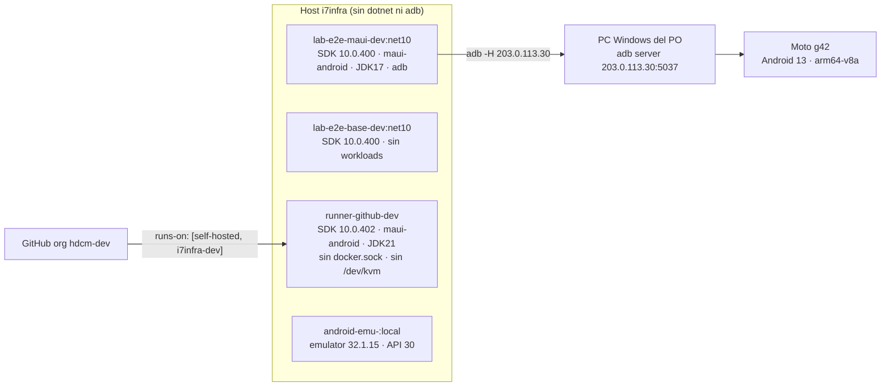

# R2 — Entorno de compilación y ensayo

Fecha de medición: 2026-10-25 · Host: i7infra (Linux, sin `dotnet` ni `adb` en el host) · Relevador: agente del
workflow 01-Framework-Concept

> **Estado: COMPLETO (con dos puntos NO VERIFICADOS declarados).** Primera corrida: PARCIAL por el bloqueo de
> inodos de `/vm` ([§7](#7-bloqueo-sin-inodos-en-vm)). **Segunda corrida (2026-10-25, ~20:05–20:20 UTC)**, tras
> liberarse los inodos: se compiló el APK android-arm64, se publicó Blazor WASM sin `wasm-tools`, se verificó el
> emulador `fc-android-emu` (ya existía, lo creó el perito E01: no se recreó), se instaló y lanzó el APK x64 en él,
> y se reconfirmó el g42. Queda NO VERIFICADO: instalar en el g42 (prohibido en este despacho: sólo lectura) y
> levantar el emulador desde cero (ya estaba vivo; la receta de §4 se reconstruyó de su `docker inspect`).

## Índice

1. [Resumen para la mesa](#1-resumen-para-la-mesa)
2. [Imágenes y contenedores disponibles](#2-imágenes-y-contenedores-disponibles)
   1. [Inventario](#21-inventario)
   2. [lab-e2e-maui-dev:net10](#22-lab-e2e-maui-devnet10)
   3. [lab-e2e-base-dev:net10](#23-lab-e2e-base-devnet10)
   4. [wasm-tools y publicación Blazor WebAssembly](#24-wasm-tools-y-publicación-blazor-webassembly)
   5. [Recursos del host](#25-recursos-del-host)
3. [Compilación de MovilidadUrbana.MAUI](#3-compilación-de-movilidadurbanamaui)
   1. [Cómo se compila hoy](#31-cómo-se-compila-hoy)
   2. [Compilación medida (android-x64)](#32-compilación-medida-android-x64)
   3. [android-arm64](#33-android-arm64)
4. [Emulador propio fc-android-emu](#4-emulador-propio-fc-android-emu)
5. [Runner GitHub i7infra-runner-dev](#5-runner-github-i7infra-runner-dev)
6. [Teléfono físico Moto g42](#6-teléfono-físico-moto-g42)
7. [BLOQUEO: sin inodos en /vm (destrabado)](#7-bloqueo-sin-inodos-en-vm)
8. [Receta de ensayo](#8-receta-de-ensayo)

## 1. Resumen para la mesa

| Tema | Hallazgo | Estado |
|---|---|---|
| SDK en `lab-e2e-maui-dev:net10` | .NET SDK 10.0.400, workload `maui-android` (manifiesto 10.0.20/10.0.100), JDK 17.0.20, Android platforms 35/36, build-tools 35.0.0/36.0.0, adb, Node, Appium | Medido |
| SDK en el runner `i7infra-runner-dev` | .NET SDK 10.0.402 + 8.0.426, `maui-android` (manifiesto 10.0.110/10.0.100), JDK 21.0.12, Android platform 36, build-tools 36.0.0, adb, Node 24.19.0, gh, jq, zip | Medido |
| `wasm-tools` | **No está instalado en ninguna imagen** (ni en `lab-e2e-maui-dev`, ni en `lab-e2e-base-dev`, ni en el runner) | Medido |
| Publicar Blazor WASM sin `wasm-tools` | **Publica** (plantilla `blazorwasm`, Release): `wwwroot` 27,1 MB / 275 archivos; `.br` 3,98 MB (91 archivos). Con `InvariantGlobalization=true`: 22,9 MB / 266 archivos; `.br` 3,34 MB. AOT y `WasmBuildNative` **fallan** con NETSDK1147 (piden `wasm-tools`) | Medido |
| APK Debug android-x64 de MovilidadUrbana.MAUI | Compila: 0 advertencias, 0 errores; **167 s** en frío (2 min 32 s de MSBuild), 6 s en caliente; APK firmado **49,5 MB** (49 467 503 bytes). Segunda corrida (NuGet tibio, obj vacío): 117 s | Medido |
| APK Debug android-arm64 | Compila: 0 advertencias, 0 errores; **112 s** de pared (1 min 47 s MSBuild) con NuGet tibio; APK firmado **49,4 MB** (49 370 534 bytes), 445 entradas en `lib/arm64-v8a/` | Medido |
| Instalar y lanzar en emulador | APK x64 en `fc-android-emu`: `install -r` en 1,8 s, `Displayed …MainActivity: +6s807ms`; desinstalado al terminar | Medido |
| Docker dentro del runner | Cliente Docker 29.9.2, **pero sin socket** (`/var/run/docker.sock` no existe): un job no puede usar `docker` | Medido |
| Emulador dentro del runner | Sin `/dev/kvm` en el contenedor del runner: **no puede correr un emulador** | Medido |
| Emulador propio `fc-android-emu` | Vivo (creado por E01 a las 19:58 UTC): emulator **32.1.15**, API 30 / Android 11, `sys.boot_completed=1` (boot en 70 s), WebView **83.0.4103.106**, ABIs x86_64,x86,arm64-v8a,armeabi-v7a; sin puertos publicados (noVNC por IP del bridge) | Medido |
| g42 | `<serie-del-g42> device … model:moto_g42` por adb remoto 203.0.113.30:5037, reconfirmado ~20:10 UTC | Medido |



## 2. Imágenes y contenedores disponibles

### 2.1 Inventario

Comando: `docker images --format '{{.Repository}}:{{.Tag}}\t{{.ID}}\t{{.Size}}\t{{.CreatedSince}}'` (filtrado).

| Imagen | Id | Tamaño | Antigüedad |
|---|---|---|---|
| `lab-e2e-maui-dev:net10` | 9cd6103e0943 | 6,83 GB | 6 semanas |
| `lab-e2e-base-dev:net10` | fe75e4216e17 | 3,13 GB | 7 semanas |
| `runner-github-dev/dotnet-maui:2.338.1` | 7d4a041a5be7 | 8,43 GB | 3 días |
| `android-emu-<privado>:local` | 206b4c64694a | 6,76 GB | 5 días |
| `adb-contenedor:net10` | d7617b8510a8 | 6,31 GB | 7 semanas |

Contenedores de otros escenarios que **no se tocaron** (`docker ps`): `android-emu-<privado>` (Up 5 days,
`0.0.0.0:6080->6080`), `android-emu-banco` (Up 3 days, `6080/tcp` sin publicar), `runner-github-dev`,
`runner-github-ng`, `runner-github-ap25`, `adb-contenedor` (Up 10 days). No hay ningún contenedor `lab-e2e-*`
corriendo.

### 2.2 lab-e2e-maui-dev:net10

Comando (contenedor efímero):

```bash
docker run --rm --name fc-insp-lab-e2e-maui-dev --entrypoint bash lab-e2e-maui-dev:net10 -lc \
  'id -un; dotnet --version; dotnet workload list; java -version; ls $ANDROID_HOME/platforms $ANDROID_HOME/build-tools; which adb node appium docker'
```

Salida resumida:

```
USER=dev
10.0.400
Se encontró un problema al comprobar las cargas de trabajo. Para obtener más información, ejecute "dotnet workload update".
Versión de carga de trabajo: 10.0.400.1
maui-android      10.0.20/10.0.100      SDK 10.0.400
openjdk version "17.0.20" 2026-07-21
/opt/android-sdk/build-tools: 35.0.0  36.0.0
/opt/android-sdk/platforms:   android-35  android-36
/opt/android-sdk/platform-tools/adb
/usr/bin/node
/usr/bin/appium
(docker: no está)
```

- El aviso «Se encontró un problema al comprobar las cargas de trabajo» aparece en cada comando `dotnet`, pero
  **no impidió compilar** (§3.2).
- La receta de la imagen está en `/LAB/Lab-E2E.WebBlazor/Lab-E2E.WebBlazor/.devcontainer/Dockerfile`: base
  `mcr.microsoft.com/dotnet/sdk:10.0`, OpenJDK 17, cmdline-tools, `platforms;android-36` y `-35`,
  `build-tools;36.0.0` y `35.0.0`, `dotnet workload install maui-android`, Node 22 + Appium + `uiautomator2`.
  No instala `wasm-tools`.
- El pack de Android que usó la compilación es `Microsoft.Android.Sdk.Linux/36.1.69` (se ve en la ruta de los
  targets del error de §3.3).

### 2.3 lab-e2e-base-dev:net10

Mismo comando. Salida resumida:

```
USER=root
10.0.400
Workload version: 10.0.400-manifests.330ea142
Installed Workload Id      Manifest Version      Installation Source
(ninguno)
bash: line 1: java: command not found
ANDROID_HOME=   (vacío)
/usr/bin/node
```

Sirve para compilar y probar proyectos `net10.0` puros (por ejemplo un Blazor WASM sin AOT, si se confirma que no
necesita `wasm-tools`); **no** sirve para Android.

### 2.4 wasm-tools y publicación Blazor WebAssembly

- Medido: ninguna de las tres imágenes de build lista `wasm-tools` en `dotnet workload list` (§2.2, §2.3, §5).
- Medido (segunda corrida) en un contenedor efímero de `lab-e2e-base-dev:net10` (SDK 10.0.400, sin workloads),
  sobre un volumen Docker `fc-wasm` (borrado al terminar):

```bash
docker volume create fc-wasm
docker run --rm --name fc-wasm -v fc-wasm:/w -w /w lab-e2e-base-dev:net10 bash -lc '
  dotnet new blazorwasm -o Demo -n Demo
  dotnet publish Demo/Demo.csproj -c Release -o /w/pub-default
  dotnet publish Demo/Demo.csproj -c Release -o /w/pub-invariant -p:InvariantGlobalization=true
  dotnet publish Demo/Demo.csproj -c Release -o /w/pub-aot       -p:RunAOTCompilation=true
  dotnet publish Demo/Demo.csproj -c Release -o /w/pub-native    -p:WasmBuildNative=true'
# medición: du -sb, find -type f | wc -l, y suma de tamaños de *.br / *.gz sobre <salida>/wwwroot
```

| Medida (`<salida>/wwwroot`) | Por defecto | `InvariantGlobalization=true` |
|---|---|---|
| ¿Publica? | Sí (rc=0) | Sí (rc=0, 19 s) |
| Tamaño total `wwwroot` (con `.br` y `.gz`) | 27 141 473 B · 275 archivos | 22 865 659 B · 266 archivos |
| Sólo originales (sin `.br`/`.gz`) | 18 032 965 B · 93 archivos | 15 352 437 B · 90 archivos |
| Suma de `.br` | **3 982 476 B** · 91 archivos | **3 342 147 B** · 88 archivos |
| Suma de `.br` dentro de `_framework/` | 2 813 848 B · 43 archivos | 2 173 519 B · 40 archivos |
| Suma de `.gz` | 5 126 032 B | 4 171 075 B |
| `_framework/` total | 15 750 428 B · 129 archivos (36 `.wasm`) | 11 474 614 B · 120 archivos (36 `.wasm`) |
| ICU (`icudt_*.dat`) | CJK 956 416 · EFIGS 550 832 · no_CJK 1 107 168 B | ninguno |
| `dotnet.native.*.wasm` | 3 002 094 B (`.br` 976 866) | **idéntico** 3 002 094 B |

Salida resumida de los intentos que **sí** necesitan `wasm-tools`:

```
== AOT (-p:RunAOTCompilation=true)
Microsoft.NET.Sdk.ImportWorkloads.targets(38,5): error NETSDK1147: To build this project, the following workloads
must be installed: wasm-tools   → rc=1 t=2s
== WasmBuildNative (-p:WasmBuildNative=true, el relink de dotnet.native.wasm)
… error NETSDK1147: … wasm-tools   → rc=1 t=1s
```

- Conclusión medida: **un publish común no necesita `wasm-tools`**; AOT y relink nativo sí (NETSDK1147).
- Consecuencia medida: sin relink, `InvariantGlobalization` sólo quita los tres `icudt_*.dat` (≈ 640 KB de `.br`);
  el runtime nativo `dotnet.native.wasm` no se achica (mismo tamaño byte a byte). Recortar el runtime exige
  `wasm-tools`.

### 2.5 Recursos del host

```
$ nproc                 → 8
$ free -g               → total 31, usado 25, disponible 5 (GiB); swap 288 total, 28 usado
$ grep -o -m1 avx2 /proc/cpuinfo || echo sin-avx2   → sin-avx2
$ ls -l /dev/kvm        → crw-rw----+ 1 root kvm 10, 232
$ df -h /vm             → 674G, 137G usados, 531G libres
$ df -i /vm             → 691200 inodos, 691060 usados, 140 libres (100 %)   ← ver §7
```

Con ~5 GiB de memoria disponible, un emulador más (2–4 GiB de RAM de guest) compite con todo lo que ya corre:
es criterio propio, no medido.

## 3. Compilación de MovilidadUrbana.MAUI

### 3.1 Cómo se compila hoy

Fuentes: `/LAB/Lab-E2E.WebBlazor/Lab-E2E.WebBlazor/.devcontainer/dev.sh` y
`/LAB/Lab-E2E.WebBlazor/Lab-E2E.WebBlazor.Documentacion/ia-db/indexes/13_App-Android.md`.

- `dev.sh up` levanta `lab-e2e-maui-dev` privilegiado, con `/dev/bus/usb`, el repo en `/work` y tres
  volúmenes: `lab-maui-nuget` (caché NuGet), `adb-claves` (clave adb ya autorizada en el teléfono) y
  `lab-maui-keystore` (keystore de Debug). **Antes apaga el adb de `adb-contenedor`** (`adb kill-server`):
  por eso no se usó `dev.sh` en este relevamiento.
- `dev.sh build` ejecuta (13_App-Android.md:241):
  `dotnet build src/MovilidadUrbana.MAUI/MovilidadUrbana.MAUI.csproj -c Debug -f net10.0-android
  -p:AndroidPackageFormat=apk -p:RuntimeIdentifier=$ABI -p:EmbedAssembliesIntoApk=true`, con `ABI=android-arm`
  por defecto (el moto e6 play, armeabi-v7a).
- El APK queda en `src/MovilidadUrbana.MAUI/bin/Debug/net10.0-android/$ABI/*-Signed.apk`; paquete
  `ar.lab.movilidadurbana`.
- La app es **XAML nativo + MVVM**, no Blazor Hybrid (13_App-Android.md:18-19); el target es sólo
  `net10.0-android` (13_App-Android.md:27).
- En CI, `android.yml` publica un APK Release firmado con la clave de depuración del runner; ningún workflow corre
  los UITests porque «no hay emulador en los workflows» (13_App-Android.md:254-259 y 283).

### 3.2 Compilación medida (android-x64)

Copia de trabajo: sólo el proyecto, tomado del commit `8fb4c3a` (2026-09-18) con `git archive` (árbol de trabajo
limpio), en `/vm/claude-tmp/fc-r2/mu` del host. El repo original no se tocó.

```bash
git -C /LAB/Lab-E2E.WebBlazor/Lab-E2E.WebBlazor archive HEAD src/MovilidadUrbana.MAUI | tar -x -C /vm/claude-tmp/fc-r2/mu
docker volume create fc-nuget
docker run --rm --name fc-build-apk -u 0 -v fc-nuget:/home/dev/.nuget lab-e2e-maui-dev:net10 chown -R dev:dev /home/dev/.nuget
docker run --rm --name fc-build-apk -v fc-nuget:/home/dev/.nuget -v /vm/claude-tmp/fc-r2/mu:/work -w /work \
  lab-e2e-maui-dev:net10 bash -lc 'dotnet build src/MovilidadUrbana.MAUI/MovilidadUrbana.MAUI.csproj -c Debug \
  -f net10.0-android -p:AndroidPackageFormat=apk -p:RuntimeIdentifier=android-x64 -p:EmbedAssembliesIntoApk=true'
```

Salida resumida (caché NuGet vacía):

```
Se ha restaurado /work/src/MovilidadUrbana.MAUI/MovilidadUrbana.MAUI.csproj (en 11,32 s).
MovilidadUrbana.MAUI -> /work/src/MovilidadUrbana.MAUI/bin/Debug/net10.0-android/android-x64/MovilidadUrbana.MAUI.dll
Compilación correcta.  0 Advertencia(s)  0 Errores
Tiempo transcurrido 00:02:32.77
exit=0 segundos=167         (reloj de pared, incluye arranque del contenedor)
```

| Medida | Valor |
|---|---|
| Tiempo en frío (pared) | 167 s |
| Tiempo MSBuild en frío | 2 min 32,77 s |
| Recompilación sin cambios (pared / MSBuild) | 6 s / 3,01 s |
| `ar.lab.movilidadurbana-Signed.apk` | 49 467 503 bytes (≈ 49,5 MB) |
| `ar.lab.movilidadurbana.apk` (sin firmar) | 49 322 468 bytes |
| `bin/` · `obj/` | 95 MB · 258 MB |
| Caché NuGet (`fc-nuget`) tras restaurar | 469,4 MB |
| Archivos creados por la compilación (copia + bin + obj) | ≈ 8 750 |

Observaciones:

- El tamaño (≈ 49 MB para una sola ABI) se explica por `EmbedAssembliesIntoApk=true` en Debug; no se midió un
  Release.
- El contenedor efímero **genera un keystore de Debug nuevo en cada corrida** (no se montó `lab-maui-keystore`):
  un APK así no se instala con `install -r` sobre uno firmado con otra clave. Para ensayos repetidos conviene un
  volumen propio para `/home/dev/.local/share/Xamarin` (criterio propio, derivado de 13_App-Android.md:232).

### 3.3 android-arm64

**Primera corrida:** mismo comando con `-p:RuntimeIdentifier=android-arm64` sobre la misma copia: **falló** en 7 s.

```
Xamarin.Android.EmbeddedResource.targets(40,5): error XARLP7024: System.IO.IOException: No space left on device :
'/work/src/MovilidadUrbana.MAUI/obj/Debug/net10.0-android/android-arm64/lp/157/jl/META-INF/androidx/...'
    2 Errores
```

El disco tenía 531 GB libres: lo agotado eran los **inodos** de `/vm` (§7). No es un problema del proyecto.

**Segunda corrida (medida):** copia nueva del repo **entero** con `git archive` del mismo commit `8fb4c3a` (el árbol
de trabajo del original estaba limpio: `git status --short` vacío) en `~/fc-work/r2/mu` (disco `/`,
53,7 M inodos libres), y el mismo volumen `fc-nuget` (ya tibio). Se compilaron arm64 y luego x64, uno tras otro:

```bash
R=<workspace>/LAB/Lab-E2E.WebBlazor/Lab-E2E.WebBlazor
mkdir -p ~/fc-work/r2/mu && git -C $R archive HEAD | tar -x -C ~/fc-work/r2/mu
for ABI in android-arm64 android-x64; do
  docker run --rm --name fc-build-apk-$ABI -v fc-nuget:/home/dev/.nuget -v ~/fc-work/r2/mu:/work -w /work \
    lab-e2e-maui-dev:net10 bash -lc "dotnet build src/MovilidadUrbana.MAUI/MovilidadUrbana.MAUI.csproj -c Debug \
    -f net10.0-android -p:AndroidPackageFormat=apk -p:RuntimeIdentifier=$ABI -p:EmbedAssembliesIntoApk=true"
done
```

```
android-arm64: Se ha restaurado … (en 2,61 s) · 0 Advertencia(s) 0 Errores · Tiempo transcurrido 00:01:47.11 · exit=0 s=112
android-x64:   0 Advertencia(s) 0 Errores · Tiempo transcurrido 00:01:52.82 · exit=0 s=117
```

| Medida | android-arm64 | android-x64 (2.ª corrida) |
|---|---|---|
| Pared / MSBuild | 112 s / 1 min 47 s | 117 s / 1 min 53 s |
| `…-Signed.apk` | 49 370 534 B | 49 467 503 B (igual que la 1.ª corrida) |
| Sin firmar | 49 223 057 B | — |
| Librerías nativas (`unzip -l`) | 445 en `lib/arm64-v8a/` | 445 en `lib/x86_64/` |

- Ambas ABIs juntas: `bin/` 190 MB, `obj/` 514 MB, ≈ 12 300 entradas en la copia.
- Los dos APK quedaron en `~/fc-work/r2/apk/` (`ar.lab.movilidadurbana-android-{arm64,x64}-Signed.apk`);
  la copia del repo se borró. El volumen `fc-nuget` (477 MB, en `/var/lib/docker`) se conserva como caché.
- Cada APK lleva un keystore de Debug generado en su contenedor efímero (sin volumen de keystore): ver §3.2.

## 4. Emulador propio fc-android-emu

**Medido en la segunda corrida.** `docker ps -a --filter name=fc-android-emu` → `fc-android-emu  Up 11 minutes
6080/tcp`: el contenedor **ya existía** (creado 2026-10-25 19:58:03 UTC por el perito E01). Por la regla del
despacho **no se recreó**; sólo se verificó.

Compose de referencia (sólo leído):
`<repositorio privado de la app de referencia>`
(`docker-compose.yml`, `Dockerfile` `FROM adb-contenedor:net10`, `entrypoint.sh`). El entrypoint instala el SDK
en `/opt/emu-sdk` si falta, fija el emulator en el build `10696886` (32.1.15), crea el AVD si falta, y levanta
Xvfb + x0vncserver + websockify en `0.0.0.0:6080`. Exige `VNC_PASSWORD`.

Configuración real de la instancia (`docker inspect fc-android-emu`, contraseña VNC redactada):

| Aspecto | Valor |
|---|---|
| Imagen | `android-emu-<privado>:local` |
| Variables | `EMU_API=30`, `EMU_AVD=fcensayo30`, `EMU_RAM_MB=3072`, `EMU_BUILD=10696886`, `VNC_PASSWORD=<redactado>` |
| Dispositivos / grupo | `/dev/kvm`, `group_add 993` |
| Volúmenes | `android-emu-<privado>-sdk:/opt/emu-sdk` **de sólo lectura** (comparte el SDK sin escribirlo), `fc-android-emu-home:/home/dev/.android` (10,5 GB), bind de `OUTPUTs/Ensayos/E01-WASM-Descargado-En-WebView` en `/work` |
| Red / puertos | `bridge`, IP 172.17.0.5; **sin puertos publicados** (6080 lo tiene `android-emu-<privado>`) |
| Límites | sin límite de memoria ni CPU; `shm` 64 MB (el compose original usa 1 GB y `mem_limit 8g`) |

Verificación (todo dentro del contenedor, con su propio adb):

```bash
docker exec fc-android-emu bash -lc 'adb devices -l; adb shell getprop sys.boot_completed;
  adb shell getprop ro.build.version.release; adb shell getprop ro.build.version.sdk;
  adb shell getprop ro.product.cpu.abilist; adb shell dumpsys webviewupdate | grep "Current WebView";
  adb shell wm size; /opt/emu-sdk/emulator-10696886/emulator -version | head -1'
docker logs fc-android-emu 2>&1 | grep '^\[emu'
curl -s -o /dev/null -w '%{http_code}\n' http://172.17.0.5:6080/vnc.html
```

```
emulator-5554  device product:sdk_gphone_x86_64 model:sdk_gphone_x86_64 device:generic_x86_64_arm64 transport_id:1
1                                  ← sys.boot_completed
11 / 30                            ← Android / API
x86_64,x86,arm64-v8a,armeabi-v7a,armeabi
Current WebView package (name, version): (com.google.android.webview, 83.0.4103.106)
Physical size: 540x1200
Android emulator version 32.1.15.0 (build_id 10696886)
[emu 19:58:04] arrancando emulador (fcensayo30, 3072 MB)
[emu 19:59:14] sys.boot_completed=1          ← 70 s de arranque
200                                          ← noVNC por la IP del bridge
```

Observaciones:

- **Trampa medida:** `emulator -version` a secas (el del `PATH`, `/opt/emu-sdk/emulator`) responde **37.2.12**; el
  proceso que corre es `/opt/emu-sdk/emulator-10696886/qemu/.../qemu-system-x86_64` (32.1.15). Para comprobar la
  versión hay que llamar al binario de la carpeta fija.
- **WebView 83** (Chromium de 2020) en la imagen API 30 `google_apis`: es muy viejo frente al 155 del g42. Para un
  ensayo de Blazor WASM dentro de WebView, el emulador mide el peor caso, no el teléfono real (criterio propio).
- Red de salida desde el emulador: `ping 8.8.8.8` responde (22,7 ms).
- Se dejó corriendo tal como estaba.

Receta para levantarlo desde cero (reconstruida del `docker inspect` de la instancia viva; **NO VERIFICADA por este
relevador** porque la instancia ya existía y la regla impide recrearla):

```bash
docker ps -a --filter name=fc-android-emu        # si existe y anda, NO recrear
docker volume create fc-android-emu-home
docker run -d --name fc-android-emu --device /dev/kvm --group-add 993 --shm-size 1g \
  -e VNC_PASSWORD='<8 caracteres>' -e EMU_API=30 -e EMU_AVD=fcensayo30 -e EMU_RAM_MB=3072 -e EMU_BUILD=10696886 \
  -v android-emu-<privado>-sdk:/opt/emu-sdk:ro -v fc-android-emu-home:/home/dev/.android \
  android-emu-<privado>:local
# opcional: -p 127.0.0.1:6081:6080 para noVNC desde el host (6080 está ocupado); o usar la IP del bridge
docker logs -f fc-android-emu | grep -m1 'sys.boot_completed=1'
```

El SDK compartido en sólo lectura funciona porque ya trae la `system-image` de API 30 y el emulator 10696886: si
faltara algo, el entrypoint intentaría instalarlo y fallaría al escribir (inferido del entrypoint, no medido).

## 5. Runner GitHub i7infra-runner-dev

Inspección de sólo lectura (`docker exec runner-github-dev …`, `docker inspect`) y lectura del compose
`~/docker/runner-github/runner-github-dev/docker-compose.yml` (sin el `.env`).

| Aspecto | Valor | Evidencia |
|---|---|---|
| Base | `myoung34/github-runner:2.338.1-ubuntu-noble` (Ubuntu 24.04.5) | Dockerfile l. 12-13, `/etc/os-release` |
| Registro | org `hdcm-dev`, nombre `i7infra-runner-dev`, `ephemeral: true`, `disableUpdate: true` | `/actions-runner/.runner` |
| Labels | `i7infra,i7infra-dev,dotnet,maui-android` (+ `self-hosted`, `linux`, `x64` por defecto) | `env LABELS` |
| Usuario | root | `id` |
| .NET | SDK 10.0.402 y 8.0.426; host 10.0.13; workload `maui-android` 10.0.110/10.0.100 | `dotnet --info` |
| `wasm-tools` | **No** | `dotnet workload list` |
| Java | OpenJDK 21.0.12.1 (`JAVA_HOME=/usr/lib/jvm/java-21-openjdk-amd64`) | `java -version` |
| Android SDK | `/opt/android-sdk`: `platforms;android-36`, `build-tools;36.0.0`, platform-tools (adb), cmdline-tools | `ls` |
| Node / herramientas | Node v24.19.0, git, gh, jq, zip; caché `/cache` con `nuget` y `ms-playwright` | `which`, `ls /cache` |
| Docker | Cliente 29.9.2 instalado; **daemon inaccesible**: «failed to connect to the docker API at unix:///var/run/docker.sock» | `docker info` |
| KVM | `/dev/kvm` no existe en el contenedor; `Devices=null`, `Privileged=false` | `ls`, `docker inspect` |
| Límites | memoria 8 GiB, 4 CPU, `restart=always` | `docker inspect` |

Qué puede correr un workflow `runs-on: [self-hosted, i7infra-dev]`:

- **Sí:** restore/build/test de proyectos `net10.0` y `net8.0`; build y publish de APK Android (`maui-android`,
  API 36); pruebas con Playwright (caché de navegadores presente); `gh`/`jq` para scripts.
- **No (medido):** `docker build`/`docker run` (sin socket); emulador Android (sin KVM); compilación iOS (sólo
  `maui-android`).
- **No sin cambios (medido en `lab-e2e-base-dev`, §2.4, mismo SDK 10.0.x):** publish Blazor WASM con AOT o relink
  falla con NETSDK1147 sin `wasm-tools`; habría que instalarlo en el job o en la imagen. El publish común sí anda
  (medido en `lab-e2e-base-dev`; en el runner NO VERIFICADO por ser de sólo lectura). Si un job instala workloads, el runner es efímero y la caché `/cache` es la única persistencia.
- Consecuencia (criterio propio): las pruebas E2E sobre dispositivo no pueden correr dentro de este runner tal
  como está; necesitarían un emulador externo alcanzable por red o un cambio de imagen/compose (decisión de N3/N4).

## 6. Teléfono físico Moto g42

Medición de la primera corrida del mismo día (2026-10-25); el estado `device` **se reconfirmó en la segunda
corrida** (§6.2). USB y propiedades (§6.1, §6.3) no se volvieron a leer.

### 6.1 USB en i7infra

Lectura de `/sys/bus/usb/devices/*/{idVendor,idProduct,manufacturer,product,serial}`:

| Bus-puerto | VID:PID | Fabricante / producto | Serie |
|---|---|---|---|
| 2-3.4 | 0403:6001 | FTDI FT232R USB UART | AL03OCA9 |
| 2-4 | 0665:5161 | INNO TECH USB to Serial | — |
| 3-1.4 | 0e8d:20ff | MediaTek (sin nombre) | ZE22223QKV |

El único teléfono en i7infra es el moto e6 play (`ZE22223QKV`), enumerado sólo como HID (clase `03 00 00`), sin
interfaz ADB. No hay ningún Motorola (VID 22b8) por USB: el g42 no está en este host.

### 6.2 adb

```
$ docker exec adb-contenedor adb devices -l
List of devices attached
(vacío)
$ docker exec adb-contenedor timeout 15 adb -H 203.0.113.30 -P 5037 devices -l
<serie-del-g42>  device product:hawao_g model:moto_g42 device:hawao transport_id:2
```

Reconfirmación (segunda corrida, ~20:10 UTC, sólo lectura):

```
$ docker exec adb-contenedor timeout 20 adb -H 203.0.113.30 -P 5037 devices -l
List of devices attached
<serie-del-g42>             device product:hawao_g model:moto_g42 device:hawao transport_id:2
exit=0
```

Va por el server adb de la PC Windows del PO (Tailscale `dev`, relay DERP «sao», ~95 ms).

### 6.3 Propiedades

| Propiedad | Valor |
|---|---|
| Modelo | moto g42 (`hawao_g`) |
| Android / API | 13 / 33 |
| ABIs | arm64-v8a, armeabi-v7a, armeabi |
| Pantalla | 1080×2400, densidad física 420, override 540 |
| Android System WebView | 155.0.8059.43 |

APK para este equipo: `-p:RuntimeIdentifier=android-arm64`. El teléfono tiene apps de producción del PO: sólo se
instalan/desinstalan paquetes `com.frameworkconcept.*`.

## 7. BLOQUEO: sin inodos en /vm

> **DESTRABADO (segunda corrida).** El PO/presidencia liberó inodos: al empezar la segunda corrida `df -i /vm` daba
> 691 200 inodos, 172 913 usados, **518 287 libres** (26 %). Se destrabaron: compilación android-arm64 (§3.3),
> publicación WASM (§2.4), verificación del emulador (§4), reconfirmación del g42 (§6.2) y las recetas (§8).
> Para no volver a caer: todos los intermedios de la segunda corrida fueron a `~/fc-work/r2/` (disco
> `/`, 53,7 M inodos libres) o a volúmenes Docker, y se borraron al terminar; también se borró la copia vieja
> `/vm/claude-tmp/fc-r2/mu` (≈ 8 750 entradas). Al cerrar: `df -i /vm` → 164 204 usados, 526 996 libres.
> Quedan sólo los logs en `/vm/claude-tmp/fc-r2/` y los APK en `~/fc-work/r2/apk/`.
> Lo que sigue es el registro original del bloqueo.

**BLOQUEO: compilación android-arm64 y todo comando posterior — `No space left on device` / el entorno de comandos
del agente responde «this computer's disk is full (ENOSPC) … Nothing ran» — prueba de una variable: reintentar un
comando mínimo (`df -i /vm`) sin cambiar nada: mismo error.**

- `df -i /vm` (último comando que corrió): 691 200 inodos, 691 060 usados, **140 libres**. Espacio en bytes: 531 GB
  libres.
- Reparto medido antes del bloqueo (`find | wc -l`): `/vm/claude-tmp/claude-1000/-home-fernando-workspaces-workspace-dev`
  ≈ 679 000 entradas, sobre todo scratchpads de **otras** sesiones (≈ 258 000, 119 000, 103 000, 83 000 y 33 000
  entradas en cinco carpetas de sesión). La copia de este relevamiento (`/vm/claude-tmp/fc-r2`) usa ≈ 8 750.
- No se borró nada: el entorno pidió avisar al PO antes de borrar para hacer lugar, y lo de otras sesiones no es
  de este relevador. Para destrabar hace falta que el PO (o la presidencia) libere inodos; lo propio de este
  relevamiento que se puede borrar sin pérdida es `/vm/claude-tmp/fc-r2/mu/src/MovilidadUrbana.MAUI/{bin,obj}`
  (el APK x64 está ahí mismo) y el volumen Docker `fc-nuget` no ocupa `/vm`.
- Observación de criterio propio: `/vm` es ext4 con sólo ~691 000 inodos para 674 GB; compilaciones .NET/Android
  (miles de archivos chicos por build) lo agotan. Para ensayos conviene trabajar en un volumen Docker (vive en
  `/var/lib/docker`, en otro disco) en lugar de un bind a `/vm`.

## 8. Receta de ensayo

Estado de cada receta: **probada** = ejecutada el 2026-10-25 con la salida citada; **NO VERIFICADA** = escrita a
partir de las fuentes citadas, sin ejecutar (con motivo).

Reglas comunes: nunca compilar en el repo original; intermedios fuera de `/vm` (en `~/fc-work/…` o
volúmenes Docker); nombres de contenedor con prefijo `fc-`; no tocar `android-emu-<privado>`,
`android-emu-banco` ni contenedores ajenos.

### 8.1 Compilar un APK MAUI x64 / arm64 (probada, §3.3)

```bash
R=<workspace>/LAB/Lab-E2E.WebBlazor/Lab-E2E.WebBlazor
W=~/fc-work/r2/mu                       # copia, nunca el repo original
mkdir -p $W ~/fc-work/r2/apk && git -C $R archive HEAD | tar -x -C $W
docker volume create fc-nuget                        # caché NuGet (fuera de /vm)
docker run --rm --name fc-build-apk -u 0 -v fc-nuget:/home/dev/.nuget lab-e2e-maui-dev:net10 \
  chown -R dev:dev /home/dev/.nuget                  # sólo la primera vez
for ABI in android-x64 android-arm64; do             # x64 → emulador · arm64 → g42
  docker run --rm --name fc-build-apk-$ABI -v fc-nuget:/home/dev/.nuget -v $W:/work -w /work lab-e2e-maui-dev:net10 \
    bash -lc "dotnet build src/MovilidadUrbana.MAUI/MovilidadUrbana.MAUI.csproj -c Debug -f net10.0-android \
    -p:AndroidPackageFormat=apk -p:RuntimeIdentifier=$ABI -p:EmbedAssembliesIntoApk=true"
  cp $W/src/MovilidadUrbana.MAUI/bin/Debug/net10.0-android/$ABI/ar.lab.movilidadurbana-Signed.apk \
     ~/fc-work/r2/apk/ar.lab.movilidadurbana-$ABI-Signed.apk
done
rm -rf $W                                            # borrar intermedios
```

Medido: 112 s (arm64) y 117 s (x64) con NuGet tibio; 167 s x64 con NuGet frío; APK ≈ 49,4–49,5 MB.
Para instalar repetidamente sobre el mismo dispositivo sin desinstalar, montar además
`-v fc-keystore:/home/dev/.local/share/Xamarin` (NO VERIFICADA: no se probó un segundo `install -r` con otra firma).

### 8.2 Publicar Blazor WASM (probada, §2.4)

```bash
docker volume create fc-wasm
docker run --rm --name fc-wasm -v fc-wasm:/w -w /w lab-e2e-base-dev:net10 bash -lc '
  dotnet new blazorwasm -o Demo -n Demo &&
  dotnet publish Demo/Demo.csproj -c Release -o /w/pub -p:InvariantGlobalization=true &&
  du -sb /w/pub/wwwroot && find /w/pub/wwwroot -type f | wc -l &&
  find /w/pub/wwwroot -name "*.br" -printf "%s\n" | awk "{s+=\$1} END {print s}"'
docker volume rm fc-wasm
```

Medido: publica sin `wasm-tools`; `.br` total 3,34 MB (invariante) / 3,98 MB (por defecto). La receta se corrió
tal cual está escrita: `22865591 /w/pub/wwwroot`, `266` archivos, `3342074` B de `.br` (difiere en < 100 B de §2.4
porque cada `dotnet new` genera valores propios del proyecto).
`-p:RunAOTCompilation=true` y `-p:WasmBuildNative=true` fallan con NETSDK1147: para eso hace falta
`dotnet workload install wasm-tools` en la imagen o en el job (instalación NO VERIFICADA).
Para sacar el `wwwroot` publicado a disco: `docker run --rm -v fc-wasm:/w -v <destino>:/out lab-e2e-base-dev:net10
cp -r /w/pub/wwwroot /out/` (NO VERIFICADA: en esta corrida no hizo falta).

### 8.3 Instalar en el emulador y leer logcat (probada, APK x64 en `fc-android-emu`)

El adb del emulador escucha dentro de su contenedor, así que el APK se copia adentro y se usa su propio adb:

```bash
E="docker exec fc-android-emu adb -s emulator-5554"
$E shell getprop sys.boot_completed                          # → 1
docker exec fc-android-emu bash -lc 'adb shell dumpsys webviewupdate | grep "Current WebView"'   # → 83.0.4103.106
docker cp ~/fc-work/r2/apk/ar.lab.movilidadurbana-android-x64-Signed.apk fc-android-emu:/tmp/fc-app.apk
$E install -r /tmp/fc-app.apk                                # → Performing Streamed Install / Success (1,8 s)
$E shell monkey -p ar.lab.movilidadurbana -c android.intent.category.LAUNCHER 1
PID=$($E shell pidof -s ar.lab.movilidadurbana | tr -d '\r')
$E logcat -d --pid=$PID | grep -iE 'monodroid|DOTNET|exception'
$E logcat -d | grep 'Displayed ar.lab'                       # → Displayed ar.lab.movilidadurbana/.MainActivity: +6s807ms
$E uninstall ar.lab.movilidadurbana                          # → Success
docker exec fc-android-emu rm -f /tmp/fc-app.apk
```

Salida resumida del logcat (pid 7594): `W monodroid: runtime args empty`, `D DOTNET : AndroidCryptoNative_InitLibraryOnLoad`,
avisos `monodroid-assembly: failed to load bundled assembly es-AR/Microsoft.EntityFrameworkCore.resources.dll`
(satélites de idioma ausentes; no impiden arrancar). Sin excepciones; la actividad se mostró a los 6,8 s.

### 8.4 Instalar en el g42 (acceso probado; instalación NO VERIFICADA)

NO VERIFICADA — motivo: este despacho permitía sólo lectura sobre el g42, y en él sólo se instalan paquetes
`com.frameworkconcept.*` (el APK de §8.1 es `ar.lab.movilidadurbana`). Requisito del lado del PO: g42 por USB a su
PC `dev`, depuración USB autorizada y el server adb escuchando en 203.0.113.30:5037.

```bash
P="docker exec adb-contenedor adb -H 203.0.113.30 -P 5037 -s <serie-del-g42>"
docker exec adb-contenedor timeout 20 adb -H 203.0.113.30 -P 5037 devices -l    # probado → <serie-del-g42> device
# el APK tiene que estar dentro del contenedor que ejecuta adb; con uno efímero (sólo arm64):
docker run --rm --name fc-adb-g42 -v ~/fc-work/r2/apk:/apk lab-e2e-maui-dev:net10 \
  adb -H 203.0.113.30 -P 5037 -s <serie-del-g42> install -r /apk/<com.frameworkconcept.app>-android-arm64-Signed.apk
$P shell monkey -p com.frameworkconcept.<app> -c android.intent.category.LAUNCHER 1
$P logcat -d -t 500 | grep -iE 'monodroid|DOTNET|chromium|com.frameworkconcept'
$P uninstall com.frameworkconcept.<app>                     # sólo paquetes propios del ensayo
```

Sólo APK `android-arm64` y sólo `applicationId` con prefijo `com.frameworkconcept.`; nunca tocar otras apps ni
ajustes del teléfono. Nota: `docker run` con `-H/-P` usa el server adb remoto, así que no hace falta clave adb local
(inferido del uso de §6.2, no probado con `install`).
