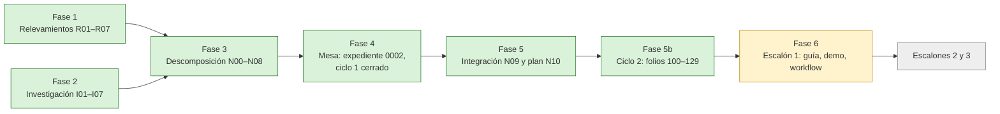

# 00 — Bitácora maestra

| Campo | Valor |
|---|---|
| **Id** | B00 |
| **Título** | Índice de todas las bitácoras de la corrida, su estado, despachos caídos y punto de continuación |
| **Autor (rol)** | Despacho N00 (versión inicial); actualizada por la presidencia, despacho P10, al cerrar la fase de integración |
| **Fecha** | 2026-10-26 |
| **Fuentes leídas** | El tool-prompt `/LAB/Lab-Documentos/Lab-Documentos.Documentacion/PROMPTs/DEVs/Enchacement/01-Replanteo-Y-Analisis/Replanteo-Y-Analisis.md` (67 líneas); las bitácoras listadas en §3; los folios del expediente 0002 (`ls actuaciones/`) |
| **Carpeta** | `/LAB/Lab-Documentos/Lab-Documentos.Documentacion/PROMPTs/DEVs/Enchacement/01-Replanteo-Y-Analisis/OUTPUTs/Bitacoras/` (en adelante `B/`) |
| **Expediente** | `/LAB/Lab-Documentos/Lab-Documentos.Documentacion/PROMPTs/DEVs/Enchacement/01-Replanteo-Y-Analisis/OUTPUTs/Expedientes/0002-Replanteo-Metodologia-DocAsCode/` (en adelante `EXP/`) |

## Índice

1. [Estado de la corrida](#1-estado-de-la-corrida)
2. [Fases y despachos](#2-fases-y-despachos)
3. [Índice de bitácoras](#3-índice-de-bitácoras)
4. [Despachos caídos](#4-despachos-caídos)
5. [Punto de continuación](#5-punto-de-continuación)
6. [Pendientes registrados para fases posteriores](#6-pendientes-registrados-para-fases-posteriores)

---

## 1. Estado de la corrida

La fase de análisis terminó. La mesa de expertos abrió el expediente 0002, compuso el panel por jurado, despachó ocho
comisiones a ciegas, consolidó 46 preguntas y 13 contradicciones en 29 decisiones, pasó por el refutador y votó en dos
rondas. **Resultado** (folio 099): 28 decisiones `PROCEDE` (26 por la propuesta; D08 y D17 por la alternativa_2) y una
`NO_PROCEDE` (D22, «mejorar los orquestadores»), que vuelve al jurado como D22-R en el ciclo 2. La mesa cerró el
ciclo 1 **por decisión**, con lo abierto declarado. La integración que pide `TP:53` está en `N09` (modelo completo) y el
plan de los tres escalones en `N10`.

Sigue siendo fase sin escritura en los repos: nada de lo producido está versionado. Lab-Documentos.Documentacion sigue
en `8da0cd9` y Lab-Documentos en `5d5c2b4` (`git log -1`, 2026-10-26).



## 2. Fases y despachos

| Fase | Despachos | Estado | Producto |
|---|---|---|---|
| 1 — Relevamiento del workspace | R01–R07 | Terminada | 7 bitácoras |
| 2 — Investigación de industria y academia | I01–I05; I06 e I07 (complementarias, abiertas por la mesa) | Terminada | 7 bitácoras; informes en los folios 0060 y 0070 |
| 3 — Descomposición conceptual | N00 | Terminada | 8 núcleos, cohesión global y esta maestra |
| 4 — Mesa de expertos | P01–P02 (presidencia), jurado de composición (J1–J5), C-REQUISITOS, C-VERIFICACION, C-LECTOR, C-ANALISTA, C-ARQ-NET, C-DECISIONES, C-ACADEMICO, C-AGENTES-IA, A01 (análisis), R99 (refutador), jurado de veredicto (J1–J5, dos rondas), A02 (reconsideración) | Terminada (ciclo 1) | Folios 001–004, 0060, 0070, 010–017, 080, 085, 090, 095 |
| 5 — Integración | P10 (presidencia) | Terminada | Folio 099 (resolución), `N09`, `N10` |
| — Crítica del dictamen | C10 (crítico adversarial) | Pendiente | `B/C10-Critica-Del-Dictamen.md` |
| 6 — Escritura, escalón 1 | Según `N10` §5–§6 | Siguiente | Delegación y CI, saneamiento, `docs-guard`, mini demo, cuerpo de la guía |

## 3. Índice de bitácoras

Estados: **cerrada** = el despacho terminó y entregó; **borrador-para-mesa** = insumo que la mesa ya usó; **vigente** =
documento de trabajo que se mantiene. Líneas medidas con `wc -l` el 2026-10-26.

### 3.1 Relevamientos del workspace

| Id | Archivo | Líneas | Tema | Estado |
|---|---|---|---|---|
| R01 | `B/R01-Protocolo-De-Mesa.md` | 664 | Protocolo de mesa, jurado, expediente y plantillas | Cerrada |
| R02 | `B/R02-Guia-Actual-Y-Ejemplos.md` | 346 | Guía actual y prueba de concepto | Cerrada |
| R03 | `B/R03-SDD-Lab-Documentos.md` | 430 | Marco documental de Lab-Documentos, ia-db, workflows y runner | Cerrada |
| R04 | `B/R04-SDD-B-Servicio-Push.md` | 337 | Marco SDD del servicio de notificaciones push (privado, ofuscado) | Cerrada |
| R05 | `B/R05-MovilidadUrbana-MAUI.md` | 291 | MovilidadUrbana.MAUI como base de la mini demo | Cerrada |
| R06 | `B/R06-Geometria-Estado-Documental.md` | 300 | Estado documental de Lab-Geometria | Cerrada |
| R07 | `B/R07-Reglas-PromptFramework.md` | 380 | Lista de verificación VER-* y tensiones entre reglas | Cerrada |

### 3.2 Investigaciones

| Id | Archivo | Líneas | Tema | Estado |
|---|---|---|---|---|
| I01 | `B/I01-Topologia-De-Repositorios.md` | 276 | Mismo repo, dedicado o híbrido; matriz D1–D8 | Cerrada |
| I02 | `B/I02-Versionado-Y-Deriva.md` | 470 | Versionado de docs y deriva | Cerrada |
| I03 | `B/I03-Documentacion-Para-Agentes-IA.md` | 361 | Canales para agentes, escritura por agentes, riesgos | Cerrada |
| I04 | `B/I04-Estandares-Y-Metodologias.md` | 435 | Serie 2651x, 15289, 12207, Diátaxis, DITA, arc42, C4, MADR | Cerrada |
| I05 | `B/I05-Edicion-Academica-Y-Material-Formativo.md` | 364 | Calidad documental, APA 7, CQ y PE | Cerrada |
| I06 | `B/I06-Marcos-SDD-De-Mercado.md` | 467 | Marcos SDD de mercado frente a los dos SDD propios | Cerrada |
| I07 | `B/I07-Complementos-De-Industria.md` | 469 | DORA, documentación viva, guías de estilo, WCAG, 82079-1, anclas multi-repo | Cerrada |

### 3.3 Descomposición conceptual e integración

| Id | Archivo | Líneas | Núcleo | Estado |
|---|---|---|---|---|
| N00 | `B/N00-Cohesion-Global.md` | 292 | Cohesión global y matriz de trazabilidad | Borrador-para-mesa (reverificada en `N09` §12) |
| N01 | `B/N01-Gobierno-De-La-Mesa-Y-Evidencia.md` | 170 | Gobierno de la corrida | Borrador-para-mesa |
| N02 | `B/N02-Topologia-Versionado-Y-Coordinacion.md` | 168 | Topología, versionado y coordinación | Borrador-para-mesa |
| N03 | `B/N03-Doble-Audiencia-Humanos-Y-Agentes.md` | 160 | Doble audiencia | Borrador-para-mesa |
| N04 | `B/N04-Metodologia-Del-Ciclo-Documental.md` | 166 | Metodología del ciclo documental | Borrador-para-mesa |
| N05 | `B/N05-Arquitectura-De-Referencia-Y-CI.md` | 187 | Arquitectura de referencia y CI | Borrador-para-mesa |
| N06 | `B/N06-Marco-SDD-Compartido-Y-Orquestadores.md` | 165 | Marco SDD compartido y orquestadores | Borrador-para-mesa |
| N07 | `B/N07-Demostraciones-Piloto-Y-Aplicacion.md` | 182 | Demo, piloto y aplicación | Borrador-para-mesa |
| N08 | `B/N08-Guia-Y-Material-Formativo.md` | 183 | Guía y material formativo | Borrador-para-mesa |
| N09 | `B/N09-Integracion.md` | 516 | **Integración**: modelo completo, tabla única de piezas, conocimiento a catalogar, matriz reverificada | Vigente |
| N10 | `B/N10-Plan-De-Implementacion.md` | 484 | **Plan** de unidades de E1, E2 y E3 | Vigente |
| B00 | `B/00-Bitacora-Maestra.md` | — | Esta bitácora | Vigente |

### 3.4 Crítica

| Id | Archivo | Líneas | Tema | Estado |
|---|---|---|---|---|
| C00 | `B/C00-Critica-De-Completitud.md` | 230 | Crítica de completitud de las fases 1 a 3 | Cerrada |
| C10 | `B/C10-Critica-Del-Dictamen.md` | 104 | Crítica adversarial del dictamen, de `N09` y de `N10` | Cerrada; P-1 resuelto por D22-R' y P-2…P-5 aplicadas (folio 129) |

## 4. Despachos caídos

| Despacho | Qué pasó | Efecto | Estado |
|---|---|---|---|
| `J4-coherencia-historica-V2` | Cortado por el límite de sesión (2026-10-26, 22:33 UTC) | La ronda 2 quedó sin el voto de J4 | Re-despachado en la reanudación; votó (acta 095 §4.3) |
| `J5-riesgo-V2` | Corrió dos veces: antes del corte y en la reanudación, con rótulos distintos | El recuento usó la segunda corrida; D22 salió `NO_PROCEDE` | Declarado como irregularidad (095 §4.3; lote L13) |
| `P10:integracion` | Cortado por el límite de sesión en la primera corrida | Ninguno sobre lo anterior | Re-despachado y terminado (folios 095, 099; `N09`; `N10`) |
| `C10:critica` | Cortado por el límite de sesión antes de empezar | Falta la crítica del dictamen | Pendiente: corre después de P10 |

Ningún insumo anterior se volvió a despachar: los folios 001–090 estaban completos en disco (`ls actuaciones/`).

## 5. Punto de continuación

**Ciclo 2 cerrado (2026-10-27).** Folios 100 (respuesta del PO y lectura), 110 (análisis), 115 (refutación), 120
(acta: 12 `PROCEDE`, 1 `NO_PROCEDE`), 125 (corrigenda) y 129 (resolución). D22 resuelta por D22-R' (capa A `KLD` +
capa B consultada por L12'); D07 firme; D08 sigue CON REVISIÓN hasta E1-G (C2-5). Ninguna decisión sin dictamen.

```text
Sigue: implementación E1 según N10 §14 — onda 0 (folios 130 opción B y 131 criterios E1),
onda 1 (E1-U0a, E1-U6), y así hasta E1-G. Sin actos previos del PO salvo L11 declarado.
Bitácora de seguimiento: DocsAsCode-Bitacoras/ · presidencia
```

## 6. Pendientes registrados para fases posteriores

| # | Pendiente | Origen | Fase o unidad |
|---|---|---|---|
| P1 | Corregir la ruta del Profile en el framework y en el tool-prompt (`/IA/PROMPTs/IA.Prompts/…`); es del PO | `R07:124`; lote L6 | Propuesta al PO |
| P2 | Actualizar la ia-db de Lab-Documentos.Documentacion | `R03:160-166`; D02 | E1-U5 |
| P3 | No tocar la ia-db de Lab-Geometria.Documentacion mientras haya PR ajenos abiertos | `R06:131`; X12 | E2-U6 |
| P4 | Barrido S2 de las bitácoras (rutas del host) antes de versionarlas | F001 D6 | E1-U0c |
| P5 | `.gitignore` de Lab-Documentos.Documentacion sin regla para `.apk`/`.wasm` | `R03:311-312` | E1-U0c |
| P6 | Delegación del merge y control `verificar` antes del primer PR | `R01:643`; D02 | E1-U0a, E1-U0b |
| P7 | Deuda inmediata de la guía | `R02:339-343`; D02 | E1-U1 |
| P8 | Votación de D22-R, ratificación de D07, revisión de `NO_PROCEDE` por homogeneidad y rol formal de K2 | Folio 099 §5 y §7 | PRE-04 (ciclo 2) |
| P9 | Ensayos E-F1, E-F2, E-F4 a E-F14 | Folio 099 RS-6 | Según `N10` §10 |
