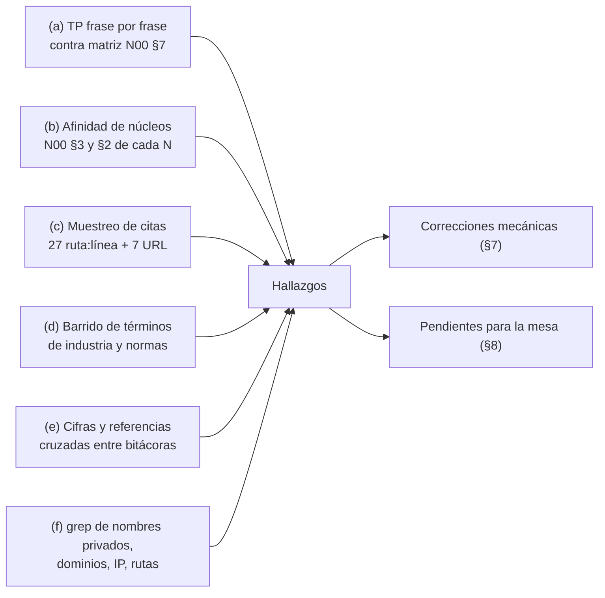

# C00 — Crítica de completitud

| Campo | Valor |
|---|---|
| **Id** | C00 |
| **Título** | Refutación adversarial: ¿la descomposición N00–N08 y los relevamientos R01–R07 / I01–I05 cubren todo el pedido, con evidencia que verifica y sin filtraciones? |
| **Autor (rol)** | Despacho C00 — crítico de completitud (subagente de la presidencia). No vota ni decide |
| **Fecha** | 2026-10-26 |
| **Fuentes leídas** | `TP` completo (68 líneas físicas; `wc -l` da 67 porque falta el salto final); `B/00-Bitacora-Maestra.md`; `B/N00`…`B/N08` completos; `B/R01`…`B/R07` e `B/I01`…`B/I05` por muestreo dirigido (líneas citadas por los núcleos y encabezados); fuentes primarias del workspace y siete URL externas, listadas en §5 |
| **Modo** | Sólo lectura sobre los repos; escritura únicamente en `OUTPUTs/Bitacoras/` |

## Índice

1. [Alias de rutas](#1-alias-de-rutas)
2. [Definiciones](#2-definiciones)
3. [Método](#3-método)
4. [Resumen de hallazgos](#4-resumen-de-hallazgos)
5. [Muestreo de evidencia (c)](#5-muestreo-de-evidencia-c)
6. [Hallazgos por eje](#6-hallazgos-por-eje)
7. [Correcciones aplicadas](#7-correcciones-aplicadas)
8. [Trabajo pendiente para la mesa](#8-trabajo-pendiente-para-la-mesa)
9. [No verificado](#9-no-verificado)

---

## 1. Alias de rutas

| Alias | Ruta absoluta |
|---|---|
| `TP` | `/LAB/Lab-Documentos/Lab-Documentos.Documentacion/PROMPTs/DEVs/Enchacement/01-Replanteo-Y-Analisis/Replanteo-Y-Analisis.md` |
| `B/` | `/LAB/Lab-Documentos/Lab-Documentos.Documentacion/PROMPTs/DEVs/Enchacement/01-Replanteo-Y-Analisis/OUTPUTs/Bitacoras/` |
| `GUIA` | `/LAB/Lab-Documentos/Lab-Documentos/Guides/Documentacion-Tecnica/Sistema-De-Documentacion-E-Integracion/Sistema-Documentador-Tecnico-Guide.md` |
| `MU` | `/LAB/Lab-E2E.WebBlazor/Lab-E2E.WebBlazor` |
| `GEO` | `/PROG2/Geometria/Lab-Geometria` |
| `RD` | `/IA/SDD/IA.SDD/SDD/Devs/Rules/Rules-Documentacion.md` |
| `R0n`, `I0n`, `N0n` | `B/<Id>-<Slug>.md` |

## 2. Definiciones

| Término | Qué designa aquí |
|---|---|
| Verifica | La línea o la URL citada contiene lo que la bitácora afirma (texto o cifra), comprobado por este despacho |
| Verifica con reparo | Lo afirmado es sustancialmente cierto pero una cifra o un rótulo es inexacto |
| Corrección mecánica | Cambio que no requiere juicio ni nueva investigación: ofuscar un nombre, corregir un conteo comprobado, arreglar una referencia cruzada, sumar una marca a la matriz |
| Pendiente para la mesa | Hallazgo que pide investigación nueva o una decisión |
| Filtración | Nombre, ruta, dominio, host, usuario o secreto de un repo **privado** escrito en una bitácora (el repo es público) |

## 3. Método

- (d) se hizo con `grep -liE '<término>'` sobre `B/R0*.md B/I0*.md B/N0*.md` para 45 términos (normas, generadores, guías de estilo, marcos SDD, accesibilidad, i18n, procedencia). Un término sin coincidencias es señal de hueco, no prueba: la mesa decide si importa.
- (f) se hizo con `grep -noiE` de nombres del servicio privado, prefijos de ruta privada, dominios, IPv4, identidades y nombres de clientes conocidos, más inspección de cada coincidencia.

## 4. Resumen de hallazgos

| # | Eje | Hallazgo | Estado |
|---|---|---|---|
| H1 | f | `R01:172` transcribía el nombre del servicio privado en la cita de `TP:30` | Corregido |
| H2 | f | `R07:367` exponía el prefijo de ruta del repo privado | Corregido |
| H3 | c, e | La guía tiene **12** secciones numeradas, no 11 (`R02:58`, `N08-H01`) | Corregido |
| H4 | c, e | Son **ocho** enlaces rotos a cinco destinos, no «cinco enlaces» (`R02:199`, `N08-H02`) | Corregido |
| H5 | e | `N08:167` remitía a «N00 §6» para el punto de integración; está en N00 §9 | Corregido |
| H6 | e | `B00:22` decía «20 bitácoras»; §3 lista 21 (7 R + 5 I + 9 N), y faltaba C00 en el índice | Corregido |
| H7 | a | `TP:14` («documentación a usuario de sistema») no marcaba N03, N06 ni N07, pese a que es el origen del choque X1 | Corregido en la matriz |
| H8 | d | Faltan fuentes de industria relevantes: marcos SDD de mercado, DORA, documentación viva/BDD, guías de estilo, accesibilidad, IEC/IEEE 82079-1, i18n | Pendiente |
| H9 | b | «Arquitectura clara» (`TP:36` g) quedó con «●» sólo en N05, que la lee como toolchain de CI; el pedido puede referirse a la arquitectura del sistema documentador entero | Pendiente |
| H10 | b, e | N00 §10 cuenta «análisis de decisiones» como perfil separado; `N01-H05` (con `R01:246-249`) dice que el antecedente lo fusionó con el analista de sistemas y que no es el rol 6 bis | Pendiente |
| H11 | c | Ninguna cita externa muestreada falló; las 27 del workspace verifican salvo H3 y H4 | Informativo |
| H12 | f | Sin otras filtraciones: `i7infra-dev` está en `TP:34`; `aplicada.stream` y la organización del runner corresponden a Lab-Geometria, público | Informativo |

## 5. Muestreo de evidencia (c)

### 5.1 Citas internas (bitácora → bitácora)

| # | Cita usada en | Cita | Resultado |
|---|---|---|---|
| 1 | N00 §3 | `R01:167` incógnita principal | Verifica |
| 2 | N00 §3, N02 | `I01:166-175` mecanismo según topología | Verifica (diagrama) |
| 3 | N00 X2, N06-H01 | `R03:141-156` la ia-db no es marco SDD | Verifica |
| 4 | N00 X1, N06-H13 | `R06:112-119` exclusión del usuario final | Verifica |
| 5 | N00 X3, N05-H09 | `R06:129` PR con `Verificar` en `ubuntu-latest` | Verifica |
| 6 | N05-H03 | `R06:143-145` runner único, versión 2.338.1 | Verifica |
| 7 | N00 X4, N06-H08 | `R03:256-267` tres versiones del conocimiento | Verifica |
| 8 | N00 X5 | `I03:340` «adoptada» frente a propuesta | Verifica |
| 9 | N03-H12 | `R02:241-245` `302` en vez de `401`; `llms.txt` sin H2 | Verifica |
| 10 | N07-M02 | `R05:110-120` sin roles; sesión | Verifica |
| 11 | N00 X7 | `R06:193` trazas `CU-000NN` frente a `CU-100NN` | Verifica |
| 12 | N00 X9 | `I03:196`, `R03:212-214` | Verifica |
| 13 | N00 X11, X12 | `R07:348`, `R07:350` | Verifica |
| 14 | N01-H04 | `R01:233-238` techo de cinco, jurado compone | Verifica |
| 15 | N01-H10 | `R01:643` sin delegación ni `.github/` | Verifica |
| 16 | N06-H04 | `R04:190-193` agentes sin uso | Verifica |
| 17 | N08-H04 | `R02:286-294` huecos de la guía | Verifica |
| 18 | N00 §5 | `I05:231`, `I01:193-194`, `R04:315-316`, `R05:270`, `I02:121-129` | Verifican |
| 19 | N02-W07 | `R06:125-127`, `R06:151-157` (47 PR, MinVer) | Verifica |
| 20 | N02-H10, N03-H15 | `I04:309`, `I04:330` | Verifican (son criterio de I04, rotulado) |

### 5.2 Citas a fuentes primarias del workspace (re-medidas)

| # | Afirmación | Comprobación | Resultado |
|---|---|---|---|
| 21 | `RD` excluye al usuario final en las líneas 102, 723, 801, 1003; roles en 457 | `sed -n` de cada línea de `RD` | Verifica |
| 22 | «El producto no lleva manual» | `GEO/SDD/Docs/Unidades-Entrega/GeometriaFactory-Web/03-UX-UI-DX/Experiencia-De-Uso.md:100` | Verifica |
| 23 | La guía llama «adoptada» a `llms.txt`; trazas a `CU-00021…29` | `GUIA:161`, `GUIA:428`, `GUIA:529` | Verifica |
| 24 | 11 secciones numeradas (`R02:58`) | `grep -n '^## ' GUIA` → `## 1.` … `## 12. Registro de evidencias` (`GUIA:717`) | **No verifica**: son 12 → H3 |
| 25 | Cinco enlaces rotos (`R02:199`) | `grep -o '\.\./Documentacion-Tecnica[^)]*' GUIA` → 8 apariciones (líneas 189, 203×3, 432, 590, 625, 633), 5 destinos | **Verifica con reparo** → H4 |
| 26 | PoC devuelve `401` sin rol | `…/Examples/Prueba-Ayuda-Por-Rol/Web/Program.cs:41` | Verifica |
| 27 | MovilidadUrbana: `X-Sesion-Id`, GUID por dispositivo, `role="list"`, `net10.0-android`, 27 `AutomationId`, 33 capturas | `MU/src/MovilidadUrbana.ApiWeb/Controllers/LocalidadesController.cs:9`; `…/MAUI/Services/DeviceSession.cs:6-12`; `…/Web/Components/Shared/Grid.razor:70`; `…/MAUI/*.csproj:9`; `grep -c AutomationId` = 27; `ls evidencia/2026-09-12-maui` = 33 `.png` | Verifica |
| 28 | Lab-Documentos.Documentacion en `8da0cd9` (2026-10-11), sin `.github/`, ia-db modificada sin commitear; Lab-Documentos sin tags | `git log -1`, `ls -d .github`, `git status --short`, `git tag \| wc -l` = 0 | Verifica |
| 29 | `Guides/`: 295 `.md`, 45 con «consultad», 0 con DOI, 2 con `[Compilado:` (`I05:244`) | `find`/`grep -rl` | Verifica |
| 30 | `Knowledge-Mesa-De-Expertos-A-Pedido` 3.1 (608 l.) y 1.2 | `sed -n 11p`, `wc -l` en KB-privada e IA.Prompts | Verifica |

### 5.3 Fuentes externas (consultadas el 2026-10-26)

| # | Afirmación (bitácora) | URL · título | Resultado |
|---|---|---|---|
| 31 | Archivos de contexto no elevan el éxito y suben el costo >20 % (`I03:117`) | https://arxiv.org/abs/2602.11988 · «Evaluating AGENTS.md: Are Repository-Level Context Files Helpful for Coding Agents?» (v1 2026-02-12, v3 2026-09-29) | Verifica |
| 32 | `llms.txt`: propuesta de J. Howard, 2024-09-03, sólo H1 obligatorio, secciones H2 (`I03:128`) | https://llmstxt.org/ · «The /llms.txt file» | Verifica |
| 33 | `AGENTS.md`: más de 60 000 proyectos; Agentic AI Foundation (Linux Foundation); gana el más cercano (`I01:193`, `I03:96-99`) | https://agents.md/ · «AGENTS.md» | Verifica |
| 34 | OWASP LLM01:2025, escenario 4 (`I03:231`) | https://genai.owasp.org/llmrisk/llm01-prompt-injection/ · «LLM01:2025 Prompt Injection» | Verifica |
| 35 | Docusaurus: menos de 10 versiones, tiempo de build, no versionar parches (`I02:121-125`) | https://docusaurus.io/docs/versioning · «Versioning» | Verifica |
| 36 | ISO/IEC/IEEE 12207:2026, ed. 2.0, 2026-04-29, 140 p., CHF 227 (`I04:180`) | https://webstore.iec.ch/en/publication/113447 · «ISO/IEC/IEEE 12207:2026» | Verifica |
| 37 | Lighthouse v13.2.0 «config: implement llms.txt check for AI agents» (`I03:129`) | https://github.com/GoogleChrome/lighthouse/releases · «Releases» | Verifica |

## 6. Hallazgos por eje

### 6.1 (a) Solicitudes o reglas sin núcleo o mal mapeadas

- **Cobertura.** Las 47 filas de `N00 §7` se contrastaron con `TP:4-68`. Ninguna frase con contenido quedó sin «●». Las líneas sin fila (`TP:1-3`, `TP:10`, `TP:24`, `TP:28`, `TP:40`, `TP:63-65`) son títulos o separadores.
- **H7 (corregido).** `TP:14` habla de «documentación a usuario de sistema». Es justo la materia que `RD:102` declara fuera de alcance y que origina X1 (`N00:142`). La fila marcaba sólo N04 y N08. Se sumó «○» en N03 (audiencia), N06 (vía normativa) y N07 (piloto).
- **TP:34 sin dueño de repositorio.** El pedido dice «Configura el wofklow» sin decir en qué repo ni qué workflow. N05 lo deja como pregunta 1 (`N05 §8`), así que está mapeado. Se registra que la mesa tiene que **cerrarlo**, no sólo preguntarlo. Ver §8, P4.

### 6.2 (b) Núcleos fragmentados o fusionados

- La segmentación resiste la crítica en lo central. N02 justifica la unión topología + versionado (`TP:20`, `I01:166-175`). N07 justifica la cadena (`TP:30`, «luego… finalmente»). La exclusión de un núcleo «estándares» está bien motivada (`N00:72`).
- **H9 (pendiente).** N05 une «arquitectura clara» (`TP:36` g) con el runner (`TP:34`) porque «el runner condiciona la arquitectura» (`N05:52`). Hay otra lectura: «arquitectura» como la del sistema documentador entero (piezas, topología, audiencias, ciclo). Con ella, la frase tendría «●» compartido con N02 y N04, y N05 sería sólo su realización. *Criterio propio:* la fusión con CI arriesga que la mesa responda «arquitectura» con una lista de herramientas.
- **Doble «●» en `TP:30` (e).** El paso «aplicarlo a SDD-B mejorando los orquestadores» está en N06 y en N07. No es error, porque N06 tiene el «qué se mejora» y N07 el «dónde se prueba». Conviene que el `ENUNCIADO` diga cuál de los dos decide.

### 6.3 (c) Evidencia

Sobre 37 comprobaciones (§5), 35 verifican y 2 tienen error de cifra (H3, H4), ya corregidos. No apareció ninguna afirmación sin evidencia en los núcleos. Las propuestas están rotuladas «criterio propio». Las cláusulas ISO salen de índices y fichas comerciales, no del cuerpo normativo, y así lo declara `I04:426`. Las afirmaciones normativas finas (por ejemplo 26514 6.12 y 8.17, en `N02-H10` y `N03-H15`) quedan entonces en evidencia de índice.

### 6.4 (d) Fuentes de industria o normas no relevadas (H8, pendiente)

Barrido de §3, sin coincidencias en R/I/N salvo donde se indica:

| Hueco | Por qué importa | Núcleo |
|---|---|---|
| Marcos *spec-driven development* de mercado (GitHub Spec Kit, Kiro, Tessl): 0 coincidencias | El pedido gira sobre «marco SDD de diseño asistido por IA» (`TP:18`); hoy sólo se relevan los SDD propios | N06, N04 |
| DORA / State of DevOps (calidad de documentación como capacidad medida): 0 coincidencias reales (los resultados de `grep -i dora` son «evaluadora») | Es la evidencia empírica de industria más citada sobre el efecto de la documentación; sirve a «tendencias del mercado» (`TP:36`) | N04, N02 |
| Documentación viva / especificación ejecutable (BDD, Gherkin, Reqnroll en .NET; Martraire, *Living Documentation*): 0 coincidencias | Ataca la deriva haciendo que la especificación sea una prueba. Encaja con CU/RN y con el stack .NET | N02, N05 |
| Guías de estilo (Google developer documentation style guide, Microsoft Writing Style Guide): 0 | Base estándar de reglas Vale; I02 propone Vale sin un estilo de referencia | N05, N08 |
| Accesibilidad del sitio publicado (WCAG 2.2): 0 coincidencias de «WCAG» | La guía publica HTML para personas; 26514 la trata, pero sin norma web concreta | N03, N05 |
| IEC/IEEE 82079-1 (información de uso): 0 | Norma horizontal de «documentación a usuario» (`TP:14`), complementaria de 2651x | N04 |
| Flujo de traducción e i18n (gestión de traducciones, frescura de `translation_of`): sólo menciones en R02 y R06 | La guía y la PoC ya tienen respaldo de idioma (`N07-E01`); falta práctica de industria | N08, N05 |
| Regulación de transparencia de IA (por ejemplo, Reglamento UE de IA) y estándares de procedencia (C2PA, SLSA): 0 | Sólo si la mesa considera que `origin: agent` necesita marco externo (`I03:360` no halló estándar) | N03 |
| Mecanismos multi-repo concretos (`git subtree`, Renovate/Dependabot para fijar versiones de docs): 0 | `N02-W11` pide mecanismos multi-repo; I01 cubre submódulos y agregadores, no la actualización automática de anclas | N02 |
| The Good Docs Project (plantillas): 0 | Plantillas abiertas por tipo de documento para el catálogo de 15289 | N08, N04 |

### 6.5 (e) Contradicciones entre bitácoras

- H3, H4, H5 y H6: resueltas (§7).
- **H10 (pendiente).** `N00 §10` propone cuatro perfiles de `TP:36` más un quinto (agentes), y trata «análisis de decisiones» como perfil propio. `N01-H05` recuerda que no es el rol 6 bis y que el antecedente lo fusionó con el analista. Si la mesa sigue ese antecedente, se libera un cupo. Lo decide el jurado de composición.
- Las demás cifras compartidas coinciden: tres versiones del conocimiento, 47 PR, 26 agentes del SDD-B (`R04:159`, `N06-H03`), 759 líneas de la guía.

### 6.6 (f) Filtraciones

- **H1 (corregido).** `R01:172` citaba `TP:30` con el nombre literal del servicio privado. Ahora dice `<SDD-B>` (nombre ofuscado), como la matriz de N00.
- **H2 (corregido).** `R07:367` listaba el prefijo de ruta del repo privado. Ahora dice `<privado>/…`.
- **Revisado sin acción:** `i7infra-dev` (literal de `TP:34`); dominios `aplicada.stream` y organización del runner (`R06:14`, `R06:143`, `R06:161-179`), que son de Lab-Geometria, público (`git remote` del repo); menciones a OneSignal (producto público citado por la guía, sin vínculo escrito con SDD-B); `R04` usa alias sistemáticos (`R04 §1`).
- **Riesgo vigente, ya registrado:** la ruta del host (`/home/<usuario>/…`) aparece en casi todas las bitácoras. Lo manda la carta, pero choca con S2 (X10, P4 de B00). Hay que barrer antes de versionar.

## 7. Correcciones aplicadas

| # | Archivo:línea | Antes | Después |
|---|---|---|---|
| 1 | `R01:172` | «aplicarlo a `<nombre privado>`» | «aplicarlo a `<SDD-B>` (nombre ofuscado)» |
| 2 | `R07:367` | prefijo de ruta del repo privado | `` `<privado>/…` (repo privado, ofuscado) `` |
| 3 | `R02:58` | «11 secciones numeradas» | «12 secciones numeradas (la 12 es el registro de evidencias, `GUIA:717`)» |
| 4 | `R02:199` | «Los cinco enlaces relativos» | «Los ocho enlaces relativos (a cinco destinos distintos; `:203` lleva tres)» |
| 5 | `N08:84` | «759 líneas, 11 secciones» | «759 líneas, 12 secciones numeradas más resumen ejecutivo» |
| 6 | `N08:85` | «Los cinco enlaces internos» | «Los ocho enlaces internos (cinco destinos distintos)» |
| 7 | `N08:167` | «(ver N00 §6)» | «(ver N00 §9)» |
| 8 | `00-Bitacora-Maestra.md:22` | «las 20 bitácoras» | «las 21 bitácoras … (más C00, agregada después)» |
| 9 | `00-Bitacora-Maestra.md` §3 | — | Nueva §3.4 con la fila C00 |
| 10 | `N00 §7`, fila `TP:14` | ● N04, ○ N08 | Más ○ N03, N06, N07, con nota de ajuste |

Los anclajes internos (`](#…)`) de las 22 bitácoras se comprobaron con un script de *slug*: 0 rotos. No hay enlaces relativos a archivos.

## 8. Trabajo pendiente para la mesa

| # | Pendiente | Origen | Núcleo | Quién |
|---|---|---|---|---|
| P1 | Investigar los marcos SDD de mercado (Spec Kit, Kiro, Tessl) frente a los dos SDD propios, con URL y fecha | H8 | N06 | Investigador (despacho nuevo, I06) |
| P2 | Relevar DORA, documentación viva/BDD en .NET, guías de estilo, WCAG 2.2, IEC/IEEE 82079-1, i18n y mecanismos multi-repo de actualización de anclas | H8 | N02, N04, N05, N08 | Investigador (despacho nuevo o ampliación de I02/I04) |
| P3 | Decidir si «arquitectura clara» (`TP:36` g) es la del sistema documentador entero (● compartido N02/N04/N05) o la del toolchain | H9 | N05, N00 | Presidencia en el `ENUNCIADO` |
| P4 | Cerrar en qué repo y con qué alcance se configura el workflow de `TP:34` (único o plantilla) | §6.1 | N05 | Mesa |
| P5 | Decidir si «análisis de decisiones» ocupa un cupo propio o se fusiona con el analista, como en el antecedente | H10 | N01 | Jurado de composición |
| P6 | Fijar qué núcleo decide `TP:30` (e) (N06 o N07) | §6.2 | N06, N07 | Presidencia |
| P7 | Hacer el barrido S2 de rutas del host antes de versionar (ya era P4 de B00) | §6.6 | N01 | Presidencia |

## 9. No verificado

- El resto de las líneas de R01–R07 e I01–I05 que no entraron en el muestreo (§5). El muestreo cubre 37 citas.
- Que no exista ninguna fuente de §6.4 bajo otro nombre o en otro idioma: el barrido es léxico.
- Las cifras de OneSignal, GitHub y Kubernetes de la guía (`R02:191`): no se reverificaron.
