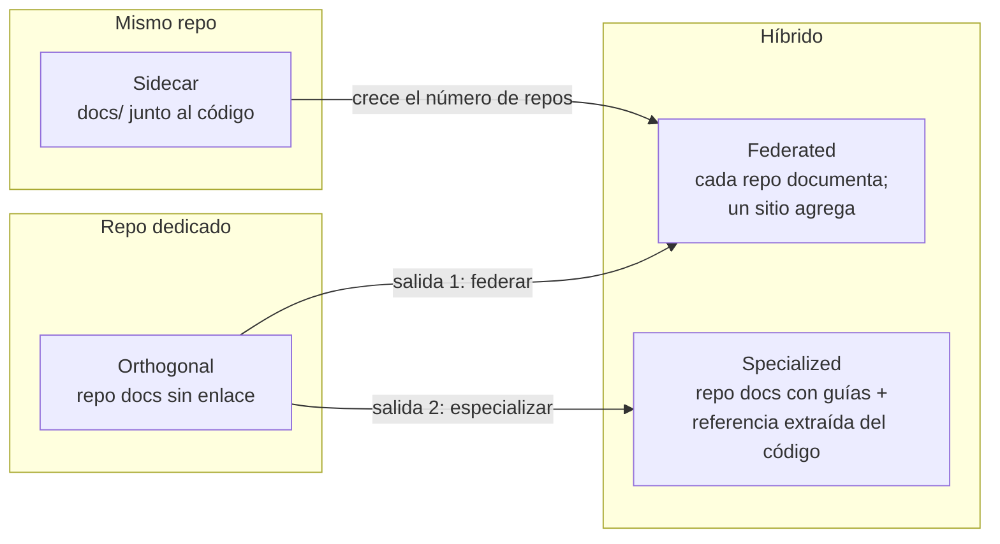
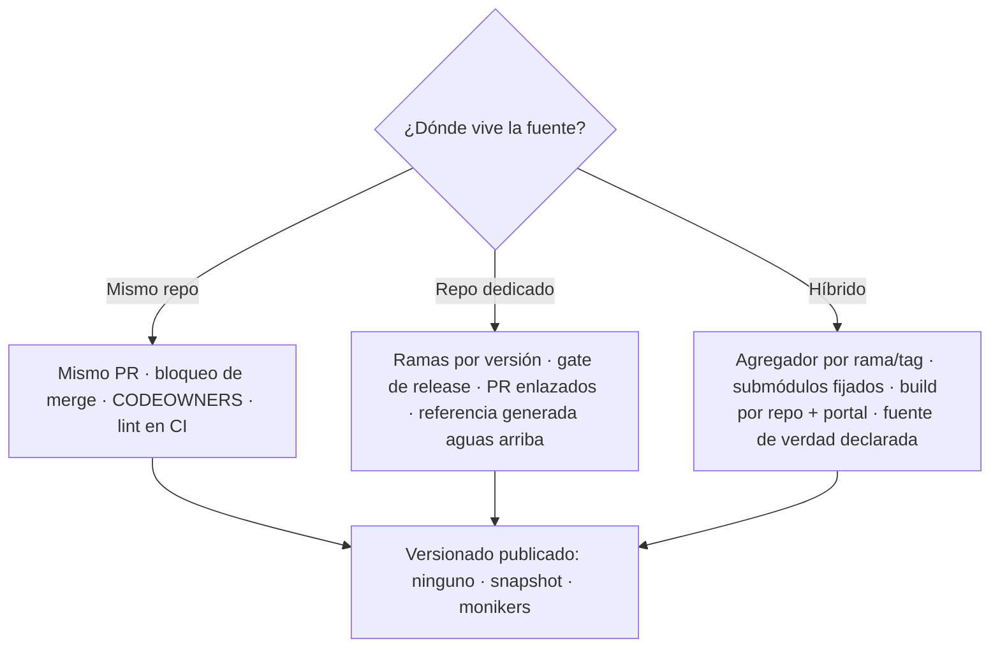

# I01 — Topología de repositorios para la documentación: mismo repo, repo dedicado o híbrido

| Campo | Valor |
|---|---|
| **Id** | I01 |
| **Título** | ¿Documentación en el mismo repositorio del código, en un repositorio dedicado o híbrida (multi-repo agregado)? Estado de la industria, mecanismos contra el desfase y matriz de decisión |
| **Autor (rol)** | Investigador de industria del despacho I01 (subagente de la mesa de *Replanteo y análisis DocAsCode*) |
| **Fecha** | 2026-10-26 (todas las fuentes externas se consultaron ese día) |
| **Tool-prompt** | `/LAB/Lab-Documentos/Lab-Documentos.Documentacion/PROMPTs/DEVs/Enchacement/01-Replanteo-Y-Analisis/Replanteo-Y-Analisis.md` |
| **Modo** | Sólo lectura sobre los repositorios; consultas web (WebSearch, WebFetch) y lectura pública de la API de GitHub (`curl`). Nada se compiló ni se commiteó |
| **Fuentes leídas** | 29 fuentes externas primarias o de primera mano (tabla completa en §11) · en el workspace: el tool-prompt; `Sistema-Documentador-Tecnico-Guide.md` §6.1–§6.3 y §7; `ia-db/README.md` de Lab-Documentos y de Lab-E2E.WebBlazor; listados de primer nivel de Lab-Geometria y Lab-E2E.WebBlazor; `git remote`/`git log` de los pares código↔`.Documentacion` |

---

## Índice

1. [Pregunta y alcance](#1-pregunta-y-alcance)
2. [Definiciones](#2-definiciones)
3. [Las tres estrategias (y sus cuatro topologías)](#3-las-tres-estrategias-y-sus-cuatro-topologías)
4. [Casos de la industria, uno por uno](#4-casos-de-la-industria-uno-por-uno)
   - 4.1 Docs Like Code (Anne Gentle) · 4.2 Write the Docs · 4.3 GitLab · 4.4 Kubernetes · 4.5 Microsoft Learn / .NET · 4.6 Google · 4.7 Antora · 4.8 Backstage TechDocs · 4.9 Docusaurus y MkDocs + mike · 4.10 OpenTelemetry (submódulos)
5. [Catálogo de mecanismos contra el desfase](#5-catálogo-de-mecanismos-contra-el-desfase)
6. [Ventajas, costos y cuándo conviene cada estrategia](#6-ventajas-costos-y-cuándo-conviene-cada-estrategia)
7. [La dimensión de los agentes IA](#7-la-dimensión-de-los-agentes-ia)
8. [Matriz de decisión basada en evidencia](#8-matriz-de-decisión-basada-en-evidencia)
9. [Contraste con el workspace (hechos y criterio propio)](#9-contraste-con-el-workspace-hechos-y-criterio-propio)
10. [No verificado](#10-no-verificado)
11. [Fuentes](#11-fuentes)

---

## 1. Pregunta y alcance

El tool-prompt plantea (línea 20) que, para una metodología común *DocAsCode*, «queda entender que conviene hacer, si tener un repositorio dedicado a la documentación con su propio ciclo evolutivo o bien estar integrado en el mismo repositorio de codigo. Y aquí surgen problemas de desfase de versionado, y coordinación».

Esta bitácora responde **sólo** a esa pregunta topológica: dónde vive la fuente de la documentación, cómo se coordina con el código y con qué mecanismos la industria evita el desfase. No trata herramientas de render ni tipos documentales salvo cuando condicionan la topología.

## 2. Definiciones

| Término | Definición usada en esta bitácora |
|---|---|
| **Docs as code** | Tratar la documentación con las mismas herramientas y flujos que el código: control de versiones, marcado en texto plano, revisión de código, issues y pruebas automáticas (Write the Docs, §4.2). No prescribe por sí mismo un repositorio |
| **Mismo repo** (*sidecar*, *co-located*) | La fuente de la documentación vive en el repositorio del código, en una carpeta (`doc/`, `docs/`, `g3doc/`) o en los comentarios del código |
| **Repo dedicado** (*orthogonal*) | La documentación vive en un repositorio propio, con su historia, sus ramas y, a menudo, su equipo |
| **Híbrido / multi-repo agregado** (*federated*, *specialized*) | Cada repo de código aporta su documentación (o datos de referencia) y un repo o sitio central la **agrega** en el build |
| **Desfase** (*drift*) | La documentación describe una versión distinta de la que corre o se publica: cambia el código y la doc no, o la doc se publica antes o después que el release |
| **Versión de documentación** | Conjunto de páginas que corresponde a una versión del producto (Antora la llama *component version*, Docusaurus *version*, Microsoft Learn *moniker*) |
| **Fuente de verdad** | El lugar donde una pieza se edita; las demás copias se derivan y no se tocan a mano |

## 3. Las tres estrategias (y sus cuatro topologías)

La taxonomía más explícita que encontré es la de *Docs-as-code topologies* (passo.uno, 2023-05-14), que distingue cuatro patrones. Los agrupo en las tres estrategias que pide el despacho:

| Topología | Qué es | A favor | En contra / riesgo | Cuándo la ubica el autor |
|---|---|---|---|---|
| Sidecar | Docs en el repo del código (Markdown, comentarios, docstrings) | Se versiona con el código; buen punto de partida | «often treats documentation as an accessory»; conflictos si los ritmos de release difieren; un marcado roto puede trabar un release | Cultura editorial incipiente, docs internas, mucha referencia generada |
| Orthogonal | Repo de docs separado, sin vínculo con los de código | Autonomía e identidad propia | «It fails at nurturing a healthy relationship with the developers»; contenido duplicado; silos | Estado de transición; sólo tiene dos salidas: federar o especializar |
| Federated | Cada repo documenta su componente; un repo central agrega | Autonomía de equipos (ejemplos citados: OpenTelemetry con submódulos, CentOS con Antora) | «lots of discipline and a robust content strategy»; submódulos y pipelines frágiles | Proyectos autónomos bajo un mismo paraguas |
| Specialized | Repo central con guías; los repos de código exportan referencia como datos | Divide el trabajo; el sitio «becomes a product» | Exige cultura de automatización y datos estructurados de los devs | Productos complejos con confianza escritores↔devs (preferida del autor) |

**Nota de autoridad.** passo.uno es un blog técnico personal, no un estándar. Lo uso como taxonomía; las afirmaciones de hecho se apoyan en los casos de §4.

## 4. Casos de la industria, uno por uno

### 4.1 Docs Like Code (Anne Gentle)

- **El libro** *Docs Like Code* (docslikecode.com/book) tiene capítulos sobre automatizar builds, flujos con GitHub, pruebas de docs, revisión y «Versions and releases: publish docs as code». La página del libro **no** toma partido sobre mismo repo vs. repo dedicado.
- **Su práctica a escala** (*Docs Like Code: Strategies and Stories*, CIDM RIDE, diciembre de 2017): plantea que se puede usar un repo de docs dedicado o docs dentro del repo de código; un escenario simple usa un solo repo y uno complejo «multiple source repositories»; ella documentaba «over 300 code repositories» de «30 REST API services». La transición entre modelos es gradual («not final»). Reporta para Rackspace un salto de 6 a 175 contribuyentes y builds que pasaron de minutos a segundos (dato de la autora, no auditado aquí).
- **Mecanismo concreto** (*Protecting a Branch so Only the Docs Team Merges and Publishes*, docslikecode.com, 2023-10-01): docs dentro del repo de código, carpeta `docs/` protegida con **CODEOWNERS** + la regla «Require review from Code Owners». Resultado declarado: «builds trust and safety while also ensuring you can move fast when needed». Es la respuesta de esta corriente al temor de que «docs en el repo de código» quite control al equipo de redacción.
- **Criterio de decisión citado** (vía passo.uno): considerar «your users, contributors, reviewers, content size, deployed docs, and translated docs».

### 4.2 Write the Docs

La guía *Docs as code* define el enfoque por herramientas (Git, Markdown/reST/AsciiDoc, revisión, pruebas automáticas) y beneficios. El más relevante para el desfase: **«You can block merging of new features if they don't include documentation»**. No se pronuncia sobre topología. Lectura: el bloqueo de merge es trivial en mismo repo y requiere coordinación cruzada en repo dedicado.

### 4.3 GitLab: docs en el repo del producto, sitio agregador aparte

- **Ubicación.** «The documentation source files are in the same repositories as the product code» (*Documentation site architecture*). GitLab usa `/doc`; Runner usa `/docs`; Omnibus, Charts y Operator, `/doc`.
- **Agregación.** El sitio docs.gitlab.com se genera desde un proyecto propio, `docs-gitlab-com` (Hugo), que reúne la documentación de GitLab, Runner, Operator, Omnibus, Charts y otros. Es un **híbrido federado**: fuente en cada repo, publicación centralizada. La página no detalla el mecanismo de *pull*.
- **Mismo MR.** *Workflows*: «When possible, the merge request with the code should include the documentation»; el equipo de redacción lo «strongly encourages», aunque los MR de docs separados «are still common», y algunos equipos lo vuelven obligatorio.
- **Definición de hecho.** «Documentation forms part of the GitLab definition of done, and should be completed before the milestone release».
- **Válvula de escape controlada.** Revisión del technical writer **posterior al merge** si faltan menos de tres días para el release o el cambio es chico; entonces «the developer or maintainer must schedule a review immediately after the merge» y se abre un issue de seguimiento.
- **Gates de CI** (*Documentation testing*): `docs-lint markdown` (Vale, markdownlint, `lint-doc.sh`; falla el job), `docs-lint links` (enlaces relativos) y `docs code_quality` (Vale informativo, «does not block merge requests»).
- **Versiones.** El sitio publica una versión nueva por release mensual; las viejas van a `/archives/`; las correcciones a versiones ya publicadas siguen el *runbook* de patch releases.

### 4.4 Kubernetes: repo dedicado (`kubernetes/website`) coordinado con el release

- **Ubicación.** Código en `kubernetes/kubernetes`; docs en `kubernetes/website`; mejoras en `kubernetes/enhancements`.
- **Coordinación por release** (*Documenting a feature for a release*): el autor de la feature abre un **PR borrador** contra la rama `dev-1.38` de `kubernetes/website`, enlaza en la descripción los PR de `kubernetes/kubernetes` y el issue de `kubernetes/enhancements`, y avisa en ese issue para que «the docs person managing this release» lo siga. **Gate de proceso, no de CI**: «If your feature needs documentation and the first draft content is not received, the feature may be removed from the milestone».
- **Ramas por versión** (verificado con la API pública de GitHub, `GET /repos/kubernetes/website/branches`, 2026-10-26): conviven dos familias, `dev-1.17` … `dev-1.38` (release en curso, más variantes por idioma como `dev-1.37-ar.1`) y `release-1.4` … `release-1.36` (versiones publicadas), además de `main`.
- **Versiones publicadas** (*Available Documentation Versions*): «documentation for the current version of Kubernetes and the four previous versions», cada una en su subdominio (`v1-36.docs.kubernetes.io`, …). Disponibilidad de docs ≠ soporte del release.
- **Referencia generada cruzando repos** (*Generating Reference Documentation for the Kubernetes API*): la referencia de API se construye desde el OpenAPI de `kubernetes/kubernetes` con el generador de `kubernetes-sigs/reference-docs` (`make updateapispec`, `make copyapi`, variable `K8S_RELEASE`) y se commitea en `kubernetes/website`; los errores se corrigen **aguas arriba**, no en lo generado. Es el patrón *specialized*.

### 4.5 Microsoft Learn / .NET: repos dedicados, fuente de verdad por pieza

- **Conceptual** en `dotnet/docs`; el sitio .NET se construye desde varios repos (ASP.NET Core, MAUI, EF, Community Toolkit) — README de `dotnet/docs`. Cada artículo trae un control que **enruta el feedback al repo correcto**. Hay workflows mensuales: uno abre issues para proyectos que apuntan a versiones de .NET fuera de soporte y otro genera el «What's new».
- **Referencia de API** en `dotnet/dotnet-api-docs`, separado del código. Para algunos ensamblados «the API reference docs are maintained in the assembly's source code»; ahí el XML del repo se regenera y el botón *Edit* se deshabilita (`open_to_public_contributors: false`).
- **Regla de fuente de verdad explícita** (`dotnet/runtime`, *adding-api-guidelines.md*): «New public APIs must be documented with triple-slash comments». Si la librería usa `UseCompilerGeneratedDocXmlFile` (por defecto `true`): «Source comments in this repo are the source of truth» y se sincronizan a `dotnet-api-docs` «periodically (every preview)». Si está en `false`, la fuente de verdad es `dotnet-api-docs` y el código se sincroniza «only once for newly introduced APIs».
- **Versionado sin duplicar archivos** (*Versioning System SQL Docs*, Microsoft Learn, ms.date 2025-09-08): para SQL Server 2014 y anteriores cada versión tenía su copia completa, y «if a flaw was discovered in the 2014 documentation, the flaw might also exist in 2012 and 2008», lo que dificultaba el mantenimiento. Desde 2016 un mismo archivo sirve varias versiones mediante **monikers** (`>=sql-server-2017`) que filtran secciones, oraciones y entradas del TOC, y el parámetro `?view=` en la URL.
- **DocFX** (herramienta del ecosistema): «Converts .NET assembly, XML code comment, REST API Swagger files and markdown into rendered HTML pages». Es el puente técnico para que la referencia salga del código aunque la prosa viva en otro lado.

### 4.6 Google: docs junto al código en el monorepo

*Software Engineering at Google*, capítulo 10 «Documentation» (Tom Manshreck; abseil.io): Google introdujo «its own framework for embedding documentation within code» (g3doc), con un directorio `g3doc` por API, para «associate them directly with the code they document». Las docs se tratan como código: control de versiones, dueños, revisión e issues; una de las condiciones es «Undergo reviews for changes (and change with the code it documents)». Contra el desfase usan **dueños y *freshness dates***: «Documents without owners become stale», y la metadata envía recordatorios por mail cuando el documento no se toca en un período dado; agregar «Last reviewed by…» aumentó la adopción.

### 4.7 Antora: componentes multi-repo con versiones por rama o tag

- *Repositories and Content Source Roots*: el contenido de un sitio puede repartirse en varios repos git, locales o remotos; Antora busca una raíz de contenido **por rama o tag** y un `antora.yml` que identifica el *component version*. «Where you store the content source roots is up to you», o sea que la fuente puede vivir dentro de los repos de código.
- *What's a Component Version?*: «a discrete version of the documentation for a project, product, library, service»; Antora junta archivos de igual componente y versión **desde múltiples fuentes**.
- *URLs for Content Sources*: el *playbook* admite «as many `url` keys as you need», cada una con su filtro de ramas (p. ej. `branches: v1.0, v2.0`); si dos fuentes aportan el mismo archivo, Antora **falla** («does not permit duplicate files»), lo que funciona como gate de consistencia.
- Es la implementación canónica del patrón **federado con versión atada a la rama del código**: la doc de la 2.0 está en la rama `v2.0` del repo del código, y el sitio la agrega.

### 4.8 Backstage TechDocs: docs al lado del código, agregadas por catálogo

- *TechDocs Documentation*: «Spotify's homegrown docs-like-code solution»; Markdown guardado con el código y descubrible «from the Service's page in Backstage Catalog».
- *TechDocs Architecture*: la configuración básica construye y guarda en el servidor local de Backstage (para probar). La **recomendada** para producción construye en el **CI de cada repo** («The key difference in the recommended deployment approach is where the docs are built») y publica en almacenamiento en la nube, del que lee `techdocs-backend`. Sus razones: confiabilidad, crecimiento y rendimiento, sitios persistentes entre reinicios.
- Lectura: es federación **por catálogo**, no por un repo agregador. Cada servicio es dueño de su doc y de su build; el portal sólo indexa y sirve.

### 4.9 Docusaurus y MkDocs + mike: versionado del sitio

- **Docusaurus** (*Versioning*): `docs:version` copia `docs/` a `versioned_docs/version-X/` y registra en `versions.json`. La herramienta advierte: «Most of the time, you don't need versioning as it will just increase your build time» y agrega complejidad; conviene en sitios con mucho tráfico y cambios rápidos entre versiones; no corresponde por patch; mantener **menos de 10** versiones como regla práctica y archivar las viejas como despliegues inmutables. También advierte que el versionado complica la contribución.
- **mike** (`jimporter/mike`): despliega varias versiones de MkDocs en una rama (`gh-pages`), un directorio por versión y alias (`latest`, `dev`). Principio: una vez generada una versión, «you should never need to touch that version again», porque queda como HTML ya construido y los cambios futuros de MkDocs no la rompen. Es **sincronización por tag/release**: el CI del release despliega la versión.

### 4.10 OpenTelemetry: agregación por submódulos

*Development setup* de opentelemetry.io: parte del contenido se monta desde **submódulos git** en `content-modules`. Un cambio en esa doc exige primero un PR en el repo del submódulo; «Only after the submodule PR has been accepted, can you update the submodule and have the changes appear in this website». El CI trae los submódulos en cada corrida. Es el costo que passo.uno describe como fragilidad: dos PR y un *bump* por cambio.

## 5. Catálogo de mecanismos contra el desfase

| Mecanismo | Qué ataca | Quién lo usa (evidencia) | Requiere |
|---|---|---|---|
| **Docs en el mismo PR/MR** | Que el código cambie sin su doc | GitLab (§4.3), Google «change with the code it documents» (§4.6) | Mismo repo (o PR acoplados) |
| **Bloquear merge sin docs** | Ídem, como regla dura | Write the Docs (§4.2); algunos equipos de GitLab (§4.3) | Mismo repo + revisión |
| **Docs en la definición de hecho** | Doc que llega tarde al release | GitLab (§4.3) | Proceso |
| **Gate de proceso del release** (feature sin doc sale del milestone) | Doc que llega tarde, con repo separado | Kubernetes (§4.4) | Equipo/rol de release docs |
| **CODEOWNERS + revisión obligatoria** | Pérdida de control editorial en el repo de código | docslikecode (§4.1) | Plataforma con code owners |
| **Lint / enlaces en CI** | Doc rota que traba el release | GitLab `docs-lint` (§4.3) | CI |
| **Ramas por versión en el repo de docs** | Doc de la versión equivocada | Kubernetes `dev-1.xx` / `release-1.xx` (§4.4) | Disciplina de ramas en dos repos |
| **Versión atada a rama/tag del código** | Ídem, sin segunda historia | Antora (§4.7) | Agregador multi-repo |
| **Snapshot por versión** (`versioned_docs/`, directorios de mike) | Doc publicada vieja que se rompe o se mezcla | Docusaurus, mike (§4.9) | Política de cuántas versiones |
| **Monikers / filtrado por versión en un mismo archivo** | Duplicar archivos por versión (y sus bugs) | Microsoft Learn SQL (§4.5) | Plataforma que filtre |
| **Fuente de verdad única + sincronización por preview** | Doble edición de la referencia | `dotnet/runtime` → `dotnet-api-docs` (§4.5) | Herramienta de sync |
| **Generar la referencia desde el código** (OpenAPI, XML docs) | Referencia escrita a mano que se desactualiza | Kubernetes `reference-docs` (§4.4), DocFX (§4.5) | Generador en CI |
| **Submódulos fijados** | Agregar repos ajenos de forma reproducible | OpenTelemetry (§4.10) | Dos PR por cambio |
| **Build en CI de cada repo + portal** | Centralizar sin un repo agregador | Backstage recomendado (§4.8) | Almacenamiento compartido |
| **Dueño + fecha de frescura** | Doc que nadie mira | Google (§4.6) | Metadata + recordatorios |
| **Enrutar feedback al repo correcto** | Lector que no sabe dónde reportar | `dotnet/docs` (§4.5) | Metadata por página |

## 6. Ventajas, costos y cuándo conviene cada estrategia

| | **Mismo repo** | **Repo dedicado** | **Híbrido (agregado)** |
|---|---|---|---|
| **Desfase de versión** | Se resuelve solo: el tag del código congela su doc (criterio propio, coincide con Antora y Google) | Hay que construir la coherencia: ramas espejo y gate de release (Kubernetes) | Se resuelve si el agregador lee la rama/tag del código (Antora); si no, reaparece |
| **Coordinación** | Un PR | Dos PR enlazados a mano + rol de coordinación por release (Kubernetes) | Por repo un PR; el agregador o submódulo agrega un paso (OpenTelemetry) |
| **Control editorial** | Se recupera con CODEOWNERS (docslikecode) | Natural: el repo es del equipo de docs | Repartido; exige estrategia de contenido (passo.uno) |
| **Contribución externa / traducción** | Más fricción si el repo de código es pesado o privado (criterio propio) | Más fácil: Kubernetes mantiene ramas por idioma (`dev-1.37-ar.1`) | Intermedio |
| **Sitio único multi-producto** | No por sí solo | Sí | Sí (GitLab, Antora, Backstage) |
| **Costo principal** | Doc tratada como accesorio; un marcado roto puede trabar el release (passo.uno); CI de docs en cada repo | Silos y duplicación (passo.uno); trabajo de sincronizar | Pipelines y submódulos frágiles; disciplina (passo.uno) |
| **Conviene cuando** | La doc cambia al ritmo del código y la mantiene el mismo equipo; un solo producto/servicio; referencia generada | Producto grande con equipo de docs, comunidad, idiomas y release propio; o doc que no describe una versión del código (guías transversales, cursos) | Varios repos/servicios bajo un paraguas que necesitan un sitio coherente y versiones por componente |

## 7. La dimensión de los agentes IA

El tool-prompt (línea 20) pide considerar que «no solo son agentes humanos que accederan a esta documentación». Dos convenciones vigentes afectan a la topología:

- **AGENTS.md** (agents.md, administrado por la Agentic AI Foundation de la Linux Foundation): un README para agentes en la **raíz del repo de código**; en monorepos cada subproyecto puede tener el suyo, y «the closest one takes precedence». Es, por diseño, **documentación en el mismo repo**, porque el agente que modifica código la lee del árbol que tiene abierto.
- **llms.txt** (Jeremy Howard, v2, publicada el 2024-09-03): un `/llms.txt` en el **sitio publicado** con contexto y enlaces a versiones `.md` de cada página. Es una convención del **artefacto publicado**, independiente de dónde viva la fuente.

**Criterio propio, a validar por la mesa.** Para agentes que **cambian código**, el desfase es más caro que para humanos, porque actúan sobre lo que leen sin dudar. Eso empuja las instrucciones operativas y la especificación hacia el mismo repo o hacia una referencia fijada por versión. Para agentes que **consultan**, lo que importa es un punto de entrada único y versionado en el sitio publicado, sea cual sea la topología de la fuente. No encontré estudios empíricos que comparen las tres topologías para agentes; no hay métricas en esta bitácora sobre eso.

## 8. Matriz de decisión basada en evidencia

Se recorre por pieza documental, no por proyecto: la industria mezcla topologías según la pieza (.NET separa conceptual y referencia; GitLab separa fuente y sitio; Kubernetes separa doc y código pero genera la referencia del código).

| # | Pregunta | Si **sí** → | Evidencia |
|---|---|---|---|
| D1 | ¿La pieza tiene que cambiar en el mismo PR que el código que describe (especificación, ayuda de pantalla, AGENTS.md, ADR)? | **Mismo repo**, con docs en la definición de hecho y gate de CI | GitLab §4.3; Google §4.6; Write the Docs §4.2; agents.md §7 |
| D2 | ¿Se puede **generar** del código (API, XML docs, OpenAPI)? | Fuente en el código; publicarla con generador; declarar la fuente de verdad | `dotnet/runtime` §4.5; Kubernetes `reference-docs` §4.4; DocFX §4.5 |
| D3 | ¿Hay varios repos o servicios que deben publicarse como **un** sitio? | **Híbrido**: fuente en cada repo + agregador que lea la rama/tag (Antora) o build por repo + portal (Backstage); sitio en repo propio (GitLab) | §4.3, §4.7, §4.8 |
| D4 | ¿La pieza tiene **ritmo propio**: comunidad, traducciones, equipo de redacción, o no describe una versión del código (guías de estudio, cursos, análisis, prompts)? | **Repo dedicado**; si además sigue releases, ramas por versión + gate de release + PR enlazados | Kubernetes §4.4; `dotnet/docs` §4.5; passo.uno §3 |
| D5 | ¿Conviven usuarios de **varias versiones** publicadas? | Versionar el sitio (snapshot con Docusaurus/mike o monikers); limitar cantidad y archivar | Docusaurus «below 10» §4.9; Kubernetes actual + 4 §4.4; Microsoft Learn §4.5 |
| D5′ | ¿Una sola versión viva (un despliegue)? | **No** versionar el sitio: la versión es la que corre | Docusaurus «Most of the time, you don't need versioning» §4.9 |
| D6 | ¿El control editorial preocupa con la doc en el repo de código? | CODEOWNERS sobre `docs/` + revisión obligatoria | docslikecode §4.1 |
| D7 | ¿Se agrega por submódulo? | Aceptar dos PR + *bump* por cambio, o preferir agregador por rama/tag | OpenTelemetry §4.10; passo.uno §3 |
| D8 | ¿Hay doc que nadie dueña? | Dueño + fecha de revisión en metadata, con recordatorio | Google §4.6 |

Métricas citables encontradas: Kubernetes publica la versión actual más las cuatro anteriores; Docusaurus sugiere menos de 10 versiones; Gentle reporta de 6 a 175 contribuyentes en Rackspace (dato de la autora). No hallé métricas comparativas de desfase entre topologías y no se presenta ninguna.

## 9. Contraste con el workspace (hechos y criterio propio)

**Hechos.**

- El workspace ya usa la topología **código + repo hermano `.Documentacion`**: `Lab-Documentos` ↔ `Lab-Documentos.Documentacion` (`/LAB/Lab-Documentos/Lab-Documentos.Documentacion/ia-db/README.md:31` y `:35`), `Lab-E2E.WebBlazor` ↔ `Lab-E2E.WebBlazor.Documentacion` (`/LAB/Lab-E2E.WebBlazor/Lab-E2E.WebBlazor.Documentacion/ia-db/README.md:35` y `:37`), y lo mismo en Lab-Geometria y en SDD-B (según la bitácora R04 de esta corrida).
- Lab-Geometria tiene `SDD/` y `AGENTS.md` **dentro del repo de código** (listado de `/PROG2/Geometria/Lab-Geometria/`).
- La guía vigente ya formula la regla D1: «¿tiene que cambiar en el mismo pull request que el código? Si sí, va al repo de código» (`/LAB/Lab-Documentos/Lab-Documentos/Guides/Documentacion-Tecnica/Sistema-De-Documentacion-E-Integracion/Sistema-Documentador-Tecnico-Guide.md:271-286`), cita a Kubernetes con ramas `release-1.29` a `release-1.36` (`:290`) y a Docusaurus contra el versionado por defecto (`:292`).
- **Desfase real ya registrado**: el README del código de Lab-E2E.WebBlazor «todavía enlaza las guías en `Lab-E2E.WebBlazor.Documentacion/Guides`, que ya no existe» (`/LAB/Lab-E2E.WebBlazor/Lab-E2E.WebBlazor.Documentacion/ia-db/README.md:37`). Es el síntoma *orthogonal* de passo.uno: un enlace manual entre repos sin gate que lo vigile.

**Criterio propio (para la mesa).**

1. La guía describe **el mismo repo y el dedicado**, pero no el **híbrido agregado** (Antora, Backstage, el sitio aparte de GitLab), que es el que encaja con «varios sistemas que comparten conocimientos». Conviene sumarlo como tercera opción con D3 y D7.
2. La guía muestra sólo la mitad del modelo de ramas de Kubernetes: falta la familia `dev-1.xx` (la del release en curso, adonde se abren los PR de features) y el gate «sin doc, la feature sale del milestone». Esto no contradice lo que dice la guía; la completa (verificado el 2026-10-26).
3. El par código↔`.Documentacion` es un **repo dedicado de meta-documentación** (D4: habla del proyecto, no del producto). Lo que hace falta es un gate de enlaces cruzados entre repos, porque el caso de `:37` muestra que hoy el desfase no se detecta.
4. Para agentes conviene **declarar la fuente de verdad por pieza**, como hace `dotnet/runtime`, en la ia-db de cada par.

## 10. No verificado

- **El mecanismo exacto con que `docs-gitlab-com` trae el contenido** de cada repo: la página de arquitectura no lo detalla.
- **Las fechas límite de docs en el calendario de Kubernetes**: la página remite a la *feature tracking sheet* y a Slack, a los que no accedí.
- **La guía de *versioning* del contributor guide de Microsoft Learn** (sintaxis `::: moniker range`): la URL probada dio 404. El mecanismo se documenta con la página pública de SQL.
- **La autoría de passo.uno**: el texto extraído no consigna autor. No la atribuyo.
- **La postura explícita de Anne Gentle** sobre mismo repo vs. dedicado: no encontré una declaración directa. Sólo su práctica (2017) y el mecanismo de CODEOWNERS (2023).
- **Google developer docs (sitio público developers.google.com)**: no encontré una fuente primaria sobre la topología de sus repos. Lo de Google se apoya en el libro *Software Engineering at Google* (práctica interna, g3doc).
- **El capítulo del libro de Google**: la URL es `ch10.html` y su título es «Documentation». El resumen automático lo numeró de otra forma; tomo el número de la URL.

## 11. Fuentes

Todas consultadas el **2026-10-26**.

| # | URL | Título | Para qué se usó |
|---|---|---|---|
| 1 | https://www.writethedocs.org/guide/docs-as-code/ | Docs as code (Write the Docs) | Definición; bloquear merge sin docs |
| 2 | https://www.docslikecode.com/book/ | Docs Like Code (Anne Gentle) | Temario; ausencia de postura topológica |
| 3 | https://www.slideshare.net/slideshow/docs-like-code-strategies-and-stories/83506271 | Docs Like Code: Strategies and Stories (A. Gentle, dic. 2017) | Repo dedicado vs. interno; 300 repos; métricas Rackspace |
| 4 | https://www.docslikecode.com/articles/protecting-codeowners-file/ | Protecting a Branch so Only the Docs Team Merges and Publishes (2023-10-01) | CODEOWNERS sobre `docs/` |
| 5 | https://passo.uno/docs-as-code-topologies/ | Docs-as-code topologies (2023-05-14) | Taxonomía sidecar/orthogonal/federated/specialized |
| 6 | https://docs.gitlab.com/development/documentation/workflow/ | Workflows (GitLab Docs) | Mismo MR; definición de hecho; revisión posterior al merge |
| 7 | https://docs.gitlab.com/development/documentation/site_architecture/ | Documentation site architecture (GitLab Docs) | Fuente en repos de producto; sitio `docs-gitlab-com`; versiones |
| 8 | https://docs.gitlab.com/development/documentation/testing/ | Documentation testing (GitLab Docs) | Jobs `docs-lint` |
| 9 | https://kubernetes.io/docs/contribute/new-content/new-features/ | Documenting a feature for a release | PR borrador a `dev-1.38`; gate de milestone |
| 10 | https://kubernetes.io/docs/home/supported-doc-versions/ | Available Documentation Versions | Versión actual + 4 |
| 11 | https://kubernetes.io/docs/contribute/generate-ref-docs/kubernetes-api/ | Generating Reference Documentation for the Kubernetes API | Referencia generada cruzando repos |
| 12 | https://api.github.com/repos/kubernetes/website/branches?per_page=100 | API de GitHub — ramas de kubernetes/website | Familias `dev-1.xx` y `release-1.xx` |
| 13 | https://kubernetes.io/docs/contribute/advanced/ | Advanced contributing (Kubernetes) | Rol de coordinación de docs del release |
| 14 | https://github.com/dotnet/docs/blob/main/README.md | dotnet/docs README | Sitio multi-repo; feedback enrutado; workflows mensuales |
| 15 | https://github.com/dotnet/dotnet-api-docs/blob/main/README.md | dotnet/dotnet-api-docs README | Referencia separada; edición deshabilitada si la fuente es el código |
| 16 | https://github.com/dotnet/runtime/blob/main/docs/coding-guidelines/adding-api-guidelines.md | Adding APIs guidelines (dotnet/runtime) | Fuente de verdad y sincronización por preview |
| 17 | https://dotnet.github.io/docfx/ | Quick Start — docfx | Referencia desde XML docs + Markdown |
| 18 | https://learn.microsoft.com/en-us/sql/sql-server/versioning-system-monikers-ui-sql-server?view=sql-server-ver17 | Versioning System SQL Docs (Microsoft Learn) | Copias por versión vs. monikers |
| 19 | https://abseil.io/resources/swe-book/html/ch10.html | Software Engineering at Google, cap. 10 «Documentation» | g3doc; dueños; freshness dates |
| 20 | https://docs.antora.org/antora/latest/content-source-repositories/ | Repositories and Content Source Roots (Antora) | Multi-repo; raíz por rama/tag |
| 21 | https://docs.antora.org/antora/latest/component-version/ | What's a Component Version? (Antora) | Versión de componente desde varias fuentes |
| 22 | https://docs.antora.org/antora/latest/playbook/content-source-url/ | URLs for Content Sources (Antora) | Playbook multi-url; falla ante duplicados |
| 23 | https://backstage.io/docs/features/techdocs/ | TechDocs Documentation (Backstage) | Docs junto al código; catálogo |
| 24 | https://backstage.io/docs/features/techdocs/architecture | TechDocs Architecture (Backstage) | Build en CI por repo + almacenamiento |
| 25 | https://docusaurus.io/docs/versioning | Versioning (Docusaurus) | Snapshots; «below 10»; cuándo no versionar |
| 26 | https://github.com/jimporter/mike | mike (MkDocs) | Versiones por directorio y alias |
| 27 | https://opentelemetry.io/docs/contributing/development/ | Development setup (OpenTelemetry) | Submódulos y doble PR |
| 28 | https://agents.md/ | AGENTS.md | Doc para agentes en el repo; la más cercana gana |
| 29 | https://llmstxt.org/ | The /llms.txt file, v2 (J. Howard) | Punto de entrada para LLM en el sitio publicado |
