# I02 — Versionado de la documentación y deriva respecto del código

## Índice

1. [Alcance y método](#1-alcance-y-método)
2. [Definiciones](#2-definiciones)
3. [Mapa de mecanismos](#3-mapa-de-mecanismos)
4. [Versionado de la documentación atado a releases](#4-versionado-de-la-documentación-atado-a-releases)
5. [SemVer, changelogs y Conventional Commits](#5-semver-changelogs-y-conventional-commits)
6. [Documentación generada desde la fuente (foco .NET)](#6-documentación-generada-desde-la-fuente-foco-net)
7. [Pruebas de documentación](#7-pruebas-de-documentación)
8. [Contratos de frontmatter validados en CI](#8-contratos-de-frontmatter-validados-en-ci)
9. [Deuda documental, dueños y frescura](#9-deuda-documental-dueños-y-frescura)
10. [Agentes IA como lectores](#10-agentes-ia-como-lectores)
11. [Contraste con el workspace](#11-contraste-con-el-workspace)
12. [Cadena de referencia en GitHub Actions para .NET (criterio propio)](#12-cadena-de-referencia-en-github-actions-para-net-criterio-propio)
13. [Hallazgos consolidados](#13-hallazgos-consolidados)
14. [Lo que no se verificó](#14-lo-que-no-se-verificó)
15. [Fuentes](#15-fuentes)

---

## 1. Alcance y método

Despacho I02 de la corrida que ejecuta `Replanteo-Y-Analisis.md`. El prompt plantea que, al elegir
entre repositorio de documentación dedicado o integrado al código, «surgen problemas de desfase de
versionado, y coordinación. Seguramente la industria ya tiene resuelto el abordaje metodologico de esta
cuestión»
(`/LAB/Lab-Documentos/Lab-Documentos.Documentacion/PROMPTs/DEVs/Enchacement/01-Replanteo-Y-Analisis/Replanteo-Y-Analisis.md:20`).
Esta bitácora releva **cómo la industria resuelve ese desfase**: con qué mecanismos se versiona la
documentación y con cuáles se previene o detecta la deriva.

Método:

- Búsqueda web (modo *extended*) y lectura directa de la documentación oficial de cada herramienta o
  norma. Todas las fuentes externas se consultaron el **2026-10-26**; se listan en §15 con número `[Fn]`.
- Las citas textuales en inglés provienen de la lectura de la página por la herramienta de consulta web;
  se transcriben entre comillas tal como las devolvió. Donde la página no decía lo buscado, se anota.
- Contraste mínimo con el workspace (solo lectura) para ubicar qué de esto ya existe (§11).
- Lo que es **criterio propio** (costos, recomendaciones, el pipeline de §12) se marca como tal.

## 2. Definiciones

| Término | Definición usada en esta bitácora |
|---|---|
| **Deriva documental** (*doc drift*) | Divergencia entre lo que la documentación afirma y lo que el sistema hace. La deriva no es un evento: se acumula con cada cambio de código que no arrastra su cambio de documentación. |
| **Deuda documental** | «Documentation debt is a type of technical debt that describes problems in documentation such as missing, inadequate or incomplete artifacts» (Rios et al., resumen según búsqueda [F27]). |
| **Versionado de la documentación** | Publicar más de una edición de la documentación a la vez, cada una ligada a una versión del producto (p. ej. `1.x` y `2.x` conviven en el sitio). Distinto de llevar la documentación en Git, que todo *docs as code* ya hace. |
| **Docs as code** | «a philosophy that you should be writing documentation with the same tools as code»: issue trackers, Git, marcado en texto plano, code reviews y pruebas automatizadas [F25]. |
| **Fuente única** (*single source*) | La documentación de referencia se **genera** desde un artefacto que el compilador o el runtime ya validan (XML doc comments, OpenAPI, AsyncAPI), en vez de escribirse a mano. |
| **Frescura** (*freshness*) | Marca explícita de la última revisión humana de una página («freshness dates» en Google [F23]; `ms.date` en Microsoft Learn [F19]). |
| **Compuerta** (*gate*) | Chequeo de CI que bloquea la fusión cuando falla. Opuesto a **aviso** (reporta y no bloquea). |

## 3. Mapa de mecanismos

La industria no tiene «un» mecanismo contra la deriva: tiene capas. Las ordeno por **cuándo actúan**
respecto del cambio de código (clasificación propia, construida con las fuentes de §4–§9).

```mermaid
flowchart LR
    subgraph P["1 · Prevenir (la deriva no puede ocurrir)"]
        P1["Mismo repo + mismo PR<br/>(Google, Antora)"]
        P2["Docs generadas desde fuente<br/>XML doc · OpenAPI · AsyncAPI"]
        P3["Snippets por referencia<br/>a código que compila"]
    end
    subgraph D["2 · Detectar en el PR (compuerta)"]
        D1["Ejecutar la doc<br/>doctest · Doc Detective"]
        D2["Diff de contrato<br/>oasdiff · PublicApiAnalyzers"]
        D3["Acople ruta→doc<br/>paths-filter + CODEOWNERS"]
        D4["Esquema de frontmatter<br/>+ lint (Vale, markdownlint)"]
    end
    subgraph T["3 · Detectar con el tiempo (aviso)"]
        T1["Enlaces externos programados<br/>lychee → issue"]
        T2["Frescura: last_review / ms.date<br/>+ ciclo de revisión"]
    end
    subgraph R["4 · Comunicar y congelar"]
        R1["Changelog + SemVer<br/>Keep a Changelog · Conv. Commits"]
        R2["Versiones publicadas<br/>Docusaurus · mike · RTD · Antora"]
    end
    P --> D --> T --> R
```



La lectura del mapa: cuanto más a la izquierda actúa un mecanismo, más barato es mantenerlo y menos
deriva deja pasar; los de la derecha no evitan la deriva, la **hacen visible** o la **congelan** por versión.

## 4. Versionado de la documentación atado a releases

### 4.1 Qué problema resuelve

Que el lector de una versión vieja del producto (un cliente que no actualizó un NuGet, una API `v1` que
convive con `v2`) encuentre la documentación **de su versión**, y no la de `main`.

### 4.2 Herramientas relevadas

| Herramienta | Modelo | Evidencia |
|---|---|---|
| **Docusaurus** | Instantánea por copia: `docusaurus docs:version 1.1.0` copia `docs/` a `versioned_docs/version-1.1.0/`, con `versioned_sidebars/` y `versions.json` («a list of version names, ordered from newest to oldest»). `docs/` queda como la versión en desarrollo (`/docs/next`). | [F1] |
| **mike** (MkDocs) | Un directorio por versión en la rama `gh-pages`; «creating a new Git commit on your `gh-pages` branch every time you deploy a new version». Alias (`latest`, `dev`) como symlink o redirección; `mike deploy --push --update-aliases 1.2 latest`; `mike set-default`. | [F2] |
| **Read the Docs** | Las versiones **son** tags y ramas de Git. `latest` sigue la rama por defecto; `stable` sigue «your greatest stable semantic version number release» y «excludes pre-release versions». Cada push construye la versión activa. | [F3] |
| **Antora** | La versión la fija la clave `version` de `antora.yml` («It's the version key in the component version descriptor or playbook that determines the version»), no el nombre de la rama. Recomienda ramas; desaconseja carpetas («We generally recommend against using this method»). El *playbook* agrega fuentes de **varios repositorios** («You can add as many `url` keys as you need»). | [F4], [F5] |
| **DocFX** | Grupos (`groups`) en `docfx.json` con un destino por versión; los mantenedores reconocen que en v3 el soporte de versiones quedó incompleto (selector de versión ausente). | [F6] (búsqueda, discusiones de GitHub de 2022; ver §14) |
| **Microsoft Learn** (DocFX propietario) | *Monikers* por rango: la página de OpenAPI de ASP.NET Core declara `monikers: aspnetcore-6.0 … aspnetcore-12.0`, `versioningType: Ranged`, `defaultMoniker: aspnetcore-10.0`. Una sola fuente Markdown, con bloques condicionados por versión. | metadatos de [F15] |

### 4.3 Cuándo **no** versionar

Las propias herramientas lo desaconsejan por defecto. Docusaurus: versionar «will just increase your build
time», no crear versión para *patches* sin funcionalidades nuevas («will only just create unnecessary
duplicated files») y mantener el número «below 10» [F1]. Antora agrega el principio de fondo: la
documentación «isn't bound to the software lifecycle, but rather follows it» y «Documentation is the
explanation of the software, not the software itself» [F4].

**Criterio propio.** Versionar el sitio sólo hace falta cuando conviven consumidores de versiones
distintas (paquetes, APIs públicas con `vN`). Un servicio con un único despliegue vivo documenta una
sola versión: la desplegada. La guía actual ya llega a la misma conclusión (§11).

### 4.4 Implementación en GitHub Actions y costo

| Herramienta | Disparador típico en Actions | Costo (criterio propio) |
|---|---|---|
| Docusaurus | `docs:version` se corre a mano o en el job de release al crear el tag; el build publica todas las carpetas | Medio: duplica archivos por versión; el build crece lineal con las versiones |
| mike | Job sobre `push: tags: ['v*']` que hace `mike deploy --push --update-aliases X.Y latest` | Bajo: no duplica fuentes, sólo salida HTML en `gh-pages` |
| Read the Docs | Ninguno: el servicio escucha los pushes | Bajo en CI; dependencia de un tercero |
| Antora | Job que corre el playbook sobre ramas/tags de N repos | Medio: un playbook más que mantener; resuelve el caso multi‑repo |
| DocFX `groups` | Un `docfx build` por grupo | Medio‑alto en v2; versiones incompletas en v3 |

## 5. SemVer, changelogs y Conventional Commits

### 5.1 Qué problema resuelven

No previenen deriva: **comunican** el cambio a quien lee y le dan a la documentación un ancla (la
versión) contra la que medirse.

### 5.2 Normas

- **SemVer 2.0.0.** MAJOR.MINOR.PATCH por compatibilidad, y una regla que liga versión y documentación:
  «Software using Semantic Versioning MUST declare a public API. This API could be declared in the code
  itself or exist strictly in documentation» [F7]. Es decir: para SemVer, la documentación **es** parte del
  contrato versionado.
- **Keep a Changelog 1.1.0.** «Changelogs are *for humans*, not machines»; tipos Added, Changed,
  Deprecated, Removed, Fixed, Security; una sección `Unreleased` arriba que al publicar pasa a ser la de la
  versión; y rechazo explícito de volcar el `git log` («full of noise») [F8].
- **Conventional Commits 1.0.0.** `fix` → PATCH, `feat` → MINOR, `BREAKING CHANGE` o `!` → MAJOR; `docs:`
  es un tipo permitido sin efecto implícito en la versión. Beneficios declarados: changelogs automáticos y
  cálculo automático del salto de versión [F9].

### 5.3 Automatización

- **release-please** mantiene un *Release PR* que, al fusionarse, actualiza changelog y archivos de
  versión, etiqueta y crea el GitHub Release a partir de Conventional Commits [F10]. La página consultada
  no lista una estrategia `dotnet`; existe `simple` (`version.txt` + `CHANGELOG.md`) [F10].
- **Tensión documentada.** Keep a Changelog pide prosa curada para humanos [F8]; release-please genera
  desde commits [F10]. **Criterio propio:** se concilian usando Conventional Commits para **calcular** la
  versión y redactando a mano (o revisando) la sección `Unreleased`.

### 5.4 Costo (criterio propio)

Bajo. Keep a Changelog es disciplina de PR; Conventional Commits se valida con un linter de mensajes;
release-please es un único workflow.

## 6. Documentación generada desde la fuente (foco .NET)

### 6.1 Qué problema resuelve

Elimina la deriva **por construcción** en la documentación de referencia: si la referencia sale del
código, no puede contradecirlo. La prosa (conceptos, tutoriales) sigue siendo humana.

### 6.2 Mecanismos en .NET

| Mecanismo | Qué hace | Evidencia |
|---|---|---|
| **XML doc comments** | `DocumentationFile` / `GenerateDocumentationFile` emite el `.xml` desde los `///`; aplica a todo el proyecto y se silencia por archivo con `#pragma warning`. | [F11] |
| **DocFX `metadata`** | Lee proyectos, soluciones (`.slnx` con .NET 9+) o ensamblados con su XML lateral y genera YAML de API, que `docfx build` convierte en HTML. Dos etapas separables (`docfx metadata`, `docfx build`). | [F12] |
| **OpenAPI en build** (.NET 9+) | `Microsoft.AspNetCore.OpenApi` genera en runtime; sumar `Microsoft.Extensions.ApiDescription.Server` lo genera **al compilar**; `OpenApiDocumentsDirectory` fija dónde, `OpenApiGenerateDocumentsOptions` el nombre (`--file-name`), el documento (`--document-name v2`) y la versión de OpenAPI (`--openapi-version OpenApi3_1`). Funciona levantando el entrypoint con un servidor simulado, así que la lógica de arranque se ejecuta. | [F15] (líneas 93–97, 411–543 del texto consultado) |
| **oasdiff** | Compara dos OpenAPI y reporta «only the changes that break existing API clients»; tiene `changelog`, `breaking`, y detecta cambios incompatibles sin salto MAJOR. Acción: `oasdiff/oasdiff-action/breaking` con `base`, `revision` y `fail-on: WARN`/`ERR`. | [F13], [F14] |
| **PublicApiAnalyzers** | `PublicAPI.Shipped.txt` / `PublicAPI.Unshipped.txt` declaran la superficie pública. RS0016: «All public types and members should be declared in PublicAPI.txt»; RS0017: al quitar un miembro, registrarlo con prefijo `*REMOVED*`. Todo cambio de API pública queda visible en el diff del PR. | [F16], [F17] |
| **AsyncAPI generator** | Desde un documento AsyncAPI y una plantilla produce «a human-readable website or Markdown», SDKs o esqueletos. Equivalente de OpenAPI para mensajería/eventos. | [F18] |

### 6.3 Patrón en Actions y costo

Patrón (criterio propio, armado con [F14] y [F15]): el build deja `openapi.json` en el repo; un paso
`git diff --exit-code` sobre ese archivo falla si alguien cambió la API sin regenerarlo; `oasdiff` contra
la rama base decide si el cambio es incompatible y exige el salto MAJOR.

Costo (criterio propio): **bajo** para XML docs y OpenAPI en build (propiedades MSBuild); **bajo** para
oasdiff (una acción); **medio** para PublicApiAnalyzers (cada PR que toca API pública edita el `.txt`, que
es justamente su valor); **medio** para DocFX (sitio y plantilla propios).

## 7. Pruebas de documentación

### 7.1 Qué problema resuelven

Detectan en el PR que **lo que la documentación muestra ya no funciona**: un ejemplo que no compila, un
comando que falla, un enlace muerto, un término fuera de norma.

### 7.2 Ejecutar la documentación

- **doctest** (Python) busca «pieces of text that look like interactive Python sessions, and then executes
  those sessions to verify that they work exactly as shown»; uso declarado: «To check that a module's
  docstrings are up-to-date» [F20]. Es el precedente histórico de «documentación ejecutable».
- **Doc Detective** sigue las instrucciones «step-by-step, just like your users would», en un entorno real
  (CLI, llamadas a API, UI), y corre en CI/CD «to prevent regressions»; lee Markdown, AsciiDoc y DITA [F21].
- **Snippets compilados en las docs de .NET.** La guía de contribución de .NET ordena: «DON'T include sample
  code inline in an article» y «DO use a snippet project», porque así «your sample code is validated by our
  CI system»; los snippets viven en `snippets/<artículo>/{csharp,fsharp,vb}/` con su `.csproj` [F22]. La
  guía de código de Microsoft Learn agrega la sintaxis `:::code source="…" id="snippet_Create":::` y
  advierte que las referencias por número de línea «are brittle because code files inevitably change»;
  hay que preferir **snippets con nombre** [F24].

### 7.3 Enlaces y prosa

- **lychee-action** revisa enlaces en Markdown/HTML; el ejemplo oficial corre por `schedule` diario con
  `fail: false` y abre un *issue* con `peter-evans/create-issue-from-file` cuando hay rotos; caché
  `.lycheecache` para no golpear sitios externos [F26].
- **Vale** «brings code-like linting to prose»: reglas YAML propias (p. ej. `Terms.yml` con
  `substitution`), `level: error` hace fallar CI [F28]. `vale-action@v3` con `reporter: github-pr-review`,
  `fail_on_error: true` y `filter_mode: added` (sólo líneas tocadas) [F29].
- **markdownlint-cli2-action** valida estructura Markdown: `globs: '**/*.md'`, `config:` [F30].

### 7.4 El caso de referencia: la suite de GitLab

GitLab corre sobre todo MR que toca Markdown: `docs-lint markdown` (Vale + markdownlint + `lint-doc.sh`,
que exige «front matter indicating ownership of the page»), `docs-lint mermaid`, `docs-lint links`
(relativos; externos se omiten), `docs-lint redirects` (páginas borradas o renombradas sin redirección), y
`graphql-verify` / `docs-lint deprecations-and-removals`, que fallan cuando la documentación **generada**
quedó desincronizada de su fuente [F31]. Es el ejemplo más completo encontrado de «la deriva como
compuerta».

### 7.5 Costo (criterio propio)

| Mecanismo | Costo de alta | Costo de mantenimiento | Bloquea |
|---|---|---|---|
| markdownlint | Muy bajo | Muy bajo | Sí |
| lychee (relativos en PR, externos programados) | Bajo | Bajo (lista `.lycheeignore`) | Relativos sí; externos no |
| Vale | Medio (definir estilo y vocabulario) | Medio | Sólo `error` |
| Snippets compilados .NET | Medio (un proyecto por artículo) | Bajo: el compilador hace el trabajo | Sí |
| Doc Detective | Alto (entorno real, especificar pasos) | Medio‑alto | Sí |

## 8. Contratos de frontmatter validados en CI

### 8.1 Qué problema resuelven

Hacen que los metadatos de gobierno (dueño, fecha de revisión, versión de la fuente, estado) existan y
tengan forma válida; sin ellos los mecanismos de §9 no tienen de dónde leer.

### 8.2 Evidencia

- **Microsoft Learn** exige `author`, `description`, `ms.author`, `ms.date`, `title`; omitirlos produce
  «a validation error during build». `ms.author` «Identifies the article's owner»; `ms.date` indica «the
  last time the article was substantially edited or guaranteed fresh» [F19].
- **GitLab** exige `stage`, `group` e `info`; `codeowners.rake` lee `group` para asignar el technical
  writer y generar CODEOWNERS; `lint-doc.sh` falla sin el frontmatter de dueño [F32], [F31].
- **remark-lint-frontmatter-schema** valida el frontmatter YAML contra **JSON Schema** (tipos, patrones,
  enumeraciones), con esquema por archivo (`$schema`) o global por patrón de rutas, y se corre por
  `remark-cli` en CI [F33].
- **Docusaurus** deriva «última actualización» del historial de Git y advierte que «will not work correctly
  with shallow clones»: en Actions requiere `fetch-depth: 0`; `last_update` en frontmatter la sobrescribe
  [F34]. Lección general: **la frescura calculada desde Git exige historia completa en CI**.

### 8.3 Costo (criterio propio)

Bajo: un esquema JSON y un paso de CI. El costo real es acordar los campos una vez.

## 9. Deuda documental, dueños y frescura

### 9.1 Qué problema resuelve

La deriva que ningún test atrapa: prosa conceptual correcta en sintaxis pero falsa en contenido.

### 9.2 Evidencia

- *Software Engineering at Google*: la documentación debe «Be placed under source control», «Have clear
  ownership», «Undergo reviews for changes» y «Have issues tracked»; «Documents without owners become stale
  and difficult to maintain»; «we often attach "freshness dates" to documentation», con recordatorios por
  correo cuando una página no se toca en, por ejemplo, tres meses; y lo que ya no sirve se borra o se marca
  obsoleto [F23].
- *Google documentation best practices*: «Change your documentation in the same CL as the code change»;
  «Dead docs are bad»; «A small set of fresh and accurate docs is better than a large assembly» [F35].
- **Ciclo de revisión declarado por página**: los metadatos de Microsoft Learn incluyen `ms.update-cycle`
  (`1095-days` en [F11], `365-days` en [F15]). Es un SLA de revisión por artículo.
- **CODEOWNERS**: «Code owners are automatically requested for review when someone opens a pull request
  that modifies code that they own»; con «Require review from Code Owners» en la protección de rama, la
  aprobación pasa a ser obligatoria [F36]. Ver §14 sobre disponibilidad en plan free.
- **Acople ruta→documento**: `dorny/paths-filter` da salidas booleanas por filtro a nivel de job/step,
  cosa que los filtros `paths:` nativos no hacen; con eso se arma «cambió `src/Api/**` y no cambió
  `docs/api/**` → fallar» [F37]. La propia acción advierte no interpolar nombres de archivo en `run:`.
- **Literatura**: la deuda documental se estudia como subtipo de deuda técnica (Rios et al., ACM
  10.1145/2851613.2851761) [F27]. Hay herramientas emergentes que anclan cada documento al hash de commit
  o a la huella AST del símbolo que describe y fallan cuando el código anclado cambia; son fuentes de
  proveedores, no normas [F38].

### 9.3 Costo (criterio propio)

Bajo para frontmatter `owner`/`last_review` + aviso programado; medio para el acople ruta→doc (hay que
mantener el mapa); alto para anclaje por AST (herramientas jóvenes, sin estándar).

## 10. Agentes IA como lectores

El prompt pide considerar que no sólo humanos leerán la documentación
(`Replanteo-Y-Analisis.md:20`). La única convención relevada en este despacho es **`/llms.txt`**
(Jeremy Howard, 2024-09-03): un Markdown con H1, resumen en *blockquote* y listas de enlaces a archivos
Markdown, más una sección `Optional` que el agente puede saltar [F39]. Relación con la deriva (criterio
propio): un agente no distingue una página vieja de una vigente salvo que el **metadato** lo diga, así que
`last_review`, `status: obsoleto` y la versión de la fuente pesan más para un agente que para un humano.
El tratamiento a fondo corresponde a otro eje de la corrida.

## 11. Contraste con el workspace

| Mecanismo de la industria | Estado observado | Evidencia |
|---|---|---|
| Frontmatter con dueño y revisión | La guía ya lleva `owner`, `last_review`, `origin`, `confidence`, `traces` | `/LAB/Lab-Documentos/Lab-Documentos/Guides/Documentacion-Tecnica/Sistema-De-Documentacion-E-Integracion/Sistema-Documentador-Tecnico-Guide.md:1-12` |
| Decisión mismo‑repo vs repo aparte | Regla: «¿tiene que cambiar en el mismo pull request que el código? Si sí, va al repo de código»; coherencia «gratuita» con el mismo repo | misma guía `:283`, `:288` |
| Cuándo versionar el sitio | Ya cita a Docusaurus y concluye que un único despliegue vivo documenta una sola versión | misma guía `:292` |
| Frescura por traza versionada (`traces: [CU-00026@1.1]`) | Propuesto, no implementado; equivale al «anclaje a la fuente» de §9 | misma guía `:430`, `:470-471` |
| Chequeos de CI de la ayuda | Enlaces y cruce de rol **probados**; frontmatter, cobertura y frescura **propuestos** | misma guía `:462-471` |
| Changelog en Lab-Documentos.Documentacion | Keep a Changelog, pero agrupado por **fecha**, no por versión, por decisión explícita | `/LAB/Lab-Documentos/Lab-Documentos.Documentacion/CHANGELOG.md:1-9` |
| Tags en Lab-Documentos y .Documentacion | Ninguno (`git tag` vacío en ambos) | `git -C … tag`, 2026-10-26 |
| Versión desde tags (Lab-Geometria) | MinVer calcula la versión desde `v<MAJOR>.<MINOR>.<PATCH>`; tags hasta `v1.2.0` | `/PROG2/Geometria/Lab-Geometria/Directory.Build.props:28-59` |
| XML doc comments en Lab-Geometria | **Apagados**: `GenerateDocumentationFile=false` | `/PROG2/Geometria/Lab-Geometria/Directory.Build.props:26` |
| OpenAPI en Lab-Geometria | Runtime (`AddOpenApi`/`MapOpenApi`), sin generación en build ni diff de contrato en CI observados | `/PROG2/Geometria/Lab-Geometria/src/GeometriaFactory.Api/Composition/ApiDocumentation.cs:58`, `:117`; pasos en `.github/workflows/ci.yml:59-96` |
| SDD-B: compuertas sobre documentación | Existen compuertas propias: versión del servicio (SemVer, no retrocede respecto del último tag), coherencia **encabezado/historial** de cada documento, vocabulario neutro en código y docs, y una copia de CSS compartida entre panel y maqueta verificada con `cmp` | SDD-B, `.github/workflows/ci.yml:178`, `:195`, `:204`, `:214`; `scripts/gates/verificar-encabezado-docs.py:1-25` |
| SDD-B: repo de documentación | Un workflow `verificar` (enlaces, marcadores y datos que no se publican en la ia-db) | SDD-B, repo de documentación, `.github/workflows/verificar.yml:14-15` |

Lectura (criterio propio): el workspace ya tiene las piezas de **gobierno** (frontmatter, changelog,
compuertas a medida en SDD-B) pero no las piezas **estándar baratas** de la industria (markdownlint,
lychee, Vale, esquema de frontmatter) ni la **fuente única** en .NET (XML docs, OpenAPI en build + diff).
SDD-B resolvió con scripts propios problemas que tienen herramienta estándar (su guardia de encabezados
es un caso particular de «esquema de metadatos»); Lab-Documentos, que separa contenido y prompts en dos
repos sin tags, es justo el caso donde la industria pide anclar versiones explícitamente (Antora) o
aceptar que la documentación «follows» y no «is bound to» el software [F4].

## 12. Cadena de referencia en GitHub Actions para .NET (criterio propio)

**No probada.** Es una síntesis de §4–§9 para que la mesa la evalúe; usa el runner que pide el prompt
(`Replanteo-Y-Analisis.md:34`). Versiones de acciones tomadas de las páginas consultadas.

```yaml
name: docs-guard
on:
  pull_request:
  schedule: [{ cron: "0 6 * * 1" }]   # externos y frescura, semanal
jobs:
  docs-pr:
    if: github.event_name == 'pull_request'
    runs-on: [self-hosted, i7infra-dev]
    permissions: { contents: read, pull-requests: read }
    steps:
      - uses: actions/checkout@v4
        with: { fetch-depth: 0 }               # frescura desde git [F34]
      - uses: DavidAnson/markdownlint-cli2-action@v25   # estructura [F30]
        with: { globs: '**/*.md' }
      - uses: lycheeverse/lychee-action@v2      # enlaces relativos (versión no verificada, §14)
        with: { args: "--offline --root-dir ${{ github.workspace }} ." }
      - uses: vale-cli/vale-action@v3           # prosa, sólo líneas tocadas [F29]
        with: { fail_on_error: true, filter_mode: added }
      - run: npx remark --frail -u remark-frontmatter -u remark-lint-frontmatter-schema docs/  # esquema [F33]
      - run: dotnet build -warnaserror           # XML docs + OpenAPI en build + snippets [F11][F15][F22]
      - run: git diff --exit-code -- '**/openapi*.json'   # contrato regenerado y commiteado
      - uses: dorny/paths-filter@v4              # acople código→doc [F37]
        id: f
        with:
          filters: |
            api:  ['src/**/Api/**']
            docs: ['docs/**']
      - if: steps.f.outputs.api == 'true' && steps.f.outputs.docs == 'false'
        run: echo "::error::Cambió la API y no la documentación" && exit 1
  docs-scheduled:
    if: github.event_name == 'schedule'
    runs-on: [self-hosted, i7infra-dev]
    steps:
      - uses: actions/checkout@v4
      - uses: lycheeverse/lychee-action@v2       # externos → issue, sin bloquear [F26]
        with: { fail: false }
      # + script que lista páginas con last_review vencido (ciclo tipo ms.update-cycle [F15])
```

Faltaría, según el repo: `oasdiff-action/breaking` contra la rama base [F14], `PublicApiAnalyzers` en
librerías NuGet [F16], y release-please/Keep a Changelog en el job de release [F8], [F10].

## 13. Hallazgos consolidados

| # | Hallazgo | Evidencia |
|---|---|---|
| H1 | La industria trata la deriva en **capas**: prevenir (mismo PR, fuente única), detectar en PR (compuertas), detectar con el tiempo (avisos), comunicar/congelar (changelog, versiones). Ninguna herramienta sola lo resuelve. | §3; [F23], [F31], [F35] |
| H2 | La regla de base es **cambiar la documentación en el mismo cambio que el código**; cuando la doc está en otro repo, hay que construir la coherencia (Antora la agrega por playbook y clave `version`). | [F35] «same CL»; [F4], [F5] |
| H3 | Versionar el **sitio** es opcional y caro; las herramientas mismas lo desaconsejan salvo que convivan consumidores de versiones distintas. RTD y mike usan los **tags** como versión, lo que alinea doc y release sin copiar archivos. | [F1], [F2], [F3] |
| H4 | En .NET la fuente única está madura y es barata: XML docs, OpenAPI **en build** (.NET 9+), DocFX `metadata`, PublicApiAnalyzers; oasdiff convierte el contrato en compuerta de SemVer. | [F11], [F12], [F15], [F16], [F14] |
| H5 | El equipo de docs de .NET prohíbe código inline y exige proyectos de snippets compilados por CI, referenciados por **nombre** y no por línea. | [F22], [F24] |
| H6 | GitLab es el referente de «deriva como compuerta»: lint de prosa, Markdown, mermaid, enlaces, redirecciones, dueño en frontmatter y desincronización de docs generadas, todo en el MR. | [F31], [F32] |
| H7 | La frescura se gobierna con **dueño nombrado + fecha de revisión + ciclo**; Microsoft lo hace obligatorio (`ms.author`, `ms.date`, `ms.update-cycle`) y Google con «freshness dates» y recordatorios. | [F19], [F23], metadatos de [F15] |
| H8 | La frescura calculada desde Git necesita `fetch-depth: 0` en Actions. | [F34] |
| H9 | SemVer considera la documentación parte del contrato («exist strictly in documentation»); Keep a Changelog y Conventional Commits se complementan si la versión se calcula de commits y la prosa del changelog se cura. | [F7], [F8], [F9], [F10] |
| H10 | El workspace tiene gobierno (frontmatter, changelog, compuertas a medida en SDD-B) pero no las piezas estándar baratas (markdownlint, lychee, Vale, JSON Schema de frontmatter) ni la fuente única .NET en Lab-Geometria (`GenerateDocumentationFile=false`, OpenAPI sólo en runtime). | §11 |
| H11 | Lab-Documentos y su .Documentacion no tienen tags y su changelog va por fecha: la deriva entre ambos repos no tiene ancla de versión hoy. | §11 |

## 14. Lo que no se verificó

- **DocFX y versiones**: sólo por búsqueda (issues/discusiones de 2022); no se confirmó si versiones
  posteriores de DocFX recuperaron el selector de versión. La URL `…/docfx/docs/versioning.html` dio 404.
- **Versión vigente de `lycheeverse/lychee-action`** (`@v2` en §12): la página leída no fijaba el tag
  mayor en lo devuelto; verificar antes de usar.
- **RTD «automation rules»**: la página de versiones consultada no las describe; no se buscó la página
  específica.
- **CODEOWNERS obligatorio en repos privados con plan free**: la página no lo aclara. La memoria del
  proyecto registra que la protección de rama da 403 en plan free (no se re-verificó en este despacho).
- **Texto completo de Rios et al.**: sólo el resumen vía búsqueda.
- **Herramientas de anclaje por AST** [F38]: fuentes de proveedores, no auditadas.
- **El pipeline de §12 no se ejecutó**; es propuesta.
- **Citas en inglés**: obtenidas a través de la herramienta de consulta web, que resume la página; las
  marcadas entre comillas fueron devueltas como textuales, pero no se cotejaron byte a byte con el HTML.

## 15. Fuentes

Todas consultadas el **2026-10-26**.

| Id | Título | URL |
|---|---|---|
| F1 | Versioning — Docusaurus | https://docusaurus.io/docs/versioning |
| F2 | jimporter/mike — README | https://github.com/jimporter/mike |
| F3 | Versions — Read the Docs | https://docs.readthedocs.com/platform/en/stable/versions.html |
| F4 | Content source versioning methods — Antora | https://docs.antora.org/antora/latest/content-source-versioning-methods/ |
| F5 | Content source url — Antora playbook | https://docs.antora.org/antora/latest/playbook/content-source-url/ |
| F6 | Config Reference / issues #396, #7070, discusiones #7976, #8174 — dotnet/docfx | https://dotnet.github.io/docfx/reference/docfx-json-reference.html · https://github.com/dotnet/docfx/discussions/7976 · https://github.com/dotnet/docfx/discussions/8174 |
| F7 | Semantic Versioning 2.0.0 | https://semver.org/spec/v2.0.0.html |
| F8 | Keep a Changelog 1.1.0 | https://keepachangelog.com/en/1.1.0/ |
| F9 | Conventional Commits 1.0.0 | https://www.conventionalcommits.org/en/v1.0.0/ |
| F10 | googleapis/release-please — README | https://github.com/googleapis/release-please |
| F11 | Compiler Options – Output options (DocumentationFile) — Microsoft Learn | https://learn.microsoft.com/en-us/dotnet/csharp/language-reference/compiler-options/output |
| F12 | .NET API Docs — docfx | https://dotnet.github.io/docfx/docs/dotnet-api-docs.html |
| F13 | oasdiff/oasdiff — README | https://github.com/oasdiff/oasdiff |
| F14 | oasdiff/oasdiff-action — README | https://github.com/oasdiff/oasdiff-action |
| F15 | Generate OpenAPI documents — ASP.NET Core, Microsoft Learn | https://learn.microsoft.com/en-us/aspnet/core/fundamentals/openapi/aspnetcore-openapi |
| F16 | PublicApiAnalyzers.Help.md — dotnet/roslyn-analyzers | https://github.com/dotnet/roslyn-analyzers/blob/main/src/PublicApiAnalyzers/PublicApiAnalyzers.Help.md |
| F17 | Microsoft.CodeAnalysis.PublicApiAnalyzers.md — reglas | https://github.com/dotnet/roslyn-analyzers/blob/main/src/PublicApiAnalyzers/Microsoft.CodeAnalysis.PublicApiAnalyzers.md |
| F18 | Generator — AsyncAPI | https://www.asyncapi.com/docs/tools/generator |
| F19 | Metadata for Microsoft Learn documentation — Contributor guide | https://learn.microsoft.com/en-us/contribute/content/metadata |
| F20 | doctest — Python 3 documentation | https://docs.python.org/3/library/doctest.html |
| F21 | Doc Detective — documentación | https://docs.doc-detective.com/ |
| F22 | Contribute to the .NET documentation repositories — Contributor guide | https://learn.microsoft.com/en-us/contribute/content/dotnet/dotnet-contribute |
| F23 | Software Engineering at Google, cap. 10 «Documentation» | https://abseil.io/resources/swe-book/html/ch10.html |
| F24 | How to include code in docs — Contributor guide | https://learn.microsoft.com/en-us/contribute/content/code-in-docs |
| F25 | Docs as Code — Write the Docs | https://www.writethedocs.org/guide/docs-as-code/ |
| F26 | lycheeverse/lychee-action — README | https://github.com/lycheeverse/lychee-action |
| F27 | Impacts of agile requirements documentation debt on software projects (Rios et al.) — ACM DL (vía búsqueda) | https://dl.acm.org/doi/10.1145/2851613.2851761 |
| F28 | Vale — documentación | https://docs.vale.sh/ |
| F29 | vale-cli/vale-action — README | https://github.com/errata-ai/vale-action |
| F30 | DavidAnson/markdownlint-cli2-action — README | https://github.com/DavidAnson/markdownlint-cli2-action |
| F31 | Documentation testing — GitLab Docs | https://docs.gitlab.com/development/documentation/testing/ |
| F32 | Metadata — GitLab Docs | https://docs.gitlab.com/development/documentation/metadata/ |
| F33 | JulianCataldo/remark-lint-frontmatter-schema — README | https://github.com/JulianCataldo/remark-lint-frontmatter-schema |
| F34 | 📦 plugin-content-docs — Docusaurus | https://docusaurus.io/docs/api/plugins/@docusaurus/plugin-content-docs |
| F35 | Documentation Best Practices — Google styleguide | https://google.github.io/styleguide/docguide/best_practices.html |
| F36 | About code owners — GitHub Docs | https://docs.github.com/en/repositories/managing-your-repositorys-settings-and-features/customizing-your-repository/about-code-owners |
| F37 | dorny/paths-filter — README | https://github.com/dorny/paths-filter |
| F38 | We built a linter for documentation rot — Fiberplane (proveedor) | https://fiberplane.com/blog/drift-documentation-linter/ |
| F39 | The /llms.txt file — llmstxt.org | https://llmstxt.org/ |
