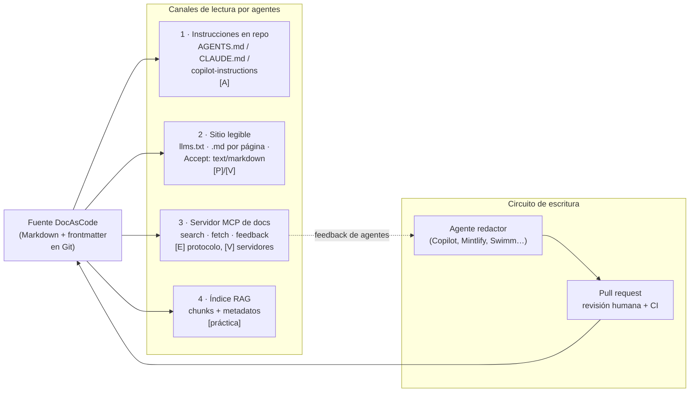

# I03 — Documentación para agentes de IA: qué es estándar, qué es propuesta y qué conviene exigir

## Índice

1. [Alcance y método](#1-alcance-y-método)
2. [Definiciones](#2-definiciones)
3. [Mapa del ecosistema](#3-mapa-del-ecosistema)
4. [Canal 1 — Archivos de instrucciones en el repositorio (AGENTS.md, CLAUDE.md, copilot-instructions)](#4-canal-1--archivos-de-instrucciones-en-el-repositorio)
5. [Canal 2 — El sitio publicado legible por máquinas (llms.txt, .md por página, negociación de contenido)](#5-canal-2--el-sitio-publicado-legible-por-máquinas)
6. [Canal 3 — Servidores MCP de documentación](#6-canal-3--servidores-mcp-de-documentación)
7. [Canal 4 — Recuperación (RAG), chunking y metadatos](#7-canal-4--recuperación-rag-chunking-y-metadatos)
8. [Agentes que redactan y actualizan documentación](#8-agentes-que-redactan-y-actualizan-documentación)
9. [Humano en el bucle: revisión, aprobación y procedencia](#9-humano-en-el-bucle-revisión-aprobación-y-procedencia)
10. [Riesgos y controles](#10-riesgos-y-controles)
11. [Requisitos para una documentación DocAsCode de doble audiencia](#11-requisitos-para-una-documentación-docascode-de-doble-audiencia)
12. [Registro de fuentes](#12-registro-de-fuentes)
13. [Contraste con la guía actual del corpus](#13-contraste-con-la-guía-actual-del-corpus)
14. [Lo que no se verificó](#14-lo-que-no-se-verificó)

---

## 1. Alcance y método

**Pregunta.** ¿Cómo resuelve hoy la industria (2024–2026) una documentación que leen *y* mantienen agentes de IA además de personas, y qué requisitos concretos se desprenden para un sistema DocAsCode?

**Método.** Búsqueda web y lectura directa (WebFetch) de la fuente primaria de cada afirmación: especificaciones, documentación oficial de los productos, papers en arXiv, documentos de proceso de proyectos abiertos y publicaciones técnicas de los autores. Donde sólo se encontró cobertura secundaria (blogs de SEO, prensa) se marca **[secundaria]**. Cada fuente se identifica en el texto como `[Fnn]` y se detalla en §12 (URL, título, fecha de publicación cuando consta, fecha de consulta: 2026-10-26).

**Escala de madurez usada en esta bitácora** (criterio propio, para distinguir estándar de marketing):

| Nivel | Significado | Ejemplo |
|---|---|---|
| **E — Especificación normativa** | Texto con MUST/SHOULD, versionado, con gobierno abierto | MCP 2025-11-25 [F20][F21] |
| **A — Convención adoptada** | Sin norma formal, pero la leen múltiples herramientas de distintos proveedores | AGENTS.md [F02] |
| **P — Propuesta** | Publicada para comentarios; adopción del lado productor, consumo dudoso | llms.txt [F01] |
| **V — Funcionalidad de proveedor** | Existe y funciona, pero es de un solo vendedor | Mintlify `/mcp`, GitBook `/~gitbook/mcp` [F09][F10] |
| **M — Afirmación de marketing** | Promesa sin evaluación pública | «answers grounded in your code» (DeepWiki) [F14] |

---

## 2. Definiciones

- **Documentación de doble audiencia.** La misma fuente sirve a personas (HTML navegable) y a agentes (texto plano o Markdown, índices, herramientas). La guía del corpus ya usa la expresión «regla de doble audiencia» (`Sistema-Documentador-Tecnico-Guide.md:94`).
- **Archivo de instrucciones de agente.** Markdown versionado en el repo que un agente de código carga en su contexto al empezar (AGENTS.md, CLAUDE.md, `.github/copilot-instructions.md`). Es *contexto*, no configuración ejecutada [F03].
- **llms.txt.** Archivo Markdown en `/llms.txt` con un H1 obligatorio, resumen opcional y listas de enlaces; propuesto por Jeremy Howard el 2024-09-03 [F01].
- **MCP (Model Context Protocol).** Protocolo abierto para que un cliente de IA descubra e invoque herramientas y recursos de un servidor [F20][F21]. Un **servidor MCP de documentación** expone búsqueda y lectura de páginas como herramientas.
- **RAG / chunking.** Recuperar fragmentos (*chunks*) de un corpus para inyectarlos en el contexto del modelo. El tamaño y los límites del fragmento afectan la recuperación [F22].
- **Inyección de prompt indirecta.** Instrucciones maliciosas contenidas en datos externos (páginas, archivos, issues) que el modelo termina obedeciendo [F17].
- **Procedencia (provenance).** Registro de quién o qué produjo un cambio y quién responde por él (trailers de commit, metadatos de autoría, revisión del PR).
- **Deriva (drift).** Divergencia creciente entre la documentación y el sistema que describe [F13].

---

## 3. Mapa del ecosistema

Hallazgo de síntesis (criterio propio sobre las fuentes de §4–§8): la industria no tiene *un* estándar de «docs para IA», sino **cuatro canales** con madurez muy distinta, más un circuito de escritura por agentes que siempre desemboca en un pull request.



---

## 4. Canal 1 — Archivos de instrucciones en el repositorio

### 4.1 AGENTS.md: la convención con más adopción

- Se define como «a README for agents», Markdown sin campos obligatorios; «stewarded by the Agentic AI Foundation under the Linux Foundation»; declara uso en «over 60k open-source projects» y lista como lectores a Codex, Jules, Gemini CLI, Aider, goose, opencode, Zed, Warp, VS Code, Devin, Windsurf, Junie, Cursor, Amp, RooCode, Copilot coding agent, Factory, Kilo Code y Augment [F02].
- **Precedencia por cercanía:** «The closest AGENTS.md to the edited file wins; explicit user chat prompts override everything» [F02].
- Secciones recomendadas: visión del proyecto, comandos de build y prueba, estilo, pruebas, seguridad [F02].
- **Madurez: A.** No hay especificación con MUST; la adopción es real y multi-proveedor.

### 4.2 CLAUDE.md (Claude Code)

- Jerarquía: se cargan los `CLAUDE.md`/`CLAUDE.local.md` del directorio de trabajo y de todos los ancestros, **concatenados** (no se pisan); los de subdirectorios se cargan bajo demanda; reglas por ruta en `.claude/rules/`; importaciones `@ruta` hasta 4 saltos [F03].
- Lee AGENTS.md: si no hay CLAUDE.md lo usa; si hay ambos, por defecto lee sólo CLAUDE.md, salvo que CLAUDE.md importe AGENTS.md [F03].
- Tres afirmaciones que importan para el diseño: «Claude treats them as context, not enforced configuration» (para bloquear algo, un hook); «target under 200 lines per CLAUDE.md file. Longer files consume more context and reduce adherence»; y las importaciones externas al directorio piden aprobación «to protect you from files other people commit to a shared project» [F03].

### 4.3 GitHub Copilot

- `.github/copilot-instructions.md` (todo el repo) y `.github/instructions/NOMBRE.instructions.md` con frontmatter `applyTo: "<glob>"` (por ruta); `excludeAgent` para excluir revisión de código o agente cloud [F04].
- Copilot también lee AGENTS.md («the nearest AGENTS.md file in the directory tree will take precedence») y acepta un único `CLAUDE.md` o `GEMINI.md` en la raíz [F04].
- En revisión de PR lee instrucciones **de la rama head**, no de la base [F04]. (Observación propia: esto permite probar cambios de instrucciones en el mismo PR, pero también que un PR modifique las instrucciones que guían su propia revisión.)

### 4.4 Evidencia empírica sobre su utilidad

| Estudio | Hallazgo | Fuente |
|---|---|---|
| Gloaguen et al., ETH/LogicStar, arXiv 2602.11988 (v1 2026-02-12, v3 2026-09-29) | Los archivos de contexto **no elevan de forma fiable** la tasa de éxito y suben el costo de inferencia >20 %; los agentes *sí siguen* las instrucciones, pero los «repository overviews» no ayudan; son útiles para **prácticas no estándar**. | [F15] |
| Vercel, 2026-01-27 (evaluación propia sobre APIs de Next.js 16 ausentes del entrenamiento) | Índice de docs comprimido en AGENTS.md: 100 % de aprobación; *skill* sin instrucción explícita: 53 % (igual que sin docs); «In 56% of eval cases, the skill was never invoked». | [F16] |

Lectura (criterio propio): las dos fuentes no se contradicen. La del ETH mide resúmenes generales de repositorio; la de Vercel mide un **índice que apunta a documentación precisa y versionada** que el modelo no conoce. Lo que funciona es *poco texto, específico, no deducible del código, y punteros a la fuente*. Es exactamente la forma del adaptador de la base de conocimientos del workspace: «Este archivo es un puntero a una base de conocimientos … No trae oficio propio» (`KB-privada/Adapters/agents-md/AGENTS.md:8-9`), y del punto de entrada de la ia-db: «No recorras las ~114 600 líneas de Markdown» (`/LAB/Lab-Documentos/Lab-Documentos.Documentacion/ia-db/README.md:8`).

---

## 5. Canal 2 — El sitio publicado legible por máquinas

### 5.1 llms.txt: propuesta con adopción productora y consumo dudoso

- **Formato** [F01]: Markdown en `/llms.txt` (o subruta); sólo el H1 es obligatorio; blockquote de resumen; secciones H2 con listas `[nombre](url): notas`; una H2 «Optional» marca lo prescindible. Cada página debería tener versión Markdown limpia en la misma URL con `.md` (o `index.html.md`); descubrimiento por `rel="alternate" type="text/markdown"` y `rel="describedby"`. La página se autodenomina propuesta abierta a comentarios, no estándar. `llms-full.txt` **no figura** en la propuesta (es una extensión de los generadores).
- **Señal de adopción institucional:** Lighthouse incorporó una categoría «agentic browsing» con chequeo de llms.txt: v13.2.0 «config: implement llms.txt check for AI agents (#16970)», v13.3.0 la pasa a la configuración por defecto, v13.5.0 la agrupa como «agent discovery» [F23]. Que Lighthouse lo audite **no** implica que los modelos lo consuman.
- **Señal en contra, de Google Search:** John Mueller, 2025-04-17: «AFAIK none of the AI services have said they're using LLMs.TXT» y «it's comparable to the keywords meta tag» [F24].
- **Consumo medido [secundaria]:** estudios de logs de proveedores SEO (Ahrefs, Otterly, Limy, SE Ranking, EZY.AI) reportan que los crawlers de IA casi no lo piden (p. ej. ~0,1 % de visitas de bots); hay un reporte en contra (Profound). No se verificaron las metodologías originales (§14).
- **Madurez: P.** Barato de producir, útil como índice para agentes *dirigidos* (alguien le pasa la URL a su agente), no como palanca de descubrimiento.

### 5.2 Markdown por página y negociación de contenido

- GitBook: cualquier página tiene versión Markdown agregando `.md` a la URL [F10]. Mintlify y Claude Code docs anteponen a cada página un aviso «Fetch the complete documentation index at: …/llms.txt» [F03][F09]; la guía del corpus ya registró ese patrón en OneSignal (`Sistema-Documentador-Tecnico-Guide.md:94`).
- Cloudflare, «Introducing Markdown for Agents», 2026-02-12: con `Accept: text/markdown` convierte el HTML a Markdown en el borde; agrega `x-markdown-tokens` (tokens estimados) y `Content-Signal: ai-train=yes, search=yes, ai-input=yes`; ejemplo propio de 16 180 → 3 150 tokens («a 80% reduction») [F25]. **Madurez: V (beta)**, pero apoyado en HTTP estándar (negociación de contenido).
- Observación propia: servir Markdown **desde la fuente** (DocAsCode ya lo tiene) es superior a convertir HTML: no hay pérdida ni ruido de navegación, y el `.md` servido es auditable contra el repo.

---

## 6. Canal 3 — Servidores MCP de documentación

| Servidor | Endpoint | Herramientas / alcance | Autenticación | Madurez | Fuente |
|---|---|---|---|---|---|
| Microsoft Learn MCP Server | `https://learn.microsoft.com/api/mcp` (Streamable HTTP) | buscar docs, traer artículo completo, buscar ejemplos de código; sobre el *knowledge service* de Ask Learn; refresco incremental + completo diario | ninguna; gratuito | V (GA pública) | [F07] |
| Context7 (Upstash) | `https://mcp.context7.com/mcp` o CLI `ctx7` | `resolve-library-id`, `query-docs`; docs por versión | API key opcional | V | [F08] |
| Mintlify (por sitio) | `/mcp`, `/authed/mcp`, `/.well-known/mcp` | search, filesystem virtual, **submit feedback** (el agente reporta páginas incorrectas); respeta `.mintignore` y `noindex` | OAuth en sitios privados, filtrado por grupos | V | [F09] |
| GitBook (por sitio) | `{sitio}/~gitbook/mcp` | sólo lectura, **sólo última versión publicada**; páginas ocultas siguen accesibles por MCP | OAuth + DCR en sitios autenticados | V | [F10] |

Hallazgos:

1. **El protocolo es estándar (E), los servidores son de proveedor (V).** MCP tiene especificación con MUST/SHOULD y versión fechada (2025-11-25) [F20][F21].
2. **La «versión» es un problema abierto.** GitBook sirve sólo la última publicada [F10]; Context7 resuelve versión por texto del prompt [F08]; Mintlify acepta filtro `version` [F09]. Un DocAsCode con docs atadas al tag del código tiene ventaja si expone la versión explícitamente.
3. **Ocultar ≠ restringir.** «Hidden pages stay reachable through MCP» (GitBook) [F10]; coincide con lo que la guía ya concluyó para `groups` de Mintlify: resolver la confidencialidad en el build, no en la vista (`Sistema-Documentador-Tecnico-Guide.md:236`).
4. **Riesgo de terceros.** Context7: «Context7 projects are community-contributed and while we strive to maintain high quality, we cannot guarantee the accuracy, completeness, or security of all library documentation» [F08]. Una fuente de docs por MCP es contenido **no confiable** a efectos de inyección (§10).

---

## 7. Canal 4 — Recuperación (RAG), chunking y metadatos

- Anthropic, «Contextual Retrieval», 2024-09-19: anteponer a cada chunk 50–100 tokens de contexto del documento reduce el fallo de recuperación (1 − recall@20) un 35 % (embeddings), 49 % (+ BM25) y 67 % (+ reranking); chunks de «no more than a few hundred tokens»; «The choice of chunk size, chunk boundary, and chunk overlap can affect retrieval performance» [F22].
- Consecuencia de diseño (criterio propio): una documentación con **secciones autocontenidas, encabezados que nombran el tema, y frontmatter con título/descripción/versión** le da al indexador el «contexto de chunk» gratis, sin generarlo con un LLM. Es lo que ya prescribe la regla de la corrida («secciones jerárquicas… autocontenida y no delta», `Replanteo-Y-Analisis.md:42`) y lo que explota la ia-db al cargar «por sección» (`KB-privada/Adapters/agents-md/AGENTS.md:28-29`).
- **Metadatos como contrato.** Microsoft Learn publica en cada página metadatos de máquina: `ms.date`, `ms.author`, `updated_at`, `git_commit_id`, `original_content_git_url` [F07] (observado en la respuesta de la página del MCP Server). Es procedencia y frescura legibles por agentes.
- Cloudflare expone tokens estimados por página (`x-markdown-tokens`) para que el agente decida si cabe [F25]. Observación propia: un `llms.txt` o índice que incluya tamaño por entrada cumple la misma función sin depender del CDN.

---

## 8. Agentes que redactan y actualizan documentación

| Producto / trabajo | Qué hace | Cómo entra el cambio | Madurez | Fuente |
|---|---|---|---|---|
| GitHub Copilot cloud agent | Investiga el repo, planifica, edita, corre pruebas; tareas desde issue/PR/chat/automatizaciones (p. ej. notas de release semanales) | **Un PR por tarea**, en una sola rama | V (GA) | [F05][F06] |
| Mintlify agent / automatización «Update from code changes» | Redacta docs desde PRs, Slack o enlaces; observa repos de código | Abre PR en el repo de docs; por defecto dos veces por semana o por PR fusionado; «Automations open pull requests by default»; algunas (traducción) fusionan directo | V | [F11][F12][F13] |
| Swimm Auto-sync | Mantiene fragmentos de código citados en docs al día por CI | Cambios rutinarios automáticos; si el cambio es significativo **falla el chequeo** y bloquea el PR o abre un issue con plazo | V | [F26] |
| DeepWiki (Cognition) | Genera wiki con diagramas desde el repo; dirigible con `.devin/wiki.json` | Regeneración; sin evaluación pública de exactitud | V / M | [F14] |
| DocAgent (arXiv 2504.08725, ACL 2025) | Multiagente Reader/Searcher/Writer/**Verifier**/Orchestrator, orden topológico; evalúa completitud, utilidad y **veracidad** | Investigación | investigación | [F27] |

Hallazgos:

1. **El patrón dominante es «agente propone, PR dispone».** Ningún producto primario consultado describe escritura directa a la rama principal como modo recomendado; Mintlify lo permite pero advierte que la revisión es lo seguro para docs de usuario [F12].
2. **Hay dos estrategias de detección de deriva:** *anclaje* (Swimm acopla el doc a fragmentos de código y falla el CI si divergen) [F26] y *observación de eventos* (Mintlify reacciona a PRs fusionados) [F12]. La primera es determinista; la segunda depende del juicio del modelo («Renaming a private variable… should not create a docs pull request» es un criterio, no una garantía).
3. **El rol Verificador** aparece en la investigación (DocAgent) como pieza separada del Redactor [F27]; coincide con la mesa evaluadora del marco SDD del workspace (se relevó en R03, no se repite aquí).
4. **Canal de retorno de los agentes lectores:** Mintlify agrega una herramienta MCP para que el agente lector reporte páginas incorrectas u obsoletas [F09]. Cierra el bucle lectura → escritura.

---

## 9. Humano en el bucle: revisión, aprobación y procedencia

### 9.1 Controles de flujo verificados (Copilot cloud agent) [F06]

| Riesgo | Control |
|---|---|
| Que alguien sin permiso dirija al agente | Sólo usuarios con escritura; «Comments from users without write access are never presented to the agent» |
| Que empuje a cualquier rama | Una sola rama `copilot/…` o la del PR existente |
| Autoaprobación | El agente «cannot approve or merge a pull request»; **quien pidió el PR tampoco puede aprobarlo** |
| CI con código no revisado | Los workflows no corren hasta que alguien con escritura los aprueba |
| Exfiltración | Firewall de salida a internet |
| Instrucciones ocultas | Se filtran caracteres ocultos y comentarios HTML antes de pasar la entrada al agente |

### 9.2 Norma del protocolo

MCP: «there SHOULD always be a human in the loop with the ability to deny tool invocations»; los clientes SHOULD mostrar las entradas antes de llamar y «Validate tool results before passing to LLM»; las anotaciones de herramientas son no confiables salvo de servidores confiables (MUST) [F21].

### 9.3 Procedencia

- **Linux kernel, `coding-assistants`:** «AI agents MUST NOT add Signed-off-by tags» (sólo humanos certifican el DCO); el humano revisa y responde; atribución con `Assisted-by: LLM [TOOL1] [TOOL2]` [F19]. **En flujo:** cobertura de prensa de octubre 2026 reporta que los mantenedores acordaron retirar la obligación del tag [secundaria; no verificado en el árbol principal]. Lo que **no** cambia es la regla de responsabilidad humana.
- **En DocAsCode:** la guía del corpus ya prevé `origin` y `confidence` cuando participó un agente (`Sistema-Documentador-Tecnico-Guide.md:565`, `:603`). La industria (Microsoft Learn) expone `ms.author` y `git_commit_id` [F07]; no se encontró un estándar de frontmatter para «generado por IA» adoptado entre proveedores (§14).

```mermaid
sequenceDiagram
    participant Ev as Evento (PR de código fusionado)
    participant Ag as Agente redactor
    participant Repo as Repo de docs (rama)
    participant CI as CI (validadores deterministas)
    participant H as Revisor humano (≠ solicitante)
    Ev->>Ag: diff + contexto
    Ag->>Repo: rama propia + commit con atribución
    Repo->>CI: frontmatter, enlaces, trazas, anclajes
    CI-->>H: verde / rojo con motivo
    H->>Repo: aprueba o pide cambios
    Note over H,Repo: el agente no aprueba ni fusiona;<br/>la responsabilidad queda en el humano
```

---

## 10. Riesgos y controles

| Riesgo | Evidencia | Control con respaldo | Fuente |
|---|---|---|---|
| **Inyección indirecta por docs** | OWASP LLM01:2025, escenario 4: «An attacker modifies a document in a repository used by a … RAG application» | etiquetar y separar contenido no confiable; mínimo privilegio; aprobación humana para acciones de alto riesgo; pruebas adversariales; «it is unclear if there are fool-proof methods» | [F17] |
| **Trifecta letal** (datos privados + contenido no confiable + comunicación externa) | Willison, 2025-06-16 | evitar la combinación; restringir al agente tras leer contenido no confiable; no confiar sólo en guardarraíles | [F18] |
| **Caso real: issue malicioso → fuga por PR** | Invariant Labs, 2025-05-26, servidor MCP oficial de GitHub: un issue público hace que el agente copie datos de repos privados a un PR público | un repositorio por sesión, permisos granulares, monitoreo | [F28] |
| **Docs que traen instrucciones para agentes** | Observación propia: al consultar la página MCP de Mintlify el 2026-10-26, el contenido devuelto traía un bloque «Agent Instructions» que pedía crear un proyecto; el modelo intermedio lo ignoró | tratar todo texto de docs de terceros como datos, nunca como órdenes; filtrar comentarios/caracteres ocultos como hace Copilot [F06] | [F09][F06] |
| **Instrucciones de repo como vector** | Copilot revisa con instrucciones de la rama head [F04]; Claude Code pide aprobación para imports externos «to protect you from files other people commit» [F03] | revisar cambios a AGENTS.md/CLAUDE.md como código sensible (CODEOWNERS); no importar fuera del repo sin aprobación | [F03][F04] |
| **Alucinación / docs incorrectas generadas** | DocAgent parte de que la doc generada suele ser «incomplete, unhelpful, or factually wrong»; Copilot: «incorrect or suboptimal code» | verificador separado; evaluación de veracidad; revisión humana | [F27][F05] |
| **Docs generadas que empeoran al agente** | ETH: archivos de contexto generados por LLM rinden peor que los escritos por desarrolladores; recomiendan omitir los generados | escribir a mano las instrucciones; medir antes de agregar | [F15] |
| **Deriva** | «Documentation goes stale by default»; «Docs without an owner drift first» | dueño por sección; anclajes verificados por CI (Swimm); disparo por PR fusionado | [F12][F26] |
| **Fuentes de terceros sin garantía** | Disclaimer de Context7 | lista de fuentes MCP permitidas; preferir servidor propio o oficial | [F08] |
| **Filtración por índice** | GitBook: páginas ocultas accesibles por MCP | no compilar contenido interno en el sitio externo | [F10] |

---

## 11. Requisitos para una documentación DocAsCode de doble audiencia

Criterio propio, derivado de §4–§10. Cada requisito lleva su respaldo y una prioridad: **D** (debe), **C** (conviene), **O** (opcional, sujeto a evaluación).

### 11.1 Fuente y estructura

| # | Requisito | Prio | Respaldo |
|---|---|---|---|
| R1 | Una sola fuente Markdown en Git; HTML, `.md` y cualquier índice para agentes se **generan** de ella en el mismo build. | D | [F01][F10][F25]; guía `:175` |
| R2 | Secciones autocontenidas con encabezados que nombran el tema (el chunk debe entenderse fuera del documento). | D | [F22] |
| R3 | Frontmatter obligatorio y validado en CI: `title`, `description`, `version`/fuente trazada, `last_review`, `owner`, `status`; y `origin`/`confidence` si intervino un agente. | D | [F07]; guía `:565`, `:603`, `:609` |
| R4 | Separar referencia (generada del contrato) de prosa (Diátaxis), para que el agente sepa qué es normativo. | C | guía `:165` |

### 11.2 Publicación para agentes

| # | Requisito | Prio | Respaldo |
|---|---|---|---|
| R5 | Cada página disponible como `.md` en su URL, con `rel="alternate" type="text/markdown"`. | D | [F01][F10] |
| R6 | `llms.txt` generado (H1, resumen, H2 por familia, sección `Optional`), filtrado por el mismo control de acceso que la navegación; tratarlo como índice para agentes dirigidos, **no** como SEO. | C | [F01][F23][F24]; guía `:439` |
| R7 | Exponer versión y tamaño: cada entrada del índice con la versión del producto que documenta y, opcional, tokens estimados. | C | [F25][F10] |
| R8 | Servidor MCP de docs (búsqueda + lectura + reporte de error) sólo cuando haya consumidores reales; sólo lectura; sin páginas internas. | O | [F07][F09][F10] |
| R9 | Confidencialidad resuelta en el build: lo interno no se compila en el sitio externo, ni en `.md`, ni en `llms.txt`, ni en MCP. | D | [F10]; guía `:236` |

### 11.3 Instrucciones para agentes en el repo

| # | Requisito | Prio | Respaldo |
|---|---|---|---|
| R10 | Un `AGENTS.md` en la raíz (lectura multi-herramienta) como **puntero**: comandos, convenciones no deducibles, dónde está el índice; no resúmenes del repo. CLAUDE.md, si existe, importa AGENTS.md. | D | [F02][F03][F15][F16] |
| R11 | ≤ ~200 líneas por archivo; reglas por ruta (`applyTo`, `.claude/rules/`, AGENTS.md anidados) en vez de un archivo largo. | C | [F03][F04][F02] |
| R12 | Escritos y revisados por personas; cambios a archivos de instrucciones bajo CODEOWNERS. | D | [F15][F04] |

### 11.4 Escritura por agentes y control humano

| # | Requisito | Prio | Respaldo |
|---|---|---|---|
| R13 | Todo cambio de un agente entra por PR en rama propia; el agente no aprueba ni fusiona; el aprobador no es quien lo pidió. | D | [F06][F12] |
| R14 | Validadores deterministas en CI antes de la revisión humana: frontmatter, enlaces, trazas con versión, anclajes a código (estilo Swimm). | D | [F26]; guía `:461` |
| R15 | Rol verificador separado del redactor (otro agente o mesa) que contraste contra la fuente antes del PR. | C | [F27] |
| R16 | Procedencia en el commit (trailer de atribución) y en el frontmatter (`origin`), con responsabilidad humana explícita. | D | [F19]; guía `:565` |
| R17 | Disparo por evento (PR de código fusionado) que **propone** el cambio de docs; nada se publica sin PR. | C | [F12] |

### 11.5 Seguridad

| # | Requisito | Prio | Respaldo |
|---|---|---|---|
| R18 | Todo contenido de docs que lee un agente se trata como **datos no confiables**; nunca se le da a la vez acceso a secretos, contenido externo y salida a red. | D | [F17][F18][F28] |
| R19 | El build de docs filtra comentarios HTML/caracteres ocultos en lo publicado para agentes, o los marca. | C | [F06] |
| R20 | Fuentes externas (MCP de terceros, Context7) sólo desde una lista permitida; registrar su URL y fecha cuando se citen. | C | [F08][F21] |

---

## 12. Registro de fuentes

Todas consultadas el **2026-10-26**. Fecha de publicación entre paréntesis cuando la fuente la declara.

| Id | Título | URL | Tipo |
|---|---|---|---|
| F01 | The /llms.txt file (2024-09-03; v2) | https://llmstxt.org/ | propuesta, primaria |
| F02 | AGENTS.md | https://agents.md/ | convención, primaria |
| F03 | How Claude remembers your project (Claude Code docs) | https://code.claude.com/docs/en/memory | doc oficial |
| F04 | Adding repository custom instructions for GitHub Copilot | https://docs.github.com/en/copilot/how-tos/configure-custom-instructions/add-repository-instructions | doc oficial |
| F05 | About GitHub Copilot cloud agent | https://docs.github.com/en/copilot/concepts/agents/coding-agent/about-coding-agent | doc oficial |
| F06 | Risks and mitigations for Copilot cloud agent | https://docs.github.com/en/copilot/concepts/agents/coding-agent/risks-and-mitigations | doc oficial |
| F07 | Microsoft Learn MCP Server overview (ms.date 2026-05-05) | https://learn.microsoft.com/en-us/training/support/mcp | doc oficial |
| F08 | upstash/context7 (README) | https://github.com/upstash/context7 | repo oficial |
| F09 | Mintlify — Model Context Protocol | https://www.mintlify.com/docs/ai/model-context-protocol | doc oficial |
| F10 | GitBook — MCP servers for published docs | https://gitbook.com/docs/publishing-documentation/mcp-servers-for-published-docs | doc oficial |
| F11 | Introducing the Mintlify Agent (2025-09-29) | https://www.mintlify.com/blog/agents-launch | blog del proveedor |
| F12 | Keep docs accurate as your product grows (Mintlify Learn) | https://learn.mintlify.com/courses/structure-docs/keeping-docs-current | doc oficial |
| F13 | Mintlify — The Mintlify agent, now in your dashboard | https://www.mintlify.com/blog/agent-dashboard | blog del proveedor (sólo vía resultado de búsqueda; no leído completo) |
| F14 | DeepWiki (Devin docs) | https://docs.devin.ai/work-with-devin/deepwiki | doc oficial |
| F15 | Gloaguen et al., Evaluating AGENTS.md: Are Repository-Level Context Files Helpful for Coding Agents? (v1 2026-02-12, v3 2026-09-29) | https://arxiv.org/abs/2602.11988 | paper |
| F16 | Vercel — AGENTS.md outperforms skills in our agent evals (2026-01-27) | https://vercel.com/blog/agents-md-outperforms-skills-in-our-agent-evals | evaluación del proveedor |
| F17 | OWASP GenAI — LLM01:2025 Prompt Injection | https://genai.owasp.org/llmrisk/llm01-prompt-injection/ | guía de seguridad |
| F18 | Simon Willison — The lethal trifecta for AI agents (2025-06-16) | https://simonwillison.net/2025/Jun/16/the-lethal-trifecta/ | análisis técnico |
| F19 | Linux kernel — AI Coding Assistants (process/coding-assistants) | https://docs.kernel.org/process/coding-assistants.html | doc de proceso |
| F20 | MCP — Security Best Practices | https://modelcontextprotocol.io/specification/2025-06-18/basic/security_best_practices | especificación |
| F21 | MCP 2025-11-25 — Server / Tools | https://modelcontextprotocol.io/specification/2025-11-25/server/tools | especificación |
| F22 | Anthropic — Introducing Contextual Retrieval (2024-09-19) | https://www.anthropic.com/news/contextual-retrieval | publicación técnica |
| F23 | GoogleChrome/lighthouse — Releases (v13.2.0–v13.5.0) | https://github.com/GoogleChrome/lighthouse/releases | notas de versión |
| F24 | Search Engine Journal — Google Says LLMs.Txt Comparable To Keywords Meta Tag (2025-04-17) | https://www.searchenginejournal.com/google-says-llms-txt-comparable-to-keywords-meta-tag/544804/ | prensa con cita directa |
| F25 | Cloudflare — Introducing Markdown for Agents (2026-02-12) | https://blog.cloudflare.com/markdown-for-agents/ | blog del proveedor |
| F26 | Swimm — Keep docs updated with Auto-sync | https://docs.swimm.io/features/keep-docs-updated-with-auto-sync/ | doc oficial |
| F27 | Yang et al., DocAgent: A Multi-Agent System for Automated Code Documentation Generation (2025-04-11; ACL 2025) | https://arxiv.org/abs/2504.08725 | paper |
| F28 | Invariant Labs — GitHub MCP Exploited (2025-05-26) | https://invariantlabs.ai/blog/mcp-github-vulnerability | investigación de seguridad |

**Secundarias (no usadas como prueba única):** estudios de adopción/consumo de llms.txt citados por resultados de búsqueda (optimizely.com, richdevtools.com, aivisibilitynerd.com, searchengineland.com); cobertura del retiro del tag `Assisted-by` (hackaday.com 2026-10-15, heise.de, mindstudio.ai); cobertura de Lighthouse (ppc.land, searchengineland.com).

---

## 13. Contraste con la guía actual del corpus

Guía: `/LAB/Lab-Documentos/Lab-Documentos/Guides/Documentacion-Tecnica/Sistema-De-Documentacion-E-Integracion/Sistema-Documentador-Tecnico-Guide.md` (759 líneas).

| Tema | Qué dice hoy la guía | Qué aporta esta investigación |
|---|---|---|
| llms.txt | Lo presenta como «Convención `llms.txt` (adoptada por varios generadores)» (`:161`) y lo implementa por rol (`:339`, `:439`, `:504`) | Precisar madurez **P**: propuesta [F01]; Lighthouse lo audita [F23]; Google lo compara con meta keywords [F24]; consumo medido bajo [secundaria]. Mantenerlo, pero no venderlo como estándar. |
| `.md` por página | Registrado (OneSignal, `:94`; propuesta `:339`) | Coincide con GitBook, Mintlify y Cloudflare [F10][F09][F25]; sumar `rel="alternate"` [F01]. |
| Procedencia de agentes | `origin` y `confidence` (`:565`, `:603`) | Agregar trailer de commit y regla de responsabilidad humana [F19]; aprobador ≠ solicitante [F06]. |
| AGENTS.md / CLAUDE.md / copilot-instructions | **No aparece** (búsqueda sin coincidencias de `agents.md`, `claude.md`, `copilot`) | Canal 1 completo (§4), con evidencia empírica de qué contenido sirve [F15][F16]. |
| MCP de documentación | **No aparece** (`mcp` sin coincidencias) | Canal 3 (§6). |
| Inyección de prompt y seguridad | **No aparece** | §10 completo. |
| Chunking / RAG | **No aparece** (`chunk`, `rag` sin coincidencias) | §7; la regla de secciones autocontenidas ya lo favorece. |
| Agentes redactores | Ciclo con PR y validadores (§8.3, `:574-591`) | Confirmado como patrón de industria (§8); sumar anclajes deterministas y verificador. |

(La búsqueda se hizo con `grep -n -i -E "llms|agents\.md|claude\.md|copilot|mcp|prompt injection|inyecci|chunk|rag\b|frontmatter"` sobre la guía.)

---

## 14. Lo que no se verificó

- **Cifras de consumo de llms.txt** (Ahrefs, Otterly, Limy, SE Ranking, EZY.AI, Profound): sólo se vieron a través de resúmenes de búsqueda; no se leyeron los estudios ni sus metodologías. No se usan como prueba única.
- **Retiro del tag `Assisted-by` en el kernel:** reportado por prensa de octubre 2026; la página `docs.kernel.org` consultada todavía muestra el tag. Estado final no verificado.
- **Comunicado de Google (2026-06-15) sobre llms.txt en Search:** citado por un blog; no se encontró en la documentación de Google.
- **Mintlify «automate agent» tutorial:** la URL `https://www.mintlify.com/docs/guides/automate-agent` devolvió 404; el flujo API → PR se tomó de [F12] y del resultado de búsqueda, no del tutorial.
- **Otros agentes redactores** (Swimm con IA generativa, Cursor BugBot, Google Gemini Code Assist para docs): no se encontró fuente primaria específica sobre redacción de documentación en el tiempo de esta corrida.
- **Estándar de metadatos «contenido generado por IA» en frontmatter:** no se encontró uno adoptado entre proveedores; la ausencia no está probada, sólo no hallada.
- **Copilot cloud agent y documentación:** la página [F05] no menciona documentación como tarea específica; que sirva para docs es inferencia (es un agente de cambios genéricos sobre el repo).
