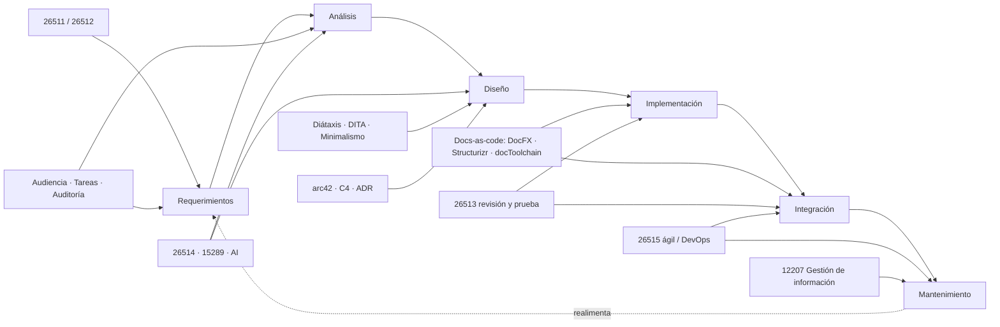
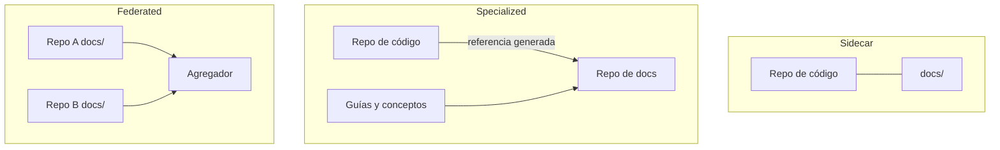

# I04 — Estándares y metodologías para documentación técnica de sistemas

| Campo | Valor |
|---|---|
| Id | I04 |
| Título | Estándares y metodologías para analizar requerimientos documentales, diseñar, implementar e integrar documentación técnica |
| Autor (rol) | Investigador de industria y normas (subagente de la mesa del tool-prompt 01-Replanteo-Y-Analisis) |
| Fecha | 2026-10-26 |
| Tool-prompt | `/LAB/Lab-Documentos/Lab-Documentos.Documentacion/PROMPTs/DEVs/Enchacement/01-Replanteo-Y-Analisis/Replanteo-Y-Analisis.md` |
| Fuentes leídas | 7 muestras públicas de normas ISO/IEC/IEEE (iTeh), 2 fichas de la tienda IEC, 1 búsqueda de catálogo IEEE, diataxis.fr (4 páginas), OASIS DITA 1.3, arc42 (3 páginas), c4model.com, blog de Nygard, MADR, Structurizr (2 páginas), docToolchain (GitHub y sitio), DocFX, Write the Docs, NN/g (2 artículos), ERIC, MIT Press, una reseña académica de minimalismo, llmstxt.org, passo.uno. Detalle en §11. |
| Modo | Solo lectura sobre los repositorios; la única escritura es este archivo |

---

## Índice

1. [Propósito y alcance](#1-propósito-y-alcance)
2. [Definiciones](#2-definiciones)
3. [Mapa general: qué cubre cada marco en el ciclo](#3-mapa-general-qué-cubre-cada-marco-en-el-ciclo)
4. [Normas ISO/IEC/IEEE](#4-normas-isoiecieee)
   - 4.1 [Serie 2651x: información para usuarios](#41-serie-2651x-información-para-usuarios)
   - 4.2 [ISO/IEC/IEEE 15289: contenido de los ítems de información](#42-isoiecieee-15289-contenido-de-los-ítems-de-información)
   - 4.3 [ISO/IEC/IEEE 12207: proceso de gestión de información](#43-isoiecieee-12207-proceso-de-gestión-de-información)
   - 4.4 [IEEE 1063 (histórico)](#44-ieee-1063-histórico)
   - 4.5 [Qué es de pago y qué se leyó de dónde](#45-qué-es-de-pago-y-qué-se-leyó-de-dónde)
5. [Marcos de organización del contenido](#5-marcos-de-organización-del-contenido)
   - 5.1 [Diátaxis](#51-diátaxis)
   - 5.2 [DITA y la escritura por tópicos](#52-dita-y-la-escritura-por-tópicos)
   - 5.3 [Minimalismo (Carroll)](#53-minimalismo-carroll)
6. [Documentación de arquitectura](#6-documentación-de-arquitectura)
   - 6.1 [arc42](#61-arc42)
   - 6.2 [Modelo C4](#62-modelo-c4)
   - 6.3 [ADR: Nygard y MADR](#63-adr-nygard-y-madr)
7. [Docs-as-code y herramientas](#7-docs-as-code-y-herramientas)
   - 7.1 [Definición operativa](#71-definición-operativa)
   - 7.2 [Structurizr](#72-structurizr)
   - 7.3 [docToolchain](#73-doctoolchain)
   - 7.4 [DocFX (ecosistema .NET)](#74-docfx-ecosistema-net)
   - 7.5 [Topologías de repositorio](#75-topologías-de-repositorio)
   - 7.6 [Salida para agentes: llms.txt](#76-salida-para-agentes-llmstxt)
8. [Técnicas de análisis: audiencia, tareas, auditoría, arquitectura de información](#8-técnicas-de-análisis-audiencia-tareas-auditoría-arquitectura-de-información)
9. [Aplicación a un equipo pequeño .NET (criterio propio)](#9-aplicación-a-un-equipo-pequeño-net-criterio-propio)
10. [Contraste con la guía actual del workspace](#10-contraste-con-la-guía-actual-del-workspace)
11. [Registro de fuentes](#11-registro-de-fuentes)
12. [Limitaciones y lo no verificado](#12-limitaciones-y-lo-no-verificado)

---

## 1. Propósito y alcance

Esta bitácora releva **qué prescribe la industria** (normas formales, marcos abiertos y técnicas de diseño de información) para las seis fases que el tool-prompt pide cubrir: requerimientos → análisis → diseño → implementación → integración → mantenimiento. Es insumo para la mesa: no decide la metodología, sólo deja la base normativa con evidencia.

Convenciones de evidencia:

- **Normas**: se cita la URL de la muestra pública y la cláusula. El texto se extrajo con `pdftotext` el 2026-10-26.
- **Web**: URL, título y fecha de consulta (todas el 2026-10-26).
- **Criterio propio**: aparece marcado como tal. No es evidencia, es propuesta del investigador.

## 2. Definiciones

| Término | Definición usada en esta bitácora | Fuente |
|---|---|---|
| Información para usuarios | Nombre que la serie 2651x usa desde 2017-2018 en lugar de «documentación de usuario». La 26515:2018 lista entre sus cambios el «replacement of the paper-based term "documentation" with the general term "information for users"». | 26515:2018, prólogo (muestra iTeh) |
| Ítem de información | Unidad documental del ciclo de vida (plan, especificación, informe…) cuyo propósito y contenido fija la 15289. | 15289:2019, cl. 1 |
| Tipo genérico de documento | Descripción, plan, política, procedimiento, informe, solicitud, especificación (más registro). | 15289:2019, índice cl. 7 y 9 |
| Tópico | Unidad autónoma de contenido con un único propósito (concepto, tarea, referencia…). Base de DITA. | OASIS DITA 1.3 |
| ADR | *Architecture Decision Record*: archivo corto que registra una decisión con su contexto, estado y consecuencias. | Nygard 2011 |
| Docs-as-code | Escribir documentación «with the same tools as code»: gestor de incidencias, Git, texto plano, revisión de código, pruebas automáticas. | Write the Docs |
| Auditoría de contenido | Evaluación de la calidad de lo listado en el inventario de contenido, con decisión conservar/actualizar/quitar. | NN/g, Kaley 2020 |
| Análisis de tareas | «The systematic study of how users complete tasks to achieve their goals.» | NN/g, Rosala 2020 |

## 3. Mapa general: qué cubre cada marco en el ciclo

La matriz resume lo que se desarrolla en §4 a §8. «●» indica cobertura explícita según la fuente; «○», cobertura parcial o indirecta (criterio propio al leer el índice).

| Marco | Req. | Análisis | Diseño | Implem. | Integración | Manten. |
|---|---|---|---|---|---|---|
| ISO/IEC/IEEE 26511 (gestión) | ● | ● | ○ | ○ | ● (publicación y entrega) | ● (calidad, madurez) |
| ISO/IEC/IEEE 26512 (adquisición/suministro) | ● | ○ | | | | |
| ISO/IEC/IEEE 26513 (prueba y revisión) | | | | ● | ● | ● |
| ISO/IEC/IEEE 26514 (diseño y desarrollo) | ● | ● (audiencia y tareas) | ● | ● | ● (empaquetado, liberación) | ● (6.11, 6.12) |
| ISO/IEC/IEEE 26515 (ágil) | ● | ○ | ● | ● | ● (DevOps, 7.7) | ● |
| ISO/IEC/IEEE 15289 (contenido) | ○ | ● | ● | | | |
| ISO/IEC/IEEE 12207 (gestión de información) | ○ | | | ○ | ○ | ● |
| Diátaxis | | ○ | ● | ● | | ● (mejora iterativa) |
| DITA | | | ● | ● | ● (mapas, perfiles) | ● (reutilización) |
| Minimalismo | | ○ | ● | ● | | |
| arc42 | | | ● | ● | | ○ |
| C4 | | | ● | ● | | |
| ADR (Nygard/MADR) | | | ● | ● | | ● (superseded) |
| Structurizr / docToolchain / DocFX | | | | ● | ● | ● |
| Análisis de audiencia y tareas | ● | ● | | | | |
| Auditoría de contenido | ● | ● | | | | ● |
| Arquitectura de información | | ● | ● | | | |

## 4. Normas ISO/IEC/IEEE

Todas las normas de esta sección son del comité ISO/IEC JTC 1/SC 7 en cooperación con IEEE (lo declaran los prólogos de las muestras). La serie 2651x se organiza **por rol**: gestor (26511), adquirente/proveedor (26512), revisor/probador (26513), diseñador/desarrollador (26514) y equipo ágil (26515).

### 4.1 Serie 2651x: información para usuarios

#### 4.1.1 ISO/IEC/IEEE 26511:2018 — Requisitos para gestores de información para usuarios

- **Edición**: muestra iTeh (`cdn.standards.iteh.ai/samples/70879/…/ISO-IEC-IEEE-26511-2018.pdf`).
- **Qué prescribe** (cl. 1): «It provides requirements for strategy, planning, managing, staffing, translation, production, and quality and process-maturity assessment for managers of information for users.» Incluye «requirements for key documents produced for managing information for users, including strategic and project plans». Enumera diez actividades: estrategia de desarrollo de información, evaluación de necesidades de información del usuario, planificación y gestión del proyecto, conformación de equipos, revisión y prueba, traducción, publicación y entrega, satisfacción y calidad, productividad y costos, madurez organizacional.
- **Agilidad**: «The guidance in this document applies to multiple project management approaches, including both» (el texto continúa con ágil y tradicional; corte en la muestra).
- **Estructura** (índice): cl. 5 «Managing strategy for information development» con subcláusulas de partes interesadas, necesidades de usuario, visión.
- **Fases**: requerimientos (necesidades), planificación, integración (publicación) y mantenimiento (calidad, madurez).
- **Estado**: ISO lista un borrador de trabajo de sucesor, ISO/IEC/IEEE WD 26511 «Management of information for users…» (`iso.org/standard/91115.html`, visto en resultados de búsqueda; la página respondió 403 a la lectura directa: **no verificado** su estado exacto).

#### 4.1.2 ISO/IEC/IEEE 26512:2018 — Requisitos para adquirentes y proveedores

- **Edición**: «Second edition 2018-06»; reemplaza a 26512:2010 (prólogo, muestra iTeh `samples/72088/…`).
- **Qué prescribe** (cl. 1): aplica los procesos de acuerdo (adquisición y suministro) de 12207 y 15288 a la información para usuarios. «It applies the Agreement processes (acquisition and supply) to information for users, and addresses the preparation of requirements for this information.» Cubre los documentos de salida: especificación de la información, *statement of work*, pedido de propuesta y propuesta.
- **Fases**: requerimientos (formalizar qué documentación se pide y a quién).
- **Nota**: el IEEE lista una edición 26512-2026 en desarrollo (resultado de búsqueda; **no verificado** en fuente primaria).
- **Relevancia para un equipo pequeño** (criterio propio): baja como proceso contractual, pero su idea de **especificar los requisitos de la documentación antes de producirla** es exactamente la fase de «requerimientos documentales» que pide el tool-prompt.

#### 4.1.3 ISO/IEC/IEEE 26513:2017 — Requisitos para probadores y revisores

- **Edición**: «Second edition 2017-10»; reemplaza a ISO/IEC 26513:2009 (prólogo, muestra iTeh `samples/67417/…`).
- **Qué prescribe** (cl. 1): «specifies processes for use in testing and reviewing of user documentation (Clause 6). It is not limited to the test and review stage of the lifecycle, but includes activities throughout the information management and documentation management process.» Se limita a evaluar el contenido, «not with the evaluation of the software it supports». Da «the minimum requirements for testing and reviewing user documentation (Clause 7)».
- **Estructura** (índice): cl. 6 estrategia de evaluación (requisitos, criterios, selección de método, proceso de prueba, recursos); cl. 7 métodos: revisión documental (planificar, administrar la revisión de calidad, revisión de cambios de configuración), **prueba de sistema de la documentación** (plan de prueba, gestión de problemas), **prueba de usabilidad de la documentación** (objetivos, métricas).
- **Cambios 2017** (prólogo): amplía accesibilidad y traducción/localización; reemplaza las listas de chequeo editoriales del anexo A por «User-centered Test and Review Guidelines».
- **Fases**: implementación, integración, mantenimiento (revisión de cambios de configuración).

#### 4.1.4 ISO/IEC/IEEE 26514:2022 — Diseño y desarrollo de información para usuarios

- **Edición**: «First edition 2022-01»; «cancels and replaces ISO/IEC 26514:2008, which has been technically revised» (muestra iTeh `samples/77451/…`).
- **Qué prescribe** (cl. 1): «covers the development process for designers and developers of information for users of software. It describes how to establish what information users need, how to determine the way in which that information should be presented, and how to prepare the information and make it available. It is not limited to the design and development stage of the life cycle, but includes information on design throughout the life cycle, such as design strategy and maintaining a design.» Además: «provides requirements for the structure, information content, and format of information for users of software.»
- **Audiencia de la norma**: arquitectos y desarrolladores de información («information architects who plan the structure and format of information products…»).
- **Estructura** (índice de la muestra), que es el esqueleto metodológico más completo de la serie:
  - cl. 5 Proceso de gestión de información (planificar y gestionar el proyecto de desarrollo de información).
  - cl. 6 Arquitectura y desarrollo de la información: 6.1 requisitos, objetivos y restricciones (incluye 6.1.3 «Requirements on information for users», 6.1.5 infraestructura y herramientas, 6.1.7 usuarios y objetivos de usabilidad); **6.2 análisis de audiencia y de tareas**; 6.3 desarrollo; 6.4 revisión; 6.5 prototipos y borradores; 6.6 gestión de contenido durante el desarrollo; 6.7 traducción; 6.8 ensamblado final; 6.9 empaquetado; 6.10 liberación; **6.11 actualización y mantenimiento; 6.12 control de versiones y de cambios**.
  - cl. 7 Calidad de la información: corrección, consistencia, comprensibilidad, concisión, **minimalismo (7.6)**, accesibilidad.
  - cl. 8 Estructura: modularidad (8.2), modelo de información (8.4), estructura de información conceptual, instruccional y de referencia (8.5-8.7), resolución de problemas, mensajes de error, glosario, contenido generado por usuarios (8.14), **API (8.15)**, FAQ (8.16), **chatbots y sistemas de respuesta por voz (8.17)**.
  - cl. 9 Formato: medios, información sensible al contexto, accesibilidad, navegación (índice, búsqueda, enlaces), formatos de instrucciones.
- **Fases**: todas, de requerimientos a mantenimiento.
- **Hallazgo**: la división conceptual / instruccional / referencia de 8.5-8.7 coincide con tres de los cuatro tipos de Diátaxis y con los tipos base de DITA (criterio propio al comparar índices; la norma no cita a Diátaxis en lo visible de la muestra).

#### 4.1.5 ISO/IEC/IEEE 26515:2018 — Información para usuarios en entornos ágiles

- **Edición**: «Second edition 2018-12»; reemplaza a 26515:2011 (muestra iTeh `samples/70880/…`).
- **Qué prescribe** (cl. 1): «takes a process standard approach to specify the way in which information for users can be developed in agile development projects.» cl. 5 requisitos generales, cl. 6 planificación y gestión, cl. 7 diseño, desarrollo y provisión. «This document is intended neither to encourage nor to discourage the use of any particular agile development tools or methods.» Incluye «activities throughout the whole life cycle».
- **Cambios 2018** (prólogo): incluye sistemas además de software; reemplaza «documentation» por «information for users»; «inclusion of agile information development across multiple teams and projects, especially projects in continuous maintenance situations such as DevOps».
- **Estructura** (índice): 6.1 gestión de cambios para desarrollo ágil; 6.2 composición de equipos (comunicación, equipos distribuidos); 6.3 gestión entre equipos; 6.4 tareas entre iteraciones (planificación global, dimensionamiento por iteración, **cambios de contenido de último momento**); 6.5 seguimiento (stand-ups, retrabajo, cambio de requisitos); 6.6 partes interesadas; 7.1 relación entre desarrollo ágil y desarrollo de información; 7.3.1 requisitos de usuario; 7.4 revisión, prueba de sistema y usabilidad; 7.5 traducción; 7.6 producción; **7.7 «Delivering information for users with a continuous delivery process (DevOps)»**; anexo A prácticas ágiles.
- **Fases**: todas, con énfasis en integración continua y mantenimiento.
- **Relevancia** (criterio propio): es la norma más cercana a la situación del workspace (equipos chicos, iteraciones, CI). Su 7.7 es el antecedente normativo directo de docs-as-code con entrega continua.

### 4.2 ISO/IEC/IEEE 15289: contenido de los ítems de información

- **Edición leída**: «Fourth edition 2019-07»; reemplaza a 15289:2017 (muestra iTeh `samples/74909/…`).
- **Qué prescribe** (cl. 1): «specifies the purpose and content of all identified systems and software life‐cycle and service management information items (documentation).» Los contenidos se definen por tipo genérico (cl. 7) y por propósito específico (cl. 10). Aclara que 12207 y 15288 definen un proceso de gestión de información «but do not "detail information items in terms of name, format, explicit content, and recording media"», y que esta norma «provides a mapping of processes from the above standards to a set of information items». Los ítems «are combined or subdivided consistent with the life cycle model, as needed for project or organizational purposes».
- **Estructura** (índice): cl. 7 tipos genéricos (descripción, plan, política, procedimiento, informe, solicitud, especificación); cl. 8 mapeo de ítems a los procesos del ciclo de vida de sistemas y de software; cl. 9 registros; cl. 10 contenidos específicos por documento (plan de aceptación, informe de aceptación, plan de adquisición, plan de capacidad, solicitud de cambio…).
- **Fases**: análisis y diseño del **catálogo documental** (qué documentos existen y qué contiene cada uno).
- **Estado de edición**: un resultado de búsqueda menciona referencias cruzadas a 15288:2023 y 12207:2026 en la ficha de la 15289, lo que sugiere una edición más nueva. **No verificado**: no se consiguió la ficha primaria de una 15289 posterior a 2019.

### 4.3 ISO/IEC/IEEE 12207: proceso de gestión de información

- **Hallazgo de vigencia**: ISO/IEC/IEEE 12207:2026 está publicada. La tienda IEC (`webstore.iec.ch/en/publication/113447`, consultada 2026-10-26) informa edición 2.0, publicación **2026-04-29**, 140 páginas, CHF 227. Según la ficha, la norma «does not define information item formats, which ISO/IEC/IEEE 15289 covers» (resumen de la ficha). Los resultados de búsqueda indican que la edición 2017 figura como retirada en ISO y que el anexo I de la 2026 mapea procesos contra la edición anterior (**no verificado** en texto primario de la 2026).
- **Edición 2017 (leída)**: «First edition 2017-11» (muestra iTeh `samples/63712/…`). El índice ubica **6.3.6 Information Management process** (p. 50) dentro de los procesos de gestión técnica, junto a 6.3.5 gestión de configuración y 6.3.8 aseguramiento de calidad. La muestra no incluye el texto de 6.3.6; sólo se vio por buscador el comienzo del propósito: «The purpose of the Information Management process is to generate, obtain, confirm, transform, retain, retri[eve]…» (texto truncado; **no verificado** completo).
- **Limitación declarada** (1.4, edición 2017): «This document does not prescribe a specific software life cycle model, development methodology, method, modelling approach, or technique.»
- **Fases**: transversal; en la práctica gobierna retención, versión y recuperación (mantenimiento).
- **Consecuencia** (criterio propio): la guía del workspace cita 12207:2017 (ver §10); debería actualizarse la referencia a 12207:2026 o declarar que se cita la edición retirada a propósito.

### 4.4 IEEE 1063 (histórico)

- IEEE Std 1063-2001 «IEEE Standard for Software User Documentation» figura como **superseded** en el catálogo IEEE. Según el resultado de búsqueda sobre `standards.ieee.org/standard/1063-2001.html`: «Status: Superseded Standard, Superseded by 26512-2011, Superseding 1063-1987». Otro catálogo (Intertek) lista también a 26511-2012 como reemplazo. La página IEEE directa respondió error al leerla: **no verificado** en lectura propia.
- **Lectura** (criterio propio): el contenido de producto de 1063 (estructura y contenido del manual) migró, en la práctica, a la familia 2651x; hoy la referencia de diseño es 26514:2022.

### 4.5 Qué es de pago y qué se leyó de dónde

| Norma | Acceso | Precio verificado | Qué se leyó en esta bitácora |
|---|---|---|---|
| 26511:2018 | De pago | No consultado | Muestra pública iTeh: portada, índice, cl. 1 |
| 26512:2018 | De pago | No consultado | Muestra iTeh: portada, prólogo, cl. 1 |
| 26513:2017 | De pago | No consultado | Muestra iTeh: prólogo, índice, cl. 1 |
| 26514:2022 | De pago | CHF 204, 64 p., 2022-01-14 (IEC webstore 73614) | Muestra iTeh: portada, prólogo, índice completo, cl. 1 |
| 26515:2018 | De pago | CHF 135, 22 p., 2018-12-12 (IEC webstore 64405) | Muestra iTeh: prólogo, índice, cl. 1-3 |
| 15289:2019 | De pago | No consultado | Muestra iTeh: portada, prólogo, índice, cl. 1, 4, 5 |
| 12207:2017 | Retirada (ver 4.3) | — | Muestra iTeh: índice, cl. 1.4 |
| 12207:2026 | De pago | CHF 227, 140 p., 2026-04-29 (IEC webstore 113447) | Sólo la ficha comercial |
| IEEE 1063-2001 | Histórica | — | Sólo el resultado de búsqueda del catálogo IEEE |

- **Fuente secundaria**: los resúmenes de buscador (estado de 26511 WD, 26512-2026, 12207:2017 retirada, 1063 superseded) son secundarios. Las muestras iTeh son **texto primario de la norma**, pero parcial: el cuerpo normativo (cl. 5 en adelante) no se leyó en ninguna. Todo lo que se dice sobre el contenido de esas cláusulas sale **del índice**, no del texto.
- `iso.org` respondió 403 a toda lectura directa en esta sesión.

## 5. Marcos de organización del contenido

### 5.1 Diátaxis

- **Autor**: «Diátaxis is the work of Daniele Procida»; nace de ideas presentadas en Divio entre 2014 y 2021, con contexto original «limited to software product documentation» (`diataxis.fr/colophon/`).
- **Qué prescribe**: «approaches to content, architecture and form»; cuatro necesidades y cuatro formas: *tutorials*, *how-to guides*, *technical reference*, *explanation* (`diataxis.fr`).
- **Brújula** (`diataxis.fr/compass/`): dos preguntas, «action or cognition?» y «acquisition or application?»:

| El contenido… | …sirve a… | …es |
|---|---|---|
| informa acción | adquisición de habilidad | tutorial |
| informa acción | aplicación de habilidad | guía práctica |
| informa conocimiento | aplicación de habilidad | referencia |
| informa conocimiento | adquisición de habilidad | explicación |

- **Aplicación iterativa** (`diataxis.fr/how-to-use-diataxis/`): trabajar de a un paso, publicar cada mejora, no pensar en el panorama completo, **no crear estructura vacía** (la página califica de «horrible» armar secciones vacías por cada tipo); la estructura «changes … from the inside».
- **Fases**: diseño (taxonomía), implementación (redacción), mantenimiento (mejora continua).
- **Límite** (criterio propio): Diátaxis organiza documentación de **producto para quien lo usa**; no cubre documentación de arquitectura ni de proceso (eso es arc42/ADR/15289).

### 5.2 DITA y la escritura por tópicos

- **Qué es**: estándar OASIS que «defines a set of document types for authoring and organizing topic-oriented information», con mecanismos para «combining, extending, and constraining document types» (`docs.oasis-open.org/dita/dita/v1.3/dita-v1.3-part0-overview.html`, «DITA Version 1.3 Part 0: Overview Plus Errata 02», OASIS Standard, 19 de junio de 2018).
- **Ediciones de 1.3**: Base (tópico y mapa), Technical Content (especializaciones técnicas), All-Inclusive (aprendizaje y formación).
- **Tipos de tópico**: concepto, tarea, referencia, glosario y resolución de problemas, especializaciones del tópico genérico (fuente secundaria: resultado de búsqueda sobre Wikipedia y la página OASIS de *reference topic*).
- **Procesamiento condicional**: atributos `@audience`, `@platform`, `@product` y perfiles DITAVAL (ya citado en la guía del workspace, §10).
- **DITA 2.0**: **no verificado**. Ni `dita-lang.org` ni las búsquedas confirmaron su aprobación como OASIS Standard.
- **Fases**: diseño (modelo de información), implementación (tópicos), integración (mapas que ensamblan salidas), mantenimiento (reutilización).
- **Aplicación** (criterio propio): para un equipo .NET pequeño, adoptar **XML DITA** es sobredimensionado; lo valioso es la disciplina: tópicos autocontenidos de un solo tipo, metadatos de audiencia en el frontmatter y mapas (índices) separados del contenido. Esto se puede hacer en Markdown con frontmatter.

### 5.3 Minimalismo (Carroll)

- **Obra fundante**: John M. Carroll, *The Nurnberg Funnel: Designing Minimalist Instruction for Practical Computer Skill*, MIT Press, 1990 (`mitpress.mit.edu/9780262031639/the-nurnberg-funnel/`; datos vistos en resultado de búsqueda). Continuación: *Minimalism Beyond the Nurnberg Funnel*, MIT Press, 1998.
- **Formulación en principios**: H. van der Meij y J. M. Carroll, «Principles and Heuristics for Designing Minimalist Instruction», *Technical Communication* 42(2): 243-261, mayo 1995 (`eric.ed.gov/?id=EJ504916`).
- **Los cuatro principios** (tomados de una reseña secundaria, P. Graham, «Understanding Minimalism», 2000, Tabla 1, `static.aminer.org/pdf/PDF/000/591/907/reconstructing_minimalism.pdf`; **fuente secundaria**, el artículo de 1995 no se leyó):
  1. Elegir un enfoque orientado a la acción (1.1 dar oportunidad inmediata de actuar; 1.2 alentar la exploración; 1.3 respetar la integridad de la actividad del usuario).
  2. Anclar la herramienta en el dominio de la tarea (2.1 tareas instruccionales reales; 2.2 componentes que reflejen la estructura de la tarea).
  3. Apoyar el reconocimiento y la recuperación de errores (3.1 prevenir; 3.2-3.4 información de error en el lugar).
  4. Apoyar la lectura para hacer, estudiar y ubicar (4.1 ser breve; 4.2 cerrar capítulos).
- **Normativizado**: la 26514:2022 tiene una subcláusula 7.6 «Minimalism» dentro de calidad de la información (índice de la muestra).
- **Fases**: diseño e implementación (redacción de tareas).

## 6. Documentación de arquitectura

### 6.1 arc42

- **Qué prescribe**: plantilla de doce secciones: 1 Introducción y objetivos, 2 Restricciones, 3 Contexto y alcance, 4 Estrategia de solución, 5 Vista de bloques, 6 Vista de ejecución, 7 Vista de despliegue, 8 Conceptos transversales, 9 Decisiones de arquitectura, 10 Requisitos de calidad, 11 Riesgos y deuda técnica, 12 Glosario (`docs.arc42.org/home/`). «Created by Gernot Starke, licensed under CC BY-SA 4.0.»
- **Liviandad**: secciones «tailorable to your specific needs»; para algo más corto ofrece el *arc42 canvas* que «captures a whole system on a single page» (`arc42.org/overview`). «Open source and free, also for commercial use.»
- **Sección 9**: recomienda un ADR «for every important decision» y la estructura de Nygard (`docs.arc42.org/section-9/`).
- **Fases**: diseño e implementación de la documentación de arquitectura; mantenimiento parcial (riesgos y deuda).

### 6.2 Modelo C4

- **Autor**: Simon Brown (`c4model.com`).
- **Qué prescribe**: cuatro diagramas jerárquicos —contexto del sistema, contenedores, componentes, código— más diagramas suplementarios de paisaje del sistema, dinámico y de despliegue. Es «Notation independent» y «Tooling independent».
- **Relación con arc42** (criterio propio): los niveles de contexto y contenedores encajan en las secciones 3 y 5 de arc42; el diagrama de despliegue, en la 7. No se encontró en las páginas leídas una afirmación oficial de esa correspondencia.
- **Fases**: diseño.

### 6.3 ADR: Nygard y MADR

- **Nygard** (`cognitect.com/blog/2011/11/15/documenting-architecture-decisions`, 15 de noviembre de 2011): secciones Title, Context, Decision, Status, Consequences. «We will keep ADRs in the project repository under doc/arch/adr-NNN.md.» «ADRs will be numbered sequentially and monotonically. Numbers will not be reused.» «If a decision is reversed, we will keep the old one around, but mark it as superseded.»
- **MADR** (`adr.github.io/madr/`): «Markdown Architectural Decision Records», versión 4.0.0 (2024-09-17). Secciones: título; contexto y problema (obligatoria); *decision drivers*; opciones consideradas (obligatoria); resultado de la decisión (obligatoria, con consecuencias y confirmación opcionales); pros y contras; más información. Frontmatter con estado, fecha, decisores, consultados, informados. Ubicación sugerida `docs/decisions/NNNN-title-with-dashes.md`. Licencia `MIT OR CC0-1.0`. Sirve también para decisiones no arquitectónicas.
- **Fases**: diseño (registro de la decisión), mantenimiento (estado *superseded*).
- **Aplicación** (criterio propio): MADR agrega «opciones consideradas» y «decision drivers», que es lo que el tool-prompt pide a la mesa («criterios de decisión y análisis de las decisiones»). Es la variante natural para expedientes con alternativas.

## 7. Docs-as-code y herramientas

### 7.1 Definición operativa

Write the Docs (`writethedocs.org/guide/docs-as-code/`): docs-as-code «refers to a philosophy that you should be writing documentation with the same tools as code»: «Issue Trackers», «Version Control (Git)», «Plain Text Markup (Markdown, reStructuredText, Asciidoc)», «Code Reviews», «Automated Tests». Beneficios listados: escritores mejor integrados con desarrollo, borradores de los desarrolladores, y **bloquear el merge de funcionalidades sin documentación**. La página **no** se pronuncia sobre mismo repositorio o repositorio aparte.

### 7.2 Structurizr

- DSL textual para modelar arquitectura basado en C4 (`docs.structurizr.com/dsl`).
- `!docs <path>` adjunta documentación Markdown/AsciiDoc al workspace, a un sistema o a un contenedor; importa los archivos del directorio en orden alfabético (`docs.structurizr.com/dsl/docs`).
- `!adrs <path> [type|fqn]` adjunta ADR; tipos incorporados `adrtools`, `madr` y `log4brains` (`docs.structurizr.com/dsl/adrs`).
- **Lectura** (criterio propio): Structurizr une en un artefacto versionable el modelo C4, la prosa (que puede seguir la plantilla arc42) y los ADR. Corre sobre JVM; en un equipo .NET entra como contenedor de herramienta, no como dependencia del producto.

### 7.3 docToolchain

- «an implementation of the docs-as-code approach for software architecture», que se combina con «the arc42 template for software architecture»; «a AsciiDoc Toolchain for technical Software Documentation, focused on Software Architecture Documentation»; licencia MIT (`github.com/docToolchain/docToolchain`).
- El sitio (`doctoolchain.org/docToolchain/v2.0.x/`) indica que la rama estable es v3 y que v4 está en desarrollo, usa jBake como generador y puede publicar a Confluence.
- **Lectura** (criterio propio): su base AsciiDoc choca con un corpus en Markdown como el del workspace; vale como referencia de la idea «plantilla arc42 + pipeline».

### 7.4 DocFX (ecosistema .NET)

- `dotnet.github.io/docfx/`: «Converts .NET assembly, XML code comment, REST API Swagger files and markdown into rendered HTML pages»; también genera JSON y PDF; requiere .NET SDK 8.0 o superior; se instala como `dotnet tool`.
- **Fases**: implementación e integración (referencia de API generada del código + prosa en Markdown en un mismo sitio).

### 7.5 Topologías de repositorio

Esta es la pregunta central del tool-prompt (repositorio dedicado vs integrado). La fuente más concreta que apareció es `passo.uno/docs-as-code-topologies/` (2023-05-14; **autor no consignado en el texto capturado, no verificado**). Es un blog, no una norma.

| Topología | Definición | A favor | En contra |
|---|---|---|---|
| *Sidecar* | Docs dentro del repo de código | Se versionan con el código | Se tratan como accesorio; conflictos si los ritmos de liberación difieren |
| *Orthogonal* | Repo de docs propio, vínculo manual con el código | Autonomía | Silos, contenido duplicado entre escritores y desarrolladores |
| *Federated* | Docs repartidas en repos de código, un repo central las agrega (submódulos, Antora) | Autonomía con un sitio unificado | Difícil de mantener; pipelines frágiles |
| *Specialized* | Cada repo aporta contenido que no se superpone; la referencia se trae al compilar | División de trabajo clara | Exige cultura de automatización |

La misma página cita a Anne Gentle, *Docs Like Code*: la decisión debe considerar «your users, contributors, reviewers, content size, deployed docs, and translated docs» (cita de segunda mano: **el libro no se leyó**).

**Respaldo normativo** (criterio propio): ninguna norma leída prescribe una topología de repositorio. La 26514 exige control de versiones y de cambios (6.12) y la 26515 entrega continua (7.7), pero no dicen dónde vive el fuente.

### 7.6 Salida para agentes: llms.txt

- `llmstxt.org`: propuesta de Jeremy Howard (publicada 2024-09-03, modificada 2026-08-10, v2). Un `llms.txt` en Markdown en la raíz o en una subruta (`/docs/llms.txt`), con H1 obligatorio, resumen en cita, secciones H2 con listas de enlaces y una sección «Optional»; cada página con su versión `.md` en la misma URL; descubrimiento por `rel="alternate" type="text/markdown"` y `rel="describedby"`.
- **No es una norma formal**: la página dice «The llms.txt specification is open for community input».
- **Hallazgo** (criterio propio): ninguna norma ISO leída trata a los **agentes de IA como lectores**. Lo más cercano es 26514 8.17 «Chatbots and voice response systems», que trata al bot como **canal de entrega** al usuario humano, no como consumidor de la documentación. El doble público humano/agente queda hoy cubierto por convenciones de comunidad, no por normas.

## 8. Técnicas de análisis: audiencia, tareas, auditoría, arquitectura de información

| Técnica | Qué prescribe | Fuente | Fase |
|---|---|---|---|
| Análisis de audiencia y de tareas (normativo) | 26514 6.2 «Audience and task analysis», con 6.2.2 análisis de audiencia y 6.2.3 análisis de tareas; 6.1.7 objetivos de usabilidad | Índice de la muestra 26514:2022 | Requerimientos, análisis |
| Análisis de tareas (práctica) | Dos etapas: relevar (indagación contextual, entrevistas de incidentes críticos, diarios, muestreo de actividad) y analizar; salida típica: diagrama HTA (objetivo → tareas → subtareas, con «plans» para novato/experto) | NN/g, Maria Rosala, 2020-09-20, `nngroup.com/articles/task-analysis/` | Análisis |
| Inventario y auditoría de contenido | Inventario = «a list of every piece of digital content you currently have»; auditoría = «examines, assesses, and evaluates the quality of the content listed in the inventory». Pasos: dueño, alcance acotado, planilla, criterios, completar datos, estado conservar/actualizar/quitar, mantener vivo | NN/g, Anna Kaley, 2020-09-27, `nngroup.com/articles/content-audits/` | Requerimientos (de la reforma), mantenimiento |
| Arquitectura de información | Sistemas de organización, rotulado, navegación y búsqueda; tesauros, vocabularios controlados, metadatos | Rosenfeld, Morville, Arango, *Information Architecture: For the Web and Beyond*, 4.ª ed., O'Reilly, 2015 (ISBN 978-1491911686). **Fuente secundaria**: sólo se vio el índice por buscador. | Análisis, diseño |
| Navegación normativa | 26514 9.10: encontrar de nuevo la misma información, enlaces, tabla de contenidos, índice, búsqueda | Índice de la muestra 26514:2022 | Diseño |

## 9. Aplicación a un equipo pequeño .NET (criterio propio)

Todo lo de esta sección es **propuesta del investigador**. Se apoya en lo citado arriba, pero no es evidencia.

### 9.1 Principio rector

Las normas no obligan a una herramienta ni a un ciclo: 12207 «does not prescribe a specific software life cycle model» (1.4), 15289 permite combinar o subdividir ítems y 26515 no favorece métodos ágiles concretos. Un equipo chico puede, entonces, **adoptar el esqueleto de proceso de 26514 y 26515 en versión liviana** y llenarlo con marcos abiertos.

### 9.2 Receta por fase

| Fase | Qué hacer | Marco | Artefacto en el repo |
|---|---|---|---|
| Requerimientos | Lista de audiencias (humanas y agentes) y de sus tareas; requisitos de la documentación como requisitos del producto | 26514 6.1-6.2; 26512 (idea de especificar) | `docs/_requisitos.md` o una sección del SDD |
| Análisis | Inventario y auditoría de lo existente (planilla o tabla Markdown); HTA por rol | NN/g; 15289 cl. 7 para clasificar | Tabla de inventario con estado conservar/actualizar/quitar |
| Diseño | Taxonomía: Diátaxis para el producto; arc42 (o su canvas) + C4 para la arquitectura; MADR para las decisiones; metadatos de audiencia en el frontmatter (idea DITA) | Diátaxis, arc42, C4, MADR, DITA | Árbol `docs/` por tipo; `docs/decisions/` |
| Implementación | Redacción minimalista por tópicos; referencia de API generada (comentarios XML → DocFX; OpenAPI) | Minimalismo, 26514 cl. 7-8, DocFX | Markdown + generación en el build |
| Integración | Docs en el mismo PR que el código; CI que compila el sitio, valida enlaces y bloquea merges sin documentación; salida `.md` + `llms.txt` | Write the Docs, 26515 7.7, llms.txt | Workflow de CI |
| Mantenimiento | Revisión por cambio de configuración; ADR *superseded* en vez de borrar; auditoría periódica | 26513 cl. 7.2; Nygard; NN/g | Etiqueta de versión que congela código y docs juntos |

### 9.3 Lo que no conviene adoptar en un equipo chico

- DITA XML completo y su cadena de herramientas (costo de entrada alto frente a Markdown).
- El proceso contractual completo de 26512 (pensado para relación adquirente/proveedor).
- Comprar las seis normas: el índice público de 26514 y 26515 ya da el esqueleto. Si se compra una, la de mayor rendimiento es **26514:2022** (CHF 204), porque es la única que prescribe estructura, contenido y formato.

## 10. Contraste con la guía actual del workspace

Guía: `/LAB/Lab-Documentos/Lab-Documentos/Guides/Documentacion-Tecnica/Sistema-De-Documentacion-E-Integracion/Sistema-Documentador-Tecnico-Guide.md` (71 505 bytes, modificada el 2026-09-28).

**Ya cubierto** (con evidencia):

| Tema | Evidencia en la guía |
|---|---|
| Diátaxis | `…/Sistema-Documentador-Tecnico-Guide.md:165` (cita de diataxis.fr, consultada 2026-09-16) y cruce familia × tipo en `:189-195` |
| Nygard ADR y arc42 | `…/Sistema-Documentador-Tecnico-Guide.md:203` |
| DITA, procesamiento condicional | `…/Sistema-Documentador-Tecnico-Guide.md:234` y `:246` (OASIS DITA 1.3 §2.4.3) |
| ISO/IEC/IEEE 15289:2019 | `…/Sistema-Documentador-Tecnico-Guide.md:542`, con la limitación de muestra declarada en `:683` |
| DocFX | `…/Sistema-Documentador-Tecnico-Guide.md:319` y glosario `:702` |
| llms.txt | `…/Sistema-Documentador-Tecnico-Guide.md:94`, `:161`, `:662`, `:708` |

**Ausente** (búsqueda por texto en la guía, 2026-10-26, cero coincidencias): serie 2651x (26511-26515), modelo C4, MADR, Structurizr, docToolchain, minimalismo o Carroll, análisis de tareas, arquitectura de información.

**Desactualizado**: la guía cita ISO/IEC/IEEE 12207:2017 en `…/Sistema-Documentador-Tecnico-Guide.md:542`; la tienda IEC lista 12207:2026 como publicada el 2026-04-29 (§4.3).

**Brecha principal** (criterio propio): la guía se apoya en la 15289 (qué documentos hay) y en docs-as-code (cómo se versionan), pero le falta la **norma de proceso de diseño** (26514) y la **de agilidad y DevOps** (26515), que son justamente las que cubren las fases de requerimientos, análisis e integración que pide el tool-prompt.

## 11. Registro de fuentes

Todas consultadas el 2026-10-26. «P» = primaria; «S» = secundaria.

| # | Fuente | URL | Tipo |
|---|---|---|---|
| 1 | ISO/IEC/IEEE 26511:2018, muestra | https://cdn.standards.iteh.ai/samples/70879/04bb78cdf082449a83535830bc899255/ISO-IEC-IEEE-26511-2018.pdf | P (parcial) |
| 2 | ISO/IEC/IEEE 26512:2018, muestra | https://cdn.standards.iteh.ai/samples/72088/1f639d08881540638bf997dce87dc29d/ISO-IEC-IEEE-26512-2018.pdf | P (parcial) |
| 3 | ISO/IEC/IEEE 26513:2017, muestra | https://cdn.standards.iteh.ai/samples/67417/403cc2e7a8744c76bf40ed12f118e624/ISO-IEC-IEEE-26513-2017.pdf | P (parcial) |
| 4 | ISO/IEC/IEEE 26514:2022, muestra | https://cdn.standards.iteh.ai/samples/77451/e161501288fd44f88c6fdd0f6e46b017/ISO-IEC-IEEE-26514-2022.pdf | P (parcial) |
| 5 | ISO/IEC/IEEE 26515:2018, muestra | https://cdn.standards.iteh.ai/samples/70880/1d67e3a097bf410a9a4ce292aa8b0c8b/ISO-IEC-IEEE-26515-2018.pdf | P (parcial) |
| 6 | ISO/IEC/IEEE 15289:2019, muestra | https://cdn.standards.iteh.ai/samples/74909/24359dd8f7184f7dbec19eed52a9e9ad/ISO-IEC-IEEE-15289-2019.pdf | P (parcial) |
| 7 | ISO/IEC/IEEE 12207:2017, muestra | https://cdn.standards.iteh.ai/samples/63712/0bc6d9107eeb46d88dbc7b628b12cf4b/ISO-IEC-IEEE-12207-2017.pdf | P (parcial) |
| 8 | IEC webstore, 26514:2022 | https://webstore.iec.ch/en/publication/73614 | P (ficha) |
| 9 | IEC webstore, 26515:2018 | https://webstore.iec.ch/en/publication/64405 | P (ficha) |
| 10 | IEC webstore, 12207:2026 | https://webstore.iec.ch/en/publication/113447 | P (ficha) |
| 11 | IEEE SA, 1063-2001 (vía buscador) | https://standards.ieee.org/standard/1063-2001.html | S |
| 12 | Diátaxis, inicio, brújula, cómo usar, colofón | https://diataxis.fr/ · /compass/ · /how-to-use-diataxis/ · /colophon/ | P |
| 13 | OASIS DITA 1.3 Part 0 | https://docs.oasis-open.org/dita/dita/v1.3/dita-v1.3-part0-overview.html | P |
| 14 | arc42 docs, overview, sección 9 | https://docs.arc42.org/home/ · https://arc42.org/overview · https://docs.arc42.org/section-9/ | P |
| 15 | C4 model | https://c4model.com/ | P |
| 16 | M. Nygard, «Documenting Architecture Decisions» | https://www.cognitect.com/blog/2011/11/15/documenting-architecture-decisions | P |
| 17 | MADR | https://adr.github.io/madr/ | P |
| 18 | Structurizr DSL, docs y adrs | https://docs.structurizr.com/dsl · /dsl/docs · /dsl/adrs | P |
| 19 | docToolchain | https://github.com/docToolchain/docToolchain · https://doctoolchain.org/docToolchain/v2.0.x/ | P |
| 20 | DocFX | https://dotnet.github.io/docfx/ | P |
| 21 | Write the Docs, Docs as Code | https://www.writethedocs.org/guide/docs-as-code/ | P |
| 22 | NN/g, Content Inventory and Auditing 101 | https://www.nngroup.com/articles/content-audits/ | P |
| 23 | NN/g, Task Analysis | https://www.nngroup.com/articles/task-analysis/ | P |
| 24 | ERIC, van der Meij y Carroll 1995 | https://eric.ed.gov/?id=EJ504916 | P (registro) |
| 25 | P. Graham, «Understanding Minimalism», 2000 | https://static.aminer.org/pdf/PDF/000/591/907/reconstructing_minimalism.pdf | S |
| 26 | MIT Press, *The Nurnberg Funnel* (vía buscador) | https://mitpress.mit.edu/9780262031639/the-nurnberg-funnel/ | S |
| 27 | llms.txt | https://llmstxt.org/ | P (propuesta) |
| 28 | Docs-as-code topologies | https://passo.uno/docs-as-code-topologies/ | S (blog) |
| 29 | Rosenfeld, Morville, Arango, 4.ª ed. (vía buscador) | https://www.oreilly.com/library/view/information-architecture-4th/9781491913529/ | S |

## 12. Limitaciones y lo no verificado

- **Cuerpo normativo ISO**: no se leyó en ninguna norma. Lo que se dice de las cláusulas 5 en adelante sale de los índices.
- **iso.org**: respondió 403; los estados del WD 26511 y de la 12207:2017 retirada vienen de resúmenes de buscador.
- **15289 posterior a 2019**: indicio por buscador, sin ficha primaria.
- **12207:2026, cláusula de gestión de información**: no se leyó; no se sabe si cambió su numeración (6.3.6 en 2017).
- **DITA 2.0**: estado no verificado.
- **Minimalismo**: los principios vienen de una reseña de 2000 y no del artículo de 1995.
- **Autor de passo.uno**: no consignado en el texto capturado.
- **Anne Gentle, *Docs Like Code***: citado de segunda mano.
- **Precios de 26511, 26512, 26513 y 15289**: no consultados.
- **Repos privados**: no se usaron en esta bitácora.
