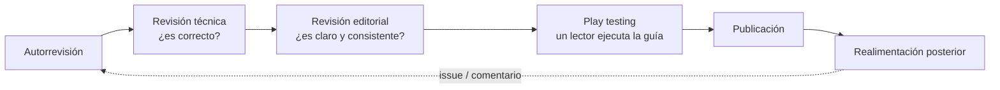
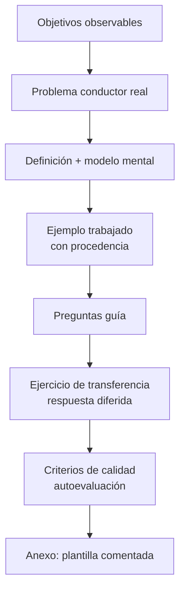
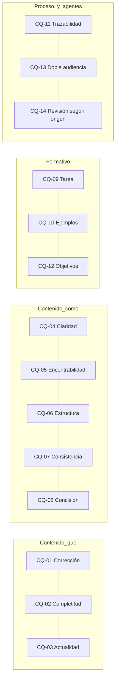
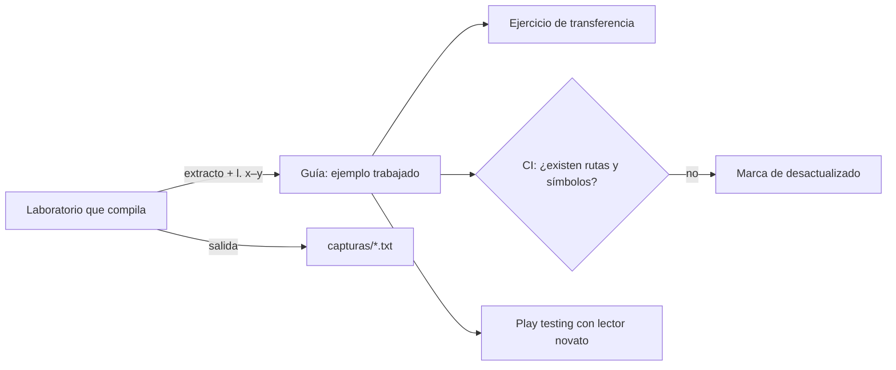

# I05 — Edición académica y material formativo: calidad documental, citación y diseño de ejemplos

| Campo | Valor |
|-------|-------|
| Id | I05 |
| Título | Edición de material bibliográfico y de consulta técnica; evaluación de calidad documental; formato de citación y patrones de ejemplos para las guías |
| Autor (rol) | Investigador académico de la mesa (despacho I05), agente de IA. Aporta evidencia y propuestas; no decide |
| Fecha | 2026-10-26 |
| Encargo | `/LAB/Lab-Documentos/Lab-Documentos.Documentacion/PROMPTs/DEVs/Enchacement/01-Replanteo-Y-Analisis/Replanteo-Y-Analisis.md` (67 líneas, leído completo) |
| Modo | Sólo lectura sobre los repos. Un intermedio (texto extraído de un PDF público) se generó en `{dir-de-trabajo}/i05/` y se borró al terminar |

**Fuentes del workspace leídas** (se abrevian con el prefijo):

| Prefijo | Ruta absoluta |
|---------|---------------|
| `PROMPT` | `/LAB/Lab-Documentos/Lab-Documentos.Documentacion/PROMPTs/DEVs/Enchacement/01-Replanteo-Y-Analisis/Replanteo-Y-Analisis.md` |
| `PERFIL` | `/IA/PROMPTs/IA.Prompts/PromptFramework/Profiles/Study-Guide-Documentation.md` (85 líneas) |
| `RS` | `/IA/PROMPTs/IA.Prompts/PromptFramework/RuleSets/RuleSet-Study-Guide.md` |
| `R-EVID` | `/IA/PROMPTs/IA.Prompts/PromptFramework/Rules/Rule-Evidences.md` |
| `R-DUAL` | `/IA/PROMPTs/IA.Prompts/PromptFramework/Rules/Rule-Dual-Audience.md` |
| `GUIA` | `/LAB/Lab-Documentos/Lab-Documentos/Guides/Documentacion-Tecnica/Sistema-De-Documentacion-E-Integracion/Sistema-Documentador-Tecnico-Guide.md` (759 líneas) |
| `NET` | `/LAB/Lab-Documentos/Lab-Documentos/Guides/Dot-NET-Arquitectura-Guide/Dot-NET-Arquitectura-Guide.md` (2944 líneas; se leyeron §0.5 y Anexo E) |
| `GUIDES` | `/LAB/Lab-Documentos/Lab-Documentos/Guides/` (conteos con `grep`, ver §9) |

**Fuentes externas**: 25 referencias, listadas con su estado de verificación en el [§10](#10-referencias-y-estado-de-verificación). Todas consultadas el 2026-10-26.

---

## Índice

1. [Resumen ejecutivo](#1-resumen-ejecutivo)
2. [Definiciones](#2-definiciones)
3. [Qué dice la investigación empírica sobre documentación de software](#3-qué-dice-la-investigación-empírica-sobre-documentación-de-software)
4. [Modelos de calidad y normas de la comunicación técnica](#4-modelos-de-calidad-y-normas-de-la-comunicación-técnica)
5. [Diseño instruccional aplicable a guías de estudio](#5-diseño-instruccional-aplicable-a-guías-de-estudio)
6. [LLMs como productores y consumidores de documentación](#6-llms-como-productores-y-consumidores-de-documentación)
7. [Producto 1 — Criterios de calidad citables](#7-producto-1--criterios-de-calidad-citables)
8. [Producto 2 — Formato de citación recomendado para las guías](#8-producto-2--formato-de-citación-recomendado-para-las-guías)
9. [Producto 3 — Patrones para crear ejemplos y material de consulta](#9-producto-3--patrones-para-crear-ejemplos-y-material-de-consulta)
10. [Referencias y estado de verificación](#10-referencias-y-estado-de-verificación)
11. [Observaciones y limitaciones](#11-observaciones-y-limitaciones)
12. [Insumos para la mesa](#12-insumos-para-la-mesa)

---

## 1. Resumen ejecutivo

La literatura empírica coincide en un diagnóstico: la documentación falla sobre todo por **contenido** (incorrecta, incompleta, desactualizada) y, entre los problemas de forma, por **claridad**. Aghajani et al. (2020) midieron que el 88 % de 146 profesionales considera importante la falta de claridad, y que la desactualización más dañina es la **función nueva sin documentar** (69 %). Tan, Wagner y Treude (2024) muestran que la desactualización se puede **detectar mecánicamente** (referencias a código que ya no existe). Con LLMs, la calidad de la documentación deja de ser sólo un problema humano: un agente que consume documentación mejora mucho cuando ésta trae **ejemplos de código correctos** (Chen et al., 2025), y produce código obsoleto cuando le falta conocimiento de lo deprecado (Wang et al., 2025).

Del lado formativo, el minimalismo de Carroll, el Information Mapping de Horn, los «primeros principios» de Merrill y la investigación sobre **ejemplos trabajados** dan reglas concretas para estructurar guías de estudio, compatibles con el perfil `Study-Guide-Documentation` que el prompt manda aplicar (`PROMPT:66-68`).

Esta bitácora entrega tres productos: un juego de **criterios de calidad** con fuente (§7), un **formato de citación** unificado APA 7 adaptado al castellano y a la trazabilidad de repos (§8), y **patrones** para producir ejemplos y material de consulta (§9).

---

## 2. Definiciones

| Término | Definición en esta bitácora | Fuente |
|---------|------------------------------|--------|
| Problema documental | Defecto de la documentación agrupado en cuatro categorías: contenido «qué» (correctness, completeness, up-to-dateness), contenido «cómo» (maintainability, readability, usability, usefulness), proceso y herramientas | Aghajani et al. (2020), §2, que resume la taxonomía de 162 problemas de Aghajani et al. (2019) |
| Desactualización (*up-to-dateness*) | El comportamiento descrito ya no coincide con el implementado, o lo nuevo no está descrito | Aghajani et al. (2020), §2 y §4.1 |
| Minimalismo | Enfoque de diseño instruccional orientado a la acción y a la tarea, con soporte para reconocer y recuperarse de errores | Carroll (1990); van der Meij y Carroll (1995) |
| Information Mapping | Método de escritura estructurada en bloques rotulados, con tipos de información estables | Horn et al. (1969); síntesis secundaria en Wikipedia, «Structured writing» |
| Ejemplo trabajado (*worked example*) | Problema resuelto paso a paso que se estudia en lugar de, o antes de, resolver uno equivalente | Sweller y Cooper (1985); Atkinson et al. (2000) |
| Cita / referencia | Cita: la mención en el texto. Referencia: la entrada completa en la lista final | ISO 690:2021 (alcance); APA 7 |
| Criterio propio | Juicio de este investigador sin fuente externa. Se rotula «Criterio propio» | Convención de `NET:89` («Criterio de esta guía») y `R-EVID:11` |

---

## 3. Qué dice la investigación empírica sobre documentación de software

### 3.1 La taxonomía de problemas (ICSE 2019) y su validación (ICSE 2020)

- **Aghajani et al. (2019)** analizaron 878 artefactos (listas de correo, Stack Overflow, *issues* y *pull requests*) y derivaron una taxonomía de problemas documentales (Semantic Scholar API, registro DOI 10.1109/ICSE.2019.00122).
- **Aghajani et al. (2020)** la validaron con dos encuestas a **146 profesionales** (125 de ABB). Los datos siguientes salen del texto completo del artículo (PDF del autor, `emadpres.github.io/pdfs/icse2020.pdf`):

| Categoría (proporción de artefactos en 2019) | Subcategorías | Hallazgo 2020 relevante para las guías |
|---|---|---|
| Contenido «qué» (55 %) | Correctness, Completeness, Up-to-dateness | Instrucciones de instalación inapropiadas y tutorial defectuoso: 65 % las considera importantes. Ejemplos de código erróneos: 59 %. Falta de documentación de una función nueva: 69 %, y es la más recurrente de su subcategoría |
| Contenido «cómo» (29 %) | Maintainability, Readability, Usability, Usefulness | **Claridad: 88 %**, el problema más votado. Accesibilidad/encontrabilidad: 65 %. Organización de la información: 49 % |
| Proceso (9 %) | Internacionalización, contribución, configuración del generador, problemas causados por la documentación, **trazabilidad** | Mala organización de archivos (40 %) y falta de trazabilidad (35 %) son frecuentes aunque menos votadas |
| Herramientas (15 %) | Bugs, soporte, expectativas, ayuda, migración | Percibidas como menos importantes |

Remedios que proponen los propios encuestados (Aghajani et al., 2020, §4.1): que la documentación **la pruebe alguien con poco conocimiento del dominio**; revisar las instrucciones de instalación con usuarios externos; usar **contenedores** para probar las instrucciones en entornos reproducibles; y generar documentación actualizada en la integración continua.

### 3.2 La documentación obsoleta se puede detectar

**Tan, Wagner y Treude (2024)**, *Empirical Software Engineering* 29, art. 5, DOI 10.1007/s10664-023-10397-6, proponen detectar referencias a elementos de código que siguen en README y wikis después de que su código fue borrado. Sobre más de 3000 proyectos de GitHub, la mayoría tuvo al menos una referencia obsoleta en algún momento (resumen en arXiv:2212.01479). Las cifras puntuales (28,9 % y 82,3 %) aparecen sólo en un fragmento secundario y quedan **no verificadas**.

### 3.3 Uso real de la documentación

- **Garousi et al. (2013)**, EASE, DOI 10.1145/2460999.2461003, y su extensión en *Information and Software Technology* (2015), DOI 10.1016/j.infsof.2014.08.003. Caso industrial (NovAtel): el uso de la documentación depende de la necesidad de información y de la tarea; en mantenimiento se prefiere el código fuente. **Verificación parcial**: sólo resúmenes vistos en repositorios institucionales.
- **Forward y Lethbridge (2002)**, DocEng: encuesta a 48 profesionales; valoran las herramientas que extraen conocimiento del código y automatizan el mantenimiento de la documentación. **Verificación parcial**: resumen por buscador. El DOI no se verificó.

### 3.4 *Docs as code* en la literatura académica

La búsqueda no encontró una encuesta académica amplia sobre *docs as code*. El antecedente más directo es **Cadavid, Andrikopoulos y Avgeriou (2022)**, ECSA (arXiv:2206.11668), una investigación-acción técnica que aplica *documentation-as-code* a documentos de control de interfaces en ASTRON. El resumen no trae resultados, así que **no se verificaron** sus conclusiones. Hecho: la evidencia académica sobre *docs as code* como práctica es escasa. La guía actual la sostiene con fuentes de la industria (Write the Docs, `GUIA:102`), lo cual es legítimo si se declara.

### 3.5 La revisión de la documentación como proceso

**Bhat, Arawjo, Shrivastava y Guo (2026)**, aceptado en GROUP 2027 (arXiv:2608.26232), entrevistaron a 31 redactores técnicos. Identifican **cinco etapas de revisión**: autorrevisión, revisión técnica, revisión editorial, *play testing* y realimentación posterior a la publicación. Las dificultades son conseguir revisores expertos, los plazos del desarrollo y las herramientas no pensadas para documentación.

*Diagrama: las cinco etapas según Bhat et al. (2026). Las preguntas entre paréntesis son criterio propio.*

---

## 4. Modelos de calidad y normas de la comunicación técnica

### 4.1 Modelo de diez dimensiones (Treude et al., 2020)

**Treude, Middleton y Atapattu (2020)**, ESEC/FSE, pp. 1509-1512, DOI 10.1145/3368089.3417045, descomponen la calidad documental en **diez dimensiones de estructura, contenido y estilo**, tomadas de la investigación sobre calidad de información. Las dimensiones son: *structure, cohesion, understandability, conciseness, effectiveness, clarity, quality, appeal, readability, consistency* (arXiv:2007.10744, versión HTML). En la aplicación con editores técnicos, la documentación de referencia y los README salieron mejor que los artículos de blog. **No verificado**: el agrupamiento de cada dimensión en estructura, contenido o estilo, porque la versión HTML consultada no lo explicita.

### 4.2 Normas ISO/IEC/IEEE para información al usuario

- **ISO/IEC/IEEE 26514:2022**, *Design and development of information for users*, 1.ª edición, 2022-01, reemplaza a ISO/IEC 26514:2008 (`committee.iso.org/standard/77451.html`). Fija requisitos de estructura, contenido y formato de la información para usuarios de software durante todo su ciclo de vida. Excluye la capacitación por computadora y los materiales de cursos formales. **Consecuencia**: cubre la ayuda al usuario de la guía (`FAM-USR`), pero no las guías de estudio de Lab-Documentos.
- **ISO/IEC/IEEE 26515:2018**, información al usuario en entornos ágiles. **Verificación parcial**: sólo catálogos de terceros.

### 4.3 Comunicación técnica: STC, minimalismo e Information Mapping

- **STC**: la Society for Technical Communication anunció su disolución el 29 de enero de 2025 (Chapter 7, según fuentes secundarias: LinkedIn de la STC, blog de Eric Holscher, ClickHelp). Su sitio está en mantenimiento: `stc.org/about-stc/defining-technical-communication/` no devolvió la definición el 2026-10-26. **Consecuencia**: no conviene citar a la STC como autoridad vigente; sí a su revista *Technical Communication* como fuente histórica.
- **Minimalismo** (Carroll, 1990, *The Nurnberg Funnel*, MIT Press). Van der Meij y Carroll (1995), *Technical Communication* 42(2), 243-261, lo formulan en cuatro principios: (1) elegir un enfoque orientado a la acción; (2) anclar la herramienta en el dominio de la tarea; (3) apoyar el reconocimiento de errores y la recuperación; (4) apoyar la lectura para hacer, estudiar y ubicar. **Verificación parcial**: los principios se tomaron de fuentes secundarias concordantes (instructionaldesign.org; EduTechWiki; un artículo de 2021 de la Universidad de Vaasa).
- **Information Mapping** (Horn): bloques rotulados (*chunking, labeling, relevance, consistency*) y siete tipos de información frecuentes: concepto, procedimiento, proceso, principio, hecho, estructura y clasificación (Wikipedia, «Structured writing», que cita a Horn 1969, 1989 y 1993). Otras fuentes secundarias suman *integrated graphics*, *accessible detail* y *hierarchy*. **No verificado** contra Horn en primera mano.

### 4.4 Relación con Diátaxis, que ya usa la guía

La guía actual adopta Diátaxis: tutoriales, guías prácticas, referencia y explicación (`GUIA:165`). *Criterio propio*: Information Mapping y Diátaxis tipan a granularidades distintas. Diátaxis tipa **páginas** según la necesidad del lector; Horn tipa **bloques** dentro de la página. Se pueden combinar sin contradicción.

---

## 5. Diseño instruccional aplicable a guías de estudio

| Principio | Fuente | Qué exige a una guía |
|-----------|--------|----------------------|
| Objetivos observables | Krathwohl (2002), *Theory Into Practice* 41(4), 212-218, DOI 10.1207/s15430421tip4104_2 | Abrir cada unidad con lo que el lector podrá **hacer** (recordar, comprender, aplicar, analizar, evaluar, crear) |
| Problemas reales, activación, demostración, aplicación, integración | Merrill (2002), *ETR&D* 50(3), 43-59, DOI 10.1007/BF02505024 (resumen en ERIC EJ657839) | Un problema conductor real; conectar con lo que el lector ya sabe; mostrar antes de pedir; ejercicio de aplicación; transferencia al contexto propio |
| Efecto del ejemplo trabajado | Sweller y Cooper (1985), *Cognition and Instruction* 2(1), 59-89, DOI 10.1207/s1532690xci0201_3 | Mostrar el problema resuelto **antes** de pedir uno equivalente |
| Principios para ejemplos | Atkinson, Derry, Renkl y Wortham (2000), *Review of Educational Research* 70(2), 181-214, DOI 10.3102/00346543070002181 | Pasos rotulados, varios ejemplos que varíen lo superficial, autoexplicación. **Verificación parcial**: el contenido detallado del artículo no se leyó; sólo el registro bibliográfico |
| Minimalismo | §4.3 | Tareas reales desde la primera página; errores previstos con su recuperación |

**Contraste con el perfil vigente** (`PERFIL:56-63`). El perfil ya exige Definición, Aplicación por escenario, Ejemplos concretos, **Preguntas guía**, Criterios de calidad y Anexo con plantilla. Le faltan dos piezas que la literatura respalda:

1. **Objetivos de aprendizaje** al abrir (Krathwohl; Merrill). El perfil no los pide.
2. **Ejercicios de aplicación o transferencia** con respuesta diferida (Merrill: aplicación e integración). El perfil no los pide. Sin embargo, la guía .NET ya los tiene (`NET:36`, `NET:2612` «9.7 Ejercicios de transferencia»), y en `GUIA` no hay ninguno: la sección 9 tiene preguntas guía (`GUIA:656`), pero no ejercicios.

*Diagrama: unidad temática propuesta. Fusiona `PERFIL:56-63` con Merrill (2002) y Krathwohl (2002). El orden es criterio propio.*

---

## 6. LLMs como productores y consumidores de documentación

### 6.1 LLM como productor

- **Khan y Uddin (2022)**, ASE NIER, DOI 10.1145/3551349.3559548 (arXiv:2209.02235): Codex genera documentación de código en seis lenguajes con BLEU 20,6, un 11,2 % por encima del estado del arte previo, incluso con un solo ejemplo. *Límite*: BLEU mide parecido textual, no corrección.
- **Yamasaki et al. (2026)**, MSR Mining Challenge (arXiv:2601.20171), estudian 1997 *pull requests* de documentación. Los agentes de IA envían bastantes más PR de documentación que los humanos, y esas ediciones **se fusionan con poca modificación humana posterior**. Los autores alertan sobre la confiabilidad de lo generado y sobre las prácticas de revisión.

### 6.2 LLM como consumidor

- **Chen et al. (2025)** (arXiv:2503.15231) estudiaron cuatro bibliotecas Python poco comunes con 1017 API. La recuperación aumentada (RAG) sobre la documentación mejoró el desempeño entre un 83 % y un 220 %. **Lo que más aporta son los ejemplos de código**; las descripciones y las listas de parámetros aportan menos. Los autores recomiendan cuidar la calidad y la diversidad de los ejemplos. El DOI ACM 10.1145/3821424 lo informa un buscador; **no se verificó**.
- **Wang et al. (2025)**, ICSE (arXiv:2406.09834): siete LLMs, 145 correspondencias de API en ocho bibliotecas y 28 125 *prompts*. Todos los modelos usan API deprecadas, y una solución liviana es inyectar conocimiento de deprecación.
- **Chatlatanagulchai et al. (2025)** (arXiv:2511.12884) estudiaron 2303 archivos de contexto (AGENTS.md, CLAUDE.md) en 1925 repos. Esos archivos **evolucionan como código de configuración**, con agregados chicos y frecuentes. Priorizan pruebas (75,9 %), implementación (70,8 %) y arquitectura (68,1 %); rara vez cubren seguridad (14,8 %) o rendimiento (14,5 %).

### 6.3 Consecuencias para el sistema documentador

| Hecho | Consecuencia (*criterio propio*) |
|-------|-----------------------------------|
| Para el agente, los ejemplos pesan más que la prosa (Chen et al., 2025) | Los ejemplos de las guías tienen que **compilar y estar fechados por versión**. Hoy es la marca `[Compilado: …]` de `NET:86` |
| Los modelos arrastran API obsoletas (Wang et al., 2025) | Cada guía declara versión de SDK y fecha de verificación, y marca lo deprecado |
| Lo generado se fusiona casi sin revisión (Yamasaki et al., 2026) | `origin: agent` y `confidence` del frontmatter (`R-DUAL:21`) deben **gatillar** una revisión técnica y editorial (§3.5), no sólo registrarse |
| La desactualización es detectable (Tan et al., 2024) | Un chequeo de CI: los símbolos y rutas citados en las guías tienen que existir en el commit referido |

---

## 7. Producto 1 — Criterios de calidad citables

Cada criterio tiene un identificador estable, una pregunta de verificación y su fuente. «Auto» quiere decir que se puede chequear con herramientas.

| Id | Criterio | Pregunta de verificación | Auto | Fuente |
|----|----------|--------------------------|------|--------|
| CQ-01 | Corrección | ¿Cada afirmación técnica y cada ejemplo coincide con el sistema en la versión declarada? | Parcial (compilar ejemplos) | Aghajani et al. (2019, 2020): Correctness |
| CQ-02 | Completitud | ¿Están cubiertas la instalación, el despliegue y cada función nueva? | No | Aghajani et al. (2020): 68 % y 69 % |
| CQ-03 | Actualidad | ¿Toda referencia a código, ruta o símbolo existe en el commit citado? | Sí | Tan et al. (2024) |
| CQ-04 | Claridad | ¿Un lector sin conocimiento del dominio ejecuta la guía sin ayuda? | No (*play testing*) | Aghajani et al. (2020): 88 %; Bhat et al. (2026) |
| CQ-05 | Encontrabilidad | ¿Hay índice, anclas predecibles y entradas «estoy acá → qué aplico»? | Sí (índice, anclas) | Aghajani et al. (2020): 65 %; `PERFIL:46`; `R-DUAL:23` |
| CQ-06 | Estructura y cohesión | ¿Las unidades siguen el mismo patrón interno y se enlazan entre sí? | Parcial | Treude et al. (2020); `PERFIL:56-63, 72` |
| CQ-07 | Consistencia terminológica | ¿Un término, un significado, registrado en el glosario? | Parcial | Treude et al. (2020); Horn (*consistency*); `PERFIL:71` |
| CQ-08 | Concisión y relevancia | ¿Cada bloque trata un solo tipo de información? | No | Treude et al. (2020); Horn (*relevance*) |
| CQ-09 | Orientación a la tarea | ¿La unidad parte de una tarea real y prevé errores con su recuperación? | No | van der Meij y Carroll (1995); Merrill (2002) |
| CQ-10 | Ejemplos trabajados de calidad | ¿Hay ejemplos resueltos, rotulados, con procedencia, antes de los ejercicios? | Parcial | Sweller y Cooper (1985); Atkinson et al. (2000); Chen et al. (2025) |
| CQ-11 | Trazabilidad de fuentes | ¿Toda afirmación externa tiene referencia completa con fecha de consulta, y toda interna, ruta y línea o commit? | Sí (enlaces, formato) | `R-EVID:17-27`; Aghajani et al. (2020): Traceability; ISO 690:2021 |
| CQ-12 | Objetivos y evaluación | ¿La unidad declara objetivos observables y cierra con preguntas guía y un ejercicio? | Parcial (presencia) | Krathwohl (2002); Merrill (2002); `PERFIL:61` |
| CQ-13 | Doble audiencia | ¿Frontmatter válido, IDs estables, diagramas como código y snippets con procedencia? | Sí | `R-DUAL:21-26`; Chatlatanagulchai et al. (2025) |
| CQ-14 | Revisión según origen | Si `origin != human`, ¿pasó revisión técnica y editorial registrada? | Sí (metadato) | Yamasaki et al. (2026); Bhat et al. (2026) |

*Criterio propio*: los criterios con «Sí» (CQ-03, 05, 11, 13 y 14) son candidatos a chequeo de CI. Los demás se cubren con revisión humana y *play testing*.

---

## 8. Producto 2 — Formato de citación recomendado para las guías

### 8.1 Situación actual en el workspace

| Hecho | Evidencia |
|-------|-----------|
| La guía .NET ya usa un estilo **autor-año tipo APA** con anclas `ref-…`, fecha de consulta y marcas de procedencia de código | `NET:82-90` (§0.5 Marcas de procedencia); `NET:2842-2858` (Anexo E) |
| La guía del documentador cita **por dominio**, sin autor, título ni anexo de referencias (p. ej. «`writethedocs.org/guide/docs-as-code/`, consultada el 2026-09-16») | `GUIA:84`, `GUIA:102`, `GUIA:165`; secciones `GUIA:16-717`, sin «Referencias» |
| La guía del documentador separa un «Registro de evidencias» con método de obtención (`curl`, WebFetch) | `GUIA:717-735` |
| En `GUIDES`: 295 `.md`; 45 contienen «consultad…»; 30 tienen una sección de Referencias, Fuentes o Bibliografía; **ninguno** contiene «doi.org» o «DOI»; sólo 2 usan `[Compilado:` | `grep -r` sobre `GUIDES`, 2026-10-26 |
| El frontmatter de `GUIA` repite `DOC-ADR` en `traces` | `GUIA:11` |

### 8.2 Elección y justificación

- **Estilo**: APA 7, autor-año, adaptado al castellano. Así ya lo hace `NET`, de modo que se generaliza la práctica existente en lugar de inventar una.
- **Marco normativo**: ISO 690:2021 fija principios y requisitos para referencias y citas. Cubre programas y aplicaciones, conjuntos de datos y archivos web, y pide un sistema **determinista**: cada cita se puede mapear sin ambigüedad a sus elementos de fuente. No define un modelo de datos legible por máquina ni impone un estilo. Así lo describen catálogos de organismos nacionales (SIS, Standard Norge), no el texto de la norma. APA 7 sirve como estilo concreto dentro de ese marco.
- **Fecha de consulta**: APA 7 la pide **sólo** para contenido diseñado para cambiar y no archivado (guías de bibliotecas universitarias como AUT y Douglas College; el sitio de APA bloqueó la consulta automática). *Criterio propio*: en estas guías **siempre** se pone, porque `R-EVID:25` exige «referencia y fecha de obtención» y casi todas las fuentes técnicas son páginas vivas. Es un apartamiento deliberado de APA que conviene declarar en el §0 de cada guía.

### 8.3 Plantillas

| Tipo | Plantilla | Ejemplo |
|------|-----------|---------|
| Artículo con DOI | Autor, A. A., y Autor, B. B. (Año). Título. *Revista*, *vol*(n.º), pp. https://doi.org/… | Tan, W. S., Wagner, M., y Treude, C. (2024). Detecting outdated code element references in software repository documentation. *Empirical Software Engineering*, *29*, art. 5. https://doi.org/10.1007/s10664-023-10397-6 |
| Ponencia | Autor. (Año). Título. En *Actas de …* (pp.). Editorial. https://doi.org/… | Aghajani, E., et al. (2020). Software documentation: The practitioners' perspective. En *Proceedings of ICSE 2020* (pp. 590-601). ACM. https://doi.org/10.1145/3377811.3380405 |
| Preprint | Autor. (Año). *Título* (arXiv:XXXX.XXXXX). arXiv. https://doi.org/10.48550/arXiv.… | Chen, J., et al. (2025). *When LLMs meet API documentation…* (arXiv:2503.15231). https://doi.org/10.48550/arXiv.2503.15231 |
| Libro | Autor. (Año). *Título* (ed.). Editorial. | Carroll, J. M. (1990). *The Nurnberg funnel*. MIT Press. |
| Norma | Organismo. (Año). *Código: Título* (ed.). | ISO/IEC/IEEE. (2022). *ISO/IEC/IEEE 26514:2022 Systems and software engineering — Design and development of information for users* (1.ª ed.). |
| Página web | Autor u organización. (Año, día mes). *Título*. Sitio. URL (consultado el AAAA-MM-DD). | Igual que `NET:2846` |
| Repositorio o software | Autor. (Año). *Nombre* (versión, etiqueta o commit corto) [Software]. GitHub. URL (consultado el …) | Las guías de bibliotecas no coinciden entre `[Computer software]` y `[Source code]`: fijar uno |
| Archivo del workspace | `ruta/absoluta:línea` o `repo@commit:ruta#Lx-Ly` | `GUIA:717` en bitácoras. En guías publicadas, la ruta relativa al repo más el commit |
| Código compilado | `[Compilado: ruta, l. x–y]` / `[Fragmento ilustrativo: motivo]` | `NET:86-88` |
| Repo privado | Descripción ofuscada, sin dominio ni host | «servicio de notificaciones push (privado), commit …» |

**En el texto**: «(Aghajani et al., 2020, §4.1)» enlazado a `#ref-aghajani-2020`. La cita textual va entre comillas, con su explicación y, si es un mecanismo, con el snippet que la materializa. Esta última regla ya está en `NET:90` y en la memoria del proyecto «citas explicadas y materializadas».

**Para la cara agente** (*criterio propio*): agregar al frontmatter un campo opcional `sources: [ref-aghajani-2020, …]`, con los mismos IDs del anexo, para que un agente recorra las fuentes sin parsear la prosa. Es consistente con los IDs estables que exige `R-DUAL:22`.

---

## 9. Producto 3 — Patrones para crear ejemplos y material de consulta

| Id | Patrón | Qué hacer | Fuente o evidencia |
|----|--------|-----------|--------------------|
| PE-01 | Problema conductor | Un caso real recorre toda la guía; cada unidad lo avanza | Merrill (2002); `NET` §9.5 «El problema conductor, resuelto» (`NET:2527`) |
| PE-02 | Ejemplo trabajado, después ejercicio | Mostrar el caso resuelto y rotulado; recién después, un ejercicio análogo con respuesta diferida | Sweller y Cooper (1985); Atkinson et al. (2000); `NET:2612` |
| PE-03 | Ejemplo ejecutable con procedencia | Todo snippet sale de un laboratorio que compila. Marca `[Compilado: ruta, l.]` más versión de SDK; la salida, guardada en `capturas/` | `NET:85-88`; Chen et al. (2025); Aghajani et al. (2020), 59 % |
| PE-04 | Contraejemplo rotulado | Mostrar lo que no conviene, marcado `[Fragmento ilustrativo: contraejemplo]` | `NET:88`; van der Meij y Carroll (1995): reconocer errores |
| PE-05 | Error previsto y recuperación | Cada procedimiento trae «si ves X, hacé Y» | van der Meij y Carroll (1995), principio 3 |
| PE-06 | Instrucciones probadas en contenedor | Instalación y lanzamiento verificados en un devcontainer limpio | Aghajani et al. (2020), §4.1; el ejemplo actual trae `.devcontainer` (bitácora R02) |
| PE-07 | Bloques tipados | Dentro de la página, rotular bloques como concepto, procedimiento, principio, etc. Entre páginas, Diátaxis | Horn (Wikipedia, «Structured writing»); `GUIA:165` |
| PE-08 | Mapa de entrada | Tablas «estoy acá → qué aplico» por escenario, contexto y artefacto | `PERFIL:46` |
| PE-09 | Prueba con un lector novato | Antes de publicar, alguien con poco dominio ejecuta la guía; se registra el resultado | Aghajani et al. (2020); Bhat et al. (2026), *play testing* |
| PE-10 | Ejemplos variados en lo superficial | Dos o tres ejemplos que cambian el dominio y mantienen la estructura | Atkinson et al. (2000) (**verificación parcial**); Chen et al. (2025), «diversity of code examples» |
| PE-11 | Fecha y versión visibles | Cada guía declara versiones verificadas y fecha. Lo deprecado se marca | Wang et al. (2025); `NET` Anexo C (`NET:2711`) |
| PE-12 | Material de consulta separado del recorrido | Glosario, referencias, listas de verificación y plantillas en anexos con anclas estables | `PERFIL:49`; ISO/IEC/IEEE 26514:2022 (estructura) |

*Diagrama: ciclo de vida de un ejemplo. Combina PE-03, PE-09 y CQ-03 (criterio propio).*

---

## 10. Referencias y estado de verificación

Estados: **V** = verificado en fuente primaria o registro bibliográfico oficial (texto completo, arXiv, ERIC, ISO, API de Semantic Scholar); **P** = parcial (sólo resumen o fuentes secundarias concordantes); **N** = no verificado. Todas las consultas, el 2026-10-26.

| # | Referencia | Estado | Cómo se verificó |
|---|------------|--------|------------------|
| 1 | Aghajani, E., Nagy, C., Vega-Márquez, O. L., Linares-Vásquez, M., Moreno, L., Bavota, G., y Lanza, M. (2019). Software documentation issues unveiled. *ICSE 2019*, 1199-1210. https://doi.org/10.1109/ICSE.2019.00122 | V (registro); P (detalle de la taxonomía, tomado de #2) | `api.semanticscholar.org/graph/v1/paper/DOI:10.1109/ICSE.2019.00122` |
| 2 | Aghajani, E., Nagy, C., Linares-Vásquez, M., Moreno, L., Bavota, G., Lanza, M., y Shepherd, D. C. (2020). Software documentation: The practitioners' perspective. *ICSE 2020*, 590-601. https://doi.org/10.1145/3377811.3380405 | V | Texto completo: `https://emadpres.github.io/pdfs/icse2020.pdf` (§2, §4.1) |
| 3 | Tan, W. S., Wagner, M., y Treude, C. (2024). Detecting outdated code element references in software repository documentation. *Empirical Software Engineering*, 29, 5. https://doi.org/10.1007/s10664-023-10397-6 | V (resumen); N (porcentajes) | `arxiv.org/abs/2212.01479` |
| 4 | Treude, C., Middleton, J., y Atapattu, T. (2020). Beyond accuracy: Assessing software documentation quality. *ESEC/FSE 2020*, 1509-1512. https://doi.org/10.1145/3368089.3417045 | V (dimensiones); P (DOI, por buscador) | `arxiv.org/abs/2007.10744`, `arxiv.org/html/2007.10744` |
| 5 | Garousi, G., Garousi, V., Moussavi, M., Ruhe, G., y Smith, B. (2013). Evaluating usage and quality of technical software documentation: An empirical study. *EASE 2013*. https://doi.org/10.1145/2460999.2461003 | P | Resúmenes por buscador |
| 6 | Garousi, G., et al. (2015). Usage and usefulness of technical software documentation: An industrial case study. *Information and Software Technology*. https://doi.org/10.1016/j.infsof.2014.08.003 | P | Resumen en repositorio institucional |
| 7 | Forward, A., y Lethbridge, T. C. (2002). The relevance of software documentation, tools and technologies: A survey. *DocEng 2002*. | P | Resumen por buscador; DOI no verificado |
| 8 | Silva, L., Unterkalmsteiner, M., y Wnuk, K. (2024). *Towards identifying and minimizing customer-facing documentation debt* (arXiv:2402.11048) | V | `arxiv.org/html/2402.11048`. Aplica la taxonomía #1 en Ericsson: 86 de 101 defectos son de contenido «qué» |
| 9 | Cadavid, H., Andrikopoulos, V., y Avgeriou, P. (2022). *Documentation-as-code for interface control document management in systems of systems* (arXiv:2206.11668). ECSA 2022 | V (resumen) | `arxiv.org/abs/2206.11668` |
| 10 | Bhat, A., Arawjo, I., Shrivastava, D., y Guo, J. L. C. (2026). *"A second set of eyes": The process and challenges of software documentation review* (arXiv:2608.26232). GROUP 2027 | V (resumen) | `arxiv.org/abs/2608.26232` |
| 11 | Carroll, J. M. (1990). *The Nurnberg funnel: Designing minimalist instruction for practical computer skill*. MIT Press | P | `mitpress.mit.edu/9780262031639/` (buscador); instructionaldesign.org |
| 12 | van der Meij, H., y Carroll, J. M. (1995). Principles and heuristics for designing minimalist instruction. *Technical Communication*, 42(2), 243-261 | P | Fuentes secundarias concordantes |
| 13 | Horn, R. E., Nicol, E., Kleinman, J., y Grace, M. (1969). *Information mapping for learning and reference*. Information Resources Inc. | P | Wikipedia, «Robert E. Horn» y «Structured writing» |
| 14 | ISO/IEC/IEEE. (2022). *ISO/IEC/IEEE 26514:2022 — Design and development of information for users* (1.ª ed.) | V | `committee.iso.org/standard/77451.html` |
| 15 | ISO/IEC/IEEE. (2018). *ISO/IEC/IEEE 26515:2018 — Developing information for users in an agile environment* | P | Catálogos de terceros |
| 16 | ISO. (2021). *ISO 690:2021 — Guidelines for bibliographic references and citations to information resources* | P | Catálogos nacionales (SIS, Standard Norge); `iso.org` respondió 403 |
| 17 | American Psychological Association. (2020). *Publication manual of the APA* (7.ª ed.) | P | `apastyle.apa.org` bloqueó la consulta automática; guías de bibliotecas (AUT, Douglas College, Huddersfield) |
| 18 | Merrill, M. D. (2002). First principles of instruction. *ETR&D*, 50(3), 43-59. https://doi.org/10.1007/BF02505024 | V | `eric.ed.gov/?id=EJ657839` |
| 19 | Sweller, J., y Cooper, G. A. (1985). The use of worked examples as a substitute for problem solving in learning algebra. *Cognition and Instruction*, 2(1), 59-89. https://doi.org/10.1207/s1532690xci0201_3 | P | Registro de Crossref por buscador |
| 20 | Atkinson, R. K., Derry, S. J., Renkl, A., y Wortham, D. (2000). Learning from examples: Instructional principles from the worked examples research. *Review of Educational Research*, 70(2), 181-214. https://doi.org/10.3102/00346543070002181 | P | Registro SAGE y ASU por buscador; contenido no leído |
| 21 | Krathwohl, D. R. (2002). A revision of Bloom's taxonomy: An overview. *Theory Into Practice*, 41(4), 212-218. https://doi.org/10.1207/s15430421tip4104_2 | P | Buscador |
| 22 | Khan, J. Y., y Uddin, G. (2022). Automatic code documentation generation using GPT-3. *ASE 2022*. https://doi.org/10.1145/3551349.3559548 | V | `arxiv.org/abs/2209.02235` |
| 23 | Wang, C., Huang, K., Zhang, J., Feng, Y., Zhang, L., Liu, Y., y Peng, X. (2025). LLMs meet library evolution: Evaluating deprecated API usage in LLM-based code completion. *ICSE 2025* | V | `arxiv.org/abs/2406.09834` |
| 24 | Chen, J., Chen, S., Cao, J., Shen, J., y Cheung, S.-C. (2025). *When LLMs meet API documentation: Can retrieval augmentation aid code generation just as it helps developers?* (arXiv:2503.15231) | V (resumen); N (DOI ACM) | `arxiv.org/abs/2503.15231` |
| 25 | Chatlatanagulchai, W., et al. (2025). *Agent READMEs: An empirical study of context files for agentic coding* (arXiv:2511.12884) | V | `arxiv.org/abs/2511.12884` |
| 26 | Yamasaki, K., et al. (2026). *Who writes the docs in SE 3.0? Agent vs. human documentation pull requests* (arXiv:2601.20171). MSR 2026 | V (resumen) | `arxiv.org/abs/2601.20171` |
| 27 | Disolución de la STC (enero de 2025) | P | Fuentes secundarias (LinkedIn de la STC, `ericholscher.substack.com`, ClickHelp); `stc.org` en mantenimiento |

---

## 11. Observaciones y limitaciones

**Hechos**

- Varios sitios bloquearon la consulta automática: Springer (redirección a login), ResearchGate y el PDF de USI (403), apastyle.apa.org (protección anti-bots) e iso.org (403). Por eso varias referencias quedaron en «P».
- El único texto completo leído es Aghajani et al. (2020). Las cifras de §3.1 salen de ahí; las de los demás estudios, de sus resúmenes.
- La búsqueda no encontró una evaluación académica amplia de *docs as code*.
- El frontmatter de `GUIA` repite `DOC-ADR` en `traces` (`GUIA:11`).

**Interpretaciones (criterio propio)**

- La guía del documentador es la que **menos cumple su propio tema** en citación: usa dominios en lugar de referencias completas (§8.1). Unificarla con el estilo de `NET` es barato y la vuelve ejemplar.
- ISO/IEC/IEEE 26514 excluye explícitamente el material de cursos formales. Las guías de estudio necesitan, además, el marco instruccional del §5.

---

## 12. Insumos para la mesa

1. **Adoptar CQ-01 a CQ-14** (§7) como lista de verificación de las guías. Automatizar en CI CQ-03 (existencia de rutas y símbolos), CQ-05 (índice y anclas), CQ-11 (formato de referencia y fecha), CQ-13 (frontmatter) y CQ-14 (origen y revisión).
2. **Unificar el estilo de cita** en APA 7 en castellano con fecha de consulta siempre (§8). Declarar el apartamiento de APA, sumar el campo `sources:` al frontmatter y convertir `GUIA` como piloto.
3. **Proponer al dueño del perfil** `Study-Guide-Documentation` dos piezas nuevas: objetivos observables y ejercicio de transferencia (§5). Por la regla de no tocar la norma sin el PO, esto va **como propuesta, no como cambio**.
4. **Reglamentar los ejemplos** con PE-03 (compilado con procedencia) y PE-09 (*play testing*). Son los dos patrones con más respaldo, tanto para humanos (Aghajani et al., 2020) como para agentes (Chen et al., 2025).
5. **Revisión obligatoria según origen**: un documento con `origin: agent` no se fusiona sin revisión técnica y editorial registrada (Yamasaki et al., 2026; Bhat et al., 2026).
6. **Pendiente de verificación**, si la mesa lo usa como argumento central: texto completo de Aghajani et al. (2019) (subcategorías finas), Atkinson et al. (2000) y ISO 690:2021.
