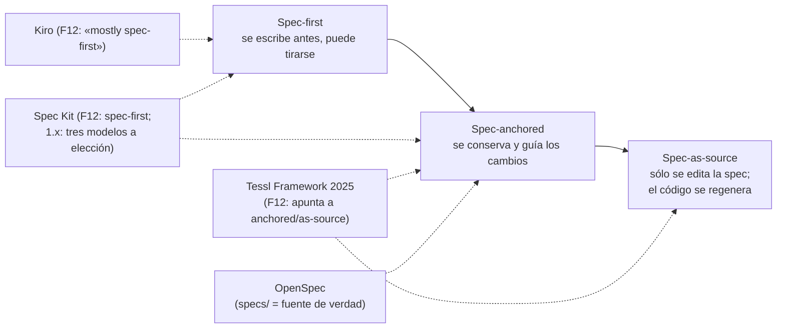
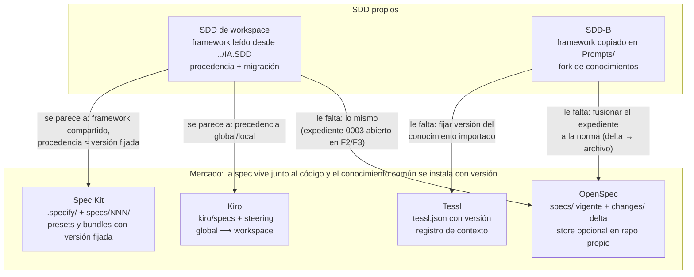

# I06 — Marcos SDD de mercado frente a los dos SDD propios

| Campo | Valor |
|---|---|
| Id | I06 |
| Autor (rol) | Investigador de industria, despacho I06 (subagente de la mesa) |
| Fecha | 2026-10-26 |
| Tool-prompt | `/LAB/Lab-Documentos/Lab-Documentos.Documentacion/PROMPTs/DEVs/Enchacement/01-Replanteo-Y-Analisis/Replanteo-Y-Analisis.md` (en adelante `TP`) |
| Insumos internos | R03 (SDD de workspace usado por Lab-Documentos), R04 (SDD-B), R06 (Geometría), C00 |
| Fuentes externas | 17 fuentes primarias o de autor identificado, 2025-2026, listadas en §12 (todas consultadas el 2026-10-26) |
| Modo | Lectura. Única escritura: este archivo y el folio 0060 del expediente 0002. Intermedios en `{dir-de-trabajo}/I06/` (borrados al cerrar, ver §13) |

---

## Índice

1. [Propósito y alcance](#1-propósito-y-alcance)
2. [Definiciones](#2-definiciones)
3. [Marco de lectura: tres niveles de SDD y seis preguntas](#3-marco-de-lectura-tres-niveles-de-sdd-y-seis-preguntas)
4. [GitHub Spec Kit](#4-github-spec-kit)
5. [AWS Kiro](#5-aws-kiro)
6. [Tessl](#6-tessl)
7. [OpenSpec](#7-openspec)
8. [BMad Method](#8-bmad-method)
9. [Piezas transversales: AGENTS.md y las críticas de la industria](#9-piezas-transversales-agentsmd-y-las-críticas-de-la-industria)
10. [Comparación con los dos SDD propios](#10-comparación-con-los-dos-sdd-propios)
11. [Qué conviene adoptar y qué no](#11-qué-conviene-adoptar-y-qué-no)
12. [Registro de fuentes](#12-registro-de-fuentes)
13. [Limitaciones, lo no verificado y huella de ensayos](#13-limitaciones-lo-no-verificado-y-huella-de-ensayos)
14. [Excepciones a conocimientos](#14-excepciones-a-conocimientos)

---

## 1. Propósito y alcance

La crítica de completitud detectó que la fase 1 relevó sólo los SDD propios y ninguno de mercado: «Marcos *spec-driven development* de mercado (GitHub Spec Kit, Kiro, Tessl): 0 coincidencias» (`C00-Critica-De-Completitud.md:173`), y pidió un despacho nuevo (`C00…:218`). Esta bitácora cubre ese hueco.

Para cada marco se responde lo mismo:

1. Qué artefactos produce (especificación, plan, tareas, constitución o *steering*).
2. Dónde viven (repo de código, carpeta).
3. Cómo versiona la especificación frente al código.
4. Cómo trata la documentación de usuario y la técnica.
5. Cómo orquesta agentes.
6. Qué conocimiento comparte entre proyectos.

Después se compara contra los dos SDD propios y se cierra con lo que conviene adoptar y lo que no. Es **insumo**: la mesa decide.

Convenciones de evidencia:

- **Externo**: URL + título + fecha de consulta (§12). Donde el texto se descargó en crudo, la cita lleva `archivo:línea` del crudo y la huella SHA-256 (prefijo de 16) en §12.
- **Interno**: `ruta:línea` desde la raíz del workspace. El SDD-B se cita con los alias de R04 (`<SDD-B>`, `<SDD-B.Doc>`).
- **[Criterio propio]**: interpretación del investigador, no evidencia.

## 2. Definiciones

| Término | Definición usada aquí | Fuente |
|---|---|---|
| SDD (*spec-driven development*) | Flujo de trabajo con agentes de IA en el que un artefacto de especificación en lenguaje natural, estructurado y orientado a comportamiento, precede y guía la generación de código | Böckeler 2025 (F12); GitHub blog 2025 (F02) |
| *Spec-first* | La especificación se escribe antes de codificar y puede descartarse después | F12; Spec Kit `docs/concepts/spec-persistence.md:51` |
| *Spec-anchored* | La especificación se conserva después de implementar y se usa para cambios futuros | F12; `spec-persistence.md:52-53` |
| *Spec-as-source* | La especificación es la única fuente editada por humanos; el código se regenera | F12; `spec-persistence.md:54-55` |
| Constitución / *steering* / reglas | Contexto persistente de proyecto (principios, stack, estructura) que se carga en cada interacción; Böckeler lo llama «memory bank» y lo distingue de la especificación | F12; F06 |
| Especificación delta | Documento que describe sólo lo que cambia (agregado, modificado, quitado) respecto de la especificación vigente | OpenSpec `docs/concepts.md:348-408` (F13) |
| Modelo de persistencia | Regla del equipo sobre qué se hace con spec/plan/tareas **después** de entregar (flow-back, flow-forward, living spec) | Spec Kit `spec-persistence.md:3-8` (F03) |
| SDD de workspace | El marco IA.SDD (`/IA/SDD/IA.SDD/`) más los conocimientos de `KB-privada/` y el marco de mesa; Lab-Documentos y Geometría lo consumen desde afuera (R03:141-156, decisión 5 de la presidencia) | R03, R06 |
| SDD-B | El SDD del servicio de notificaciones push (privado), con framework propio en `<SDD-B>/Prompts/` | R04 |

## 3. Marco de lectura: tres niveles de SDD y seis preguntas

Böckeler (Thoughtworks), en el artículo que la propia documentación de Spec Kit cita como referencia (`spec-persistence.md:46-55`), clasifica las herramientas por **cuánto vive la especificación**:

**[Criterio propio]** Para el problema del `TP` (desfase doc↔código, `TP:20`), el nivel importa más que la herramienta: sólo los niveles *anchored* y *as-source* obligan a mantener la especificación viva, que es exactamente lo que falla en los SDD propios (R04 §8.1; R06 §4).

## 4. GitHub Spec Kit

**Identidad.** Kit de código abierto de GitHub, licencia MIT (`spec-kit/README.md:264`). Anunciado el 2025-09-02 (F02). Versión 1.0.0 del 2026-08-21 (`spec-kit/CHANGELOG.md:530`); última, v1.2.3 del 2026-10-22 (API de releases, F01).

### 4.1 Artefactos

| Artefacto | Qué es | Evidencia |
|---|---|---|
| Constitución | «a set of immutable principles that govern how specifications become code» en `memory/constitution.md`; plantilla de nueve artículos, IV-VI definidos por cada proyecto | `spec-driven.md:276`, `:280`, `:321-325` |
| `spec.md` | Qué y por qué | `spec-driven.md:127-128` |
| `plan.md` + `research.md`, `data-model.md`, `contracts/`, `quickstart.md` | Plan técnico y documentos de soporte | `spec-driven.md:138-142` |
| `tasks.md` | Tareas derivadas del plan | `spec-driven.md:143` |
| Informes de *converge*, *analyze*, *checklist* | Evaluación de la implementación contra spec/plan/tareas | `README.md:113-122`; `spec-persistence.md:16-20` |
| Extensiones de bug y de evaluación de ideas | `.specify/bugs/<slug>/`, `.specify/assessments/<slug>/` | `README.md:153`, `:187` |

Flujo mínimo: «Create a constitution once per project and repeat the remaining steps for each feature» (`README.md:105-106`), con `/speckit-constitution → specify → plan → tasks → implement → converge` (`README.md:113-118`).

### 4.2 Dónde viven

- En el **repo de código**: `.specify/` (constitución, plantillas, scripts) y `specs/<NNN-rama>/` por funcionalidad (`spec-driven.md:84`, `:127-143`).
- **Una rama por funcionalidad**: «Generates a semantic branch name from your description and creates it automatically» (`spec-driven.md:82`).
- **Monorepo**: el proyecto es el directorio que contiene `.specify/`; cada miembro tiene su constitución, su `specs/` y su numeración (`guides/monorepo.md:3-6`).
- **Repos separados**: «projects in separate repositories can consume a versioned artifact or synchronized copy» de un contrato con «one authoritative owner per contract» (`monorepo.md:12-16`).

### 4.3 Versionado de la spec frente al código

- La spec viaja en el mismo commit y la misma rama que el código (`spec-driven.md:152`: «All documents properly versioned in a feature branch»).
- **Spec Kit no impone qué pasa después de entregar.** «Spec Kit intentionally leaves teams in control of what happens to `spec.md`, `plan.md`, and `tasks.md` after a feature is delivered» (`spec-persistence.md:3-5`). Nombra tres modelos, «None is the default» (`:8`):

| Modelo | Regla posterior a la entrega | Riesgo declarado | Línea |
|---|---|---|---|
| Flow-back | Los hallazgos se reflejan en cualquier artefacto y se reconcilian | «silent divergence» | `:61-89` |
| Flow-forward | Lo entregado es inmutable; un cambio abre un directorio nuevo | duplicación de contexto | `:91-108` |
| Living spec | `spec.md` es el contrato; plan y tareas se regeneran | pérdida de fundamento | `:110-128` |

- No hay reconciliación automática: «The core workflow has no dedicated command that automatically reconciles differences» (`:22-23`). *Converge* sólo agrega tareas pendientes (`:16-20`).
- Recomendación explícita: elegir el modelo y «document the convention in your project constitution» (`:149-151`).
- Dos lazos de mantenimiento separados: actualizar los archivos de Spec Kit (comandos, plantillas) y evolucionar los artefactos de `specs/` (`guides/evolving-specs.md:7-12`).

### 4.4 Documentación de usuario y técnica

- Técnica: plan, modelo de datos y contratos API son subproducto (`spec-driven.md:93`). Promete «Living Documentation: Specifications stay in sync with code because they generate it» (`spec-driven.md:160`).
- **De usuario: no hay proceso.** Ningún comando ni plantilla produce documentación para el usuario final (inventario de `templates/`, árbol del repo, F01). El anuncio aclara que el énfasis «isn't because documentation became more important» (F02).

### 4.5 Orquestación de agentes

- No orquesta agentes propios: **integra** el agente que el equipo ya usa. Hay páginas de integración para unas 50 herramientas (Copilot, Claude, Codex, Cursor, Gemini, Kiro CLI, etc.) en `docs/integrations/` (árbol del repo, F01).
- Cada fase es un comando que el humano corre y revisa: «one at a time, reviewing each result before continuing» (`README.md:106-107`). Hay *workflows* para encadenar comandos, compuertas y tareas de shell (`README.md:52`).

### 4.6 Conocimiento compartido entre proyectos

- **Presets** para «Enforce organizational or regulatory standards», apilables por prioridad (`README.md:49-50`; `reference/presets.md:3`).
- **Bundles**: «a single, versioned, installable unit» que fija versiones de componentes y verifica SHA-256 (`reference/bundles.md:3-5`, `:129`).
- **Catálogos privados** de componentes aprobados (`README.md:57`).

**[Criterio propio]** Spec Kit separa con nitidez lo que comparte la organización (presets, bundles, catálogos con versión fijada) de lo que es de cada proyecto (constitución y `specs/`). Es la separación que hoy falla en los SDD propios: R03 §7.3 midió tres versiones del mismo conocimiento de mesa (3.1, 1.2, 1.15).

## 5. AWS Kiro

**Identidad.** IDE y CLI de agentes de AWS, presentado el 2025-07-14 (F04). Producto propietario.

### 5.1 Artefactos

| Artefacto | Qué es | Evidencia |
|---|---|---|
| `requirements.md` (o `bugfix.md`) | Requisitos en notación EARS: «WHEN [condition/event] THE SYSTEM SHALL [expected behavior]» | F05 (Feature Specs) |
| `design.md` | Diseño técnico | F05 |
| `tasks.md` | Tareas; se ejecutan de a una o en «parallel waves» | F05 (Specs) |
| *Steering*: `product.md`, `tech.md`, `structure.md` | «persistent knowledge about your project», incluidos en cada interacción | F06 |
| *Hooks*: `.kiro/hooks/<id>.json` | Comando de shell o prompt que se dispara ante un evento | F07 |

Hay dos órdenes de trabajo: «Requirements-First» y «Design-First» (F05).

### 5.2 Dónde viven

- `.kiro/specs/<funcionalidad>/` en el repo, una carpeta por funcionalidad. Recomienda varias especificaciones antes que una sola para todo el código (F08).
- «Store specs directly in your project repository alongside the code they describe» (F08).
- Entre equipos: «a central specs repository» compartido «by leveraging Git submodules or package references» (F08).
- *Steering* de workspace en `.kiro/steering/` y global en `~/.kiro/steering/`. Ante conflicto, «Kiro will prioritize the workspace steering instructions» (F06).

### 5.3 Versionado de la spec frente al código

- Mismo repo y mismo control de versiones que el código (F08: «Specs are designed to be version-controlled»).
- Sincronización asistida, no mecánica: al cambiar requisitos se pide a Kiro actualizar `design.md` y se usa **Sync Files** sobre `tasks.md` (F08). El anuncio afirma «Kiro's specs stay synced with your evolving codebase» (F04).
- Böckeler lo clasifica como «mostly spec-first» (F12).

### 5.4 Documentación de usuario y técnica

- El anuncio da como ejemplo de *hook* actualizar el README cuando cambian los endpoints de la API, y nombra el problema: «documentation mismatches that complicate future maintenance» (F04).
- La página de *hooks* lista «auto-create tests, docs, or translations when new source files appear» (F07).
- No hay un proceso de documentación de usuario final: los *hooks* son el mecanismo genérico.

### 5.5 Orquestación de agentes

- Un agente principal en el IDE o CLI. Tareas en olas paralelas (F05).
- *Custom agents*: el *steering* no se incluye solo, hay que declararlo en sus `resources` (F06).
- Lee `AGENTS.md`: «AGENTS.md files do not support inclusion modes and are always included» (F06).

### 5.6 Conocimiento compartido entre proyectos

- *Steering* global por máquina.
- Para equipos: distribución por MDM o directivas de grupo, o descarga al directorio global (F06).
- Configuración sincronizada en la nube para sesiones web (F06).

**[Criterio propio]** El reparto global/workspace con precedencia del workspace es un patrón directo para el par KB-privada / proyecto. La distribución por MDM no sirve para un equipo de una persona con agentes (R03 §6).

## 6. Tessl

**Identidad.** Empresa con producto en dos etapas, y las fuentes primarias muestran el cambio:

- **2025 (lanzamiento, 2025-09-23):** un *Framework* en beta cerrada y un *Spec Registry* en beta abierta con «over 10,000» especificaciones de uso de librerías (F09). En el Framework, las especificaciones «live in the codebase as long-term memory». Las etiquetas `@generate` (generar código desde la spec) y `@describe` (la spec documenta código existente) marcan el modo (F09).
- **2026 (documentación vigente):** «an open platform for managing agentic development across your organization» centrada en *skills*, *rules* y *plugins* versionados («Context as software»): «Skills, rules, and docs are versioned, reviewed, and rolled out with the same rigor as code dependencies» (F10, F11).

### 6.1 Artefactos

| Etapa | Artefacto | Evidencia |
|---|---|---|
| 2025 | Spec por componente: descripción, capacidades enlazadas a tests, API pública. Böckeler observó una spec por archivo de código y el encabezado «GENERATED FROM SPEC - DO NOT EDIT» | F09, F12 |
| 2025 | *Usage specs*: cómo usar una librería o reglas internas de la organización | F09 |
| 2026 | *Rules* (siempre cargadas) y *skills* (por relevancia) | `core-concepts.md` (F11) |
| 2026 | *Plugin*: paquete versionado de skills, rules, servidores MCP y hooks; `.tessl-plugin/plugin.json` con `version` SemVer obligatoria | F11; `reference/configuration.md:9`, `:73` |
| 2026 | `tessl.json`: manifiesto de dependencias del repo con versión fijada, más bloques `verify` y `schedules` | `configuration.md:246-261`, `:263-302` |

### 6.2 Dónde viven

- Contexto del repo como archivos planos del repo (F10).
- Dos vías de distribución (`distribute/repository-plugins.md`, F11):
  - **En el repo** cuando «Context is tightly coupled to this specific codebase» y no hace falta versionado entre proyectos (`file:` en `tessl.json`).
  - **En el registro** cuando se necesita «automated distribution across multiple repositories» o mantener plugins «up to date independently from code changes».

### 6.3 Versionado de la spec frente al código

- 2025: *spec-anchored* con exploración de *spec-as-source*. Böckeler midió no determinismo al regenerar desde la misma spec (F12).
- 2026: el contexto se versiona como dependencia (SemVer, instalación, retroceso). Los *verifiers* chequean en CI invariantes del repo, en modo «advisory or blocking» (`configuration.md:297-302`).

### 6.4 Documentación

- Automatización «Keep docs in sync»: una tarea programada diaria corre `tessl/docs-audit`, que «reads the code and the docs, finds where they disagree, and opens a PR that reconciles them» (`use-case-docs-audit.md`, F11).
- Hay automatizaciones gemelas de changelog semanal y de chequeo de preparación de release (índice `llms.txt`, F11).

### 6.5 Orquestación de agentes

- No orquesta un pipeline de fases. Distribuye contexto a los agentes que ya usa el equipo, ofrece un agente propio para tareas recurrentes y mide la calidad del contexto:
  - «a review tells you whether a skill is well written; an eval tells you whether it works» (`core-concepts.md`, F11).

### 6.6 Conocimiento compartido entre proyectos

**Es su razón de ser.** Organización → workspaces → plugins versionados en un registro privado o público, con políticas de instalación y escaneo de seguridad (F11, `core-concepts.md`).

**[Criterio propio]** Tessl 2026 es el contraejemplo más claro del fork divergente de conocimientos que R04 §7.3 midió en el SDD-B: copia local 1.x frente a KB-privada 2.x/3.x, «sin mecanismo de sincronización». Tessl resuelve eso con un manifiesto (`tessl.json`) que **fija versión** y una regla explícita de cuándo el contexto vive en el repo y cuándo en el registro.

## 7. OpenSpec

**Identidad.** Proyecto de código abierto (Fission-AI). v1.15.0 del 2026-10-24; unas 73 000 estrellas en GitHub (API, F13). Se declara «built for brownfield not just greenfield» (`README.md:32`).

### 7.1 Artefactos y lugar

- `openspec/specs/`: «Specs are the source of truth — they describe how your system currently behaves» (`docs/concepts.md:46`).
- `openspec/changes/<id>/` con `proposal.md`, `design.md`, `tasks.md` y `specs/` **delta** (`README.md:54-58`; `concepts.md:189-201`).
- **Archivo**: «merging its delta specs into the main specs and preserving the change for history» en `changes/archive/<fecha>-<id>/` (`concepts.md:507`; `README.md:69-70`).
- Secciones delta `ADDED` / `MODIFIED` / `REMOVED`, cada una con su efecto al archivar (`concepts.md:391-397`).

### 7.2 Versionado y topología

- Por defecto en el repo de código («an `openspec/` folder next to the code it plans»).
- **Stores (beta)**: la misma carpeta en un repositorio propio, compartido por varios repos de código. Sirve para «Frontend and backend in separate repos» y para «One product, several client repos» (F14, «Stores»).
- En el store, especificaciones y cambios llevan ramas y PR como el código (F14).
- El README lo justifica: «One source of truth your whole team and every coding agent can read, across every repo… No drifting wiki» (`README.md:110-114`).

### 7.3 Documentación, agentes y conocimiento

- No trata la documentación de usuario.
- Funciona sobre los agentes existentes mediante comandos `/opsx:*` (`README.md:150`).
- Se compara a sí mismo con Spec Kit («heavyweight… lots of Markdown») y con Kiro («locked into their IDE») (`README.md:189-191`). **[Criterio propio]** Es autodeclaración de un competidor: indica posicionamiento, no es evidencia neutral.

**[Criterio propio]** OpenSpec es el único marco relevado que **modela explícitamente la especificación vigente separada del cambio en curso** y la fusión al cerrar. Es la pieza que falta en el «expediente que reintegra a la norma» del SDD-B (R04 §9.4) y en el expediente 0003 de IA.SDD (§10.3).

## 8. BMad Method

**Identidad.** Proyecto de código abierto, licencia MIT; v6.12.4 estable del 2026-10-14 y v7 en alfa (`BMAD-METHOD/README.md:18`; API de releases, F15).

| Pregunta | Respuesta con evidencia |
|---|---|
| Artefactos | Por *skill*: `brief-<slug>.md`, `prd-<slug>.md`, `architecture-<slug>.md`, `DESIGN.md`/`EXPERIENCE.md`/`ux-<slug>.md`, requisitos y `tickets.toml` del PO (F16, «Choose a Planning Path»). Cuatro caminos según tamaño: trivial, una sesión, épica, proyecto (F16) |
| Dónde viven | En carpetas `<tipo>-<slug>/` de la iniciativa activa o, sin iniciativa, en `_bmad-output` (F16) |
| Spec vs código | El PRD de arranque se **archiva** «out of reach of an ordinary change». En las épicas, `bmad-retrospective` conserva los planes como «live status and evidence» (F17) |
| Documentación | `bmad-project-context` escribe un bloque verificado en el `AGENTS.md` del repo. `bmad-document-project` está deprecado (F17). No trata la documentación de usuario |
| Agentes | Perspectivas especializadas (producto, arquitectura, UX, desarrollo, pruebas) y «multiple-agent discussions without handing over judgment» (`README.md:80-81`); persona de PO «Sofia» (F16) |
| Conocimiento compartido | Módulos instalables (Builder, Test Architect, Loop, etc.) por npm, *skills* CLI o *marketplaces* de plugins (`README.md:24-55`, `:90-97`) |

**[Criterio propio]** BMad es el más parecido a los SDD propios por los **roles especializados y la discusión multiagente**, que en la casa son la mesa de expertos. Su lección más útil: **dimensionar el proceso al tamaño del cambio** (cuatro caminos) en lugar de un pipeline único. Es lo que el SDD-B no hizo: sus compuertas no corren desde el 2026-08-29 y todo entra por expediente (R04 §5.3).

## 9. Piezas transversales: AGENTS.md y las críticas de la industria

### 9.1 AGENTS.md

- «A simple, open format for guiding coding agents», «a README for agents».
- En monorepos, «The closest AGENTS.md to the edited file wins».
- Custodia: Agentic AI Foundation de la Linux Foundation. Se declara usado por «over 60k open-source projects» (F18).
- Kiro lo lee siempre (F06). BMad escribe en él (F17).
- **IA.SDD ya lo adopta**: lo emite en la raíz del destino, derivado de `Contrato-Agentes.md` (`/IA/SDD/IA.SDD/SDD/Devs/Rules/Rules-Documentacion.md:287-294`). Geometría lo tiene (R06 §3).
- R03 §4.2 no encontró ninguno en Lab-Documentos.

### 9.2 Críticas con fuente

| Crítica | Fuente |
|---|---|
| Un solo flujo con opinión fuerte es excesivo para cambios chicos («four user stories with 16 acceptance criteria» para un bug menor en Kiro) | Böckeler, F12 |
| Muchos Markdown repetitivos y costosos de revisar; «I'd rather review code» | F12 |
| Falsa sensación de control: los agentes ignoran instrucciones | F12 |
| Paralelo con *model-driven development*: inflexibilidad más no determinismo | F12 |
| «the workflows remain elaborate and opinionated»; «lengthy spec files that are hard to review»; el riesgo de «relearning a bitter lesson» | Thoughtworks Technology Radar, técnica en **Assess**, 2025-11-05 (F19) |

**[Criterio propio]** Las críticas coinciden con lo medido en casa: el SDD-B tiene 26 agentes y 4 compuertas que no se ejercen (R04 §5.3), y el marco de workspace produce bitácoras y folios muy voluminosos (R01 tiene 54 KB). Lo adoptable es la **proporcionalidad**, no más ceremonia.

## 10. Comparación con los dos SDD propios

### 10.1 Matriz por pregunta

| Pregunta | Spec Kit | Kiro | Tessl (2026) | OpenSpec | BMad | **SDD de workspace (IA.SDD; lo consumen Lab-Documentos y Geometría)** | **SDD-B (privado)** |
|---|---|---|---|---|---|---|---|
| Artefactos | Constitución + spec/plan/tasks por funcionalidad | Steering + requirements/design/tasks | Rules, skills, plugins | specs vigentes + changes con delta | Brief, PRD, arquitectura, UX, tickets | Intake → manifiesto → `SDD/Docs/` por categorías 01-11 con cadena D6 (Visión → NB → CU → RN → ADR → US → BT → Sprint → Test → Pipeline) (`Master-Prompt.md:49`); expedientes | `docs/` 01-11 + `Context/` (acta) + 42 expedientes (R04 §3.1) |
| Dónde viven | Repo de código (`.specify/`, `specs/`) | Repo (`.kiro/`) | Repo (`tessl.json`, plugins `file:`) o registro | Repo (`openspec/`) o store en repo propio | Repo (`_bmad-output`, `AGENTS.md`) | Destino: `SDD/Intake/`, `SDD/Docs/`; el framework **no se copia**, se lee desde `../IA.SDD/` (`Master-Prompt.md:19`, `:23`) | Repo de código (`docs/`, `Prompts/`) + repo de documentación (pedidos, ia-db) (R04 §3) |
| Spec ↔ código | Misma rama; modelo de persistencia elegido por el equipo | Misma rama; Sync Files asistido | Contexto como dependencia SemVer; verifiers en CI | Delta → archivo → fusión en specs | PRD archivado; retros como estado vivo | Versión por documento + `_legacy/`; **procedencia** del destino frente al framework y reconciliación normativa (`Master-Prompt.md:94-161`); Geometría en 13.16 con el framework en 13.22 (R06 §4) | Docs sin número de producto; desfase medido (R04 §4.1, §8.1) |
| Doc. de usuario | No | Hooks genéricos | Auditoría de docs programada | No | No | **Excluida por norma** (`Rules-Documentacion.md:102`, `:723`, `:801`, `:1003`) | No relevada como proceso (R04) |
| Doc. técnica | Plan, modelo de datos, contratos | design.md, hooks de README | docs-audit | design.md | Arquitectura; AGENTS.md | Categoría 11 en tres momentos y AG-00110 (R06 §10); `AGENTS.md` derivado | `docs/` normativa; ia-db derivada anclada a commit (R04 §4.1) |
| Orquestación | Integra el agente del equipo; comandos por fase con revisión humana | Agente del IDE; tareas en olas | Distribuye contexto; agente propio para tareas | Comandos sobre agentes existentes | Roles especializados y discusión multiagente | Orquestador maestro + reanudación + migración (`/IA/SDD/IA.SDD/SDD/Devs/Orchestrator/`); mesa a pedido | 3 orquestadores de fase + 4 compuertas + bibliotecario; **no se usan** desde 2026-08-29; lo vivo es la mesa (R04 §5) |
| Conocimiento compartido | Presets, bundles con versión fijada, catálogos privados | Steering global con precedencia del workspace | Registro, `tessl.json` con versión, evals | Stores (beta) | Módulos instalables | `Conocimiento/` con versión = la del framework (`/IA/SDD/IA.SDD/Conocimiento/Index-Knowledge.md:46-50`) + KB-privada aparte | Copia propia de 18 conocimientos, fork divergente (R04 §7.3) |

### 10.2 Diagrama de posiciones

### 10.3 Lo que los SDD propios ya hacen mejor que el mercado

- **Procedencia y migración normativa.** IA.SDD declara con qué versión del framework se generó cada destino y ofrece tres salidas ante un desfase: plan de migración, regenerar o seguir en la versión de origen leída desde `_legacy/` (`/IA/SDD/IA.SDD/SDD/Devs/Orchestrator/Master-Prompt.md:94-161`). Spec Kit separa «project-file updates» de la evolución de `specs/` (`evolving-specs.md:7-12`), pero no relevé una reconciliación normativa equivalente.
- **Evidencia verificable como regla (D9)** y sensado de deriva (`/IA/SDD/IA.SDD/SDD/Devs/Rules/Deriva-Rules.md:21-23`). El mercado la delega en tests o en verifiers (Tessl) o en *converge* (Spec Kit).
- **Expediente con folios inmutables y mesa con refutador** (R01 §12). Ningún marco relevado registra la deliberación con ese nivel. **[Criterio propio]** Es también la fuente del volumen que critican F12 y F19.

### 10.4 Donde el mercado está por delante

| Brecha | Mercado | Casa | Evidencia interna |
|---|---|---|---|
| Regla explícita de qué pasa con la spec después de entregar | Spec Kit: tres modelos, se declaran en la constitución | No declarada en el SDD-B; IA.SDD la está escribiendo (expediente 0003, «retroalimentación de la especificación ante cambios», tramo F1 aplicado en 13.20 y F2/F3 pendientes) | `/IA/SDD/IA.SDD/Expedientes/0003-…/README.md:8`, `:39`; pase de `020-constancia-…` |
| Cambio en curso separado de la norma vigente, con fusión al cerrar | OpenSpec delta → archivo | Expedientes que no reintegran: 5 cartas, ninguna desde 2026-09-16 | R04 §6, §9.4 |
| Conocimiento común con versión fijada por proyecto | Tessl `tessl.json`; Spec Kit bundles | SDD-B: copia 1.x frente a IKB 2.x/3.x; conocimiento de mesa en tres versiones | R04 §7.3; R03 §7.3 |
| Proceso proporcional al tamaño | BMad cuatro caminos; Spec Kit puntos de entrada independientes (`README.md:34-36`) | Pipeline del SDD-B sin uso real | R04 §5.3 |
| Control automático de deriva doc↔código | Tessl docs-audit programado que abre PR; hooks de Kiro | Ningún chequeo de documentación en CI en Geometría ni en Lab-Documentos | R06 §6; R03 §9.1 |
| Documentación de usuario | Tampoco la resuelve ningún marco | Excluida por norma en IA.SDD | `Rules-Documentacion.md:102` |

**Hallazgo I06-H1.** Ningún marco SDD de mercado relevado tiene un proceso para **documentación de usuario final**. Todos producen artefactos de ingeniería (spec, plan, tareas, contexto para agentes). **[Criterio propio]** El «sistema documentador» del `TP` (decisión 2 de la presidencia) no puede copiar ese hueco de un marco de mercado: debe tomarlo de las normas de información para usuarios (I04 §4.1) y de Diátaxis (I04 §5.1), y declarar el apartamiento de `Rules-Documentacion.md:102`, como ya anticipó R06 §10.

## 11. Qué conviene adoptar y qué no

Todo lo que sigue es **[Criterio propio]** fundado en la evidencia de §4-§10. La mesa decide.

### 11.1 Adoptar (como práctica, no como herramienta)

| # | Qué | De dónde | Por qué | Dónde caería |
|---|---|---|---|---|
| A1 | **Declarar un modelo de persistencia de la spec por proyecto** (flow-back, flow-forward o living), escrito en el equivalente de la constitución | Spec Kit `spec-persistence.md:130-151` | Cierra la pregunta «qué es la fuente de verdad después de entregar» que hoy no tiene respuesta en el SDD-B (R04 §8.1) y que el expediente 0003 de IA.SDD está resolviendo | Conocimiento de KB-privada o regla de IA.SDD; `AGENTS.md`/manifiesto del destino |
| A2 | **Separar la norma vigente del cambio en curso y fusionar al cerrar** (delta `AGREGADO`/`MODIFICADO`/`QUITADO` y archivo) | OpenSpec `concepts.md:46-50`, `:391-397`, `:505-535` | Da forma mecánica a la «cuarta vía» que no se ejerce (R04 §9.4): un expediente cierra sólo cuando su delta se fusionó en `docs/` | Folio `resolucion` con sección delta; compuerta de cierre del expediente |
| A3 | **Fijar versión del conocimiento compartido por proyecto** (manifiesto con alias + versión; copia local sólo con excepción declarada) | Tessl `tessl.json` (`configuration.md:246-261`); Spec Kit bundles (`bundles.md:3-5`) | Elimina el fork divergente (R04 §7.3; R03 §7.3) sin obligar a un registro | Manifiesto del destino (IA.SDD ya cita alias, `Index-Knowledge.md:46-50`; falta la versión cuando el conocimiento viene de KB-privada) |
| A4 | **Precedencia explícita global → proyecto** para reglas y conocimientos | Kiro *steering* (F06); AGENTS.md «closest wins» (F18) | Hace explícito lo que hoy se infiere: workspace (KB-privada, IA.SDD) por defecto, proyecto gana con excepción declarada | Ya existe como «apartamiento» (`Root-Rules.md` §11, R06 §10); falta escribirlo como regla de precedencia |
| A5 | **Auditoría de deriva doc↔código automatizada que abre PR** (no que bloquea) | Tessl docs-audit (F11); Kiro hooks (F04, F07) | Es el control que falta en ambos CI (R06 §6; R03 §9.1); encaja en el workflow pedido con `runs-on: [self-hosted, i7infra-dev]` | Paso del workflow del escalón 1 (demo MovilidadUrbana.MAUI): chequeos deterministas bloqueantes (enlaces, frontmatter, trazas) más un informe asesor de deriva |
| A6 | **Proceso proporcional**: caminos por tamaño del cambio, con «trivial» sin expediente | BMad (F16); Spec Kit `README.md:34-36` | Responde a F12 y F19 y a la falta de uso del pipeline completo del SDD-B (R04 §5.3) | Regla de entrada del orquestador o de la mesa (umbral para abrir expediente) |
| A7 | **`AGENTS.md` como contrato de contexto en todo repo**, incluido Lab-Documentos | F18; IA.SDD ya lo exige (`Rules-Documentacion.md:287-294`) | Es el único formato transversal a todas las herramientas relevadas; Lab-Documentos no lo tiene (R03 §4.2) | Escalón 1 y piloto Geometría |
| A8 | **Topología «store» como opción**, no como regla: un repo de planificación compartido sólo cuando un cambio abarca varios repos de código | OpenSpec Stores (F14); Kiro repo central con submódulos (F08) | Da nombre y criterio de uso al repo `.Documentacion` que ya existe (R03 §3; R04 §3.2) | Insumo para N02 (topología): «junto al código por defecto; repo propio sólo para lo que abarca varios repos o no se despliega» |

### 11.2 No adoptar

| # | Qué | Por qué no |
|---|---|---|
| N1 | **Adoptar una herramienta de mercado como marco** (instalar Spec Kit, Kiro o Tessl en lugar de IA.SDD) | Ninguna cubre documentación de usuario (I06-H1). Kiro y Tessl son propietarios: Kiro exige su IDE o CLI (F04; `OpenSpec/README.md:191`) y Tessl, una cuenta y un registro (F11). Se perdería lo que los SDD propios hacen mejor (§10.3). Además, `Rules-Documentacion.md:1003` prohíbe introducir productos comerciales en los nombres de archivo, y la casa trabaja con agentes propios, no con un IDE comercial |
| N2 | ***Spec-as-source*** (regenerar código desde la spec) | Böckeler midió no determinismo aun con specs a nivel archivo y advierte el paralelo con MDD (F12). Contradice la evidencia verificable D9: el código desplegado es la verdad medible (R06 §8) |
| N3 | **Una rama de especificación por funcionalidad que muere con el PR** como único registro (spec-first puro) | Es lo que F12 critica de Spec Kit. Los SDD propios necesitan especificación viva (A1) y expediente con historia |
| N4 | **Distribución por MDM o registro en la nube** para el conocimiento | Desproporcionado para un mantenedor único con agentes (R03 §6). Un manifiesto con versión fija en git (A3) da el mismo efecto |
| N5 | **Plantilla de nueve artículos de la constitución de Spec Kit** tal cual | Los artículos I-II (biblioteca primero, CLI obligatoria) (`spec-driven.md:282-306`) son una arquitectura opinada que no corresponde a apps MAUI/Blazor. Se toma la idea de constitución con principios propios, no su contenido |
| N6 | **EARS obligatorio** para requisitos documentales | Útil para requisitos funcionales (F05), pero el SDD de workspace ya tiene su cadena NB → CU → RN. Imponer otra notación duplicaría vocabulario (`Vocabulario-Rules.md`). Puede citarse como opción en la guía |

### 11.3 Efecto en las decisiones de la presidencia

| Decisión | Aporte de I06 |
|---|---|
| (1) Alcance escalonado | A5 y A7 entran en el escalón 1 (workflow y `AGENTS.md`); A1-A2 son materia del piloto Geometría; A3-A4 de la mejora de orquestadores de ambos SDD (escalón 3) |
| (2) Arquitectura del sistema documentador entero | El mercado cubre spec, contexto para agentes, versionado del contexto y CI. **No** cubre audiencias de usuario ni publicación (I06-H1): esas piezas salen de I04/I05 |
| (5) X2 corregido | Confirmado por contraste: en todos los marcos de mercado la «marco SDD» es una herramienta o un paquete externo instalado en el repo, no un índice. Coincide con R03:141-156 |

## 12. Registro de fuentes

Todas consultadas el **2026-10-26**. «Crudo» = descargado con `curl` a `{dir-de-trabajo}/I06/raw/` (borrado al cerrar); la huella es el prefijo de 16 hex del SHA-256.

| Id | Fuente (título, autor/editor, fecha de publicación) | URL | Crudo y huella |
|---|---|---|---|
| F01 | *github/spec-kit* (repositorio, README, `spec-driven.md`, CHANGELOG, árbol `docs/` y `templates/`; releases v1.2.3 2026-10-22, v1.0.0 2026-08-21), GitHub | https://github.com/github/spec-kit | `README.md` 3baa99368443f262 · `spec-driven.md` 1517eba9868e7066 |
| F02 | «Spec-driven development with AI: Get started with a new open source toolkit», Den Delimarsky, GitHub Blog, 2025-09-02 | https://github.blog/ai-and-ml/generative-ai/spec-driven-development-with-ai-get-started-with-a-new-open-source-toolkit/ | — (WebFetch) |
| F03 | «Spec Persistence Models», «Evolving Specs in Existing Projects», «Using Spec Kit in a Monorepo», «Presets», «Bundles», documentación de Spec Kit, 2026 | https://github.com/github/spec-kit/tree/main/docs (`concepts/spec-persistence.md`, `guides/evolving-specs.md`, `guides/monorepo.md`, `reference/presets.md`, `reference/bundles.md`) | `spec-persistence.md` 952515924a04ab9e · `monorepo.md` 011a4638f682d335 |
| F04 | «Introducing Kiro», N. Swaminathan y D. Singh, kiro.dev, 2025-07-14 | https://kiro.dev/blog/introducing-kiro/ | — (WebFetch) |
| F05 | «Specs» y «Feature Specs», documentación de Kiro | https://kiro.dev/docs/specs/ · https://kiro.dev/docs/specs/feature-specs/ | HTML descargado; texto extraído |
| F06 | «Steering», documentación de Kiro | https://kiro.dev/docs/steering/ | HTML descargado; texto extraído |
| F07 | «Hooks», documentación de Kiro | https://kiro.dev/docs/hooks/ | — (WebFetch) |
| F08 | «Best practices» (Specs), documentación de Kiro | https://kiro.dev/docs/specs/best-practices/ | HTML descargado; texto extraído |
| F09 | «Tessl launches spec-driven framework and registry to make AI coding agents reliable», Simon Maple, tessl.io, 2025-09-23 | https://tessl.io/blog/tessl-launches-spec-driven-framework-and-registry | — (WebFetch) |
| F10 | «What is Tessl?», documentación de Tessl | https://docs.tessl.io/ | — (WebFetch) |
| F11 | Documentación de Tessl: `llms.txt`, «Core concepts», «Using plugins directly from your repo», «Configuration files», «Keep docs in sync» | https://docs.tessl.io/llms.txt (y páginas `.md` enlazadas) | `core-concepts.md` 5f572dd29c65c85b · `repository-plugins.md` cda41f2c9076439d · `configuration.md` 9bd08c8a2c636287 · `use-case-docs-audit.md` 8d82bda8d58f2171 |
| F12 | «Understanding Spec-Driven-Development: Kiro, spec-kit, and Tessl», Birgitta Böckeler (Thoughtworks), martinfowler.com, 2025-10-15 | https://martinfowler.com/articles/exploring-gen-ai/sdd-3-tools.html | — (WebFetch) |
| F13 | *Fission-AI/OpenSpec* (README, `docs/concepts.md`; release v1.15.0 2026-10-24) | https://github.com/Fission-AI/OpenSpec | `README.md` a64074d2eebc76e9 · `concepts.md` 40b9b3c9ceb8c86f |
| F14 | «Stores (beta)», documentación de OpenSpec | https://openspec.dev/docs/stores | HTML descargado; texto extraído |
| F15 | *bmad-code-org/BMAD-METHOD* (README; release v6.12.4 2026-10-14) | https://github.com/bmad-code-org/BMAD-METHOD | `README.md` 8a4384a5ea8f44a0 |
| F16 | «Choose a Planning Path», documentación de BMad Method | https://docs.bmad-method.org/plan/choose-a-planning-path/ | — (WebFetch) |
| F17 | «Start in an Existing Codebase», documentación de BMad Method | https://docs.bmad-method.org/existing-codebases/start-in-an-existing-codebase/ | — (WebFetch) |
| F18 | «AGENTS.md», agents.md (Agentic AI Foundation, Linux Foundation) | https://agents.md/ | — (WebFetch) |
| F19 | «Spec-driven development», Thoughtworks Technology Radar, técnica, anillo Assess, 2025-11-05 | https://www.thoughtworks.com/radar/techniques/spec-driven-development | — (WebFetch) |

**Fuentes primarias 2024-2026**: F01-F11 y F13-F18 (17) son de los propios editores o de autor identificado. F12 y F19 son análisis de terceros con autor y fecha.

Fuentes internas leídas: R03, R04, R06, R01 §12, C00:173 y :218; `/IA/SDD/IA.SDD/{CHANGELOG.md:6, SDD/Devs/Orchestrator/Master-Prompt.md, SDD/Devs/Rules/Rules-Documentacion.md, SDD/Devs/Rules/Deriva-Rules.md, Conocimiento/Index-Knowledge.md, Expedientes/0003-…/README.md}`.

## 13. Limitaciones, lo no verificado y huella de ensayos

### 13.1 Lo no verificado

- **Reposicionamiento de Tessl el 2026-01-29** como registro de *skills*: sólo lo afirma una reseña de terceros (codemyspec.com, junio de 2026) que apareció en la búsqueda. **No verificado** en una fuente primaria. Lo que sí está verificado es el estado actual de la documentación de Tessl (F10, F11) frente al anuncio de 2025 (F09).
- **Ruta `.specify/memory/constitution.md` exacta en Spec Kit 1.x**: `spec-driven.md:276` dice `memory/constitution.md`, y la lista del repositorio muestra `.specify/memory`. No se ejecutó `specify init` para confirmarlo.
- **No se ejecutó ninguna herramienta** (Spec Kit, OpenSpec, BMad, Kiro, Tessl). Todo es lectura de documentación. Un ensayo práctico (por ejemplo, `specify init` u `openspec init` sobre una copia de la demo MovilidadUrbana.MAUI en un contenedor `--rm`) queda **propuesto** para la fase de ensayos del escalón 1, no hecho.
- **Kiro: lista completa de disparadores de *hooks*** y ruta de `.kiro/specs/` fuera del ejemplo de F08. La página de *hooks* remite a otra que no se leyó.
- **Cifras de adopción** (estrellas de GitHub, «60k projects» de AGENTS.md): son autodeclaradas o de la API, sin valor de calidad.
- **Tessl Framework de 2025** (beta cerrada): sólo a través de F09 y F12. No se tuvo acceso al producto.
- **Otros marcos no relevados** por falta de tiempo o de fuente primaria localizada en esta corrida: *Amazon Q Developer*, *Cursor rules/plans*, *Claude Code plan mode*, *Agent OS* y similares. Quedan fuera sin juicio.

### 13.2 Huella de ensayos (intermedios)

| Qué | Dónde | Estado |
|---|---|---|
| Descarga de 24 archivos de documentación pública (Markdown, HTML, JSON de la API de GitHub) para citar por línea y calcular huellas | `{dir-de-trabajo}/I06/raw/` | **Borrado** al cerrar (`rm -rf {dir-de-trabajo}/I06`) |
| Contenedores Docker | ninguno | — |

## 14. Excepciones a conocimientos

Las propuestas de §11 que se apartan de un conocimiento o regla catalogada:

| Conocimiento / regla (§) | Qué se propone en su lugar | Impacto operativo |
|---|---|---|
| `/IA/SDD/IA.SDD/SDD/Devs/Rules/Rules-Documentacion.md:102`, `:723`, `:801`, `:1003` (el usuario final no técnico queda fuera de alcance) | Que el sistema documentador incluya la documentación de usuario. El mercado tampoco la cubre (I06-H1), así que la fuente debe ser la normativa de I04/I05 | Requiere apartamiento declarado en el destino o cambio de norma en IA.SDD. Ya identificado en R06 §10. Lo decide la mesa |
| `<SDD-B>/Prompts/Conocimientos/README.md:25-35` (el catálogo se extiende por fork y copia local) (R04 §7.1) | A3: manifiesto con alias + versión fijada de KB-privada; copia local sólo con excepción declarada | Cambia cómo el SDD-B importa conocimiento. Exige una lista de versiones y un chequeo de desalineación en CI. Corresponde al escalón 3 |
| `/IA/SDD/IA.SDD/Conocimiento/Index-Knowledge.md:46-50` (la versión del conocimiento es la del framework) | No se contradice. A3 lo **extiende** a los conocimientos que vienen de KB-privada, que no viajan en el snapshot del framework | Ninguno sobre IA.SDD. Sólo agrega un campo al manifiesto del destino |
| `Knowledge-Mesa-De-Expertos-A-Pedido` 3.1 y `Expediente-Rules` 1.1 (todo cambio de norma por expediente con folios) | A6: un camino «trivial» sin expediente, por umbral | Reduce folios en cambios menores. Requiere fijar el umbral y quién lo aplica. **Propuesta para la mesa, no apartamiento consumado** |
