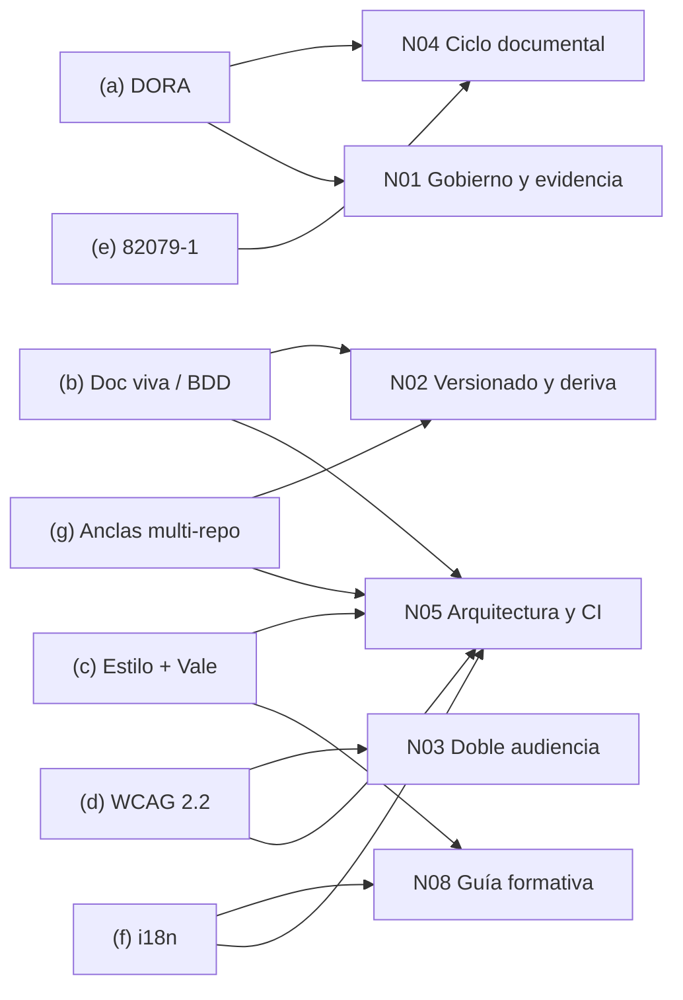
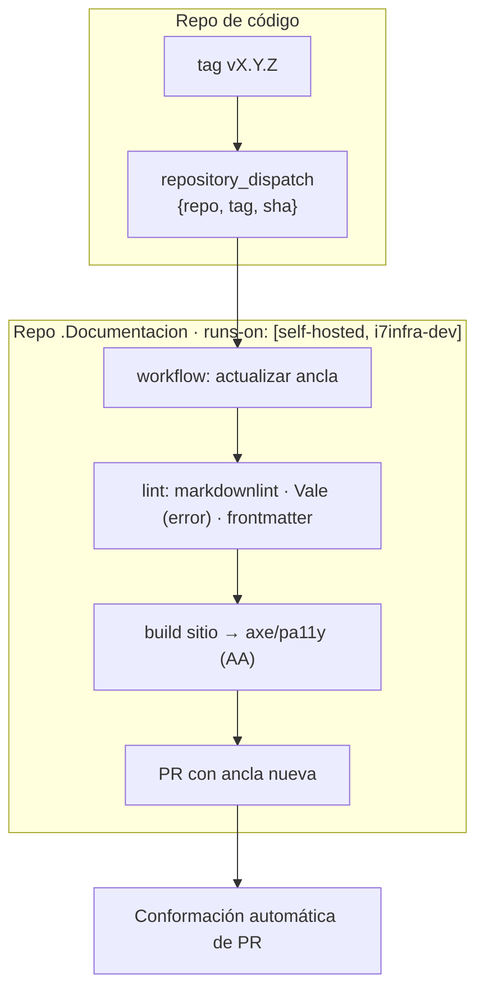

# I07 — Complementos de industria

| Campo | Valor |
|---|---|
| Id | I07 |
| Título | Siete huecos de industria señalados por C00 (H8, P2): DORA, documentación viva/BDD en .NET, guías de estilo y Vale, WCAG 2.2 en sitios de documentación, IEC/IEEE 82079-1:2019, internacionalización de docs y mecanismos multi-repo de anclas de versión |
| Autor (rol) | Investigador de industria (subagente de la mesa del tool-prompt 01-Replanteo-Y-Analisis, despacho I07) |
| Fecha | 2026-10-26 |
| Tool-prompt | `/LAB/Lab-Documentos/Lab-Documentos.Documentacion/PROMPTs/DEVs/Enchacement/01-Replanteo-Y-Analisis/Replanteo-Y-Analisis.md` |
| Fuentes leídas | 38 fuentes externas (34 primarias), detalle en §13; además C00, N02, N05, R03, R05, R06, I01, I02 y cuatro reglas de IA.SDD |
| Modo | Solo lectura sobre los repositorios; escritura sólo en esta bitácora y en el folio `actuaciones/0070-informe-complementos-de-industria.md`. Intermedios en `{dir-de-trabajo}/I07/`, borrados al terminar (§15) |

---

## Índice

1. [Propósito y alcance](#1-propósito-y-alcance)
2. [Definiciones](#2-definiciones)
3. [Mapa: qué hueco ataca qué núcleo](#3-mapa-qué-hueco-ataca-qué-núcleo)
4. [(a) DORA: calidad de documentación y su efecto](#4-a-dora-calidad-de-documentación-y-su-efecto)
5. [(b) Documentación viva y especificación ejecutable en .NET](#5-b-documentación-viva-y-especificación-ejecutable-en-net)
6. [(c) Guías de estilo técnicas y su automatización con Vale](#6-c-guías-de-estilo-técnicas-y-su-automatización-con-vale)
7. [(d) WCAG 2.2 aplicada a sitios de documentación](#7-d-wcag-22-aplicada-a-sitios-de-documentación)
8. [(e) IEC/IEEE 82079-1:2019](#8-e-iecieee-82079-12019)
9. [(f) Internacionalización de la documentación](#9-f-internacionalización-de-la-documentación)
10. [(g) Anclas de versión entre repositorios](#10-g-anclas-de-versión-entre-repositorios)
11. [Síntesis de aplicabilidad a un equipo pequeño .NET con runner self-hosted](#11-síntesis-de-aplicabilidad)
12. [Contraste con conocimientos catalogados y excepciones](#12-contraste-con-conocimientos-catalogados-y-excepciones)
13. [Registro de fuentes](#13-registro-de-fuentes)
14. [Limitaciones y lo no verificado](#14-limitaciones-y-lo-no-verificado)
15. [Folio de ensayos: creado y borrado](#15-folio-de-ensayos-creado-y-borrado)

---

## 1. Propósito y alcance

C00 (`C00-Critica-De-Completitud.md:89`, `:167-179`) dejó pendiente el hueco H8: la fase 1 no relevó DORA, documentación viva, guías de estilo, accesibilidad, IEC/IEEE 82079-1, i18n ni mecanismos multi-repo de actualización de anclas (propuesta P2, `:219`). Esta bitácora llena ese hueco con fuentes primarias. Para cada tema responde tres preguntas:

1. **Qué prescribe** la fuente.
2. **Con qué evidencia.**
3. **Qué tan aplicable es** a un equipo pequeño .NET que corre la CI en `runs-on: [self-hosted, i7infra-dev]`.

No decide nada: es insumo para la mesa (`R01`).

Convenciones:

- **Web**: se cita la URL y el título. Todas las fuentes se consultaron el 2026-10-26.
- **PDF**: el texto se extrajo con `pdftotext -layout`. Se cita página o cláusula.
- **Workspace**: se cita `ruta:línea`, con la ruta desde la raíz del workspace.
- **Criterio propio**: va rotulado así. Es propuesta del investigador, no evidencia.

Restricción heredada del runner, porque condiciona toda la aplicabilidad: el runner es efímero y no tiene `docker.sock` ni `privileged` (`N05-Arquitectura-De-Referencia-Y-CI.md:81`, con origen en `R03:365-374`). El patrón de los workflows existentes es «sin `container:`» y `dotnet` directo (`R03:391-398`).

## 2. Definiciones

| Término | Definición usada aquí | Fuente |
|---|---|---|
| Calidad de documentación (DORA) | Grado en que la documentación interna «helps readers accomplish their goals», «is accurate, up-to-date, and comprehensive» e «is findable, well organized, and clear» | DORA 2021, p. 21 [F2] |
| Documentación viva | Documentación del sistema «automatically checked against the system's behaviour» | Cucumber, *Behaviour-Driven Development* [F8] |
| Especificación ejecutable | Ejemplo escrito en Gherkin que, ligado a código de prueba, se ejecuta como test | Reqnroll [F4]; Cucumber [F8] |
| Guía de estilo | Conjunto de convenciones de redacción y terminología. Google la presenta como «guidelines, not rules» | Google [F12] |
| Linter de prosa | Herramienta que aplica reglas de estilo a texto como si fuera código; Vale usa reglas YAML empaquetadas | Vale [F13] |
| Criterio de éxito (WCAG) | Requisito comprobable con nivel A, AA o AAA | WCAG 2.2 [F18] |
| Información para el uso | Información que el proveedor entrega para usar un producto de forma segura, eficiente y eficaz. 82079-1 la usa como término genérico | 82079-1:2019, cl. 1 [F22] |
| Ancla de versión | Lo que fija qué edición de la documentación describe qué versión del código (tag, rama, SHA) | `N02-Topologia-Versionado-Y-Coordinacion.md:74` |
| Bump | Commit o PR que mueve un ancla (puntero de submódulo, SHA, versión) a un valor más nuevo | Criterio propio |

## 3. Mapa: qué hueco ataca qué núcleo

Los núcleos son los que C00 asignó a cada hueco (`C00:173-179`). La flecha de (g) es la que pide P2 (`C00:219`).

## 4. (a) DORA: calidad de documentación y su efecto

### 4.1 Qué dice

**Informe 2021 (primera medición).** DORA midió por primera vez la documentación interna: «manuals, READMEs, and even code comments» [F2, p. 21]. Estos son sus resultados:

- «about 25% of respondents have good quality documentation».
- Los equipos con documentación de mayor calidad tienen «2.4 times more likely to see better software delivery and operational (SDO) performance» [F2, p. 21].
- También son más propensos a adoptar otras prácticas: «3.8 times more likely to implement security practices», «2.4 times more likely to meet or exceed their reliability targets», «3.5 times more likely to implement Site Reliability Engineering (SRE) practices» y «2.5 times more likely to fully leverage the cloud» [F2, p. 21].
- «Documentation doesn't have to be perfect. Our research shows that any improvement in documentation quality has a positive and direct impact on performance» [F2, p. 21].

**Prácticas con impacto significativo según DORA 2021** [F2, pp. 22-23]:

1. «Document critical use cases for your products and services».
2. «Create clear guidelines for updating and editing existing documentation».
3. «Define owners».
4. «Include documentation as part of the software development process».
5. «Recognize documentation work during performance reviews and promotions».
6. Recursos de apoyo: «Training on how to write and maintain documentation», «Automated testing for code samples or incomplete documentation» y «Guidelines, such as documentation style guides and guides for writing for a global audience».

**Capacidad DORA (página viva).** Reúne la medición de 2022 («eight metrics that assess documentation attributes like clarity, findability, and reliability»). Afirma que la documentación de calidad impulsa «the implementation of every single technical practice we studied» y que amplifica el efecto de cada capacidad sobre el desempeño organizacional. Sus ejemplos son trunk-based development, cuyo efecto pasa de 36% a 1525%, y CI, que pasa de 34% a 750% [F1].

**Informe 2024.** Redefine la medida como «perception of internal documentation […] in terms of its reliability, findability, updatedness, and ability to provide support» [F3, p. 36]. Sus resultados:

- «A 25% increase in AI adoption is associated with a… 7.5% increase in documentation quality» [F3, p. 37].
- La documentación de calidad amplifica el efecto del foco en el usuario sobre el desempeño del producto (Figura 16) [F3, p. 63].
- «too much documentation can be as problematic as not enough».
- Prácticas: «Documenting critical use cases», «Defining ownership and processes to update the documentation», «Maintaining documentation as part of the software development lifecycle», «Deleting out-of-date or redundant documentation» y «Recognizing documentation work» [F3, p. 64].

### 4.2 Evidencia y su peso

DORA es una encuesta: las cifras son asociaciones estimadas, no experimentos. El propio informe 2024 mide **percepción** [F3, p. 36]. El 7,5% atribuido a la IA es una asociación con la adopción, y en el mismo informe la IA aparece con efecto negativo sobre la estabilidad de entrega (página del informe [F28b]).

Criterio propio: DORA sirve para justificar **prácticas**. No sirve para prometer una mejora cuantitativa en un equipo de una o dos personas.

### 4.3 Aplicabilidad (criterio propio)

Cada práctica DORA ya tiene un correlato en el workspace, y lo que falta es volverla verificable:

| Práctica DORA | Correlato existente o propuesto | Núcleo |
|---|---|---|
| Documentar casos de uso críticos | Los CU del SDD como fuente de la ayuda (`R06:193`) | N04 |
| Definir dueños | Campo `owner` del frontmatter. La ayuda de Geometría no lo lleva (`R02:110`) | N03, N05 |
| Guías para actualizar y eliminar | Changelog y reglas de deriva del SDD. DORA 2024 agrega **borrar** lo redundante como práctica explícita | N04 |
| Doc dentro del ciclo de desarrollo | Mismo PR que el código (`I02:399`) | N02 |
| Pruebas automáticas de muestras de código | Compuertas de N05; DORA nombra la prueba de *code samples* | N05 |
| Guías de estilo y escritura para audiencia global | §6 y §9 de esta bitácora | N08 |

Costo para el equipo: bajo, porque son reglas de proceso y no herramientas.

## 5. (b) Documentación viva y especificación ejecutable en .NET

### 5.1 Qué prescribe

- **BDD (Cucumber).** Tres prácticas: «Discovery», «Formulation» y «Automation». El resultado es «system documentation that is automatically checked against the system's behaviour» [F8].
- **Martraire, *Living Documentation*** (Addison-Wesley, 2019, ISBN 978-0-13-468932-6). Sostiene que la documentación puede «evolve, stay dynamic», apoyada en artefactos bien hechos y automatización dirigida [F9]. Sólo se leyó la ficha del editor; el libro no.

### 5.2 Estado del ecosistema .NET (verificado)

| Hecho | Fuente |
|---|---|
| Reqnroll es «an open-source .NET test automation tool to practice Behavior Driven Development», «based on the SpecFlow framework and code base», y ejecuta con MsTest, NUnit, TUnit o xUnit | [F4] |
| SpecFlow llegó a fin de vida el 2024-12-31: sus repos de GitHub se borraron y SpecFlow+ LivingDoc nunca fue abierto. El post es del 2025-01-09 | [F6] |
| Reqnroll v3.0.0 (2025-08-21) trae *formatters*: un HTML (reemplazo del «SpecFlow+ LivingDoc Generator») y uno de Cucumber Messages (`.ndjson`). Quitó .NET 6/7 | [F7] |
| El HTML formatter genera un archivo único (`reqnroll_report.html`) con los *features* ejecutados y su resultado. Se habilita en `reqnroll.json` o por variable de entorno y «does not currently support customization or templating» | [F5] |

### 5.3 Relación con el workspace

- IA.SDD ya pide criterios BDD: el analista funcional se alinea «con criterios de aceptación en BDD (Given/When/Then)» (`/IA/SDD/IA.SDD/SDD/Devs/Rules/Rules-Especificacion-Funcional.md:20`). La estrategia de pruebas debe decir «cuándo se usan especificaciones Given-When-Then ejecutables y dónde viven los archivos `.feature`» (`/IA/SDD/IA.SDD/SDD/Devs/Rules/Rules-Calidad-Y-Pruebas.md:166`).
- C00 señaló que la especificación ejecutable «ataca la deriva haciendo que la especificación sea una prueba» (`C00:175`).

### 5.4 Aplicabilidad (criterio propio)

- **Runner.** Reqnroll sólo necesita `dotnet test`, así que encaja con el patrón «`dotnet` directo, sin `container:`» (`R03:395-396`). El reporte HTML sale como artefacto del job. No se ensayó.
- **MovilidadUrbana.MAUI.** La app es `net10.0-android` únicamente (`R05:68`). Un proyecto de pruebas Reqnroll tendría que apuntar a la lógica en un TFM `net10.0` sin Android. No se verificó que esa lógica esté separada en un proyecto aparte.
- **Geometría (piloto).** Ya tiene una batería Playwright de 8 clases (`R06:190`). Reqnroll podría envolver escenarios de CU-100NN, pero eso es una migración de pruebas, no un agregado barato.
- **Riesgo.** Gherkin duplica el CU en prosa si el CU no se convierte en la fuente. Opciones para la mesa:
  1. El `.feature` **es** la sección de criterios de aceptación del CU.
  2. El `.feature` traza al CU con un tag (`@CU-10005`).

  La segunda es menos invasiva.
- **Costo.** Medio (paquete y proyecto de pruebas). Beneficio: un reporte vivo por corrida.

## 6. (c) Guías de estilo técnicas y su automatización con Vale

### 6.1 Qué prescriben

**Google developer documentation style guide** [F12]:

- Fija un orden de precedencia: (1) estilo propio del proyecto, (2) esta guía, (3) referencias de terceros, entre ellas el Microsoft Writing Style Guide para estilo técnico.
- «Depart from it when doing so improves your content», manteniendo la coherencia dentro del documento.

**Microsoft Writing Style Guide** [F10], [F11]:

- Se presenta como guía «for all communication» técnica.
- Sus diez consejos: «Use bigger ideas, fewer words», «Write like you speak», «Project friendliness», «Get to the point fast», «Be brief», «When in doubt, don't capitalize», «Use end punctuation in the right places», «Remember the last comma», «Don't be spacey» y «Revise weak writing».
- Es para inglés. Para otros idiomas, Microsoft publica *Localization Style Guides*, incluidas **Spanish (Neutral), (Mexico), (Spain) y (US)** [F29].

### 6.2 Automatización con Vale

| Hecho | Fuente |
|---|---|
| `Packages` en `.vale.ini` + `vale sync` instalan estilos. Nombrar un paquete trae «its latest release»; para fijar la versión se usa la URL de una release | [F13] |
| Existen paquetes que implementan Google [F17] y Microsoft [F16], ambos MIT y no avalados por Google ni por Microsoft. El de Google aclara que la guía original es CC BY 4.0 | [F16], [F17] |
| La ortografía usa por defecto un diccionario en_US. Admite diccionarios Hunspell (`dictionaries`, `dicpath`, `append`) | [F14] |
| `vale-action@v3`: `fail_on_error` falla sólo con alertas `error`, `filter_mode: added` revisa sólo líneas agregadas y `version` fija el binario. «On self-hosted runners, The Vale and `reviewdog` binaries go into the runner's tool cache» | [F15] |

### 6.3 Aplicabilidad (criterio propio)

- **Idioma.** La guía y las bitácoras del workspace están en español. Los paquetes Google y Microsoft implementan guías **en inglés**, así que aplicarlos tal cual a prosa española generaría ruido. Alternativas:
  1. Estilo Vale propio y chico: vocabulario de términos aceptados y rechazados, sustituciones y la regla de términos de API en inglés.
  2. Diccionario Hunspell `es` vía `dictionaries`. No ensayado.
  3. Paquetes Google y Microsoft sólo sobre contenido en inglés, como la carpeta `en/` de la ayuda (`R02:110`).
- **Referencia normativa.** Para la prosa española, la *Spanish (Neutral) Localization Style Guide* de Microsoft [F29] es la referencia publicada más cercana a una guía técnica en español. No se leyó su contenido (PDF por `aka.ms`).
- **Precedencia.** Adoptar el orden de Google (proyecto, guía, terceros). Así las reglas propias del workspace prevalecen sobre las de Google y Microsoft (ver §12).
- **Runner.** Vale es un binario y no necesita Docker. El *tool cache* persiste entre jobs «on a self-hosted runner» [F15]. No se verificó si sigue cierto en un runner **efímero** que se desregistra tras un job (`N05:81`); en ese caso el binario se bajaría en cada corrida.
- **Severidad.** Empezar con `fail_on_error: true` y sólo reglas `error`, como ya propuso I02 (`I02:249`).
- **Permisos.** No se verificaron los permisos que necesita *reviewdog* para comentar con el patrón `permissions: contents: read` (`R03:393`).

## 7. (d) WCAG 2.2 aplicada a sitios de documentación

### 7.1 Qué prescribe

- WCAG 2.2 es Recomendación W3C desde el **5 de octubre de 2023** [F19]. La versión vigente del documento está fechada el «12 December 2024» [F18].
- Tiene tres niveles: «A (lowest), AA, and AAA (highest)».
- Agrega nueve criterios a 2.1 y quita 4.1.1 Parsing [F18].

Criterios de éxito con impacto directo en un sitio de documentación (texto verificado en [F18]):

| Criterio | Nivel | Por qué importa en docs |
|---|---|---|
| 1.1.1 Non-text Content | A | Los diagramas mermaid y las capturas necesitan alternativa textual |
| 1.4.3 Contrast (Minimum), 4.5:1 | AA | Temas claro y oscuro del generador |
| 2.4.1 Bypass Blocks | A | Saltar el menú lateral |
| 2.4.5 Multiple Ways | AA | Índice, búsqueda y navegación |
| 2.4.6 Headings and Labels | AA | Encabezados que describen el tema |
| 2.4.11 Focus Not Obscured (Minimum) — nuevo | AA | Barras pegajosas de los temas de docs |
| 2.5.8 Target Size (Minimum), 24×24 px — nuevo | AA | Enlaces del índice en el teléfono |
| 3.1.1 Language of Page | A | `lang` del `<html>`. DocFX: `_lang` «Primary language of the page. If unset, the <html> tag will not have lang property» [F28] |
| 3.1.2 Language of Parts | AA | Pasajes en otro idioma dentro de la página, como citas en inglés dentro de texto en español |
| 3.2.6 Consistent Help — nuevo | A | La ayuda embebida por rol de la guía debe aparecer en el mismo orden relativo en todas las páginas |

### 7.2 Automatización

- **axe-core** cubre WCAG 2.0, 2.1 y 2.2 y encuentra «on average 57% of WCAG issues automatically». Lo que no puede juzgar lo devuelve como «incomplete» (MPL-2.0) [F20].
- **pa11y-ci** recorre una lista de URLs o un `sitemap`. Usa los *runners* `htmlcs` y `axe`, tiene umbral `--threshold` y sale con código 2 cuando hay fallas [F21].

### 7.3 Relación con el workspace y aplicabilidad

- IA.SDD ya fija **WCAG 2.2 AA como piso**: «Accesibilidad del portal (WCAG 2.2 AA)» (`/IA/SDD/IA.SDD/SDD/Devs/Rules/Rules-UX-UI-DX.md:27`, `:218`, `:285`, `:351`) y en las maquetas (`/IA/SDD/IA.SDD/Conocimiento/Knowledge-Template-HTML-SDD-Default.md:71`, `:829`). Extender ese piso al sitio de documentación no se aparta de ningún conocimiento.
- **Runner** (criterio propio). axe y pa11y necesitan un Chromium sin cabeza. Sin Docker, hay que instalarlo en el job o reutilizar el que ya usa la E2E de Geometría (`R06:138`). No se ensayó.
- **Costo.** Bajo, si se corre contra el sitio construido en el mismo job. El 43% restante es revisión manual, y la mesa puede volverlo ítem de la lista VER-* (`R07`).

## 8. (e) IEC/IEEE 82079-1:2019

### 8.1 Qué prescribe

Leído sobre la muestra pública de iTeh [F22] (texto extraído con `pdftotext`). La ficha de ISO [F23] devolvió 403; la búsqueda confirma su título y que reemplaza a IEC 82079-1:2012.

**Alcance (cl. 1).** «provides principles and general requirements for information for the use of products». La información para el uso es:

- «necessary for the safe use of a product»;
- «helpful for the efficient and effective use of a product»;
- «often necessary to fulfil market, legal, and regulatory obligations».

Entre los productos alcanzados nombra «application software (e.g. office software and web applications)». Entre las formas de entrega, «information for operation of software, provided electronically with the software as an online help» y «product tutorial as a web-based training aid» [F22, cl. 1].

**Estructura (índice de la muestra)** [F22]:

| Cláusula | Contenido relevante |
|---|---|
| 5.3 | Criterios de calidad: Minimalism, Correctness, Conciseness, Consistency, Comprehensibility, **Accessibility** |
| 5.4 | Use of repeatable processes |
| 6 | *Information management process*: 6.2.2 Target audiences, 6.2.3 Media, **6.2.4 Languages**, 6.2.5 Information sources, **6.2.6 Information sustainment**, **6.2.10 Configuration management**, 6.2.12 Quality assurance; 6.3 Design and development, including review, editing, and testing; 6.5 Sustainment, maintenance and improvement |
| 7 | Contenido: identificadores, terminología, 7.14 Information security and data privacy, 7.15 Training |
| 8 | Estructura: 8.2 Information types, 8.3.2 Use of information models, 8.4.3 Dynamic delivery |
| 9 | Medios y formato: 9.6 User interaction and search features, 9.10 Legibility, readability and comprehensibility |
| 10 | Professional competencies: tres niveles de competencia y 10.4 Competencies of translators |
| Anexo A | Evaluación: Comprehensiveness check, Inspection for effectiveness (desk check), Empirical effectiveness check, Process evaluation, Competency evaluation |

### 8.2 Aplicabilidad (criterio propio)

- La serie 2651x (I04 §4.1) es específica de software. 82079-1 es horizontal y está pensada para quien entrega información **al usuario final**. Por eso encaja con la ayuda embebida por rol de la guía y del piloto Geometría, no con la documentación interna de arquitectura.
- Su Anexo A da un procedimiento de evaluación reutilizable como compuerta de dictamen por escalón (decisión 1 de la presidencia). Tiene dos niveles:
  1. Chequeo de completitud y *desk check*: automatizable en parte con la cobertura CU→ayuda.
  2. Chequeo empírico de eficacia: manual, con un usuario real.
- La cláusula 10 (competencias, incluidas las de traductores) se relaciona con el perfil del académico en edición (TP:36) y con la pregunta de N03 sobre traducción por IA (`N03-Doble-Audiencia-Humanos-Y-Agentes.md:120`).
- Es de pago y sólo se leyó la muestra: los requisitos normativos («shall») de las cláusulas 5 a 10 **no se leyeron**.

## 9. (f) Internacionalización de la documentación

### 9.1 Qué hace cada generador (verificado)

| Generador | Qué traduce | Flujo | Detección de traducción desactualizada | Fuente |
|---|---|---|---|---|
| Docusaurus | Markdown y MDX «as a whole, to fully preserve the translation context»; JSON (formato Chrome i18n) con `write-translations`. Estructura `i18n/[locale]/[pluginName]/…`; `hreflang` automático. No traduce *slugs* ni detecta el idioma del visitante | Git (monorepo, forks o submódulos), Crowdin u otro SaaS | **No**: «it is your responsibility to maintain the respective translated files»; «Hard to maintain: you have to keep the translated files in sync» | [F24], [F25] |
| MkDocs (núcleo) | Sólo el tema: «Theme localization only translates the text elements of the theme itself» | El contenido necesita un plugin de terceros | No aplica | [F26] |
| mkdocs-static-i18n | Archivos por sufijo `.<language>.md` o por carpetas | Plugin; el README declara el proyecto «frozen as-is» | No figura en el README | [F27] |
| DocFX | Sólo se halló `_lang` por página (atributo `lang` del `<html>`) | No se halló soporte multi-idioma nativo en la documentación pública consultada | No aplica | [F28] |

### 9.2 Contraste con la guía actual

- La guía ya propone idiomas por carpeta, respaldo con aviso y frescura de traducción vía `translation_of` (`R02:83`, `:110`, `:185`, `:187`).
- Ningún generador relevado trae detección de traducción desactualizada en su flujo Git. Por lo tanto el validador de frescura que la guía propone es **una compuerta propia, no un estándar de la herramienta**. Criterio propio, con evidencia en [F25].
- 82079-1 trata los idiomas como parte del plan de información (6.2.4) y la competencia de traductores (10.4) [F22].
- DORA 2021 recomienda «guides for writing for a global audience» [F2, p. 23].

### 9.3 Aplicabilidad (criterio propio)

- **Mini demo y piloto**: un solo idioma fuente (es), más `en` sólo donde ya existe (la PoC de ayuda), con:
  - `lang` correcto por página (WCAG 3.1.1);
  - `translation_of` y un hash o versión de la fuente en el frontmatter de la traducción;
  - el validador de la guía comparando ese valor (`R02:187` indica que `HelpCatalog.Validate` hoy no lee `translation_of`).
- **SaaS de traducción**: no aplica a un equipo pequeño sin traductores.
- **Traducción por agente**: requiere decisión de N03 (`N03:120`).

## 10. (g) Anclas de versión entre repositorios

### 10.1 Mecanismos (verificado)

| Mecanismo | Qué fija | Cómo se actualiza | Límites | Fuente |
|---|---|---|---|---|
| **git submodule** | «a particular commit» (modo `160000`) | `git submodule update --remote` sigue la rama por defecto, o la de `branch` en `.gitmodules`; mover el puntero exige un commit en el superproyecto | *Detached HEAD*; `--remote` sin `--merge`/`--rebase` puede ocultar commits locales; para recorrer submódulos hace falta `--recurse-submodules` | [F37] |
| **git subtree** | Una copia del contenido en un subdirectorio | `pull`/`merge`; `--squash` resume en un commit; `split`/`push` devuelven cambios | «do not need any special constructions»: no hay `.gitmodules`; el ancla queda implícita en la historia | [F38] |
| **Antora content sources** | Rama o tag por fuente en el *playbook*; versión por `antora.yml` | Editar el *playbook* o crear el tag | Ya relevado: `I01:123-127`, `I02:115` | I01, I02 |
| **Renovate `git-submodules`** | Digest o tag del submódulo | PR automático; con tag en `branch` lo mueve «to the latest Git branch or tag» | **Beta y opt-in** (`enabled: false` por defecto); el seguimiento por tag rompe `git submodule update --remote` | [F30] |
| **Renovate regex manager** | Cualquier valor en cualquier archivo (`customManagers`, `matchStrings` con `currentValue` o `currentDigest`) | PR automático contra *datasources* como `github-tags` o `git-refs` | Coincidencia «per-file, not per-line»; RE2 sin *lookahead* | [F31] |
| **Renovate como GitHub Action** | — | Corre «inside a Docker container» (`ghcr.io/renovatebot/renovate`) | Necesita PAT `repo` o GitHub App; con `GITHUB_TOKEN`, las corridas de sus PR requieren aprobación manual | [F32] |
| **Dependabot `gitsubmodule`** | Puntero de submódulo | PR de *version updates*; repos privados soportados | Sin SemVer, sólo `cooldown.default-days`; no se verificó qué ref sigue | [F33], [F34] |
| **Dependabot en runners self-hosted** | — | Etiqueta `dependabot` en el runner | La página documenta el caso para repos **privados** | [F35] |
| **`repository_dispatch`** | Lo que lleve el `client_payload` (p. ej., el tag o SHA nuevo) | El repo emisor llama a la API REST; el receptor corre un workflow | `event_type` de 100 caracteres como máximo; `client_payload` de 10 propiedades de primer nivel y menos de 64 KB; el workflow debe estar en la rama por defecto; PAT clásico con `repo` | [F36], [F36b] |
| **`GITHUB_TOKEN`** | — | — | «limited to the repository that contains your workflow»: no sirve para despachar a otro repo. Los eventos `repository_dispatch` creados con él sí disparan corridas | [F39] |

### 10.2 Contraste con el workspace

- Lab-Geometria ancla su ia-db por **SHA**, no por tag. Quedó unos 47 PR atrás (`N02:103`, `R06:126`, `R06:157`).
- Lab-Documentos y su `.Documentacion` no tienen tags (`N02:104`).
- Ambos son exactamente el caso que estos mecanismos automatizan.

### 10.3 Aplicabilidad al runner (criterio propio)

- **Renovate Action en `i7infra-dev`.** No es viable tal como se documenta: necesita Docker y el runner no tiene `docker.sock` (`N05:81`). Quedan dos alternativas, ambas no verificadas: la app alojada de Renovate, o correr Renovate como CLI de Node sin contenedor.
- **Patrón de menor costo**, sin herramienta de terceros:
  1. El repo de código, al crear un tag, emite un `repository_dispatch` (`event_type: code-tagged`, payload `{repo, tag, sha}`) al repo `.Documentacion`.
  2. El workflow receptor corre en `[self-hosted, i7infra-dev]`, actualiza el ancla (frontmatter `traces`, SHA de la ia-db o puntero de submódulo) y abre un PR.
  3. Ese PR entra al ciclo de conformación automática de PR del workspace (`/IA/SDD/IA.SDD/Conocimiento/Knowledge-Conformacion-Pull-Request-Automatico.md`).

  Requiere un PAT o una GitHub App con acceso a ambos repos, por [F39]: es un secreto nuevo, y cuidado con la «guarda de mismo repositorio» de los repos públicos (`R03:392`).
- **Submódulo frente a subtree frente a ancla declarativa.** Para documentación que **cita** código (y no lo incluye), alcanza un ancla declarativa (SHA o tag en el frontmatter) más el patrón anterior. El submódulo agrega fragilidad («dos PR y un *bump* por cambio», `I01:143`) y sólo se justifica si el build de la doc necesita los archivos del otro repo.

## 11. Síntesis de aplicabilidad

Criterio propio, sobre la evidencia de §4-§10. Los escalones son los de la decisión (1) de la presidencia.

| Hueco | Prescripción central | Costo para un equipo pequeño | Encaje con el runner sin Docker | Escalón sugerido |
|---|---|---|---|---|
| (a) DORA | Dueños, CU críticos, doc en el ciclo, borrar lo obsoleto, guías de estilo, prueba de muestras | Bajo (proceso) | No aplica | Mini demo: `owner` y `last_review` obligatorios |
| (b) Doc viva | BDD con Gherkin; reporte HTML de Reqnroll v3 | Medio | Bueno (`dotnet test`) | Piloto Geometría (CU-100NN ↔ `.feature`) |
| (c) Estilo + Vale | Precedencia proyecto > Google > Microsoft; linter de prosa | Bajo a medio (estilo propio en español) | Bueno (binario) | Mini demo (sólo `error`) |
| (d) WCAG 2.2 AA | Criterios de §7.1; axe/pa11y, que cubren cerca del 57% | Bajo, más revisión manual | Medio (Chromium) | Mini demo, si se publica sitio |
| (e) 82079-1 | Plan de información, calidad, competencias, evaluación del Anexo A | Bajo como lista de chequeo | No aplica | Compuerta de dictamen de cada escalón (ayuda al usuario final) |
| (f) i18n | Traducción de documento entero; frescura no resuelta por las herramientas | Medio | Bueno | Piloto: `lang` y validador de `translation_of` |
| (g) Anclas | Submódulo, subtree, Antora, bots, `repository_dispatch` | Bajo a medio | Bueno con `repository_dispatch`; malo con la Renovate Action | SDD-B y Geometría: tag → dispatch → PR |

## 12. Contraste con conocimientos catalogados y excepciones

| Conocimiento | § / línea | Relación con lo relevado |
|---|---|---|
| IA.SDD `Rules-UX-UI-DX.md` | `:27`, `:218`, `:285`, `:351` | Ya fija WCAG 2.2 AA como piso: §7 lo **extiende** al sitio de docs. Coincide |
| IA.SDD `Knowledge-Template-HTML-SDD-Default.md` | `:71`, `:829` | WCAG 2.2 AA también en maquetas. Coincide |
| IA.SDD `Rules-Especificacion-Funcional.md` | `:20` | Criterios BDD Given/When/Then. §5 los vuelve ejecutables. Coincide |
| IA.SDD `Rules-Calidad-Y-Pruebas.md` | `:166` | Pide declarar dónde viven los `.feature`. Coincide |
| IA.SDD `Rules-Documentacion.md` | §1.4 (`:230-245`) | Estilo narrativo formativo: «Explicar, no solo describir». **Tensión** con «Be brief» y «Use bigger ideas, fewer words» de Microsoft [F11] |
| IA.SDD `Knowledge-Conformacion-Pull-Request-Automatico.md` | todo | Destino de los PR de *bump* de §10.3. Coincide |

### Excepciones a conocimientos

**Ninguna propuesta de esta bitácora se aparta de un conocimiento catalogado.** La tensión con `Rules-Documentacion.md` §1.4 se resuelve sin excepción: adoptando la precedencia que la misma Google prescribe («Follow style guidance specific to your project or product» primero [F12]), §1.4 prevalece sobre las reglas de Microsoft y Google. Impacto operativo: el estilo Vale del proyecto no debe incluir reglas de brevedad que contradigan §1.4.

**No es un conocimiento, pero sí un patrón del workspace** (`R03:391-398`): la Renovate Action necesita Docker. Si la mesa la eligiera, rompería el patrón «sin `container:`» del runner. Por eso §10.3 propone `repository_dispatch`.

## 13. Registro de fuentes

Todas consultadas el 2026-10-26. «P» = primaria; «S» = secundaria.

| # | Fuente | URL | Tipo |
|---|---|---|---|
| F1 | DORA — Capabilities: Documentation quality | https://dora.dev/capabilities/documentation-quality/ | P |
| F2 | 2021 Accelerate State of DevOps Report (PDF, pp. 21-23) | https://dora.dev/research/2021/dora-report/2021-dora-accelerate-state-of-devops-report.pdf | P |
| F3 | 2024 Accelerate State of DevOps Report v.2024.3 (PDF, pp. 36-37, 63-64) | https://dora.dev/research/2024/dora-report/2024-dora-accelerate-state-of-devops-report.pdf | P |
| F28b | DORA Research: 2024 (página del informe) | https://dora.dev/research/2024/dora-report/ | P |
| F4 | Reqnroll documentation (latest) | https://docs.reqnroll.net/latest/ | P |
| F5 | Reqnroll formatters | https://docs.reqnroll.net/latest/reporting/reqnroll-formatters.html | P |
| F6 | SpecFlow end-of-life has been announced (Reqnroll, 2025-01-09) | https://reqnroll.net/news/2025/01/specflow-end-of-life-has-been-announced/ | P |
| F7 | Reqnroll v3.0.0 release (2025-08-21) | https://github.com/reqnroll/Reqnroll/releases/tag/v3.0.0 | P |
| F8 | Cucumber — Behaviour-Driven Development | https://cucumber.io/docs/bdd/ | P |
| F9 | Martraire, *Living Documentation* (ficha del editor) | https://www.informit.com/store/living-documentation-continuous-knowledge-sharing-by-9780134689326 | S (ficha) |
| F10 | Welcome — Microsoft Writing Style Guide | https://learn.microsoft.com/en-us/style-guide/welcome/ | P |
| F11 | Top 10 tips for Microsoft style and voice | https://learn.microsoft.com/en-us/style-guide/top-10-tips-style-voice | P |
| F12 | Google developer documentation style guide | https://developers.google.com/style | P |
| F13 | Vale — Packages | https://docs.vale.sh/packages | P |
| F14 | Vale — Spelling check | https://docs.vale.sh/checks/spelling | P |
| F15 | vale-cli/vale-action (README) | https://github.com/vale-cli/vale-action | P |
| F16 | errata-ai/Microsoft (paquete Vale) | https://github.com/errata-ai/Microsoft | P |
| F17 | vale-cli/Google (paquete Vale) | https://github.com/errata-ai/Google | P |
| F18 | WCAG 2.2 (W3C Recommendation, versión 12 Dec 2024) | https://www.w3.org/TR/WCAG22/ | P |
| F19 | What's New in WCAG 2.2 (W3C WAI) | https://www.w3.org/WAI/standards-guidelines/wcag/new-in-22/ | P |
| F20 | dequelabs/axe-core (README) | https://github.com/dequelabs/axe-core | P |
| F21 | pa11y/pa11y-ci (README) | https://github.com/pa11y/pa11y-ci | P |
| F22 | IEC/IEEE 82079-1:2019, muestra pública iTeh (cl. 1 e índice) | https://cdn.standards.iteh.ai/samples/21861/ab407a67d171431aa1cf07b0befed06b/IEC-IEEE-82079-1-2019.pdf | P (parcial) |
| F23 | ISO — IEC/IEEE 82079-1:2019 (ficha; 403 al leer, título por búsqueda) | https://www.iso.org/standard/71620.html | P (no leída) |
| F24 | Docusaurus — i18n Introduction | https://docusaurus.io/docs/i18n/introduction | P |
| F25 | Docusaurus — i18n Using Git | https://docusaurus.io/docs/i18n/git | P |
| F26 | MkDocs — Localizing Your Theme | https://www.mkdocs.org/user-guide/localizing-your-theme/ | P |
| F27 | ultrabug/mkdocs-static-i18n (README) | https://github.com/ultrabug/mkdocs-static-i18n | P |
| F28 | DocFX — Template (metadatos `_lang`) | https://dotnet.github.io/docfx/docs/template.html | P |
| F28c | DocFX — Basic concepts (sin i18n) | https://dotnet.github.io/docfx/docs/basic-concepts.html | P |
| F29 | Microsoft Localization Style Guides | https://learn.microsoft.com/en-us/globalization/reference/microsoft-style-guides | P |
| F30 | Renovate — git-submodules manager | https://docs.renovatebot.com/modules/manager/git-submodules/ | P |
| F31 | Renovate — Custom Manager Support using Regex | https://docs.renovatebot.com/modules/manager/regex/ | P |
| F32 | renovatebot/github-action (README) | https://github.com/renovatebot/github-action | P |
| F33 | Dependabot — Supported ecosystems and repositories | https://docs.github.com/en/code-security/dependabot/ecosystems-supported-by-dependabot/supported-ecosystems-and-repositories | P |
| F34 | Dependabot options reference | https://docs.github.com/en/code-security/dependabot/working-with-dependabot/dependabot-options-reference | P |
| F35 | Managing Dependabot on self-hosted runners | https://docs.github.com/en/code-security/dependabot/maintain-dependencies/managing-dependabot-on-self-hosted-runners | P |
| F36 | Events that trigger workflows — `repository_dispatch` | https://docs.github.com/en/actions/reference/workflows-and-actions/events-that-trigger-workflows | P |
| F36b | REST — Create a repository dispatch event | https://docs.github.com/en/rest/repos/repos#create-a-repository-dispatch-event | P |
| F37 | Pro Git — Git Tools: Submodules | https://git-scm.com/book/en/v2/Git-Tools-Submodules | P |
| F38 | git-subtree (contrib, fuente en el repo de git) | https://github.com/git/git/blob/master/contrib/subtree/git-subtree.adoc | P |
| F39 | GitHub Actions — GITHUB_TOKEN | https://docs.github.com/en/actions/concepts/security/github_token | P |

Secundarias vistas sólo en búsqueda, no usadas como evidencia: resúmenes de DORA 2024 y 2025 en octopus.com, splunk.com, thenewstack.io y getdx.com. Sus cifras se reemplazaron por las del PDF primario [F3].

## 14. Limitaciones y lo no verificado

- **Nada se ensayó en el runner.** Faltan corridas de Vale, Reqnroll, axe/pa11y y `repository_dispatch` en `[self-hosted, i7infra-dev]`. Motivo: el despacho es de investigación, y los ensayos de CI corresponden a la mini demo (escalón 1).
- **82079-1.** Sólo muestra pública (alcance, índice). Los requisitos normativos de las cláusulas 5 a 10 y el Anexo A no se leyeron (son de pago).
- **DORA 2022 y 2025.** No se leyeron sus PDF. Las cifras de 2022 vienen de la página de capacidad [F1]. DORA 2025 no se relevó.
- **Martraire.** Sólo la ficha del editor.
- **Vale con español.** No se verificó que un diccionario Hunspell `es` funcione (inferencia sobre [F14]). Tampoco el contenido de la *Spanish (Neutral) Style Guide* (PDF no descargado).
- **`vale-action` en runner efímero.** No se verificó si el *tool cache* sobrevive al desregistro, ni los permisos de *reviewdog*.
- **Dependabot `gitsubmodule`.** No se verificó qué ref sigue (rama por defecto o `branch`) ni su soporte de runners self-hosted en repos **públicos** [F35].
- **`repository_dispatch` con token de grano fino.** La página REST sólo documenta el PAT clásico (`repo`). El permiso de grano fino no se verificó.
- **DocFX i18n.** La ausencia de soporte multi-idioma nativo se infiere de dos páginas [F28], [F28c]. Puede existir práctica comunitaria no relevada.
- **Separación de la lógica de MovilidadUrbana.MAUI** en un TFM `net10.0` probable con Reqnroll: no verificada (`R05:68`).
- **Renovate como CLI Node sin Docker en el runner**: no verificado.

## 15. Folio de ensayos: creado y borrado

| Creado | Para qué | Estado final |
|---|---|---|
| `{dir-de-trabajo}/I07/pdf/` (82079.pdf, dora2021.pdf, dora2024.pdf) | Extraer texto con `pdftotext` | Borrado |
| `{dir-de-trabajo}/I07/*.txt`, `docfxref.html`, `wcag22.html` | Texto extraído y búsqueda de criterios | Borrado |
| Contenedores Docker | Ninguno | — |

Las copias que la herramienta WebFetch dejó en su caché de resultados de sesión no se crearon a mano y no se tocaron.
