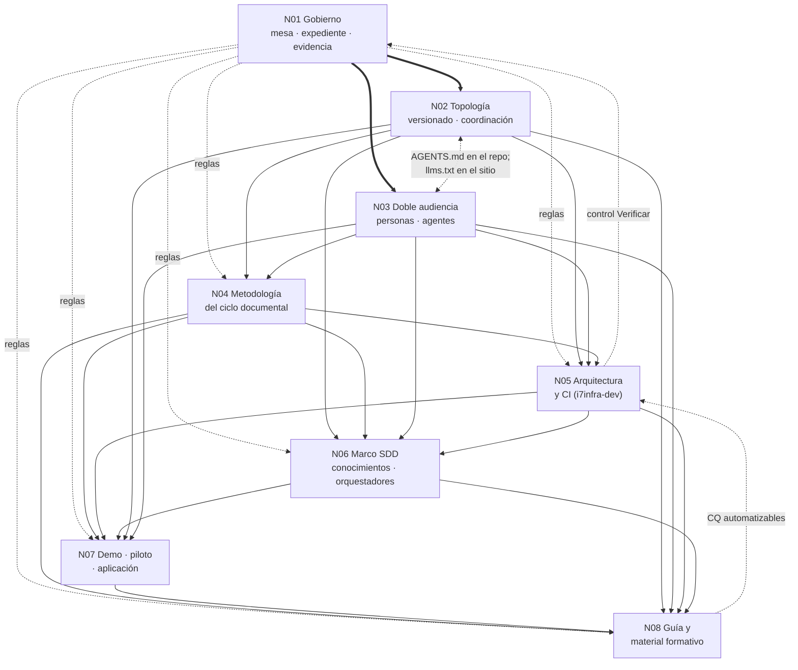
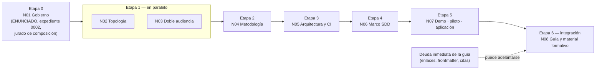

# N00 — Cohesión global de los núcleos conceptuales

| Campo | Valor |
|---|---|
| **Id** | N00 |
| **Título** | Documento de cohesión global: segmentación del pedido, relaciones y dependencias entre núcleos, contradicciones cruzadas, matriz de trazabilidad prompt → núcleo, orden de tratamiento y punto de integración |
| **Autor (rol)** | Despacho N00 — descomposición conceptual (subagente de la presidencia). No vota ni decide |
| **Fecha** | 2026-10-26 |
| **Fuentes leídas** | El tool-prompt completo (67 líneas) y las doce bitácoras R01–R07 e I01–I05, completas; los ocho documentos de núcleo N01–N08 que produce este mismo despacho |
| **Modo** | Sólo lectura sobre los repos; única escritura en `OUTPUTs/Bitacoras/` |

## Índice

1. [Alias de rutas](#1-alias-de-rutas)
2. [Propósito](#2-propósito)
3. [Segmentación: los ocho núcleos y por qué son ocho](#3-segmentación-los-ocho-núcleos-y-por-qué-son-ocho)
4. [Grafo de dependencias](#4-grafo-de-dependencias)
5. [Relaciones, referencias y vínculos entre núcleos](#5-relaciones-referencias-y-vínculos-entre-núcleos)
6. [Contradicciones que cruzan núcleos](#6-contradicciones-que-cruzan-núcleos)
7. [Matriz de trazabilidad prompt → núcleo](#7-matriz-de-trazabilidad-prompt--núcleo)
8. [Orden de tratamiento](#8-orden-de-tratamiento)
9. [Punto de integración](#9-punto-de-integración)
10. [Especialistas por núcleo (vista consolidada)](#10-especialistas-por-núcleo-vista-consolidada)
11. [Observaciones](#11-observaciones)

---

## 1. Alias de rutas

| Alias | Ruta absoluta |
|---|---|
| `TP` | `/LAB/Lab-Documentos/Lab-Documentos.Documentacion/PROMPTs/DEVs/Enchacement/01-Replanteo-Y-Analisis/Replanteo-Y-Analisis.md` |
| `B/` | `/LAB/Lab-Documentos/Lab-Documentos.Documentacion/PROMPTs/DEVs/Enchacement/01-Replanteo-Y-Analisis/OUTPUTs/Bitacoras/` |
| `R0n`, `I0n`, `N0n` | `B/<Id>-<Slug>.md` |

## 2. Propósito

La regla de `TP:44-57` pide transformar el pedido en núcleos conceptuales manejables, cada uno con su documento, y mantener «un documento de cohesión global que describa las relaciones, dependencias, referencias y vínculos existentes entre los distintos núcleos» (`TP:49`), con trazabilidad suficiente para integrarlos después (`TP:51`, `TP:53`). Este documento cumple esa función: dice qué núcleo cubre cada frase del pedido, en qué orden conviene tratarlos, dónde chocan y dónde se reconstruye el modelo completo.

## 3. Segmentación: los ocho núcleos y por qué son ocho

| Id | Núcleo | Archivo | Unidad de afinidad (por qué es un núcleo) |
|---|---|---|---|
| N01 | Gobierno de la corrida: mesa, expedientes, evidencia y descomposición | `B/N01-Gobierno-De-La-Mesa-Y-Evidencia.md` | Ideas sobre **cómo se trabaja**; dependencia fuerte mesa → expediente → ensayo → evidencia → presentación por núcleo |
| N02 | Topología de repositorios, versionado y coordinación | `B/N02-Topologia-Versionado-Y-Coordinacion.md` | Incógnita principal (`R01:167`); topología y versionado se condicionan mutuamente (`I01:166-175`) |
| N03 | Doble audiencia: personas y agentes de IA | `B/N03-Doble-Audiencia-Humanos-Y-Agentes.md` | El agente como lector y como redactor, con los dos modos de intervención de `TP:32` |
| N04 | Metodología del ciclo documental | `B/N04-Metodologia-Del-Ciclo-Documental.md` | El **objetivo** literal (`TP:26`): fases, entradas, salidas y respaldo normativo |
| N05 | Arquitectura de referencia y toolchain .NET / CI | `B/N05-Arquitectura-De-Referencia-Y-CI.md` | «Arquitectura clara» (`TP:36`) y workflow sobre el runner (`TP:34`): el runner condiciona la arquitectura |
| N06 | Marco SDD compartido, conocimientos comunes y orquestadores | `B/N06-Marco-SDD-Compartido-Y-Orquestadores.md` | Vehículo de reutilización: conocimientos compartidos y mejora de orquestadores (`TP:18`, `TP:30`) |
| N07 | Demostraciones, piloto y aplicación | `B/N07-Demostraciones-Piloto-Y-Aplicacion.md` | Cadena de validación empírica de `TP:30` (demo → piloto → SDD-B), con dependencia fuerte entre escalones |
| N08 | Enriquecimiento de la guía y material formativo | `B/N08-Guia-Y-Material-Formativo.md` | El entregable nombrado (`TP:20`) y la edición académica que define su calidad (`TP:36`) |

**Contraste con los esperables del despacho.** Los siete esperables se confirmaron con evidencia y se agregó uno:

- **Se agregó N01 (gobierno).** El pedido dedica la mayor parte de `TP:36` y toda la regla `TP:44-61` al modo de trabajo. Esas ideas no tienen afinidad temática con DocAsCode, pero sí dependencia fuerte entre sí, y sin ellas ningún otro núcleo se valida. Dejarlas repartidas habría fragmentado por párrafo, que es lo que `TP:46-47` prohíbe.
- **Se mantuvo «topología + versionado + coordinación» como un solo núcleo (N02)** y no tres, porque el pedido los encadena en una oración (`TP:20`) y porque la industria elige el mecanismo de versión según la topología (`I01:166-175`, `I02:74-98`).
- **Se separó la realización en CI (N05) de N02**: N02 decide *qué* se ancla y *qué* se acopla; N05 lo vuelve compuerta en un runner con restricciones propias (`R03:363-398`).
- **Se mantuvo un solo núcleo para demo, piloto y aplicación (N07)** porque cada escalón es entrada del siguiente (`TP:30` «luego… finalmente»). Se analizan por escalón dentro del documento.
- **No se hizo un núcleo aparte de «estándares de industria»**: atraviesa N02, N03, N04 y N08, y cada uno trae su respaldo (I01–I05). Un núcleo «estándares» habría agrupado por tipo de fuente, no por afinidad de ideas.

## 4. Grafo de dependencias

*Flechas llenas: «es insumo de». Punteadas: realimentación o cruce. La flecha N05 → N01 es la única que vuelve: la fase de escritura necesita el control `Verificar` para que los PR no queden en reserva (`R01:643`).*

No hay ciclos en las dependencias principales; las realimentaciones (N05 → N01, N08 → N05) son de fases posteriores y no bloquean el análisis.

## 5. Relaciones, referencias y vínculos entre núcleos

| De | A | Tipo | Qué fluye | Evidencia que sostiene el vínculo |
|---|---|---|---|---|
| N01 | todos | Gobierna | Reglas de evidencia, forma del dictamen, expediente 0002, carta con ruta real del Profile | `R01:120-132`, `R01:419-431`, `R07:140` |
| N02 | N04 | Insumo | Topología por pieza para diseño, integración y mantenimiento | `I01:200-213` |
| N03 | N04 | Insumo | Audiencias agente y modos de intervención para requerimientos | `I03:248-291`; `TP:32` |
| N02 | N05 | Insumo | Anclas de versión y acople código→doc que se vuelven compuertas | `I02:351-392` |
| N03 | N05 | Insumo | Salidas para agentes, frontmatter validado, confidencialidad en el build | `I03:253-265` |
| N04 | N05 | Insumo | La fase de integración fija qué se valida | `I04:358` |
| N02 | N06 | Insumo | El mismo modelo de versión aplica a conocimientos (tres versiones vivas) | `R03:256-267`, `R04:263-270` |
| N04 | N06 | Insumo | La metodología se vuelve conocimiento reutilizable | `TP:30`; `R06:236` |
| N05 | N06 | Insumo | Compuertas que los orquestadores disparan (Momento 2 de AG-00110) | `R06:216-217` |
| N06 | N07 | Precondición | Vía normativa de la piloto (apartamiento o cambio de norma) | `R06:112-119`, `R06:215` |
| N05 | N07 | Precondición | Workflow sobre `[self-hosted, i7infra-dev]` en demo y piloto | `R05:226`; `R06:217` |
| N02 | N07 | Insumo | Dónde vive la mini demo | `R05:230-236` |
| N07 | N08 | Insumo | Ejemplos reales, capturas, prueba de concepto reproducida | `R02:338`; `R05:146` |
| N04, N02, N03, N05, N06 | N08 | Contenido | Cada uno es un tema del cuerpo documental | `R07:178-201` |
| N08 | N05 | Realimentación | CQ-03, 05, 11, 13 y 14 como compuertas | `I05:231` |
| N02 | N03 | Cruce | `AGENTS.md` en el repo de código; `llms.txt` en el sitio publicado | `I01:193-194` |

**Referencias compartidas.** Tres fuentes atraviesan varios núcleos y conviene citarlas igual en todos: la guía actual (R02, en N02, N03, N04, N07, N08), la matriz D1–D8 de I01 (N02, N05, N07) y los requisitos R1–R20 de I03 (N03, N05, N08).

## 6. Contradicciones que cruzan núcleos

| # | Contradicción | Núcleos | Evidencia | Quién la resuelve |
|---|---|---|---|---|
| X1 | La ayuda por rol de la guía §7 choca con `Rules-Documentacion` de IA.SDD (usuario final fuera de alcance) y con la decisión «El producto no lleva manual» de Geometría | N06, N07, N08 | `R06:112-119` | Jurado sobre la vía normativa (N06); N07 y N08 la acatan |
| X2 | El pedido dice que la ia-db de Lab-Documentos tiene marco SDD propio; lo relevado dice que es un índice y que el marco es de workspace | N06, N01 | `TP:18`; `R03:141-156` | Presidencia en el `ENUNCIADO` (dato corregido) |
| X3 | `TP:34` exige el runner self-hosted; el CI que hoy se agrega en el repo auxiliar de Geometría usa `ubuntu-latest`; el runner es uno solo y lo comparte la E2E | N05, N07 | `R06:129`, `R06:143-145`, `R06:246` | N05 (decisión de concurrencia y alcance del workflow) |
| X4 | Mismo conocimiento en tres versiones vivas (3.1, 1.2, 1.15): imposible «compartir» sin elegir fuente | N02, N06 | `R03:256-267` | N06 con el modelo de N02 |
| X5 | La guía llama «adoptada» a `llms.txt`, que es propuesta; la prueba de concepto lo filtra por cookie | N03, N08, N07 | `I03:340`; `R02:241-245` | N03 fija madurez y regla de acceso; N08 corrige el texto |
| X6 | Una demo MAUI sin roles frente a un modelo de privilegios que depende del render en servidor | N07, N03 | `R05:110-120`; `R02:346` | N07 (la demo muestra audiencias, no roles) |
| X7 | Trazas de la guía a `CU-000NN` (unidad Api) cuando las pantallas están en `CU-100NN` (unidad Web) | N07, N04, N08 | `R06:193` | N04 fija el contrato `traces`; N07 lo aplica |
| X8 | `TP:30` como alcance o como plan | N01, N07 | `R01:172` | Presidencia (lectura que menos agrega: plan) |
| X9 | Regla «aprobador ≠ solicitante» con un equipo de una sola persona con dos identidades | N03, N01 | `I03:196`; `R03:212-214` | Jurado (riesgo e irreversibilidad) |
| X10 | Carta común (ruta absoluta del host) frente a compuerta S2 de `Rule-Expediente` para lo versionado | N01, N08 | `R01:15-24`, `R01:639` | Presidencia antes de versionar cualquier pieza |
| X11 | Enlaces relativos (`Rule-Markdown`) frente a ruta completa desde la raíz (regla del PO) | N08, N01 | `R07:348` | N08 (relativos en repo publicado; completos en bitácoras) |
| X12 | `Rule-Indexing` pide actualizar la ia-db; la fase es de sólo lectura y hay otra corrida escribiendo la ia-db de Geometría | N01, N07 | `R07:350`; `R06:131` | N01 (diferido a la fase de escritura) |
| X13 | Doc en el mismo repo no evitó la deriva en el SDD-B; doc separada rompió enlaces en Lab-E2E.WebBlazor: ninguna topología sola resuelve | N02, N05 | `R04:315-316`; `R05:270` | N02 + N05 (topología con compuerta) |

## 7. Matriz de trazabilidad prompt → núcleo

Cada frase con contenido del pedido, en orden de línea. «●» = núcleo principal; «○» = núcleo que la usa o la toca.

| Línea | Fragmento (resumido) | Tipo | N01 | N02 | N03 | N04 | N05 | N06 | N07 | N08 |
|---|---|---|---|---|---|---|---|---|---|---|
| `TP:4` | «ultracode leer y ejecutar …» | Invocación | ● | | | | | | | |
| `TP:6` | «Replanteo y analisis sistema de documentación DocAsCode» | Overview | ○ | ○ | ○ | ● | ○ | ○ | ○ | ○ |
| `TP:12` | Leer la ia-db de Lab-E2E.WebBlazor, ejemplos referidos a `MovilidadUrbana.MAUI` | Contexto / dato | | ○ | ○ | | | | ● | |
| `TP:14` | Partir del desarrollo actual sobre documentación a usuario, diseño, desarrollo e implementación | Contexto | | | ○ | ● | | ○ | ○ | ○ |
| `TP:15` | La guía `Sistema-Documentador-Tecnico-Guide.md` | Contexto / dato | | | | | | | ○ | ● |
| `TP:16` | Ejemplos y demostración en `Examples` | Contexto / dato | | | | | | | ● | ○ |
| `TP:18` (a) | «investigar y establecer métodlogias de diseño, implementación e integración en los sistemas» | Incógnita | | | | ● | ○ | | | |
| `TP:18` (b) | La ia-db de Lab-Documentos «tiene su propio marco SDD» | Dato (a corregir, X2) | ○ | | | | | ● | | |
| `TP:18` (c) | El SDD del servicio push (privado) | Dato | | | | | | ● | ○ | |
| `TP:18` (d) | «ambos se basan en agentes orquestadores y en conocimientos que pueden compartir» | Dato | | | ○ | | | ● | | |
| `TP:20` (a) | «crear una metodología común de como analizar requerimientos documentales, diseño, implementación e integración usando DocAsCode» | Requisito | | | | ● | | ○ | | |
| `TP:20` (b) | «repositorio dedicado … o bien estar integrado en el mismo repositorio de codigo» | Incógnita principal | | ● | | ○ | | | ○ | |
| `TP:20` (c) | «desfase de versionado, y coordinación» | Incógnita | | ● | | | ○ | ○ | | |
| `TP:20` (d) | «la industria ya tiene resuelto el abordaje metodologico» | Hipótesis | | ● | ○ | ○ | | | | |
| `TP:20` (e) | «agentes IA, integración con sistema multiagenticos, no solo son agentes humanos» | Requisito | | | ● | ○ | ○ | ○ | | |
| `TP:20` (f) | «hace falta un estudio profundo» | Requisito | ○ | ○ | ○ | ○ | | | | ● |
| `TP:20` (g) | «se debe enriquecer la guía … y los ejemplos/demos anexados» | Requisito | | | | | | | ○ | ● |
| `TP:26` | «Definir una metodlogía clara en evaluarción de requerimientos, analisis, diseño, implementación e integración» | Objetivo | | | | ● | | | | ○ |
| `TP:30` (a) | «Analizar los temas … las diferentes estrategias en base a los sistemas que venimos cubriendo» | Requisito | | ○ | | ● | | | ○ | |
| `TP:30` (b) | «Se puede enriqueser la guía actual, crear demostraciones y ejemplos» | Deseable | | | | | | | ● | ● |
| `TP:30` (c) | «mini demo basado en `MovilidadUrbana.MAUI` … referencia inicial» | Deseable | | | | | ○ | | ● | |
| `TP:30` (d) | «prueba piloto … con `Geometria` establecer un conocimeinto» | Deseable / plan | | | | | | ○ | ● | |
| `TP:30` (e) | «aplicarlo a `<SDD-B>` (nombre ofuscado) mejorando los agentes orquestadores de ambos» | Deseable / plan | | | | | | ● | ● | |
| `TP:30` (f) | «para ser aplicado luego en el diseño de nuevos sitemas» | Requisito | | | | ○ | | ● | | |
| `TP:32` (a) | «entender como se resuelve en la industria los problemas planteados» | Requisito | ○ | ● | ● | ● | | | | ○ |
| `TP:32` (b) | «puedan intervenir de forma automática la IA o bien que los agentes humanos entiendan el flujo de trabajo» | Requisito | | | ● | ○ | | ○ | | |
| `TP:34` | «Configura el wofklow con este runner de github: `runs-on: [self-hosted, i7infra-dev]`» | Requisito duro | ○ | | | | ● | | ○ | |
| `TP:36` (a) | «Crea una mesa basada en … Mesa-De-Expertos-A-Pedido y … Consulta-A-Un-Tercero» | Requisito | ● | | | | | | | |
| `TP:36` (b) | Reclutar analistas en sistemas, arquitectos .NET, especialistas en criterios de decisión | Requisito de composición | ● | ○ | | ○ | ○ | | ○ | |
| `TP:36` (c) | «academicos en edición de material bibliografico para consultar y crear ejemplos y material de consulta» | Requisito de composición | ● | | | | | | | ● |
| `TP:36` (d) | «presentale el contexto, objetivos y las soliticitudes junto con las reglas dadas» | Requisito | ● | | | | | | | |
| `TP:36` (e) | «abrir los expedientes si se requiere tal seguimiento» | Requisito condicional | ● | | | | | | | |
| `TP:36` (f) | «Que se debata la mejor forma, que consulten los estandares» | Requisito | ● | ○ | ○ | ● | | | | |
| `TP:36` (g) | «trazar una arquitectura clara, puede alternativas … simplicidad y practicidad, escalibilidad» | Requisito | | ○ | | ○ | ● | | | |
| `TP:36` (h) | «Los investigadores especializados pueden ensayar … se presenten y evaluen los resultados ante la mesa» | Deseable / habilitación | ● | | | | ○ | | ● | |
| `TP:36` (i) | «basarse en las tendencias del mercado y los estandares de la industria» | Requisito | ○ | ● | ● | ● | ○ | | | ○ |
| `TP:42` | Markdown jerárquico, definiciones, ejemplos, mermaid, autocontenido, no delta, con índices | Regla | ● | | | | | | | ● |
| `TP:44` | Descomposición conceptual sobre la totalidad del prompt, para todos | Regla | ● | ○ | ○ | ○ | ○ | ○ | ○ | ○ |
| `TP:46-47` | Núcleos por afinidad y dependencia, no por extensión | Regla | ● | | | | | | | |
| `TP:49` | Un markdown por núcleo y documento de cohesión global | Regla | ● | | | | | | | |
| `TP:51` | Cada núcleo analizable y validable por separado, con trazabilidad | Regla | ● | ○ | ○ | ○ | ○ | ○ | ○ | ○ |
| `TP:53` | Fase de integración que consolida y resuelve contradicciones | Regla | ● | | | | | | | ● |
| `TP:55` | Presentar cada eje a la mesa evaluadora y planificadora | Regla | ● | | | | | | | |
| `TP:57` | Registros retomables en `OUTPUTs/Bitacoras` | Regla | ● | | | | | | | |
| `TP:59` | «No inventar información» | Regla | ● | ○ | ○ | ○ | ○ | ○ | ○ | ○ |
| `TP:61` | «Toda afirmación debe estar respaldada por evidencia verificable» | Regla | ● | ○ | ○ | ○ | ○ | ○ | ○ | ○ |
| `TP:65-68` | Profile `Study-Guide-Documentation` (ruta citada inexistente; real con `PROMPTs/`) | Framework | ○ | | | | | | | ● |

*Ajuste de C00 (2026-10-26): `TP:14` suma «○» en N03 (la «documentación a usuario» es una audiencia), N06 y N07 (choque X1 con `Rules-Documentacion`, `R06:112-119`).*

**Cobertura.** Todas las filas tienen al menos un «●». Ninguna frase del pedido quedó sin núcleo; las de mayor dispersión (`TP:44`, `TP:51`, `TP:59`, `TP:61`) son reglas transversales que N01 gobierna y que cada núcleo valida en su sección de criterios.

## 8. Orden de tratamiento

*Criterio propio del despacho, derivado del grafo de §4: primero lo que no depende de nada, después lo que integra.*

| Etapa | Núcleo(s) | Por qué en este lugar | Qué la desbloquea |
|---|---|---|---|
| 0 | N01 | Sin `ENUNCIADO`, expediente y panel no sale ningún despacho (`R01:122`) | Nada |
| 1 | N02 ∥ N03 | No dependen entre sí salvo el cruce de §5; ambos son insumo de N04 y N05; tienen evidencia de industria completa (I01, I02, I03) | N01 |
| 2 | N04 | Integra topología y audiencias en un ciclo por fases | N02, N03 |
| 3 | N05 | Materializa N02, N03 y la fase de integración de N04 | N04 |
| 4 | N06 | Convierte la metodología y las compuertas en conocimiento y mejora de orquestadores; decide la vía normativa de la piloto | N04, N05 |
| 5 | N07 | Prueba lo anterior en sistemas reales; la piloto necesita la vía normativa de N06 | N05, N06 |
| 6 | N08 | Reconstruye el modelo completo como cuerpo documental | Todos |

**Lo que puede adelantarse sin romper dependencias.** La deuda inmediata de la guía (enlaces rotos, `status`, `traces` duplicado, recuento de páginas, cita de ACT-10, `$P` de `Lanzar-Example.md`; `R02:339-343`) no depende de ninguna decisión de la mesa y puede tratarse como unidad separada en la fase de escritura.

## 9. Punto de integración

**Dónde.** La integración que pide `TP:53` ocurre en **N08**: el cuerpo documental de la guía enriquecida es el modelo completo reconstruido. Cada núcleo N02–N06 se vuelve un tema del cuerpo, N07 aporta los ejemplos reales y N01 aporta las reglas de forma y evidencia con que se valida (ver el diagrama de `N08 §6`).

**Cuándo.** Después del dictamen de la mesa sobre N02–N07, en la fase de escritura. En esta fase de sólo lectura el punto de integración se deja **definido**, no ejecutado.

**Qué se consolida en la integración** (criterio propio):

1. Las respuestas cerradas, pregunta por pregunta, de las secciones «Preguntas abiertas» de cada núcleo (dictamen sin «depende», `R01:190`).
2. La resolución de las trece contradicciones de §6, cada una con el núcleo que la decidió.
3. Una tabla única pieza documental → topología → ancla de versión → compuerta → audiencia → tema de la guía, que junta N02, N03, N05 y N08.
4. El conocimiento reutilizable (N06) con fuente única y versión.
5. La matriz de §7 reverificada: cada fila apunta a la sección de la guía que la cubre.

**Registro.** *Criterio propio:* la integración se registra en una bitácora propia (por ejemplo `N09-Integracion.md`) y en el folio `resolucion` del expediente 0002, cuyo pase es el punto de continuación (`R01:391-394`). La presidencia decide el nombre.

## 10. Especialistas por núcleo (vista consolidada)

Señales para el jurado de composición, que respeta el techo de núcleo permanente + cinco variables o ad hoc por ciclo (`R01:236`). La composición la vota el jurado y no se eleva al PO (`R01:238`).

| Perfil | Núcleos | Señal en el pedido |
|---|---|---|
| Núcleo permanente (requisitos, verificación, lector sin contexto, refutador) | Todos | `R01:233` |
| Analista de sistemas | N02, N03, N04, N07 | `TP:36` |
| Arquitecto de software .NET | N02, N05, N06, N07 | `TP:36` |
| Especialista en análisis de decisiones (criterios y pesos) | N01, N02, N04 | `TP:36` |
| Académico en edición de material bibliográfico | N08 | `TP:36` |
| Especialista en documentación para agentes de IA / seguridad LLM | N03 | `TP:20`, `TP:32` |
| Especialista en DevOps y runners self-hosted | N05 | `TP:34` |
| Especialista en gestión de configuración y versionado | N02 | `TP:20` |
| Especialista en marcos SDD y gestión del conocimiento | N06 | `TP:18`, `TP:30` |
| Especialista en normas de información para usuarios (2651x) | N04 | `TP:36` («estandares») |
| Diseñador instruccional / redactor técnico | N08 | `TP:36` («material de consulta») |

Con el techo de cinco no caben todos en un ciclo. *Criterio propio:* los cuatro perfiles que nombra `TP:36` cubren N01, N02, N04, N05 y N08; el quinto cupo, por cobertura de la incógnita no atendida por esos cuatro, sería el especialista en documentación para agentes (N03). DevOps, SDD y normas quedan como postergados o como ad hoc con carta de mandato en un ciclo posterior.

## 11. Observaciones

**Hechos.**

- Las doce bitácoras de insumo existen y están completas (`ls B/`; recuento de líneas en `00-Bitacora-Maestra.md`).
- Ninguna bitácora de insumo está versionada: `PROMPTs/DEVs/Enchacement/01` figura sin seguimiento en Lab-Documentos.Documentacion (`R03:301`).
- R01 usa rutas desde la raíz del workspace; las demás bitácoras y estos núcleos usan la ruta del host, como pide la carta (X10).

**Interpretaciones (criterio propio).**

- La mayor parte del valor nuevo para la guía está en N02, N03 y N04: son los tres huecos que R02 midió (`R02:286-294`) y los tres con más evidencia de industria (I01–I04).
- El riesgo más alto para la secuencia de N07 es X1 (choque normativo de la piloto); conviene que el jurado lo trate temprano aunque N06 esté en la etapa 4.
