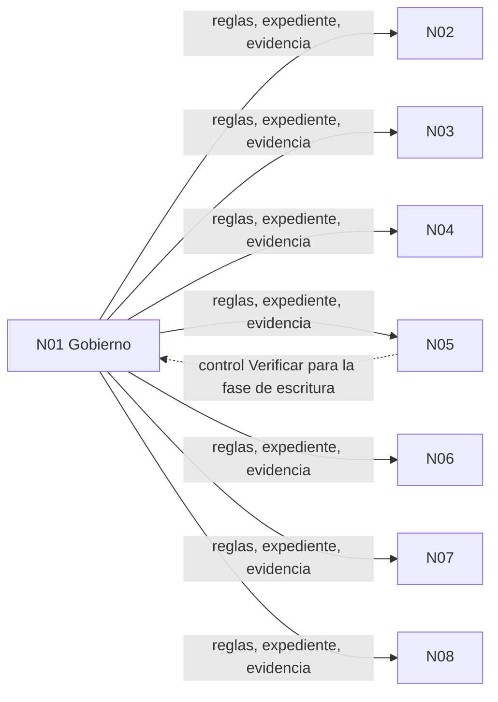

# N01 — Gobierno de la corrida: mesa, expedientes, evidencia y descomposición conceptual

| Campo | Valor |
|---|---|
| **Id** | N01 |
| **Título** | Gobierno de la corrida: cómo se convoca y conduce la mesa, cómo se expedienta, qué evidencia vale y cómo se descompone el pedido |
| **Autor (rol)** | Despacho N00 — descomposición conceptual (subagente de la presidencia). No vota ni decide |
| **Fecha** | 2026-10-26 |
| **Fuentes leídas** | El tool-prompt completo (67 líneas) y las doce bitácoras R01–R07 e I01–I05, completas (rutas en §1) |
| **Modo** | Sólo lectura sobre los repos; única escritura en `OUTPUTs/Bitacoras/` |

## Índice

1. [Alias de rutas](#1-alias-de-rutas)
2. [Definición del núcleo](#2-definición-del-núcleo)
3. [Ideas del prompt que agrupa](#3-ideas-del-prompt-que-agrupa)
4. [Definiciones](#4-definiciones)
5. [Hallazgos de las bitácoras](#5-hallazgos-de-las-bitácoras)
6. [Tensiones internas del núcleo](#6-tensiones-internas-del-núcleo)
7. [Preguntas abiertas para la mesa](#7-preguntas-abiertas-para-la-mesa)
8. [Criterios de validación del núcleo](#8-criterios-de-validación-del-núcleo)
9. [Dependencias con otros núcleos](#9-dependencias-con-otros-núcleos)
10. [Especialistas sugeridos](#10-especialistas-sugeridos)
11. [No verificado](#11-no-verificado)

---

## 1. Alias de rutas

| Alias | Ruta absoluta |
|---|---|
| `TP` | `/LAB/Lab-Documentos/Lab-Documentos.Documentacion/PROMPTs/DEVs/Enchacement/01-Replanteo-Y-Analisis/Replanteo-Y-Analisis.md` |
| `B/` | `/LAB/Lab-Documentos/Lab-Documentos.Documentacion/PROMPTs/DEVs/Enchacement/01-Replanteo-Y-Analisis/OUTPUTs/Bitacoras/` |
| `R01` … `R07`, `I01` … `I05` | `B/<Id>-<Slug>.md` (por ejemplo `R01` = `B/R01-Protocolo-De-Mesa.md`) |

Las citas van como `alias:línea`. Las que cada bitácora hace a sus propias fuentes se transcriben tal como la bitácora las da.

## 2. Definición del núcleo

Este núcleo reúne todo lo que el pedido dice sobre **cómo se trabaja**, no sobre **qué se decide**: la mesa de expertos y su composición, los expedientes, los ensayos de los investigadores, la regla de descomposición conceptual con sus bitácoras retomables y las dos reglas de veracidad («no inventar», «evidencia verificable»). Es transversal: cada uno de los otros siete núcleos se presenta a la mesa y se valida con las reglas que fija éste.

**Qué no es.** No contiene la metodología DocAsCode (N04) ni el diseño del workflow de CI (N05). Cuando el pedido usa «workflow» en `TP:34` se refiere al flujo de GitHub Actions, que es objeto de N05; el «ciclo de trabajo» de `Rule-Workflow` es de este núcleo (`R07:356`, tensión T10).

**Por qué es un núcleo y no un anexo.** Las ideas de `TP:36` y `TP:44-61` dependen fuertemente entre sí: la mesa abre expedientes, los expedientes guardan los ensayos, los ensayos son la evidencia que exige `TP:61`, y la descomposición es la forma en que esa evidencia se presenta a la mesa (`TP:55`). Ninguna se puede validar sin las otras.

## 3. Ideas del prompt que agrupa

| # | Idea | Cita literal (resumida) | Línea |
|---|---|---|---|
| 1.1 | Invocación por *ultracode* del tool-prompt | «ultracode leer y ejecutar `…/Replanteo-Y-Analisis.md`» | `TP:4` |
| 1.2 | Crear una mesa sobre dos conocimientos | «Crea una mesa basada en los conocimientos: `…/Knowledge-Mesa-De-Expertos-A-Pedido.md` y `…/Knowledge-Mesa-Consulta-A-Un-Tercero.md`» | `TP:36` |
| 1.3 | Reclutar especialistas | «determinar que especialistas en el tema necesitas reclutar y convocalos inclui analistas en sistemas y arquitectos en software .NET, especialistas en analisis … criterios de decisión … academicos en edición de material bibliografico» | `TP:36` |
| 1.4 | Presentar el caso con las reglas | «A la mesa presentale el contexto, objetivos y las soliticitudes junto con las reglas dadas» | `TP:36` |
| 1.5 | Expedientes condicionales | «La mesa debería abrir los expedientes si se requiere tal seguimiento» | `TP:36` |
| 1.6 | Ensayos y evaluación ante la mesa | «Los investigadores especializados pueden ensayar y realizar todas las pruebas … que se armen expedientes, se presenten y evaluen los resultados ante la mesa» | `TP:36` |
| 1.7 | Descomposición conceptual para todos | «Vos y toda la mesa y sus subagentes debe seguir el concepto … de descomposición conceptual sobre la totalidad del prompt» | `TP:44` |
| 1.8 | Núcleos por afinidad, no por extensión | «No fragmentes el contenido únicamente por extensión o por párrafos» | `TP:46-47` |
| 1.9 | Un markdown por núcleo + cohesión global | «documentando cada uno en un documento Markdown independiente. Mantén además un documento de cohesión global» | `TP:49` |
| 1.10 | Independencia con trazabilidad | «Cada núcleo debe poder analizarse, planificarse y validarse de manera relativamente independiente» | `TP:51` |
| 1.11 | Fase de integración | «realiza una fase de integración en la que se consoliden sus resultados» | `TP:53` |
| 1.12 | Presentar cada eje a la mesa | «presentar cada eje a la mesa evaluadora y planificadora» | `TP:55` |
| 1.13 | Registros retomables | «generando registros que puedas retomar … en `…/OUTPUTs/Bitacoras`» | `TP:57` |
| 1.14 | No inventar | «No inventar información» | `TP:59` |
| 1.15 | Evidencia verificable | «Toda afirmación debe estar respaldada por evidencia verificable» | `TP:61` |

## 4. Definiciones

| Término | Qué designa en esta corrida | Fuente |
|---|---|---|
| Presidencia | Agente que arma el contrato, compone vía jurado, consolida sin juzgar y cierra; no vota | `R01:64` (cita `MEP:118`) |
| Comisión | Especialista a ciegas, en paralelo, con mandato y no-competencia | `R01:65` |
| Refutador | Ataca evidencia, aplicación y objetivo; entra último | `R01:66`, `R01:269-271` |
| Jurado | Cinco jueces de función fija (evidencia, impacto, costo-beneficio, coherencia histórica, riesgo); vota composición y veredicto | `R01:285-291` |
| `ENUNCIADO` | Clasificación de cada frase del pedido en incógnita, dato, requisito, deseable o exclusión | `R01:70`, `R01:157-179` |
| Folio | Archivo `actuaciones/NNN-<tipo>-<slug>.md` de un expediente | `R01:72` |
| Pase | Última línea del folio, `Sigue: <acto> · <quién>`; es el punto de continuación | `R01:73`, `R01:391-394` |
| Núcleo conceptual | Grupo de ideas con afinidad o dependencia fuerte; unidad de segmentación del pedido | `R07:88` (cita `TP:46-47`) |
| Ancla E1–E4/C | Clase de evidencia de un hallazgo; C sólo funda una pregunta | `R01:77` |
| P0–P3 | Nivel de impacto | `R01:78`, lectura propuesta en `R01:221-225` |

## 5. Hallazgos de las bitácoras

| Id | Hallazgo | Evidencia |
|---|---|---|
| N01-H01 | El ciclo de la mesa tiene diez pasos y ningún despacho sale antes del `ENUNCIADO`; cada dato del despacho lleva comando y salida, y cada carta se archiva en `evidencia/` antes de despachar | `R01:120-132` |
| N01-H02 | La clase de objeto tomada es «diseño de una norma o decisión»: exige fuentes externas sin cláusulas inventadas, refutador que ataque el costo de aplicar, y dictamen pregunta por pregunta sin «depende» | `R01:188-191` |
| N01-H03 | La mesa no cumple `Rule-Mesa` §3.1 (el objeto es una norma por diseñar, no un corpus de especificación); se usa como forma y los campos `estado`, `diff_normativo` y `pendientes_declarados` van en «no aplica» con motivo | `R01:193-197`, `R01:647` |
| N01-H04 | Panel: núcleo permanente (requisitos, verificación, lector sin contexto, refutador) + máximo cinco variables o ad hoc por ciclo; lo compone el jurado y la composición **nunca** se eleva al PO | `R01:233-239`, `R01:465-467` |
| N01-H05 | El «especialista en análisis… criterios de decisión» de `TP:36` no es el rol 6 bis «análisis de decisiones», que sólo entra con ficha de excepción admitida; el antecedente lo fusionó con la comisión de analista de sistemas | `R01:246-249` |
| N01-H06 | La consulta a un tercero está nombrada pero sin destinatario ni canal; un workflow no puede usar el canal. Queda cargada en reserva; «académicos en edición bibliográfica» se leen como comisiones (agentes), no terceros | `R01:314-324`, `R01:644`, `R01:646` |
| N01-H07 | El expediente procede: el caso atraviesa corridas y repos (guía → piloto Geometría → SDD-B) y entra material externo. Recomendación: Lab-Documentos.Documentacion, carpeta padre `PROMPTs/DEVs/Enchacement/01-Replanteo-Y-Analisis/OUTPUTs/Expedientes/`, número **0002**, título `0002-Replanteo-Metodologia-DocAsCode` | `R01:346-350`, `R01:419-431` |
| N01-H08 | El único antecedente, expediente 0001, **no está versionado** (`git ls-files` → 0), y 32 de sus archivos llevan la ruta del host; versionados así, el control E-12 los rechazaría | `R01:638-639` |
| N01-H09 | Ningún repo declara la carpeta padre de expedientes; hay que declararla en la providencia de apertura | `R01:642` |
| N01-H10 | No hay delegación del merge asentada ni `.github/` en Lab-Documentos.Documentacion: el ciclo automático de PR no aplica y un PR quedaría en reserva por G3 | `R01:482-490`, `R01:643` |
| N01-H11 | La delegación «la mesa decide y queda aprobado» no alcanza a excepciones, fila de alcance ni aprobaciones: salen en el lote del cierre con `SI NO RESPONDÉS` | `R01:473-476`, `R01:645` |
| N01-H12 | La ruta del Profile que da el pedido (`TP:68`) no existe; la real lleva `PROMPTs/`. No es bloqueo (prueba de una variable ya corrida), pero **todo despacho** debe recibir la ruta real | `R01:648`, `R07:120-124`, `R07:140` (VER-W05) |
| N01-H13 | R07 dejó 104 ítems de verificación (`VER-…`) en 14 grupos, con su regla y línea; sirven como lista de control de la corrida y como anexo de la guía | `R07:128-315`, `R07:372` |
| N01-H14 | Lectura del pedido: la secuencia «mini demo → piloto Geometría → SDD-B» de `TP:30` se toma como **plan** (otras corridas), no como alcance de ésta, por ser la lectura que menos agrega | `R01:172` |
| N01-H15 | `Rule-Indexing` manda actualizar la ia-db y esta fase es de sólo lectura: se difiere a la fase de escritura | `R07:350` (T4) |

## 6. Tensiones internas del núcleo

| # | Tensión | Evidencia | Propuesta (criterio propio; decide la mesa) |
|---|---|---|---|
| T1 | La carta común pide ruta absoluta; la compuerta S2 de `Rule-Expediente` manda no escribir la ruta del host ni su usuario en un repo público. R01 se apartó (rutas desde la raíz del workspace); R02–R07 e I01–I05 usan la ruta del host | `R01:15-24`; `R01:639` | En bitácoras de trabajo (no versionadas hoy) se sigue la carta. Lo que pase a un expediente versionado se redacta con rutas desde la raíz del workspace, o se versiona copia redactada con el original en `evidencia/local/` |
| T2 | «README como juicio» (MEP) frente a carátula fija de seis filas (`Rule-Expediente`) | `R01:368-373`, `R01:640` | Manda la regla: el juicio vive en el folio `resolucion` y en el pase |
| T3 | El antecedente votó con el rótulo `ARCHIVA`, que la regla no tiene | `R01:641` | La carta del jurado fija `PROCEDE` / `NO_PROCEDE` / `INSUFICIENTE` |
| T4 | Frontmatter obligatorio en todo documento (`Rule-Dual-Audience`) frente a bitácoras que no lo traen | `R07:349` (T3) | En entregables de la guía, obligatorio; en bitácoras, la presidencia decide uniformar. Este documento lo trae |
| T5 | «Workflow» designa el ciclo de trabajo y el flujo de CI | `R07:356` (T10) | En actas: «ciclo de trabajo» y «workflow de CI» |

## 7. Preguntas abiertas para la mesa

1. ¿Se abre el expediente 0002 en la carpeta que propone R01 (`OUTPUTs/Expedientes/`) o en otra? ¿Uno solo para esta corrida, con cita calificada a los expedientes que abran la piloto y la aplicación al SDD-B? (`R01:433-436`)
2. ¿Qué perfiles convoca el jurado dentro del techo de cinco variables, y cuáles quedan postergados? (`R01:241-249`; ver §10 de cada núcleo)
3. ¿Se confirma la lectura de `TP:30` como plan de corridas posteriores, o la mesa entiende que la mini demo es alcance de ésta? (`R01:172`)
4. ¿Se activa la consulta a un tercero? Sólo si el PO nombra destinatario y canal; de lo contrario queda en reserva (`R01:644`).
5. ¿Cómo se resuelve T1 (ruta del host en lo que se versione)? ¿Se exige barrido S2 antes de versionar cualquier bitácora?
6. ¿La fase de escritura empieza por una unidad que asiente la delegación del merge y un control `Verificar` sobre el runner de `TP:34`, como sugiere R01? (`R01:643`)
7. ¿Qué lectura P0–P3 rige el caso? R01 propone una (`R01:221-225`).

## 8. Criterios de validación del núcleo

| # | Criterio | Cómo se verifica |
|---|---|---|
| V1 | Existe un `ENUNCIADO` con cada frase del pedido clasificada y su línea, antes del primer despacho de comisiones | Folio `providencia` del expediente; contraste con `R01:157-179` |
| V2 | Cada carta de despacho está en `evidencia/` antes de su despacho y recibe la ruta real del Profile | Fecha-hora de la pieza frente a la del despacho; `grep` de `/IA/PROMPTs/IA.Prompts` en las cartas |
| V3 | La composición del panel la votó el jurado con descartes motivados, sin elevarla al PO | Acta del jurado de composición (plantilla `R01:566-595`) |
| V4 | Cada núcleo N01–N08 tiene su documento y figura en N00 con su dependencia y su fila en la matriz de trazabilidad | `ls B/N0*`; matriz de N00 |
| V5 | La cuenta de folios del cierre da (comisiones + refutador + análisis + perito + dos jurados) | Bloque `CIERRE DE MESA` (`R01:442-451`) |
| V6 | Ninguna afirmación sin `ruta:línea` o URL + título + fecha; lo no verificado, rotulado | Muestreo de los informes contra VER-E01…E09 (`R07:164-172`) |
| V7 | Ningún repo privado nombrado; ninguna escritura fuera de `OUTPUTs/` | `grep` de los nombres privados y de rutas fuera de `OUTPUTs/` sobre lo escrito |

## 9. Dependencias con otros núcleos

N01 es **precondición** de todos: fija quién decide, con qué evidencia y en qué carpeta queda cada acto. No depende de ninguno para empezar. Recibe de N05 una pieza puntual: el control `Verificar` sobre el runner `[self-hosted, i7infra-dev]` que la fase de escritura necesita para que un PR no quede en reserva por G3 (`R01:643`).

## 10. Especialistas sugeridos

Señales para el jurado de composición; la decisión es del jurado (`R01:238`).

| Perfil | Por qué para este núcleo | Señal |
|---|---|---|
| Núcleo permanente: requisitos, verificación, lector sin contexto, refutador | Obligatorio en todo ciclo | `R01:233` |
| Especialista en gobierno documental y gestión de expedientes | Carpeta padre, folios, barrido S2, versionado del antecedente | `R01:638-643` |
| Especialista en análisis de decisiones (criterios y pesos) | `TP:36` lo pide; dictamen sin «depende» exige criterios con fuente antes de puntuar | `TP:36`; `R01:246-249`, `R01:275-276` |

## 11. No verificado

- Las secciones de `Rule-Mesa` §6–§9 y de `Rule-Expediente` §6 salvo E-12 no fueron leídas por R01 (`R01:661-662`); este documento no agrega lectura propia de esas reglas.
- La visibilidad pública de los repos se toma de la carta común (`R01:663-664`).
- Si `Index-Knowledge.md` está al día con la base `1585af9` (`R01:649`).
