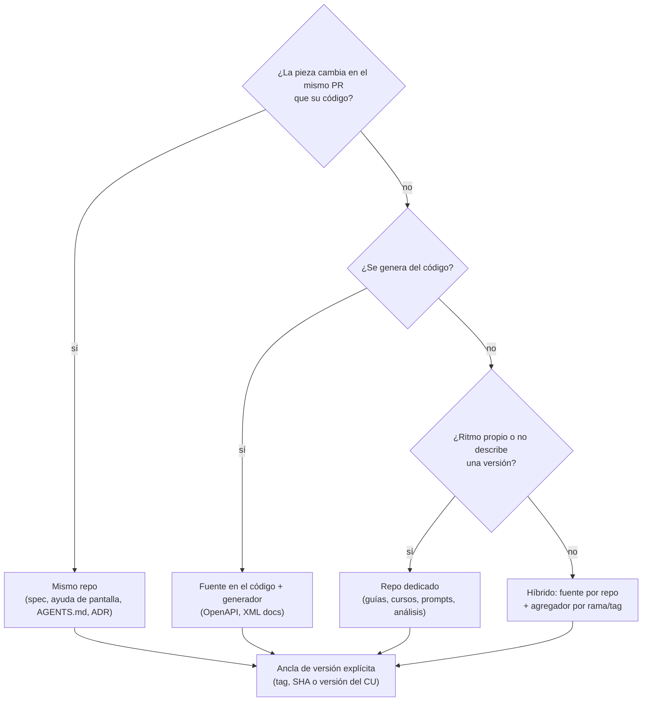

# N02 — Topología de repositorios, versionado y coordinación

| Campo | Valor |
|---|---|
| **Id** | N02 |
| **Título** | ¿Repositorio dedicado, integrado o híbrido? Cómo se ancla la versión de la documentación a la del código y cómo se coordinan los cambios entre repos |
| **Autor (rol)** | Despacho N00 — descomposición conceptual (subagente de la presidencia). No vota ni decide |
| **Fecha** | 2026-10-26 |
| **Fuentes leídas** | El tool-prompt completo y las doce bitácoras R01–R07 e I01–I05, completas |
| **Modo** | Sólo lectura; única escritura en `OUTPUTs/Bitacoras/` |

## Índice

1. [Alias de rutas](#1-alias-de-rutas)
2. [Definición del núcleo](#2-definición-del-núcleo)
3. [Ideas del prompt que agrupa](#3-ideas-del-prompt-que-agrupa)
4. [Definiciones](#4-definiciones)
5. [Hallazgos de la industria](#5-hallazgos-de-la-industria)
6. [Hallazgos del workspace](#6-hallazgos-del-workspace)
7. [Preguntas abiertas para la mesa](#7-preguntas-abiertas-para-la-mesa)
8. [Criterios de validación del núcleo](#8-criterios-de-validación-del-núcleo)
9. [Dependencias con otros núcleos](#9-dependencias-con-otros-núcleos)
10. [Especialistas sugeridos](#10-especialistas-sugeridos)
11. [No verificado](#11-no-verificado)

---

## 1. Alias de rutas

| Alias | Ruta absoluta |
|---|---|
| `TP` | `/LAB/Lab-Documentos/Lab-Documentos.Documentacion/PROMPTs/DEVs/Enchacement/01-Replanteo-Y-Analisis/Replanteo-Y-Analisis.md` |
| `B/` | `/LAB/Lab-Documentos/Lab-Documentos.Documentacion/PROMPTs/DEVs/Enchacement/01-Replanteo-Y-Analisis/OUTPUTs/Bitacoras/` |
| `R0n`, `I0n` | `B/<Id>-<Slug>.md` |

## 2. Definición del núcleo

Es la **incógnita principal** del pedido (`R01:167`): dónde vive la fuente de la documentación, cómo se fija qué versión de la documentación corresponde a qué versión del código y cómo se coordinan los cambios cuando la documentación y el código están separados. Topología, versionado y coordinación forman un solo núcleo porque el pedido los presenta encadenados («Y aquí surgen problemas de desfase de versionado, y coordinación», `TP:20`) y porque la industria los resuelve juntos: la elección de topología determina qué mecanismos contra la deriva son posibles (`I01:166-175`, `I02:74-98`).

**Qué no es.** No diseña el workflow concreto (N05) ni decide qué piezas consumen los agentes (N03). Sí decide **por pieza documental** dónde vive su fuente y cuál es su ancla de versión, que N05 después vuelve compuerta.

## 3. Ideas del prompt que agrupa

| # | Idea | Cita literal (resumida) | Línea |
|---|---|---|---|
| 2.1 | Repo dedicado con ciclo propio frente a integrado | «si tener un repositorio dedicado a la documentación con su propio ciclo evolutivo o bien estar integrado en el mismo repositorio de codigo» | `TP:20` |
| 2.2 | Desfase de versionado y coordinación | «Y aquí surgen problemas de desfase de versionado, y coordinación» | `TP:20` |
| 2.3 | La industria ya lo resolvió | «Seguramente la industria ya tiene resuelto el abordaje metodologico de esta cuestión» | `TP:20` |
| 2.4 | Entender primero cómo lo resuelve la industria | «Es necesaario primero entender como se resuelve en la industria los problemas planteados en el contexto» | `TP:32` |
| 2.5 | Basarse en tendencias y estándares | «Es importante basarse en las tendencias del mercado y los estandares de la industria» | `TP:36` |
| 2.6 | Dos SDD en repos separados (`ia-db` en repos `.Documentacion`) | «`/LAB/Lab-Documentos/Lab-Documentos.Documentacion/ia-db/README.md` … y por otro lado … `<SDD-B.Doc>/ia-db/README.md` (ruta ofuscada)» | `TP:18` |

## 4. Definiciones

| Término | Definición | Fuente |
|---|---|---|
| Sidecar (mismo repo) | La fuente de la documentación vive en el repo del código | `I01:43`, `I01:71-76` (passo.uno, 2023-05-14) |
| Orthogonal (repo dedicado) | Repo propio, sin vínculo mecánico con el código; el autor lo ve como estado de transición | `I01:44`, `I01:74` |
| Federated / specialized (híbrido) | Cada repo aporta su parte y un sitio central agrega, o el repo central trae la referencia generada del código | `I01:45`, `I01:75-76` |
| Deriva (*drift*) | Divergencia acumulada entre lo que la documentación afirma y lo que el sistema hace | `I02:61` |
| Ancla de versión | Lo que fija qué edición de la documentación describe qué versión del código (tag, rama, SHA, moniker) | Criterio propio, a partir de `I01:155-158` y `I02:110-117` |
| Fuente de verdad | El lugar donde una pieza se edita; las demás copias se derivan | `I01:48` |

## 5. Hallazgos de la industria

| Id | Hallazgo | Evidencia |
|---|---|---|
| N02-H01 | Ninguna referencia elige una sola topología: la decisión se toma **por pieza**. .NET separa conceptual y referencia; GitLab separa fuente y sitio; Kubernetes separa doc y código pero genera la referencia desde el código | `I01:200` |
| N02-H02 | GitLab es híbrido: fuente «in the same repositories as the product code», sitio aparte; doc en el mismo MR «when possible» y en la definición de hecho; revisión posterior al merge como válvula | `I01:95-101` |
| N02-H03 | Kubernetes: repo dedicado con gate de proceso (PR borrador contra `dev-1.38`; sin doc, la feature puede salir del milestone); dos familias de ramas `dev-1.xx` y `release-1.xx`; publica la versión actual y cuatro anteriores | `I01:105-109` |
| N02-H04 | .NET declara la fuente de verdad por pieza: comentarios `///` en el código, sincronizados a `dotnet-api-docs` «every preview»; Microsoft Learn abandonó copias por versión en favor de monikers | `I01:113-117` |
| N02-H05 | Google pone la doc junto al código (`g3doc`), con dueños y fechas de frescura | `I01:121` |
| N02-H06 | Agregadores multi-repo: Antora (raíz por rama/tag, falla ante duplicados), Backstage (build en el CI de cada repo + portal), OpenTelemetry (submódulos: dos PR por cambio) | `I01:125-143` |
| N02-H07 | Versionar el **sitio** es opcional y caro: Docusaurus recomienda no hacerlo salvo que convivan versiones y mantener menos de 10; RTD y mike usan los tags como versión | `I02:121-129`, `I02:400` |
| N02-H08 | La deriva se ataca por capas: prevenir (mismo PR, fuente única), detectar en el PR (compuertas), detectar con el tiempo (avisos), comunicar o congelar (changelog, versiones) | `I02:74-98`, `I02:398` |
| N02-H09 | SemVer trata la documentación como parte del contrato («exist strictly in documentation»); Keep a Changelog y Conventional Commits se complementan | `I02:150-159`, `I02:406` |
| N02-H10 | Ninguna norma ISO leída prescribe dónde vive la fuente; 26514 exige control de versiones (6.12) y 26515 entrega continua (7.7) sin fijar repositorio | `I04:309` |
| N02-H11 | Matriz de decisión por pieza D1–D8 (mismo PR → mismo repo; generable → fuente en el código; varios repos y un sitio → híbrido; ritmo propio → dedicado; versionar sólo si conviven versiones; CODEOWNERS; costo de submódulos; dueño y frescura) | `I01:202-213` |

## 6. Hallazgos del workspace

| Id | Hallazgo | Evidencia |
|---|---|---|
| N02-W01 | El workspace ya usa la topología código + repo hermano `.Documentacion` (Lab-Documentos, Lab-E2E.WebBlazor, Lab-Geometria, SDD-B) | `I01:220` |
| N02-W02 | En el SDD-B la documentación vive **en los dos** repos con reparto de roles: norma y expedientes en el de código; pedidos del PO, `OUTPUTs/` e `ia-db` en el de documentación | `R04:67-77` |
| N02-W03 | Tener la doc en el mismo repo no evitó el desfase en el SDD-B: la especificación no siguió al código; un documento afirma que cualquier falla bloquea el merge y es falso | `R04:148-151`, `R04:283`, `R04:286`, `R04:315-316` |
| N02-W04 | El repo de documentación del SDD-B no tiene ciclo de versión propio («no artefactos versionados por release»); el SDD-B tiene cuatro líneas de número independientes y los documentos sólo versión por cabecera | `R04:98-102`, `R04:117-126` |
| N02-W05 | Rutas cruzadas rotas entre repos: 32 archivos del repo de código del SDD-B citan rutas que el repo de doc movió | `R04:288` |
| N02-W06 | En Lab-E2E.WebBlazor, 3 enlaces del README del código y unos 50 de las guías mudadas no resuelven: costo medido de separar docs y código | `R05:156`, `R05:160`, `R05:270` |
| N02-W07 | Lab-Geometria ya aplica el reparto de la guía (lo que cambia con el código, en el código; lo que habla del proyecto, en el auxiliar). El único desfase medible es la ia-db, anclada a SHA y no a etiqueta, que quedó unos 47 PR atrás | `R06:151-157`, `R06:125-127` |
| N02-W08 | Lab-Documentos y su `.Documentacion` no tienen tags y su changelog va por fecha: la deriva entre ambos no tiene ancla | `I02:408`, `R03:203-205` |
| N02-W09 | La ia-db v4.0 de Lab-Documentos.Documentacion está sin commitear desde el 2026-10-18 y su manifiesto dice «árbol limpio», que ya no es cierto | `R03:160-166` |
| N02-W10 | El mismo conocimiento (`Mesa-De-Expertos-A-Pedido`) existe en tres versiones (3.1, 1.2, 1.15): el desfase de versionado aplicado a los conocimientos de los orquestadores | `R03:256-267`, `R04:263-270` |
| N02-W11 | La guía ya formula D1 («¿tiene que cambiar en el mismo PR?») pero no trata el híbrido agregado, la familia `dev-1.xx` de Kubernetes ni mecanismos multi-repo | `R02:288-289`, `I01:227-228` |

*Diagrama: lectura de la matriz D1–D4 de `I01:202-207`; la última caja es criterio propio.*

## 7. Preguntas abiertas para la mesa

1. ¿Se adopta la decisión **por pieza documental** (matriz D1–D8) en lugar de una topología única por proyecto? (`I01:200-213`)
2. Para cada par código ↔ `.Documentacion`, ¿cuál es el ancla de versión de la documentación del repo hermano: tag del código, SHA indexado o ninguna (se acepta que la doc «follows» y no «is bound to» el software, `I02:123-125`)?
3. ¿Se versiona el sitio publicado o se documenta sólo la versión desplegada? (`I02:127-129`; la guía ya concluye lo segundo, `I02:327`)
4. ¿Qué mecanismo detecta enlaces rotos **entre repos** (N02-W05, N02-W06)? ¿Gate en cada PR o aviso programado?
5. ¿Cómo se cita entre repos para que una reorganización no rompa referencias: por identificador estable (expediente, commit) en vez de ruta? (`R04:317-319`)
6. Para los conocimientos de los orquestadores (N02-W10), ¿una sola fuente en KB-privada referenciada con versión, o copias con mecanismo de sincronización? (cruza con N06)
7. ¿Lab-Documentos y su `.Documentacion` adoptan tags y changelog por versión, o se declara que son repos de ritmo propio (D4)?

## 8. Criterios de validación del núcleo

| # | Criterio | Cómo se verifica |
|---|---|---|
| V1 | Cada pieza documental del inventario de N04 tiene asignada topología y ancla de versión, con la fila D1–D8 que la justifica | Tabla pieza → repo → ancla → fila D |
| V2 | Toda recomendación cita al menos un caso de industria con URL y fecha, y su costo | Contraste con `I01:247-276`, `I02:430-470` |
| V3 | El dictamen distingue los cuatro proyectos del workspace (Lab-Documentos, MovilidadUrbana, Lab-Geometria, SDD-B) sin forzar una única respuesta | Una fila por proyecto en el dictamen |
| V4 | Se nombra al menos un mecanismo verificable por CI para cada desfase relevado (N02-W03…W10) | Mapa desfase → mecanismo → compuerta de N05 |
| V5 | Cadena de Consecuencias aplicada antes de recomendar entre opciones (dónde cae, cuánto pesa, qué pierde la otra, reversibilidad) | `R01:262` |

## 9. Dependencias con otros núcleos

| Relación | Con | Qué fluye |
|---|---|---|
| Depende de | N01 | Reglas de evidencia y forma del dictamen |
| Alimenta | N04 | Las fases de integración y mantenimiento dependen de la topología elegida |
| Alimenta | N05 | Cada ancla y cada regla de acople se vuelve compuerta de CI |
| Alimenta | N06 | El mismo modelo de versión aplica a los conocimientos compartidos |
| Alimenta | N07 | Decide dónde vive la mini demo (código o `Examples/`) y la piloto |
| Cruza con | N03 | `AGENTS.md` va en el repo de código (D1); `llms.txt` es del sitio publicado, sea cual sea la topología (`I01:193-194`) |

## 10. Especialistas sugeridos

| Perfil | Por qué | Señal |
|---|---|---|
| Arquitecto de software .NET | Topología de soluciones, MinVer, OpenAPI en build, fuente de verdad por pieza | `TP:36`; `R06:151`, `I02:184-191` |
| Especialista en gestión de configuración y versionado (release engineering) | Anclas, tags, ramas por versión, changelog, SemVer | `TP:20`; `R04:117-151`; `I02:150-170` |
| Analista de sistemas | Inventario por pieza y por proyecto; casos de desfase reales | `TP:36`; `R04:281-296` |
| Especialista en análisis de decisiones | Pesos explícitos sobre simplicidad, practicidad y escalabilidad antes de puntuar D1–D8 | `TP:36`; `R01:275-276` |

## 11. No verificado

- Cómo `docs-gitlab-com` trae el contenido de cada repo; fechas límite de docs en Kubernetes; autoría de passo.uno (`I01:234-240`).
- Estado del versionado en DocFX v3 (`I02:412-413`).
- Si el repo de documentación del SDD-B tiene etiquetas (`R04:332-333`).
- No hay estudios empíricos que comparen topologías para agentes (`I01:196`).
