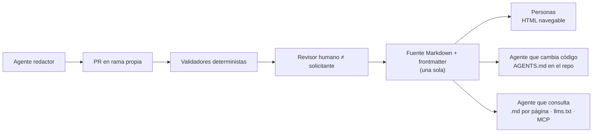

# N03 — Doble audiencia: personas y agentes de IA

| Campo | Valor |
|---|---|
| **Id** | N03 |
| **Título** | Documentación que leen y mantienen personas y agentes de IA (incluidos sistemas multiagente): canales, contenido útil, control humano y riesgos |
| **Autor (rol)** | Despacho N00 — descomposición conceptual (subagente de la presidencia). No vota ni decide |
| **Fecha** | 2026-10-26 |
| **Fuentes leídas** | El tool-prompt completo y las doce bitácoras R01–R07 e I01–I05, completas |
| **Modo** | Sólo lectura; única escritura en `OUTPUTs/Bitacoras/` |

## Índice

1. [Alias de rutas](#1-alias-de-rutas)
2. [Definición del núcleo](#2-definición-del-núcleo)
3. [Ideas del prompt que agrupa](#3-ideas-del-prompt-que-agrupa)
4. [Definiciones](#4-definiciones)
5. [Hallazgos de las bitácoras](#5-hallazgos-de-las-bitácoras)
6. [Contradicciones a resolver](#6-contradicciones-a-resolver)
7. [Preguntas abiertas para la mesa](#7-preguntas-abiertas-para-la-mesa)
8. [Criterios de validación del núcleo](#8-criterios-de-validación-del-núcleo)
9. [Dependencias con otros núcleos](#9-dependencias-con-otros-núcleos)
10. [Especialistas sugeridos](#10-especialistas-sugeridos)
11. [No verificado](#11-no-verificado)

---

## 1. Alias de rutas

| Alias | Ruta absoluta |
|---|---|
| `TP` | `/LAB/Lab-Documentos/Lab-Documentos.Documentacion/PROMPTs/DEVs/Enchacement/01-Replanteo-Y-Analisis/Replanteo-Y-Analisis.md` |
| `B/` | `/LAB/Lab-Documentos/Lab-Documentos.Documentacion/PROMPTs/DEVs/Enchacement/01-Replanteo-Y-Analisis/OUTPUTs/Bitacoras/` |
| `R0n`, `I0n` | `B/<Id>-<Slug>.md` |

## 2. Definición del núcleo

El pedido introduce un cambio de lector: «no solo son agentes humanos que accederan a esta documentación» (`TP:20`), y pide que la tarea documental admita **dos modos de intervención**: la IA de forma automática o las personas que entienden el flujo para aportar (`TP:32`). Este núcleo junta ambas caras: el agente como **lector** (qué canales consume y qué contenido le sirve) y el agente como **redactor** (cómo entra su cambio, quién lo aprueba, cómo se registra la procedencia), más los riesgos que trae tratar documentación como entrada de un modelo.

**Qué no es.** No define la arquitectura de publicación (N05) ni el marco de agentes orquestadores de los SDD (N06); fija los **requisitos** que esos núcleos tienen que satisfacer.

## 3. Ideas del prompt que agrupa

| # | Idea | Cita literal (resumida) | Línea |
|---|---|---|---|
| 3.1 | Aparición de los agentes IA | «Con la aparición de los agentes IA, integración con sistema multiagenticos» | `TP:20` |
| 3.2 | Lectores humanos y no humanos | «no solo son agentes humanos que accederan a esta documentación, así que hace falta un estudio profundo» | `TP:20` |
| 3.3 | Intervención automática de la IA | «tener en cuenta que en esta tarea documental puedan intervenir de forma automática la IA» | `TP:32` |
| 3.4 | Personas que entienden el flujo | «o bien que los agentes humanos entiendan el flujo de trabajo para poder intervenir o realizar sus aportes» | `TP:32` |
| 3.5 | Marcos «asistidos por IA» basados en orquestadores | «su propio marco SDD de diseño asistido por IA … ambos se basan en agentes orquestadores» | `TP:18` |

## 4. Definiciones

| Término | Definición | Fuente |
|---|---|---|
| Doble audiencia | La misma fuente sirve a personas (HTML) y a agentes (Markdown, índices, herramientas) | `I03:57` |
| Archivo de instrucciones de agente | `AGENTS.md`, `CLAUDE.md`, `.github/copilot-instructions.md`; es contexto, no configuración ejecutada | `I03:58` |
| `llms.txt` | Markdown en `/llms.txt` con H1 obligatorio, resumen y listas de enlaces; propuesta abierta (Howard, 2024-09-03) | `I03:59`, `I03:128` |
| MCP | Protocolo abierto para que un cliente de IA descubra e invoque herramientas de un servidor | `I03:60` |
| Inyección de prompt indirecta | Instrucciones maliciosas contenidas en datos externos que el modelo obedece | `I03:62` |
| Procedencia | Registro de quién produjo un cambio y quién responde por él | `I03:63` |
| Escala de madurez E/A/P/V/M | Especificación / convención adoptada / propuesta / función de proveedor / marketing (criterio de I03) | `I03:45-51` |

## 5. Hallazgos de las bitácoras

| Id | Hallazgo | Evidencia |
|---|---|---|
| N03-H01 | No hay un estándar único de «docs para IA»: hay cuatro canales de madurez distinta (instrucciones en el repo [A], sitio legible [P/V], MCP [E protocolo, V servidores], RAG [práctica]) más un circuito de escritura que siempre termina en PR | `I03:70-88` |
| N03-H02 | `AGENTS.md` es la convención más adoptada (más de 60 000 proyectos, unas 20 herramientas); gana el archivo más cercano | `I03:96-99` |
| N03-H03 | Evidencia empírica: los archivos de contexto no elevan de forma fiable el éxito y suben el costo más de 20 % (ETH, arXiv 2602.11988); un índice de docs en `AGENTS.md` dio 100 % frente a 53 % de una skill (Vercel). Funciona poco texto, específico, no deducible del código y con punteros a la fuente | `I03:115-120` |
| N03-H04 | `llms.txt` es propuesta, no estándar: Lighthouse lo audita desde v13.2.0, Google lo compara con la meta keywords; servir `.md` por página sí está extendido | `I03:128-138` |
| N03-H05 | Ocultar no es restringir: en GitBook las páginas ocultas siguen accesibles por MCP; coincide con «confidencialidad en el build, no en la vista» de la guía | `I03:155` |
| N03-H06 | Patrón dominante de escritura por agentes: «agente propone, PR dispone»; el rol Verificador separado del Redactor aparece en la investigación (DocAgent) | `I03:181-184` |
| N03-H07 | Controles verificados de Copilot: el agente no aprueba ni fusiona; quien pidió el PR tampoco lo aprueba; workflows esperan aprobación; se filtran caracteres ocultos | `I03:192-199` |
| N03-H08 | Riesgos: inyección indirecta por documentos (OWASP LLM01:2025), «trifecta letal», caso real de fuga por el MCP de GitHub; texto de docs de terceros es dato, nunca orden | `I03:229-240` |
| N03-H09 | Requisitos propuestos R1–R20 (fuente Markdown única, secciones autocontenidas, frontmatter validado, `.md` por página, `llms.txt` como índice y no SEO, `AGENTS.md` puntero escrito por personas bajo CODEOWNERS, todo cambio de agente por PR con aprobador ≠ solicitante, verificador separado, procedencia, contenido no confiable) | `I03:248-291` |
| N03-H10 | Para el agente consumidor, los ejemplos de código pesan más que la prosa (Chen et al., 2025: mejora de 83 % a 220 %); los modelos arrastran API deprecadas (Wang et al., 2025); los PR de documentación de agentes se fusionan con poca revisión (Yamasaki et al., 2026) | `I05:179-181`, `I05:175`, `I05:185-190` |
| N03-H11 | La guía actual no trata `AGENTS.md`, MCP, inyección ni chunking; presenta `llms.txt` como «adoptada» | `I03:338-347`, `R02:291` |
| N03-H12 | El `llms.txt` de la prueba de concepto exige cookie (un agente sin sesión recibe `302` a HTML, no `401`) y no trae secciones H2 | `R02:241`, `R02:245` |
| N03-H13 | Lab-Documentos no tiene `AGENTS.md`, `CLAUDE.md` ni `CODEOWNERS`; la ia-db cumple el papel de punto de entrada para agentes y declara restricciones de consumo | `R03:132-135`, `R03:151-152` |
| N03-H14 | Las reglas del framework ya piden cara agente: frontmatter de 10 campos, IDs estables, bloques entradas/salidas/validaciones, snippets con procedencia; el Profile no fija el frontmatter ni los prefijos de ID | `R07:247-253`, `R07:366` |
| N03-H15 | Ninguna norma ISO leída trata al agente como lector; 26514 8.17 ve al chatbot como canal hacia el humano | `I04:330` |

*Diagrama: síntesis de `I03:72-88` y `I03:210-223`.*

## 6. Contradicciones a resolver

| # | Contradicción | Evidencia | Dirección propuesta (criterio propio) |
|---|---|---|---|
| C1 | La guía llama «adoptada» a una convención que su autor declara propuesta | `I03:340`; `I04:329` | Corregir la madurez en la guía (N08) sin quitar el canal |
| C2 | ETH dice que los archivos de contexto no ayudan; Vercel dice que un índice en `AGENTS.md` sí | `I03:115-120` | No se contradicen: miden cosas distintas (resumen general frente a índice preciso); la mesa decide la forma del `AGENTS.md` |
| C3 | La prueba de concepto filtra `llms.txt` por sesión; un agente sin cookie no puede consumirlo | `R02:241-245`; consecuencia para un cliente MAUI en `R02:346` | Distinguir agente autenticado (ve su rol) de agente anónimo (sólo lo público) |
| C4 | `origin: agent` y `confidence` sólo se registran; la literatura pide que gatillen revisión | `I05:189`; `I03:282` (R16) | Que el metadato sea condición de compuerta (N05) |

## 7. Preguntas abiertas para la mesa

1. ¿Qué canales de lectura se adoptan como obligatorios y cuáles como opcionales: `AGENTS.md`, `.md` por página, `llms.txt`, MCP propio, índice tipo ia-db? (`I03:257-265`)
2. ¿Qué relación hay entre la ia-db existente y `llms.txt`: uno reemplaza al otro, o la ia-db es el índice interno y `llms.txt` el público? (`R05:194`)
3. ¿Qué intervenciones automáticas de IA se permiten (proponer PR, regenerar referencia, traducir) y cuáles exigen siempre una persona? (`TP:32`; `I03:181`)
4. ¿Quién aprueba un PR de documentación hecho por un agente si el equipo es de una sola persona? (`R03:212-214`: autor único con dos identidades) — la regla «aprobador ≠ solicitante» (`I03:196`) choca con el tamaño del equipo.
5. ¿Qué frontmatter y qué prefijos de ID fija la mesa, dado que el Profile no los define? (`R07:366`, `R07:371`)
6. ¿Cómo se entera una persona del «flujo de trabajo» para intervenir (`TP:32`)? ¿Basta la guía, o hace falta un documento de proceso con bloques entradas/salidas/validaciones? (`R07:251`)
7. ¿Qué controles contra inyección indirecta se exigen al publicar docs que van a leer agentes (filtrado de comentarios HTML, lista de fuentes MCP permitidas)? (`I03:289-291`)

## 8. Criterios de validación del núcleo

| # | Criterio | Cómo se verifica |
|---|---|---|
| V1 | Cada canal adoptado tiene su madurez declarada con fuente (E/A/P/V/M) | Tabla canal → madurez → fuente |
| V2 | Hay un requisito explícito para cada uno de los dos modos de `TP:32` (automático y humano) | Matriz requisito → modo |
| V3 | Todo requisito sobre agentes tiene respaldo en una fuente primaria o en una medición del workspace | Contraste con `I03:295-330` |
| V4 | El frontmatter mínimo y los prefijos de ID quedan fijados y son validables por esquema | Esquema JSON o equivalente propuesto a N05 |
| V5 | Se declara qué contenido es confidencial y se demuestra que no se compila en ninguna salida para agentes | Prueba de N05/N07 sobre `.md`, `llms.txt` y MCP |

## 9. Dependencias con otros núcleos

| Relación | Con | Qué fluye |
|---|---|---|
| Depende de | N01 | Reglas de evidencia |
| Cruza con | N02 | `AGENTS.md` en el repo de código; `llms.txt` en el sitio publicado (`I01:193-194`) |
| Alimenta | N04 | Las audiencias (incluidos agentes) son entrada de la fase de requisitos |
| Alimenta | N05 | Salidas para agentes y validadores deterministas del build |
| Alimenta | N06 | Cómo los orquestadores leen y escriben documentación |
| Alimenta | N07 | La mini demo muestra la audiencia «agente IA» (`R05:225`) |
| Alimenta | N08 | Corrección de madurez de `llms.txt`, nuevas secciones de la guía |

## 10. Especialistas sugeridos

| Perfil | Por qué | Señal |
|---|---|---|
| Especialista en documentación para agentes de IA (AGENTS.md, llms.txt, MCP, RAG) | Canales y contenido útil, con evidencia empírica | `TP:20`; `I03:96-165` |
| Especialista en seguridad de sistemas con LLM | Inyección indirecta, trifecta letal, controles de publicación | `I03:229-240` |
| Analista de sistemas | Modos de intervención humano/automático como flujo con roles | `TP:32`, `TP:36` |

## 11. No verificado

- Cifras de consumo de `llms.txt` (sólo secundarias) y el retiro del tag `Assisted-by` del kernel (`I03:355-356`).
- Un estándar de frontmatter para «contenido generado por IA»: no hallado (`I03:360`).
- Si la rama `[Authorize]` de la prueba de concepto deja muerta la respuesta `401` (`R02:241`).
