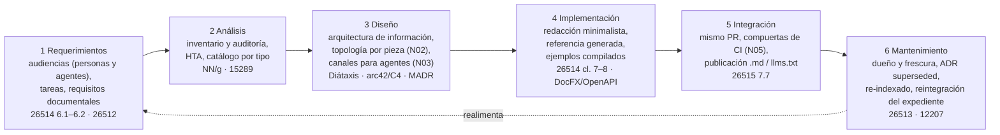

# N04 — Metodología del ciclo documental

| Campo | Valor |
|---|---|
| **Id** | N04 |
| **Título** | Una metodología común para evaluar requerimientos documentales, analizar, diseñar, implementar, integrar y mantener documentación técnica de sistemas con DocAsCode |
| **Autor (rol)** | Despacho N00 — descomposición conceptual (subagente de la presidencia). No vota ni decide |
| **Fecha** | 2026-10-26 |
| **Fuentes leídas** | El tool-prompt completo y las doce bitácoras R01–R07 e I01–I05, completas |
| **Modo** | Sólo lectura; única escritura en `OUTPUTs/Bitacoras/` |

## Índice

1. [Alias de rutas](#1-alias-de-rutas)
2. [Definición del núcleo](#2-definición-del-núcleo)
3. [Ideas del prompt que agrupa](#3-ideas-del-prompt-que-agrupa)
4. [Definiciones](#4-definiciones)
5. [Hallazgos de las bitácoras](#5-hallazgos-de-las-bitácoras)
6. [El ciclo propuesto como hipótesis a refutar](#6-el-ciclo-propuesto-como-hipótesis-a-refutar)
7. [Preguntas abiertas para la mesa](#7-preguntas-abiertas-para-la-mesa)
8. [Criterios de validación del núcleo](#8-criterios-de-validación-del-núcleo)
9. [Dependencias con otros núcleos](#9-dependencias-con-otros-núcleos)
10. [Especialistas sugeridos](#10-especialistas-sugeridos)
11. [No verificado](#11-no-verificado)

---

## 1. Alias de rutas

| Alias | Ruta absoluta |
|---|---|
| `TP` | `/LAB/Lab-Documentos/Lab-Documentos.Documentacion/PROMPTs/DEVs/Enchacement/01-Replanteo-Y-Analisis/Replanteo-Y-Analisis.md` |
| `B/` | `/LAB/Lab-Documentos/Lab-Documentos.Documentacion/PROMPTs/DEVs/Enchacement/01-Replanteo-Y-Analisis/OUTPUTs/Bitacoras/` |
| `R0n`, `I0n` | `B/<Id>-<Slug>.md` |

## 2. Definición del núcleo

Es el **objetivo** del pedido, escrito en una sola línea: «Definir una metodlogía clara en evaluarción de requerimientos, analisis, diseño, implementación e integración de documetnación técnica de sistemas» (`TP:26`). El núcleo reúne todo lo que hace falta para que esa metodología exista como proceso: las fases, qué entra y qué sale de cada una, qué norma o marco la respalda y quién interviene. Suma la fase de mantenimiento porque las bitácoras muestran que es donde se pierde la coherencia (deriva, re-indexado atrasado) y porque las normas la tratan como parte del ciclo (`I04:76-94`).

**Qué no es.** No decide la topología (N02) ni los canales para agentes (N03): los recibe como insumos de las fases de diseño, integración y mantenimiento. Tampoco escribe la guía (N08): la metodología es el **contenido** que la guía enriquecida tiene que enseñar.

## 3. Ideas del prompt que agrupa

| # | Idea | Cita literal (resumida) | Línea |
|---|---|---|---|
| 4.1 | Objetivo: metodología clara por fases | «Definir una metodlogía clara en evaluarción de requerimientos, analisis, diseño, implementación e integración de documetnación técnica de sistemas» | `TP:26` |
| 4.2 | Investigar y establecer metodologías | «Se hace neceario investigar y establecer métodlogias de diseño, implementación e integración en los sistemas» | `TP:18` |
| 4.3 | Metodología común entre sistemas | «Para crear una metodología común de como analizar requerimientos documentales, diseño, implementación e integración usando DocAsCode» | `TP:20` |
| 4.4 | Analizar estrategias en base a los sistemas cubiertos | «Analizar los temas planteados … las diferentes estrategias en base a los sistemas que venimos cubriendo» | `TP:30` |
| 4.5 | Partir de lo existente sobre documentación al usuario | «Partiendo del desarrollo actual sobre lo que es materia de documentación a usuario de sistema, su diseño, desarrollo e implementación» | `TP:14` |
| 4.6 | Debatir, consultar estándares, buscar simplicidad | «Que se debata la mejor forma, que consulten los estandares … se deben buscar las ventajas de simplicidad y practicidad, escalibilidad» | `TP:36` |
| 4.7 | Aplicable a nuevos sistemas | «para ser aplicado luego en el diseño de nuevos sitemas» | `TP:30` |

## 4. Definiciones

| Término | Definición | Fuente |
|---|---|---|
| Información para usuarios | Término de la serie 2651x en lugar de «documentación de usuario» | `I04:63` |
| Ítem de información | Unidad documental (plan, especificación, informe…) cuyo contenido fija 15289 | `I04:64` |
| Análisis de tareas | «The systematic study of how users complete tasks to achieve their goals» | `I04:70` (NN/g, Rosala 2020) |
| Auditoría de contenido | Evaluación del inventario con decisión conservar / actualizar / quitar | `I04:69` (NN/g, Kaley 2020) |
| Requerimiento documental | Requisito sobre la documentación (audiencia, tarea, forma, calidad) formulado antes de producirla | Criterio propio sobre `I04:137` y `I04:154` (26512, 26514 6.1.3) |
| Deuda documental | Problemas como artefactos faltantes, inadecuados o incompletos | `I02:62` (Rios et al.) |

## 5. Hallazgos de las bitácoras

| Id | Hallazgo | Evidencia |
|---|---|---|
| N04-H01 | La serie ISO/IEC/IEEE 2651x se organiza por rol (gestor, adquirente, revisor, diseñador, equipo ágil); 26514:2022 es el esqueleto más completo: 6.1 requisitos, 6.2 análisis de audiencia y tareas, 6.11 mantenimiento, 6.12 control de versiones, 7.6 minimalismo, 8.15 API, 8.17 chatbots | `I04:118`, `I04:149-159` |
| N04-H02 | 26515:2018 7.7 «Delivering information for users with a continuous delivery process (DevOps)» es el antecedente normativo directo de docs-as-code con entrega continua | `I04:163-168` |
| N04-H03 | 26512 aporta la idea de **especificar los requisitos de la documentación antes de producirla**, que es la fase «requerimientos documentales» que pide el pedido | `I04:137` |
| N04-H04 | 15289 fija tipos genéricos de ítem (descripción, plan, política, procedimiento, informe, solicitud, especificación): sirve para el catálogo documental | `I04:172-175` |
| N04-H05 | 12207:2026 está publicada (2026-04-29); la guía cita la 12207:2017 | `I04:180`, `I04:384` |
| N04-H06 | Matriz marco × fase: requerimientos y análisis los cubren 2651x, análisis de audiencia/tareas y auditoría; diseño, Diátaxis, DITA, minimalismo, arc42, C4, ADR; implementación e integración, docs-as-code (DocFX, Structurizr); mantenimiento, 26513, ADR *superseded*, 12207 | `I04:76-114` |
| N04-H07 | Receta propuesta por fase para un equipo .NET chico (criterio de I04): requisitos de audiencias humanas y agentes; inventario y HTA; Diátaxis + arc42/C4 + MADR; redacción minimalista y referencia generada; docs en el mismo PR con CI; revisión por cambio y ADR *superseded* | `I04:352-359` |
| N04-H08 | Lo que no conviene en un equipo chico: DITA XML completo, el proceso contractual de 26512, comprar todas las normas (si una, 26514) | `I04:363-365` |
| N04-H09 | La guía actual tiene ciclo de vida **del documento** y derivación CU → página, pero no requisitos documentales, diseño de arquitectura de información ni integración verificada: «La metodología es del documento, no del sistema documentador» | `R02:292` |
| N04-H10 | Brecha principal de la guía: le faltan las normas de proceso (26514) y de agilidad/DevOps (26515), justo las que cubren requerimientos, análisis e integración | `I04:386` |
| N04-H11 | Ciclo real de una guía en Lab-Documentos: prompt del PO → mesa → bitácoras 00–04 → guía en `Guides/` → cierre → commit manual → re-indexado; el paso que se atrasa es commit + re-indexado | `R03:172-195`, `R03:220-222` |
| N04-H12 | En el SDD-B el expediente resultó la unidad de trazabilidad más viva; la metodología debería prever cómo un expediente **reintegra** a la norma | `R04:322-323` |
| N04-H13 | La literatura empírica (Aghajani 2019/2020) ubica la mayoría de los problemas en el contenido «qué» (55 %) y, en forma, la claridad (88 % la considera importante); los remedios incluyen probar con lectores novatos y en contenedores | `I05:77-84` |
| N04-H14 | Revisión como proceso en cinco etapas: autorrevisión, técnica, editorial, *play testing*, realimentación posterior | `I05:101` |
| N04-H15 | Diátaxis recomienda mejorar de a un paso y no armar estructura vacía | `I04:223` |

## 6. El ciclo propuesto como hipótesis a refutar

*Criterio propio del despacho, armado con N04-H01…H15. Viaja a la mesa como hipótesis, no como lectura previa (`R01:207`).*

| Fase | Entrada | Salida verificable | Quién (persona / agente) |
|---|---|---|---|
| 1 Requerimientos | Pedido, NB/CU del sistema, audiencias | Lista de audiencias y tareas; requisitos de la documentación | Analista (persona); agente releva |
| 2 Análisis | Lo existente | Inventario con estado conservar/actualizar/quitar | Agente propone; persona decide |
| 3 Diseño | Inventario + requisitos | Árbol de tipos, topología por pieza, contrato de frontmatter, ADR | Arquitecto; mesa |
| 4 Implementación | Diseño | Páginas, referencia generada, ejemplos que compilan | Redactor (persona o agente) por PR |
| 5 Integración | PR | Compuertas en verde, sitio y salidas para agentes publicados | CI + revisor ≠ solicitante |
| 6 Mantenimiento | Cambios del código, avisos | Revisión por frescura, re-indexado, reintegración | Dueño nombrado |

## 7. Preguntas abiertas para la mesa

1. ¿Se adopta el esqueleto de 26514 y 26515 en versión liviana como columna vertebral, completado con marcos abiertos? (`I04:348`)
2. ¿Qué artefacto concreto registra los «requerimientos documentales» en cada tipo de proyecto (sección del SDD, `docs/_requisitos.md`, NB/CU)? (`I04:354`)
3. ¿La metodología es una sola para los cuatro tipos de sistema relevados (corpus de guías, app MAUI sin roles, panel con roles, servicio con paquetes NuGet), o un tronco común con variantes? (`TP:30`; R05, R06, R04)
4. ¿Cómo se integra el expediente como unidad de cambio documental y cómo reintegra a la norma? (`R04:322-323`)
5. ¿Qué parte del ciclo pueden hacer agentes sin persona y qué fases exigen decisión humana? (cruza con N03)
6. ¿Se agrega la fase de mantenimiento al objetivo literal (que nombra cinco fases) como cambio de alcance declarado? (`TP:26`; R01 indica que una fila de alcance no se asienta por silencio, `R01:460`)

## 8. Criterios de validación del núcleo

| # | Criterio | Cómo se verifica |
|---|---|---|
| V1 | Cada fase tiene entrada, salida verificable, responsable y respaldo normativo o de industria con fuente | Tabla de §6 completada y citada |
| V2 | La metodología se puede aplicar a los cuatro sistemas relevados sin contradicción | Recorrido de las seis fases sobre Lab-Documentos, MovilidadUrbana, Lab-Geometria y SDD-B |
| V3 | Las fases de requerimientos, análisis e integración, ausentes en la guía, quedan cubiertas | Contraste con `R02:292` e `I04:386` |
| V4 | La propuesta pasa el ataque del refutador sobre el costo de aplicarla («ceremonia que nadie completa») | Informe del refutador (`R01:269-271`) |
| V5 | Se distingue qué es norma (con número), qué es práctica de industria y qué es criterio propio | Rotulado en el dictamen |

## 9. Dependencias con otros núcleos

| Relación | Con | Qué fluye |
|---|---|---|
| Depende de | N01 | Reglas del dictamen |
| Depende de | N02 | Topología y anclas para diseño, integración y mantenimiento |
| Depende de | N03 | Audiencias agente y modos de intervención para requerimientos y diseño |
| Alimenta | N05 | La fase de integración define qué compuertas tiene que tener el CI |
| Alimenta | N06 | El ciclo se incorpora a los orquestadores y a los conocimientos compartidos |
| Alimenta | N07 | La demo y la piloto prueban el ciclo de punta a punta |
| Alimenta | N08 | La guía enriquecida enseña el ciclo |

## 10. Especialistas sugeridos

| Perfil | Por qué | Señal |
|---|---|---|
| Analista de sistemas | Requerimientos documentales, análisis de audiencias y tareas, inventario | `TP:36`; `I04:336-338` |
| Especialista en normas de información para usuarios (serie 2651x, 15289, 12207) | Respaldo normativo de cada fase | `TP:36`; `I04:118-206` |
| Arquitecto de información / redactor técnico | Diátaxis, arquitectura de información, minimalismo | `I04:210-247`, `I04:339` |
| Especialista en análisis de decisiones | Alternativas con pesos de simplicidad, practicidad y escalabilidad | `TP:36` |

## 11. No verificado

- El cuerpo normativo de las ISO (de la cláusula 5 en adelante) no se leyó: todo sale de índices y cláusula 1 (`I04:426`).
- Estado del borrador sucesor de 26511 y de una 15289 posterior a 2019 (`I04:427-428`).
- La numeración de la gestión de información en 12207:2026 (`I04:429`).
- Los cuatro principios del minimalismo vienen de una reseña secundaria (`I04:431`).
