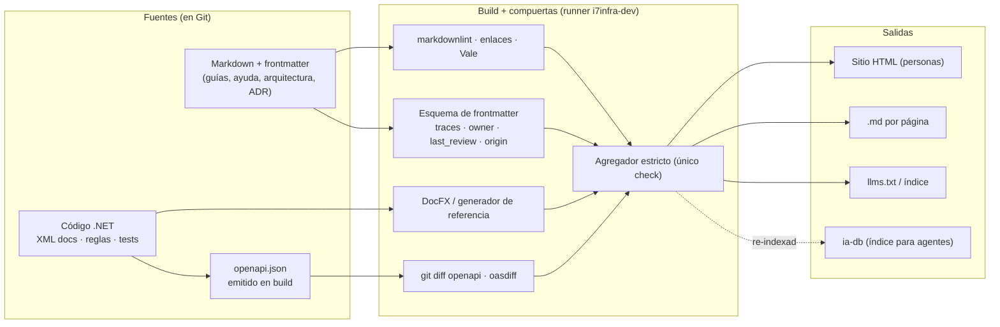

# N05 — Arquitectura de referencia y toolchain .NET / CI

| Campo | Valor |
|---|---|
| **Id** | N05 |
| **Título** | Arquitectura clara del sistema documentador (fuentes → build → salidas) y su realización con herramientas .NET y un workflow de GitHub Actions sobre `runs-on: [self-hosted, i7infra-dev]` |
| **Autor (rol)** | Despacho N00 — descomposición conceptual (subagente de la presidencia). No vota ni decide |
| **Fecha** | 2026-10-26 |
| **Fuentes leídas** | El tool-prompt completo y las doce bitácoras R01–R07 e I01–I05, completas |
| **Modo** | Sólo lectura; única escritura en `OUTPUTs/Bitacoras/` |

## Índice

1. [Alias de rutas](#1-alias-de-rutas)
2. [Definición del núcleo](#2-definición-del-núcleo)
3. [Ideas del prompt que agrupa](#3-ideas-del-prompt-que-agrupa)
4. [Definiciones](#4-definiciones)
5. [Hallazgos sobre el runner y los workflows existentes](#5-hallazgos-sobre-el-runner-y-los-workflows-existentes)
6. [Hallazgos sobre el toolchain](#6-hallazgos-sobre-el-toolchain)
7. [Arquitectura de referencia como hipótesis](#7-arquitectura-de-referencia-como-hipótesis)
8. [Preguntas abiertas para la mesa](#8-preguntas-abiertas-para-la-mesa)
9. [Criterios de validación del núcleo](#9-criterios-de-validación-del-núcleo)
10. [Dependencias con otros núcleos](#10-dependencias-con-otros-núcleos)
11. [Especialistas sugeridos](#11-especialistas-sugeridos)
12. [No verificado](#12-no-verificado)

---

## 1. Alias de rutas

| Alias | Ruta absoluta |
|---|---|
| `TP` | `/LAB/Lab-Documentos/Lab-Documentos.Documentacion/PROMPTs/DEVs/Enchacement/01-Replanteo-Y-Analisis/Replanteo-Y-Analisis.md` |
| `B/` | `/LAB/Lab-Documentos/Lab-Documentos.Documentacion/PROMPTs/DEVs/Enchacement/01-Replanteo-Y-Analisis/OUTPUTs/Bitacoras/` |
| `R0n`, `I0n` | `B/<Id>-<Slug>.md` |

## 2. Definición del núcleo

El pedido exige dos cosas que se apoyan una en la otra: que los especialistas «deben trazar una arquitectura clara» buscando «simplicidad y practicidad, escalibilidad» (`TP:36`) y que se configure «el wofklow con este runner de github: `runs-on: [self-hosted, i7infra-dev]`» (`TP:34`). La arquitectura dice qué piezas tiene el sistema documentador (fuentes, generadores, validadores, salidas); el workflow es donde esas piezas se ejecutan y se vuelven compuertas. Se agrupan porque el diseño de la arquitectura está condicionado por el runner (un solo contenedor efímero, sin `docker.sock`, compartido) y porque el workflow no tiene sentido sin la arquitectura que valida.

**Qué no es.** No decide dónde vive cada pieza (N02) ni qué consumen los agentes (N03); materializa esas decisiones. Es el núcleo donde la regla de `TP:34` es restricción dura (`R01:173`).

## 3. Ideas del prompt que agrupa

| # | Idea | Cita literal (resumida) | Línea |
|---|---|---|---|
| 5.1 | Workflow con runner self-hosted | «Configura el wofklow con este runner de github : `runs-on: [self-hosted, i7infra-dev]`» | `TP:34` |
| 5.2 | Arquitectura clara | «los especialistas deben trazar una arquitectura clara, puede alternativas» | `TP:36` |
| 5.3 | Simplicidad, practicidad, escalabilidad | «se deben buscar las ventajas de simplicidad y practicidad, escalibilidad» | `TP:36` |
| 5.4 | Arquitectos .NET en la mesa | «inclui analistas en sistemas y arquitectos en software .NET» | `TP:36` |
| 5.5 | Diseño, implementación e integración en los sistemas | «establecer métodlogias de diseño, implementación e integración en los sistemas» | `TP:18` |
| 5.6 | Ensayos de los investigadores | «Los investigadores especializados pueden ensayar y realizar todas las pruebas que sean necesarias» | `TP:36` |

## 4. Definiciones

| Término | Definición | Fuente |
|---|---|---|
| Compuerta (*gate*) | Chequeo de CI que bloquea la fusión cuando falla; opuesto a aviso | `I02:67` |
| Agregador estricto | Job final con `if: always()` que da rojo ante `skipped`/`cancelled` salvo omisión declarada; único check requerido | `R03:333`, `R03:397` |
| Fuente única | Referencia generada desde un artefacto que el compilador o el runtime ya validan (XML docs, OpenAPI, AsyncAPI) | `I02:65` |
| Runner `i7infra-dev` | Runner self-hosted efímero con etiquetas `i7infra,i7infra-dev,dotnet,maui-android` | `R03:365-369` |
| Workflow de CI | El flujo de GitHub Actions; se distingue del «ciclo de trabajo» de `Rule-Workflow` | `R07:356` |

## 5. Hallazgos sobre el runner y los workflows existentes

| Id | Hallazgo | Evidencia |
|---|---|---|
| N05-H01 | El runner es efímero (un job y se desregistra), sin `docker.sock` ni `privileged`, con cachés en `/cache`; en `runs-on` va la etiqueta, no el nombre; sin `timeout-minutes` un test colgado bloquea el único runner | `R03:365-374` |
| N05-H02 | La etiqueta sólo sirve a repos cuyo dueño tenga registrado ese runner; una instancia de otra organización no la tiene | `R03:373-375` |
| N05-H03 | El runner está vivo (contenedor de alcance organización, versión 2.338.1) y es **uno solo**, compartido con la E2E serializada de Lab-Geometria | `R06:143-145` |
| N05-H04 | Patrón común de los workflows que ya lo usan: etiqueta específica, guarda de mismo repositorio (repos públicos), `contents: read`, `timeout-minutes`, sin `container:`, `dotnet` directo con SDK fijado, agregador estricto, guion local equivalente | `R03:391-398` |
| N05-H05 | El único workflow de Lab-Documentos (`framework-concept-demo.yml`) está **sin trackear**, usa el runner en sus cuatro jobs y sólo cubre la demo de Concepts: un PR que toca `Guides/` pasa en verde por omisión; no hay compuerta documental | `R03:318-340` |
| N05-H06 | Lab-Documentos tuvo `ci`/`release`/`auditoria` con el runner hasta el 2026-09-13 y los borró con la app | `R03:344-351` |
| N05-H07 | Contradicción entre workflows: Lab-E2E.StaticHtml usa `container:` sobre el runner que otros documentan sin Docker | `R03:383`, `R03:409` |
| N05-H08 | Lab-Geometria: `ci.yml` en `ubuntu-latest`, `e2e.yml` en el runner propio con guarda de forks y concurrencia sin cancelación; **ningún chequeo de documentación** | `R06:137-145` |
| N05-H09 | En el repo auxiliar de Geometría hay un PR abierto que agrega un CI `Verificar` en `ubuntu-latest`, que no usa el runner de `TP:34` | `R06:129` |
| N05-H10 | Lab-Documentos.Documentacion no tiene `.github/`; un PR ahí no tendría controles (reserva G3 del ciclo automático) | `R01:488-490` |
| N05-H11 | El «validador en CI» de la prueba de concepto corre al arrancar la app y sólo registra en el log; no hay workflow | `R02:186`, `R02:237` |

## 6. Hallazgos sobre el toolchain

| Id | Hallazgo | Evidencia |
|---|---|---|
| N05-T01 | En .NET la fuente única es madura y barata: XML docs (`GenerateDocumentationFile`), DocFX `metadata` (acepta `.slnx` con .NET 9+), OpenAPI generado al compilar con `Microsoft.Extensions.ApiDescription.Server`, `oasdiff-action/breaking`, PublicApiAnalyzers, AsyncAPI | `I02:184-191`, `I02:401` |
| N05-T02 | Las docs de .NET prohíben código inline y exigen proyectos de snippets compilados en CI, referenciados por nombre y no por línea | `I02:217-222`, `I02:402` |
| N05-T03 | GitLab es el referente de «deriva como compuerta»: Vale, markdownlint, frontmatter de dueño, mermaid, enlaces, redirecciones y desincronización de docs generadas | `I02:236-241` |
| N05-T04 | Piezas estándar baratas ausentes en el workspace: markdownlint, lychee, Vale, JSON Schema de frontmatter | `I02:338-340`, `I02:407` |
| N05-T05 | La frescura calculada desde Git exige `fetch-depth: 0` | `I02:270-272`, `I02:405` |
| N05-T06 | I02 propone un workflow `docs-guard` sobre el runner de `TP:34` (markdownlint, lychee, Vale, esquema de frontmatter, `dotnet build -warnaserror`, diff del OpenAPI, `paths-filter` código→doc; avisos programados) — **no probado**; versión `@v2` de lychee sin confirmar | `I02:351-392`, `I02:414-415` |
| N05-T07 | Lab-Geometria tiene `GenerateDocumentationFile=false` y OpenAPI sólo en runtime; MinVer calcula versión desde tags | `I02:332-334` |
| N05-T08 | MovilidadUrbana: el contrato OpenAPI real (3.1.1, 8 operaciones) omite el encabezado `X-Sesion-Id`, usa título por defecto y sólo existe en runtime | `R05:170-180` |
| N05-T09 | En el host `dotnet` no está en el PATH; docker, `mcr.microsoft.com/dotnet/sdk:10.0` y `gf-sdk-docker:local` sí: todo ensayo va por contenedor | `R05:249-258` |
| N05-T10 | Herramientas para arquitectura documentada: Structurizr (C4 + `!docs` + `!adrs`, corre en JVM), docToolchain (AsciiDoc), DocFX (.NET) | `I04:280-294` |
| N05-T11 | Lab-Geometria trata advertencias como error (incluidas `IL2026`/`IL3050`): YamlDotNet o Markdig deben compilar sin advertencias antes de comprometer el diseño | `R06:250` |

## 7. Arquitectura de referencia como hipótesis

*Criterio propio del despacho; viaja como hipótesis a refutar. Resume la propuesta de mini demo de R05 (`R05:206-216`), la receta de I04 (`I04:352-359`) y la cadena de I02 (`I02:351-392`).*

Restricciones que la arquitectura hereda del runner (de N05-H01…H04): jobs sin contenedores anidados, `timeout-minutes` obligatorio, guarda de forks en repos públicos, permisos mínimos, guion local equivalente y validaciones baratas y sin estado para no competir con la E2E serializada.

## 8. Preguntas abiertas para la mesa

1. ¿El workflow de `TP:34` es **uno** (en Lab-Documentos, para la guía y sus demos) o una **plantilla** que cada repo instancia? (`R03:318-340`; `R06:217`)
2. ¿Qué compuertas bloquean y cuáles son avisos? Propuesta de I05: CQ-03, 05, 11, 13 y 14 son automatizables (`I05:231`).
3. ¿Cómo se resuelve la concurrencia con la E2E en el único runner: grupo de concurrencia propio, validaciones en `ubuntu-latest` salvo lo que pida `TP:34`, o todo en el runner? (`R06:246` R4)
4. ¿Qué pasa con el PR abierto del repo auxiliar de Geometría que usa `ubuntu-latest` (N05-H09) frente a la restricción de `TP:34`?
5. ¿Generador de sitio: DocFX (nativo .NET, versionado incompleto en v3), un generador estático simple, o el render embebido de la prueba de concepto para la ayuda en el panel? (`I02:116`; `R02:338`)
6. ¿Se generan el OpenAPI y los XML docs en build en los proyectos piloto? (`R05:189`; `I02:333-334`)
7. ¿Se versiona el workflow de Concepts (hoy sin trackear) como base del nuevo, o se escribe uno documental independiente? (`R03:418`)

## 9. Criterios de validación del núcleo

| # | Criterio | Cómo se verifica |
|---|---|---|
| V1 | Todo job del workflow nuevo usa exactamente `runs-on: [self-hosted, i7infra-dev]` | `grep runs-on` sobre el YAML (VER-W09, `R07:144`) |
| V2 | El workflow cumple el patrón común del workspace (guarda de forks, permisos mínimos, `timeout-minutes`, agregador, guion local) | Lista `R03:391-398` contra el YAML |
| V3 | Cada compuerta tiene una prueba negativa: un defecto plantado la pone en rojo | Corrida con defecto (como los tres de la consola, `R02:124`) |
| V4 | La arquitectura se justifica por simplicidad, practicidad y escalabilidad con el costo de cada pieza | Tabla pieza → costo (`I02:245-251`) → alternativa |
| V5 | Se corrió al menos una vez en el runner real (o se declara «no verificado» con motivo) | Enlace a la corrida o rótulo |

## 10. Dependencias con otros núcleos

| Relación | Con | Qué fluye |
|---|---|---|
| Depende de | N02 | Anclas de versión y reglas de acople código→doc que se vuelven compuertas |
| Depende de | N03 | Salidas para agentes, frontmatter, control de confidencialidad en el build |
| Depende de | N04 | La fase de integración fija qué se valida |
| Alimenta | N01 | Control `Verificar` para que los PR de la fase de escritura no queden en reserva |
| Alimenta | N07 | La demo y la piloto corren sobre este workflow |
| Alimenta | N06 | Los orquestadores mejorados disparan o consumen estas compuertas |

## 11. Especialistas sugeridos

| Perfil | Por qué | Señal |
|---|---|---|
| Arquitecto de software .NET | Arquitectura clara, DocFX, OpenAPI en build, XML docs, `TreatWarningsAsErrors` | `TP:36`; `I02:184-191`; `R06:250` |
| Especialista en DevOps / GitHub Actions con runners self-hosted | Workflow con la etiqueta exacta, concurrencia, seguridad en repos públicos | `TP:34`; `R03:363-398`; `R06:246-247` |
| Especialista en calidad documental automatizada (docs-as-code tooling) | markdownlint, lychee, Vale, esquema de frontmatter, pruebas negativas | `I02:226-251` |

## 12. No verificado

- Corridas reales del workflow de Concepts (no está en el remoto) y si `container:` funciona en el runner (`R03:418`, `R03:423-424`).
- Que el runner esté registrado y en línea en GitHub (`R06:298`).
- Generar OpenAPI en build en MovilidadUrbana y DocFX sobre `net10.0-android` (`R05:290-291`).
- Versión vigente de `lycheeverse/lychee-action` (`I02:414-415`).
- Si CODEOWNERS puede ser obligatorio en el plan free (`I02:418-419`).
