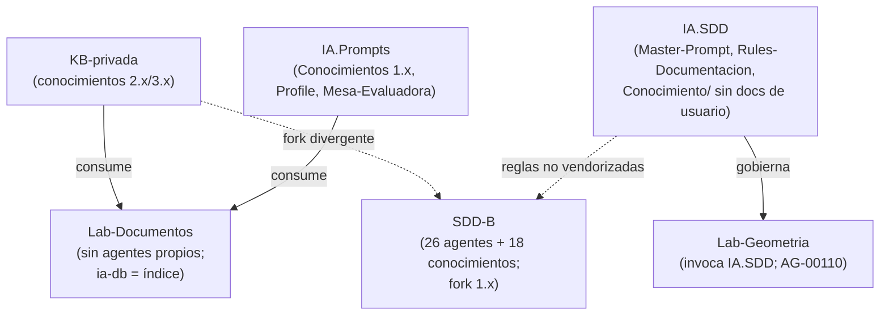

# N06 — Marco SDD compartido, conocimientos comunes y orquestadores

| Campo | Valor |
|---|---|
| **Id** | N06 |
| **Título** | Qué tienen en común los dos marcos SDD (Lab-Documentos y el servicio de notificaciones push, privado, «SDD-B»), qué conocimientos pueden compartir y cómo mejorar sus agentes orquestadores para incorporar la metodología |
| **Autor (rol)** | Despacho N00 — descomposición conceptual (subagente de la presidencia). No vota ni decide |
| **Fecha** | 2026-10-26 |
| **Fuentes leídas** | El tool-prompt completo y las doce bitácoras R01–R07 e I01–I05, completas |
| **Modo** | Sólo lectura; única escritura en `OUTPUTs/Bitacoras/`. El SDD-B se nombra con alias (`<SDD-B>` repo de código, `<SDD-B.Doc>` repo de documentación), como en R04 |

## Índice

1. [Alias de rutas](#1-alias-de-rutas)
2. [Definición del núcleo](#2-definición-del-núcleo)
3. [Ideas del prompt que agrupa](#3-ideas-del-prompt-que-agrupa)
4. [Definiciones](#4-definiciones)
5. [Hallazgos de las bitácoras](#5-hallazgos-de-las-bitácoras)
6. [Contradicciones a resolver](#6-contradicciones-a-resolver)
7. [Preguntas abiertas para la mesa](#7-preguntas-abiertas-para-la-mesa)
8. [Criterios de validación del núcleo](#8-criterios-de-validación-del-núcleo)
9. [Dependencias con otros núcleos](#9-dependencias-con-otros-núcleos)
10. [Especialistas sugeridos](#10-especialistas-sugeridos)
11. [No verificado](#11-no-verificado)

---

## 1. Alias de rutas

| Alias | Ruta absoluta |
|---|---|
| `TP` | `/LAB/Lab-Documentos/Lab-Documentos.Documentacion/PROMPTs/DEVs/Enchacement/01-Replanteo-Y-Analisis/Replanteo-Y-Analisis.md` |
| `B/` | `/LAB/Lab-Documentos/Lab-Documentos.Documentacion/PROMPTs/DEVs/Enchacement/01-Replanteo-Y-Analisis/OUTPUTs/Bitacoras/` |
| `R0n`, `I0n` | `B/<Id>-<Slug>.md` |

## 2. Definición del núcleo

El pedido afirma que los dos marcos SDD «se basan en agentes orquestadores y en conocimientos que pueden compartir» (`TP:18`) y cierra la secuencia de trabajo con «mejorando los agentes orquestadores de ambos para ser aplicado luego en el diseño de nuevos sitemas» (`TP:30`). Este núcleo junta esas dos ideas porque son el **vehículo de reutilización** de la metodología: lo que la mesa decida sólo llega a nuevos sistemas si queda escrito como conocimiento compartido y si los orquestadores lo cargan.

**Qué no es.** No es la metodología (N04) ni la piloto (N07). Es el lugar donde la metodología se convierte en **norma reutilizable** y donde se decide cómo se versionan y propagan los conocimientos entre marcos.

## 3. Ideas del prompt que agrupa

| # | Idea | Cita literal (resumida) | Línea |
|---|---|---|---|
| 6.1 | Lab-Documentos tiene su propio marco SDD | «`/LAB/Lab-Documentos/Lab-Documentos.Documentacion/ia-db/README.md`, el cual tiene su propio marco SDD de diseño asistido por IA» | `TP:18` |
| 6.2 | El servicio push (privado) tiene su propio SDD | «y por otro lado tenemos `<SDD-B.Doc>/ia-db/README.md` con su propio SDD» | `TP:18` |
| 6.3 | Ambos sobre orquestadores y conocimientos compartibles | «pero ambos se basan en agentes orquestadores y en conocimientos que pueden compartir» | `TP:18` |
| 6.4 | Establecer un conocimiento desde la piloto | «se puede empezar una prueba piloto en con `Geometria` establecer un conocimeinto» | `TP:30` |
| 6.5 | Mejorar los orquestadores de ambos | «finalmente aplicarlo a `<SDD-B>` (nombre ofuscado) mejorando los agentes orquestadores de ambos» | `TP:30` |
| 6.6 | Para nuevos sistemas | «para ser aplicado luego en el diseño de nuevos sitemas» | `TP:30` |

## 4. Definiciones

| Término | Definición | Fuente |
|---|---|---|
| Orquestador (en este workspace) | El **marco** que coordina agentes (presidencia, relator, jurado, auditor), no un agente persistente en el repo | `R03:65` |
| ia-db | Base de conocimiento **derivada** (índices destilados) para que un agente lea el proyecto sin recorrerlo entero | `R03:61`, `R04:52-53` |
| Conocimiento | Documento `Knowledge-*.md` con oficio reutilizable, catalogado en un `Index-Knowledge.md` | `R04:227-229` |
| Fork divergente | Copia local de un conocimiento que evolucionó por separado de la base común | `R04:263-270` |
| Apartamiento declarado | Desvío local y reversible de una regla del framework, registrado con su ADR | `R06:215` |

## 5. Hallazgos de las bitácoras

| Id | Hallazgo | Evidencia |
|---|---|---|
| N06-H01 | La ia-db de Lab-Documentos.Documentacion **no es un marco SDD**: indexa guías; no define agentes ni ciclo de especificación. El marco real es de workspace (Mesa-Evaluadora, Knowledge-Mesa-*, Profile, tool-prompts de indexado) | `R03:141-156`, `R03:228-234`, `R03:404` |
| N06-H02 | Los agentes `AG-ROOT…AG-11` de Lab-Documentos son fichas de estudio importadas, con dos numeraciones que no coinciden; la propia ia-db pide no darlos por vigentes | `R03:147-150`, `R04:175-178` |
| N06-H03 | El SDD-B tiene un pipeline operativo de 26 agentes `AG-FF_NN`: tres orquestadores de fase, cuatro compuertas, un bibliotecario del conocimiento, prioridad de fuentes en seis niveles, modo reincorporación y cuarta vía por expediente | `R04:157-198` |
| N06-H04 | En la práctica los agentes del SDD-B no se usan: ningún `AG-*` cambió en la última ventana y las compuertas de lectura no corren desde el 2026-08-29; lo vivo es la mesa a pedido dentro de expedientes | `R04:190-193` |
| N06-H05 | En el SDD-B la norma se mueve por expedientes sin asiento en el acta; la cuarta vía existe en el texto pero no se ejerció | `R04:213-214`, `R04:322-323` |
| N06-H06 | La cuarta vía del SDD-B depende de reglas de `IA.SDD` que no están vendorizadas en el repo | `R04:195-198` |
| N06-H07 | Los prompts de Lab-Documentos pasaron de Mesa-Evaluadora (septiembre–octubre) a Knowledge-Mesa-* (Concepts y este replanteo) | `R03:240-247` |
| N06-H08 | `Knowledge-Mesa-De-Expertos-A-Pedido` existe en tres versiones (3.1 en KB-privada, 1.2 en IA.Prompts, 1.15 en el SDD-B); `Consulta-A-Un-Tercero` en dos | `R03:256-267` |
| N06-H09 | Los 14 homónimos del SDD-B están en 1.x/2.x frente a 2.x/3.x en KB-privada; el repo de doc del SDD-B ya rige por la 2.0 de conformación de PR mientras el de código guarda la 1.0: dos fuentes vivas sin sincronización | `R04:263-270` |
| N06-H10 | De los 18 conocimientos del SDD-B, los directamente aplicables a DocAsCode son cinco genéricos: Mesa-De-Expertos-A-Pedido, Conformación de PR manual y automático, Versionado-Producto-Integral, Release-Y-Despliegue-Versionado | `R04:236-261` |
| N06-H11 | Geometría no tiene orquestadores propios: invoca los de IA.SDD; el subagente dueño de la documentación, AG-00110, sólo corrió el Momento 1 | `R06:199-209` |
| N06-H12 | La base `Conocimiento/` de IA.SDD no tiene ningún conocimiento de documentación de usuario ni de *docs as code* | `R06:211` |
| N06-H13 | `Rules-Documentacion.md` de IA.SDD deja fuera del framework la documentación para el usuario final no técnico (líneas 102, 723, 801, 1003); los roles son integrador, mantenedor y operador | `R06:112-119` |
| N06-H14 | Mejoras propuestas por R06 (criterio propio de R06): apartamiento declarado para la piloto en lugar de cambiar la norma; Momento 2 efectivo de AG-00110; validador documental en CI; indexado anclado a etiqueta; migrar a 13.22 | `R06:213-220` |
| N06-H15 | Lecciones del SDD-B (criterio propio de R04): los conocimientos genéricos deberían tener una sola fuente (KB-privada) referenciada con versión; los índices para IA tienen que declarar su commit base y un disparador de regeneración | `R04:320-325` |
| N06-H16 | Candidatos a compartir que identifica R03 (criterio propio): marco de mesa/expediente, regla de descomposición en núcleos con cohesión, tool-prompt de indexado, conformación de PR | `R03:269-272` |

*Diagrama: relaciones medidas en `R03:228-272`, `R04:195-198`, `R04:263-270` y `R06:199-211`.*

## 6. Contradicciones a resolver

| # | Contradicción | Evidencia | Dirección propuesta (criterio propio) |
|---|---|---|---|
| C1 | El pedido dice que la ia-db de Lab-Documentos tiene «su propio marco SDD»; lo relevado dice que es un índice | `TP:18` frente a `R03:141-156` | Que la mesa lo declare en el `ENUNCIADO` como dato corregido, no como agregado |
| C2 | La ayuda por rol de la guía §7 choca con `Rules-Documentacion` (usuario final fuera de alcance) y con la decisión de diseño de Geometría («El producto no lleva manual») | `R06:112-119` | Apartamiento declarado con ADR para la piloto, o cambio de norma; decide la mesa (cruza con N07) |
| C3 | Un conocimiento con tres versiones vivas no se puede «compartir» sin elegir fuente | `R03:256-267`, `R04:263-270` | Fuente única con referencia versionada, o fork declarado con regla de sincronización |
| C4 | El pedido pide «mejorar los agentes orquestadores» y en el SDD-B esos agentes no se usan | `TP:30` frente a `R04:190-193` | Mejorar lo que está vivo (mesa a pedido, expedientes) antes que el pipeline AG-xx; decide la mesa |

## 7. Preguntas abiertas para la mesa

1. ¿Dónde vive el conocimiento DocAsCode que resulte: KB-privada, `IA.SDD/Conocimiento/`, o ambos con uno como fuente? (`R06:236`; `R04:324-325`)
2. ¿Qué significa «mejorar los orquestadores» para cada marco: agregar una fase o subagente documental, cargar un conocimiento nuevo, o activar el Momento 2 de AG-00110? (`R06:213-220`)
3. ¿Se resuelve el choque con `Rules-Documentacion` por apartamiento declarado en la piloto o por cambio de norma que agregue un cuarto rol «usuario»? (`R06:215`)
4. ¿Qué mecanismo sincroniza los conocimientos entre la base común y las copias de cada proyecto? (`R04:270`)
5. ¿Se migra Geometría de SDD 13.16 a 13.22 antes de la piloto, o se declara que corre sobre 13.16? (`R06:97-98`, `R06:243`)
6. ¿Qué de la norma del SDD-B (prioridad de fuentes, reincorporación, delegación del merge) entra al marco común? (`R04:180-188`)
7. ¿Cómo se trae al repo del SDD-B la dependencia no vendorizada de `IA.SDD`? (`R04:195-198`)

## 8. Criterios de validación del núcleo

| # | Criterio | Cómo se verifica |
|---|---|---|
| V1 | Existe un inventario de conocimientos compartibles con fuente única declarada y versión | Tabla conocimiento → fuente → versión → consumidores |
| V2 | Cada mejora de orquestador nombra el archivo y la sección que cambia, y quién es su dueño (PO o mesa) | Lista de cambios propuestos con ruta |
| V3 | Ninguna mejora toca `PROMPTs/` del PO ni la norma de IA.SDD sin el mecanismo que la regla prevé | Contraste con `R06:219`, `R06:251` y la memoria «no tocar la norma» citada en `R06:215` |
| V4 | El conocimiento resultante es aplicable a un sistema nuevo sin leer el piloto | Lectura por el «lector sin contexto» del núcleo permanente |

## 9. Dependencias con otros núcleos

| Relación | Con | Qué fluye |
|---|---|---|
| Depende de | N04 | La metodología que se vuelve conocimiento |
| Depende de | N02 | El modelo de versión y fuente única aplicado a los conocimientos |
| Depende de | N03 | Cómo leen y escriben los orquestadores |
| Depende de | N05 | Las compuertas que los orquestadores disparan |
| Alimenta | N07 | La vía normativa de la piloto (C2) y la aplicación al SDD-B |
| Alimenta | N08 | La guía enseña cómo se integra la metodología a un SDD |

## 10. Especialistas sugeridos

| Perfil | Por qué | Señal |
|---|---|---|
| Especialista en marcos SDD y orquestación multiagente | Pipeline AG-xx, Master-Prompt, cuarta vía, Momento 2 de AG-00110 | `TP:18`, `TP:30`; `R04:157-198`; `R06:199-220` |
| Especialista en gestión del conocimiento (catálogo, versiones, forks) | Tres versiones de un mismo conocimiento; fuente única | `R03:256-267`; `R04:263-270` |
| Arquitecto de software .NET | Conocimientos .NET (NuGet, migraciones, Bundle-JS) y su aplicabilidad | `R04:243-251` |

## 11. No verificado

- El contenido de las versiones 2.x/3.x de KB-privada frente a las 1.x locales del SDD-B: sólo se compararon cabeceras (`R04:336`).
- Quién está regenerando la ia-db 16.0 del SDD-B (`R04:334`).
- La ejecución de las compuertas del SDD-B (`R04:335`).
