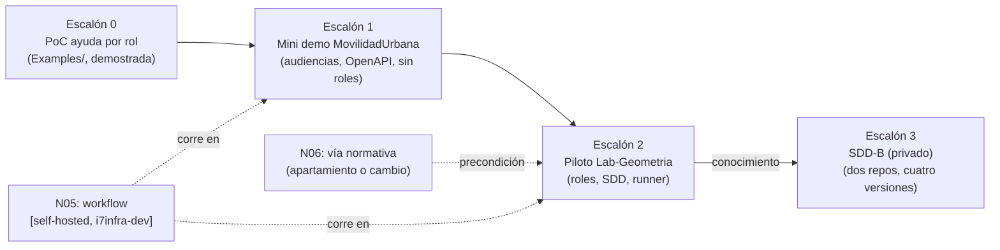

# N07 — Demostraciones, piloto y aplicación

| Campo | Valor |
|---|---|
| **Id** | N07 |
| **Título** | La metodología puesta a prueba en tres escalones: ejemplos y mini demo sobre MovilidadUrbana.MAUI, prueba piloto en Lab-Geometria y aplicación al servicio de notificaciones push (privado, «SDD-B») |
| **Autor (rol)** | Despacho N00 — descomposición conceptual (subagente de la presidencia). No vota ni decide |
| **Fecha** | 2026-10-26 |
| **Fuentes leídas** | El tool-prompt completo y las doce bitácoras R01–R07 e I01–I05, completas |
| **Modo** | Sólo lectura; única escritura en `OUTPUTs/Bitacoras/` |

## Índice

1. [Alias de rutas](#1-alias-de-rutas)
2. [Definición del núcleo](#2-definición-del-núcleo)
3. [Ideas del prompt que agrupa](#3-ideas-del-prompt-que-agrupa)
4. [Definiciones](#4-definiciones)
5. [Escalón 0: la prueba de concepto existente](#5-escalón-0-la-prueba-de-concepto-existente)
6. [Escalón 1: mini demo MovilidadUrbana.MAUI](#6-escalón-1-mini-demo-movilidadurbanamaui)
7. [Escalón 2: piloto en Lab-Geometria](#7-escalón-2-piloto-en-lab-geometria)
8. [Escalón 3: aplicación al SDD-B](#8-escalón-3-aplicación-al-sdd-b)
9. [Preguntas abiertas para la mesa](#9-preguntas-abiertas-para-la-mesa)
10. [Criterios de validación del núcleo](#10-criterios-de-validación-del-núcleo)
11. [Dependencias con otros núcleos](#11-dependencias-con-otros-núcleos)
12. [Especialistas sugeridos](#12-especialistas-sugeridos)
13. [No verificado](#13-no-verificado)

---

## 1. Alias de rutas

| Alias | Ruta absoluta |
|---|---|
| `TP` | `/LAB/Lab-Documentos/Lab-Documentos.Documentacion/PROMPTs/DEVs/Enchacement/01-Replanteo-Y-Analisis/Replanteo-Y-Analisis.md` |
| `B/` | `/LAB/Lab-Documentos/Lab-Documentos.Documentacion/PROMPTs/DEVs/Enchacement/01-Replanteo-Y-Analisis/OUTPUTs/Bitacoras/` |
| `R0n`, `I0n` | `B/<Id>-<Slug>.md` |

## 2. Definición del núcleo

El pedido arma una secuencia en una sola frase: crear demostraciones y ejemplos («podes montar una mini demo basado en `MovilidadUrbana.MAUI`»), «luego» una prueba piloto con Geometría que establezca un conocimiento, y «finalmente» aplicarlo al servicio push (`TP:30`). Los tres escalones son un solo núcleo por **dependencia fuerte**: cada uno toma como entrada lo que el anterior demostró, y los tres responden la misma pregunta —¿la metodología funciona sobre sistemas reales del workspace?—. Se suma el escalón 0, la prueba de concepto que ya existe en `Examples/` (`TP:16`), porque es la base técnica de los demás.

**Qué no es.** No escribe la guía (N08) ni define la metodología (N04); la **prueba**. R01 lee los escalones 2 y 3 como plan de corridas posteriores, no como alcance de ésta (`R01:172`).

## 3. Ideas del prompt que agrupa

| # | Idea | Cita literal (resumida) | Línea |
|---|---|---|---|
| 7.1 | Ejemplo de referencia: ia-db de Lab-E2E.WebBlazor sobre MovilidadUrbana.MAUI | «Leer `/LAB/Lab-E2E.WebBlazor/Lab-E2E.WebBlazor.Documentacion/ia-db/README.md` son ejemplos, referido al proyecto `MovilidadUrbana.MAUI`» | `TP:12` |
| 7.2 | Ejemplos y demostración existentes | «acompañado de ejemplos y/o demostración en `…/Examples`» | `TP:16` |
| 7.3 | Crear demostraciones y ejemplos | «Se puede enriqueser la guía actual, crear demostraciones y ejemplos» | `TP:30` |
| 7.4 | Mini demo MAUI como referencia inicial | «podes montar una mini demo basado en `MovilidadUrbana.MAUI` para usarlo de referencia inicial» | `TP:30` |
| 7.5 | Piloto en Geometría | «luego, se puede empezar una prueba piloto en con `Geometria` establecer un conocimeinto» | `TP:30` |
| 7.6 | Aplicación al servicio push | «y finalmente aplicarlo a `<SDD-B>` (nombre ofuscado)» | `TP:30` |
| 7.7 | Ensayos y resultados ante la mesa | «Los investigadores especializados pueden ensayar … se presenten y evaluen los resultados ante la mesa» | `TP:36` |

## 4. Definiciones

| Término | Definición | Fuente |
|---|---|---|
| Mini demo | Ejemplo ejecutable, mínimo y autocontenido que muestra fuente → validación → publicación | `R05:49` |
| Prueba piloto | Primera aplicación de la metodología a un sistema real, para extraer un conocimiento reutilizable | Criterio propio sobre `TP:30` |
| Audiencia frente a rol | Audiencia: tipo de lector (persona usuaria, desarrollador, consumidor de API, agente). Rol: privilegio de acceso en el sistema | `R05:120` |
| Derivar frente a generar | Generar: salida mecánica (referencia desde OpenAPI). Derivar: reescritura con traza (ayuda desde un CU) | `R05:47` |
| Traza (`traces`) | Metadato que apunta a la fuente que la página explica, con versión | `R05:48` |

## 5. Escalón 0: la prueba de concepto existente

| Id | Hallazgo | Evidencia |
|---|---|---|
| N07-E01 | La prueba de concepto «ayuda por rol» (consola + panel Blazor) se reprodujo el 2026-10-26: salida idéntica a `salida.txt` con 3 fallas; el panel dio 404 cruzado entre roles en HTML y `.md`, `llms.txt` por rol y respaldo de idioma con aviso | `R02:120-144`, `R02:179-185` |
| N07-E02 | Sólo propuesto: validación de frontmatter, cobertura CU→página, frescura de derivación y traducción, E2E, integración con Lab-Geometria, sitio interno; el validador corre al arrancar y sólo deja log | `R02:186-190` |
| N07-E03 | Inconsistencias: recuento de páginas que no cierra, `translation_of` con dos formatos, `401` previsto y `302` observado, `llms.txt` sin H2, imágenes `:latest` | `R02:208-251` |
| N07-E04 | El motor de la prueba de concepto puede ser la referencia técnica de la capa «ayuda al usuario» (criterio de R02) | `R02:338` |
| N07-E05 | Un devcontainer huérfano con la ruta vieja; `Lanzar-Example.md:21` mantiene `$P` en la ruta vieja | `R02:148`, `R02:203-206` |

## 6. Escalón 1: mini demo MovilidadUrbana.MAUI

| Id | Hallazgo | Evidencia |
|---|---|---|
| N07-M01 | La app es `net10.0-android`, sin servidor, con SQLite local; capas como carpetas de un solo proyecto; 18 pruebas de ViewModels y 5 Appium | `R05:58-71`, `R05:96-104` |
| N07-M02 | **No hay roles ni autenticación**; aísla por sesión (cookie, `X-Sesion-Id`, GUID en el dispositivo). La demo puede mostrar audiencias, no roles, y complementa la prueba de concepto sin repetirla | `R05:110-120`, `R05:266` |
| N07-M03 | No existe manual de usuario; hay 33 capturas reales del recorrido completo y 27 `AutomationId` estables | `R05:144-146`, `R05:164` |
| N07-M04 | El contrato OpenAPI real omite `X-Sesion-Id`, usa título por defecto y sólo existe en runtime: caso real de «fuente de verdad incompleta» | `R05:170-180`, `R05:268-269` |
| N07-M05 | Las reglas están triplicadas (Web, ApiWeb, MAUI); no hay CU ni RN numerados: hay que elegir fuente canónica y asignar identificadores para trazar | `R05:104`, `R05:272-273` |
| N07-M06 | Propuesta de R05 (criterio propio): unas 12 páginas (6 usuario con `traces`, 3 técnicas, 1 referencia generada + 1 guía «primer pedido»), un `llms.txt` y un workflow en `[self-hosted, i7infra-dev]` que valide enlaces, `traces` y lint del OpenAPI | `R05:218-228` |
| N07-M07 | Dónde vive queda abierto: junto al código (evidencia de enlaces rotos al separar) o en `Examples/` de Lab-Documentos; variante híbrida | `R05:230-236` |
| N07-M08 | La demo no debe inventar roles ni modificar Lab-E2E.WebBlazor sin expediente (la ia-db prohíbe renombrar textos, `AutomationId` y contratos) | `R05:238-241` |
| N07-M09 | Un cliente MAUI cambia el modelo de privilegios de la guía, que depende del render en servidor: o la ayuda viaja en el paquete (visibilidad, no confidencialidad) o se sirve desde un backend | `R02:346` |

## 7. Escalón 2: piloto en Lab-Geometria

| Id | Hallazgo | Evidencia |
|---|---|---|
| N07-G01 | No hay nada construido de la ayuda por rol en Lab-Geometria (`/ayuda` → 404); las piezas que la propuesta reutiliza existen (`Role`, claim `gf:role`, `SessionState`, `NotFoundSurface`, batería Playwright) | `R06:175-191` |
| N07-G02 | **Choque con la norma y con el diseño**: `Rules-Documentacion` excluye al usuario final no técnico, y el SDD del destino declara «El producto no lleva manual» | `R06:112-119`, `R06:242` |
| N07-G03 | Trazas mal apuntadas en la guía: deriva de `CU-00021…29` (unidad Api); las pantallas están en `CU-10001…10010` (unidad Web) | `R06:193`, `R06:248` |
| N07-G04 | El SDD del destino está en 13.16 y el framework en 13.22; un solo expediente resuelto; etapa `i` abierta | `R06:97-103` |
| N07-G05 | La categoría 11 (documentación) quedó en el plan inicial, con inconsistencias de versión, trazas a un manifiesto viejo y una afirmación falsa sobre contenedores | `R06:106-110` |
| N07-G06 | Hay otra corrida escribiendo hoy en la ia-db del repo auxiliar (regeneración sin commitear y un PR abierto): no conviene tocar `ia-db/` hasta que cierre | `R06:127-131`, `R06:244` |
| N07-G07 | Lo productivo se construye desde `main` y lo despliega el PO; el agente no despliega | `R06:161-171`, `R06:249` |
| N07-G08 | Reparto propuesto por R06: NB/CU/ADR, revisión de `Experiencia-De-Uso.md`, páginas `Ayuda/es/`, catálogo, validador y E2E en el repo de código; ia-db y lecciones en el auxiliar; conocimiento reutilizable en KB-privada o `IA.SDD/Conocimiento/` | `R06:226-236` |
| N07-G09 | Secuencia sugerida por R06: decidir vía normativa y trazas → SDD → catálogo y validador en CI → páginas → contextual, `.md`, `llms.txt`, E2E → cobertura y frescura → conocimiento para el SDD-B | `R06:284-292` |

## 8. Escalón 3: aplicación al SDD-B

| Id | Hallazgo | Evidencia |
|---|---|---|
| N07-P01 | Documentación en dos repos con reparto de roles; el repo de doc sin versión propia; un único control `verificar` agregado el 2026-10-26 | `R04:67-102` |
| N07-P02 | 14 problemas de desfase y coordinación registrados (especificación que no siguió al código, carátulas atrasadas, rutas cruzadas rotas, registro de despliegues incompleto, secretos versionados, ia-db a medio regenerar) | `R04:281-296` |
| N07-P03 | El SDD-B resolvió con scripts propios lo que tiene herramienta estándar (guardias de versión, encabezado/historial de documentos, vocabulario neutro) | `I02:335`, `I02:341-342` |
| N07-P04 | Lecciones (criterio propio de R04): la cercanía física no evita el desfase sin compuerta; citar por identificador estable; declarar commit base de los índices; el expediente como unidad de trazabilidad | `R04:315-326` |

## 9. Preguntas abiertas para la mesa

1. ¿La mini demo es alcance de esta corrida o del plan? ¿Y la piloto y la aplicación al SDD-B? (`R01:172`)
2. ¿Dónde vive la mini demo: junto al código de Lab-E2E.WebBlazor, en `Examples/` de Lab-Documentos, o híbrida? (`R05:230-236`)
3. ¿Qué demuestra cada escalón que el anterior no demostró? Propuesta: E0 roles y confidencialidad en servidor; E1 audiencias, fuente generada (OpenAPI) y cliente sin servidor; E2 integración con un SDD real y su CI; E3 dos repos y versionado multi-pieza (criterio propio).
4. Para la piloto, ¿apartamiento declarado con ADR o cambio de `Rules-Documentacion`? ¿Se migra a 13.22 antes? (cruza con N06; `R06:286`)
5. ¿Qué traza usa el contrato `traces`: `CU-100NN` para pantallas y `CU-000NN`/`RN-` para reglas? (`R06:193`)
6. ¿Cómo se trazan reglas sin identificador en MovilidadUrbana: asignando `RN-LOC-01` o trazando a `ruta:constante`? (`R05:190`, `R05:272`)
7. ¿Se corrigen primero las deudas del escalón 0 (enlaces, `$P`, devcontainer huérfano, `302`/`401`) antes de construir encima? (`R02:339-343`)
8. ¿Qué evidencia y qué ensayos se presentan a la mesa en cada escalón, y en qué expediente? (`TP:36`; `R01:277-279`)

## 10. Criterios de validación del núcleo

| # | Criterio | Cómo se verifica |
|---|---|---|
| V1 | Cada escalón tiene objetivo, alcance, sistema, qué demuestra y criterio de éxito medible | Ficha por escalón en el dictamen |
| V2 | La mini demo no inventa roles y no modifica el repo de código sin expediente | Revisión del diff contra `R05:238-241` |
| V3 | Cada demo trae al menos un defecto plantado que el validador detecta (prueba negativa) | Salida del CI con el defecto en rojo |
| V4 | La piloto declara su vía normativa antes de construir | Folio o ADR que la asiente |
| V5 | El conocimiento extraído de la piloto se puede aplicar al SDD-B sin leer la piloto | Lectura del lector sin contexto |
| V6 | Ninguna escritura concurrente sobre la ia-db de Geometría mientras la otra corrida siga abierta | `git status`/PR del repo auxiliar al momento de escribir |

## 11. Dependencias con otros núcleos

| Relación | Con | Qué fluye |
|---|---|---|
| Depende de | N04 | El ciclo que se prueba |
| Depende de | N02 | Dónde vive cada demo y cuál es su ancla |
| Depende de | N03 | Audiencia agente, `llms.txt`, `.md` por página |
| Depende de | N05 | Workflow y compuertas sobre el runner |
| Depende de | N06 | Vía normativa de la piloto y destino del conocimiento |
| Alimenta | N08 | Ejemplos reales y capturas que la guía enriquecida cita |

## 12. Especialistas sugeridos

| Perfil | Por qué | Señal |
|---|---|---|
| Arquitecto de software .NET con experiencia en MAUI y Blazor | Cliente sin servidor, render estático, catálogo incrustado, `TreatWarningsAsErrors` | `TP:36`; `R05:58-71`; `R06:250` |
| Analista de sistemas | CU/RN, trazas, reparto de piezas por repo | `TP:36`; `R06:193`, `R06:226-236` |
| Especialista en pruebas E2E (Playwright, Appium) | Acceso por rol, capturas regenerables | `R05:191-192`; `R06:190` |
| Investigador ensayista (perito) | Ensayos de una variable sobre las demos | `TP:36`; `R01:277-279` |

## 13. No verificado

- El devcontainer de la prueba de concepto en sí (se probó con la imagen del SDK) (`R02:120`).
- Generar OpenAPI en build y DocFX sobre `net10.0-android` en MovilidadUrbana (`R05:290-291`).
- El estado del PR abierto del repo auxiliar de Geometría y la ausencia de localización en `src/` (`R06:296-297`).
- Que YamlDotNet o Markdig compilen sin advertencias en Lab-Geometria (`R06:299`).
