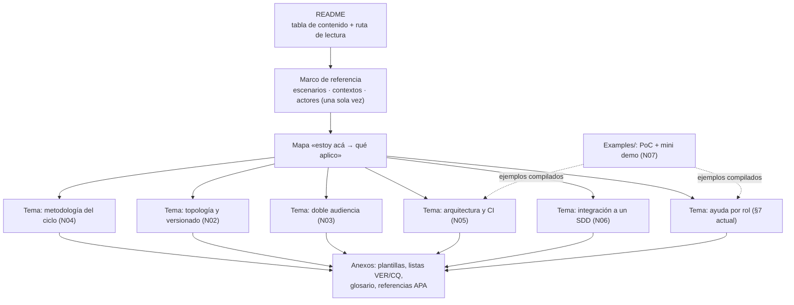

# N08 — Enriquecimiento de la guía y material formativo

| Campo | Valor |
|---|---|
| **Id** | N08 |
| **Título** | Cómo se enriquece `Sistema-Documentador-Tecnico-Guide.md` y sus ejemplos para que sea una guía de estudio conforme al Profile, con citación académica, criterios de calidad y ejemplos de consulta |
| **Autor (rol)** | Despacho N00 — descomposición conceptual (subagente de la presidencia). No vota ni decide |
| **Fecha** | 2026-10-26 |
| **Fuentes leídas** | El tool-prompt completo y las doce bitácoras R01–R07 e I01–I05, completas |
| **Modo** | Sólo lectura; única escritura en `OUTPUTs/Bitacoras/` |

## Índice

1. [Alias de rutas](#1-alias-de-rutas)
2. [Definición del núcleo](#2-definición-del-núcleo)
3. [Ideas del prompt que agrupa](#3-ideas-del-prompt-que-agrupa)
4. [Definiciones](#4-definiciones)
5. [Hallazgos sobre la guía actual](#5-hallazgos-sobre-la-guía-actual)
6. [Hallazgos sobre forma, calidad y citación](#6-hallazgos-sobre-forma-calidad-y-citación)
7. [Contradicciones a resolver](#7-contradicciones-a-resolver)
8. [Preguntas abiertas para la mesa](#8-preguntas-abiertas-para-la-mesa)
9. [Criterios de validación del núcleo](#9-criterios-de-validación-del-núcleo)
10. [Dependencias con otros núcleos](#10-dependencias-con-otros-núcleos)
11. [Especialistas sugeridos](#11-especialistas-sugeridos)
12. [No verificado](#12-no-verificado)

---

## 1. Alias de rutas

| Alias | Ruta absoluta |
|---|---|
| `TP` | `/LAB/Lab-Documentos/Lab-Documentos.Documentacion/PROMPTs/DEVs/Enchacement/01-Replanteo-Y-Analisis/Replanteo-Y-Analisis.md` |
| `B/` | `/LAB/Lab-Documentos/Lab-Documentos.Documentacion/PROMPTs/DEVs/Enchacement/01-Replanteo-Y-Analisis/OUTPUTs/Bitacoras/` |
| `R0n`, `I0n` | `B/<Id>-<Slug>.md` |
| `GUIA` | `/LAB/Lab-Documentos/Lab-Documentos/Guides/Documentacion-Tecnica/Sistema-De-Documentacion-E-Integracion/Sistema-Documentador-Tecnico-Guide.md` |

## 2. Definición del núcleo

Es el **entregable** que el pedido nombra: «se debe enriquecer la guía `Sistema-Documentador-Tecnico-Guide.md` y los ejemplos/demos anexados» (`TP:20`), con el Profile `Study-Guide-Documentation` (`TP:65-68`) y las reglas de forma de `TP:42`. Reúne también el pedido de «academicos en edición de material bibliografico para consultar y crear ejemplos y material de consulta» (`TP:36`), porque la edición académica es la que fija cómo se cita, cómo se evalúa la calidad y cómo se diseñan los ejemplos de esa guía. Es el **punto de integración** de los demás núcleos: cada uno aporta contenido que la guía tiene que enseñar.

**Qué no es.** No decide la metodología, la topología ni la arquitectura; las **expone** como cuerpo documental. La deuda inmediata de la guía (enlaces rotos, frontmatter, citas) sí puede tratarse antes que el resto.

## 3. Ideas del prompt que agrupa

| # | Idea | Cita literal (resumida) | Línea |
|---|---|---|---|
| 8.1 | La guía existente como punto de partida | «contamos con esto: `…/Sistema-Documentador-Tecnico-Guide.md`» | `TP:15` |
| 8.2 | Enriquecer la guía y los ejemplos | «se debe enriquecer la guía `Sistema-Documentador-Tecnico-Guide.md` y los ejemplos/demos anexados» | `TP:20` |
| 8.3 | Enriquecer, crear ejemplos | «Se puede enriqueser la guía actual, crear demostraciones y ejemplos» | `TP:30` |
| 8.4 | Académicos para material de consulta | «cita tambien academicos en edición de material bibliografico para consultar y crear ejemplos y material de consulta» | `TP:36` |
| 8.5 | Forma de los documentos | «organizados en secciones jerárquicas … definiciones, explicaciones, ejemplos claros y … gráficos mermaid. Debe ser autocontenida y no delta. Los documentos creados deben tener índices» | `TP:42` |
| 8.6 | Profile de guía de estudio | «Aplicar: `/IA/IA.Prompts/PromptFramework/Profiles/Study-Guide-Documentation.md`» | `TP:65-68` |
| 8.7 | Estudio profundo | «así que hace falta un estudio profundo» | `TP:20` |

## 4. Definiciones

| Término | Definición | Fuente |
|---|---|---|
| Guía de estudio (Profile) | Recorrido de aprendizaje, no colección de fichas; README con ruta de lectura, marco de escenarios/contextos/actores, un documento por tema con seis secciones fijas, anexos y glosario | `R07:78`, `R07:178-201` |
| Documento temático | Definición · Aplicación por escenario · Ejemplos concretos · Preguntas guía · Criterios de calidad · Anexo con plantilla | `R07:193-201` |
| *Study-note* | Tipo con que la guía actual se declara a sí misma (`doc_type: study-note`) | `R02:48` |
| Ejemplo trabajado | Problema resuelto paso a paso estudiado antes de uno equivalente | `I05:64` |
| CQ-nn | Criterio de calidad con pregunta de verificación y fuente (I05) | `I05:198-213` |
| PE-nn | Patrón para crear ejemplos y material de consulta (I05) | `I05:276-289` |

## 5. Hallazgos sobre la guía actual

| Id | Hallazgo | Evidencia |
|---|---|---|
| N08-H01 | La guía (`DOC-SDT-0001`, 759 líneas, 12 secciones numeradas más resumen ejecutivo) no tiene índice; es sólida en evidencia externa y declara bien sus interpretaciones; su eje es la ayuda al usuario de un panel, no una metodología general | `R02:58`, `R02:90` |
| N08-H02 | Los ocho enlaces internos (cinco destinos distintos) `../Documentacion-Tecnica/…` están rotos desde la reorganización `9162e07`; la guía predica un validador de enlaces que no se aplica a sí misma | `R02:199` |
| N08-H03 | El recuento de páginas de la ayuda no cierra entre guía, README y prueba de concepto; `translation_of` tiene dos formatos; `status: draft` contra la convención `vigente|borrador|obsoleto`; `DOC-ADR` repetido en `traces`; cita de ACT-10 no literal | `R02:208-233` |
| N08-H04 | Huecos frente al pedido: sin análisis del patrón `.Documentacion` ni mecanismos multi-repo; sin ancla de versión entre repos; 0 menciones de CODEOWNERS, workflows o runner; 0 de orquestadores, MCP o `AGENTS.md`; sin requisitos documentales ni integración verificada; 0 de MAUI | `R02:286-294` |
| N08-H05 | Contra el Profile: cumple preguntas guía, glosario, mermaid y trazabilidad; no cumple README e índice, un documento por tema con estructura fija, ni sección de criterios de calidad; marco de referencia parcial con enlaces rotos | `R02:302-319` |
| N08-H06 | Las secciones 5 a 8 nacieron de una discusión que no quedó registrada (el `OUTPUTs/` del prompt 14 está vacío) | `R02:263-265` |
| N08-H07 | Le faltan las normas 2651x, C4, MADR, Structurizr, docToolchain, minimalismo, análisis de tareas y arquitectura de información; cita 12207:2017 cuando hay 12207:2026 | `I04:382-386` |
| N08-H08 | Presenta `llms.txt` como «adoptada» cuando es una propuesta; no trata `AGENTS.md`, MCP, inyección de prompt ni chunking | `I03:338-347` |
| N08-H09 | La guía del documentador cita por dominio, sin autor ni anexo de referencias; la guía .NET ya usa autor-año tipo APA con fecha de consulta y marcas `[Compilado:]` | `I05:241-245` |
| N08-H10 | No tiene ejercicios de transferencia (la guía .NET sí, en `Dot-NET-Arquitectura-Guide.md:2612`) | `I05:150-153` |

## 6. Hallazgos sobre forma, calidad y citación

| Id | Hallazgo | Evidencia |
|---|---|---|
| N08-F01 | R07 convirtió el Profile, su RuleSet y el tool-prompt en 104 ítems `VER-…` en 14 grupos; reutilizables como anexo «listas de verificación» | `R07:128-315`, `R07:372` |
| N08-F02 | La ruta del framework que citan RuleSet, Profile y tool-prompt no existe; es convención escrita en el README del framework, no descuido aislado | `R07:120-124` |
| N08-F03 | El Profile no fija frontmatter ni prefijos de ID para guías de estudio, aunque `Rule-Dual-Audience` se lo delega | `R07:366`, `R07:371` |
| N08-F04 | Dos reglas del PO fuera del framework: enlaces con ruta completa desde la raíz del workspace; citas explicadas y materializadas con snippet | `R07:336-337` |
| N08-F05 | Criterios de calidad CQ-01…CQ-14 con fuente; cinco automatizables en CI (actualidad de rutas y símbolos, índice y anclas, formato de referencias, frontmatter, revisión según origen) | `I05:198-213`, `I05:231` |
| N08-F06 | Formato de citación propuesto: APA 7 en castellano dentro de ISO 690:2021, con fecha de consulta siempre (apartamiento declarado de APA porque `Rule-Evidences` la exige); campo `sources:` en el frontmatter | `I05:247-270` |
| N08-F07 | Patrones PE-01…PE-12 (problema conductor, ejemplo trabajado antes del ejercicio, ejemplo que compila con procedencia, contraejemplo rotulado, error previsto, instrucciones probadas en contenedor, *play testing*, fecha y versión visibles) | `I05:276-289` |
| N08-F08 | Al Profile le faltan objetivos de aprendizaje y ejercicios de transferencia (Krathwohl, Merrill); va como propuesta al dueño, no como cambio | `I05:150-153`, `I05:361` |
| N08-F09 | 26514:2022 excluye el material de cursos formales: no alcanza para guías de estudio, que necesitan además marco instruccional | `I05:125`, `I05:353` |
| N08-F10 | En `Guides/` hay 295 `.md`: 45 con fecha de consulta, 30 con sección de referencias, ninguno con DOI, 2 con `[Compilado:` | `I05:244` |

*Diagrama: estructura del Profile (`R07:178-201`) aplicada a los núcleos; la asignación de temas es criterio propio, a decidir por la mesa.*

## 7. Contradicciones a resolver

| # | Contradicción | Evidencia | Dirección propuesta (criterio propio) |
|---|---|---|---|
| C1 | `Rule-Markdown` pide enlaces relativos; el PO pide ruta completa desde la raíz | `R07:348` (T2) | Relativos dentro de un repo publicado; completos en bitácoras y respuestas |
| C2 | `Rule-Documentation` prohíbe lo hipotético; el pedido pide demos | `R07:351` (T5) | Ejemplos reales cuando existan; el resto rotulado ilustrativo con datos sintéticos |
| C3 | `Rule-All` prohíbe sobrescribir sin mandato; el pedido manda enriquecer la guía | `R07:357` (T11) | Mandato sólo para la guía y sus ejemplos, no para otros archivos |
| C4 | «Autocontenido» frente a «un dato vive en un solo documento» | `R07:354` (T8) | Definir en una frase donde se usa y enlazar a la definición canónica |
| C5 | La guía presenta la ayuda al usuario final como natural; la norma de IA.SDD la excluye | `R06:112-119` | Declararlo en la guía como decisión de diseño por contexto (cruza con N06 y N07) |

## 8. Preguntas abiertas para la mesa

1. ¿Se reestructura la guía en un cuerpo documental (README, marco, un documento por tema, anexos) o se enriquece el archivo único? R02 indica que el Profile exige lo primero (`R02:319`).
2. ¿Qué temas tiene el cuerpo y cuál es la ruta de lectura? ¿Coinciden con los núcleos N02–N06 más la ayuda por rol actual?
3. ¿Se corrige la deuda inmediata (enlaces, frontmatter, recuento, `translation_of`, cita de ACT-10, `$P`) antes del enriquecimiento, como unidad separada? (`R02:339-343`)
4. ¿Se adopta APA 7 en castellano con fecha de consulta siempre, y la guía del documentador como piloto de citación? (`I05:360`)
5. ¿Se adoptan CQ-01…CQ-14 y PE-01…PE-12 como anexos de la guía y como compuertas de N05 donde sea automatizable? (`I05:359`)
6. ¿Qué frontmatter y prefijos de ID fija la mesa para el cuerpo (hueco del Profile)? (`R07:371`)
7. ¿Se eleva al dueño del Profile la propuesta de objetivos de aprendizaje y ejercicios de transferencia, y la corrección de la ruta del framework? (`I05:361`; `R07:124`)
8. ¿Si se compra una sola norma, 26514:2022, para leer el cuerpo normativo que hoy sólo se conoce por índice? (`I04:365`)

## 9. Criterios de validación del núcleo

| # | Criterio | Cómo se verifica |
|---|---|---|
| V1 | El cuerpo cumple los ítems VER-G01…G10 y VER-T01…T07 del Profile | Lista de `R07:178-201` aplicada |
| V2 | Todo documento creado tiene índice, secciones jerárquicas, definiciones, ejemplos y es autocontenido | VER-M01…M11 (`R07:207-217`) |
| V3 | Cero enlaces internos rotos y cero citas sin autor, título y fecha | Validador de enlaces de N05; muestreo contra la plantilla APA de `I05:255-266` |
| V4 | Cada hueco de `R02:286-294` y de `I04:382-386` queda cubierto o declarado fuera de alcance con motivo | Tabla hueco → sección de la guía |
| V5 | Al menos un ejemplo por tema es real y compilado (PE-03) y uno pasó *play testing* (PE-09) | Marca `[Compilado:]` y registro del lector novato |
| V6 | La guía nueva se lee sin la vieja ni las bitácoras | Lectura del lector sin contexto |

## 10. Dependencias con otros núcleos

| Relación | Con | Qué fluye |
|---|---|---|
| Depende de | N01 | Reglas de forma y evidencia; Profile con ruta real |
| Depende de | N02, N03, N04, N05, N06 | Contenido de cada tema |
| Depende de | N07 | Ejemplos reales, capturas, demo |
| Alimenta | N05 | CQ automatizables como compuertas |

N08 es el **punto de integración** (ver N00 §9): la fase de integración que pide `TP:53` reconstruye el modelo completo como este cuerpo documental.

## 11. Especialistas sugeridos

| Perfil | Por qué | Señal |
|---|---|---|
| Académico en edición de material bibliográfico | Citación, referencias, material de consulta | `TP:36`; `I05:247-270` |
| Diseñador instruccional | Objetivos, ejemplos trabajados, ejercicios de transferencia, minimalismo | `I05:142-166` |
| Redactor técnico / arquitecto de información | Reestructurar la guía como cuerpo; Diátaxis; mapa de entrada | `R02:319`; `I04:210-225` |
| Lector sin contexto (núcleo permanente) | Autocontenido y *play testing* | `R01:233`; `I05:286` |

## 12. No verificado

- La autoría de las secciones 5 a 8 de la guía: la discusión que las originó no quedó registrada (`R02:265`).
- Cifras de OneSignal, GitHub y Kubernetes de la guía: verificadas el 2026-09-16/19, no reverificadas (`R02:191`).
- Texto completo de Aghajani 2019, Atkinson 2000 e ISO 690:2021 (`I05:364`).
- `RuleSet-Default.md` no se leyó; su composición se infiere (`R07:378`).
