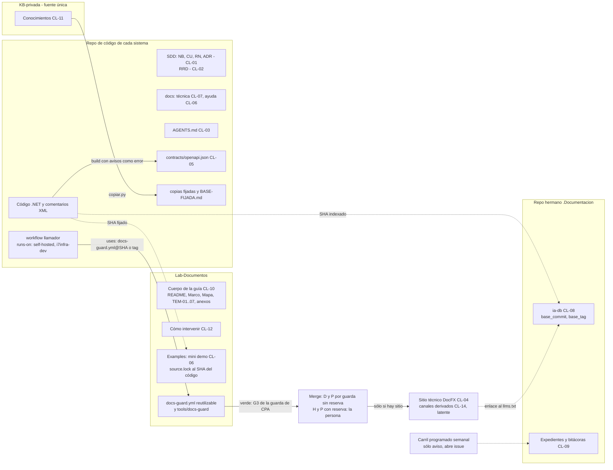
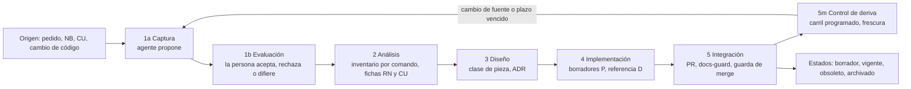
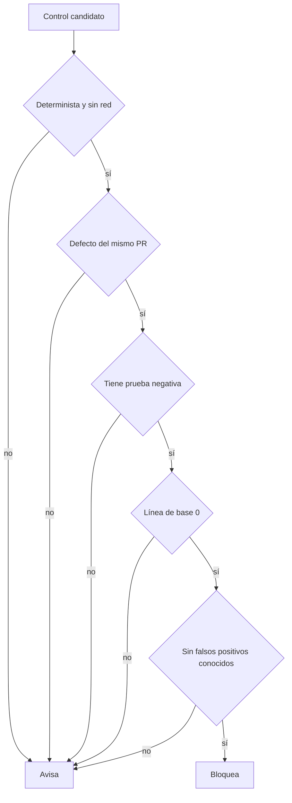
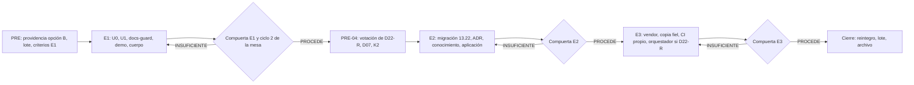

# N09 — Integración: el modelo completo

| Campo | Valor |
| --- | --- |
| **Id** | N09 |
| **Título** | Modelo completo del sistema documentador DocAsCode: metodología del ciclo, arquitectura de referencia, tabla única de piezas, contratos, escalones, conocimiento a catalogar y matriz de trazabilidad reverificada |
| **Autor (rol)** | Presidencia de la mesa (despacho P10), en la fase de integración que pide `TP:53` |
| **Fecha** | 2026-10-26 |
| **Fuentes leídas** | Tool-prompt (`TP`, 68 líneas — `wc -l` da 67 porque la última no termina en salto —, entero); `N00` §3, §6, §7 y §9; folios 001 (D1–D6), 002 §8, 004 §6–§7, 080 completo, 085 completo, 090 completo, 095 y 099 del expediente 0002; `R01` §10, §14, §15; `R07` §5; `KB-privada/Knowledges/Knowledge-Conformacion-Pull-Request-Automatico.md` §3; `ls` de los repos y herramientas citados |
| **Carpeta** | `/LAB/Lab-Documentos/Lab-Documentos.Documentacion/PROMPTs/DEVs/Enchacement/01-Replanteo-Y-Analisis/OUTPUTs/Bitacoras/` (en adelante `B/`) |

## Índice

1. [Qué es este documento](#1-qué-es-este-documento)
2. [Alias y definiciones](#2-alias-y-definiciones)
3. [Arquitectura de referencia del sistema documentador](#3-arquitectura-de-referencia-del-sistema-documentador)
4. [Metodología del ciclo documental](#4-metodología-del-ciclo-documental)
5. [Tabla única: pieza → topología → ancla → compuerta → audiencia → tema](#5-tabla-única-pieza--topología--ancla--compuerta--audiencia--tema)
6. [Variantes por tipo de sistema](#6-variantes-por-tipo-de-sistema)
7. [Contratos comunes](#7-contratos-comunes)
8. [Integración continua: dos carriles y la regla de bloqueo](#8-integración-continua-dos-carriles-y-la-regla-de-bloqueo)
9. [Escalones, hipótesis y compuertas](#9-escalones-hipótesis-y-compuertas)
10. [Conocimiento reutilizable a catalogar](#10-conocimiento-reutilizable-a-catalogar)
11. [Contradicciones entre núcleos, resueltas](#11-contradicciones-entre-núcleos-resueltas)
12. [Matriz de trazabilidad de N00 §7, reverificada](#12-matriz-de-trazabilidad-de-n00-7-reverificada)
13. [Observaciones](#13-observaciones)
14. [Lo no verificado](#14-lo-no-verificado)
15. [Excepciones a conocimientos y reservas](#15-excepciones-a-conocimientos-y-reservas)

---

## 1. Qué es este documento

`N00` §9 dejó definido el punto de integración y lo que tenía que consolidarse: las respuestas cerradas por pregunta,
las trece contradicciones resueltas, una tabla única pieza → topología → ancla → compuerta → audiencia → tema, el
conocimiento reutilizable con fuente única y versión, y la matriz de trazabilidad reverificada. Este documento hace
esa consolidación sobre el dictamen votado (folio 099) y reconstruye el modelo completo en una sola pieza. Sirve a
tres lectores: al PO, que decide el lote; a quien implemente los escalones con `N10`; y a la mesa del ciclo 2, que
juzga la compuerta E1 contra este modelo.

Lo que no es: no es la guía. La guía enriquecida (el cuerpo documental de D27) es el producto del escalón 1 y toma de
acá su contenido. Las respuestas pregunta por pregunta viven en el folio 099 §4; este documento las usa sin repetirlas.

**Cómo se lee una afirmación.** Lo que viene del dictamen cita su decisión (`Dnn`) y, a través de ella, el folio
que la funda. Lo que es juicio de la presidencia va rotulado **[criterio propio]**. Dos decisiones no tienen
dictamen votado (Q31 y Q34, por D22): donde el modelo las necesita, lo dice y aplica el default de `099` §5.1.

## 2. Alias y definiciones

### 2.1 Alias

| Alias | Ruta (desde la raíz del workspace) |
| --- | --- |
| `TP` | `/LAB/Lab-Documentos/Lab-Documentos.Documentacion/PROMPTs/DEVs/Enchacement/01-Replanteo-Y-Analisis/Replanteo-Y-Analisis.md` |
| `EXP/` | `/LAB/Lab-Documentos/Lab-Documentos.Documentacion/PROMPTs/DEVs/Enchacement/01-Replanteo-Y-Analisis/OUTPUTs/Expedientes/0002-Replanteo-Metodologia-DocAsCode/` |
| `F0nn` | Folio `EXP/actuaciones/0nn-…md` |
| `GUIA` | `/LAB/Lab-Documentos/Lab-Documentos/Guides/Documentacion-Tecnica/Sistema-De-Documentacion-E-Integracion/Sistema-Documentador-Tecnico-Guide.md` (759 líneas, `wc -l`) |
| `EXAMPLES` | `/LAB/Lab-Documentos/Lab-Documentos/Guides/Documentacion-Tecnica/Sistema-De-Documentacion-E-Integracion/Examples/` (hoy: `Lanzar-Example.md`, `Prueba-Ayuda-Por-Rol/`) |
| `LE` | `/LAB/Lab-E2E.WebBlazor/Lab-E2E.WebBlazor/` (MovilidadUrbana; `main` en `8fb4c3a`, 2026-09-18) |
| `GEO` | `/PROG2/Geometria/Lab-Geometria/` (`main` en `4b114d7`, 2026-09-15; 10 tags) |
| `IKB` | `KB-privada/` (`main` en `1585af9`, 2026-10-25) |
| `ISDD` | `/IA/SDD/IA.SDD/` (`main` en `d4035aa`, 2026-10-23) |
| `SDD-B` | El SDD del servicio de notificaciones push (privado) |

Los SHA y fechas se midieron con `git log -1 --format='%h %ad'` el 2026-10-26.

### 2.2 Definiciones

| Término | Definición |
| --- | --- |
| Sistema documentador | El conjunto de piezas, fuentes de verdad, repositorios, anclas de versión, compuertas, canales y actores (personas y agentes) que producen y mantienen la documentación de un sistema. Es el objeto de la «arquitectura clara» de `TP:36` según F001 D2 |
| Pieza documental | Una unidad que se escribe, se versiona y se valida por separado: un CU, un `AGENTS.md`, una página de ayuda, el `openapi.json` |
| Clase de pieza (`CL-nn`) | Categoría cerrada del catálogo de §5. Cada clase fija topología, fuente, ancla, compuerta, audiencia, canal, clase de intervención y tema (D03, D20) |
| Topología | Dónde vive la pieza respecto del código: en el mismo repo, en el repo hermano `.Documentacion`, en un repo dedicado, o como artefacto del build |
| Ancla de versión | El dato que dice contra qué estado del código vale la pieza: el commit, un SHA entre repos (`base_commit`) o un tag (D04) |
| Deriva | Distancia entre lo que la pieza afirma y lo que el código hace. Se detecta en el PR (bloquea) o en el carril programado (avisa) |
| Clase de intervención D/P/H | D: la produce un generador determinista. P: la propone un agente. H: sólo una persona (D08) |
| RRD | Registro de requerimientos documentales: una fila por requerimiento, con audiencia, tarea, pieza, criterio Dado/Cuando/Entonces y decisión de la persona (D14) |
| Compuerta | Control que corre en la CI y termina con un código de salida. Bloquea o avisa según la regla de §8.3 |
| `docs-guard` | El workflow reutilizable que corre las compuertas documentales (D17) |
| Escalón | Cada una de las tres etapas de `TP:30` (E1 demo y guía, E2 piloto Geometría, E3 SDD-B), con compuerta de dictamen (F001 D1) |
| `AI-n` | Chequeo anti-inyección de la compuerta (AI-1 comentarios HTML, AI-2 caracteres invisibles, AI-3 frases dirigidas al agente, AI-4 URL fuera de la lista de dominios, AI-5 HTML oculto). Antes «C1–C5» (corrección C-2) |
| `AK-n` | Control anti-inyección del sistema (AK-1 compuerta AI, AK-2 saneado en el build, AK-3 excepciones con huella, AK-4 lista de dominios, AK-5 job sin secretos, AK-6 lectura de fuentes externas sólo desde la lista, AK-7 fixture permanente en rojo). Antes «K1–K7» |
| `PR-n` | Grupo de controles del carril PR (§8.1). Antes «G1–G7» del diagrama de `080` §8.2. G1–G4 queda reservado a la guarda de merge de `CPA` |

## 3. Arquitectura de referencia del sistema documentador

### 3.1 Vista de conjunto

*Diagrama: un repo de código llama al workflow reutilizable de Lab-Documentos, que corre las compuertas en el runner
de la organización. El conocimiento baja de KB-privada por copia fijada. La demo y la ia-db se anclan al
código por SHA. El sitio y sus canales derivados existen sólo si un escalón publica sitio (D05).*

### 3.2 Componentes, responsabilidades y límites

| Componente | Responsabilidad | Límite (lo que no hace) | Decisión |
| --- | --- | --- | --- |
| KB-privada | Fuente única de los conocimientos compartidos, con versión | No se edita desde un consumidor: el consumidor trae una copia fijada | D21 |
| Repo de código | Fuente de verdad del comportamiento y de la especificación cuando hay SDD; emite la referencia (OpenAPI, XML) en el build | No aloja la guía de estudio | D03, D19 |
| Lab-Documentos | Cuerpo de la guía, ejemplos y mini demo; aloja la plantilla `docs-guard.yml` | No duplica el código: lo fija por SHA (`source.lock`) | D25, D27, D17 |
| Repo hermano `.Documentacion` | ia-db (índice interno para agentes), expedientes, bitácoras y prompts | La ia-db no es un marco SDD propio: es un índice (F001 D5) | D07, D15 |
| `docs-guard` | Correr las compuertas de §8 y devolver un código de salida | No escribe, no tiene secretos, no invoca agentes LLM (AK-5) | D17, D18 |
| Runner `[self-hosted, i7infra-dev]` | Ejecutar los jobs de los repos de su organización | Efímero: sólo persiste `/cache`; sin `docker.sock`; no existe en la organización del SDD-B (`085` T2) | D17 |
| Persona del equipo (PO) | Decide y aprueba lo de clase H, asienta la delegación, etiqueta y publica | No necesita aprobar cada PR de clase D o P sin reserva | D08 |
| Agentes | Proponen (P): fichas, borradores, reindexado, correcciones por deriva | No aceptan ADR, no deciden divergencias, no tocan lo de clase H | D08 |

### 3.3 Cómo se comporta en un caso concreto

Un desarrollador cambia, en MovilidadUrbana, el largo máximo del campo de comentario. Hoy la pantalla promete 60
caracteres y el campo admite 80 (defecto H-L07, F012 E-02; F013 E-A01). En el modelo:

1. La ficha `RN-LOC-01` de la mini demo declara la regla con su ancla `ruta#Símbolo@SHA` (D10).
2. La página de ayuda que menciona el límite lleva `traces: [RN-LOC-01@1.0]`.
3. La demo fija el código en `source.lock` (`8fb4c3a`). Contra ese SHA, `traces-resolve` resuelve y la compuerta da
   verde; contra `main` de `LE`, el carril programado detecta que el símbolo cambió y **avisa** (D25).
4. Si el cambio se fusiona en `LE`, un agente propone (P) actualizar la ficha y el `source.lock`; la compuerta corre
   en el PR, y con verde y sin reserva el merge lo hace la guarda (D08).
5. La decisión de si el límite correcto es 60 u 80 es una divergencia entre letra e intención: **la decide una persona**
   (acto H, `KDR:38`).

## 4. Metodología del ciclo documental

### 4.1 Fases

La metodología usa las cinco fases literales de `TP:26`, con la primera partida en captura y evaluación. El
mantenimiento no es una sexta fase: es control de deriva dentro de la fase 5 y disparador de reentrada a la 1a (D14).
La tabla lo muestra como fila propia, marcada «5m», para que se vea dónde vive.

### 4.2 Entradas, salidas y actores por fase

| Fase | Entradas | Salidas | Actor humano | Agente | Clase | Compuerta o control |
| --- | --- | --- | --- | --- | --- | --- |
| 1a Captura | Pedido, NB, CU, inventario de pantallas y endpoints | Filas del RRD en estado `propuesto` | — | Releva audiencias, tareas y piezas; propone filas | P | Esquema RRD (`PR-2`) |
| 1b Evaluación | Filas `propuesto` | Filas `aceptado`, `rechazado` o `diferido`, con `decide` y fecha | **Acepta, rechaza o difiere** cada fila | — | H | Toda fila tiene `decide` y criterio Dado/Cuando/Entonces |
| 2 Análisis | RRD aceptado, código, especificación | Inventario (salida de comando); fichas RN/CU con rótulo de certeza; informe de deriva | **Decide divergencias letra/intención** (`KDR:38`) | Genera inventario y fichas | D (inventario), P (fichas) | `traces-resolve` sobre fichas nuevas |
| 3 Diseño | Fichas, catálogo de clases | Clase asignada a cada pieza; ADR «Propuesto» | **Acepta ADR**, excepciones y confidencialidad | Redacta ADR y plantillas | P, H | Clase existente en el catálogo; clase nueva sólo por expediente |
| 4 Implementación | Diseño aceptado | Páginas en borrador; OpenAPI y XML emitidos; `.md` y `llms.txt` si hay sitio | — | Redacta borradores y traducciones | P (prosa), D (referencia) | `PR-1` a `PR-7` en el PR |
| 5 Integración | PR con compuertas | Merge; `status` actualizado; anclas fijadas | **Merge de H y de P con reserva**; pasar a `vigente`; deprecar, archivar, etiquetar, publicar | Reindexa índices generados; abre PR de corrección | D, P, H | Guarda G1–G4 de `CPA` con delegación asentada |
| 5m Control de deriva | Repos de la organización, `last_review` | Issue de aviso con lo que derivó | Prioriza el issue | Propone el PR de corrección (vuelve a 1a o a 4) | P | Carril programado (§8.2) |

### 4.3 El registro de requerimientos documentales (RRD)

**Dónde vive.** En un destino con SDD, en `02-Especificacion-Funcional/` de la unidad de entrega, por el ADR de
apartamiento de D23 (excepción E-5 de `099` §8). Sin SDD, en `docs/_requisitos.md` del árbol que documenta; en E1, el
de la mini demo. Si la documentación es una función del producto, el requerimiento va en NB/CU y el RRD lo referencia.

| Campo | Contenido | Ejemplo (ilustrativo, mini demo) |
| --- | --- | --- |
| `id` | `RD-NN` | `RD-03` |
| `audiencia` | Una sola | persona usuaria |
| `tarea` | Lo que la audiencia necesita lograr | cargar un comentario sin que se corte |
| `pieza` | Clase y archivo | `CL-06`, `docs/ayuda/comentarios.md` |
| `fuente` | `ID@versión` o línea del pedido | `RN-LOC-01@1.0` |
| `canal` | Dónde lo lee | `.md` en el repo (sin sitio) |
| `prioridad` | D (debe), C (conviene), O (opcional) | D |
| `criterio` | Dado/Cuando/Entonces e instrumento | Dado el límite de la regla, cuando la persona lee la ayuda, entonces el número coincide con el de la ficha; instrumento: `traces-resolve` |
| `estado` | `propuesto`, `aceptado`, `rechazado`, `diferido`, con motivo | aceptado |
| `decide` y `fecha` | Quién y cuándo | PO, fecha |

### 4.4 Estados del documento y plantilla de cláusula

Estados: `borrador` → `vigente` → `obsoleto` → `archivado`. Pasar a `vigente` es acto H y es el momento en que la
persona revisa la `description` (D09 con C-13). Toda cláusula de la metodología se escribe con la plantilla de F010
§5.1: `id`, `fase`, `sujeto`, `obliga`, `origen`, `dado/cuando/entonces`, `instrumento`, `nivel`. En la muestra de
F010 E1, 20 de 29 cláusulas no tenían criterio completo; reescritas con la plantilla, 24 de 24 quedaron completas.

### 4.5 Qué significa «clara» y qué significa «integración»

`TP:26` pide una metodología «clara». La claridad se mide con la prueba de lectura P-LECT de F012 §6: un lector sin
contexto recorre la ruta y anota las dudas que el texto no responde; el umbral es cero dudas sin respuesta (D26, G-e).
«Integración» tiene dos acepciones y el glosario de la guía las separa: en el ciclo del código, PR más CI; en el
producto, ayuda embebida y canal para agentes (D14).

## 5. Tabla única: pieza → topología → ancla → compuerta → audiencia → tema

Catálogo cerrado de catorce clases (D03, D20), con las correcciones C-2, C-7 y C-8 aplicadas. Una pieza nueva se
clasifica en una clase; si no encaja, se abre una clase por expediente.

| Clase | Pieza (ejemplo) | Topología | Fuente de verdad | Ancla de versión | Compuerta en CI (bloquea salvo indicación) | Audiencia | Canal | Intervención | Tema de la guía |
| --- | --- | --- | --- | --- | --- | --- | --- | --- | --- |
| CL-01 | Especificación: NB, CU, RN, ADR | Repo de código (`SDD/`, `docs/adr/`) | El `.md` | Commit más versión del CU/RN | Esquema, enlaces, registro de IDs | Analista, desarrollador, agente | Repo, ia-db | P redacta; H acepta ADR | TEM-02 |
| CL-02 | RRD | Con la especificación (SDD: `02-…`, excepción E-5; sin SDD: `docs/_requisitos.md`) | El `.md` | Commit | Esquema RRD; toda página de usuario traza a un `RD-` | Analista, PO, mesa | Repo | P propone; H evalúa | TEM-02 |
| CL-03 | `AGENTS.md` | Raíz de cada repo | El archivo | Commit | Existe y sus enlaces resuelven; excluido de AI-3 por ruta (AK-3) | Agente de código | Repo | **H** | TEM-04 |
| CL-04 | Referencia .NET (comentarios XML) | En el código | `///` con `GenerateDocumentationFile` | Commit (build) | `dotnet build -warnaserror`; `docfx --warningsAsErrors` si hay sitio | Desarrollador, agente | Sitio técnico y `.md` de API, si hay sitio | D | TEM-01, TEM-06 |
| CL-05 | Contrato REST (`openapi.json`) | En el código, emitido en build | Controladores y transformador | Commit | `git diff --exit-code`; aserción de encabezados; `oasdiff breaking` en E3 | Consumidor de API, agente | El JSON en el repo | D | TEM-06 |
| CL-06 | Ayuda al usuario final | Repo de la interfaz; en E1, `EXAMPLES` con `source.lock` | El `.md` con `traces` | Commit más versión del CU/RN trazado | Enlaces, `traces-resolve`, AI-1 a AI-5, cruce de rol si aplica | Persona usuaria; agente del usuario | App (con servidor) o `.md` (sin servidor) | P | TEM-05 |
| CL-07 | Técnica escrita (arquitectura, compilar, primer pedido) | Repo de código (`docs/tecnica/`) | El `.md` | Commit | Enlaces, frontmatter, mermaid | Desarrollador | Repo o sitio técnico | P | TEM-01 |
| CL-08 | ia-db e índices para agentes | Repo hermano `.Documentacion` | Los índices | `base_commit` (SHA) y `base_tag` | **Aviso** programado de atraso; estructura | Agente que trabaja en el repo | Repo; enlaza al `llms.txt` | P | TEM-04 |
| CL-09 | Expedientes, bitácoras, prompts | Repo hermano `.Documentacion` | El `.md` | Commit; citas al código por permalink | Enlaces, esquema de folio, barrido S2 | Mesa, PO, agente | Repo | P actúa; H resuelve | (gobierno; no es tema) |
| CL-10 | Guía de estudio (cuerpo) | Repo dedicado (Lab-Documentos) | El `.md` | Versión del cuerpo en el README y tag por compuerta | `docs-guard` completo: esquema, enlaces, AI, mermaid, lint, `reflint` | Estudiante, docente, agente | Repo (render de GitHub), sin sitio | P borrador; H vigente | (es el cuerpo) |
| CL-11 | Conocimientos compartidos | KB-privada | `Knowledge-*.md` | Versión y SHA-256 en `BASE-FIJADA.md` | `copiar.py --check` en el consumidor; aviso si la base avanza | Orquestadores, agentes | Copia fijada en cada repo | **H** | TEM-07 |
| CL-12 | Documento de proceso «Cómo intervenir» | Plantilla en el cuerpo; instancia por proyecto | El `.md` | Versión de la plantilla en `traces` | Bloques entradas/salidas/validaciones presentes; el paso «validar» usa el mismo comando que la CI | Persona del equipo, agente orquestador | Repo | **H** | Ruta «intervenir» |
| CL-13 | README y CHANGELOG (repo y paquete) | Mismo repo | El `.md` | Fecha o versión del paquete | Entrada en el PR | Desarrollador, consumidor del paquete | Repo o feed | P | TEM-03 |
| CL-14 | Canales derivados: `.md` por página, `llms.txt` público y por rol, agregado < 50 000 tokens, índice ID → ruta | Artefacto del build | Frontmatter y fuentes | Versión del build | Reproducibilidad (dos corridas, mismo diff), AI-1 y AI-2 | Agentes | Sitio | D | TEM-04 |

**CL-14 está latente**: ninguna variante la activa mientras no haya sitio (D05). Se activa con el primer sitio que
publique un escalón.

## 6. Variantes por tipo de sistema

Un tronco común (fases de §4, frontmatter y trazas de §7, catálogo de §5 y `docs-guard`) con cuatro variantes. Una
variante sólo activa, quita o sustituye clases y compuertas; nunca agrega fases (D13, con C-7).

| Parámetro | V1 Corpus de guías (Lab-Documentos) | V2 App cliente sin roles (MovilidadUrbana) | V3 Panel con roles (Geometría) | V4 Servicio con paquetes (SDD-B) |
| --- | --- | --- | --- | --- |
| Audiencias | Estudiante, docente, agente | Persona usuaria, desarrollador, consumidor de API, agente | Lo anterior más los roles del panel | Integrador, operador, agente |
| Clases activas | CL-02, CL-09, CL-10, CL-11, CL-12 | CL-02, CL-03, CL-04, CL-05, CL-06 (con fichas `RN-LOC` como anexo), CL-07, CL-12 | CL-01 a CL-08, CL-12 | CL-01 a CL-05, CL-07, CL-08, CL-11 a CL-13 |
| Clases inactivas (motivo) | El resto: no hay código propio | CL-01 (no hay SDD), CL-14 (no hay sitio) | CL-14 (sin sitio en E2) | CL-14 (sin sitio) |
| Confidencialidad | No aplica | Visibilidad (viaja en el paquete) | En el build y en el servidor | En el build y secretos |
| Fuente generada | — | OpenAPI (en E1, extraído en ejecución del SHA), `///` | OpenAPI, `///` | API pública de paquetes; `oasdiff` |
| Ancla | Versión del cuerpo y tag | SHA (`source.lock`) | Tag y SHA | Tag por línea de versión |
| Registro de IDs | `DOC-` y `corpus_id` | `RN-LOC-nn` provisionales | El del SDD | El del SDD |

## 7. Contratos comunes

| Contrato | Regla | Decisión |
| --- | --- | --- |
| Frontmatter | Los diez campos de `RDA:21` (`doc_id`, `doc_type`, `title`, `status`, `origin`, `confidence` si `origin ≠ human`, `owner`, `last_review`, `audience`, `traces`) más `description` obligatoria (≤ 160 caracteres, revisada por la persona en el PR que pasa a `vigente`). `corpus_id` y `version` sólo en el README del cuerpo. Vocabulario cerrado: `status` vigente/borrador/obsoleto; `origin` human/ia-assisted/ia-generated; `audience` cerrada. Esquema JSON por `doc_type` | D09 (C-13) |
| Prefijos de ID | Los de `CGT` más `TEM-`, `CQ-`, `PE-`, `OBJ-`, `EJR-`, `RD-` y `ref-`, con un registro cerrado | D09 |
| Trazas | Nivel 1: la página lleva `traces: [ID@MAJOR.MINOR]`. Nivel 2: la ficha del ID lleva `ruta#Símbolo@SHA` de dónde se declara, se verifica y se aplica. Pantalla → CU de su unidad; regla → RN de su unidad dueña; `CU-000NN` sólo API. El registro de IDs se genera de los encabezados. `traces-resolve` bloquea | D10 |
| Ancla de versión | Mismo repo: commit. Entre repos: `base_commit` obligatorio y `base_tag` cuando exista; la existencia del ancla bloquea y el desfase avisa. Guías: SemVer del cuerpo en el README y tag anotado por compuerta. Citas al código por permalink con SHA | D04 |
| Cita entre repos | `Repo@ancla:corpus_id/doc_id` con permalink. Dentro del cuerpo, enlaces relativos (la clave es el `doc_id`: excepción E-8). En expediente y bitácoras, ruta desde la raíz del workspace | D06 |
| Citación | APA 7 autor-año en castellano, siempre con fecha de consulta (excepción E-10); anexo de referencias con anclas `ref-…`; software con versión; fuentes en Git por versión o commit, nunca `main` | D28 |
| Publicación | Una sola versión publicada (`main`) con sello por página. Guías sin generador. DocFX 2.81 sólo para el sitio técnico .NET de un escalón | D05 |
| Canales para agentes | Siempre: Markdown con frontmatter, `AGENTS.md` puntero (clase H), ia-db, OpenAPI en build. Si hay sitio: `.md` por página, `llms.txt` rotulado «propuesta», agregado < 50 000 tokens. MCP fuera de E1–E3. La ia-db enlaza al `llms.txt`, nunca al revés | D07 |
| Intervención | D y P por la guarda G1–G4 sin reserva de `CPA` §3.4, con delegación asentada; H y P con decisión pendiente, la persona; la segunda identidad no aprueba a la primera; verificador ≠ redactor | D08 (alt. 2) |
| Unidad de cambio | El PR. Expediente sólo si se cumple una rama de `RE` §1. Reintegro con la fila `Reintegra` y A13/A15 de `Expediente-Rules` 1.1 | D15 |

## 8. Integración continua: dos carriles y la regla de bloqueo

### 8.1 Carril PR (bloqueante)

Corre en cada PR, en `[self-hosted, i7infra-dev]`, en un solo job del workflow reutilizable `docs-guard.yml` llamado
desde cada repo de la organización del runner (D17 por la alternativa_2), con `timeout-minutes: 10` y grupo de
concurrencia propio con cancelación en PR.

| Grupo | Controles | Bloquea |
| --- | --- | --- |
| PR-1 | Enlaces internos y anclas (`lychee --offline --include-fragments`); prohibición de relativos que salen del repo | Sí |
| PR-2 | Esquema de frontmatter, registro de prefijos, esquema RRD | Sí |
| PR-3 | Anti-inyección AI-1, AI-2, AI-4, AI-5. AI-3 avisa hasta que E-F10 deje su línea de base en 0. AI-4 sólo avisa en el anexo de referencias (C-14) | Sí (salvo lo indicado) |
| PR-4 | Mermaid que parsea; markdownlint estructural con MD013 apagado | Sí |
| PR-5 | `traces-resolve` (`ID@ver` contra el registro) | Sí |
| PR-6 | Diff del contrato OpenAPI | Sí |
| PR-7 | `copiar.py --check`; `reflint` en el cuerpo nuevo | Sí (`reflint` avisa en lo heredado) |

Los prototipos de estos controles ya existen como evidencia de las comisiones y se portan en E1-U2:
`EXP/evidencia/C-VERIFICACION/herramientas/` (`traces-resolve.sh`, `mermaid-parse.mjs`, `ocultos.mjs`,
`url-fecha.mjs`, `cita-linea.mjs`, `cuerpo.schema.json`, `ayuda.schema.json`, `markdownlint-cli2.jsonc`),
`EXP/evidencia/C-AGENTES-IA/herramientas/agent_channels.py` y `EXP/evidencia/C-ACADEMICO/scripts/reflint.py`
(`ls`, 2026-10-26).

### 8.2 Carril programado (aviso)

Semanal, sólo aviso, abre o actualiza un issue (permiso `issues: write`, excepción E-9). Corre sólo sobre los repos
públicos de la organización del runner, clonados en forma anónima, con una tabla versionada repo → ruta del workspace
(C-5). El SDD-B tiene su propio carril en su organización (L10).

| Control | Qué detecta |
| --- | --- |
| `lychee --root-dir` sobre el árbol armado | Enlaces entre repos y externos rotos |
| Atraso de `base_commit` | ia-db o demo contra `main` del código |
| Deriva del vendor y versión nueva en IKB | Copias fijadas desactualizadas |
| Frescura | `last_review` mayor a 365 días |

### 8.3 La regla de bloqueo

Un control bloquea sólo si cumple las cinco condiciones; si falla una, avisa (D18):

1. es determinista y no usa red;
2. el defecto lo introduce el mismo PR;
3. tiene prueba negativa (par rojo/verde);
4. su línea de base sobre el corpus que vigila es 0 (o llega a 0 en el saneamiento U1);
5. no da falsos positivos conocidos, o los canaliza por excepciones con huella.

### 8.4 Seguridad del runner

La guarda `if:` contra forks es higiene, no barrera: el archivo de workflow que corre en un PR desde un fork viene del
propio PR (`085` T2-3). La barrera es la configuración de la organización: aprobación obligatoria de corridas de forks
y grupo de runners limitado a repos elegidos. Son actos H del PO (fila L11).

## 9. Escalones, hipótesis y compuertas

### 9.1 Qué demuestra cada escalón

| Escalón | Afirma lo nuevo | Observable de aceptación | Prueba negativa |
| --- | --- | --- | --- |
| E0 (hecho) | Ayuda por rol con confidencialidad en el servidor | Sin rol → `401`; página de otro rol → `404` | Validador de la prueba de concepto con tres fallas plantadas → exit 1 |
| E1 | Audiencias sin roles; fuente generada del SHA; ancla SHA entre repos con aviso de deriva; trazas de dos niveles con `RN-LOC-nn`; CI en el runner | Piezas de la demo con su fila; `docs-guard` verde en el SHA con URL; aviso de deriva contra `main`; P-LECT con cero dudas sin respuesta | Defecto plantado por compuerta; el defecto real `RN-LOC-01` (60/80) en rojo hasta corregir la traza |
| E2 | Método dentro de un SDD real (IA.SDD 13.22); registro de IDs real; roles; ancla por tag; validador en el CI del repo de código | ADR de D23 previos a la primera rama; la ayuda de pantalla traza a `CU-100NN`; E2E de acceso por rol en verde | `traces-resolve` sobre traza desfasada e inexistente → 1 |
| E3 | Dos repos y varias líneas de versión; conocimiento de E2 aplicado sin leer la piloto; orquestador según D22-R si se aprueba | Tabla pieza → ancla resuelta en los dos repos; `copiar.py --check` y vendor verdes; un cambio de código dispara el aviso en el otro repo | SHA inexistente → 128; deriva del vendor → 1 |

Umbral provisional de «mini» para E1, hasta que lo lea el rol formal del ciclo 2: la demo cabe en un PR revisable
(≤ 20 piezas, 1 workflow, < 15 min en el runner) (`099` §7, RS-5).

### 9.2 La compuerta de cada escalón

Antes de cada escalón, un folio de criterios en el expediente 0002. El dictamen es un folio `resolucion` con el
paquete G-a a G-g (D26):

| # | Prueba | Umbral para `PROCEDE` |
| --- | --- | --- |
| G-a | Folio de criterios previo | Fecha anterior a la primera rama del escalón; cada criterio con instrumento |
| G-b | Corrida real en el runner | Una corrida verde sobre el SHA del merge, con URL y SHA copiados a `evidencia/`. En E3, en el runner de la organización del SDD-B |
| G-c | Prueba negativa | 100 % de las compuertas bloqueantes en rojo con su defecto plantado, en rama que no se fusiona |
| G-d | Trazas | 100 % de las `traces` del escalón resuelven |
| G-e | P-LECT | Cero dudas sin respuesta; en E2, paridad persona/agente |
| G-f | Barrido S2 | Vacío |
| G-g | Lista VER-* aplicable (`R07` §5) | 100 % de los obligatorios |

Corte: `PROCEDE` si las siete cumplen; `NO_PROCEDE` ante un P0; `INSUFICIENTE` si falta una medida (vuelve una vez).

## 10. Conocimiento reutilizable a catalogar

`TP:30` pide que el resultado sirva «para ser aplicado luego en el diseño de nuevos sitemas». El modelo lo concreta en
seis piezas con una sola fuente cada una (D21).

| # | Nombre (provisional donde se indica) | Qué contiene | Fuente única | Versión y cuándo cambia | Consumidores |
| --- | --- | --- | --- | --- | --- |
| CR-1 | Conocimiento DocAsCode, alias provisional `DocAsCode-Doble-Audiencia` (el mismo que ensayó `090` R-A2; el nombre definitivo se fija en E2) | Fases de §4, catálogo de §5, variantes de §6, contratos de §7, regla de §8.3, clases D/P/H | `KB-privada/Knowledges/` (E2-U3) | **[criterio propio]** 0.x mientras sea borrador; 1.0 cuando la compuerta E2 dé `PROCEDE` | `IA.SDD/Conocimiento/` (copia con cierre), Lab-Geometria, SDD-B (E3), nuevos sistemas |
| CR-2 | Workflow reutilizable `docs-guard.yml` | Los grupos PR-1 a PR-7 y su agregador | `/LAB/Lab-Documentos/Lab-Documentos/.github/workflows/docs-guard.yml` (E1-U0a, E1-U2) | Por SHA; tag anotado `docs-guard-vX.Y.Z` cuando el PO etiqueta (acto H) | Repos de la organización del runner por `uses:`; el SDD-B por copia con huella |
| CR-3 | Herramientas de `docs-guard` | `traces-resolve`, `agent_channels` (AI-1 a AI-5), `reflint`, `url-fecha`, `mermaid-parse`, esquemas | `/LAB/Lab-Documentos/Lab-Documentos/tools/docs-guard/` (E1-U2; se portan desde la evidencia de §8.1) | La del workflow que las trae | `docs-guard`, `ci-local.sh` de cada proyecto |
| CR-4 | Esquema de frontmatter y registro de prefijos | §7, filas 1 y 2 | Anexo del cuerpo de la guía en Lab-Documentos (E1-U4a) | Versión del cuerpo | Todo documento del cuerpo y de los proyectos |
| CR-5 | Plantilla «Cómo intervenir» | Pasos ubicar, derivar, validar, proponer y mantener, con entradas/salidas/validaciones | Cuerpo de la guía (E1-U4d) | Versión del cuerpo; cada instancia la cita en `traces` | Una instancia por proyecto |
| CR-6 | Esquema del RRD | §4.3 | Dentro de CR-1, con plantilla en el anexo de la guía | La de CR-1 | Destinos con y sin SDD |

La propuesta de generalizar la «prioridad de fuentes» del SDD-B al marco común queda fuera de este catálogo hasta que
se vote D22-R (`099` §5.1).

## 11. Contradicciones entre núcleos, resueltas

| # | Núcleos | Resolución | Decisión |
| --- | --- | --- | --- |
| X1 | N06, N07, N08 | Apartamiento con ADR en Geometría, ADR que supera «El producto no lleva manual» con el PO y propuesta de cambio de norma decidida en E3 | D23 |
| X2 | N06, N01 | La ia-db es un índice; el marco SDD es de workspace | F001 D5 |
| X3 | N05, N07 | Workflow reutilizable en el runner, un job, concurrencia propia; PR #2 intacto; SDD-B en su runner | D17 |
| X4 | N02, N06 | Fuente única en IKB con copias fijadas y `--check` | D21 |
| X5 | N03, N08, N07 | `llms.txt` como «propuesta»; corrección en U1; índice público sin sesión; `401`/`404` | D07, D02 |
| X6 | N07, N03 | La demo muestra audiencias, no roles | D25 |
| X7 | N07, N04, N08 | Pantalla → CU de su unidad; regla → RN de su unidad dueña | D10 |
| X8 | N01, N07 | Alcance escalonado | F001 D1 |
| X9 | N03, N01 | Segunda identidad no aprueba; verificador ≠ redactor; guarda para D y P sin reserva | D08 |
| X10 | N01, N08 | Rutas desde la raíz en lo versionable; la etiqueta del runner no es ruta | F001 D6 |
| X11 | N08, N01 | Relativos dentro del cuerpo con el `doc_id` como clave; raíz en expediente y bitácoras | D06 |
| X12 | N01, N07 | Reindexado como PR P al cerrar cada escalón; ia-db de Geometría sin tocar con PR ajenos | D02 |
| X13 | N02, N05 | Topología por clase con compuerta y ancla por clase | D03, D04, D18 |

## 12. Matriz de trazabilidad de N00 §7, reverificada

Cada fila de `N00` §7 se reverificó contra el texto del pedido (`TP`, 68 líneas — `wc -l` da 67: la última no termina en salto —, leído entero el 2026-10-26) y se le
asignó la decisión que la responde y el lugar donde queda cubierta: un tema del cuerpo de la guía (`TEM-nn`, D27), un
anexo, o una unidad de `N10`. La columna «Núcleo ●» repite el principal de `N00`. **[criterio propio]** en la
asignación de tema.

| Línea | Fragmento (resumido) | Núcleo ● | Decisión | Dónde queda cubierta | Estado |
| --- | --- | --- | --- | --- | --- |
| `TP:4` | Invocación | N01 | — | Folio 001 del expediente | Cubierta |
| `TP:6` | Replanteo y análisis DocAsCode | N04 | D14, D20 | TEM-01, TEM-02 | Planificada (E1-U4b) |
| `TP:12` | Leer la ia-db de Lab-E2E, ejemplos de MovilidadUrbana | N07 | D25 | Mini demo en `EXAMPLES` | Planificada (E1-U3) |
| `TP:14` | Partir de la documentación a usuario actual | N04 | D14, D23 | TEM-02, TEM-05 | Planificada (E1-U4b, E1-U4c) |
| `TP:15` | La guía actual | N08 | D27 | Pasa a `obsoleto` con tabla de correspondencia | Planificada (E1-U4f) |
| `TP:16` | Ejemplos y demostración en `Examples` | N07 | D25 | `EXAMPLES/` | Planificada (E1-U3) |
| `TP:18` (a) | Investigar metodologías de diseño, implementación e integración | N04 | D14 | TEM-02 | Planificada (E1-U4b) |
| `TP:18` (b) | La ia-db de Lab-Documentos «tiene marco SDD propio» | N06 | F001 D5 | TEM-07 (dato corregido: es índice) | Planificada (E1-U4d) |
| `TP:18` (c) | El SDD del servicio push (privado) | N06 | D21, D22 | TEM-07; E3 | D21 planificada (E3-U1); D22 sin dictamen votado |
| `TP:18` (d) | Orquestadores y conocimientos que pueden compartir | N06 | D21 | CR-1; TEM-07 | Planificada (E2-U3) |
| `TP:20` (a) | Metodología común: requerimientos, diseño, implementación, integración | N04 | D13, D14 | TEM-02 | Planificada (E1-U4b) |
| `TP:20` (b) | ¿Repo dedicado o mismo repo? | N02 | D03 | TEM-03; §5 | Planificada (E1-U4b) |
| `TP:20` (c) | Desfase de versionado y coordinación | N02 | D04, D06 | TEM-03 | Planificada (E1-U4b) |
| `TP:20` (d) | La industria ya lo tiene resuelto | N02 | D03, D11 | TEM-01, TEM-03 (fuentes I01–I07) | Planificada (E1-U4b) |
| `TP:20` (e) | Agentes IA y multiagentes, no sólo personas | N03 | D07, D08 | TEM-04 | Planificada (E1-U4c) |
| `TP:20` (f) | Estudio profundo | N08 | — | Lectura pendiente del rol formal (RS-5) | Sin umbral leído |
| `TP:20` (g) | Enriquecer la guía y los ejemplos | N08 | D27 | Cuerpo completo | Planificada (E1-U4a a E1-U4f) |
| `TP:26` | Metodología clara: evaluación, análisis, diseño, implementación, integración | N04 | D14, D26 | TEM-02; claridad por P-LECT (G-e) | Planificada (E1-U4b; compuerta E1) |
| `TP:30` (a) | Analizar estrategias según los sistemas cubiertos | N04 | D13 | TEM-02 (variantes); Marco con cuatro escenarios | Planificada (E1-U4a) |
| `TP:30` (b) | Enriquecer la guía, crear demos y ejemplos | N07, N08 | D25, D27 | Cuerpo y `EXAMPLES` | Planificada (E1-U3, E1-U4) |
| `TP:30` (c) | Mini demo basada en MovilidadUrbana | N07 | D25 | `EXAMPLES/` mini demo | Planificada (E1-U3) |
| `TP:30` (d) | Piloto con Geometría, establecer un conocimiento | N07 | D23, D24, D21 | E2; CR-1 | Planificada (E2) |
| `TP:30` (e) | Aplicarlo al SDD-B mejorando los orquestadores de ambos | N06, N07 | D21, D22 | E3; TEM-07 | Alcance fijo (F001 D1); el «cómo» del orquestador sin dictamen votado (PRE-04) |
| `TP:30` (f) | Para aplicarlo en nuevos sistemas | N06 | D13, D21 | CR-1 a CR-6; Marco | Planificada (E2-U3) |
| `TP:32` (a) | Entender cómo resuelve la industria | N02, N03, N04 | D03, D07, D11 | TEM-01, TEM-03, TEM-04 | Planificada (E1-U4b, E1-U4c) |
| `TP:32` (b) | Intervención automática de IA o de personas que entienden el flujo | N03 | D08, D16 | TEM-04; «Cómo intervenir» | Planificada (E1-U4c, E1-U4d) |
| `TP:34` | Workflow con `runs-on: [self-hosted, i7infra-dev]` | N05 | D17 | `docs-guard.yml`; TEM-06 | Planificada (E1-U0a, E1-U2) |
| `TP:36` (a) | Mesa basada en los dos conocimientos | N01 | D01 | Expediente 0002 | Cubierta |
| `TP:36` (b) | Analistas, arquitectos .NET, especialistas en decisiones | N01 | D01 | Panel (folio 004) | Cubierta |
| `TP:36` (c) | Académicos en edición bibliográfica | N01, N08 | D01, D28 | F016; anexo de referencias | Cubierta (mesa); planificada (anexo, E1-U4a) |
| `TP:36` (d) | Presentar contexto, objetivos, solicitudes y reglas | N01 | — | Folio 002 | Cubierta |
| `TP:36` (e) | Abrir expedientes si hace falta | N01 | D15 | Expediente 0002 | Cubierta |
| `TP:36` (f) | Debatir y consultar estándares | N01, N04 | D11 | TEM-01, TEM-02; anexo «Cómo decidir» | Planificada (E1-U4) |
| `TP:36` (g) | Arquitectura clara con simplicidad, practicidad y escalabilidad | N05 | D20 | TEM-01, TEM-06; §3 y §5 de este documento | Planificada (E1-U4b, E1-U4c) |
| `TP:36` (h) | Ensayar y presentar resultados ante la mesa | N01, N07 | D26 | Paquete G-a a G-g por compuerta | Cubierta (ciclo 1); planificada (compuertas) |
| `TP:36` (i) | Tendencias del mercado y estándares | N02, N03, N04 | D11 | TEM-01 | «Tendencias» sin lectura propia (RS-5); estándares planificados |
| `TP:42` | Markdown jerárquico, definiciones, ejemplos, mermaid, autocontenido, índices | N01, N08 | D27 | Toda pieza; compuerta PR-4 | Planificada |
| `TP:44` | Descomposición conceptual para todos | N01 | — | N00–N08 y este documento | Cubierta |
| `TP:46-47` | Núcleos por afinidad | N01 | — | N00 §3 | Cubierta |
| `TP:49` | Un documento por núcleo y cohesión global | N01 | — | N01–N08; N00 | Cubierta |
| `TP:51` | Núcleos validables por separado, con trazas | N01 | — | N00 §7; esta matriz | Cubierta |
| `TP:53` | Fase de integración | N01, N08 | — | Este documento; folio 099 | Cubierta |
| `TP:55` | Presentar cada eje a la mesa | N01 | — | Folio 002 §8 (preguntas por núcleo) | Cubierta |
| `TP:57` | Registros retomables en `OUTPUTs/Bitacoras` | N01 | — | `B/` y `00-Bitacora-Maestra.md` | Cubierta |
| `TP:59` | No inventar | N01 | — | Rótulos de criterio propio y «no verificado» | Cubierta (por documento) |
| `TP:61` | Evidencia verificable | N01 | D28 | Citas `ruta:línea` y APA | Cubierta (por documento) |
| `TP:65-68` | Profile `Study-Guide-Documentation` (ruta real con `PROMPTs/`) | N08 | D27, D29 | Estructura de los temas; L6 | Planificada (E1-U4); propuesta al PO |

**Resultado de la reverificación.** 47 filas, todas con decisión o con cobertura por la forma de trabajo. Tres quedan
abiertas: `TP:20` (f) y `TP:36` (i) por los cuantificadores sin lectura (RS-5), y `TP:30` (e) por el «cómo» del
orquestador (D22). Ninguna frase del pedido quedó sin núcleo ni sin destino.

## 13. Observaciones

| # | Tipo | Observación |
| --- | --- | --- |
| O-1 | Hecho | Lab-Documentos tiene cambios sin versionar que no son de esta corrida: `Lanzar-Example.md` modificado, `.github/`, `Concepts/` y una guía de IA sin seguimiento (`git status --short`, 2026-10-26). Las unidades de E1 trabajan en `git worktree` sobre `origin/main` para no arrastrarlos (`N10` §3) |
| O-2 | Hecho | Lab-Documentos, Lab-Documentos.Documentacion y Lab-E2E.WebBlazor tienen 0 tags; Lab-Geometria tiene 10 (`git tag \| wc -l`). El SHA es la única ancla que existe siempre en los tres primeros |
| O-3 | Hecho | Las bitácoras de `B/` usan la ruta completa del host (tolerada por F001 D6). Antes de versionarlas, E1-U0c las pasa a rutas desde la raíz |
| O-4 | Interpretación | El catálogo de catorce clases agrega piezas respecto de la guía actual, pero es lo que pide el Profile (F8) y cada clase reemplaza una decisión que hoy se toma pieza por pieza **[criterio propio]** |
| O-5 | Hecho | La versión de D22 que todos los jueces sostienen (D22-R) no está votada; el modelo no la incorpora más que como dependencia de PRE-04 |

## 14. Lo no verificado

| Qué | Motivo |
| --- | --- |
| Que el job llamado por `workflow_call` tome el runner del repo que llama | Lo dice la referencia oficial reconsultada por el refutador (`085` §6, D17); el ensayo real es E-F12 en E1-U0b |
| El costo real por PR en el runner | Medido en contenedor y estimado por el refutador (`085` T2); la medición real es E-F13 |
| Que el PR #2 del repo auxiliar de Geometría siga abierto | No se consultó la API en este despacho; se toma de F010 E6 |
| — | Los cuatro diagramas mermaid de este documento sí se verificaron: renderizan sin error con `mermaid-cli` (imagen `minlag/mermaid-cli:latest`, contenedor `--rm`, 2026-10-26) |

## 15. Excepciones a conocimientos y reservas

El modelo no agrega apartamientos propios: los que usa (E-5 en §4.3 y §5, E-8 en §7, E-9 en §8.2, E-10 en §7, y los
de `KDR` §5.1 detrás de D10) son los quince consolidados en `099` §8 (E-1 a E-15), con conocimiento + §, qué se
propone en su lugar e impacto; las filas marcadas «Sí» van al lote del PO (`099` §9). La consulta a un tercero queda
**en reserva** (`099` §7, RS-1; F001 D4) y se declara en el cierre (E3-G de `N10`). *(Sección agregada por la crítica
C10, 2026-10-27.)*
