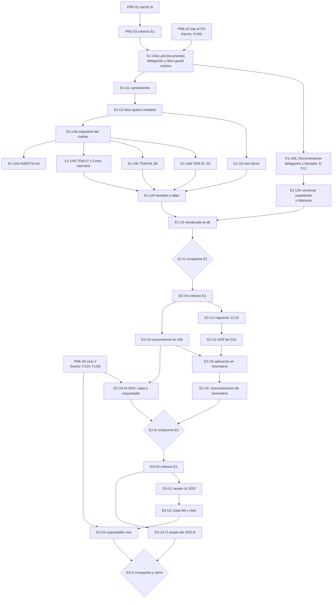

# N10 — Plan de implementación de los escalones

| Campo | Valor |
| --- | --- |
| **Id** | N10 |
| **Título** | Unidades de trabajo concretas y ordenadas para E1 (guía, mini demo, workflow, delegación y CI), E2 (piloto Geometría) y E3 (SDD-B y orquestadores) |
| **Autor (rol)** | Presidencia de la mesa (despacho P10) |
| **Fecha** | 2026-10-26 |
| **Fuentes leídas** | Folio 099 (dictamen) y `N09` (modelo); folios 080 §8 y §10, 085 §10, 090 §4–§8; `KB-privada/Knowledges/Knowledge-Conformacion-Pull-Request-Automatico.md` §3 (`CPA`); `git log`, `git status`, `git tag` y `ls .github/workflows` de los seis repos del plan (2026-10-26) |
| **Carpeta** | `/LAB/Lab-Documentos/Lab-Documentos.Documentacion/PROMPTs/DEVs/Enchacement/01-Replanteo-Y-Analisis/OUTPUTs/Bitacoras/` |

## Índice

1. [Cómo leer el plan](#1-cómo-leer-el-plan)
2. [Definiciones](#2-definiciones)
3. [Reglas comunes a toda unidad](#3-reglas-comunes-a-toda-unidad)
4. [Mapa de dependencias y paralelismo](#4-mapa-de-dependencias-y-paralelismo)
5. [Actos previos de la presidencia (PRE)](#5-actos-previos-de-la-presidencia-pre)
6. [Escalón 1](#6-escalón-1)
7. [Escalón 2](#7-escalón-2)
8. [Escalón 3](#8-escalón-3)
9. [Resumen de unidades](#9-resumen-de-unidades)
10. [Ensayos abiertos y dónde se cierran](#10-ensayos-abiertos-y-dónde-se-cierran)
11. [Riesgos del plan](#11-riesgos-del-plan)
12. [Lo no verificado](#12-lo-no-verificado)
13. [Observaciones y excepciones a conocimientos](#13-observaciones-y-excepciones-a-conocimientos)
14. [Arranque de E1 ejecutable](#14-arranque-de-e1-ejecutable)

---

## 1. Cómo leer el plan

Cada unidad tiene un solo resultado verificable y vive en un solo repositorio. Su ficha dice: repo, rama propuesta,
archivos que crea o toca, criterios de aceptación con su comando, el ensayo de cierre que se corre antes de pedir el
merge, las dependencias, y cómo se conforma el PR. El orden sale del folio 099: primero lo que habilita la escritura
(delegación y CI), después el saneamiento, después lo que se construye encima (D02).

Las unidades que no dependen entre sí y tocan repos o carpetas distintas pueden ir **en paralelo**, cada una en su
`git worktree` (`CPA` §3.5: dos unidades nunca sobre el mismo checkout). §4 marca cuáles.

## 2. Definiciones

| Término | Significado |
| --- | --- |
| Unidad | Trabajo con un resultado verificable, en un repo y una rama, que termina en un PR (o en un folio, si es de la presidencia) |
| `CPA` | Conformación automática del PR: el agente abre el PR, publica el informe con el enlace, espera la guarda G1–G4 y fusiona con commit de merge. Vale sólo con la delegación asentada en el repo destino (`CPA` §3.1) |
| Conformación «PO» | El PR lo abre el agente y el merge lo hace el PO: primer merge del repo, unidades de clase H o PR con reserva (`CPA` §3.4; D08 por la alternativa_2) |
| Ensayo de cierre | Corrida local o en el runner que el agente hace antes de pedir el merge, con su salida copiada al informe del PR |
| `GUIA-DIR` | `/LAB/Lab-Documentos/Lab-Documentos/Guides/Documentacion-Tecnica/Sistema-De-Documentacion-E-Integracion/` |
| `EXP/` | `/LAB/Lab-Documentos/Lab-Documentos.Documentacion/PROMPTs/DEVs/Enchacement/01-Replanteo-Y-Analisis/OUTPUTs/Expedientes/0002-Replanteo-Metodologia-DocAsCode/` |
| `<org-runner>` | La organización de GitHub donde está registrado el runner `i7infra-dev` y viven los repos Lab-* e IA.* |

## 3. Reglas comunes a toda unidad

1. **Rama.** Nombre `exp0002/<escalón>-<unidad>-<slug>` **[criterio propio]**; una unidad por rama; merge con commit
   de merge, nunca `squash` (`CPA` §3.5 y §4).
2. **Worktree.** Toda unidad se trabaja en un `git worktree` creado desde `origin/main`. En Lab-Documentos esto es
   obligatorio: el checkout principal tiene cambios ajenos a esta corrida (`Lanzar-Example.md` modificado; `.github/`,
   `Concepts/` y `Guides/IA/Dot-Net-Integration-AI-Layer-Guide/` sin seguimiento; `git status --short`, 2026-10-26) que
   no se tocan ni se commitean.
3. **Conformación.** Con la delegación asentada (L2), las unidades de clase D y P van por `CPA`. Las de clase H
   (workflows, `AGENTS.md`, conocimientos, aceptar ADR, etiquetar) y el primer merge de cada repo van a conformación
   «PO». Sin delegación, todo va a conformación «PO» (`CPA` §3.1: rige el padre).
4. **Runner.** Todo workflow nuevo de la organización del runner usa `runs-on: [self-hosted, i7infra-dev]`, sin
   `container:`, con `permissions: contents: read` (salvo el carril programado, `issues: write`, excepción E-9) y
   `timeout-minutes` (D17).
5. **Rutas.** En lo que se versiona, rutas desde la raíz del workspace o relativas dentro del repo; nunca la ruta del
   host ni su usuario (F001 D6). Barrido S2 antes de cada PR.
6. **Evidencia.** El informe del PR copia la salida recortada del ensayo de cierre y de la corrida del runner (las URL
   de Actions expiran, D26). Lo que funda una compuerta de escalón se copia a `EXP/evidencia/`.
7. **SDD-B.** En todo lo escrito en repos públicos se nombra «SDD-B»; sus unidades viven en su repo privado y se citan
   desde el expediente 0002 sólo por SHA y nombre del check (D26).

## 4. Mapa de dependencias y paralelismo

**Grupos que pueden correr en paralelo** (cada unidad en su worktree):

| Grupo | Unidades | Por qué no chocan |
| --- | --- | --- |
| P-A | E1-U0b ∥ E1-U1 | Repos distintos (Lab-Documentos.Documentacion y Lab-Documentos) |
| P-B | E1-U3 ∥ E1-U4a | Carpetas distintas de Lab-Documentos (`GUIA-DIR/Examples/MovilidadUrbana-Mini-Demo/` y la raíz del cuerpo) |
| P-C | E1-U4b ∥ E1-U4c ∥ E1-U4d ∥ E1-U4e | Un archivo por tema; `AGENTS.md` en la raíz; sólo comparten el README del cuerpo, que ya cerró E1-U4a |
| P-D | E1-U0c ∥ cualquiera de P-B o P-C | Repo distinto |
| P-E | E2-U1 ∥ E2-U3 | Repos distintos (Lab-Geometria e KB-privada) |
| P-F | E3-U1 ∥ E3-U4 | Carpetas distintas del repo del SDD-B (`vendor/` y `.github/`) |

El runner es uno solo: las corridas de los PR en paralelo se encolan en él. La espera con una E2E en curso se mide en
E-F13.

## 5. Actos previos de la presidencia (PRE)

| Id | Acto | Dónde | Aceptación | Depende de |
| --- | --- | --- | --- | --- |
| PRE-01 | Providencia que asienta la opción B del folio 003 §7 (D01; pendiente P-1 de `080` §12). Emitida en la onda 0 de §14 | `EXP/actuaciones/132-providencia-opcion-b.md` (renumerado: 130 y 131 quedaron usados por el asiento de respuestas y las decisiones delegadas). **Hecho** el 2026-10-27 | Folio con la opción B, la composición prevista por compuerta y el pase | — |
| PRE-02 | Entrega del lote L1–L13 del folio 099 §9 al PO. **Hecho**: respuesta y lectura en `100` §1–§3; confirmada por `129` §2 | Folio 100 | Hecho el 2026-10-27 | 099 |
| PRE-03 | Folio de criterios del escalón 1 (G-a): cada criterio en Dado/Cuando/Entonces, con instrumento y evidencia esperada; incluye los umbrales provisionales de P-5 (`129` §4.3, [criterio propio]). Emitido en la onda 0 de §14 | `EXP/actuaciones/133-providencia-criterios-e1.md` (renumerado). **Hecho** el 2026-10-27 | Fecha anterior a la primera rama de E1 (G-a) | PRE-01 |
| PRE-04 | Votación del ciclo 2. **Hecho**: acta `120`, resolución `129` (D22-R' procede; D07 firme; D08 CON REVISIÓN con C2-5; L12' con C2-6) | Folios 120 y 129 | Hecho el 2026-10-27 | — |

## 6. Escalón 1

### E1-U0a — Arranque de Lab-Documentos: delegación y `docs-guard` mínimo

| Campo | Contenido |
| --- | --- |
| Repo | Lab-Documentos (`/LAB/Lab-Documentos/Lab-Documentos/`, `main` en `5d5c2b4`) |
| Rama | `exp0002/e1-u0a-delegacion-y-docs-guard` |
| Archivos | `CHANGELOG.md` o `README.md`: sección «Delegación del merge» con fecha, responsable, techo, intervalo y excepción (la redacta el agente; la decide y fecha el PO, L2) · `.github/workflows/docs-guard.yml`: disparadores `pull_request` y `workflow_call`; un job en `[self-hosted, i7infra-dev]`, `timeout-minutes: 10`, grupo `docs-${{ github.workflow }}-${{ github.ref }}` con `cancel-in-progress` en PR; suite mínima: `lychee --offline --include-fragments` y markdownlint estructural sobre `GUIA-DIR` · `scripts/ci-local.sh`: los mismos pasos en el mismo orden (patrón 7 de `R03:398`) |
| Aceptación | (1) `grep -n "Delegación del merge" CHANGELOG.md README.md` encuentra la sección con fecha y responsable. (2) Una corrida verde de `docs-guard` sobre el `head.sha` del PR. (3) Par rojo/verde plantado: un enlace roto en un commit de una rama que no se fusiona da rojo; revertido, verde. (4) `grep -c "self-hosted, i7infra-dev" .github/workflows/docs-guard.yml` ≥ 1 y sin `container:` |
| Ensayo de cierre | `scripts/ci-local.sh` sobre el worktree; luego el PR en el runner. Mide E-F1 (primera corrida real y espera en cola) |
| Dependencias | PRE-03 (onda 0). L2 rige por lectura (`100` §3; `129` §3): el agente redacta la sección con techo e intervalo de `CPA` y fecha; el PO la ve en el PR. Su silencio no la vuelve firme (D08 pasa a FIRME en E1-G, C2-5) |
| Conformación | **PO**: primer merge del repo y unidad de clase H (workflow) (`CPA` §3.1; D08) |
| Paralelo | No: es la raíz de E1 |

### E1-U0b — Arranque de Lab-Documentos.Documentacion: delegación y llamador

| Campo | Contenido |
| --- | --- |
| Repo | Lab-Documentos.Documentacion (`main` en `8da0cd9`; sin `.github/`) |
| Rama | `exp0002/e1-u0b-delegacion-y-verificar` |
| Archivos | `CHANGELOG.md` o `README.md`: sección «Delegación del merge» · `.github/workflows/verificar.yml`: `pull_request`; job que llama `uses: <org-runner>/Lab-Documentos/.github/workflows/docs-guard.yml@<SHA de E1-U0a>` |
| Aceptación | (1) Sección de delegación con fecha y responsable. (2) La corrida del PR muestra que el job llamado corrió en el runner `i7infra-dev` (etiqueta en el registro del job): **E-F12**. (3) Par rojo/verde plantado |
| Ensayo de cierre | PR con un defecto plantado y luego corregido; captura del nombre del runner en el registro |
| Dependencias | E1-U0a fusionada (o al menos su SHA publicado en una rama del repo público) |
| Conformación | **PO** (primer merge del repo; workflow) |
| Paralelo | Grupo P-A, con E1-U1 |
| Si E-F12 falla | Rige la condición de revisión de D17: `verificar.yml` pasa a ser copia de la plantilla con cabecera y huella, y un paso `--check` compara la huella con la de Lab-Documentos |

### E1-U0c — Versionar el expediente 0002 y las bitácoras

| Campo | Contenido |
| --- | --- |
| Repo | Lab-Documentos.Documentacion |
| Rama | `exp0002/e1-u0c-expediente-y-bitacoras` |
| Archivos | `PROMPTs/DEVs/Enchacement/01-Replanteo-Y-Analisis/OUTPUTs/` completo (expediente 0002 y `Bitacoras/`), con las rutas del host de las bitácoras reemplazadas por rutas desde la raíz del workspace. No se toca nada de `PROMPTs/` fuera de `OUTPUTs/` |
| Aceptación | (1) Barrido S2 vacío sobre todo lo agregado (ruta del host, usuario, nombre del servicio privado, su organización). (2) `evidencia/local/` fuera del índice (`git ls-files EXP/evidencia/local \| wc -l` = 0). (3) `verificar` verde |
| Ensayo de cierre | Barrido S2 con el comando del folio 099 §11 sobre el árbol a agregar |
| Dependencias | E1-U0b (el repo tiene CI y delegación) |
| Conformación | `CPA` (clase P, sólo documentación) |
| Paralelo | Grupo P-D |

### E1-U1 — Saneamiento con alcance cerrado de la guía actual

| Campo | Contenido |
| --- | --- |
| Repo | Lab-Documentos |
| Rama | `exp0002/e1-u1-saneamiento-guia` |
| Archivos | `GUIA-DIR/Sistema-Documentador-Tecnico-Guide.md` y `GUIA-DIR/Examples/` |
| Alcance (cerrado, D02) | Los 8 enlaces rotos de `GUIA`; frontmatter atípico; traza `DOC-ADR` duplicada; cita de ACT-10; cita de Docusaurus a `main` y atributo `@product`; la palabra «adoptada» de `GUIA:161` (X5); los ítems de `R02:339-343`; README vacíos; tabla única de frontmatter. Se conserva el defecto plantado de la prueba de concepto. **No** se aplica APA en esta unidad |
| Aceptación | (1) `lychee --offline` sobre `GUIA-DIR` con exit 0. (2) `grep -c "adoptad" GUIA` = 0 en la fila de `llms.txt`. (3) Línea de base 0 en los controles de PR-1 y PR-4 sobre `GUIA-DIR` |
| Ensayo de cierre | `scripts/ci-local.sh`; corrida verde en el runner |
| Dependencias | E1-U0a |
| Conformación | `CPA` (clase P) |
| Paralelo | Grupo P-A |
| Nota | El saneamiento sirve a la línea de base 0 de las compuertas y no sobrevive a E1-U4f, que pasa el archivo a `obsoleto` (`095` §7, D02) |

### E1-U2 — `docs-guard` completo y herramientas

| Campo | Contenido |
| --- | --- |
| Repo | Lab-Documentos |
| Rama | `exp0002/e1-u2-docs-guard-completo` |
| Archivos | `.github/workflows/docs-guard.yml` (grupos PR-1 a PR-7 de `N09` §8.1 en un solo job con agregador estricto) · `tools/docs-guard/` con los controles portados desde `EXP/evidencia/C-VERIFICACION/herramientas/`, `EXP/evidencia/C-AGENTES-IA/herramientas/agent_channels.py` y `EXP/evidencia/C-ACADEMICO/scripts/reflint.py` · `tools/docs-guard/fixtures/` con el fixture permanente que debe dar rojo (AK-7) · `tools/docs-guard/dominios.txt` (lista de dominios, clase P con aprobación, C-14) · `.github/workflows/docs-enlaces-semanal.yml` (carril programado de `N09` §8.2, `issues: write`, tabla repo → ruta) · `scripts/ci-local.sh` actualizado |
| Aceptación | (1) Cada control bloqueante tiene par rojo/verde (G-c). (2) AI-3 avisa y no bloquea. (3) AI-4 sólo avisa en el anexo de referencias. (4) El fixture AK-7 da rojo en cada corrida. (5) El carril programado corre una vez a mano (`workflow_dispatch`) y abre o actualiza un issue. (6) Mide E-F10 (línea de base de AI-3) y E-F14 (armado del árbol) |
| Ensayo de cierre | `ci-local.sh` con cada defecto plantado, uno por vez; corrida en el runner |
| Dependencias | E1-U1 (líneas de base en 0) |
| Conformación | **PO** (workflows y lista de dominios: clase H/P con aprobación). El PO etiqueta `docs-guard-v1.0.0` (acto H) |
| Paralelo | No |

### E1-U3 — Mini demo MovilidadUrbana.MAUI en `Examples/`

| Campo | Contenido |
| --- | --- |
| Repo | Lab-Documentos |
| Rama | `exp0002/e1-u3-mini-demo-movilidad` |
| Archivos | `GUIA-DIR/Examples/MovilidadUrbana-Mini-Demo/` **[criterio propio en el nombre]**: `source.lock` (repo Lab-E2E.WebBlazor, SHA `8fb4c3a`) · `docs/_requisitos.md` (RRD) · `docs/fichas/RN-LOC-nn.md` (forma de `KDR` §5.1, ancla `ruta#Símbolo@SHA`) · `docs/ayuda/*.md` (CL-06, con `traces`) · `docs/tecnica/*.md` (CL-07) · `contracts/openapi.json` extraído en ejecución del SHA (C-10) · `README.md` con el tutorial · workflow llamador o job en `docs-guard` que: hace `git archive` del SHA de `source.lock`, compila y arranca la ApiWeb, extrae `GET /openapi/v1.json`, compara con `contracts/openapi.json` (bloquea) y corre la comparación contra `main` de `LE` (avisa) |
| Aceptación | (1) `traces-resolve` verde contra el SHA. (2) La traza al defecto real `RN-LOC-01` (60/80) da rojo hasta corregir la ficha (prueba negativa real). (3) El diff del contrato da 0 contra el SHA; con una operación plantada, exit 1. (4) El aviso contra `main` corre y queda en el registro. (5) Umbral provisional de «mini» **[criterio propio]** (`129` §4.3): ≤ 20 piezas, 1 workflow, < 15 min en el runner. (6) P-LECT sobre el tutorial con cero dudas sin respuesta. (7) No se modifica ningún archivo de Lab-E2E.WebBlazor |
| Ensayo de cierre | Corrida completa en el runner, con tiempo de pared; mide E-F13. Repite R-E4 de `085` en el runner (8 operaciones esperadas) |
| Dependencias | E1-U2 |
| Conformación | `CPA` (clase P; el workflow, si es archivo nuevo, va a **PO**) |
| Paralelo | Grupo P-B |
| Condición de revisión (D25) | Si Lab-E2E abre el expediente que autoriza tocar el código (L7), o si la extracción en ejecución deja de dar el contrato completo, la demo pasa a `LE/docs/` (alternativa B) por expediente propio |

### E1-U4a — Esqueleto del cuerpo documental

| Campo | Contenido |
| --- | --- |
| Repo | Lab-Documentos |
| Rama | `exp0002/e1-u4a-cuerpo-esqueleto` |
| Archivos | En `GUIA-DIR/`: `README.md` (con `corpus_id`, `version` 2.0.0-borrador **[criterio propio]** y las tres rutas de lectura, D27) · `00-Marco.md` (cuatro escenarios = V1–V4, contextos, convenciones) · `01-Mapa.md` («estoy acá → qué aplico») · `99-Anexos/`: esquema de frontmatter y registro de prefijos (CR-4), glosario, referencias APA con anclas `ref-…` (D28), CQ-01…14, PE-01…12, VER-*, «Cómo decidir» con la escala y una matriz trabajada, «Ejercicios» (default de L6) |
| Aceptación | (1) `docs-guard` verde. (2) Todo documento con los diez campos más `description`. (3) README con tabla de contenido completa y rutas (VER-G07). (4) Cada anexo enlazado desde el Mapa |
| Ensayo de cierre | `ci-local.sh`; P-LECT parcial sobre README, Marco y Mapa |
| Dependencias | E1-U2 |
| Conformación | `CPA` (clase P) |
| Paralelo | Grupo P-B |

### E1-U4b, E1-U4c, E1-U4d — Temas del cuerpo

| Unidad | Rama | Archivos (en `GUIA-DIR/`) | Fuente en `N09` |
| --- | --- | --- | --- |
| E1-U4b | `exp0002/e1-u4b-temas-01-03` | `TEM-01-Sistema-Documentador.md`, `TEM-02-Ciclo-Documental.md`, `TEM-03-Topologia-Y-Versionado.md` | §3, §4, §5, §7 |
| E1-U4c | `exp0002/e1-u4c-temas-04-06` | `TEM-04-Doble-Audiencia.md`, `TEM-05-Ayuda-Al-Usuario-Final.md`, `TEM-06-Compuertas-Y-CI.md` | §7, §8 |
| E1-U4d | `exp0002/e1-u4d-tem07-y-proceso` | `TEM-07-Marco-SDD.md` (`status: borrador` hasta E2), `Examples/Como-Intervenir.md` (plantilla, CR-5) y su instancia de una página para Lab-Documentos; guías prácticas de los ejemplos | §6, §10; D16 |

| Campo | Contenido (común a las tres) |
| --- | --- |
| Repo | Lab-Documentos |
| Aceptación | (1) Cada tema con los seis encabezados del Profile, idénticos en todos (VER-T01 a VER-T07). (2) Cada tema enlaza al anterior y al siguiente (VER-G08). (3) Referencias APA con fecha de consulta y ancla `ref-…`. (4) `docs-guard` verde. (5) La plantilla «Cómo intervenir» tiene bloques entradas/salidas/validaciones y su paso «validar» nombra `scripts/ci-local.sh` (VER-A05). (6) Umbrales provisionales **[criterio propio]** de P-5 (`129` §4.3): cada tema cita ≥ 3 fuentes primarias con fecha de consulta y ≥ 1 ensayo reproducible en `evidencia/`; en TEM-01 y TEM-03, ≥ 2 adopciones públicas por práctica recomendada con fuente de ≤ 24 meses |
| Ensayo de cierre | `ci-local.sh`; P-LECT del tema por un lector sin contexto |
| Dependencias | E1-U4a |
| Conformación | `CPA` (clase P; pasar a `vigente` es acto H en un PR aparte) |
| Paralelo | Grupo P-C |

### E1-U4e — `AGENTS.md` puntero de Lab-Documentos

| Campo | Contenido |
| --- | --- |
| Repo | Lab-Documentos |
| Rama | `exp0002/e1-u4e-agents-md` |
| Archivos | `AGENTS.md` en la raíz: puntero a README del cuerpo, convenciones y anexos de referencia (ruta «agente» de D27) |
| Aceptación | Existe; sus enlaces resuelven; excluido de AI-3 por ruta con huella (AK-3) |
| Dependencias | E1-U4a |
| Conformación | **PO** (clase H) |
| Paralelo | Grupo P-C |

### E1-U4f — La guía actual pasa a `obsoleto`

| Campo | Contenido |
| --- | --- |
| Repo | Lab-Documentos |
| Rama | `exp0002/e1-u4f-guia-obsoleta` |
| Archivos | `GUIA` con `status: obsoleto` y tabla «sección vieja → `doc_id` nuevo»; ampliación de `url-fecha` para citas por dominio en code spans (E-F7) |
| Aceptación | (1) Cada sección de `GUIA` tiene destino en la tabla. (2) Sobre el cuerpo nuevo: 0 URL sin fecha y 0 citas por dominio sin referencia completa (piloto de D28). (3) `url-fecha` ampliado tiene prueba negativa |
| Dependencias | E1-U3, E1-U4b, E1-U4c, E1-U4d |
| Conformación | `CPA` (clase P); el archivo se archiva recién en la versión siguiente del cuerpo |
| Paralelo | No |

### E1-U5 — Reindexado de la ia-db de Lab-Documentos.Documentacion

| Campo | Contenido |
| --- | --- |
| Repo | Lab-Documentos.Documentacion |
| Rama | `exp0002/e1-u5-reindexado-ia-db` |
| Archivos | `ia-db/README.md` e `ia-db/indexes/*` (el cuerpo nuevo, la mini demo, el expediente 0002); `base_commit` de Lab-Documentos al SHA del merge de E1-U4f |
| Aceptación | Todo documento nuevo del cuerpo tiene entrada; el índice enlaza al `llms.txt` sólo si hay sitio (no lo hay en E1) |
| Dependencias | E1-U4f, E1-U0c |
| Conformación | `CPA` (clase P, X12) |
| Paralelo | No |

### E1-U6 — Propuesta de expediente a Lab-E2E (condicionada)

**Ejecutable**: L7 rige por lectura (`100` §3; `129` §2). Repo Lab-E2E.WebBlazor; rama `exp0002/e1-u6-propuesta-expediente`; archivo:
la carta de propuesta con el defecto H-L07 como insumo y los cambios de código de D19 y D25. Conformación **PO**. Mientras el
expediente de Lab-E2E no exista, la demo sigue en `Examples/` (D25, condición (a) a futuro).

### E1-G — Compuerta E1

Folio `resolucion` en el expediente 0002 con el paquete G-a a G-g (`N09` §9.2), sobre los SHA de merge de E1-U0a a
E1-U5. La mesa del ciclo 2 se compone por la opción B (PRE-01): núcleo, `C-ARQ-NET`, `C-ANALISTA`, `C-ACADEMICO`,
`C-DEVOPS` y `C-CONFIG-RELEASE` (folio 003 §7). PRE-04 ya corrió (folios 120 y 129).

## 7. Escalón 2

### E2-U0 — Folio de criterios del escalón 2

Folio de la presidencia en el expediente 0002, con fecha anterior a la primera rama de E2 (G-a). Incluye la condición
de D24 (migración con o sin expediente propio) y los observables de D23.

### E2-U1 — Migración de Lab-Geometria a IA.SDD 13.22

| Campo | Contenido |
| --- | --- |
| Repo | Lab-Geometria (`main` en `4b114d7`) |
| Rama | `exp0002/e2-u1-migracion-13-22` |
| Archivos | Los que liste el plan de `Migracion-Rules` §3 (`/IA/SDD/IA.SDD/SDD/Devs/Rules/Migracion-Rules.md`); declaración de versión del SDD del destino |
| Aceptación | (1) El plan de §3 existe antes de tocar archivos y clasifica cada documento. (2) Ninguno «invalidado por salto mayor»; si aparece uno, la migración va a expediente propio y la piloto espera (condición de D24). (3) Lo que 13.18 dice de Lab-Geometria (`/IA/SDD/IA.SDD/CHANGELOG.md:271-277`: el expediente `0001-Migracion-Normativa-A-13.16` como forma histórica, re-medido con A1–A12) está aplicado (E-F9, C-9) |
| Ensayo de cierre | Comprobaciones de `Master-Prompt` (incluidas la 9 y la 10 de 13.22) sobre el destino; CI del repo verde |
| Dependencias | E2-U0 |
| Conformación | Según la delegación de Lab-Geometria; si cambia norma del destino, por expediente propio (`RE` §1) |
| Paralelo | Grupo P-E |

### E2-U2 — ADR de la vía normativa (D23)

| Campo | Contenido |
| --- | --- |
| Repo | Lab-Geometria |
| Rama | `exp0002/e2-u2-adr-usuario-final` |
| Archivos | ADR de apartamiento de `RDOC:102`, `:723`, `:801`, `:1003` y de `REF` §2.1 (RRD), con estado y contador (`Root-Rules` §11; `Excepcion-A-Un-Conocimiento` de 13.22) · ADR que supera «El producto no lleva manual» (`SDD/Docs/Unidades-Entrega/GeometriaFactory-Web/03-UX-UI-DX/Experiencia-De-Uso.md:100`) · NB y CU de la ayuda |
| Aceptación | Los dos ADR aceptados por el PO (L3) con fecha anterior a la primera rama de código de la piloto |
| Dependencias | E2-U1; L3 respondida |
| Conformación | **PO** (aceptar ADR es acto H) |
| Paralelo | No |

### E2-U3 — Conocimiento DocAsCode en KB-privada

| Campo | Contenido |
| --- | --- |
| Repo | KB-privada (`main` en `1585af9`; workflow `compuerta.yml`) |
| Rama | `exp0002/e2-u3-conocimiento-docascode` |
| Archivos | `Knowledges/Knowledge-<nombre definitivo>.md` (alias provisional `DocAsCode-Doble-Audiencia`, CR-1) con el contenido de `N09` §4–§8 · fila en el índice de la base |
| Aceptación | (1) Cumple la forma de conocimiento de la base (su compuerta verde). (2) Versión 0.x hasta la compuerta E2; 1.0 al `PROCEDE`. (3) `tools/copiar.py <alias> --destino` lo copia con su cierre |
| Dependencias | E2-U0 |
| Conformación | **PO** (clase H: conocimientos) |
| Paralelo | Grupo P-E |

### E2-U4 — IA.SDD: copia del conocimiento y mejora del orquestador

| Campo | Contenido |
| --- | --- |
| Repo | IA.SDD (`main` en `d4035aa`) |
| Rama | `exp0002/e2-u4-conocimiento-y-orquestador` |
| Archivos | `Conocimiento/` (copia con cierre y origen `alias@versión`) · `KLD` (capa A de D22-R', `129` §4.1) y, si el PO aprueba L12', capa B en `SDD/Devs/Orchestrator/Master-Prompt.md` (Fase I, Momento 2 de AG-00110, línea 560), con salida de clase P |
| Aceptación | (1) La copia declara origen y pasa `copiar.py --check`. (2) O-A1 rc 0; O-A3 `PENDIENTE` con evento (primer expediente posterior de Geometría, C2-6); con capa B, O-B1 = 1 |
| Dependencias | E2-U3; L12' sólo para la capa B (sin respuesta, capa B `PENDIENTE`; no bloquea la capa A) |
| Conformación | Por la vía de norma de IA.SDD (expediente propio y PR); **PO** |
| Paralelo | No |

### E2-U5 — Aplicación en Geometría

| Campo | Contenido |
| --- | --- |
| Repo | Lab-Geometria |
| Rama | `exp0002/e2-u5-aplicacion-piloto` |
| Archivos | RRD en `02-Especificacion-Funcional/` · ayuda de pantalla (CL-06) con `traces` a `CU-100NN` y reglas a `RN-020NN` · registro de IDs generado · `GenerateDocumentationFile` y `TreatWarningsAsErrors` (E-F6) · workflow llamador de `docs-guard` en el runner · E2E de acceso por rol |
| Aceptación | (1) 100 % de las `traces` resuelven (G-d). (2) `traces-resolve` sobre una traza desfasada y otra inexistente → exit 1. (3) Las 380 citas a `RN-100NN` inexistentes (F013 E-A04) detectadas antes de corregirlas. (4) E2E por rol verde. (5) Tag del repo por el PO (acto H) |
| Dependencias | E2-U2, E2-U3 |
| Conformación | `CPA` según la delegación de Lab-Geometria (clase P); workflows y tag, **PO** |
| Paralelo | No |

### E2-U6 — Lab-Geometria.Documentacion

Cuando el PR #2 de ese repo cierre: una unidad pasa su `verificar.yml` de `ubuntu-latest` al runner (D17, Q25) y, sin
PR ajenos abiertos, reindexa la ia-db (X12). Rama `exp0002/e2-u6-verificar-y-ia-db`. Conformación: workflow → **PO**;
reindexado → `CPA`.

### E2-G — Compuerta E2

Folio `resolucion` con G-a a G-g; la mesa por la opción B: núcleo, `C-ARQ-NET`, `C-ANALISTA`, `C-DECISIONES`,
`C-SDD-CONOCIMIENTO` y `C-NORMAS-IA`. Si la piloto no necesitó el rol «usuario», se retira la propuesta de cambio de
norma (condición de D23). CR-1 pasa a 1.0.

## 8. Escalón 3

| Id | Unidad | Repo | Rama | Archivos | Aceptación | Depende de | Conformación |
| --- | --- | --- | --- | --- | --- | --- | --- |
| E3-U0 | Folio de criterios E3 | Expediente 0002 | — | Folio de la presidencia | Fecha previa a la primera rama de E3; L10 (`{runner-del-SDD-B}`), L8 y L12' resueltas (`130`, `131`); L11 respondida o con su default | E2-G | Presidencia |
| E3-U1 | Vendor de IA.SDD | Repo del SDD-B (privado) | `exp0002/e3-u1-vendor-ia-sdd` | `vendor/IA.SDD/` por `git archive` en un commit fijo; `MANIFIESTO` sha256; aviso de deriva | `git archive` 14/14 y deriva plantada → exit 1 (como F011 E08); E-F5 compara con `IKB/tools/cierre.py` | E3-U0 | Por la vía del SDD-B |
| E3-U2 | Copia fiel de conocimientos y citas por ruta | Repo del SDD-B | `exp0002/e3-u2-copia-fiel-y-citas` | Catálogo de conocimientos con `Hereda-de`; citas a ruta más versión | 14 homónimos reconciliados; `copiar.py --check` verde | E3-U1; L8 | PR de norma del SDD-B; **PO** |
| E3-U3 | Orquestador vivo | Repo del SDD-B | `exp0002/e3-u3-orquestador-vivo` | Capa A de D22-R' (vendor de `KLD` y fila transversal del índice) y, si el PO aprueba L12', capa B en `_convenciones_comunes.md` §5; sin capa B, «ambos» en el SDD-B queda `PENDIENTE` (C2-4) | O-A2; O-A4 `PENDIENTE` con evento (C2-6); O-B1 si hay capa B | E3-U2; L12' | PR de norma del SDD-B; **PO** |
| E3-U4 | CI propio del SDD-B | Repo del SDD-B | `exp0002/e3-u4-ci-docs` | Copia fijada de `docs-guard.yml` con huella y `--check`; `runs-on: [self-hosted, {runner-del-SDD-B}, ...]` (L10, `130` §5); anti-inyección en modo aviso | Corrida verde en su runner (G-b de E3); huella igual a la del tag de la plantilla | E3-U0; L10 | Según la delegación del SDD-B; workflow → **PO** |
| E3-G | Compuerta E3 y cierre | Expediente 0002 | — | Folio `resolucion` y, aplicado y verificado, folio `archivo` | G-a a G-g; reintegro de cada documento con cita al expediente (D15); consulta a un tercero declarada en reserva | E3-U3, E3-U4 | Presidencia |

## 9. Resumen de unidades

| Id | Repo | Clase | Conformación | Paralelo con |
| --- | --- | --- | --- | --- |
| PRE-01 | Expediente 0002 | — | Presidencia | — |
| PRE-02 | — (mensaje al PO) | — | Presidencia | PRE-01 |
| PRE-03 | Expediente 0002 | — | Presidencia | — |
| E1-U0a | Lab-Documentos | H | PO | — |
| E1-U0b | Lab-Documentos.Documentacion | H | PO | E1-U1 |
| E1-U0c | Lab-Documentos.Documentacion | P | `CPA` | E1-U3, E1-U4* |
| E1-U1 | Lab-Documentos | P | `CPA` | E1-U0b |
| E1-U2 | Lab-Documentos | H | PO | — |
| E1-U3 | Lab-Documentos | P | `CPA` | E1-U4a |
| E1-U4a | Lab-Documentos | P | `CPA` | E1-U3 |
| E1-U4b | Lab-Documentos | P | `CPA` | E1-U4c, E1-U4d, E1-U4e |
| E1-U4c | Lab-Documentos | P | `CPA` | E1-U4b, E1-U4d, E1-U4e |
| E1-U4d | Lab-Documentos | P | `CPA` | E1-U4b, E1-U4c, E1-U4e |
| E1-U4e | Lab-Documentos | H | PO | E1-U4b, E1-U4c, E1-U4d |
| E1-U4f | Lab-Documentos | P | `CPA` | — |
| E1-U5 | Lab-Documentos.Documentacion | P | `CPA` | — |
| E1-U6 | Lab-E2E.WebBlazor (condicionada a L7) | H | PO | cualquiera de E1 |
| E1-G | Expediente 0002 | — | Presidencia y mesa | — |
| PRE-04 | Expediente 0002 | — | Jurado del ciclo 2 (hecho: 120, 129) | — |
| E2-U0 | Expediente 0002 | — | Presidencia | — |
| E2-U1 | Lab-Geometria | P/H | Según su delegación | E2-U3 |
| E2-U2 | Lab-Geometria | H | PO | — |
| E2-U3 | KB-privada | H | PO | E2-U1 |
| E2-U4 | IA.SDD | H | PO (vía de norma) | — |
| E2-U5 | Lab-Geometria | P (+H) | `CPA` y PO | — |
| E2-U6 | Lab-Geometria.Documentacion | P/H | `CPA` y PO | — |
| E2-G | Expediente 0002 | — | Presidencia y mesa | — |
| E3-U0 | Expediente 0002 | — | Presidencia | — |
| E3-U1 | Repo del SDD-B | P | Vía del SDD-B | E3-U4 |
| E3-U2 | Repo del SDD-B | H | PO | — |
| E3-U3 | Repo del SDD-B | H | PO | — |
| E3-U4 | Repo del SDD-B | H | PO | E3-U1 |
| E3-G | Expediente 0002 | — | Presidencia y mesa | — |

Total: 4 actos previos, 14 unidades de E1 más su compuerta, 7 de E2 más su compuerta y 5 de E3 más su compuerta.

## 10. Ensayos abiertos y dónde se cierran

| Ensayo | Qué decide | Unidad |
| --- | --- | --- |
| E-F1 | Primera corrida real y espera en cola | E1-U0a |
| E-F2 | Guarda de forks (higiene, no barrera) | E1-U0a |
| E-F4 | Agregado y cuerpo partido por núcleo para agentes | E1-G |
| E-F5 | `cierre.py` frente a `git archive` | E3-U1 |
| E-F6 | XML docs y avisos como error en Geometría | E2-U5 |
| E-F7 | `url-fecha` ampliado a dominios | E1-U4f |
| E-F8 | Render de rutas desde la raíz en GitHub | E1-U1 |
| E-F9 | Plan de migración 13.16 → 13.22, con 13.18 | E2-U1 |
| E-F10 | Línea de base de AI-3 con excepciones | E1-U2 |
| E-F11 | Costo de mantener los repos hermanos al día en el runner | E1-U2 |
| E-F12 | `workflow_call` toma el runner del que llama | E1-U0b |
| E-F13 | Tiempo de pared por PR en el runner, con y sin E2E | E1-U3 |
| E-F14 | Armado del árbol del workspace para el carril programado | E1-U2 |

E-F3 quedó resuelto por R-E4 del refutador (`085` §6, D25).

## 11. Riesgos del plan

| Riesgo | Efecto | Mitigación |
| --- | --- | --- |
| El PO no asienta la delegación (L2) | Todo merge vuelve al PO; el plan sigue más lento | Las unidades no cambian; sólo la conformación |
| E-F12 falla | `docs-guard` no se puede llamar entre repos | Condición de revisión de D17: copia con huella y `--check` |
| La E2E nocturna ocupa el runner | PR en cola hasta ~20 min (`085` T2) | Grupo de concurrencia propio; medir en E-F13 |
| El PO no aprueba la capa B (L12') | La mejora del orquestador queda sólo en la capa A | Rige la capa A (D22-R', `129` §4.1); capa B y O-A3/O-A4 `PENDIENTE` con evento, nunca `INSUFICIENTE` ni verde |
| Merges H esperan al PO | E1-U0a, E1-U0b, E1-U2, E1-U4e, E1-U6 quedan abiertos | Las demás unidades avanzan en sus worktrees sobre la rama de su predecesora (§14) |
| L3 no se responde | La piloto no tiene objeto | E2 corre la migración y el conocimiento; la aplicación espera |

## 12. Lo no verificado

| Qué | Motivo |
| --- | --- |
| Los nombres de rama, carpetas y archivos nuevos | Son propuesta de la presidencia; el implementador puede ajustarlos sin cambiar la unidad |
| La delegación vigente en Lab-Geometria, KB-privada e IA.SDD | No se leyó en este despacho; cada unidad la busca antes de abrir el PR (`CPA` §3.1) |
| Que la imagen del runner traiga dotnet 10 para E1-U3 | Lo afirma el refutador (`085` §6, D25); E1-U3 lo comprueba en su primera corrida |
| El estado del PR #2 de Lab-Geometria.Documentacion | Tomado de F010 E6; E2-U6 lo consulta antes de empezar |

## 13. Observaciones y excepciones a conocimientos

| # | Tipo | Observación |
| --- | --- | --- |
| O-1 | Hecho | Resuelto en el ciclo 2: D22-R' procede (`120`, `129` §4.1); la capa A garantiza la mejora sin norma y la capa B se consulta (L12'). Ya no hay unidad que dependa de una votación pendiente |
| O-2 | Interpretación | Los nombres de rama `exp0002/...` son **[criterio propio]** y no se apartan de `CPA`, que no fija nombre de rama |

**Excepciones a conocimientos.** El plan no agrega apartamientos propios; ejecuta los de `099` §8 (E-1 a E-15) en
las unidades que los materializan (E-5 en E2-U2/E2-U5, E-6 y E-7 en E3-U2, E-9 en el carril programado de E1-U2).
*(Sección agregada por la crítica C10, 2026-10-27.)*

## 14. Arranque de E1 ejecutable

*(Sección agregada por la presidencia, despacho P21, al cerrar el ciclo 2, 2026-10-27.)*

*(Actualizada por la presidencia, despacho P30, 2026-10-27, con las respuestas del PO: folios 130 a 133.)*

**Estado de partida.** El PO respondió el lote (`130` §2). PRE-01 y PRE-03 están hechos (folios `132` y `133`;
renumerados desde 130/131). D08 es **FIRME** por C2-5 (`130` §4). L3/L4: ADR consecuente sin consulta. L7: sí.
**L10: el SDD-B usa `{runner-del-SDD-B}`** (verificado, `130` §5); E3-U4 lleva `runs-on: [self-hosted, {runner-del-SDD-B}, ...]`.
L1, L5, L6, L8, L9, L12', L13: decididas por la mesa (`131` §2). Único pendiente del PO: **L11** (acto de
organización, `130` §6). Toda unidad se trabaja en su `git worktree` desde `origin/main` (§3.2), con rama
`exp0002/<escalón>-<unidad>-<slug>` **[criterio propio]**.

**Conformación durante E1.** Todo PR, incluido el primer merge de cada repo (U0a, U0b, U2, U4e, U6), se fusiona por
`CPA` con la guarda G1–G4 y cita el testimonio de `130` §2 en su cuerpo. Sólo lo irreversible con consecuencia externa
sale al PO (`131` §4). Workflows: `runs-on: [self-hosted, i7infra-dev]`, `permissions: contents: read`, sin
`pull_request_target`, actions fijadas por SHA, guarda `if:` contra forks (mitigación de L11).

| Onda | Unidades (en paralelo dentro de la onda) | Repo | Rama | Aceptación (resumen; ficha en §6) | Merge |
| --- | --- | --- | --- | --- | --- |
| 0 | PRE-01, PRE-03 | Expediente 0002 | — (folios 132, 133; hechos) | Folios con fecha anterior a la primera rama; criterios Dado/Cuando/Entonces con instrumento; umbrales de `129` §4.3 | Presidencia |
| 1 | E1-U0a | Lab-Documentos | `exp0002/e1-u0a-delegacion-y-docs-guard` | Sección «Delegación del merge» con fecha, techo e intervalo; `docs-guard` verde en `[self-hosted, i7infra-dev]`; par rojo/verde; sin `container:`; mide E-F1 | `CPA` (primer merge delegado, `130` §3) |
| 1 | E1-U6 | Lab-E2E.WebBlazor | `exp0002/e1-u6-propuesta-expediente` | Carta de propuesta con H-L07 y los cambios de D19/D25; no toca código (L7: sí) | `CPA` (`130` §3) |
| 2 | E1-U0b ∥ E1-U1 | .Documentacion ∥ Lab-Documentos | `exp0002/e1-u0b-delegacion-y-verificar` ∥ `exp0002/e1-u1-saneamiento-guia` | U0b: E-F12 (runner en el registro del job llamado) o rige la copia con huella; U1: `lychee --offline` exit 0, «adoptad» = 0, línea de base 0 | `CPA` (U0b primer merge delegado) |
| 3 | E1-U2 ∥ E1-U0c | Lab-Documentos ∥ .Documentacion | `exp0002/e1-u2-docs-guard-completo` ∥ `exp0002/e1-u0c-expediente-y-bitacoras` | U2: par rojo/verde por control, fixture AK-7 rojo, carril semanal corrido a mano, E-F10/E-F14; U0c: barrido S2 vacío, `evidencia/local` fuera del índice, `verificar` verde | `CPA` (U2 primer merge delegado, + tag `docs-guard-v1.0.0`) |
| 4 | E1-U3 ∥ E1-U4a | Lab-Documentos | `exp0002/e1-u3-mini-demo-movilidad` ∥ `exp0002/e1-u4a-cuerpo-esqueleto` | U3: trazas contra SHA, prueba negativa RN-LOC-01, diff de contrato 0/1, «mini» ≤ 20 piezas / 1 workflow / < 15 min, P-LECT sin dudas; U4a: diez campos + `description`, README con rutas | `CPA` (workflow nuevo con la seguridad de §14) |
| 5 | E1-U4b ∥ E1-U4c ∥ E1-U4d ∥ E1-U4e | Lab-Documentos | ramas de §6 | Seis encabezados del Profile, enlaces anterior/siguiente, APA con fecha, umbrales P-5 [criterio propio]; U4e: enlaces resuelven | `CPA` |
| 6 | E1-U4f | Lab-Documentos | `exp0002/e1-u4f-guia-obsoleta` | Tabla sección → `doc_id` completa; 0 URL sin fecha; `url-fecha` con prueba negativa | `CPA` |
| 7 | E1-U5 | .Documentacion | `exp0002/e1-u5-reindexado-ia-db` | Toda pieza nueva indexada; `base_commit` = merge de U4f | `CPA` |
| 8 | E1-G | Expediente 0002 | — | Paquete G-a…G-g sobre los SHA de merge; D08 ya FIRME (`130` §4); anexo con la propuesta del Profile (`131`, L6); lecciones de E1 a `DocsAsCode-Bitacoras/` | Presidencia y mesa (opción B) |

**Bitácoras.** Cada onda deja una entrada en
`LAB/Lab-Documentos/Lab-Documentos.Documentacion/PROMPTs/Guides/14-Sistema-De-Documentador-Tecnico/OUTPUTs/DocsAsCode-Bitacoras/`
(qué se hizo, ramas, PR, corridas, decisiones resueltas sin el PO con su nivel y regla) y actualiza su `00-Indice.md`.

