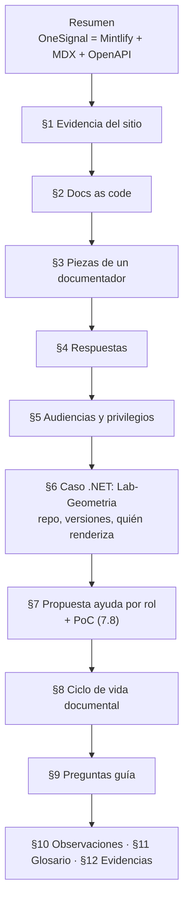
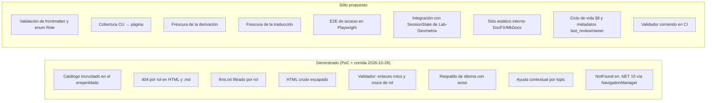

# R02 — Guía actual del sistema documentador y sus ejemplos

| Campo | Valor |
|-------|-------|
| Id | R02 |
| Título | Guía actual (`Sistema-Documentador-Tecnico-Guide.md`) y ejemplos (`Examples/`): mapa, evidencia, contradicciones, huecos y cumplimiento |
| Autor (rol) | Investigador relevador de la mesa (despacho R02), agente de IA. Produce un borrador trazable; no decide |
| Fecha | 2026-10-26 |
| Encargo | `/LAB/Lab-Documentos/Lab-Documentos.Documentacion/PROMPTs/DEVs/Enchacement/01-Replanteo-Y-Analisis/Replanteo-Y-Analisis.md` |
| Modo | Sólo lectura sobre los repos. Las corridas de prueba se hicieron sobre una **copia** en `{dir-de-trabajo}/`, borrada al terminar |

**Fuentes leídas** (rutas absolutas; en adelante se abrevian con los prefijos de la tabla):

| Prefijo | Ruta |
|---------|------|
| `GUIA` | `/LAB/Lab-Documentos/Lab-Documentos/Guides/Documentacion-Tecnica/Sistema-De-Documentacion-E-Integracion/Sistema-Documentador-Tecnico-Guide.md` (759 líneas, leída completa) |
| `EX` | `/LAB/Lab-Documentos/Lab-Documentos/Guides/Documentacion-Tecnica/Sistema-De-Documentacion-E-Integracion/Examples/` (recorrido completo: `Lanzar-Example.md`, `Prueba-Ayuda-Por-Rol/README.md`, `.devcontainer/devcontainer.json`, `.gitignore`, `Consola/*`, `Web/*`, `capturas/*.png`) |
| `P14` | `/LAB/Lab-Documentos/Lab-Documentos.Documentacion/PROMPTs/Guides/14-Sistema-De-Documentador-Tecnico/Crear-Analizar-Sistema-De-Documentador-Tecnico-Guide.md` (41 líneas; `OUTPUTs/` vacía) |
| `PROMPT` | `/LAB/Lab-Documentos/Lab-Documentos.Documentacion/PROMPTs/DEVs/Enchacement/01-Replanteo-Y-Analisis/Replanteo-Y-Analisis.md` (67 líneas) |
| `PERFIL` | `/IA/PROMPTs/IA.Prompts/PromptFramework/Profiles/Study-Guide-Documentation.md` (85 líneas) y su `RuleSets/RuleSet-Study-Guide.md` |
| `CGT` | `/LAB/Lab-Documentos/Lab-Documentos/Guides/Documentacion-Tecnica/Creacion-Guias-Tecnicas/` (destino real de los enlaces de la guía) |
| `IADB` | `/LAB/Lab-Documentos/Lab-Documentos.Documentacion/ia-db/indexes/` |
| Git | `git log --oneline -15`, `git status --short`, `git diff --stat` y `git diff` en `Lab-Documentos` y `Lab-Documentos.Documentacion`; `git ls-remote` (sólo lectura) de `Lab-Geometria` |
| Externa | `https://llmstxt.org/index.md` — «The /llms.txt file, v2», Jeremy Howard, consultada el 2026-10-26 |

---

## Índice

1. [Definiciones](#1-definiciones)
2. [Mapa de la guía](#2-mapa-de-la-guía)
3. [Los ejemplos: qué contienen](#3-los-ejemplos-qué-contienen)
4. [Corrida de verificación del 2026-10-26](#4-corrida-de-verificación-del-2026-10-26)
5. [Demostrado frente a propuesto](#5-demostrado-frente-a-propuesto)
6. [Contradicciones e inconsistencias internas](#6-contradicciones-e-inconsistencias-internas)
7. [Origen: el prompt 14 y la historia en Git](#7-origen-el-prompt-14-y-la-historia-en-git)
8. [Huecos respecto del prompt actual](#8-huecos-respecto-del-prompt-actual)
9. [Cumplimiento contra el perfil Study-Guide-Documentation](#9-cumplimiento-contra-el-perfil-study-guide-documentation)
10. [Cómo se lanza el ejemplo](#10-cómo-se-lanza-el-ejemplo)
11. [Insumos para la mesa](#11-insumos-para-la-mesa)

---

## 1. Definiciones

| Término | Uso en esta bitácora |
|---------|----------------------|
| Guía | El apunte `DOC-SDT-0001` (`GUIA:2`), que se declara `doc_type: study-note` y `status: draft` (`GUIA:3-5`) |
| PoC | Prueba de concepto «ayuda por rol» en `EX/Prueba-Ayuda-Por-Rol/`: un motor de consola (`Consola/`) y un panel Blazor (`Web/`) |
| Demostrado | Comportamiento que la PoC ejecuta y deja evidencia (salida, captura o verificación reproducida en esta corrida) |
| Propuesto | Diseño que la guía describe sin implementación en la PoC ni en Lab-Geometria |
| Criterio propio | Juicio de este relevador, sin fuente externa; se marca como tal |

---

## 2. Mapa de la guía

La guía tiene 12 secciones numeradas (la 12 es el registro de evidencias, `GUIA:717`) más un resumen ejecutivo, sin índice inicial (`GUIA:14-24` pasa del título al resumen y a la sección 1). Responde a una pregunta disparadora —¿el portal de OneSignal nace de Markdown?— y luego crece hacia el caso propio.

| § | Líneas | Tesis | Evidencia que cita |
|---|--------|-------|--------------------|
| Resumen | `GUIA:16-20` | El portal de OneSignal lo genera Mintlify desde MDX + OpenAPI; *docs as code* es el estándar | Remite a §1 |
| 1 | `GUIA:24-94` | El generador es Mintlify; el fuente es MDX servido en `.md`; la referencia sale de OpenAPI 3.1.0; hay `llms.txt` para agentes | `curl` al sitio (meta generator, `.md` de 920 líneas, `openapi.json` v11.6, `llms.txt` con 170 entradas), doc de Mintlify del 2026-09-16 (`GUIA:84-90`, `GUIA:723-730`) |
| 2 | `GUIA:98-144` | *Docs as code*: texto plano, Git, revisión, pruebas, despliegue continuo | Write the Docs (`GUIA:102-106`); API de GitHub sobre `github/docs`, `azure-docs`, `kubernetes/website`, `mintlify/docs` (`GUIA:127-136`); quickstart de Mintlify (`GUIA:140-144`) |
| 3 | `GUIA:148-165` | Ocho piezas estables (prosa, contrato, navegación, componentes, fragmentos, validación, build, salida para agentes); Diátaxis para organizar | Tabla `GUIA:152-161`; `diataxis.fr` (`GUIA:165`) |
| 4 | `GUIA:169-177` | Respuestas sí/en parte/sí/sí a las preguntas de P14 | Síntesis de §1-3 |
| 5 | `GUIA:181-248` | Dos cadenas (desarrollo / uso) y dos portales; confidencialidad en el build, no en la vista; tres nombres de industria | Siete familias de la guía `Documentacion-Tecnica` (`GUIA:191-199`); Nygard, arc42 (`GUIA:203`); Mintlify `groups` y *personalization* (`GUIA:234-236`); DITA 1.3 (`GUIA:234`, `GUIA:246`); Backstage/TechDocs (`GUIA:248`) |
| 6 | `GUIA:252-321` | En Lab-Geometria: todo en el repo de código salvo lo que habla **del** proyecto; un tag congela código y docs; tres salidas (panel, API, sitio interno) | Revisión `4b114d7` del 2026-09-15 (`GUIA:260-267`); Backstage; ramas `release-*` de Kubernetes (`GUIA:290`); Docusaurus versioning (`GUIA:292`); Markdig y DocFX (`GUIA:317-319`) |
| 7 | `GUIA:325-532` | Propuesta: ayuda por rol embebida, catálogo inmutable, 404 por rol, `llms.txt` filtrado, derivación desde CU con traza versionada, idiomas por carpeta, validador en CI | `Role.cs`, `SessionClaims.cs`, `CU-00026` (`GUIA:327`, `GUIA:415`); doc de localización de Microsoft (`GUIA:446-455`); Kubernetes y Docusaurus i18n (`GUIA:448`); PoC (`GUIA:474-522`) |
| 8 | `GUIA:536-652` | La documentación es parte del ciclo de vida: fases, acoplamiento al PR/changelog/tag, metadatos de estado, tres formas de envejecer, deprecar y archivar, actores | ISO/IEC/IEEE 15289:2019 (sólo muestra pública, `GUIA:542`, `GUIA:683`); Keep a Changelog 1.1.0 (`GUIA:590`, `GUIA:625`); metadatos de Microsoft Learn (`GUIA:607`); `_legacy/` de Lab-Geometria (`GUIA:627`) |
| 9 | `GUIA:656-672` | 15 preguntas guía para diseñar un documentador | Síntesis |
| 10 | `GUIA:676-690` | Observaciones tipadas (hecho, interpretación, no verificado) | — |
| 11 | `GUIA:694-713` | Glosario de 17 términos | — |
| 12 | `GUIA:717-759` | Registro de evidencias con fecha y método | 37 filas |

**Lectura de conjunto (criterio propio).** La guía es sólida en evidencia externa y en su caso de estudio, y declara con disciplina qué es interpretación (`GUIA:201`, `GUIA:236`, `GUIA:317`, `GUIA:572`, `GUIA:644`, `GUIA:676-690`). Su eje, sin embargo, es **la ayuda al usuario final de un panel** (`FAM-USR`), no una metodología general de documentación técnica.

---

## 3. Los ejemplos: qué contienen

### 3.1 Inventario

| Pieza | Contenido | Evidencia |
|-------|-----------|-----------|
| `Lanzar-Example.md` | Tool-prompt que levanta el panel en su devcontainer, lo expone por un túnel rápido de Cloudflare y verifica por la URL pública; variantes `--estado` y `--bajar` | `EX/Lanzar-Example.md:1-127` |
| `Prueba-Ayuda-Por-Rol/README.md` | Qué es cada carpeta, cómo levantarla, qué probar, defectos plantados de la consola | `EX/Prueba-Ayuda-Por-Rol/README.md:1-63` |
| `.devcontainer/devcontainer.json` | Imagen `mcr.microsoft.com/devcontainers/dotnet:1-10.0`, puerto 5190, `ASPNETCORE_ENVIRONMENT=Development`, `postCreateCommand` con dos `restore` | `…/.devcontainer/devcontainer.json:3-11` |
| `Consola/` | `Program.cs` (61 líneas): catálogo desde recursos incrustados, `Render` con 404 por rol, `llms.txt` por rol, validador de enlaces rotos y cruces de rol; tres páginas con defectos plantados; `salida.txt` | `…/Consola/Program.cs:9-59`, `…/Consola/Spike.csproj:4-6` |
| `Web/` | Blazor .NET 10 de render estático en servidor: `HelpCatalog` (catálogo, `Get`, `Navigation`, `ByTopic`, `ToHtml`, `Validate`), middleware para `.md` y `llms.txt`, ingreso simulado `/entrar/{role}`, selector de cultura, `AyudaContextual`, `NotFoundPage` | `…/Web/Program.cs:10-78`, `…/Web/HelpCatalog.cs:1-125`, `…/Web/Components/Routes.razor:1` |
| `Web/Ayuda/` | 7 páginas en `es/` (2 comunes, 2 de alumno, 3 de administrador) y 2 traducciones en `en/` | `find Web/Ayuda -name '*.md'` |
| `capturas/` | 7 PNG (1280×760, una 1280×900), fechadas por la guía el 2026-09-19 | `EX/Prueba-Ayuda-Por-Rol/capturas/`; `GUIA:509` |

### 3.2 Contrato real de las páginas de la PoC

Las páginas fuente (`es/`) llevan `title`, `description`, `roles`, `order`, `traces`, `topic` (por ejemplo `…/Web/Ayuda/es/alumno/enviar-un-trabajo.md:2-7`). Las traducciones llevan sólo `title`, `description` y `translation_of` (`…/Web/Ayuda/en/alumno/enviar-un-trabajo.md:2-4`): el acceso lo decide siempre la página fuente (`…/Web/HelpCatalog.cs:30`, `:64-71`). Ninguna lleva `last_review` ni `owner`, el hueco que la propia guía identifica (`GUIA:609`).

### 3.3 Capturas revisadas

Se abrieron dos: `ayuda-04-alumno-404.png` muestra la superficie «404 — Esta página no existe para tu papel» con sesión de Alumno; `ayuda-05-alumno-en-sin-traducir.png` muestra la interfaz en inglés, el aviso «This page has not been translated yet…», la marca `es` en la navegación y el bloque «Derived from CU-00028@1.1, CU-00029@1.1 · Visible to Student · Source es/alumno/consultar-mis-trabajos.md». Ambas coinciden con lo que afirman `GUIA:515-518` y `EX/Prueba-Ayuda-Por-Rol/README.md:42-45`.

---

## 4. Corrida de verificación del 2026-10-26

Se consideró barata —la imagen `mcr.microsoft.com/dotnet/sdk:10.0` ya estaba local— y se ejecutó sobre una copia (sin `bin/` ni `obj/`) en `{dir-de-trabajo}/r02`, nunca sobre el repo ni en `/vm`. Se usó la imagen del SDK en lugar del devcontainer, así que **el devcontainer en sí no se probó**.

### 4.1 Consola

`docker run --rm … mcr.microsoft.com/dotnet/sdk:10.0 dotnet run` → código de salida `1`. La salida es **idéntica** a `Consola/salida.txt`, con una sola línea extra al principio («An issue was encountered verifying workloads…»), que es un aviso del SDK de la imagen y no de la PoC. Se reprodujeron las tres fallas del validador, incluida la no plantada (`comun/ingresar → alumno/entregar-trabajo`).

### 4.2 Panel web

Se lanzó con `dotnet run --no-launch-profile` en `Production`, publicado sólo en `127.0.0.1:15190`. Respondió `200` en `/ingresar` al quinto intento de 3 s. El log dijo `Catálogo de ayuda: 9 páginas, validador con 0 fallas` y `Hosting environment: Production`.

| Petición | Resultado obtenido | Lo que afirman guía/README |
|----------|--------------------|-----------------------------|
| `/ayuda` sin sesión | `302` a `/ingresar?ReturnUrl=%2Fayuda` | `302` (`GUIA:514`) ✔ |
| `/ayuda/llms.txt` sin sesión | `302` | No lo afirman. El código prevé `401` (`…/Web/Program.cs:41`), ver 6.8 |
| Alumno → `/ayuda/alumno/enviar-un-trabajo` | `200` | ✔ |
| Alumno → `/ayuda/administrador/gobernar-las-cuentas` | `404`, el cuerpo no contiene «Gobernar las cuentas» | ✔ (`GUIA:515`) |
| Alumno → misma página `.md` | `404` | ✔ |
| Alumno → `…/alumno/../administrador/dar-desenlace.md` | `404` | No afirmado; se probó por criterio propio |
| Administrador → página de alumno | `404` | ✔ (`GUIA:516`) |
| `llms.txt` alumno / administrador | 4 / 5 entradas, sin cruces | ✔ (`GUIA:517`) |
| `.md` de alumno | Markdown con frontmatter | ✔ (`README.md:44`) |
| Cultura `en`, página sin traducir | Aviso «This page has not been translated yet; it is shown in its original language.» | ✔ (`GUIA:518`) |
| Cultura `en`, `llms.txt` | Títulos traducidos donde hay traducción; el resto en español | No afirmado explícitamente |

Al terminar se borraron el contenedor `r02-ayuda-web` y la carpeta de trabajo.

### 4.3 Estado del entorno heredado

`docker ps -a` muestra un devcontainer **huérfano** de la PoC, detenido hace 4 semanas, con la etiqueta `devcontainer.local_folder=/LAB/Lab-Documentos/Guides/Sistema-Documentador-Tecnico-Guide/Examples/Prueba-Ayuda-Por-Rol`, una ruta que ya no existe. También está el contenedor `demo-ayuda-por-rol-tunnel`, detenido. Es exactamente el caso que advierte `EX/Lanzar-Example.md:40`. No se tocaron.

---

## 5. Demostrado frente a propuesto

| Afirmación | Estado | Evidencia |
|------------|--------|-----------|
| Render Markdig + `DisableHtml()` escapa `<script>` | Demostrado | `Consola/salida.txt` (bloque «HTML de comun/ingresar»); `GUIA:505` |
| Acceso por rol decidido en servidor, 404 sin filtrar el título | Demostrado | Corrida 4.2; `…/Web/HelpCatalog.cs:64-71`; `…/Web/Components/Pages/Ayuda.razor:58` |
| `llms.txt` y `.md` pasan por el mismo filtro | Demostrado | Corrida 4.2; `…/Web/Program.cs:34-55` |
| Validador de enlaces y cruce de rol | Demostrado | `Consola/salida.txt`; `GUIA:466-467` |
| Respaldo de idioma con aviso, nunca 404 | Demostrado | Corrida 4.2; captura `ayuda-05` |
| Validador «en CI» | **Propuesto**. En la PoC corre al arrancar la app y sólo registra en el log (`…/Web/Program.cs:21-24`); en `Examples/` no hay ningún workflow | `find … -name '*.yml'` sin resultados |
| Frontmatter obligatorio, cobertura, frescura de derivación y de traducción, E2E | Propuesto | `GUIA:465`, `:469-472`. `HelpCatalog.Validate` no lee `traces` ni `translation_of` (`…/Web/HelpCatalog.cs:104-124`) |
| Integración con Lab-Geometria | Propuesto | `GUIA:329`, `GUIA:522`, `GUIA:685`. `Lab-Geometria` sigue en `4b114d7` local y remoto (`git ls-remote`: `refs/heads/main` = `4b114d74…`) y no tiene `Markdig` ni `AddLocalization` en `src/` (`grep` sin resultados) |
| Tres salidas (panel, API, sitio interno) | Una de tres probada. La referencia de API existía en Lab-Geometria; el sitio interno no se construyó | `GUIA:315-321` |
| Ciclo de vida documental (§8) | Propuesto; la secuencia es criterio declarado | `GUIA:572`, `GUIA:684` |
| Cifras de OneSignal, GitHub, Kubernetes | Verificado el 2026-09-16/19; **no se reverificó** en esta corrida | `GUIA:719-759` |

---

## 6. Contradicciones e inconsistencias internas

### 6.1 Los enlaces internos de la guía están rotos

Los ocho enlaces relativos de la guía (a cinco destinos distintos; `:203` lleva tres) apuntan a `../Documentacion-Tecnica/…` (`GUIA:189`, `:203`, `:432`, `:590`, `:625`, `:633`). Desde la carpeta de la guía resuelven a `Guides/Documentacion-Tecnica/Documentacion-Tecnica/…`, que no existe. El destino real es `CGT/` (`CGT/README.md`, `CGT/30-Arquitectura/ADR.md`, `CGT/30-Arquitectura/SAD.md`, `CGT/60-Desarrollo/Change-Log.md` y `CGT/95-Transversales/Spec-Driven-Development.md` existen). La causa es la reorganización `9162e07` («reorganización de Guides/ por categoría»), que movió la guía sin reescribir sus enlaces. Es un hallazgo de peso porque la guía predica un validador de enlaces rotos (`GUIA:466`) que no se aplica a sí misma.

### 6.2 Rutas viejas en `Lanzar-Example.md`

- La variable `$P` sigue en `/LAB/Lab-Documentos/Guides/Sistema-Documentador-Tecnico-Guide/Examples/Prueba-Ayuda-Por-Rol` (`EX/Lanzar-Example.md:21`).
- El cambio pendiente sin commitear sólo corrige la línea de invocación (`git diff`, `EX/Lanzar-Example.md:4`).
- El índice de la ia-db ya lo registra como `H-C1` (`IADB/00_MASTER-INDEX.md:241`).
- El devcontainer huérfano de 4.3 es la consecuencia material.

### 6.3 Cuántas páginas tiene la ayuda

| Fuente | Cifra |
|--------|-------|
| Árbol propuesto en 7.3 | 10 páginas + `glosario.md` (`GUIA:381-394`) |
| Plan de 7.9 | «Las nueve páginas derivadas de `CU-00021` a `CU-00029`» (`GUIA:529`) |
| Descripción de la PoC | «nueve páginas derivadas de `CU-00022` a `CU-00029`» (`GUIA:509`) |
| README de la PoC | Deriva de `CU-00022`, `23`, `24`, `26`, `28`, `29` (seis CU) (`README.md:12`) |
| PoC real | 7 páginas fuente + 2 traducciones. `HelpCatalog.Count` cuenta pares (cultura, slug), por eso el log dice 9 (`…/Web/HelpCatalog.cs:62`) |

Además, los nombres no coinciden con el árbol de 7.3: `cambiar-contrasena` / `cambiar-la-contrasena`, `dar-desenlace-a-la-revision` / `dar-desenlace`. Faltan `leer-las-discrepancias`, `primer-arranque` y `glosario`.

### 6.4 Formato de `translation_of`

La guía lo define como revisión del archivo fuente, con el ejemplo `es/alumno/enviar-un-trabajo.md@a1b2c3d` y la frase «la revisión de la que se tradujo» (`GUIA:409`, `GUIA:457`). La PoC usa la versión del CU: `es/alumno/enviar-un-trabajo.md@CU-00026@1.1` (`…/Web/Ayuda/en/alumno/enviar-un-trabajo.md:4`). Son dos mecanismos de frescura distintos: el cambio de la página frente al cambio de la especificación.

### 6.5 El estado de la guía no sigue la convención que ella misma cita

La guía declara `status: draft` (`GUIA:5`). En 8.4 cita la convención del corpus `status: vigente | borrador | obsoleto` (`GUIA:599`), la misma que fija `CGT/00-Marco-de-Referencia/Convenciones.md:49`. Además:

- `traces` repite `DOC-ADR` (`GUIA:11`).
- La versión v1.0.0 sólo figura en el `CHANGELOG`, no en el frontmatter (`IADB/01_Documentacion-Tecnica.md:39`).

### 6.6 Cita de ACT-10 presentada como textual

La guía atribuye a ACT-10 la frase entre comillas «produce borradores, no decide» (`GUIA:432`, `GUIA:638`). El texto fuente dice «Ninguna; produce borradores trazables» (`CGT/00-Marco-de-Referencia/Actores.md:37`) y «el agente de IA no decide nada» (`…/Actores.md:57`). El sentido es el mismo, pero la cita no es literal.

### 6.7 Lo que se dice «en CI» corre al arrancar

La guía describe un validador en CI (`GUIA:356-359`, `GUIA:461-472`). En la PoC web el validador corre en el arranque de la app y sólo registra en el log: no bloquea ni el build ni el despliegue (`…/Web/Program.cs:21-24`). No hay un workflow que lo ejecute.

### 6.8 `401` previsto, `302` observado

El middleware de `.md` y `llms.txt` devuelve `401` si no hay rol (`…/Web/Program.cs:41`). En la corrida, `/ayuda/llms.txt` sin sesión devolvió `302`. Inferencia, **no verificada**: la ruta `/ayuda/{*Slug}` con `[Authorize]` (`…/Ayuda.razor:2-3`) coincide antes en el enrutado, y `UseAuthorization` desafía con la redirección del cookie handler. Si es así, esa rama del código está muerta. Para un agente que consume `llms.txt`, recibir un `302` a HTML en lugar de un `401` es una diferencia relevante.

### 6.9 `llms.txt` de la PoC frente a la especificación

La especificación pide una H1 obligatoria, una cita en bloque opcional y listas de archivos «delimited by H2 headers» (`https://llmstxt.org/index.md`, «The /llms.txt file, v2», consultada el 2026-10-26, líneas 119-130). La PoC emite la H1 y una lista suelta, sin resumen ni H2 (`…/Web/Program.cs:51-53`). Cumple la parte obligatoria y se aparta de la estructura sugerida. Además, las URL son absolutas al panel y exigen sesión, así que un agente sin cookie no puede consumirlas.

### 6.10 Reproducibilidad

- `Lanzar-Example` usa `@devcontainers/cli@latest` y `cloudflare/cloudflared:latest` (`EX/Lanzar-Example.md:37`, `:78`). El README usa el CLI sin versión (`README.md:19`).
- La guía registra que lo probó con `@devcontainers/cli` 0.89.0 (`GUIA:750`).
- El devcontainer arranca en `Development` (`devcontainer.json:8`), y la regla de exponer sólo en `Production` depende de que el operador lo recuerde (`EX/Lanzar-Example.md:125`; `README.md:34`).

### 6.11 Artefactos de build presentes pero ignorados

`Web/bin` (996 KB), `Web/obj` (592 KB) y `Consola/obj` (64 KB) existen en el árbol de trabajo. Están cubiertos por `.gitignore` (`EX/Prueba-Ayuda-Por-Rol/.gitignore:1-2`) y `git ls-files` no los lista. No es un defecto del repo, pero sí ruido local.

---

## 7. Origen: el prompt 14 y la historia en Git

### 7.1 El prompt que la generó

P14 pregunta sólo por OneSignal: si sus documentos son Markdown que se genera y se renderiza, y si así trabaja la industria (`P14:13-19`). Pide un apunte en `/LAB/Lab-Documentos/Guides/Sistema-Documentador-Tecnico/Sistema-Documentador-Tecnico.md` (`P14:21`) y aplica el mismo perfil `Study-Guide-Documentation` (`P14:38-41`). Sus reglas no exigen índice ni documentos autocontenidos (`P14:26-32`); el prompt actual sí (`PROMPT:42`).

Las secciones 5 a 8 de la guía exceden la pregunta de P14. La guía explica que nacieron «a medida que vayamos discutiendo» (`P14:21`) y las fecha el 2026-09-19 (`GUIA:719`). Lo que el usuario preguntó en ese intercambio no quedó registrado: `OUTPUTs/` de P14 está vacía.

### 7.2 Historia en Git

| Repo | Hecho | Evidencia |
|------|-------|-----------|
| `Lab-Documentos` | Alta de la guía v1.0.0 y la PoC | `dade777` del 2026-09-21 («guía del sistema documentador técnico v1.0.0 con su prueba de concepto») |
| `Lab-Documentos` | Traslado a `Guides/Documentacion-Tecnica/Sistema-De-Documentacion-E-Integracion/` | `9162e07` (`git log --follow`); origen de 6.1 y 6.2 |
| `Lab-Documentos` | Pendiente sin commitear | `Examples/Lanzar-Example.md` (1 línea, invocación); también `.github/`, `Concepts/` y `Guides/IA/…` sin seguimiento (ajenos al despacho) |
| `Lab-Documentos.Documentacion` | Encargo 14 apunta su salida a Lab-Documentos y retira la PoC de este repo | `23e60d8`, `f1aa610` |
| `Lab-Documentos.Documentacion` | Pendiente sin commitear en P14 | Invocación con ruta corregida y *Overview* ampliado («Investigación sobre la organización de la documentación») |
| `Lab-Documentos.Documentacion` | Pendiente mayor ajeno | Reescritura de `ia-db/` (16 archivos, +1680/−1190 en `git diff --stat`), que ya indexa la guía (`IADB/00_MASTER-INDEX.md:49`, `IADB/01_Documentacion-Tecnica.md:9-40`) |

Las dos ramas están en `main`. El último commit de `Lab-Documentos` es `5d5c2b4` («.», 2026-10-11) y el de `.Documentacion` es `8da0cd9` («.»): son mensajes sin contenido.

---

## 8. Huecos respecto del prompt actual

`PROMPT:14-20` plantea cinco asuntos. El cruce con la guía, verificado además con `grep -i` sobre `GUIA`:

| Asunto del prompt | Qué trae la guía | Hueco |
|-------------------|------------------|-------|
| **Repo dedicado o integrado** (`PROMPT:20`) | Un criterio único: «¿tiene que cambiar en el mismo pull request que el código?» (`GUIA:273-284`, `GUIA:666`). Ejemplos: Backstage (mismo repo) frente a `github/docs` y `kubernetes/website` (repo aparte) | No analiza el patrón que el workspace **ya usa**: repos `.Documentacion` hermanos con ia-db, más un repo de guías (`Lab-Documentos`) consumido por varios proyectos. No compara mecanismos multi-repo (submódulos, agregación de fuentes, Antora multi-repo: Antora aparece sólo como formato, `GUIA:154`). Tampoco trata costos ni criterios de decisión ponderados |
| **Desfase de versionado** | Mismo repo: el tag congela todo (`GUIA:288`). Repo aparte: ramas por versión, como Kubernetes (`GUIA:290`). Docusaurus desaconseja versionar (`GUIA:292`). Trazas `CU@versión` (`GUIA:430`) | No hay mecanismo para fijar qué versión del repo de docs corresponde a qué tag del código cuando están separados (matriz de compatibilidad, referencia a SHA, verificación cruzada). La frescura por traza sólo funciona dentro de un mismo repo |
| **Coordinación** | El PR como unidad de cambio, changelog `Unreleased`, actores por fase (`GUIA:589-591`, `GUIA:635-644`) | Nada sobre PR coordinados entre repos, CODEOWNERS (0 menciones), automatización de CI (`workflow` aparece una sola vez, en la cita de Write the Docs, `GUIA:106`), ni el runner que pide el prompt (`PROMPT:34`). La PoC no tiene workflow (6.7) |
| **Consumo por agentes IA y sistemas multiagénticos** | `llms.txt` y `.md` por página (`GUIA:94`, `GUIA:662`); `origin`/`confidence` (`GUIA:603`); el agente redacta borradores (`GUIA:432`, `GUIA:638`) | 0 menciones de orquestador, multiagente, MCP o `AGENTS.md`. No relaciona la ayuda con las ia-db ni con los marcos SDD que cita el prompt (`PROMPT:18`: el SDD de Lab-Documentos y el de SDD-B). No trata recuperación, fragmentación ni permisos para agentes (el `llms.txt` exige cookie, 6.9) |
| **Metodología requisitos → análisis → diseño → implementación → integración** (`PROMPT:20`, `:26`) | Ciclo de vida del documento (planificar → archivar, `GUIA:548-570`); derivación CU → página (`GUIA:415-430`); orden de construcción (`GUIA:528-532`) | No hay fase de **requisitos documentales** (análisis de audiencias y necesidades como entrada formal), ni de **diseño de la arquitectura de información** más allá de mencionar Diátaxis (`GUIA:165`), ni de **integración** verificada (el E2E es propuesto). La metodología es del documento, no del sistema documentador |
| Mini demo sobre `MovilidadUrbana.MAUI` (`PROMPT:12`, `:30`) | — | 0 menciones de MAUI o Movilidad. La PoC es web y de servidor; un cliente MAUI (offline, sin render de servidor) cambia el modelo de privilegios de §7.5, que depende de que el HTML se arme en el servidor (`GUIA:438`). Criterio propio |
| Piloto Geometría → SDD-B | La guía tiene el caso Geometría (§6-7) a nivel de propuesta | No menciona SDD-B ni cómo trasladar el conocimiento a agentes orquestadores |

---

## 9. Cumplimiento contra el perfil Study-Guide-Documentation

El perfil pide un **cuerpo documental** navegable desde un README, con marco de referencia (escenarios, contextos, actores), mapa conceptual, un documento por tema con estructura fija, métodos, anexos y glosario (`PERFIL:41-50`, `:56-63`, `:83-85`).

| Requisito del perfil | Estado | Evidencia |
|----------------------|--------|-----------|
| Marco de referencia propio (escenarios, contextos, actores) | **Parcial** | Reusa familias y actores de `CGT` (`GUIA:189-199`, `GUIA:633-644`), pero sin escenarios ni contextos definidos para el sistema documentador. Y los enlaces al marco están rotos (6.1) |
| Mapa conceptual («estoy acá → qué aplico») | Parcial | Tabla familia → portal (`GUIA:191-199`); piezas (`GUIA:152-161`). No hay tabla de entrada por escenario |
| Un documento por tema con la estructura fija | **No cumple** | Un único archivo de 759 líneas con estructura narrativa propia. No sigue la secuencia Definición / Aplicación por escenario / Ejemplos / Preguntas guía / Criterios de calidad / Anexo por tema |
| Métodos y marcos comparados con criterios de elección | Parcial | Herramientas (`GUIA:152-161`) y repos (`GUIA:273-284`). Sin matriz de decisión entre enfoques metodológicos |
| Preguntas guía | Cumple | `GUIA:656-672` (15 preguntas) |
| Criterios de calidad | No cumple | No hay sección; aparecen dispersos como validaciones (`GUIA:461-472`) |
| Anexos: plantillas comentadas y listas de verificación | Parcial | Contrato de frontmatter (`GUIA:401-409`); no hay plantilla comentada de página ni checklist |
| Glosario | Cumple | `GUIA:694-713` |
| README con tabla de contenido y ruta de lectura | **No cumple** | La carpeta `Sistema-De-Documentacion-E-Integracion/` no tiene README (sólo la guía y `Examples/`); la guía no tiene índice. Además, el prompt actual exige índices (`PROMPT:42`) |
| Trazable: fuentes y criterio propio declarado | **Cumple bien** | `GUIA:676-690`, `GUIA:717-759` |
| Consistente (terminología, convenciones del corpus) | Parcial | Fallan `status: draft` (6.5) y la cita no literal (6.6) |
| Interconectado | Falla en la práctica | Enlaces rotos (6.1); la guía no enlaza `Lanzar-Example.md` |
| Verificable: revisión final de huecos y contradicciones | Parcial | §10 la hace para la evidencia externa, no para la coherencia interna (6.3, 6.4) |
| Diagramas como código | Cumple | Seis bloques mermaid (`GUIA:112`, `:207`, `:298`, `:347`, `:548`, `:576`) |

**Síntesis (criterio propio).** La pieza cumple bien como *study-note* trazable: así se tipa a sí misma (`GUIA:3`). No cumple como **guía de estudio** en el sentido del perfil. Llevarla a la estructura del perfil implica descomponerla en un cuerpo con README, marco y documentos por tema, coherente con la regla de núcleos conceptuales del prompt actual (`PROMPT:44-57`).

---

## 10. Cómo se lanza el ejemplo

| Objetivo | Comando | Nota |
|----------|---------|------|
| Consola, sin devcontainer | `docker run --rm -u $(id -u):$(id -g) -e HOME=/tmp -v "$PWD/Consola":/w -w /w mcr.microsoft.com/dotnet/sdk:10.0 dotnet run` (`README.md:50-53`) | Termina con `exit=1` a propósito. Escribe `bin/` y `obj/` en la carpeta montada: correr sobre una copia si el repo debe quedar intacto |
| Panel, devcontainer | `npx -y @devcontainers/cli up --workspace-folder .` y luego `… exec --workspace-folder . dotnet run --project Web/AyudaDemo.Web.csproj --no-launch-profile` (`README.md:18-22`) | Puerto 5190. Antes, borrar el devcontainer huérfano de la ruta vieja (4.3, `Lanzar-Example.md:40`) |
| Panel, sin devcontainer (usado en esta corrida) | `docker run -d -e ASPNETCORE_URLS=http://0.0.0.0:5190 -e ASPNETCORE_ENVIRONMENT=Production -p 127.0.0.1:<puerto>:5190 -v <copia>/Web:/w -w /w mcr.microsoft.com/dotnet/sdk:10.0 dotnet run --no-launch-profile` | Arranca en unos 15 s con la imagen ya presente |
| Exposición pública | `Lanzar-Example.md`, pasos 1-6 | Antes, corregir `$P` (6.2). Fijar las versiones de las imágenes (6.10) |

---

## 11. Insumos para la mesa

Lo que sigue es criterio propio, derivado de los hallazgos anteriores.

1. **Base reutilizable.** El motor de la PoC (catálogo incrustado, filtro por rol único para HTML, `.md` y `llms.txt`, validador) está demostrado y reproducido el 2026-10-26. Puede ser la referencia técnica de la capa «ayuda al usuario» de la metodología.
2. **Deuda inmediata de la guía**, antes de enriquecerla:
   - Enlaces rotos (6.1) y `$P` viejo (6.2).
   - Recuento de páginas (6.3) y formato de `translation_of` (6.4).
   - `status`, traza duplicada y versión en el frontmatter (6.5).
   - Cita de ACT-10 (6.6).
3. **Alcance.** La guía responde «dónde y cómo se publica la ayuda de un panel». El prompt actual pide una **metodología del sistema documentador** (§8): repo dedicado frente a integrado con un criterio multi-repo, sincronización de versiones entre repos, coordinación por CI, consumo por agentes y orquestadores, y fases desde los requisitos documentales hasta la integración.
4. **Cumplimiento del perfil.** Hace falta reestructurar la guía en un cuerpo con README, marco, documentos por tema y anexos (§9). La regla de núcleos del prompt sugiere que cada asunto de §8 sea un documento.
5. **Demo MAUI.** El modelo de privilegios de la PoC depende del render en servidor. Para un cliente MAUI hay que decidir si la ayuda viaja en el paquete (y entonces el filtro por rol es visibilidad, no confidencialidad, en el sentido de `GUIA:236`) o si se sirve desde el backend.
