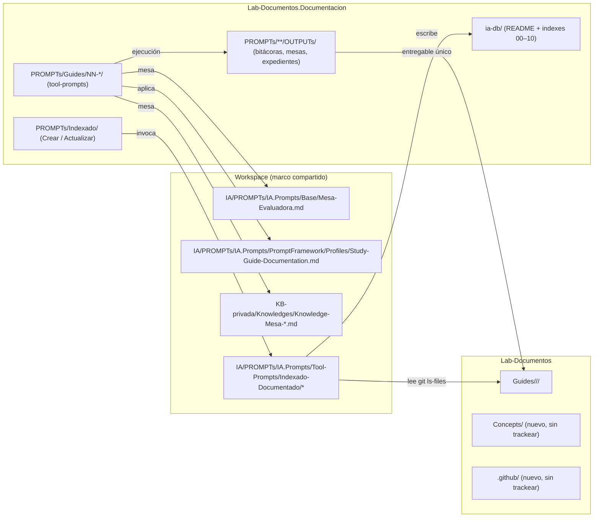
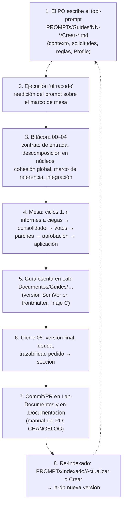

# R03 — Relevamiento del marco SDD de Lab-Documentos

## Índice

1. [Alcance y método](#1-alcance-y-método)
2. [Definiciones](#2-definiciones)
3. [Cómo se documenta hoy: dos repositorios](#3-cómo-se-documenta-hoy-dos-repositorios)
4. [La ia-db: qué es y qué no es](#4-la-ia-db-qué-es-y-qué-no-es)
5. [Ciclo de vida de una guía](#5-ciclo-de-vida-de-una-guía)
6. [Quién mantiene](#6-quién-mantiene)
7. [Agentes orquestadores y conocimientos](#7-agentes-orquestadores-y-conocimientos)
8. [Estado de los repositorios (git status)](#8-estado-de-los-repositorios-git-status)
9. [Workflows en Lab-Documentos](#9-workflows-en-lab-documentos)
10. [Antecedentes en el workspace con `runs-on: [self-hosted, i7infra-dev]`](#10-antecedentes-en-el-workspace-con-runs-on-self-hosted-i7infra-dev)
11. [Hallazgos consolidados](#11-hallazgos-consolidados)
12. [Lo que no se verificó](#12-lo-que-no-se-verificó)

---

## 1. Alcance y método

Relevamiento **de solo lectura** del marco documental de Lab-Documentos. El objetivo es dar a la mesa un
cuadro de cómo se produce, indexa y mantiene la documentación hoy, y qué antecedentes hay para el workflow
que pide el prompt (`Replanteo-Y-Analisis.md:34`).

Método: lectura de los archivos listados en el encabezado, `git status`/`git log`/`git diff` de los dos
repositorios, fechas de modificación (`stat`/`find -printf`) para datar lo no commiteado y un `grep` del
workspace por la etiqueta del runner. Las rutas se dan absolutas; donde se abrevia, `DOC/` es
`/LAB/Lab-Documentos/Lab-Documentos.Documentacion/` y `CONT/` es
`/LAB/Lab-Documentos/Lab-Documentos/`.

## 2. Definiciones

| Término | Significado en este relevamiento |
|---|---|
| **Repo de contenido** | `CONT/` (`hdcm-dev/Lab-Documentos`): las guías publicadas (`Guides/`) y, desde el 2026-10-25, `Concepts/` |
| **Repo .Documentacion** | `DOC/` (`hdcm-dev/Lab-Documentos.Documentacion`): los prompts que generan las guías (`PROMPTs/`) y la ia-db que las indexa |
| **ia-db** | Base de conocimiento para agentes: un README de entrada + índices por dominio que destilan el repo de contenido y remiten a sus fuentes (`DOC/ia-db/README.md:3-8`) |
| **Tool-prompt** | Archivo `.md` con «Invocación / Contexto / Solicitudes / Reglas / Framework» que un agente lee y ejecuta (p. ej. `Replanteo-Y-Analisis.md:1-68`) |
| **Mesa** | Ejecución multiagente de un tool-prompt según un marco (Mesa-Evaluadora o Knowledge-Mesa-De-Expertos), con bitácoras en `OUTPUTs/` |
| **Expediente** | Carpeta numerada de folios (`actuaciones/NNN-…`) que registra pedido, informes, veredictos y resoluciones de una mesa |
| **Orquestador** | En este workspace, el **marco** que coordina agentes (presidente/relator/jurado/auditor), no un agente persistente en el repo (ver §7) |

## 3. Cómo se documenta hoy: dos repositorios

Evidencia de la separación:

- La ia-db se declara «punto de entrada único» del repo de contenido y vive fuera de él
  (`DOC/ia-db/README.md:3-5`); su manifiesto dice «destino explícito fuera del proyecto»
  (`DOC/ia-db/README.md:97-98`).
- El repo .Documentacion contiene «prompts generadores en `PROMPTs/Guides/01…15`, prompts de indexado en
  `PROMPTs/Indexado/`, esta ia-db» (`DOC/ia-db/README.md:35`).
- La guía es el **único entregable** y no remite a la bitácora; la bitácora sí remite a la guía
  (`DOC/PROMPTs/Guides/15-Metodologia-Entorno-Desarrollo/OUTPUTs/Bitcora/README.md:14-16`).
- La decisión de producir la salida en el repo de contenido y no en .Documentacion está registrada:
  «la salida del encargo pasa a producirse en `Lab-Documentos`, no acá» (`DOC/CHANGELOG.md:50-54`).

Estructura de `CONT/Guides/`: once carpetas de categoría desde `9162e07` (2026-09-28)
(`DOC/ia-db/indexes/00_MASTER-INDEX.md` §2; árbol en `DOC/ia-db/README.md:49-67`). Cuatro linajes de guía
(A estructuradas con aparato común, B procedimiento del equipo, C versionadas con laboratorio,
D importado) (`00_MASTER-INDEX.md:67-74`).

`PROMPTs/` de .Documentacion tiene cinco ramas: `Analisis/` (vacía, sólo `.gitkeep`), `Concepts/` (609
archivos), `DEVs/` (12), `Guides/` (1 532) e `Indexado/` (2) (conteo `find -type f` del 2026-10-26).
`DEVs/` clasifica encargos por tipo de cambio con un README de una línea cada uno
(`DOC/PROMPTs/DEVs/Enchacement/README.md:1`: «mejorar una funcionalidad existente»; ídem `Fixs/`,
`Features/`, `Refactor/`, `Changed/`, `Breaking-Change/`), alta registrada en `DOC/CHANGELOG.md:27-29`.

## 4. La ia-db: qué es y qué no es

### 4.1 Qué es

- **Índice para agentes**, versión 4.0 del 2026-10-18 que reemplaza a la 3.0 del 2026-09-12
  (`DOC/ia-db/README.md:124-125`). Once índices por dominio 00–10 con tabla de navegación
  (`DOC/ia-db/README.md:12-24`).
- Generado por un tool-prompt del workspace (`IA/PROMPTs/IA.Prompts/Tool-Prompts/Indexado-Documentado/Iniciar-Indexado.md`)
  invocado por `DOC/PROMPTs/Indexado/Crear-Indexado.md` en modalidad *ultracode* con indexador +
  verificador adversarial por dominio, consolidador y chequeo final (`DOC/ia-db/README.md:92-95`); perfil
  `Knowledge-Indexing.md` (`:96`); actualización por `Actualizar-Indexado.md` (`:126-127`).
- Trae **restricciones para IA** que son de hecho las reglas de consumo del corpus: no modificar el repo
  de contenido, no escribir en carpetas del usuario, el índice no es fuente de verdad, no mezclar
  vocabularios de IDs, no citar como norma lo marcado [C], usar la copia vigente
  (`DOC/ia-db/README.md:69-88`).
- Verificación mecánica registrada en su manifiesto (127 enlaces internos, 364 rutas del corpus,
  tamaño y duplicación) (`DOC/ia-db/README.md:106-123`).

### 4.2 Qué no es

El prompt dice que `ia-db/README.md` «tiene su propio marco SDD de diseño asistido por IA»
(`Replanteo-Y-Analisis.md:18`). Lo relevado no lo sostiene en sentido estricto:

- La ia-db **indexa** guías; no define agentes, reglas de producción ni ciclo de especificación. Su
  única mención a SDD/agentes es el índice 09, que cubre material **importado** del proyecto *Motor DSL*
  (`DOC/ia-db/README.md:23`, `:63`; `00_MASTER-INDEX.md:73`).
- Los agentes `AG-ROOT…AG-11` que aparecen son fichas de estudio en
  `CONT/Guides/IA/references/agentes-especialidades/`, con dos numeraciones que no coinciden
  (`DOC/ia-db/indexes/09_IA-Agiles-UX-y-Otros.md:28`, `:42-44`), y la propia ia-db advierte no darlos
  por vigentes (`DOC/ia-db/README.md:81-83`).
- No hay `AGENTS.md`, `CLAUDE.md`, `.claude/` ni `CODEOWNERS` en ninguno de los dos repos
  (`find -maxdepth 3`, 2026-10-26: sin resultados).

**Criterio propio**: el «marco SDD» de Lab-Documentos existe, pero es **externo y de workspace** (§7):
tool-prompt + perfil + marco de mesa + tool-prompts de indexado. Lo que el repo aporta es el registro
(bitácoras, expedientes) y el índice.

### 4.3 Desfase de la ia-db con su propio repo

- La v4.0 **no está commiteada**: `git status` de .Documentacion muestra `M ia-db/README.md`,
  `M indexes/00…04`, `D indexes/05_Modelo-de-Ramas-y-Practicas.md … 09_Convenciones-y-Glosario.md` y seis
  índices nuevos sin trackear (05–10). Fechas de modificación 2026-10-18 20:03–20:22. En `origin/main`
  (`8da0cd9`) sigue publicada la 3.0.
- El manifiesto afirma «árbol de trabajo limpio» de Lab-Documentos (`DOC/ia-db/README.md:31`, `:105`;
  `00_MASTER-INDEX.md:163`): era cierto el 2026-10-18 y **ya no** el 2026-10-26 (§8).
- La ia-db no conoce `Concepts/` ni `.github/` (son posteriores) ni `Guides/IA/Dot-Net-Integration-AI-Layer-Guide/`.

## 5. Ciclo de vida de una guía

Reconstruido a partir del prompt 15 y su bitácora, el expediente 0001 de Concepts y el CHANGELOG.

Evidencia por paso:

| Paso | Evidencia |
|---|---|
| 1 | Prompt del PO marcado «sólo lectura»: `DOC/PROMPTs/Guides/15-Metodologia-Entorno-Desarrollo/OUTPUTs/Bitcora/README.md:18`; el prompt 15 pide reeditarse sobre `Mesa-Evaluadora.md` y fija la ruta del entregable (`Crear-Analizar-Metodlogia-Entorno-Desarrollo.md`, sección «Solicitudes») |
| 2 | Prompt reeditado `OUTPUTs/Metodlogia-Entorno-Desarrollo.md` (`Bitcora/README.md:19`) |
| 3 | Fase 1 «Análisis y construcción», archivos 00–04 (`Bitcora/README.md:32-42`) |
| 4 | Fase 2, seis pasos por ciclo y tabla de versiones 1.0.0-borrador → rc.1 → 1.0.0 → 1.1.0 (`Bitcora/README.md:43-62`) |
| 5–6 | `05-Cierre.md:42-48` (`version_final: 1.1.0`) y `:206` (trazabilidad) |
| 7 | La guía ENT entró a Lab-Documentos en `5d5c2b4` (2026-10-11) con mensaje «.» (`00_MASTER-INDEX.md` §3.1 y §6) |
| 8 | `DOC/PROMPTs/Indexado/Crear-Indexado.md:10`, `Actualizar-Indexado.md:10` |

Variantes observadas:

- **Prompts tempranos (01–05, 08–13)** sólo aplican el Profile, sin marco de mesa (tabla de §7.2).
- **Concepts/01 (2026-10)** usa la forma **expediente** (folios 001–038) con Knowledge-Mesa-De-Expertos y
  Consulta-A-Un-Tercero, ensayos con evidencia (APK, capturas) y una delegación de merge
  (`DOC/PROMPTs/Concepts/01-Framework-Concept/OUTPUTs/Expedientes/0001-Framework-Concept-Maui-Autoactualizable/actuaciones/007-providencia-delegacion-del-merge.md:8`, `:34`).
- **El CHANGELOG no acompaña el ciclo**: el de Lab-Documentos cubre sólo 2026-09-18 → 09-21
  (`00_MASTER-INDEX.md:97-102`, H-E6 en `:265`); el de .Documentacion termina en la entrada del
  2026-09-20 (`DOC/CHANGELOG.md:11`).
- **Versionado heterogéneo**: SemVer en frontmatter sólo en NET y ENT; DT/IS/OEP/REST sin `version`; SDT
  `status: draft` con esquema propio (`00_MASTER-INDEX.md:261-262`; frontmatter en
  `CONT/Guides/Documentacion-Tecnica/Sistema-De-Documentacion-E-Integracion/Sistema-Documentador-Tecnico-Guide.md:1-12`).

## 6. Quién mantiene

- **Autor único**: todos los commits de ambos repos son de una misma persona con dos identidades de git
  (`git shortlog -sne HEAD`: Lab-Documentos 23 + 9; .Documentacion 26 + 14). 14 y 21 commits llevan
  `Co-Authored-By` (asistencia de agente). Merges: 7 y 9.
- El frontmatter declara `owner: {usuario-del-host}` en SDT
  (`…/Sistema-Documentador-Tecnico-Guide.md:8`) y `origin: agent`/`ia-assisted` en general
  (`DOC/ia-db/indexes/10_Convenciones-y-Glosario.md:66`).
- El modelo de actores de DT asigna al agente de IA «autoridad: ninguna; produce borradores trazables»
  (`DOC/ia-db/indexes/01_Documentacion-Tecnica.md:90`).
- Roles de las corridas: el PO escribe el prompt; la mesa (agentes) produce bitácora y guía; el PO
  commitea. **Criterio propio** (inferido de §5 y §8): el paso «commit + re-indexado» es el que más se
  atrasa (ia-db v4.0 sin commitear desde hace 8 días; trabajo de Concepts sin trackear).

## 7. Agentes orquestadores y conocimientos

### 7.1 Qué orquesta realmente

| Pieza | Ruta | Qué aporta |
|---|---|---|
| Marco de mesa evaluadora | `/IA/PROMPTs/IA.Prompts/Base/Mesa-Evaluadora.md` (430 l.) | Se titula «Marco de orquestación multiagente para Spec-Driven Development» (`:22`); núcleo permanente + catálogo por señales + ad hoc (`:7`, `:121-177`); relator, jurado de 5, cuerpo auditor (`:184-206`); ciclo y criterios de parada (`:208-357`) |
| Mesa de expertos a pedido | `KB-privada/Knowledges/Knowledge-Mesa-De-Expertos-A-Pedido.md` | Versión 3.1 (`:11`), 608 l.; la que pide este prompt (`Replanteo-Y-Analisis.md:36`) |
| Consulta a un tercero | `KB-privada/Knowledges/Knowledge-Mesa-Consulta-A-Un-Tercero.md` | 276 l. |
| Perfil de guía de estudio | `/IA/PROMPTs/IA.Prompts/PromptFramework/Profiles/Study-Guide-Documentation.md` (85 l.) | Estructura de documento temático, criterios de calidad, diagramas |
| Indexado | `/IA/PROMPTs/IA.Prompts/Tool-Prompts/Indexado-Documentado/{Iniciar,Actualizar}-Indexado.md` + Profile `Knowledge-Indexing.md` | Produce y actualiza la ia-db |

### 7.2 Qué consume cada tool-prompt de Lab-Documentos

`grep` de referencias en `DOC/PROMPTs/**` (sin `OUTPUTs/`), 2026-10-26:

| Tool-prompt | Profile | Mesa-Evaluadora | Knowledge-Mesa-* |
|---|---|---|---|
| Guides/01, 02, 03, 04, 05, 10, 11, 13, 14; 06/02, 06/03 | Study-Guide | — | — |
| Guides/06/01, 07, 15, 16 | Study-Guide | sí | — |
| Concepts/01-Framework-Concept | Study-Guide | — | Expertos + Tercero |
| DEVs/Enchacement/01 (este) | Study-Guide | — | Expertos + Tercero |

Tendencia: de Mesa-Evaluadora (septiembre–octubre) a Knowledge-Mesa-* (Concepts y este replanteo).

### 7.3 Conocimientos compartibles con SDD-B, y una divergencia

SDD-B (servicio de notificaciones push, privado) declara «26 agentes + 4 reglas, 18 conocimientos» en
su ia-db (`<SDD-B>/ia-db/README.md:27`; índice `11_pipeline-sdd-y-agentes.md:1`, `:48`, `:144-153`), con
su **propia copia** de los conocimientos en su carpeta de prompts. Lab-Documentos, en cambio, no tiene
agentes en el repo: consume los del workspace.

El mismo conocimiento existe en **tres versiones distintas**:

| Copia | Versión (línea 11) | Líneas |
|---|---|---:|
| `KB-privada/Knowledges/Knowledge-Mesa-De-Expertos-A-Pedido.md` | 3.1 | 608 |
| `IA/PROMPTs/IA.Prompts/Conocimientos/Knowledge-Mesa-De-Expertos-A-Pedido.md` | 1.2 | 309 |
| `<SDD-B>/Prompts/Conocimientos/Knowledge-Mesa-De-Expertos-A-Pedido.md` | 1.15 | 790 |

Lo mismo para `Knowledge-Mesa-Consulta-A-Un-Tercero.md`: 276 l. en KB-privada frente a 144 l. en
IA.Prompts (`diff` de 222 líneas). **Criterio propio**: es la evidencia concreta del problema de «desfase
de versionado y coordinación» que plantea el prompt (`Replanteo-Y-Analisis.md:20`), aplicada no a la
documentación de producto sino a los conocimientos de los propios orquestadores.

Candidatos a compartir (criterio propio, a validar por la mesa): el marco de mesa/expediente, la regla
de descomposición en núcleos con bitácora de cohesión (repetida textual en los prompts:
`Replanteo-Y-Analisis.md:44-57`), el tool-prompt de indexado (ia-db como interfaz para agentes) y la
conformación de PR (`KB-privada/Knowledges/Knowledge-Conformacion-Pull-Request-Automatico.md`).

## 8. Estado de los repositorios (git status)

Medido el 2026-10-26. Ambos en `main` igual a `origin/main` y sin stash.

### 8.1 Lab-Documentos (`CONT/`, HEAD `5d5c2b4` del 2026-10-11)

| Estado | Ruta | Desde (mtime) |
|---|---|---|
| `M` | `Guides/Documentacion-Tecnica/Sistema-De-Documentacion-E-Integracion/Examples/Lanzar-Example.md` (corrige la ruta de invocación a `/LAB/Lab-Documentos/Lab-Documentos/…`, 1 línea) | 2026-10-26 07:53 |
| `??` | `.github/workflows/framework-concept-demo.yml` | 2026-10-26 06:56 |
| `??` | `.github/pull_request_template.md` | 2026-10-26 09:38 |
| `??` | `Concepts/Framework-Concept/` (`Framework-APP.md`, `Developer-Guide.md`, `Demo/` con ≈ 185 archivos: solución .NET, tests, tools, scripts, semilla firmada, clave pública de demo) | 2026-10-25 → 10-26 |
| `??` | `Guides/IA/Dot-Net-Integration-AI-Layer-Guide/` | 2026-10-25 |

Nota: `Lanzar-Example.md` corrige parcialmente el hallazgo H-C1 de la ia-db
(`00_MASTER-INDEX.md:241`): sólo cambia la línea de invocación (`git diff`, 1+/1−).

### 8.2 Lab-Documentos.Documentacion (`DOC/`, HEAD `8da0cd9` del 2026-10-11)

| Estado | Ruta | Desde (mtime) |
|---|---|---|
| `M`/`D`/`??` | `ia-db/` completa (v4.0: 6 modificados, 5 borrados, 6 nuevos; +1 680/−1 190) | 2026-10-18 |
| `M` | `PROMPTs/Indexado/Crear-Indexado.md`, `Actualizar-Indexado.md` (agregan «ultracode») | 2026-10-18 |
| `M` | `PROMPTs/Guides/06-…/01-Reedicion-Arquitectura.md`, `02-Edición-Arquitecture-Guide.md` (retoques) | 2026-10-25 |
| `M` | `PROMPTs/Guides/14-…/Crear-Analizar-Sistema-De-Documentador-Tecnico-Guide.md` (ruta y overview) | 2026-10-26 07:51 |
| `??` | `PROMPTs/Concepts/01-Framework-Concept/` (≈ 585 archivos, incluye `OUTPUTs/Ensayos/` de **80 MB** con 72 `.apk`/`.wasm`) | 2026-07-14 → 10-26 |
| `??` | `PROMPTs/Guides/16-IA-Layer/` (≈ 72 archivos) | 2026-10-25 → 10-26 |
| `??` | `PROMPTs/DEVs/Enchacement/01-Replanteo-Y-Analisis/` | 2026-10-26 |

Hechos derivados:

- **Rutas de invocación desfasadas**: los prompts commiteados citan `/LAB/Lab-Documentos.Documentacion/…`
  (p. ej. `DOC/PROMPTs/Indexado/Crear-Indexado.md:4`; `DOC/ia-db/README.md:93`) pero la carpeta real es
  `/LAB/Lab-Documentos/Lab-Documentos.Documentacion/`. Las correcciones de 06, 14 y Lanzar-Example del
  25–26 de octubre van en esa dirección, sin completar.
- **Ruta del Profile en este prompt**: `Replanteo-Y-Analisis.md:68` cita `/IA/IA.Prompts/PromptFramework/…`,
  que no existe; el archivo está en `/IA/PROMPTs/IA.Prompts/PromptFramework/Profiles/Study-Guide-Documentation.md`.
- **Binarios sin ignorar**: el `.gitignore` de .Documentacion (plantilla Visual Studio) no excluye `*.apk`
  ni `*.wasm`; un `git add` de `PROMPTs/Concepts/` subiría 80 MB a un repo público.

## 9. Workflows en Lab-Documentos

### 9.1 Hoy

Un solo workflow, **sin trackear**: `CONT/.github/workflows/framework-concept-demo.yml` (204 l.). No hay
workflow alguno en .Documentacion.

| Rasgo | Detalle | Línea |
|---|---|---|
| Origen | Implanta decisiones P6.2–P6.4 y P8 del dictamen de la ronda 2 del expediente 0001 (folio 035) | `:3-10` |
| Disparo | `pull_request` + `workflow_dispatch`, sin `paths:` (el alcance lo decide un job) | `:21-23` |
| Permisos | `contents: read`, sin secretos | `:25-26` |
| Concurrencia | por PR, `cancel-in-progress: true` | `:28-30` |
| Runner | `runs-on: [self-hosted, i7infra-dev]` en los cuatro jobs | `:42`, `:87`, `:148`, `:168` |
| Guarda de forks | `head.repo.full_name == github.repository` en `alcance` | `:41` |
| Alcance | `git diff BASE...HEAD`; corre todo si toca `Concepts/Framework-Concept/Demo/` o el propio workflow | `:66-76` |
| Aviso P6.8 | warning si cambia `global.json` o `Directory.Build.props` | `:79-81` |
| Compuerta | build sin MAUI con avisos como error, tres proyectos de tests, publish + empaquetado | `:120-142` |
| APK | `dotnet build` del cascarón `android-arm64` | `:158-161` |
| Agregador | `fw-ok` con `if: always()`: estricto, `skipped`/`cancelled` = rojo salvo omisión declarada | `:165-204` |
| Equivalente local | `Concepts/Framework-Concept/Demo/scripts/ci-local.sh` | `:17` |
| Supuestos del runner | sin `docker.sock` ni KVM; SDK 10.0.402, maui-android 10.0.110, JDK 21 | `:12-15` |

**El workflow sólo cubre la demo de Concepts**: un PR que toca `Guides/` pasa `fw-ok` en verde «por
omisión declarada» (`:188-193`). No hay compuerta de documentación (enlaces, frontmatter, markdownlint,
Mermaid). Acompaña una plantilla de PR con cuatro campos obligatorios atada a la demo
(`CONT/.github/pull_request_template.md:1-34`).

### 9.2 Antes

Lab-Documentos **tuvo** `.github/` mientras alojaba la app `MovilidadUrbana`: `ci.yml`, `e2e.yml`,
`release.yml`, `auditoria-convergencia.yml`, `verificacion-entorno.yml` y `CODEOWNERS`, agregados en
`4d4d637`/`9867aa2`/`ae91bde` (2026-08-25) y borrados en `28339d5` (2026-09-13, mensaje «.»)
(`git log --all -- .github`). En el último estado (`28339d5^`) `ci`, `release` y
`auditoria-convergencia` usaban `[self-hosted, i7infra-dev]` y `e2e` lo tenía comentado con
`ubuntu-latest` activo. Copias de esos workflows siguen en el corpus como material de estudio:
`CONT/Guides/GitFlow/Estandares-Modelo-Ramas-Guide/Anexos/workflows/{ci,release,auditoria-convergencia}.yml`
y `CONT/Guides/Testing/Lab-E2E.WebBlazor-Guides/workflows/` (no se ejecutan: no están en `.github/`).

## 10. Antecedentes en el workspace con `runs-on: [self-hosted, i7infra-dev]`

`grep -rn 'i7infra-dev' --include=*.yml --include=*.yaml` (sin `.git`, `bin`, `obj`, `node_modules`),
2026-10-26.

### 10.1 El runner

Definido en un repo de infraestructura de runners (no está en la lista de públicos: se nombra
genéricamente; ruta `INFRA-privada/docker/runner-github/runner-github-dev/docker-compose.yml`):

| Rasgo | Línea |
|---|---|
| Efímero: un job y se desregistra (`EPHEMERAL: "true"`) | `:50-54` |
| Nombre `i7infra-runner-dev`; etiquetas `i7infra,i7infra-dev,dotnet,maui-android` (además de `self-hosted`, `linux`, `x64`) | `:60-66` |
| Auto-update deshabilitado (actualizar = reconstruir imagen) | `:68-70` |
| Cachés NuGet/Gradle en un bind mount `/cache` | `:72-78` |
| Sin `docker.sock` ni `privileged` | `:80-82` |

El repo de prueba del runner documenta que en `runs-on` va la **etiqueta**, no el nombre, y lista las
etiquetas registradas (`…/Runner-Test/Dev/INFRA-privada-ensayo/.github/workflows/e2e-runner.yml:27-29`),
y que sin `timeout-minutes` un test colgado bloquea el único runner (`:30-31`). La instancia «AP25» de otra
organización **no** tiene esa etiqueta (`…/Runner-Test/AP25/…/e2e-runner.yml:30-32`): la etiqueta sirve
sólo a repos cuyo dueño tenga registrado el runner `dev`.

### 10.2 Workflows que la usan

| Repo (visibilidad) | Archivo | Cómo está armado |
|---|---|---|
| Lab-Documentos (público) | `.github/workflows/framework-concept-demo.yml` | §9.1 |
| Lab-Geometria (público) | `/PROG2/Geometria/Lab-Geometria/.github/workflows/e2e.yml` | Explica por qué corre en el runner propio (red del docente, no por velocidad) `:34-36`; `concurrency` sin cancelación porque siembra datos `:51-60`; guarda de forks para un repo público `:69-75`; matriz de navegadores `fail-fast: false` `:149-154` |
| Lab-E2E.StaticHtml (público) | `/LAB/Lab-E2E.StaticHtml/Lab-E2E.StaticHtml/.github/workflows/ci.yml`, `e2e.yml` | Usa `container: image: mcr.microsoft.com/playwright:v1.62.1-noble` sobre el runner (`ci.yml:38-41`), último cambio `63a80ba` 2026-08-23 |
| Lab-E2E.WebBlazor (público) | `/LAB/Lab-E2E.WebBlazor/Lab-E2E.WebBlazor/.github/workflows/ci.yml`, `e2e.yml` | La etiqueta queda **comentada** «como ejemplo» y corre en `ubuntu-latest` (`ci.yml:38-41`); `e2e.yml:89` sí la usa en un job |
| Corpus de Lab-Documentos (copias de estudio) | `CONT/Guides/GitFlow/Estandares-Modelo-Ramas-Guide/Anexos/workflows/ci.yml` y `release.yml` | «Sin `container:`: el runner es él mismo un contenedor y no tiene acceso al demonio de Docker» (`ci.yml:39-42`) |
| Dos repos de librerías de impresión térmica (visibilidad no relevada) | `ci.yml`, `cd-android.yml`, `cd-nuget.yml` | Todos los jobs en el runner propio (CI, APK, NuGet) |
| App móvil de un cliente (privada) | `.github/actionlint.yaml` en cinco clones | Declara `i7infra-dev` como etiqueta conocida para `actionlint` |

### 10.3 Patrones comunes (antecedente para el workflow que pide el prompt)

1. **Etiqueta específica** `[self-hosted, i7infra-dev]`, nunca `self-hosted` a secas.
2. **Guarda de mismo repositorio** en repos públicos (Lab-Geometria `e2e.yml:69-75`; Lab-Documentos `:41`).
3. **`permissions: contents: read`** y sin secretos.
4. **`timeout-minutes`** en cada job (runner único).
5. **Sin `container:`** donde se documenta la limitación del runner; `dotnet` directo con SDK fijado por
   `global.json`.
6. **Agregador estricto** como único check requerido (`fw-ok`), con omisión declarada.
7. **Equivalente local** del mismo guion (`ci-local.sh`).

## 11. Hallazgos consolidados

| ID | Hallazgo | Evidencia |
|---|---|---|
| R03-H01 | El «marco SDD de Lab-Documentos» no vive en su ia-db: la ia-db es índice; la orquestación es de workspace (Mesa-Evaluadora, Knowledge-Mesa-*, Profile, Indexado) | §4.2, §7.1 |
| R03-H02 | La ia-db v4.0 está sin commitear desde el 2026-10-18; `origin/main` publica la 3.0 con otra numeración de índices | §4.3, §8.2 |
| R03-H03 | El manifiesto de la ia-db afirma «árbol limpio» y ya no lo es; no conoce `Concepts/`, `.github/` ni la guía de AI Layer | `DOC/ia-db/README.md:31`, §8.1 |
| R03-H04 | El único workflow de Lab-Documentos está sin trackear y sólo compila la demo; ningún control automático sobre `Guides/` | §9.1 |
| R03-H05 | Lab-Documentos ya tuvo workflows con el runner propio (hasta el 2026-09-13) y los borró con la app | §9.2 |
| R03-H06 | Mismo conocimiento de mesa en tres versiones (3.1, 1.2, 1.15) y consulta-a-un-tercero en dos | §7.3 |
| R03-H07 | Rutas de invocación desfasadas tras mudar los dos repos bajo `LAB/Lab-Documentos/`; este prompt cita mal la ruta del Profile | §8.2 |
| R03-H08 | 80 MB de `.apk`/`.wasm` sin trackear en `PROMPTs/Concepts/` y sin regla en `.gitignore` | §8.2 |
| R03-H09 | Contradicción entre workflows: Lab-E2E.StaticHtml usa `container:` en el runner que otros documentan sin Docker | §10.2 |
| R03-H10 | Los CHANGELOG de ambos repos no acompañan el ciclo (cortan en septiembre) | §5 |
| R03-H11 | Mantenimiento de una sola persona, con agentes como coautores; el paso que se atrasa es commit + re-indexado | §6 |

## 12. Lo que no se verificó

- **Ejecución del workflow** `framework-concept-demo.yml`: no está en el remoto, así que no hay corridas.
  No se consultó la API de GitHub.
- **Protección de rama** de `hdcm-dev/Lab-Documentos` que la resolución P6 da por puesta (folio 037,
  fila P6): no se consultó; en otros repos del workspace la API de un plan gratuito devolvió 403 a la
  protección de rama (memoria del proyecto, no reverificada acá).
- **Si `container:` funciona** en el runner `i7infra-dev` (caso Lab-E2E.StaticHtml): no hay registro de
  corrida a la vista.
- **Visibilidad** de los repos de librerías térmicas y del repo de infraestructura de runners: no
  relevada; por eso se nombran de forma genérica.
- **Contenido** de `Concepts/Framework-Concept/Demo/` y de `Guides/IA/Dot-Net-Integration-AI-Layer-Guide/`:
  sólo se inventariaron.
- Correspondencia prompt → guía: tomada de la ia-db, que avisa que es por nombre de carpeta
  (`00_MASTER-INDEX.md:94-95`).
