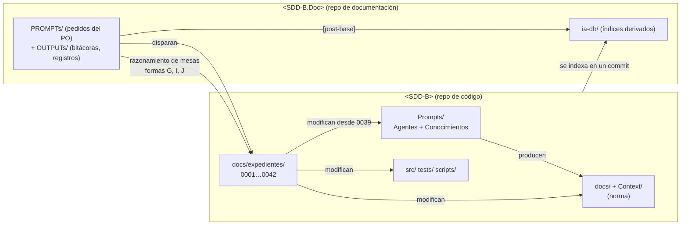
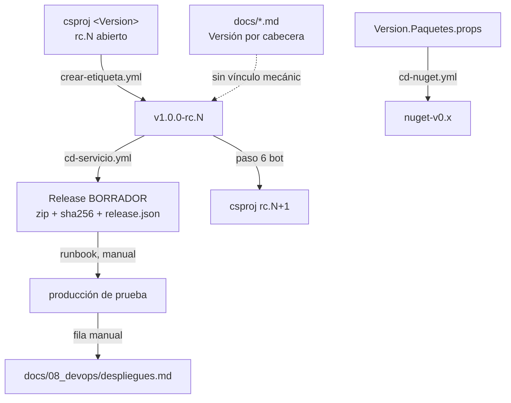
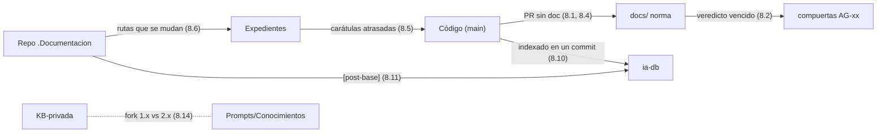

# R04 — Relevamiento del marco SDD del servicio de notificaciones push (SDD-B)

| Campo | Valor |
|---|---|
| **Id** | R04 |
| **Título** | Marco SDD del servicio de notificaciones push (privado, «SDD-B»): gestión de la documentación, versionado doc/código, agentes, conocimientos compartibles y desfases registrados |
| **Autor (rol)** | Relevador del despacho R04 (subagente de la mesa de *Replanteo y análisis DocAsCode*) |
| **Fecha** | 2026-10-26 |
| **Tool-prompt** | `/LAB/Lab-Documentos/Lab-Documentos.Documentacion/PROMPTs/DEVs/Enchacement/01-Replanteo-Y-Analisis/Replanteo-Y-Analisis.md` |
| **Modo** | Sólo lectura sobre los repositorios. Nada se compiló ni se ejecutó salvo `git`, `ls`, `grep`, `sed`, `wc` |
| **Fuentes leídas** | `<SDD-B.Doc>/ia-db/README.md` completo · `<SDD-B.Doc>/ia-db/indexes/11_pipeline-sdd-y-agentes.md` completo · `…/09_devops-y-release.md` §3, §6, §9 · `…/12_gobernanza-y-pendientes.md` §1, §6–§8 · `<SDD-B.Doc>/{README,ENTREGA,CHANGELOG}.md`, `.github/workflows/verificar.yml`, `tools/verificar_ia_db.py` · `<SDD-B>/Prompts/Agentes/{_convenciones_comunes,guia_de_uso}.md` (secciones citadas) · `<SDD-B>/Prompts/Conocimientos/{README,Catalogo}.md` y cabeceras de los 18 `Knowledge-*.md` · `<SDD-B>/docs/README.md`, `Context/acta_proyecto.md`, `docs/08_devops/ci-cd-pipeline_v1.0.md`, `docs/expedientes/0038-*/README.md`, `.csproj` del servicio, `versionado/Version.Paquetes.props`, `Program.cs` (líneas citadas) · `git log`/`git tag`/`git status` de ambos repos · comparación de cabeceras contra `KB-privada/Knowledges/` · para el contraste: `/LAB/Lab-Documentos/Lab-Documentos.Documentacion/ia-db/indexes/09_IA-Agiles-UX-y-Otros.md` |

---

## Índice

1. [Convenciones de esta bitácora (ofuscación y citas)](#1-convenciones-de-esta-bitácora-ofuscación-y-citas)
2. [Definiciones](#2-definiciones)
3. [Topología: dónde vive la documentación](#3-topología-dónde-vive-la-documentación)
4. [Versionado: doc frente a código](#4-versionado-doc-frente-a-código)
5. [El pipeline de agentes y en qué difiere del de Lab-Documentos](#5-el-pipeline-de-agentes-y-en-qué-difiere-del-de-lab-documentos)
6. [Vías de cambio: carta, expediente, PR de norma](#6-vías-de-cambio-carta-expediente-pr-de-norma)
7. [Conocimientos: inventario y cuáles son compartibles](#7-conocimientos-inventario-y-cuáles-son-compartibles)
8. [Problemas de desfase y coordinación registrados](#8-problemas-de-desfase-y-coordinación-registrados)
9. [Lecciones para la metodología común (criterio propio)](#9-lecciones-para-la-metodología-común-criterio-propio)
10. [No verificado](#10-no-verificado)

---

## 1. Convenciones de esta bitácora (ofuscación y citas)

SDD-B es **privado**. Esta bitácora vive en un repositorio público, así que:

| Alias | Qué designa | Nota |
|---|---|---|
| `<SDD-B>` | Raíz del repositorio de **código** del servicio (incluye `src/`, `tests/`, `docs/`, `Context/`, `Prompts/`) | La ruta real la tiene la presidencia en el valor de retorno de este despacho |
| `<SDD-B.Doc>` | Raíz del repositorio **separado de documentación** (hermano del de código) | Ídem |
| `<Servicio>` | Prefijo de los proyectos .NET (`<Servicio>.API.csproj`, etc.) | — |
| `<SV2>` | Sistema de diseño V2 de la casa (nombre interno privado) | En `KB-privada` ya figura neutralizado como «Sistema-De-Diseno-V2» |
| «proveedor de referencia» | El servicio externo de push al que SDD-B reemplaza | No se nombra |

Las citas son `ruta:línea` con esos alias. No se transcriben dominios, hosts, IPs, usuarios, claves, clientes ni
nombres de organización. Cuando un hallazgo dice «hay secretos en X», se da **sólo la ubicación**.

---

## 2. Definiciones

- **SDD (Spec-Driven Development) de SDD-B.** Cuerpo documental en `<SDD-B>/docs/` y `<SDD-B>/Context/` producido por
  un pipeline de 26 agentes (`<SDD-B>/Prompts/Agentes/`) con compuertas de auditoría, más un catálogo de conocimientos
  anexo (`<SDD-B>/Prompts/Conocimientos/`).
- **`ia-db`.** Base de conocimiento **derivada** (índices destilados) para que un agente lea el proyecto sin recorrer
  `docs/` entero. Vive en `<SDD-B.Doc>/ia-db/` y se regenera por un tool-prompt de indexado (`<SDD-B.Doc>/ia-db/README.md:199-207`).
- **Expediente.** Carpeta de caso `docs/expedientes/NNNN-Titulo/` con carátula, actuaciones (folios), evidencia y a veces
  mesa; es la vía por la que hoy entran casi todos los cambios (`…/indexes/11_pipeline-sdd-y-agentes.md:207-236`).
- **Carta de cambios.** Lista cerrada aprobada por el PO en `Context/input/integracion_preacta.md` que habilita el *modo
  reincorporación* (`<SDD-B>/Prompts/Agentes/_convenciones_comunes.md:48-62`).
- **PR de norma.** Cambio de `Prompts/` por pull request con mesa de revisión, sin carta ni fila del acta
  (`…/indexes/11_pipeline-sdd-y-agentes.md:298-306`).
- **[post-base].** Marca de la `ia-db` para hechos que sólo están en el repo de documentación y no en el commit de código
  indexado (`<SDD-B.Doc>/ia-db/README.md:137-141`).

---

## 3. Topología: dónde vive la documentación

**Hallazgo 3.1 — No es «repo de doc separado» ni «docs en el código»: son las dos cosas, con reparto de roles.**

| Ubicación | Qué contiene | Quién escribe | Evidencia |
|---|---|---|---|
| `<SDD-B>/docs/` (01…11, `auditoria/`, `deuda-declarada`) | La **especificación normativa** (funcional, arquitectura, ADR, contratos API, modelo de datos, DevOps, guías) | Pipeline de agentes / expedientes | `ls <SDD-B>/docs` (11 carpetas temáticas + `expedientes/`) |
| `<SDD-B>/docs/expedientes/0001…0042/` | Los **42 expedientes** de caso (1.371 archivos) | Mesas y agentes con delegación del PO | `ls docs/expedientes \| wc -l` = 42; `…/indexes/11…md:221-223` |
| `<SDD-B>/Context/` | Acta del proyecto, parámetros, arquitectura de solución (fuente de verdad nivel 2) | PO / reincorporación | `_convenciones_comunes.md:15-21` |
| `<SDD-B>/Prompts/` | **Framework propio**: 26 agentes + 4 normas transversales + catálogo de 18 conocimientos | «es del PO» | `<SDD-B.Doc>/ia-db/README.md:128` |
| `<SDD-B.Doc>/ia-db/` | Índices derivados para IA (27 índices) | Tool-prompt de indexado | `<SDD-B.Doc>/ia-db/README.md:86-119` |
| `<SDD-B.Doc>/PROMPTs/` | Pedidos del PO (DEVs/Fixs, Features, DEV-OPs, SDD/06-Catalogado, Indexado, EDUs) con sus `OUTPUTs/` (bitácoras de mesas, registros de despliegue) | PO; agentes sólo en `OUTPUTs/` | `<SDD-B.Doc>/ia-db/README.md:129-131`; `ls <SDD-B.Doc>/PROMPTs` |
| `<SDD-B.Doc>/Analisis/` | Análisis previos (panel de expertos UX/UI, análisis del proveedor de referencia) | — | `ls <SDD-B.Doc>/Analisis` |

**Hallazgo 3.2 — El repo de documentación no tiene ciclo de versión propio.** Su `CHANGELOG.md` dice: «Las entradas se
agrupan por fecha, ya que el repositorio contiene documentación y prompts, no artefactos versionados por release»
(`<SDD-B.Doc>/CHANGELOG.md:6-8`). No tiene etiquetas (no se midió `git tag` vacío en ese repo: ver §10). Su único control
de CI es `verificar` (enlaces relativos, marcadores `PO-NUEVO`, IPv4, túneles, UNC, tokens) sobre `ia-db/`, agregado hoy
(`<SDD-B.Doc>/.github/workflows/verificar.yml:1-15`, `tools/verificar_ia_db.py:10-16`, commit `4c6c190`, 2026-10-26).

**Hallazgo 3.3 — El razonamiento de los cambios cambió de lugar con el tiempo** (siete formas de expediente, A–L):
en 0024–0031 la mesa quedó **afuera** (repo de documentación), en 0033–0036 la resolución quedó en bitácoras del
fix 19, en 0038 en la bitácora del fix 20; recién 0039–0042 guardan mesa, cartas y pruebas **dentro** del expediente
(`…/indexes/11_pipeline-sdd-y-agentes.md:225-236`).

**Hallazgo 3.4 — Delegación de entrega escrita en el repo de doc.** `ENTREGA.md` asienta que el PO delegó al agente
abrir, fusionar y borrar ramas de PR siguiendo `Conformacion-Pull-Request-Automatico` **2.0 de `KB-privada`**
(`<SDD-B.Doc>/ENTREGA.md:5-28`), mientras el repo de código conserva su copia **1.0** (§7.3).

---

## 4. Versionado: doc frente a código

**Hallazgo 4.1 — Cuatro familias de número independientes; la documentación no tiene número de producto.**

| Línea | Fuente única | Valor hoy | Etiqueta | Evidencia |
|---|---|---|---|---|
| Servicio | `<SDD-B>/src/<Servicio>.API/<Servicio>.API.csproj:25` | `1.0.0-rc.9` (tronco) | `v1.0.0-rc.8` último | `git tag`; `…/indexes/09…md:205-211` |
| Paquetes NuGet (Client, Maui) | `<SDD-B>/versionado/Version.Paquetes.props:53` | `0.25.0` | `nuget-v0.25.0` | `git tag` (22 etiquetas: `v*` y `nuget-v*`) |
| Esquema SQL | `<SDD-B>/src/<Servicio>.API/Program.cs:39` (`EsquemaRequerido = "1.54"`) | `1.54` | — (viaja en `release.json`) | `…/indexes/09…md:227-245` |
| Bundle JS | — | sin número propio | — | `<SDD-B.Doc>/ia-db/README.md:55` |
| **Documentos** | Cabecera `**Versión:**` de cada `.md` | por documento (ej. glosario 3.16, contratos 2.68) | **ninguna** | `…/indexes/12…md:220-229` |
| `ia-db` | Manifiesto «Versión: 15.0/16.0» + commit indexado | 15.0 en README; 16.0 en 4 índices (§8.10) | ninguna | `<SDD-B.Doc>/ia-db/README.md:280` |

**Hallazgo 4.2 — La cadena de release es mecánica salvo en sus extremos humanos.** El paso 3 (`crear-etiqueta.yml`) y el
paso 4 (`cd-servicio`: compuertas, `release.json`, Release en borrador) son flujos; el paso 5 (publicar la prosa del
Release) **nunca se ejerció**: el Release de `rc.8` quedó `draft=True` (`…/indexes/09…md:110-125`). El paso 6 del flujo
abre el número siguiente con un commit del bot sin comprobaciones (`…/indexes/09…md:95-108`).

**Hallazgo 4.3 — Lo desplegado se lee en un registro manual, no en el código.** «Lo desplegado se lee en
`despliegues.md` … **no** en el `.csproj` ni en el `release.json`» (`<SDD-B.Doc>/ia-db/README.md:139-141`; regla
equivalente para versiones en `:142-144`).

**Hallazgo 4.4 — Doc y código comparten commit, pero no ritmo.** Como `docs/` está en el mismo repo, cada PR de
código *puede* llevar su doc; la medición muestra que no lo hace: «`docs/01_*` y `docs/02_*` sin diff en la ventana …
`modelo-datos` y `contratos-api` sin las etiquetas» (`<SDD-B.Doc>/ia-db/README.md:62`); `publicacion-nuget_v1.0.md` 1.6
«no registra ninguna de las doce publicaciones posteriores» (`…/indexes/09…md:255-257`).

---

## 5. El pipeline de agentes y en qué difiere del de Lab-Documentos

### 5.1 Inventario (SDD-B)

30 archivos: 26 `AG-*.md` + `_convenciones_comunes.md` (1.7), `_reglas_base_conocimiento.md` (1.2), `_reglas_maqueta.md`,
`guia_de_uso.md` (`ls <SDD-B>/Prompts/Agentes`; `…/indexes/11…md:48-62`).

| Fase | Agentes | Orquestador | Compuerta |
|---|---|---|---|
| Fuera de secuencia | `AG-00_01` integrador de insumo (pre-acta) · `AG-00_02` **bibliotecario** del conocimiento | — | — |
| 1 Arranque | `AG-01_01` acta · `AG-01_02` inyección de parámetros | **`AG-01_00`** | `AG-01_03` auditor del acta |
| 2 Funcional | `AG-02_01` gobernanza · `_02` PM · `_03` negocio · `_04` funcional · `_05` UX/UI · `_06` maqueta HTML | **`AG-02_00`** | `AG-03_00` auditor funcional |
| 4 Técnica | `AG-04_01` arquitectura · `_02` backlog · `_03` sprint · `_04` calidad · `_05` infra · `_06` dev guide · `_07` examples · `_08` prompts IA (omitido) | **`AG-04_00`** | `AG-05_00` auditor técnico |
| 6–7 | `AG-06_00` prompts de implementación + demo | — | **`AG-07_00`** coherencia global (cierre) |

Árbol y regla de paralelismo («el único paralelismo real está dentro de `AG-04_00`, Nivel 0»):
`<SDD-B>/Prompts/Agentes/guia_de_uso.md:164-206`.

### 5.2 Contraste con Lab-Documentos

En Lab-Documentos el marco de agentes es **material de estudio** en `Guides/IA/` (fichas `AG-00…AG-11` + `AG-ROOT`, una
por carpeta `docs/NN_…`, y un prompt de refinamiento con subagentes `SA-01…SA-12`)
(`/LAB/Lab-Documentos/Lab-Documentos.Documentacion/ia-db/indexes/09_IA-Agiles-UX-y-Otros.md:131-165`), con
inconsistencias de numeración registradas (`…/09_IA-Agiles-UX-y-Otros.md:339`).

| Eje | Lab-Documentos | SDD-B |
|---|---|---|
| Naturaleza | Guía/plantilla de agentes, importada de un template académico | Pipeline **operativo** que produjo y gobierna un producto en producción |
| Numeración | `AG-NN` = carpeta de `docs/` (1 a 1) | `AG-FF_NN` = **fase + rol**; varios agentes por fase |
| Orquestación | Un prompt maestro + subagentes SA | **Tres orquestadores de fase** (`AG-01_00`, `AG-02_00`, `AG-04_00`) + **cuatro compuertas** de lectura (`AG-01_03`, `AG-03_00`, `AG-05_00`, `AG-07_00`) |
| Conocimiento | No hay rol específico | **Bibliotecario** (`AG-00_02`) y despacho de conocimiento por lista (`_convenciones_comunes.md` §7, `:129-285`) con regla de apartamiento §7.4 |
| Cambios posteriores al cierre | No previsto | Modo reincorporación + **cuarta vía por expediente** (`_convenciones_comunes.md:48-76`) |
| Entrega | — | Traspaso de 8 turnos y delegación del merge (`_convenciones_comunes.md:286-377`) |
| Prioridad de fuentes | — | Seis niveles: usuario > `Context/` > `docs/` > conocimiento > DevProject > general (`_convenciones_comunes.md:11-24`) |

**Hallazgo 5.3 — Los agentes no se usan en la práctica cotidiana.** Ningún `AG-*.md` cambió en la ventana
`d97e7c9..9641e74`; las cuatro compuertas de lectura no corren desde el 2026-08-29 (`b92af3e`), 1.160 commits y 42
expedientes después (`…/indexes/11…md:64-76`; `…/indexes/12…md:53-60`). Lo vivo es la **mesa de expertos a pedido**
dentro de expedientes (§6).

**Hallazgo 5.4 — Dependencia de un framework externo no vendorizado.** La cuarta vía cita `Root-Rules.md` §14 y
`Expediente-Rules.md` del framework `IA.SDD` (`_convenciones_comunes.md:64-76`), que existe en
`/IA/SDD/IA.SDD/SDD/Devs/Rules/Root-Rules.md` pero no en `<SDD-B>`; 116 archivos de `<SDD-B>` declaran que el repo no
tiene `Expediente-Rules`/`Mesa-Rules` y trabajan con copias (`…/indexes/11…md:199-200`).

---

## 6. Vías de cambio: carta, expediente, PR de norma

| Aspecto | Carta | Expediente | PR de norma |
|---|---|---|---|
| Toca | `docs/`, `Context/` | Producto, `docs/` y desde 0039 `Prompts/` | `Prompts/` |
| Decide | PO literal | Mesa con delegación del PO (2026-09-14) | PO + mesa de revisión |
| Control | Compuertas de lectura (no corren) | Rojo/verde, revisión adversarial, pruebas sin contexto, juez ciego | Mesa + reproducción a ciegas |
| Uso real | **5 cartas; ninguna desde 2026-09-16** | **42 expedientes** | 0039, 0041, 0042, #421 |

Fuente: `…/indexes/11_pipeline-sdd-y-agentes.md:298-306`; conteo de cartas en `…/indexes/12…md:64-70`.

**Hallazgo 6.1 — La norma se mueve por expedientes, sin asiento en el acta.** «Ningún `C-NN` nuevo … La norma cambió
por expediente + PR» (`…/indexes/11…md:117`); `Context/` sin diff en la ventana (`…/indexes/12…md:66-70`).

**Hallazgo 6.2 — Lo que un expediente registra y una carta no** (útil como patrón para la metodología): pedido literal
con SHA-256, cartas de mandato antes del despacho, revisión adversarial por fase, pruebas sin contexto con control
negativo, juez ciego, fe de erratas, «Secciones leídas» por folio (`…/indexes/11…md:248-254`). Ciclo de vida de la
evidencia (KM 1.15): «la cruda queda local y se versiona el expediente procesado» (`…/indexes/11…md:174`).

---

## 7. Conocimientos: inventario y cuáles son compartibles

### 7.1 Propiedad del catálogo

«Con el catálogo vacío el pipeline corre exactamente igual» (`<SDD-B>/Prompts/Conocimientos/README.md:13-15`); se
extiende por fork (documento + fila en `Index-Knowledge.md`) sin tocar `Agentes/` (`…/README.md:25-35`). Once de los 18
se importaron de `IA.SDD`; siete se escribieron en SDD-B (`…/README.md:41-52`).

### 7.2 Inventario (18) con veredicto de compartibilidad

Versión local medida en la cabecera `**Versión:**`; «IKB» = versión del homónimo en `KB-privada/Knowledges/`
(medido 2026-10-26). Descripción según `<SDD-B>/Prompts/Conocimientos/Catalogo.md:16-111`.

| Archivo | Cubre (una línea) | Local | IKB | Compartible |
|---|---|---|---|---|
| `Knowledge-Conformacion-Pull-Request-Manual.md` | Ciclo de entrega agente↔humano: compuerta, rama, PR, merge humano, acuse | 1.0 | 2.0 | **Sí, genérico** |
| `Knowledge-Conformacion-Pull-Request-Automatico.md` | Variante con merge delegado: guarda sobre checks, merge atado al SHA, borrado de rama | 1.0 | 2.0 | **Sí, genérico** |
| `Knowledge-Mesa-De-Expertos-A-Pedido.md` | Mesa convocada por nombre: variantes por objeto, comisiones a ciegas + refutador, expediente; carga progresiva; ciclo de evidencia | 1.15 | 3.1 | **Sí, genérico** (núcleo de la mesa de este tool-prompt) |
| `Knowledge-Versionado-Producto-Integral.md` | Contrato de versionado multi-pieza: qué lleva número, fuente única, compatibilidad con techo, gobierno por fase | 1.0 | 2.0 | **Sí, genérico** (clave para doc vs código) |
| `Knowledge-Release-Y-Despliegue-Versionado.md` | Qué es un release, runbook en tres capas, vuelta atrás por clase, registro de despliegues, síntoma→versiones | 1.0 | 2.0 | **Sí, genérico** |
| `Knowledge-Versionado-Paquetes-NuGet.md` | Número único, línea base de API por TFM, etiqueta `nuget-v*` propia, verificación contra el feed | 1.1 | 2.0 | **Sí, .NET** |
| `Knowledge-Migraciones-SQL-Versionadas.md` | Migraciones `NNN_` idempotentes, clase de reversión, procedimientos por huella, aplicador, compuerta | 1.10 | 2.2 | **Sí, .NET + SQL Server** |
| `Knowledge-Versionado-Esquema-Base-De-Datos-EF-Layer.md` | La misma línea de esquema con EF Core Migrations | 1.0 | 2.0 | **Sí, .NET + EF** |
| `Knowledge-DataTier-DataBase-Layer.md` | Capa de datos SQL Server (nomenclatura, SP) y acceso .NET con DataManager | 1.7 | 2.2 | Sí, convención de la casa |
| `Knowledge-Parametros-De-Sistema.md` | `lut_Parametros` como convención para parámetros de instalación | 1.8 | 2.0 | Sí, convención de la casa |
| `Knowledge-Media-File-Service-SMB.md` | Archivos de usuario por `System.IO` sobre raíz compartida + sitio estático | 2.6 | 3.0 | Sí |
| `Knowledge-Media-File-Service-DataTier.md` | Realización del anterior con SP y DataManager | 2.3 | 3.0 | Sí |
| `Knowledge-Media-File-Service-EF.md` | Realización del anterior con EF Core | 1.3 | 2.0 | Sí |
| `Knowledge-Bundle-JS.md` | Costura bundle JS/TS ↔ RCL Razor: contrato, cadena de construcción, anfitriones | 1.1 | 2.0 | Sí, Blazor |
| `Knowledge-Template-HTML-<SV2>.md` | Sistema de diseño HTML/CSS/JS V2 (tokens, tema, ABM, asistentes) | 1.0 | renombrado (`…-Sistema-De-Diseno-V2.md`) | Sí, una vez neutralizado |
| `Knowledge-Template-Blazor-Interactive-Server-<SV2>.md` | Implementación Blazor del sistema V2 | 1.0 | renombrado | Sí, una vez neutralizado |
| `Knowledge-Template-HTML-Panel-Control-<SDD-B>.md` | Delta del panel de SDD-B sobre V2 | 1.4 | neutralizado como `…-Panel-De-Control` | **No tal cual** (específico) |
| `Knowledge-Template-Blazor-Interactive-Server-Panel-Control-<SDD-B>.md` | Cómo se construye una página/ABM de ese panel | 1.1 | neutralizado como `…-Panel-De-Control` | **No tal cual** (específico) |

Archivos de soporte: `Index-Knowledge.md` (1.10), `Catalogo.md` (1.2), `README.md` (1.5), `Referencias/` (2 artefactos).

**Para el objetivo DocAsCode, los directamente aplicables** son los cinco de proceso/versionado genéricos:
`Mesa-De-Expertos-A-Pedido`, `Conformacion-Pull-Request-{Manual,Automatico}`, `Versionado-Producto-Integral`,
`Release-Y-Despliegue-Versionado` (criterio propio).

### 7.3 Hallazgo — Fork divergente de la base común

Los **14** homónimos de `KB-privada` están en una versión mayor más alta (2.x/3.x) que la copia de SDD-B (1.x/2.x);
los cuatro `Template-*` no tienen homónimo porque IKB los renombró al neutralizarlos (medido con `grep` de cabeceras,
2026-10-26). El README local declara que algunos «ya no son reimportables sin rehacer ese ajuste» y que
`Mesa-De-Expertos-A-Pedido` «dejó de ser copia verbatim» (`<SDD-B>/Prompts/Conocimientos/README.md:54-62`). Y el propio
repo de doc ya rige por la **2.0 de IKB** para conformar PR (`<SDD-B.Doc>/ENTREGA.md:24`) mientras el de código guarda la
1.0. Hay, por lo tanto, **dos fuentes vivas del mismo conocimiento** sin mecanismo de sincronización.

### 7.4 Inconsistencias internas del catálogo

`README.md:41` dice «dieciocho», `:137` sigue en «catorce documentos» (verificado: `<SDD-B>/Prompts/Conocimientos/README.md:137`);
`_convenciones_comunes` conserva la errata `docs/experdientes/` (`_convenciones_comunes.md:64-66`).

---

## 8. Problemas de desfase y coordinación registrados

| # | Problema | Tipo | Evidencia |
|---|---|---|---|
| 8.1 | **La especificación no siguió al código**: funcional y contratos sin las capacidades nuevas | doc ↔ código | `<SDD-B.Doc>/ia-db/README.md:62`; `…/indexes/12…md:231-244` |
| 8.2 | **Veredicto del SDD vencido**: compuertas de lectura quietas desde 2026-08-29 | proceso | `…/indexes/12…md:53-60` |
| 8.3 | **Norma cambiada sin carta ni fila del acta**; acta con dos filas `1.9` | gobernanza | `<SDD-B>/Context/acta_proyecto.md:482-483`; `…/indexes/12…md:64-70` |
| 8.4 | Documentos que contradicen al árbol: `docs/README.md:19` «dos cartas» (son 5); `ci-cd-pipeline_v1.0.md:94` «Cualquier falla bloquea el merge» (falso: plan sin protección de rama, dos commits directos) | doc ↔ realidad | verificado en `<SDD-B>/docs/README.md:19`, `<SDD-B>/docs/08_devops/ci-cd-pipeline_v1.0.md:94`; `…/indexes/11…md:330-343` |
| 8.5 | **Carátulas de expedientes atrasadas** respecto de lo fusionado (0030, 0031, 0033, 0038, 0039, 0040) | expediente ↔ git | `…/indexes/11…md:267-272` |
| 8.6 | **Rutas cruzadas rotas entre repos**: 32 archivos del repo de código citan `Fixs/19-…`, que el repo de doc movió a `History/rc07/`; 19 más citan `Fixs/20-…`, que el árbol de trabajo del PO está borrando | código ↔ repo de doc | `…/indexes/11…md:243-246`; `git status` de `<SDD-B.Doc>` (borrados `PROMPTs/DEVs/Fixs/20-…` sin commitear, observado hoy) |
| 8.7 | **Registro de despliegues incompleto** en desarrollo (faltan ventanas del 0037 y del 0040); Release `rc.8` en borrador | operación ↔ doc | `…/indexes/09…md:340-346`, `:121-125` |
| 8.8 | **Colisión de identificadores** entre expedientes y registros (`D-6` vs `D-06`, `P-n` vs `PO-NN`) | trazabilidad | `…/indexes/11…md:274-281` |
| 8.9 | **Commits humanos directos a `main`** por orden del PO (0038), sin CI previa | entrega | `<SDD-B>/docs/expedientes/0038-*/README.md:20-22`; `…/indexes/11…md:283-294` |
| 8.10 | **La `ia-db` se desfasa por diseño y hoy está en mezcla**: README dice base 15.0 en `d97e7c9` (`README.md:52`, `:280`); el código está en `9641e74` (90 commits después); 4 índices (11, 12, 15, 16) ya dicen «Base 16.0 · `9641e74`» y el resto figura modificado sin commitear | índice derivado ↔ código | `git rev-list --count d97e7c9..HEAD` = 90 en `<SDD-B>`; `git status` de `<SDD-B.Doc>`; `grep -l "Base 16.0"` |
| 8.11 | **Hechos de producción sólo en el repo de doc** (marca [post-base]) | dos repos | `<SDD-B.Doc>/ia-db/README.md:57`, `:137-141` |
| 8.12 | **Secretos e infraestructura versionados** en ambos repos (sólo ubicación): `<SDD-B.Doc>/README.md:5-9` (apuntes con credenciales y túneles en claro), `docs/08_devops/despliegues.md`, `PROMPTs/DEV-OPs/04-…`, `05-…` | seguridad documental | `<SDD-B.Doc>/ia-db/README.md:189-195`; `…/indexes/12…md:262-267`, riesgo 5 `:278` |
| 8.13 | Reproducción sin contexto exigida por el PO pendiente para dos cambios de norma | calidad de conocimiento | `…/indexes/11…md:201-203` |
| 8.14 | Fork de conocimientos divergente de `KB-privada` (§7.3) | conocimiento compartido | medición propia de cabeceras, 2026-10-26 |

---

## 9. Lecciones para la metodología común (criterio propio)

Lo que sigue es **interpretación** del relevador, no hecho medido:

1. **Tener la doc en el mismo repo no evita el desfase** (8.1, 8.4): sin una compuerta que exija tocar el documento
   afectado en el mismo PR, la cercanía física no alcanza.
2. **El repo de doc separado funciona como «taller»** (pedidos, mesas, registros, índices) pero genera dependencias
   por ruta frágiles (8.6) y hechos que el repo de código no ve (8.11). Si se mantiene, conviene citar por **identificador
   estable** (expediente, commit) y no por ruta de carpeta que se reorganiza.
3. **Los índices para IA (`ia-db`) necesitan declarar su commit base** —SDD-B lo hace bien (`README.md:52`, pie de cada
   índice)— y un disparador de regeneración; hoy dependen de una invocación manual.
4. **El expediente resultó la unidad de trazabilidad más viva**; la metodología debería prever cómo un expediente
   **reintegra** a la norma (la «cuarta vía» existe en el texto pero no se ejerció: 5 cartas, 0 nuevas).
5. **Los conocimientos genéricos deberían tener una sola fuente** (IKB) y que el proyecto los **referencie con
   versión** en vez de copiarlos (7.3).
6. **Las cifras «medidas con comando»** que exige la `ia-db` son un buen patrón de evidencia para agentes y humanos.

---

## 10. No verificado

- Si `<SDD-B.Doc>` tiene etiquetas propias: no se corrió `git tag` en ese repo (el `CHANGELOG.md:6-8` dice que no versiona
  por release).
- Quién está regenerando hoy la `ia-db` 16.0 (8.10): se observó el estado del árbol, no el proceso.
- La ejecución de las once compuertas de `<SDD-B>/scripts/gates/` (no se corrieron).
- El contenido de las versiones 2.x/3.x de IKB frente a las 1.x locales: sólo se compararon cabeceras, no cuerpos.
- Las cifras de los índices de la `ia-db` que no se recontaron aquí (se citan como lo que el índice declara).
